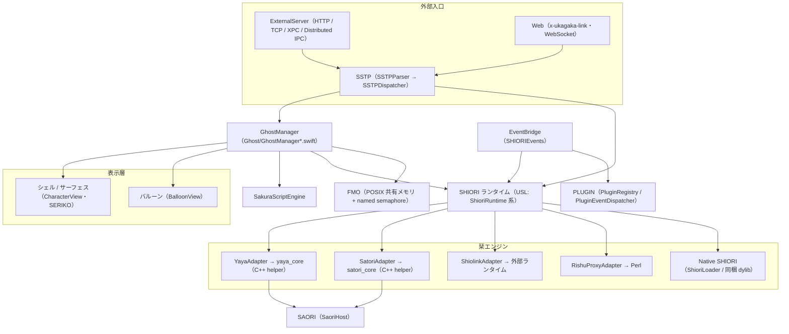

# 1 概要

関連ソースファイル

このページは次のファイルをもとに作成した。

- [README.md](../../README.md)
- [AGENTS.md](../../AGENTS.md)
- [CONTRIBUTING.md](../../CONTRIBUTING.md)
- [Ourin/main.swift](../../Ourin/main.swift)
- [Ourin/OurinApp.swift](../../Ourin/OurinApp.swift)
- [Ourin/NarInstall/Paths.swift](../../Ourin/NarInstall/Paths.swift)
- [Ourin/Ourin.entitlements](../../Ourin/Ourin.entitlements)
- [Ourin.xcodeproj/project.pbxproj](../../Ourin.xcodeproj/project.pbxproj)
- [.github/workflows/macOS.yml](../../.github/workflows/macOS.yml)

Ourin（桜鈴）は、macOS で動く **伺か（ukagaka）ベースウェア** である。伺かのゴースト（キャラクター本体の辞書・シェル・バルーン）を読み込み、SHIORI（ゴーストの会話エンジン）へイベントを送り、返ってきたさくらスクリプトを画面上のキャラクターとバルーンで再生する。Windows の SSP と既存ゴーストに対する互換性（SHIORI／SSTP／PLUGIN／SAORI／FMO）を保つことを最優先の制約にしている。

このページはリポジトリ全体の地図である。各サブシステムの詳細は [目次](./README.md) から辿る。

## 目的と現状

- README の冒頭は、開発版で追加 7 栞（灯・ese-shiori・偽栞・忍・翡翠・結奈・美坂）と、Perl を別途必要とする里珠 Proxy を実装したこと、ただしそれらは公開配布版には未収録であること（2026-10-25 時点）、全機能・全ゴーストの互換性は保証しないことを明記している。
- `AGENTS.md` は Ourin を「macOS 向け伺かベースウェア。SHIORI／SSTP／Plugin および既存ゴーストとの互換性を維持する」と定義している。
- 配布版のバージョンは Xcode プロジェクト上 `MARKETING_VERSION = 0.1.0`、`CURRENT_PROJECT_VERSION = 22`、最低 OS は `MACOSX_DEPLOYMENT_TARGET = 13.0`、bundle ID は `furin-lab.Ourin` である。

**出典:** [README.md:1-12](../../README.md#L1-L12)、[AGENTS.md:1-3](../../AGENTS.md#L1-L3)、[Ourin.xcodeproj/project.pbxproj:514-526](../../Ourin.xcodeproj/project.pbxproj#L514-L526)、[Ourin.xcodeproj/project.pbxproj:717](../../Ourin.xcodeproj/project.pbxproj#L717)

## 全体構造

README は Ourin を次の層に分けて説明している。ゴースト（シェル・バルーン）を操作する `GhostManager` が、SHIORI ランタイムの抽象を介して各言語の栞エンジンへ要求を送る。SSTP・Web・XPC からの外部要求も同じ SHIORI 層へ合流し、SAORI と PLUGIN は `SaoriHost` / `PluginHost` が受け持つ。

注意: README の図は `GhostShioriRuntime` という名前で SHIORI 層を表しているが、実装上の型の構成（`ShioriRuntime`・`ShioriRuntimeFactory` など）は [8 SHIORI 層（USL）](./08-shiori-runtime.md) を参照すること。

**出典:** [README.md:17-36](../../README.md#L17-L36)、[AGENTS.md:7-10](../../AGENTS.md#L7-L10)

## 起動の要点

アプリのエントリは `Ourin/main.swift` の `OurinApp.main()` で、`OurinApp`（SwiftUI `App`）が `@NSApplicationDelegateAdaptor` で `AppDelegate` を保持する。`AppDelegate` は独立ファイルではなく `OurinApp.swift` の中にあり、主要 system の初期化は `applicationDidFinishLaunching` に集約されている。初期化はおおむね次の順で進む（詳細は [3 アプリの起動とライフサイクル](./03-app-lifecycle.md)）。

1. ベースウェア更新ヘルパーの実行判定、XCTest 実行中なら起動処理を省略
2. 単一インスタンス判定（既存の Ourin があれば前面化して自分は終了）、孤児になった `yaya_core` の後始末
3. FMO の残留チェックと初期化（失敗しても FMO なしで続行）
4. 旧データの `~/Documents/Ourin` への一度だけの移行
5. 自動アップデート確認、`x-ukagaka-link` ハンドラ登録
6. PLUGIN の探索・ロードと `PluginEventDispatcher` の開始、HEADLINE の探索
7. SSTP / Web / Resource から SHIORI への橋渡しリゾルバの設定、外部 SSTP サーバーの起動
8. 前回選択したゴースト（`OurinStartupGhost`）または既定ゴーストの起動

**出典:** [Ourin/main.swift:1-4](../../Ourin/main.swift#L1-L4)、[Ourin/OurinApp.swift:38-60](../../Ourin/OurinApp.swift#L38-L60)、[Ourin/OurinApp.swift:350-503](../../Ourin/OurinApp.swift#L350-L503)、[AGENTS.md:7](../../AGENTS.md#L7)

## ビルド成果物（Xcode ターゲット）

`Ourin.xcodeproj` には 4 つのネイティブターゲットがある。`Ourin` ターゲットは Swift のビルドに先立って `yaya_core` と `satori_core` を CMake でビルドし、ビルド後に helper のコピー、XPC service の埋め込み、ネイティブ SHIORI エンジンのビルドと埋め込みを行う。

| ターゲット | 種類 | 役割 |
|---|---|---|
| `Ourin` | application | 本体 `Ourin.app`。build phase は Build yaya_core → Build satori_core → Sources → Frameworks → Resources → Copy yaya_core → Embed XPC Services → Build and embed native SHIORI engines |
| `OurinShioriXPCService` | xpc-service | `Ourin.app/Contents/XPCServices/` に埋め込まれる XPC service |
| `OurinTests` | unit-test | XCTest（[18 テストと互換性検証](./18-testing.md)） |
| `OurinUITests` | ui-testing | UI テスト |

この他、別パッケージとして SSP からの移行用インストーラ `Installer/`（SwiftPM）がある。ビルド全体は [2 ビルド・パッケージング・CI](./02-build-and-ci.md) にまとめた。

**出典:** [Ourin.xcodeproj/project.pbxproj:221-318](../../Ourin.xcodeproj/project.pbxproj#L221-L318)、[.github/workflows/macOS.yml:201-230](../../.github/workflows/macOS.yml#L201-L230)

## データの保存場所

ゴースト・バルーン・プラグインなどのユーザーデータの基準フォルダは `OurinPaths.baseDirectory()` が決める。本番は `~/Documents/Ourin` で、`~/Documents` が使えない（TCC 拒否など）ときは `~/Library/Application Support/Ourin` にフォールバックする。基準フォルダの下に SSP 標準のサブフォルダ（`ghost`・`balloon`・`plugin`・`headline`・`language`・`calendar`・`data`・`data/profile`・`temp`・`package`・`saori`）を冪等に作る。旧来の保存先（`~/Library/Application Support/Ourin`、旧サンドボックスコンテナ内の `Application Support/Ourin` と `Documents/Ourin`）からは、起動時に一度だけ移行する。

注意: `AGENTS.md` は保存先を `~/Library/Containers/furin-lab.Ourin/Data/Library/Application Support/Ourin/ghost/` と書いているが、現行コードではこれは **移行元** の 1 つである。現在の entitlements には App Sandbox のキーがなく、`com.apple.security.cs.disable-library-validation` だけが有効になっている（ネイティブ SHIORI / PLUGIN の dylib を読み込むため、と推測される）。ユーザーのゴースト・NAR データを実データとして扱い、破壊的操作をしないという `AGENTS.md` の制約はそのまま有効である。

**出典:** [Ourin/NarInstall/Paths.swift:9-12](../../Ourin/NarInstall/Paths.swift#L9-L12)、[Ourin/NarInstall/Paths.swift:45-79](../../Ourin/NarInstall/Paths.swift#L45-L79)、[Ourin/NarInstall/Paths.swift:116-152](../../Ourin/NarInstall/Paths.swift#L116-L152)、[Ourin/Ourin.entitlements:1-8](../../Ourin/Ourin.entitlements#L1-L8)、[AGENTS.md:11](../../AGENTS.md#L11)

## リポジトリ構成

`git ls-files` の集計（commit `aa88972`、全 1,961 ファイル）にもとづくトップレベルの地図である。

| パス | ファイル数 | 内容 | 詳細ページ |
|---|---:|---|---|
| [Ourin/](../../Ourin/) | 681 | macOS アプリ本体（Swift 236 ファイル + C/ヘッダ 3 ファイル）。うち `Resources/`（祝日データ・ライセンス・語彙表）256、`en.lproj` 166 | 3〜17 |
| [docs/](../../docs/) | 351 | 仕様書（`*_ja-jp.md` / `*_en-us.md` の対訳）、監査・計画書、HTML 版、互換性コーパスの結果 | [19](./19-dev-tooling.md) |
| [satori_core/](../../satori_core/) | 225 | 里々（SATORI）helper。上流 `satoriya-shiori` を `third_party/` に固定版で同梱 | [8.2](./08b-satori.md) |
| [OurinTests/](../../OurinTests/) | 188 | XCTest と C 製 fixture | [18](./18-testing.md) |
| [CORE_SAMPLES/](../../CORE_SAMPLES/) | 120 | YAYA の参照サンプル（`yaya-shiori-500`） | [8.1](./08a-yaya.md) |
| [Samples/](../../Samples/) | 78 | 各仕様（SHIORI・SSTP・PLUGIN・NAR・Web など）のサンプル | [18](./18-testing.md) |
| [yaya_core/](../../yaya_core/) | 69 | C++ 製の YAYA パーサ / VM（helper プロセス） | [8.1](./08a-yaya.md) |
| [engines/](../../engines/) | 61 | 追加栞・華和梨・篝・Aosora・移植プラグイン・TTS のビルドと検証 | [8.3](./08c-external-engines.md)、[12](./12-plugin.md) |
| [scripts/](../../scripts/) | 42 | リリース・既定ゴースト生成・互換性コーパス・実ゴースト検証 | [2](./02-build-and-ci.md)、[18](./18-testing.md) |
| [DefaultGhost/](../../DefaultGhost/) | 37 | 既定ゴースト（さくら・りんね・ベル）のソース。`sakura.nar` の元 | [2](./02-build-and-ci.md) |
| [ourin-autonomy/](../../ourin-autonomy/)、[ukadoc-mcp/](../../ukadoc-mcp/) | 15、7 | 開発支援の TypeScript ツール | [19](./19-dev-tooling.md) |
| [Installer/](../../Installer/) | 13 | SSP からのデータ移行インストーラ（SwiftPM） | [15](./15-nar-install.md) |
| [Plugins/](../../Plugins/) | 11 | 同梱プラグイン `ScriptBridge`（C） | [12](./12-plugin.md) |
| [OurinShioriXPCService/](../../OurinShioriXPCService/) | 3 | SHIORI 用 XPC service | [8](./08-shiori-runtime.md) |
| `.agents/`、`.serena/`、`.kamui/`、`.agent-context/`、`.claude` | — | AI エージェント向けの設定・履歴 | [19](./19-dev-tooling.md) |
| `README.md`、`AGENTS.md`、`CLAUDE.md`、`CONTRIBUTING.md`、`LICENSE`、`LICENSES/` | — | 入口文書とライセンス | — |

注意: ルートには `$!`（YAYA helper への `load` コマンドの JSON 1 行）、空の `default.profraw`、`build_output.log` のような作業中の副産物と思われるファイルも git 管理下にある。用途はコードから参照されていない（推測: 誤コミット）。

**出典:** [README.md:1-36](../../README.md#L1-L36)、[AGENTS.md:1-26](../../AGENTS.md#L1-L26)

## Ourin/ 配下のサブシステム

`Ourin/` の Swift ソースは機能別のディレクトリに分かれている。巨大な `GhostManager` は extension ファイル（`GhostManager+*.swift`）に分割されている。

| ディレクトリ / ファイル | 責務 | 詳細ページ |
|---|---|---|
| `OurinApp.swift`、`main.swift`、`ContentView.swift`、`RightClickMenu.swift`、`AppUpdater.swift`、`BasewareUpdate.swift`、`About/`、`Utils/`、`Log*.swift` | 起動・設定 UI・更新・ログ | [3](./03-app-lifecycle.md) |
| `Ghost/GhostManager*.swift`、`GhostTypes.swift`、`GhostConfiguration.swift` | ゴーストの実行の中核 | [4](./04-ghost-manager.md) |
| `Ghost/CharacterView.swift`、`Animation/`、`Ghost/Surface*.swift` | サーフェス描画と SERIKO | [5](./05-surface-shell-animation.md) |
| `Ghost/Balloon*.swift`、`Balloon/`、`OwnerDrawMenu/` | バルーンと入力 UI | [6](./06-balloon.md) |
| `SakuraScript/` | さくらスクリプトの解析 | [7](./07-sakura-script.md) |
| `USL/`、`SHIORI/`、`Compat/`、`Yaya/` | SHIORI ランタイム | [8](./08-shiori-runtime.md) |
| `SHIORIEvents/` | OS 状態の監視と SHIORI イベント | [9](./09-shiori-events.md) |
| `SSTP/`、`ExternalServer/`、`Web/` | SSTP と外部受信口 | [10](./10-sstp.md)、[10.1](./10a-external-server-web.md) |
| `FMO/` | 共有メモリと単一インスタンス | [11](./11-fmo.md) |
| `PluginHost/`、`PluginEvent/` | PLUGIN | [12](./12-plugin.md) |
| `SaoriHost/` | SAORI（内蔵・互換実装を含む） | [13](./13-saori.md) |
| `Property/`、`ResourceBridge/` | プロパティシステムとリソース | [14](./14-property-resource.md) |
| `NarInstall/`、`Nar/` | NAR のインストール | [15](./15-nar-install.md) |
| `HeadlineHost/`、`Calendar/`、`SaveShare/`、`Ghost/`（SNTP・RSS・Sound など） | 付帯機能 | [16](./16-auxiliary-features.md) |
| `DevTools/` | 開発者ツールと Migrator | [17](./17-devtools-migrator.md) |

**出典:** [Ourin/OurinApp.swift:115](../../Ourin/OurinApp.swift#L115)、[Ourin/Ghost/GhostManager.swift:822](../../Ourin/Ghost/GhostManager.swift#L822)

## 技術スタックと依存

| 部分 | 言語・技術 | 外部依存 |
|---|---|---|
| アプリ本体 | Swift 5（SwiftUI + AppKit）、C（FMO ブリッジ） | Apple のシステムフレームワークのみ |
| YAYA helper | C++（CMake、Universal 2） | nlohmann/json、iconv |
| 里々 helper | C++（固定版 SATORI、CMake） | nlohmann/json、iconv |
| 追加エンジン・移植プラグイン | C / C++ / Objective-C++、Python（ビルド・検証） | `engines/PINNED_UPSTREAM.json` に固定した上流 |
| 開発支援 | TypeScript（Node） | npm パッケージ |
| Migrator | 外部の Ghidra（`analyzeHeadless`） | 同梱しない。DevTools 使用時のみ |

開発環境は macOS 13 以上、Xcode 16.4 以上、CMake 3.20 以上、Homebrew（`cmake`・`nlohmann-json`）である。ライセンスは Ourin 独自ソースが Apache-2.0、独自ドキュメントが CC BY-SA 4.0 で、同梱の YAYA Core（BSD-3-Clause）、SATORI（BSD-2-Clause）、csaori 準拠の SAORI 境界（修正 BSD + ukagaka 例外）などはそれぞれ元のライセンスを維持する。

**出典:** [README.md:41-70](../../README.md#L41-L70)、[README.md:77-95](../../README.md#L77-L95)、[README.md:144-182](../../README.md#L144-L182)、[satori_core/CMakeLists.txt:93](../../satori_core/CMakeLists.txt#L93)

## 保護すべき制約

`AGENTS.md` は、変更時に壊してはいけない設計上の制約を次のように定めている。各ページでも該当箇所で再掲する。

| 制約 | 内容 | 関連ページ |
|---|---|---|
| AppDelegate の位置 | `Ourin/OurinApp.swift` 内。主要 system の初期化は `applicationDidFinishLaunching` に集約 | [3](./03-app-lifecycle.md) |
| SSTP の単一 stack | 外部 TCP／HTTP／XPC の SSTP は `SSTPParser` → `SSTP/SSTPDispatcher` に接続する。旧 `SstpRouter` を別経路として復活させない | [10](./10-sstp.md) |
| FMO の契約 | POSIX shared memory と named semaphore。共有メモリや lock の契約を Swift 側だけの都合で変更しない | [11](./11-fmo.md) |
| YAYA の互換性 | `yaya_core` は helper process と JSON line IPC。互換性問題はゴーストデータを改変して隠さない | [8.1](./08a-yaya.md) |
| ユーザーデータ | ghost/NAR は実データ。破壊的操作・外部公開・認証変更は明示承認が必要 | [15](./15-nar-install.md) |

`CONTRIBUTING.md` はさらに、fixture 成功・実 helper/IPC 成功・実ゴーストでの会話/保存/再起動・実画面確認を区別し、未検証を成功として扱わないことを求めている。

**出典:** [AGENTS.md:5-18](../../AGENTS.md#L5-L18)、[CONTRIBUTING.md:23-29](../../CONTRIBUTING.md#L23-L29)

## 関連ページ

- [目次](./README.md) — 全ページの一覧
- [2 ビルド・パッケージング・CI](./02-build-and-ci.md) — ターゲット・helper・リリース手順
- [3 アプリの起動とライフサイクル](./03-app-lifecycle.md) — `applicationDidFinishLaunching` の詳細
- [4 GhostManager](./04-ghost-manager.md) — ゴースト実行の中核
- [20 用語集](./20-glossary.md) — 伺か用語と Ourin 固有の名前
