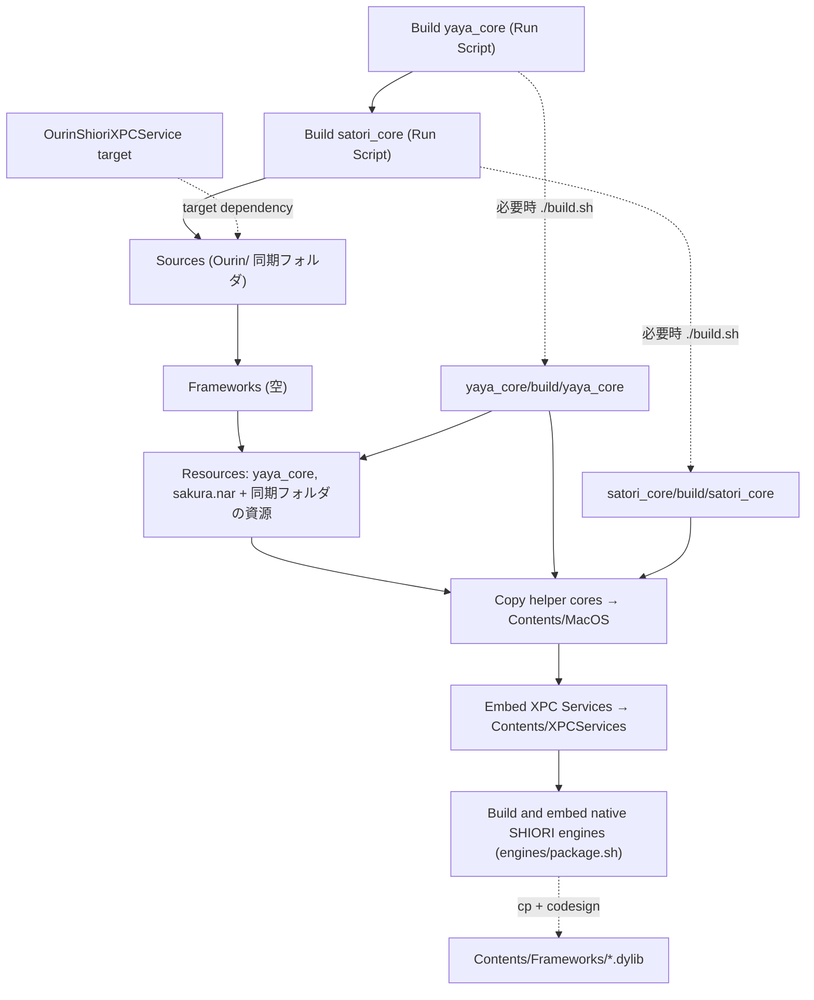
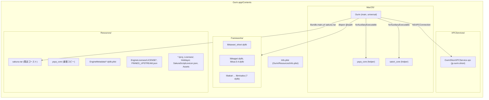
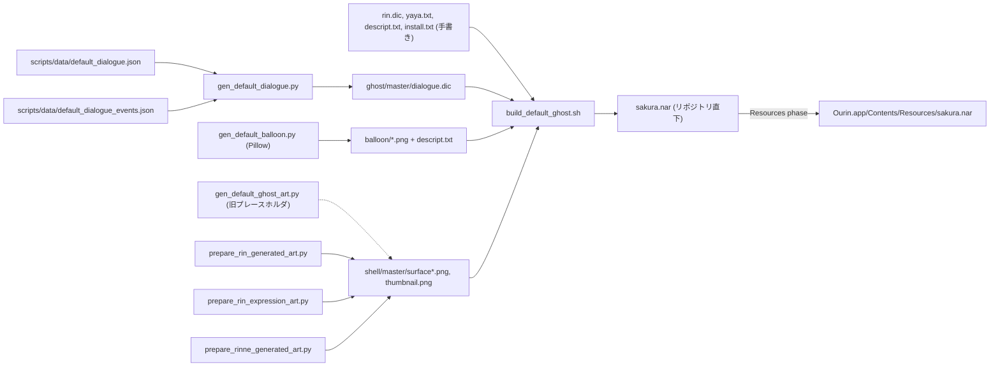
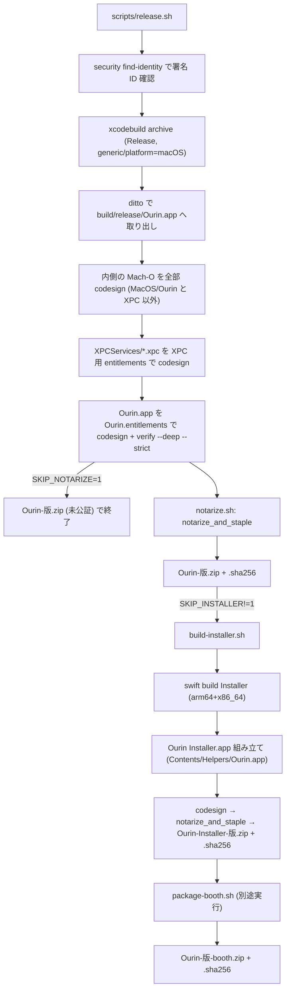

# 2 ビルド・パッケージング・CI

<details>
<summary>関連ソースファイル</summary>

このページは次のファイルをもとに作成した。

- [Ourin.xcodeproj/project.pbxproj](../../Ourin.xcodeproj/project.pbxproj)
- [Ourin.xcodeproj/xcshareddata/xcschemes/Ourin.xcscheme](../../Ourin.xcodeproj/xcshareddata/xcschemes/Ourin.xcscheme)
- [Ourin/Resources/Info.plist](../../Ourin/Resources/Info.plist)
- [Ourin/Ourin.entitlements](../../Ourin/Ourin.entitlements)
- [OurinShioriXPCService/Info.plist](../../OurinShioriXPCService/Info.plist)
- [OurinShioriXPCService/OurinShioriXPCService.entitlements](../../OurinShioriXPCService/OurinShioriXPCService.entitlements)
- [yaya_core/build.sh](../../yaya_core/build.sh)
- [satori_core/build.sh](../../satori_core/build.sh)
- [engines/package.sh](../../engines/package.sh)
- [engines/kawari/build.sh](../../engines/kawari/build.sh)
- [engines/kagari/build.sh](../../engines/kagari/build.sh)
- [engines/additional/build.sh](../../engines/additional/build.sh)
- [Installer/Package.swift](../../Installer/Package.swift)
- [Installer/Sources/OurinInstaller/InstallerModel.swift](../../Installer/Sources/OurinInstaller/InstallerModel.swift)
- [Installer/Sources/OurinInstallerCore/AppInstaller.swift](../../Installer/Sources/OurinInstallerCore/AppInstaller.swift)
- [scripts/release.sh](../../scripts/release.sh)
- [scripts/notarize.sh](../../scripts/notarize.sh)
- [scripts/build-installer.sh](../../scripts/build-installer.sh)
- [scripts/package-booth.sh](../../scripts/package-booth.sh)
- [scripts/check_release_metadata.py](../../scripts/check_release_metadata.py)
- [scripts/build_default_ghost.sh](../../scripts/build_default_ghost.sh)
- [scripts/gen_default_dialogue.py](../../scripts/gen_default_dialogue.py)
- [scripts/gen_default_balloon.py](../../scripts/gen_default_balloon.py)
- [scripts/gen_default_ghost_art.py](../../scripts/gen_default_ghost_art.py)
- [scripts/gen_holidays.py](../../scripts/gen_holidays.py)
- [scripts/prepare_rin_generated_art.py](../../scripts/prepare_rin_generated_art.py)
- [scripts/prepare_rin_expression_art.py](../../scripts/prepare_rin_expression_art.py)
- [scripts/prepare_rinne_generated_art.py](../../scripts/prepare_rinne_generated_art.py)
- [scripts/data/default_dialogue.json](../../scripts/data/default_dialogue.json)
- [scripts/data/default_dialogue_events.json](../../scripts/data/default_dialogue_events.json)
- [DefaultGhost/sakura/install.txt](../../DefaultGhost/sakura/install.txt)
- [DefaultGhost/sakura/ghost/master/descript.txt](../../DefaultGhost/sakura/ghost/master/descript.txt)
- [DefaultGhost/sakura/readme.txt](../../DefaultGhost/sakura/readme.txt)
- [.github/workflows/macOS.yml](../../.github/workflows/macOS.yml)
- [.github/ISSUE_TEMPLATE/bug_report.md](../../.github/ISSUE_TEMPLATE/bug_report.md)
- [.github/ISSUE_TEMPLATE/feature_compatibility.md](../../.github/ISSUE_TEMPLATE/feature_compatibility.md)
- [.github/ISSUE_TEMPLATE/release_task.md](../../.github/ISSUE_TEMPLATE/release_task.md)
- [.github/PULL_REQUEST_TEMPLATE.md](../../.github/PULL_REQUEST_TEMPLATE.md)
- [docs/RELEASE_GATES_2026-10-25.md](../../docs/RELEASE_GATES_2026-10-25.md)
- [docs/booth/README_ja-jp.txt](../../docs/booth/README_ja-jp.txt)
- [.gitignore](../../.gitignore)
- [Ourin/USL/BundledShioriEngine.swift](../../Ourin/USL/BundledShioriEngine.swift)
- [Ourin/USL/NativeShioriModule.swift](../../Ourin/USL/NativeShioriModule.swift)
- [Ourin/Yaya/YayaAdapter.swift](../../Ourin/Yaya/YayaAdapter.swift)
- [Ourin/USL/SatoriAdapter.swift](../../Ourin/USL/SatoriAdapter.swift)

</details>

このページは、Ourin のソースから配布物（`Ourin.app`、`Ourin Installer.app`、BOOTH 用 zip）ができるまでを扱う。Xcode プロジェクトの target と build phase、C++ 製 helper（`yaya_core` / `satori_core`）とネイティブ SHIORI dylib の組み込み、既定ゴースト `sakura.nar` の作り方、Developer ID 署名・公証の手順、バージョン方針、GitHub Actions の CI ゲートを順に説明する。

ビルドの入口は README と [AGENTS.md](../../AGENTS.md) にある `xcodebuild -project Ourin.xcodeproj -scheme Ourin build` だけである。helper とエンジンは Xcode の Run Script phase が自動で再ビルドする。個々のエンジンの中身は [8.1 YAYA](./08a-yaya.md)、[8.2 里々](./08b-satori.md)、[8.3 外部エンジン](./08c-external-engines.md) に、XPC サービスの実装は [8 SHIORI 層](./08-shiori-runtime.md) に、テストの中身は [18 テストと互換性検証](./18-testing.md) にある。

## Xcode プロジェクトの target 構成

`Ourin.xcodeproj` には 4 つの native target がある。`objectVersion = 77` の「フォルダ同期」（`PBXFileSystemSynchronizedRootGroup`）形式なので、`Ourin/` などのディレクトリに置いたファイルは pbxproj に列挙しなくても自動で target に入る。そのため Sources / Resources phase の `files` はほぼ空になっている。除外は `PBXFileSystemSynchronizedBuildFileExceptionSet` で指定する。

| target | 製品 | bundle ID | 同期フォルダ | 依存 | 備考 |
|---|---|---|---|---|---|
| `Ourin` | `Ourin.app`（application） | `furin-lab.Ourin` | `Ourin/` | `OurinShioriXPCService` | `productName` は旧名 `MacUkagaka`。`Ourin/Resources/Info.plist` と `DevTools/Migrator/Resources/DecompileAll.java` は target から除外される |
| `OurinShioriXPCService` | `OurinShioriXPCService.xpc`（xpc-service） | `jp.ourin.shiori` | `OurinShioriXPCService/` | なし | Sources に `Ourin/USL/NativeShioriModule.swift` を明示的に追加して共有している |
| `OurinTests` | `OurinTests.xctest`（unit-test） | `furin-lab.MacUkagakaTests` | `OurinTests/` | `Ourin` | `TEST_HOST` は `Ourin.app` の実行ファイル。`Fixtures/additional-shiori/**` などはソースから直接読むため bundle に入れない |
| `OurinUITests` | `OurinUITests.xctest`（ui-testing） | `furin-lab.MacUkagakaUITests` | `OurinUITests/` | `Ourin` | `TEST_TARGET_NAME = Ourin` |

共有スキーム `Ourin.xcscheme` は `Ourin.app` をビルドし、Test アクションで `OurinTests` と `OurinUITests` を実行する（Debug）。Profile と Archive は Release で動く。[docs/RELEASE_GATES_2026-10-25.md](../../docs/RELEASE_GATES_2026-10-25.md) によると、このスキームは CI でスキームが見つからない問題を解消するために追加された。

ビルド設定の要点:

| 設定 | 値 | 意味 |
|---|---|---|
| `MACOSX_DEPLOYMENT_TARGET` | 全 target で `13.0` | 最低 OS。`check_release_metadata.py` が一致を検査する |
| `MARKETING_VERSION` / `CURRENT_PROJECT_VERSION` | `0.1.0` / `22`（全 target） | XPC の Info.plist はこの 2 つを参照する |
| `ENABLE_APP_SANDBOX` | `NO`（App・XPC とも） | サンドボックスなし |
| `ENABLE_HARDENED_RUNTIME` | `YES` | 公証の前提 |
| `CODE_SIGN_ENTITLEMENTS` | `Ourin/Ourin.entitlements`、`OurinShioriXPCService/OurinShioriXPCService.entitlements` | どちらも中身は `com.apple.security.cs.disable-library-validation = true` だけ |
| `LD_RUNPATH_SEARCH_PATHS[sdk=macosx*]` | `@executable_path/../Frameworks` | 同梱 dylib（`@rpath/...`）を `Contents/Frameworks` から解決する |
| `SWIFT_OBJC_BRIDGING_HEADER` | `Ourin/Ourin-Bridging-Header.h` | FMO の C ブリッジ（[11 FMO](./11-fmo.md)） |
| `EXCLUDED_SOURCE_FILE_NAMES` | `**/Info.plist` | 同期フォルダ内の Info.plist をリソースとしてコピーしない |
| `ENABLE_USER_SCRIPT_SANDBOXING` | `NO`（プロジェクト共通） | Run Script phase（`Build satori_core`・`Build yaya_core`・`Build and embed native SHIORI engines`）が `${SRCROOT}` 配下の `satori_core/build/` などへ書き込めるようにする（推測: このための設定。各 phase は入力ファイルを宣言していない） |

`disable-library-validation` は、署名チームの異なる第三者 SHIORI・PLUGIN・SAORI の dylib/bundle を `dlopen` するために必要と考えられる（推測。entitlements・pbxproj・docs のいずれにも理由を述べた記述はない。サードパーティのモジュールを `dlopen` する箇所は `Ourin/PluginHost/Plugin.swift:48`・`Ourin/USL/NativeShioriModule.swift:43`・`Ourin/SaoriHost/SaoriLoader.swift:69` にある）。

**出典:** [Ourin.xcodeproj/project.pbxproj:79-152](../../Ourin.xcodeproj/project.pbxproj#L79-L152)、[Ourin.xcodeproj/project.pbxproj:222-317](../../Ourin.xcodeproj/project.pbxproj#L222-L317)、[Ourin.xcodeproj/project.pbxproj:509-550](../../Ourin.xcodeproj/project.pbxproj#L509-L550)、[Ourin.xcodeproj/project.pbxproj:673-729](../../Ourin.xcodeproj/project.pbxproj#L673-L729)、[Ourin.xcodeproj/project.pbxproj:787-810](../../Ourin.xcodeproj/project.pbxproj#L787-L810)、[Ourin.xcodeproj/project.pbxproj:403-456](../../Ourin.xcodeproj/project.pbxproj#L403-L456)、[Ourin.xcodeproj/xcshareddata/xcschemes/Ourin.xcscheme:26-56](../../Ourin.xcodeproj/xcshareddata/xcschemes/Ourin.xcscheme#L26-L56)、[Ourin/Ourin.entitlements:1-8](../../Ourin/Ourin.entitlements#L1-L8)、[OurinShioriXPCService/OurinShioriXPCService.entitlements:1-8](../../OurinShioriXPCService/OurinShioriXPCService.entitlements#L1-L8)、[Ourin/PluginHost/Plugin.swift:48](../../Ourin/PluginHost/Plugin.swift#L48)、[Ourin/USL/NativeShioriModule.swift:43](../../Ourin/USL/NativeShioriModule.swift#L43)、[Ourin/SaoriHost/SaoriLoader.swift:69](../../Ourin/SaoriHost/SaoriLoader.swift#L69)

## Ourin target の build phase

`Ourin` target の build phase は次の順に並ぶ。3 つの Run Script はどれも `alwaysOutOfDate = 1` なので毎回起動するが、スクリプト自身が更新の有無を判定して、必要なときだけ再ビルドする。



| # | phase | 種別 | 内容 |
|---|---|---|---|
| 1 | `Build yaya_core` | Run Script (`/bin/sh`) | `yaya_core/build/yaya_core` が無い・実行不可、`CMakeLists.txt` か `build.sh` の方が新しい、または `src/`・`third_party/` に新しいファイルがあれば `./build.sh` を実行する |
| 2 | `Build satori_core` | Run Script (`/bin/sh`) | 同じ判定を `satori_core/` で行う。判定対象に `tests/` も含む |
| 3 | Sources | Sources | `Ourin/` 以下の Swift / C を同期フォルダから取り込む |
| 4 | Frameworks | Frameworks | 空（Apple フレームワーク以外のリンクはない） |
| 5 | Resources | Resources | `yaya_core`（`yaya_core/build/yaya_core`）と、リポジトリ直下の `sakura.nar` を明示的に追加する |
| 6 | `Copy helper cores` | Copy Files（`dstSubfolderSpec = 6` = Executables） | `yaya_core` と `satori_core` を `CodeSignOnCopy` 付きで `Contents/MacOS/` へコピーする。pbxproj 内のコメントは旧名 `Copy yaya_core` のまま |
| 7 | `Embed XPC Services` | Copy Files（`$(CONTENTS_FOLDER_PATH)/XPCServices`） | `OurinShioriXPCService.xpc` を `CodeSignOnCopy, RemoveHeadersOnCopy` 付きで埋め込む |
| 8 | `Build and embed native SHIORI engines` | Run Script (`/bin/bash`) | `bash "${SRCROOT}/engines/package.sh"` |

Run Script 1・2 の判定部分（yaya_core 版）は次のとおりである。satori_core 版は `find src third_party tests` になっている点だけが違う。

```sh
cd "${SRCROOT}/yaya_core"
needs_build=0
if [ ! -x "build/yaya_core" ] || [ "CMakeLists.txt" -nt "build/yaya_core" ] || [ "build.sh" -nt "build/yaya_core" ]; then
    needs_build=1
fi
if [ "$needs_build" -eq 0 ] && find src third_party -type f -newer "build/yaya_core" -print -quit | grep -q .; then
    needs_build=1
fi
if [ "$needs_build" -eq 1 ]; then
    ./build.sh
fi
```

helper のビルドスクリプトの違い:

- `yaya_core/build.sh` は PATH に `/opt/homebrew/bin` と `/usr/local/bin` を足し、`cmake` と `make` が無ければ exit 127 で止まる。`cmake ..` の後に `make -j<CPU数>` を実行する。universal 化（`arm64;x86_64`）は `yaya_core/CMakeLists.txt` が指定する。
- `satori_core/build.sh` は `-DCMAKE_OSX_ARCHITECTURES="arm64;x86_64" -DCMAKE_OSX_DEPLOYMENT_TARGET="11.0"` で configure する。configure に失敗しても、既存のバイナリが入力より新しく、`lipo -verify_arch arm64 x86_64` も通る場合は警告を出して再利用し、exit 0 で終わる。依存（iconv など）が一時的に使えないときでもビルドを止めないための措置である。

**出典:** [Ourin.xcodeproj/project.pbxproj:9-16](../../Ourin.xcodeproj/project.pbxproj#L9-L16)、[Ourin.xcodeproj/project.pbxproj:42-66](../../Ourin.xcodeproj/project.pbxproj#L42-L66)、[Ourin.xcodeproj/project.pbxproj:244-271](../../Ourin.xcodeproj/project.pbxproj#L244-L271)、[Ourin.xcodeproj/project.pbxproj:378-386](../../Ourin.xcodeproj/project.pbxproj#L378-L386)、[Ourin.xcodeproj/project.pbxproj:403-456](../../Ourin.xcodeproj/project.pbxproj#L403-L456)、[yaya_core/build.sh:1-41](../../yaya_core/build.sh#L1-L41)、[satori_core/build.sh:1-47](../../satori_core/build.sh#L1-L47)

### engines/package.sh（ネイティブ SHIORI dylib の同梱）

`engines/package.sh` は、ピン留めした上流のエンジンをビルドして `Contents/Frameworks` に入れる。手順は次のとおり。

1. `engines/` 以下の `.sh .json .patch .cpp .c .h .py` について、相対パスと内容の SHA-256 フィンガープリントを計算する。
2. 前回の値（`build/engines/.build-inputs`）と違うか、10 個の期待 dylib のどれかが無ければ、`engines/kawari/build.sh`、`OURIN_KAGARI_UNIVERSAL=1 engines/kagari/build.sh`、`engines/additional/build.sh` を順に実行し、フィンガープリントを保存する。
3. 全 dylib に `lipo -verify_arch arm64 x86_64` をかけ、universal であることを確かめる。
4. `TARGET_BUILD_DIR` / `CONTENTS_FOLDER_PATH` が無ければ（Xcode 外から実行した場合）、ここで終わる。
5. Xcode から呼ばれた場合は `kawari kagari additional` ごとに、`*.arm64.dylib` / `*.x86_64.dylib` を除いた dylib を `Contents/Frameworks/` へコピーする。`CODE_SIGNING_ALLOWED` が `NO` でなければ `EXPANDED_CODE_SIGN_IDENTITY`（無ければ ad-hoc の `-`）で codesign する。メタデータ `*.plist` は `Resources/EngineMetadata/`、`LICENSE*` は `Resources/EngineLicenses/` へ置き、最後に `engines/PINNED_UPSTREAM.json` も `EngineLicenses/` へコピーする。

| 出力ディレクトリ | dylib | ABI メタデータ（`OurinShioriABI`） |
|---|---|---|
| `build/engines/kawari/` | `libkawari_shiori.dylib` | `ukagaka-long` |
| `build/engines/kagari/` | `libkagari.dylib`、`liblua.5.4.dylib` | `kagari`（`libkagari.dylib.plist`） |
| `build/engines/additional/` | `libakari` `libese-shiori` `libniseshiori` `libshino` `libhisui` `libyuhna` `libmisaka`（各 `.dylib`） | `ukagaka-int32` |

各エンジンの `build.sh` は、初回に上流の Git リポジトリを `build/engine-sources/` へ clone する（`OURIN_ENGINE_SOURCE_CACHE` で場所を変えられる）。そのため、初回のクリーンビルドにはネットワークが必要である。`engines/additional/build.sh` は `git archive` の SHA-256 を `PINNED_UPSTREAM.json` の値と照合し、一致しなければ止まる。kagari は Lua と sol2 を `curl` で取得し、ハッシュを検証する。

実行時は、`NativeShioriModule` が `Frameworks` 内の dylib に対応するメタデータを `Resources/EngineMetadata/<名前>.plist` から読む（署名済みの `Frameworks` にはコードだけを置く、というコメントがある）。`BundledShioriEngine` は `Contents/Frameworks`、`Resources/Engines`、`privateFrameworksURL` を探索する。

`engines/aosora/`、`engines/plugins/`、`engines/plugin-native/`、`engines/tts/` は `package.sh` の対象外である。plugins / plugin-native は CI の `test` job で個別にビルド・検証する（後述）。

**出典:** [engines/package.sh:1-52](../../engines/package.sh#L1-L52)、[engines/kawari/build.sh:1-32](../../engines/kawari/build.sh#L1-L32)、[engines/additional/build.sh:1-40](../../engines/additional/build.sh#L1-L40)、[engines/kagari/build.sh:1-30](../../engines/kagari/build.sh#L1-L30)、[Ourin/USL/NativeShioriModule.swift:54-67](../../Ourin/USL/NativeShioriModule.swift#L54-L67)、[Ourin/USL/BundledShioriEngine.swift:125-138](../../Ourin/USL/BundledShioriEngine.swift#L125-L138)

## ビルド成果物 Ourin.app の中身

pbxproj の phase、`engines/package.sh`、CI の `release-gate` job の検査項目から復元した `Ourin.app` の構成を次に示す。



| パス | 由来 | 実行時に使う側 |
|---|---|---|
| `Contents/MacOS/Ourin` | Sources | — |
| `Contents/MacOS/yaya_core` | `Copy helper cores` | `YayaAdapter` が `Bundle.main.url(forAuxiliaryExecutable: "yaya_core")` で探す |
| `Contents/MacOS/satori_core` | `Copy helper cores` | `SatoriAdapter` が `forAuxiliaryExecutable: "satori_core"` で探す |
| `Contents/XPCServices/OurinShioriXPCService.xpc` | `Embed XPC Services` | `ShioriLoader`（サービス名 `jp.ourin.shiori`、[8 SHIORI 層](./08-shiori-runtime.md)） |
| `Contents/Frameworks/*.dylib` | `engines/package.sh` | `BundledShioriEngine` / `NativeShioriModule` |
| `Contents/Resources/sakura.nar` | Resources phase | `AppDelegate.installDefaultGhost()`（[3 アプリの起動](./03-app-lifecycle.md)） |
| `Contents/Resources/yaya_core` | Resources phase | 使われない重複コピー（後述「制約と注意点」） |
| `Contents/Resources/EngineMetadata/`、`EngineLicenses/` | `engines/package.sh` | ABI 判定と、BOOTH 版でのライセンス同梱 |

`Ourin/` 同期フォルダ内のリソース（`Resources/Licenses/*.txt`、`Resources/Holidays/*.txt`、`*.lproj`、`Resources/SakuraScriptLexicon.json`、`Assets.xcassets`、`Ourin.icns` など）は、同期フォルダの規則に従って `Contents/Resources` へコピーされる。ただし、サブディレクトリ（`Licenses/`、`Holidays/`）が残るか平坦化されるかは、ビルド済みの成果物で確認していない（未確認）。コード側の想定も一致しておらず、`HolidayInfo.swift` は `Holidays/` と Resources 直下の両方を探してコメントで「同梱のときはフォルダの中身が Resources 直下に置かれる」と書く一方、`AboutView.swift` は `subdirectory: "Licenses"` を指定して読む。

**出典:** [Ourin/SHIORIEvents/HolidayInfo.swift:99-106](../../Ourin/SHIORIEvents/HolidayInfo.swift#L99-L106)、[Ourin/About/AboutView.swift:66-73](../../Ourin/About/AboutView.swift#L66-L73)、[Ourin.xcodeproj/project.pbxproj:42-77](../../Ourin.xcodeproj/project.pbxproj#L42-L77)、[.github/workflows/macOS.yml:201-259](../../.github/workflows/macOS.yml#L201-L259)、[Ourin/Yaya/YayaAdapter.swift:63](../../Ourin/Yaya/YayaAdapter.swift#L63)、[Ourin/USL/SatoriAdapter.swift:55](../../Ourin/USL/SatoriAdapter.swift#L55)、[engines/package.sh:33-52](../../engines/package.sh#L33-L52)

## 既定ゴースト sakura.nar の生成

`Ourin.app` に同梱する既定ゴースト「さくら・りんね・ベル」（`DefaultGhost/sakura/`）は、YAYA 辞書・シェル・バルーンをソースとしてリポジトリに置いている。`scripts/build_default_ghost.sh` がこれを zip してリポジトリ直下の `sakura.nar` を作る。`sakura.nar` は Git で管理された生成物であり、Xcode のビルドは再生成しない。Resources phase は直下の `sakura.nar` をそのままコピーする。aa88972 時点では、`sakura.nar` 内の 37 ファイルと `DefaultGhost/sakura/` の 37 ファイルは内容まで一致している（本ページ執筆時に zip を展開せず比較して確認）。



| スクリプト | 入力 | 出力 | 要点 |
|---|---|---|---|
| `build_default_ghost.sh` | `DefaultGhost/sakura/` | `sakura.nar` | `zip -qr -X`。`.DS_Store` を除く |
| `gen_default_dialogue.py` | `scripts/data/default_dialogue.json`、`default_dialogue_events.json` | `ghost/master/dialogue.dic` | JSON の `talks[]`（`category`・`id`・`lines[{who,face,text}]`）を YAYA 関数 `Talk_<category>` へ変換する。`who` 0/1/2 は `\0` `\1` `\p[2]`。`face` は scope ごとに許可された番号だけ受け付ける。`\ % " { } < >` と改行は禁止。埋め込み記号 `<<R0..R7>>` `<<HOUR>>` は許可されたカテゴリだけで使え、`Esc(reference[n])` / `TOSTR(GETTIME[3])` に置き換わる。ID の重複はエラー。生成物は手で編集しない |
| `gen_default_balloon.py` | なし（Pillow で描画） | `balloon/balloons0.png` `balloonk0.png` `balloonc0.png` `arrow0/1.png`、`descript.txt` | 3 倍スーパーサンプリングの角丸吹き出し。`origin`・`wordwrappoint`・`validrect`・フォント色・カーソル色などを `descript.txt` に固定値で書く |
| `gen_default_ghost_art.py` | なし（標準ライブラリだけで PNG を生成） | `surface0/1/10.png`、`thumbnail.png` | 本絵が無かったころのプレースホルダ。docstring に「本絵ができたら差し替えればよい」とある。コミット済みの `surface0/1.png` は 250x480、`surface10.png` は 180x180、`thumbnail.png` は 125x240 で、本スクリプトの出力サイズ（220x360・140x180）ではなく `prepare_rin_generated_art.py` の出力サイズ（`scripts/prepare_rin_generated_art.py:56-59`）と一致する。現在の surface は下の `prepare_*` の出力である |
| `prepare_rin_generated_art.py` | normal / smile / blink / bell の生成画像 | `surface0〜2`、`surface10`、`thumbnail.png` | 906x1736 のマスター画像を前提に、目と口のパッチだけを合成して 250x480 に縮小する。アルファや緑の色かぶりを assert で検査する |
| `prepare_rin_expression_art.py` | `--manifest` の JSON（表情番号 → PNG） | `surface3〜8`、`surface11〜13` | 縮小してから顔の内側だけを合成する。既存の出力は上書きしない。`--verify-only` あり |
| `prepare_rinne_generated_art.py` | `--manifest` の JSON（`100`〜`108`） | `surface100〜108` | りんね（`\1`）用。合成方式は同じで、出力は排他作成。`--verify-only` あり |
| `gen_holidays.py` | python-holidays | `Ourin/Resources/Holidays/holidays-XX.txt`、`Ourin/en.lproj/holidays-XX.txt` | 既定ゴーストとは無関係の祝日表生成（[9 SHIORI イベント](./09-shiori-events.md)） |

既定ゴーストの設定は次のとおり。`install.txt` は `type,ghost` / `name,sakura` / `directory,sakura` に加えて `balloon.directory,sakura` / `balloon.source.directory,balloon` を持ち、同梱バルーンも一緒にインストールさせる。`ghost/master/descript.txt` は `shiori,yaya.dll` と `sakura.name,さくら` / `kero.name,りんね` / `char2.name,ベル` を宣言し、既定サーフェスを 0 / 100 / 10 にしている。`readme.txt` には、立ち絵を画像生成 AI で作ったことが書かれている。

**出典:** [scripts/build_default_ghost.sh:1-7](../../scripts/build_default_ghost.sh#L1-L7)、[scripts/gen_default_dialogue.py:1-106](../../scripts/gen_default_dialogue.py#L1-L106)、[scripts/gen_default_balloon.py:1-68](../../scripts/gen_default_balloon.py#L1-L68)、[scripts/gen_default_ghost_art.py:1-55](../../scripts/gen_default_ghost_art.py#L1-L55)、[scripts/prepare_rin_generated_art.py:1-85](../../scripts/prepare_rin_generated_art.py#L1-L85)、[scripts/prepare_rin_expression_art.py:1-46](../../scripts/prepare_rin_expression_art.py#L1-L46)、[scripts/prepare_rinne_generated_art.py:1-44](../../scripts/prepare_rinne_generated_art.py#L1-L44)、[scripts/gen_holidays.py:1-30](../../scripts/gen_holidays.py#L1-L30)、[DefaultGhost/sakura/install.txt:1-6](../../DefaultGhost/sakura/install.txt#L1-L6)、[DefaultGhost/sakura/ghost/master/descript.txt:1-17](../../DefaultGhost/sakura/ghost/master/descript.txt#L1-L17)、[DefaultGhost/sakura/readme.txt:1-2](../../DefaultGhost/sakura/readme.txt#L1-L2)、[DefaultGhost/sakura/shell/master/surface0.png](../../DefaultGhost/sakura/shell/master/surface0.png)、[Ourin.xcodeproj/project.pbxproj:12](../../Ourin.xcodeproj/project.pbxproj#L12)

## リリース手順（署名・公証・配布物）

配布物はローカルの Mac で `scripts/release.sh` を実行して作る。CI は `CODE_SIGNING_ALLOWED=NO` で未署名のビルドしか作らず、署名に使う資格情報を持たない。



| スクリプト | 役割 | 主な環境変数・引数 | 出力 |
|---|---|---|---|
| `scripts/release.sh` | archive、内側から外側への順の Developer ID 署名、公証、zip 化、Installer の作成まで一括で行う | `OURIN_ROOT`、`OUT_DIR`（既定 `build/release`）、`SIGN_IDENTITY`、`TEAM_ID`、`NOTARY_PROFILE`（既定 `ourin-notary`）、`SKIP_NOTARIZE=1`、`SKIP_INSTALLER=1` | `Ourin.xcarchive`、`Ourin.app`、`Ourin-<CFBundleShortVersionString>.zip`、`.sha256`、`archive.log` |
| `scripts/notarize.sh` | 関数 `notarize_and_staple <app> <work> <profile> <team>` を提供し、`source` して使う | — | `<name>-notary-submit.json`、`<name>-notary.json`、失敗時は `<name>-notary-log.json` |
| `scripts/build-installer.sh` | SwiftPM の `Installer/` を universal でビルドし、`.app` に組み立てる | 第 1 引数は署名・公証済みの `Ourin.app`、第 2 引数は出力先。`SIGN_IDENTITY`（空なら ad-hoc）、`NOTARY_PROFILE`（設定時だけ公証）、`TEAM_ID` | `Ourin Installer.app`、`Ourin-Installer-<版>.zip`、`.sha256`、`installer-build.log` |
| `scripts/package-booth.sh` | BOOTH 配布用の zip を作る | 第 1 引数は release.sh の出力先 | `booth/Ourin-<版>/`（Installer・App・`はじめにお読みください.txt`・`ライセンス/`）、`Ourin-<版>-booth.zip`、`.sha256` |

挙動の詳細:

- **署名順序**: `release.sh` は `find "$APP/Contents" -type f` で見つけた Mach-O（`file -b` で判定）を、メイン実行ファイルと XPC 以下を除いてすべて `codesign --force --timestamp --options runtime` する。続いて各 `.xpc` を XPC 用 entitlements で、最後に `.app` 本体を `Ourin/Ourin.entitlements` で署名する。プロジェクトの `DEVELOPMENT_TEAM` は開発用のまま変えず、配布時だけ署名し直す方針がコメントに書かれている。署名 ID とチーム ID の既定値はスクリプト内に固定値で書かれている（値はここに転記しない）。
- **公証**: `notarize_and_staple` は app を zip にして `xcrun notarytool submit` に出し、`notarytool wait --timeout 30m` を最大 3 回まで再試行する（間隔 30 秒）。`status` が `Accepted` でなければログを取得して失敗する。成功したら `stapler staple` → `stapler validate` → `spctl -a -t exec -vv` を実行する。
- **`SKIP_NOTARIZE=1`** は署名と zip だけを行い、exit 0 で終わる。このため Installer も作られない。
- **Installer**: `Installer/Package.swift` は `OurinInstallerCore`（SSP の検出・データ移行・app の差し替え）と実行ファイル `OurinInstaller` の 2 target からなり、`platforms: [.macOS(.v12)]`、`defaultLocalization: "ja"` である。`build-installer.sh` は Info.plist をヒアドキュメントで生成する（`furin-lab.Ourin.Installer`、`LSMinimumSystemVersion 12.0`）。同梱する `Ourin.app` は再署名せず `Contents/Helpers/Ourin.app` に置き、外側だけを署名する。実行時は `InstallerModel` がこの位置を payload として読み（環境変数 `OURIN_INSTALLER_PAYLOAD` で上書きできる）、`AppInstaller` が「退避 → 設置 → 失敗したら戻す」の手順で `/Applications` などに置く。データ移行の詳細は [15 NAR インストール](./15-nar-install.md) にある。
- **BOOTH 版**: `package-booth.sh` は両方の `.app` に `stapler validate` と `spctl -a -t exec` をかけ、通らなければ中止する。`docs/booth/README_ja-jp.txt` の `{{VERSION}}` を置換して `はじめにお読みください.txt` にする。ライセンスは `LICENSE`、`LICENSES/*.txt`、`Ourin/Resources/Licenses/*.txt`、app 内の `Resources/EngineLicenses`（→ `ライセンス/エンジン`）を集める。zip は `ditto -c -k --sequesterRsrc --keepParent` で作る（Finder の圧縮と同じ形式で、拡張属性と staple を保つ）。
- **自動アップデートとの関係**: `release.sh` が作る `Ourin-<版>.zip` と `Ourin-<版>.zip.sha256` という名前は、アプリ内の `AppUpdater` が GitHub Releases の asset から探す名前と一致する（[3 アプリの起動](./03-app-lifecycle.md) の「アップデート」）。GitHub Release への upload を行うスクリプトや workflow はリポジトリに無い（`gh release` や release 作成 action の記述を検索しても見つからない。upload は手作業と推測）。

**出典:** [scripts/release.sh:1-97](../../scripts/release.sh#L1-L97)、[scripts/notarize.sh:1-47](../../scripts/notarize.sh#L1-L47)、[scripts/build-installer.sh:1-100](../../scripts/build-installer.sh#L1-L100)、[scripts/package-booth.sh:1-50](../../scripts/package-booth.sh#L1-L50)、[Installer/Package.swift:1-25](../../Installer/Package.swift#L1-L25)、[Installer/Sources/OurinInstaller/InstallerModel.swift:76-92](../../Installer/Sources/OurinInstaller/InstallerModel.swift#L76-L92)、[Installer/Sources/OurinInstallerCore/AppInstaller.swift:1-60](../../Installer/Sources/OurinInstallerCore/AppInstaller.swift#L1-L60)、[docs/booth/README_ja-jp.txt:1-30](../../docs/booth/README_ja-jp.txt#L1-L30)

## バージョン方針と check_release_metadata.py

版数を記録する場所は複数あり、`scripts/check_release_metadata.py` がそれらの一致を Xcode 無しで検査する。CI の `metadata` job とローカルで同じ検査を回す。

| 記録場所 | キー | 現在値（aa88972） | 規則 |
|---|---|---|---|
| `Ourin/Resources/Info.plist` | `CFBundleShortVersionString` | `0.1.0` | リリース時は 3 整数（`MAJOR.MINOR.PATCH`）。開発期は旧式の `X.Y.Z.B`（末尾 = `CFBundleVersion`）も通常検査に限り許される。Beta / RC などのラベルは Git tag に付ける |
| 同上 | `CFBundleVersion` | `22` | 正の整数。`--min-build N` で単調増加を検査できる |
| 同上 | `LSMinimumSystemVersion` | `13.0` | `--min-os`（既定 13.0）と一致 |
| 同上 | `AppReleaseDate` | `2026-10-26` | `YYYY-MM-DD` で、未来日でないこと。180 日を超えると警告。`--release` では当日または `--release-date` と一致が必要。About 画面に表示される |
| `project.pbxproj` | `MACOSX_DEPLOYMENT_TARGET` | すべて `13.0` | `--min-os` と一致 |
| 同上 | `MARKETING_VERSION` / `CURRENT_PROJECT_VERSION` | `0.1.0` / `22` | Info.plist と一致。bundle ID を持つ全 `XCBuildConfiguration` ブロックにキーがあること |
| `OurinShioriXPCService/Info.plist` | `CFBundleShortVersionString` / `CFBundleVersion` | `$(MARKETING_VERSION)` / `$(CURRENT_PROJECT_VERSION)` | build setting を参照しているか、本体と同じ固定値であること。`CFBundlePackageType = XPC!`、`XPCService.ServiceType = Application` |
| `README.md` | `macOS 13.0` の記述 | 13.0 | 最初に現れる `macOS <数字>` が `--min-os` と一致 |

`AppReleaseDate` 以外の不一致は FAIL として exit 1 になり、WARN だけなら exit 0 で終わる。主なオプションは `--release`、`--expect-version`、`--expect-build`、`--min-build`、`--release-date`、`--max-date-age-days`、`--root` である。

[docs/RELEASE_GATES_2026-10-25.md](../../docs/RELEASE_GATES_2026-10-25.md) に書かれたリリース時の手順は次の 4 段である。(1) Info.plist の 3 キーを更新し、(2) pbxproj の 2 キーを同じ値にし、(3) `check_release_metadata.py --release ...` で検証し、(4) 配布物を作った後に `v1.0.0-beta.1` のような SemVer の tag を付ける。

**出典:** [scripts/check_release_metadata.py:1-32](../../scripts/check_release_metadata.py#L1-L32)、[scripts/check_release_metadata.py:91-161](../../scripts/check_release_metadata.py#L91-L161)、[scripts/check_release_metadata.py:164-249](../../scripts/check_release_metadata.py#L164-L249)、[scripts/check_release_metadata.py:251-305](../../scripts/check_release_metadata.py#L251-L305)、[Ourin/Resources/Info.plist:5-6](../../Ourin/Resources/Info.plist#L5-L6)、[Ourin/Resources/Info.plist:32-33](../../Ourin/Resources/Info.plist#L32-L33)、[Ourin/Resources/Info.plist:47-50](../../Ourin/Resources/Info.plist#L47-L50)、[OurinShioriXPCService/Info.plist:1-23](../../OurinShioriXPCService/Info.plist#L1-L23)、[Ourin.xcodeproj/project.pbxproj:514-521](../../Ourin.xcodeproj/project.pbxproj#L514-L521)、[docs/RELEASE_GATES_2026-10-25.md:60-118](../../docs/RELEASE_GATES_2026-10-25.md#L60-L118)

## CI（.github/workflows/macOS.yml）

workflow 名は `macOS CI (release gate)` で、`pull_request`、`master` への push、`workflow_dispatch` で起動する。`permissions: contents: read` を設定し、`concurrency` で同じ ref の古い実行をキャンセルする。共通の env は `SCHEME=Ourin`、`PROJECT=Ourin.xcodeproj`、`MIN_MACOS=13.0` である。

| job（`name`） | runner | 依存 | 主な step | ゲート |
|---|---|---|---|---|
| `metadata` | `ubuntu-latest` | — | `python3 scripts/check_release_metadata.py --min-os "$MIN_MACOS"` | 必須（予定） |
| `test` | `macos-15` | — | Xcode `latest-stable` を選び、brew で `cmake` `nlohmann-json` `xcbeautify` を入れる。`swift test --package-path Installer`、`xcodebuild test`（runner のアーキテクチャ、`-parallel-testing-enabled NO`、`-enableCodeCoverage YES`、`CODE_SIGNING_ALLOWED=NO`）。その後、`engines/plugins/catalog.json` と `docs/compatibility-corpus/plugin-ports-results.json` の一致を確認し、`engines/plugins/build.sh`、各 adapter の Python テスト、KAGARI モジュールのテスト、`yaya_core/tests/*.py` を実行する。`TestResults.xcresult` とログを artifact に保存する | 必須（予定） |
| `helper-cores` | `macos-15` | — | `yaya_core/build.sh` と `satori_core/build.sh` を単独で実行し、`lipo -info` で arm64 と x86_64 を確認する。`scripts/test_compatibility_corpus.py`、`scripts/corpus_probe/tests`、`satori_core/tests/test_encoding.py` も実行する | 必須（予定） |
| `release-gate` | `macos-15` | `metadata` | Release の universal ビルド（`generic/platform=macOS`、`-derivedDataPath DerivedData`、`CODE_SIGNING_ALLOWED=NO`）。bundle の機械検証（MacOS 3 本・XPC・`sakura.nar` の存在、4 バイナリの universal 判定、`LSMinimumSystemVersion`、XPC と本体の版数一致）。追加 7 栞の dylib について universal、`OurinShioriABI = ukagaka-int32`、`vtool` の `minos 13.0`、ライセンスファイルの `cmp` を確認する。未署名 app の zip を artifact `Ourin-unsigned-release`（14 日保持）に保存する | 必須（予定） |
| `test-x86_64 (advisory)`（id `test-x86_64-rosetta`） | `macos-15` | — | Rosetta を入れ、`arch -x86_64 xcodebuild ... test` を実行する | `continue-on-error: true`（参考） |

テストを直列で実行する理由はコメントに書かれている。テストスイートがアプリのメイン run loop とプロセス全体のランタイムを共有するため、CPU 負荷の高い暗号系スイートと、締め切り時刻に依存する IPC/UI テストが並行すると、CI でコールバックが飢餓状態になる。

workflow 冒頭のコメントでは、`metadata / test / release-gate / helper-cores` を branch protection の必須チェックにする前提になっている。ただし、その設定にはリポジトリ管理者の作業が必要で、RELEASE_GATES 文書は「未設定の間は CI は走るが必須ではない」と記録している（設定済みかどうかは GitHub 側の設定でありリポジトリからは確認できない。未確認）。

### GitHub テンプレート

| ファイル | 用途 | 要点 |
|---|---|---|
| `.github/ISSUE_TEMPLATE/bug_report.md` | 不具合報告（`[Bug] `） | Known Issues と Bug Report Guide へのリンク。公開 Issue なので秘密情報・個人情報・実セーブデータ・未許諾 NAR を貼らないこと。環境（版・ビルド番号・CPU・Rosetta・ゴースト・SHIORI 種別）、再現手順、確認した範囲、完了条件 |
| `.github/ISSUE_TEMPLATE/feature_compatibility.md` | 機能・互換性（`[Feature] `） | 対象仕様（URL・節・上流 commit）、再配布できる最小 fixture、非対象、互換表への記録 |
| `.github/ISSUE_TEMPLATE/release_task.md` | リリース作業（`[Release] `） | 検証方法（OS/CPU・クリーン環境・署名/公証・NAR 導入・保存/再起動）、失敗時の復旧手順、Known Issues へのリンク |
| `.github/PULL_REQUEST_TEMPLATE.md` | PR 本文 | `Closes`/`Fixes` は全 AC を満たした場合だけ使い、部分対応は `Refs`。検証では fixture、実プロセス、実ゴースト、GUI を区別し、PASS/FAIL/SKIP を記録する |

優先度（P0/P1/P2）と Issue 起点の運用は [CONTRIBUTING.md](../../CONTRIBUTING.md) にある（[19 開発支援ツールと文書体系](./19-dev-tooling.md) で要約）。

**出典:** [.github/workflows/macOS.yml:1-124](../../.github/workflows/macOS.yml#L1-L124)、[.github/workflows/macOS.yml:125-279](../../.github/workflows/macOS.yml#L125-L279)、[.github/workflows/macOS.yml:280-318](../../.github/workflows/macOS.yml#L280-L318)、[.github/ISSUE_TEMPLATE/bug_report.md:1-51](../../.github/ISSUE_TEMPLATE/bug_report.md#L1-L51)、[.github/ISSUE_TEMPLATE/feature_compatibility.md:1-30](../../.github/ISSUE_TEMPLATE/feature_compatibility.md#L1-L30)、[.github/ISSUE_TEMPLATE/release_task.md:1-31](../../.github/ISSUE_TEMPLATE/release_task.md#L1-L31)、[.github/PULL_REQUEST_TEMPLATE.md:1-23](../../.github/PULL_REQUEST_TEMPLATE.md#L1-L23)、[docs/RELEASE_GATES_2026-10-25.md:122-200](../../docs/RELEASE_GATES_2026-10-25.md#L122-L200)

## ローカル生成物と .gitignore

ビルドの中間生成物はリポジトリ内に作られ、`.gitignore` で除外されている。

| パス | 作るもの |
|---|---|
| `yaya_core/build/`、`satori_core/build/` | helper の CMake ビルド |
| `build/engines/`、`build/engine-sources/`、`build/deps/` | `engines/package.sh` とエンジンごとの `build.sh`（上流ソースのキャッシュ、KAGARI の依存） |
| `build/release/` | `release.sh` / `build-installer.sh` / `package-booth.sh` の出力 |
| `build/plugin-ports/` | 変換した第三者プラグイン（[12 PLUGIN](./12-plugin.md)） |
| `Installer/.build/`、`Installer/.swiftpm/` | SwiftPM |
| `/.build` | `run_ourin.sh` の既定の DerivedData（[19 開発支援ツール](./19-dev-tooling.md)） |
| `/emily4/`、`/emily4.nar` | ローカルにだけ置く旧同梱ゴースト（テスト fixture 用） |

**出典:** [.gitignore:1-31](../../.gitignore#L1-L31)

## 制約と注意点

- **Resources への `yaya_core` 重複**: `yaya_core` は `Copy helper cores`（`CodeSignOnCopy`）に加えて Resources phase にも入っているので、`Contents/Resources/yaya_core` に署名なしのコピーが残る。RELEASE_GATES 文書はこれを公証で問題になりやすいパターンとして記録している。`release.sh` は全 Mach-O を署名するので、配布物の上では問題が回避されている。恒久対応は未定。
- **注意: `release.sh` のコメントと実装の食い違い**: `release.sh` 冒頭には「`MARKETING_VERSION` は使われていない」とある。しかし XPC の Info.plist は `$(MARKETING_VERSION)` / `$(CURRENT_PROJECT_VERSION)` を参照し、`check_release_metadata.py` もその一致を検査している。このコメントが正しいのは本体の Info.plist（`CFBundleShortVersionString` / `CFBundleVersion` に値を直接書いている）についてだけである。
- **注意: RELEASE_GATES 文書の版数は古い**: 文書では現在値が `0.0.1.21` / `21` とされているが、コード上は `0.1.0` / `22` である（3 整数のリリース形式に移行済み）。
- **deployment target の不揃い**: `satori_core` は `CMAKE_OSX_DEPLOYMENT_TARGET=11.0` でビルドされ、`yaya_core/CMakeLists.txt` は deployment target を指定していない。アプリの 13.0 より低い（または SDK 既定の）値でも動作には支障ない。RELEASE_GATES 文書は表記を 13.0 に揃えることを残件にしている。Installer は macOS 12 以上（`.v12`）のままである。
- **初回ビルドにはネットワークが必要**: `engines/package.sh` から呼ばれる各 `build.sh` が GitHub から上流を clone し、Lua などを `curl` で取得する。キャッシュ（`build/engine-sources/` など）があれば再取得しない。
- **cmake の欠如**: `cmake` が無いと `Build yaya_core` / `Build satori_core` が exit 127 で失敗する（`verify.sh` はこれを事前に検出して SKIP する）。
- **`sakura.nar` の同期は手作業**: `DefaultGhost/` を変えたら `scripts/build_default_ghost.sh` を実行して、`sakura.nar` も commit する必要がある。CI は `sakura.nar` があるかどうかしか見ない。
- **CI の範囲**: RELEASE_GATES 文書は、CI 設定の成功と、最低対応 OS（13）や Intel 実機での動作確認を区別している。ネイティブ Intel runner の job は無く、x86_64 は Rosetta 上の advisory job と `lipo` 検査だけである。

**出典:** [Ourin.xcodeproj/project.pbxproj:13-15](../../Ourin.xcodeproj/project.pbxproj#L13-L15)、[docs/RELEASE_GATES_2026-10-25.md:42-56](../../docs/RELEASE_GATES_2026-10-25.md#L42-L56)、[docs/RELEASE_GATES_2026-10-25.md:60-82](../../docs/RELEASE_GATES_2026-10-25.md#L60-L82)、[docs/RELEASE_GATES_2026-10-25.md:244-253](../../docs/RELEASE_GATES_2026-10-25.md#L244-L253)、[scripts/release.sh:7-8](../../scripts/release.sh#L7-L8)、[OurinShioriXPCService/Info.plist:14-16](../../OurinShioriXPCService/Info.plist#L14-L16)、[Ourin/Resources/Info.plist:32-48](../../Ourin/Resources/Info.plist#L32-L48)、[scripts/check_release_metadata.py:184-198](../../scripts/check_release_metadata.py#L184-L198)、[satori_core/build.sh:13-15](../../satori_core/build.sh#L13-L15)

## 関連ページ

- [3 アプリの起動とライフサイクル](./03-app-lifecycle.md) — `sakura.nar` の初回インストール、`AppUpdater` による GitHub Releases からの更新
- [8 SHIORI 層（USL）](./08-shiori-runtime.md) — `OurinShioriXPCService` と同梱エンジンの選択
- [8.1 YAYA](./08a-yaya.md) — `yaya_core` の中身と CMake 依存
- [8.2 里々](./08b-satori.md) — `satori_core` と上流の取り込み
- [8.3 SHIOLINK・里珠・追加栞・華和梨/篝/Aosora](./08c-external-engines.md) — `engines/` 以下の各エンジン
- [15 NAR インストールとパッケージ管理](./15-nar-install.md) — Installer の SSP データ移行
- [18 テストと互換性検証](./18-testing.md) — CI で動くテストの中身
- [19 開発支援ツールと文書体系](./19-dev-tooling.md) — `verify.sh`・`run_ourin.sh`、CONTRIBUTING
