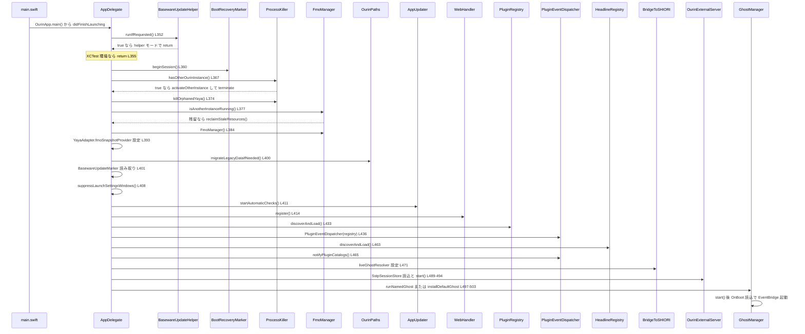
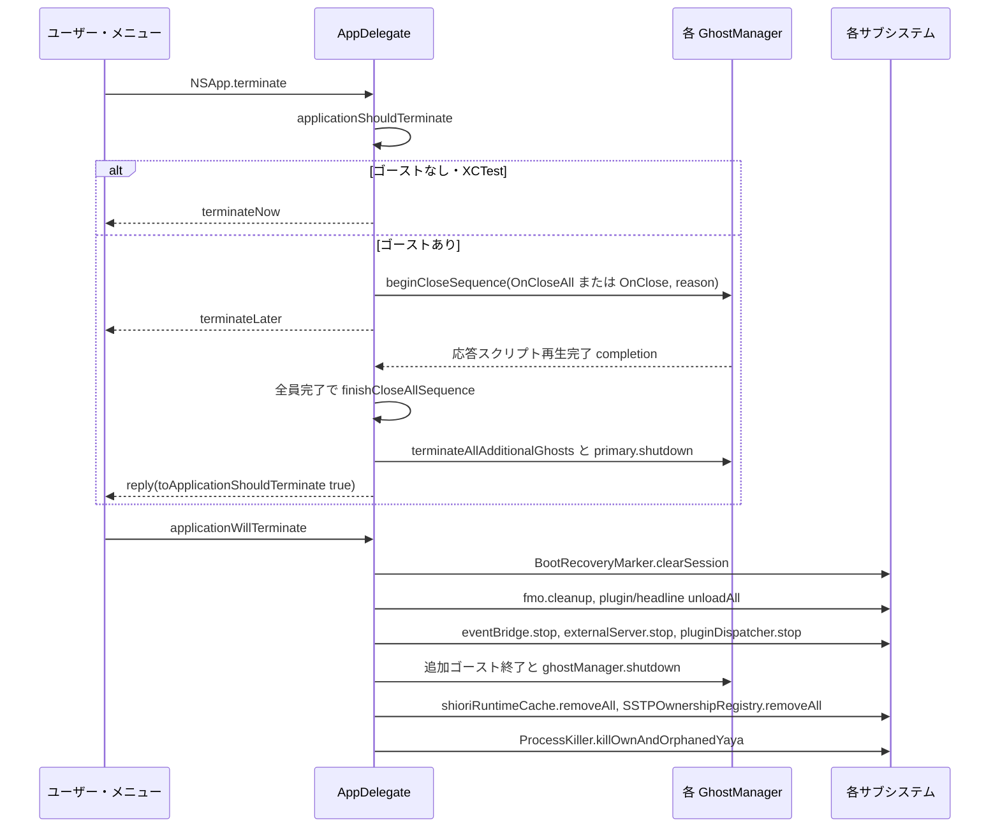
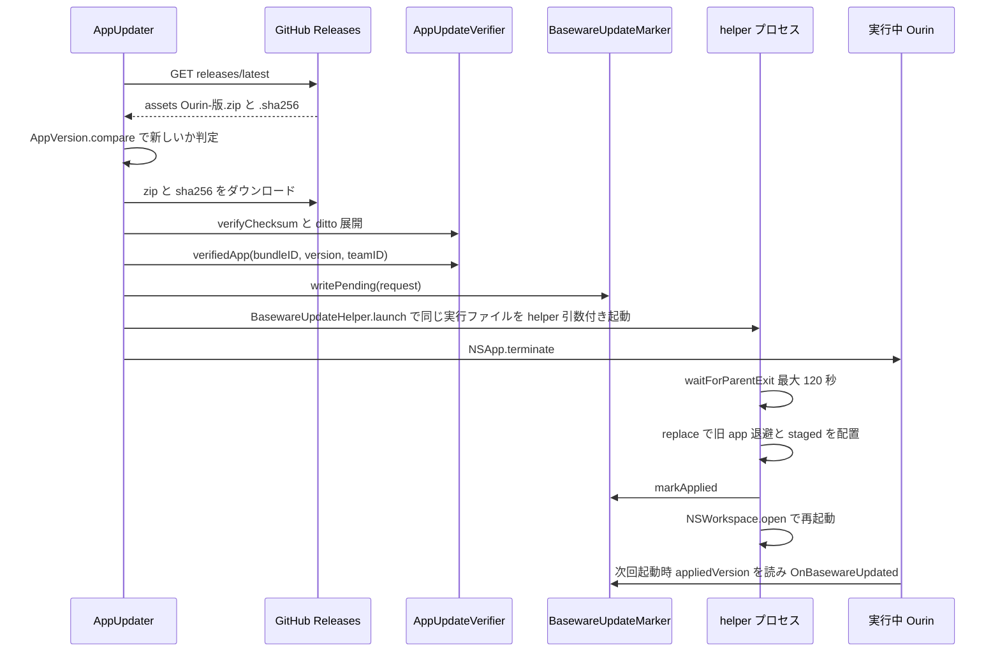

# 3 アプリの起動とライフサイクル

関連ソースファイル

このページは次のファイルをもとに作成した。

- [Ourin/main.swift](../../Ourin/main.swift)
- [Ourin/OurinApp.swift](../../Ourin/OurinApp.swift)
- [Ourin/ContentView.swift](../../Ourin/ContentView.swift)
- [Ourin/RightClickMenu.swift](../../Ourin/RightClickMenu.swift)
- [Ourin/AppUpdater.swift](../../Ourin/AppUpdater.swift)
- [Ourin/BasewareUpdate.swift](../../Ourin/BasewareUpdate.swift)
- [Ourin/About/AboutView.swift](../../Ourin/About/AboutView.swift)
- [Ourin/LogStore.swift](../../Ourin/LogStore.swift)
- [Ourin/LogModels.swift](../../Ourin/LogModels.swift)
- [Ourin/CompatLogger.swift](../../Ourin/CompatLogger.swift)
- [Ourin/Utils/Log.swift](../../Ourin/Utils/Log.swift)
- [Ourin/Utils/ProcessKiller.swift](../../Ourin/Utils/ProcessKiller.swift)
- [Ourin/Utils/SyncCenter.swift](../../Ourin/Utils/SyncCenter.swift)
- [Ourin/Resources/Info.plist](../../Ourin/Resources/Info.plist)
- [Ourin/Ourin.entitlements](../../Ourin/Ourin.entitlements)
- [Ourin/Resources/Licenses/](../../Ourin/Resources/Licenses/)
- [Ourin/en.lproj/Localizable.strings](../../Ourin/en.lproj/Localizable.strings)
- [Ourin/ja.lproj/Localizable.strings](../../Ourin/ja.lproj/Localizable.strings)
- [Ourin/ko.lproj/Localizable.strings](../../Ourin/ko.lproj/Localizable.strings)
- [Ourin/zh-Hans.lproj/Localizable.strings](../../Ourin/zh-Hans.lproj/Localizable.strings)
- [Ourin/zh-Hant.lproj/Localizable.strings](../../Ourin/zh-Hant.lproj/Localizable.strings)
- [OurinTests/LocalizationTests.swift](../../OurinTests/LocalizationTests.swift)
- [Ourin.xcodeproj/project.pbxproj](../../Ourin.xcodeproj/project.pbxproj)
- [Ourin/FMO/FmoManager.swift](../../Ourin/FMO/FmoManager.swift)
- [Ourin/NarInstall/Paths.swift](../../Ourin/NarInstall/Paths.swift)
- [Ourin/Ghost/GhostManager.swift](../../Ourin/Ghost/GhostManager.swift)
- [Ourin/Ghost/GhostManager+System.swift](../../Ourin/Ghost/GhostManager+System.swift)
- [Ourin/Ghost/GhostUtilityWindows.swift](../../Ourin/Ghost/GhostUtilityWindows.swift)
- [Ourin/Yaya/YayaAdapter.swift](../../Ourin/Yaya/YayaAdapter.swift)
- [Ourin/ExternalServer/EncodingNormalizer.swift](../../Ourin/ExternalServer/EncodingNormalizer.swift)
- [Ourin/ExternalServer/ExternalServerSecuritySettings.swift](../../Ourin/ExternalServer/ExternalServerSecuritySettings.swift)

このページは Ourin プロセスの一生を扱う。エントリポイント（`main.swift` → `OurinApp`）から始まり、`AppDelegate.applicationDidFinishLaunching` で主要な system を初期化する順序、ゴーストの初回起動、終了シーケンス（`OnCloseAll`）、単一インスタンス制御、設定 UI、メニューバーメニュー、自動アップデート、About・ライセンス表示、ログ基盤、プロセス整理、Info.plist・entitlements、ローカライズを説明する。

[AGENTS.md](../../AGENTS.md) にあるとおり、`AppDelegate` は独立したファイルではなく `Ourin/OurinApp.swift` の中にあり、主要 system の初期化は `applicationDidFinishLaunching` に集約されている。個々の system の内部は担当ページで扱う。FMO は [11 FMO](./11-fmo.md)、PLUGIN は [12 PLUGIN](./12-plugin.md)、外部 SSTP サーバは [10.1 外部受信口と Web 連携](./10a-external-server-web.md)、ゴーストの実行は [4 GhostManager](./04-ghost-manager.md)、NAR インストールは [15 NAR インストール](./15-nar-install.md) にある。ビルドで作られる `Ourin.app` の中身は [2 ビルド・パッケージング・CI](./02-build-and-ci.md) にある。

## エントリポイントと SwiftUI シーン

`Ourin/main.swift` は `OurinApp.main()` を呼ぶだけの 4 行である。`OurinApp` 構造体には `@main` 属性が付いておらず、明示的な `main.swift` が起動点になる。`OurinApp` は `@NSApplicationDelegateAdaptor(AppDelegate.self)` で AppKit の delegate を差し込み、次のシーンを宣言する。

| シーン / コマンド | 内容 |
|---|---|
| `WindowGroup("Settings", id: "Settings") { ContentView() }` | 設定・診断ウィンドウ。先頭シーンなので SwiftUI が起動時に自動で開くが、`AppDelegate` がそれを閉じる（後述） |
| `CommandGroup(replacing: .appSettings)` | `Settings...`（⌘,）→ `openSettingsWindow()`。識別子 `SettingsWindow`、900x600 の `NSWindow` を自前で作るか、既にあれば前面に出す |
| `CommandGroup(replacing: .appInfo)` | `About Ourin` → `appDelegate.showAboutWindow()`、`アップデートを確認…` → `AppUpdater.shared.checkForUpdates(userInitiated: true)` |
| `WindowGroup("DevTools", id: "DevTools") { DevToolsView() }` | DevTools（[17 DevTools と Ourin Migrator](./17-devtools-migrator.md)） |
| `MenuBarExtra("Ourin") { RightClickMenu() }`（macOS 13 以降） | メニューバー常駐メニュー。`.commands { ModernDevToolsCommands() }` も付く |

`AppDelegate` は `NSObject, NSApplicationDelegate, UNUserNotificationCenterDelegate` を実装する。SwiftUI の adaptor は `NSApp.delegate` に SwiftUI 側のプロキシを置くため、`NSApp.delegate as? AppDelegate` では実体に届かない。そこで `init()` で `Self.current`（weak static）に自分を記録し、`AppDelegate.resolve()` が「直接の delegate、無ければ `current`」の順で返す。アプリ内のほかのコード（`RightClickMenu`、`ContentView`、`GhostManager` など）は、この `resolve()` を通して `AppDelegate` に届く。

`AppDelegate` が持つ主な状態:

| プロパティ | 型 | 用途 |
|---|---|---|
| `fmo` | `FmoManager?` | FMO 共有メモリ（初期化に失敗したら nil） |
| `pluginRegistry` / `pluginDispatcher` | `PluginRegistry?` / `PluginEventDispatcher?` | PLUGIN |
| `headlineRegistry` | `HeadlineRegistry?` | HEADLINE（[16 付帯機能](./16-auxiliary-features.md)） |
| `eventBridge` | `EventBridge?` | 起動時には nil。`GhostManager.startEventBridgeIfNeeded` が設定する |
| `externalServer` | `OurinExternalServer?` | 外部 SSTP（TCP/HTTP/XPC/Distributed） |
| `ghostManager` / `additionalGhosts` | `GhostManager?` / `[GhostManager]` | 主ゴーストと同時起動中の追加ゴースト。`allGhostManagers` は両方を合わせたもの |
| `shioriRuntimeCache` | `ShioriRuntimeCache(capacity: 2)` | ゴースト切替時に SHIORI ランタイムを再利用する（[8 SHIORI 層](./08-shiori-runtime.md)） |
| `pendingBootRecovery` / `pendingBasewareUpdateVersion` | — | 前回の異常終了情報や更新完了の通知を、最初の主ゴーストへ 1 回だけ渡す |

SSTP、Web、Resource ブリッジから届く SHIORI 要求の宛先は、`yayaAdapterForShioriRequest` / `shioriRuntimeForShioriRequest` / `ghostManagerForShioriRequest` が決める。`ReceiverGhostName` ヘッダを percent デコードして小文字化し、ゴーストの設定名かフォルダ名に一致するものを選ぶ。一致しなければ主ゴーストに送る。`ghostManager` はメインスレッドで更新されるので、別スレッドからの呼び出しは `DispatchQueue.main.sync` で解決する。

**出典:** [Ourin/main.swift:1-4](../../Ourin/main.swift#L1-L4)、[Ourin/OurinApp.swift:38-99](../../Ourin/OurinApp.swift#L38-L99)、[Ourin/OurinApp.swift:115-162](../../Ourin/OurinApp.swift#L115-L162)、[Ourin/OurinApp.swift:164-195](../../Ourin/OurinApp.swift#L164-L195)、[Ourin/OurinApp.swift:286-311](../../Ourin/OurinApp.swift#L286-L311)

## applicationDidFinishLaunching の初期化順序

`applicationDidFinishLaunching` は上から順に次の処理を行う。早期 return が 3 か所ある（helper モード、XCTest、他インスタンスの検出）。

| 行 | 処理 | 補足・詳細ページ |
|---|---|---|
| 351 | `Self.current = self` | `resolve()` 用 |
| 352-354 | `BasewareUpdateHelper.runIfRequested()` | 引数に `--ourin-baseware-update-helper` があれば、更新 helper としてだけ動き、通常の初期化はしない（後述） |
| 355-358 | `isRunningUnderTests`（環境変数 `XCTestConfigurationFilePath`） | テストホストとして起動した場合は bootstrap を全部省略する |
| 360-363 | `BootRecoveryMarker.beginSession()` | 前回の `OurinCrashRecovery.active` が残っていれば異常終了とみなし、`GhostBootRecovery` を最初の主ゴーストの OnBoot（Reference6/7）へ渡す |
| 365-372 | `ProcessKiller.hasOtherOurinInstance()` | SSP 互換の単一インスタンス制御。既に動いている Ourin があればそれを前面に出し、自分は `terminate` する |
| 374 | `ProcessKiller.killOrphanedYaya()` | 親を失った（ppid=1）`yaya_core` だけを片付ける |
| 376-380 | `FmoManager.isAnotherInstanceRunning()` → `reclaimStaleResources()` | プロセス検査を通った後で FMO が残っていれば、クラッシュの残骸とみなして `shm_unlink` / `sem_unlink` する（[11 FMO](./11-fmo.md)） |
| 382-388 | `fmo = try FmoManager()` | 失敗してもログを出して FMO なしで続行する |
| 393-396 | `YayaAdapter.fmoSnapshotProvider` | YAYA の `READFMO` 用に、起動中ゴーストのレコードから SSP 互換の文字列を同期的に作る（[8.1 YAYA](./08a-yaya.md)） |
| 400 | `OurinPaths.migrateLegacyDataIfNeeded()` | 旧 `Application Support` と旧サンドボックスコンテナのデータを `~/Documents/Ourin` へ 1 回だけ移す。plugin/headline 探索と起動ゴーストより前に行う（[15 NAR インストール](./15-nar-install.md)） |
| 401-405 | `BasewareUpdateMarker.appliedVersion` | 更新直後の起動なら、版数を `pendingBasewareUpdateVersion` に保持する |
| 408 | `suppressLaunchSettingsWindows()` | 起動時に設定画面を出さない |
| 411 | `AppUpdater.shared.startAutomaticChecks()` | 20 秒後に初回の確認を行い、以後は 1 時間ごとのタイマーで判定する |
| 414-421 | `WebHandler.shared.register()`、`.ourinWebHomeURLReceived` の observer、`UNUserNotificationCenter` の delegate | `x-ukagaka-link` スキームの登録（[10.1 外部受信口と Web 連携](./10a-external-server-web.md)） |
| 424-429 | `.fmoNeedsRefresh` の observer | ゴーストの起動・終了のたびに `refreshFmo()` で共有メモリを書き直す |
| 432-460 | `PluginRegistry().discoverAndLoad()`、`PluginEventDispatcher` | `onScript`（主ゴーストの `runPluginScript`）、`onEmitEvent`（`EventBridge.dispatchPluginResponseEvent`）、`onFailure` を配線する（[12 PLUGIN](./12-plugin.md)） |
| 462-465 | `HeadlineRegistry().discoverAndLoad()`、`notifyPluginCatalogs()` | プラグインへ `installedplugin`・各種 `pathlist`・`installedghostname`・`installedballoonname` を通知する |
| 471-486 | `BridgeToSHIORI.liveGhostResolver` | SSTP・Resource からの SHIORI 要求を、宛先ゴーストの `GhostShioriRuntime.request(...)` へ timeout 2.0 秒で中継する。`Resource` 疑似イベントは `GET` に正規化する（[10 SSTP スタック](./10-sstp.md)） |
| 489-495 | `SstpSessionStore` の永続化・読込、`OurinExternalServer` の `updateConfig` → `start()` | 設定は `ExternalServerSecuritySettings.load()` から読む |
| 497-503 | `OurinStartupGhost` があれば `runNamedGhost`、無ければ `installDefaultGhost()` | 次節 |
| 506-511 | `OwnerDrawMenuAction` 通知の observer | 主ゴーストの `handleMenuAction` へ渡す |

SAORI と `EventBridge` は `applicationDidFinishLaunching` では初期化しない。`SaoriManager` は SHIORI adapter ごとに作られる（`YayaAdapter` のメンバー）。`EventBridge` は `GhostManager.start` の中で、辞書のロード（OnBoot 前）が終わった時点で `startEventBridgeIfNeeded(enableAutoEvents:)` によって起動し、`AppDelegate.eventBridge` に記録される（[9 SHIORI イベント](./09-shiori-events.md)、[13 SAORI](./13-saori.md)）。

**出典:** [Ourin/OurinApp.swift:350-512](../../Ourin/OurinApp.swift#L350-L512)、[Ourin/OurinApp.swift:10-36](../../Ourin/OurinApp.swift#L10-L36)、[Ourin/FMO/FmoManager.swift:127-165](../../Ourin/FMO/FmoManager.swift#L127-L165)、[Ourin/NarInstall/Paths.swift:116-152](../../Ourin/NarInstall/Paths.swift#L116-L152)、[Ourin/Ghost/GhostManager.swift:1772-1781](../../Ourin/Ghost/GhostManager.swift#L1772-L1781)、[Ourin/Ghost/GhostManager.swift:5353-5370](../../Ourin/Ghost/GhostManager.swift#L5353-L5370)、[Ourin/Yaya/YayaAdapter.swift:55](../../Ourin/Yaya/YayaAdapter.swift#L55)

### 起動ゴーストの決定と既定ゴーストの導入

- `runNamedGhost(name:)` は `NarRegistry.shared.installedItems(ofType: "ghost")` を名前で検索する。見つからなければ `Ghost not found` のアラートを出して終わる（既定ゴーストへのフォールバックはしない）。
- `installDefaultGhost()` は、`sakura` が導入済みならそれを `runGhost` する。未導入なら `Bundle.main.url(forResource: "sakura", withExtension: "nar")` を `installNar` する。
- `installNars(at:)` はバックグラウンドキューで NAR を 1 件ずつインストールする。起動中のゴーストがあれば、そのゴーストの `installNarFile`（SHIORI の accept/refuse を含むイベント経路）を使う。初回起動のようにゴーストがまだ無ければ `NarInstaller.installWithResult` を直接呼び、`OnInstallBegin` / `OnInstallComplete` を通知する。複数の NAR がすべて成功した場合だけ `OnInstallCompleteAll` を送る。その後、インストールしたものを順に `runGhost` し、結果をアラートで知らせる。
- `runGhost(at:bootRequest:)` は、既存の主ゴーストを `shutdown(preserveRuntimeForCache: true)` して `shioriRuntimeCache` へ預ける。続いて新しい `GhostManager(ghostURL:)` を作り、`PropertyManager.shared.setActiveGhost` を呼んでから `start(bootRequest:bootRecovery:)` する。起動に成功し、更新後の起動だった場合は `OnBasewareUpdated` を送り、マーカーを消す。
- Finder の「開く」、ダブルクリック、アプリへのドロップは `application(_:openFiles:)` / `application(_:open:)` に届き、拡張子が `nar` / `zip` のものだけを `installNars` に渡す。
- 追加ゴーストの同時起動（`launchAdditionalGhost`）、切替の確定（`completeGhostSwitch`）、追加ゴーストの終了は [4 GhostManager](./04-ghost-manager.md) の範囲である。どの操作も最後に `.fmoNeedsRefresh` を post する。

**出典:** [Ourin/OurinApp.swift:610-620](../../Ourin/OurinApp.swift#L610-L620)、[Ourin/OurinApp.swift:642-775](../../Ourin/OurinApp.swift#L642-L775)、[Ourin/OurinApp.swift:899-934](../../Ourin/OurinApp.swift#L899-L934)、[Ourin/OurinApp.swift:948-1038](../../Ourin/OurinApp.swift#L948-L1038)

### 起動時に自動で開く設定窓の抑止

SwiftUI は先頭シーンの `WindowGroup("Settings")` の窓を起動時に自動で開き、前回の終了時に開いていれば復元もする。`suppressLaunchSettingsWindows()` は、識別子が `Settings-AppWindow` で始まる窓（WindowGroup が作った窓）を、すぐに閉じる処理と、`didBecomeKey` / `didBecomeMain` / `didUpdate` 通知で見つけ次第閉じる処理を 10 秒間続ける。メニューやゴーストから開く設定窓は識別子 `SettingsWindow` の独自窓なので、この処理の対象にならない。`applicationShouldOpenUntitledFile` は `false`、`applicationShouldTerminateAfterLastWindowClosed` も `false` を返す（設定窓を閉じてもゴーストを残す）。

**出典:** [Ourin/OurinApp.swift:313-348](../../Ourin/OurinApp.swift#L313-L348)、[Ourin/OurinApp.swift:519-522](../../Ourin/OurinApp.swift#L519-L522)

## 単一インスタンス制御と ProcessKiller

単一インスタンスの判定は `ProcessKiller` がプロセス一覧を走査して行う。FMO（POSIX 共有メモリ）の有無は、その後で残留リソースを片付けるかどうかの判定にだけ使う。

| 関数 | 動作 |
|---|---|
| `otherRunningOurinInstances()` | `proc_listpids(PROC_ALL_PIDS)` と `proc_pidpath` で、実行パスが `/Ourin.app/Contents/MacOS/Ourin` で終わる自分以外のプロセスを集める。`KERN_PROCARGS2` で環境変数を読み、`XCTestConfigurationFilePath=` などを持つテストホストは除く。環境変数を読めないプロセスは、安全側に倒して稼働中とみなす |
| `hasOtherOurinInstance()` / `activateOtherInstance()` | 上の結果が空でなければ true。`NSRunningApplication.activate()` で既存のインスタンスを前面に出す |
| `killOrphanedYaya()` | 実行ファイル名が `yaya_core` で ppid が 1 のプロセスに SIGTERM を送り、0.5 秒待って残っていれば SIGKILL する |
| `killOwnAndOrphanedYaya()` | 終了時に、自分の子（ppid = 自分の pid）と孤児の `yaya_core` だけを同じ手順で終了させる |

ファイル先頭のコメントによると、以前は起動時と終了時に「パスに `Ourin.app` を含む全プロセスと全 `yaya_core`」を強制終了していたため、並行して走るテストや他インスタンスの SHIORI まで巻き込んでいた。現在の実装はそれをやめ、他の Ourin は終了させない。

**出典:** [Ourin/Utils/ProcessKiller.swift:1-139](../../Ourin/Utils/ProcessKiller.swift#L1-L139)、[Ourin/OurinApp.swift:365-380](../../Ourin/OurinApp.swift#L365-L380)

## 終了処理

アプリ全体の終了は 2 段階で進む。まず `applicationShouldTerminate` で全ゴーストのお別れトークを再生し、その後 `applicationWillTerminate` で後始末をする。

- `applicationShouldTerminate` は、XCTest 中なら `.terminateNow` を返す。終了シーケンスが進行中なら `.terminateLater`、ゴーストが無ければ `.terminateNow` を返す。それ以外の場合、通常の終了なら `OnCloseAll`（reason `user`）、ベースウェア更新による終了なら `OnClose`（reason `update`）を全ゴーストに送る。
- `beginCloseAllSequence` は、各 `GhostManager.beginCloseSequence(eventID:reason:completion:)` の完了を `pendingCloseAllManagers` で集計する。応答が空のゴーストがあっても、別のゴーストがトークを再生している間はアプリを終了しない。全員が完了したら `finishCloseAllSequence` がランタイムを破棄し、`NSApp.reply(toApplicationShouldTerminate: true)` を返す。
- `applicationWillTerminate` は、XCTest ホストでは何もしない。起動時の bootstrap を省略しているのに後始末だけ走らせると、利用者が起動中の Ourin の回復マーカーを乱すからである。通常は図の順に、`BootRecoveryMarker.clearSession()` から `ProcessKiller.killOwnAndOrphanedYaya()` までを実行する。
- `beginBasewareUpdateShutdown(version:)` は `OnBasewareUpdating` を送ってから `NSApplication.shared.terminate(nil)` を呼ぶ（更新 helper は既に起動済み）。

**出典:** [Ourin/OurinApp.swift:524-587](../../Ourin/OurinApp.swift#L524-L587)、[Ourin/OurinApp.swift:1035-1083](../../Ourin/OurinApp.swift#L1035-L1083)

## 設定 UI（ContentView）と設定キー

`ContentView` は `NavigationView` のサイドバーに `Section` enum の 8 項目を並べ、右側に詳細ビューを出す。ツールバーには Reload（`ResourceBridge.invalidateAll()` とプラグインの再ロード）、Start（`OurinStartupGhost` のゴースト、無ければ既定ゴーストを起動）、Export（`LogStore` から直近 24 時間の `jp.ourin.devtools` ログを一時ディレクトリの `OurinDiagnostics.txt` に書き出し、Finder で表示）の 3 ボタンがある。設定と開発用の診断画面を兼ねた窓で、logger の subsystem も `jp.ourin.devtools` になっている。

| タブ（`Section.rawValue`） | ビュー（定義行） | 内容 |
|---|---|---|
| `General` | `GeneralSettingsView`（566） | データフォルダの表示（`~/Documents/Ourin` 固定、Finder で開く）、文字コードの選択（UTF-8/Shift_JIS）と `CP932 受理`、Rosetta の状態（`#if arch` による判定）、自動起動（`SMAppService.mainApp`、macOS 13 以降）、自動アップデート確認と「今すぐ確認」、起動ゴースト、音声認識の権限要求、ファイルログ。保存すると「変更は次回起動時に適用されます」と表示する |
| `SHIORI Resource` | `ShioriResourceView`（192） | SHIORI Resource 値の一覧・フィルタ・ソートと、オーバーレイ値の上書き（`ResourceBridge.shared.set` / `clearOverride`）（[14 プロパティシステムとリソース](./14-property-resource.md)） |
| `Plugins & Events` | `PluginEventView`（1223） | ロード済みプラグイン、Event Injector、選択プラグインのコンソール |
| `External` | `ExternalEventsView`（1425） | TCP/HTTP/XPC の状態表示、全サーバ再起動（`externalServer.stop()` → `start()`）、サンプル SSTP 送信、curl / XPC スニペットのコピー |
| `Headline / Balloon` | `HeadlineBalloonView`（911） | ヘッドライン更新のテストと、バルーンのプレビュー・スクリプト実行 |
| `NAR Install` | `NarInstallView`（`Ourin/NarInstall/NarInstallView.swift`） | [15 NAR インストール](./15-nar-install.md) |
| `Logging & Diagnostics` | `LoggingDiagnosticsView`（1692） | `LogStore` による OSLog の閲覧。subsystem は `jp.ourin.*` / `jp.ourin.devtools` / `Ourin` / `jp.ourin.plugin`、level と期間で絞り込み、コピーできる |
| `Network` | `NetworkStatusView`（1961） | `SSTP (TCP/9801)`、`HTTP (9801)`、`XPC (jp.ourin.sstp)` の稼働状況、遅延、エラー率 |

設定キー（`@AppStorage` は使われておらず、どれも `UserDefaults.standard` を直接読み書きする）:

| キー | 型・既定 | 書く側 | 読む側 | 備考 |
|---|---|---|---|---|
| `OurinStartupGhost` | String / 未設定 | General の保存 | `applicationDidFinishLaunching`、ツールバーの Start | 未設定なら `installDefaultGhost()` |
| `OurinGeneralSettings` | Dictionary（`defaultEncoding` `acceptCP932` `autoStart` `autoUpdate`） | General の保存 | General の読込、`AppUpdater.automaticChecksEnabled`（`autoUpdate`、既定 true） | 「消費側が読みやすいよう個別キーにも併記」とコメントがある |
| `OurinAcceptCP932` | Bool / true | General の保存 | `EncodingNormalizer.acceptsCP932`（外部 SSTP の CP932 フォールバック） | |
| `OurinDefaultEncoding` | String / `UTF-8` | General の保存 | （Swift 内に読む箇所なし） | 未使用（後述） |
| `OurinEnableFileLogging` | Bool / false | General の保存 | `LogFileSink.write` | |
| `OurinLogOutputPath` | String / `~/Library/Logs/Ourin/ourin.log` | General の保存 | `LogFileSink.currentLogPath()` | |
| `OurinDevToolsResourceOverlays` | Dictionary | SHIORI Resource タブ | 同タブの起動時復元 → `ResourceBridge` | |
| `OurinCrashRecovery.active` / `OurinCrashRecovery.ghostName` | Bool / String | `BootRecoveryMarker` | 次回起動時 | 正常終了時に消す |
| `OurinLastUpdateCheck` / `OurinSkippedUpdateVersion` | Date / String | `AppUpdater` | `AppUpdater` | |
| `OurinExternalSSTPAllowTCP` / `…AllowHTTP` / `…AllowExternalSecurityLevel` / `…AllowXPC` / `…MaxPayloadSize` / `…TimeoutSeconds` | 既定 false/false/false/true/1MiB/30 秒 | （手動、`defaults write`） | `ExternalServerSecuritySettings.load()` | [10.1 外部受信口と Web 連携](./10a-external-server-web.md) |
| `OurinBasewareUpdateURL` | String | — | `GhostManager+System` の `\![update,platform]`（Info.plist の同名キーも候補） | [4 GhostManager](./04-ghost-manager.md) |

「自動起動」を保存すると、macOS 13 以降では `SMAppService.mainApp.register()` / `unregister()` を呼ぶ。表示する状態は `SMAppService.mainApp.status` の実際の値を優先する。

**出典:** [Ourin/ContentView.swift:26-158](../../Ourin/ContentView.swift#L26-L158)、[Ourin/ContentView.swift:566-907](../../Ourin/ContentView.swift#L566-L907)、[Ourin/ContentView.swift:520-546](../../Ourin/ContentView.swift#L520-L546)、[Ourin/ContentView.swift:1425-1470](../../Ourin/ContentView.swift#L1425-L1470)、[Ourin/ContentView.swift:1692-1710](../../Ourin/ContentView.swift#L1692-L1710)、[Ourin/ContentView.swift:1961-1980](../../Ourin/ContentView.swift#L1961-L1980)、[Ourin/ExternalServer/EncodingNormalizer.swift:5-9](../../Ourin/ExternalServer/EncodingNormalizer.swift#L5-L9)、[Ourin/ExternalServer/ExternalServerSecuritySettings.swift:27-60](../../Ourin/ExternalServer/ExternalServerSecuritySettings.swift#L27-L60)、[Ourin/Ghost/GhostManager+System.swift:3748-3756](../../Ourin/Ghost/GhostManager+System.swift#L3748-L3756)

## メニューバーメニュー（RightClickMenu）

`RightClickMenu` は `MenuBarExtra("Ourin")` の中身になる SwiftUI ビューである（ファイル名は SSP の右クリックメニューに由来する）。ゴーストのウィンドウを右クリックしたときのメニューは別実装の owner-draw メニューで、[6 バルーンと入力 UI](./06-balloon.md) で扱う。ほとんどの項目は `ghostManager?.handleMenuAction(<action>)` に文字列を渡すだけで、処理の本体は `GhostManager` 側にある。

| 項目 | action / 処理 | 表示条件 |
|---|---|---|
| `ゴースト(G)` → 各ゴースト | `switch_ghost:<percent-encoded 名>`（現在のゴーストに `● ` を付ける） | インストール済みゴーストがあるとき |
| `シェル(S)` → 各シェル | `switch_shell:<名>` | `shell/` 以下のディレクトリが 2 つ以上あるとき |
| `バルーン(B)` → 各バルーン | `switch_balloon:<名>` | インストール済みバルーンがあるとき |
| `着せ替え(D)` → 各パーツ | `toggleDressupBindGroup(scope:bindGroupID:)`（サムネイル付き） | 現在の scope に着せ替え項目があるとき |
| `プラグイン(P)` → 各項目 | `pluginRegistry.pluginMenuEntries()` の `actionIdentifier` | 項目があるとき。`canDispatchRequests` が false なら無効 |
| `情報(I)` / `話しかける(T)` / `再読み込み(R)` | `menu_ghost_info` / `menu_communicate` / `menu_reload` | 常に |
| `NARを読み込む...` | `NSOpenPanel`（`.nar`）→ `NSApp.delegate?.application?(NSApp, openFiles:)` | 常に |
| `設定(O)` | `menu_settings` → `GhostManager.showSettings()`（`SettingsWindow` を開く） | 常に |
| `DevTools` | `AppDelegate.showDevTools()` | 常に |
| `アップデートを確認...` | `AppUpdater.shared.checkForUpdates(userInitiated: true)` | 常に |
| `終了(Q)` | `NSApplication.shared.terminate(nil)` | 常に |

**出典:** [Ourin/RightClickMenu.swift:1-212](../../Ourin/RightClickMenu.swift#L1-L212)、[Ourin/Ghost/GhostManager.swift:5528-5538](../../Ourin/Ghost/GhostManager.swift#L5528-L5538)、[Ourin/Ghost/GhostManager.swift:5595-5621](../../Ourin/Ghost/GhostManager.swift#L5595-L5621)

## アップデート（AppUpdater と BasewareUpdate）

アップデートの経路は 2 つあり、最後の差し替えでは同じ `BasewareUpdateHelper` を共有する。

| 経路 | 起点 | 入手元 | 検証 |
|---|---|---|---|
| アプリ自動アップデート | `AppUpdater`（自動確認、メニュー、設定画面） | GitHub Releases API `releases/latest`（Info.plist の `OurinUpdateFeedURL` で差し替え可。aa88972 の Info.plist には無いので既定値を使う） | `.sha256` との SHA-256 照合、bundle ID、版数、Developer ID 署名（現在のアプリと同じ Team ID） |
| SSP 互換のベースウェア更新 | ゴーストの `\![update,platform]`（`GhostManager+System` → `BasewareUpdateCoordinator.prepare`） | `OurinBasewareUpdateURL` などの updates 記述子 | 記述子の MD5（`NarInstaller.downloadAndStage`）。`nar` / `zip` のエントリは拒否する |

`AppUpdater` の詳細:

- `startAutomaticChecks()` は 20 秒後に初回の確認を行い、その後 1 時間ごとのタイマーで `automaticCheck()` を呼ぶ。`OurinGeneralSettings.autoUpdate` が true で、`OurinLastUpdateCheck` から 24 時間以上たっているときだけ `checkForUpdates(userInitiated: false)` を実行する。
- `AppUpdateRelease.parseGitHubRelease` は draft と prerelease を無視する。版数はタグからではなく、`^Ourin-[0-9]+(\.[0-9]+)*\.zip$` に一致する asset 名から取る。これは [2 ビルド・パッケージング・CI](./02-build-and-ci.md) の `release.sh` が作る zip 名と同じ形である。
- 新版があれば、「アップデートして再起動」「あとで」「このバージョンをスキップ」のアラートを出す。自動確認のときは `OurinSkippedUpdateVersion` と同じ版を無視する。
- `install` は、現在のアプリが署名されていない（Team ID が取れない）と `currentAppUnsigned` で失敗する。そのため開発ビルドや CI の未署名ビルドは自動アップデートできない。アプリの親ディレクトリに書き込めない場合も失敗する。
- ダウンロードと展開は `OurinPaths.subdirectory("temp")/app-update-<UUID>/` で行う。署名の検証は `anchor apple generic and certificate leaf[subject.OU] = "<TeamID>"` の要件に対して、`kSecCSCheckAllArchitectures | kSecCSCheckNestedCode | kSecCSStrictValidate` で実施する。

`BasewareUpdate.swift` の構成:

| 型 | 役割 |
|---|---|
| `BasewareUpdateRequest` | helper に渡す引数（`--ourin-baseware-update-helper <親PID> <target> <staged> <marker> <version>`）の組み立てと解析 |
| `BasewareUpdateMarker` | `temp/baseware-update.json` に `{status, version, targetAppPath}` を書く。状態は `pending` → `applied` |
| `BasewareUpdateCoordinator` | `\![update,platform]` 用。現在の `.app` を `<親>/.OurinUpdate-<UUID>/` に丸ごとコピーし、記述子のファイルを `downloadAndStage` で上書きしてから request を作る |
| `BasewareUpdateHelper` | `runIfRequested()` は helper モードのとき、親の終了を最大 120 秒待ってから `replace(_:relaunch: true)` を実行して自分も終了する。`replace` は旧 app を `.<名前>.OurinOld-<UUID>` へ退避し、staged を移して `markApplied` し、`NSWorkspace.open` で再起動する。どこかで失敗したら退避した app を戻してマーカーを消す |

専用の helper 実行ファイルは同梱していない。同じ `Contents/MacOS/Ourin` を別プロセスとして起動し、`applicationDidFinishLaunching` の冒頭で helper モードに切り替える方式である（未署名の helper を bundle に追加しないため、とコメントにある）。

**出典:** [Ourin/AppUpdater.swift:1-61](../../Ourin/AppUpdater.swift#L1-L61)、[Ourin/AppUpdater.swift:63-141](../../Ourin/AppUpdater.swift#L63-L141)、[Ourin/AppUpdater.swift:143-311](../../Ourin/AppUpdater.swift#L143-L311)、[Ourin/BasewareUpdate.swift:1-105](../../Ourin/BasewareUpdate.swift#L1-L105)、[Ourin/BasewareUpdate.swift:107-229](../../Ourin/BasewareUpdate.swift#L107-L229)、[Ourin/BasewareUpdate.swift:231-332](../../Ourin/BasewareUpdate.swift#L231-L332)、[Ourin/Ghost/GhostManager+System.swift:3600-3610](../../Ourin/Ghost/GhostManager+System.swift#L3600-L3610)、[Ourin/Ghost/GhostManager+System.swift:3700-3710](../../Ourin/Ghost/GhostManager+System.swift#L3700-L3710)

## About とライセンス表示

`AppDelegate.showAboutWindow()` は 520x280 の `NSWindow` に `AboutView` を載せる（2 回目以降は同じ窓を再利用する）。`AboutView` は Info.plist から次の値を読んで表示する。`CFBundleName`、`CFBundleShortVersionString`、`CFBundleVersion`、`AppReleaseDate`（キーがあれば「リリース日」）、`NSHumanReadableCopyright`。

「ライセンスを表示…」はシートで `LicenseBrowser` を開く。先頭に `Licenses/AppLicense.txt` を「Ourin ライセンス」として置き、その下に `Bundle.main.urls(forResourcesWithExtension: "txt", subdirectory: "Licenses")` で見つかった残りのファイルを、ファイル名の `_` を空白に置き換えて名前順に並べる。ソースの `Ourin/Resources/Licenses/` には `AppLicense.txt`、`Ghidra.txt`、`Holidays_JP.txt`、`Holidays_python-holidays.txt`、`SATORI.txt`、`YAYA_Core.txt` がある。`engines/package.sh` が `Resources/EngineLicenses/` に置く同梱エンジンのライセンスは、About には表示されない（BOOTH 版の zip には `ライセンス/エンジン` として添付される）。

`OurinApp` にある `openAboutWindow()`（private）はどこからも呼ばれていない。

**出典:** [Ourin/About/AboutView.swift:1-142](../../Ourin/About/AboutView.swift#L1-L142)、[Ourin/OurinApp.swift:1097-1110](../../Ourin/OurinApp.swift#L1097-L1110)、[Ourin/OurinApp.swift:101-112](../../Ourin/OurinApp.swift#L101-L112)

## ログ基盤

| 型（ファイル） | 役割 |
|---|---|
| `Log`（`Utils/Log.swift`） | `info` / `debug` / `error`。`NSLog` に出力し、同時に `LogFileSink` にも渡す。`debug` は `verbose` が true のときだけ `NSLog` するが、`verbose` は「backslash 問題のデバッグのため一時的に有効化」とされて常に `true` を返す。本来の `OurinVerboseLogging` の読み取りはコメントアウトされている |
| `LogFileSink`（同上） | `OurinEnableFileLogging` が true のときだけ、`[ISO8601] [LEVEL] message` を `OurinLogOutputPath`（既定 `~/Library/Logs/Ourin/ourin.log`）に追記する。`NSLock` で直列化し、パスが変わったら開き直す。`resetForTesting()` あり |
| `CompatLogger`（`CompatLogger.swift`） | `os.Logger`（macOS 11 以降）と `os_log` を包む構造体。`info/debug/warning/error/fault`。subsystem は `jp.ourin.devtools`、`jp.ourin.logstore` などで、アプリ内の 22 か所で生成される |
| `LogStore`（`LogStore.swift`） | `OSLogStore(scope: .currentProcessIdentifier)`（macOS 12 以降。11 では `.local()`）から自プロセスのログを取る。subsystem が `jp.ourin.*` なら `BEGINSWITH jp.ourin` に加えて素の `Ourin` subsystem も含める。述語が空のまま全件を走査するとメインスレッドが固まるため、常に述語を付け、最大 5000 件で打ち切る |
| `LogEntry`（`LogModels.swift`） | `timestamp/level/category/message/metadata` を持つ `Identifiable` |

`LogStore` を使っているのは、設定窓の `Logging & Diagnostics` タブ、ツールバーの Export、ゴーストのユーティリティ窓の `ErrorLogViewerView`（[16 付帯機能](./16-auxiliary-features.md)）である。

**出典:** [Ourin/Utils/Log.swift:1-105](../../Ourin/Utils/Log.swift#L1-L105)、[Ourin/CompatLogger.swift:1-59](../../Ourin/CompatLogger.swift#L1-L59)、[Ourin/LogStore.swift:1-101](../../Ourin/LogStore.swift#L1-L101)、[Ourin/LogModels.swift:1-12](../../Ourin/LogModels.swift#L1-L12)、[Ourin/Ghost/GhostUtilityWindows.swift:389-392](../../Ourin/Ghost/GhostUtilityWindows.swift#L389-L392)

## SyncCenter

`SyncCenter.shared` は、さくらスクリプトの syncobject（`\![signal,syncobject,…]`、`\![set,syncobject,…]`、`\![reset,syncobject,…]`、`\![wait,syncobject,…]`）を支える、プロセス内だけの名前付きセマフォ表である。`wait(name:timeout:)` は `DispatchSemaphore` を待って実際の待ち時間を返し、無限待ちの場合は 1 時間ごとに待ち直す。`set` は `signal` と同じで、待っている側を 1 つだけ解放する。`reset` はセマフォを捨てて新しく作り直すので、保留中のシグナルが消える。プロセスをまたぐ同期は対象外である。`GhostManager` は待機をグローバルキューで行い、スクリプトの解析や UI を止めない（[7 さくらスクリプト](./07-sakura-script.md)）。

**出典:** [Ourin/Utils/SyncCenter.swift:1-59](../../Ourin/Utils/SyncCenter.swift#L1-L59)、[Ourin/Ghost/GhostManager.swift:5128-5133](../../Ourin/Ghost/GhostManager.swift#L5128-L5133)

## Info.plist と entitlements

`Ourin/Resources/Info.plist` は `GENERATE_INFOPLIST_FILE = NO` で、そのまま使われる。

| キー | 値 | 意味 |
|---|---|---|
| `CFBundleIdentifier` | `furin-lab.Ourin` | `check_release_metadata.py` は異なると警告する |
| `CFBundleShortVersionString` / `CFBundleVersion` | `0.1.0` / `22` | [2 ビルド・パッケージング・CI](./02-build-and-ci.md) のバージョン方針 |
| `LSMinimumSystemVersion` | `13.0` | 最低 OS |
| `AppReleaseDate` | `2026-10-26` | About 画面に表示する独自キー |
| `CFBundleDocumentTypes` | `Ukagaka NAR`（`jp.ourin.nar`、Role `Viewer`、アイコン `Ourin.icns`） | `.nar` のダブルクリックで Ourin が開き、`application(_:openFiles:)` が呼ばれる |
| `UTExportedTypeDeclarations` | `jp.ourin.nar`（`public.zip-archive` に準拠、拡張子 `nar`、MIME `application/x-nar` `application/x-ukagaka-nar` `application/zip`） | NAR の UTI を宣言する |
| `CFBundleURLTypes` | `org.ukagaka.link` / スキーム `x-ukagaka-link` | `WebHandler` が処理する（[10.1](./10a-external-server-web.md)） |
| `NSDocumentsFolderUsageDescription` | 「書類」フォルダ内の Ourin フォルダに保存する旨 | 基準フォルダ `~/Documents/Ourin` への TCC 同意 |
| `NSMicrophoneUsageDescription` / `NSSpeechRecognitionUsageDescription` | 音声認識イベント用 | 起動時には要求せず、設定画面のボタンから要求する |
| `NSHumanReadableCopyright` | `© 2025 Furin Lab and contributors` | About に表示する |

`Ourin/Resources/Info.plist` に `LSUIElement` も `LSBackgroundOnly` も無く、コード中に `setActivationPolicy` の呼び出しも無い。このため既定の通常アプリとして Dock にアイコンが出ると考えられる（AppKit の既定動作に基づく推測。実機では未確認）。

entitlements（`Ourin/Ourin.entitlements`）は `com.apple.security.cs.disable-library-validation` だけである。App Sandbox は無効（`ENABLE_APP_SANDBOX = NO`）、Hardened Runtime は有効である。build settings には `ENABLE_INCOMING_NETWORK_CONNECTIONS = YES` などもあるが、サンドボックスが無効なので実際の制限にはならないと考えられる（未確認）。

**出典:** [Ourin/Resources/Info.plist:1-86](../../Ourin/Resources/Info.plist#L1-L86)、[Ourin/Ourin.entitlements:1-8](../../Ourin/Ourin.entitlements#L1-L8)、[Ourin.xcodeproj/project.pbxproj:673-701](../../Ourin.xcodeproj/project.pbxproj#L673-L701)

## ローカライズ

| 項目 | 内容 |
|---|---|
| lproj | `Ourin/` 直下に `en` `ja` `ko` `zh-Hans` `zh-Hant` の 5 つ。それぞれに `Localizable.strings`（518 行、514 エントリ）がある |
| キー | 英語の UI 文字列（`"General"`、`"Settings"`）か、日本語の原文（`"アップデートを確認…"`、`"終了(Q)"`）。各ファイルの先頭に「キーは英語か、日本語の原文」と書かれている |
| プロジェクト設定 | `developmentRegion = en`。`knownRegions` は `en, Base, ja, zh-Hans, zh-Hant, ko`（`Base.lproj` は存在しない）。`LOCALIZATION_PREFERS_STRING_CATALOGS = YES` だが `.xcstrings` は無く、`.strings` を使う |
| 使い方 | SwiftUI の `Text("...")` / `Button("...")`（`LocalizedStringKey`）と `NSLocalizedString("...", comment:)` |
| 検査 | `OurinTests/LocalizationTests.swift`: 5 言語でキー集合が同じか（英語は 400 件超）、`%@` などの書式指定子がキーと一致するか、ソース中で日本語を含む UI リテラルに英訳があるか、各言語の lproj が bundle にあるか、`終了(Q)` が各言語で正しく解決されるか |
| その他 | `Ourin/en.lproj/` には祝日表 `holidays-XX.txt` も置かれている。英語表示のときの祝日名で、[9 SHIORI イベント](./09-shiori-events.md) が使う |

**出典:** [Ourin/en.lproj/Localizable.strings:1-20](../../Ourin/en.lproj/Localizable.strings#L1-L20)、[Ourin/ja.lproj/Localizable.strings:1-8](../../Ourin/ja.lproj/Localizable.strings#L1-L8)、[Ourin.xcodeproj/project.pbxproj:343-354](../../Ourin.xcodeproj/project.pbxproj#L343-L354)、[OurinTests/LocalizationTests.swift:1-93](../../OurinTests/LocalizationTests.swift#L1-L93)

## その他の delegate コールバック

| メソッド | 動作 |
|---|---|
| `userNotificationCenter(_:didReceive:)` | `ourinTrayBalloon = "1"` の通知がクリックされたら、`ourinPluginOrigin` があればそのプラグインへ `OnTrayBalloonClick` を転送する。無ければ `EventBridge` で全ゴーストに通知する |
| `handleWebHomeURL(_:)` | `x-ukagaka-link` から届いた http(s) の homeurl を `ResourceManager` と主ゴーストの設定に反映し、`checkGhostUpdate(options: ["web-homeurl"])` を呼ぶ |
| `handleFmoRefresh(_:)` / `refreshFmo()` / `collectFmoRecords()` | 全ゴーストの `FmoGhostRecord`（名前・パス・シェル・バルーン・サーフェス・`hwnd`・module state）を作り、FMO に書く。同時に `SSTPOwnershipRegistry` を更新する（[11 FMO](./11-fmo.md)） |
| `recordActiveGhostForCrashRecovery(name:manager:)` | 主ゴーストの名前だけを `BootRecoveryMarker` に記録する |
| `showDevTools()` | 700x500 の DevTools 窓（コメント上は macOS 13 未満向け） |

**出典:** [Ourin/OurinApp.swift:589-640](../../Ourin/OurinApp.swift#L589-L640)、[Ourin/OurinApp.swift:822-946](../../Ourin/OurinApp.swift#L822-L946)、[Ourin/OurinApp.swift:1085-1095](../../Ourin/OurinApp.swift#L1085-L1095)

## 制約と注意点

- **注意: データの保存先が AGENTS.md と食い違う**: AGENTS.md はユーザーデータの保存先を `~/Library/Containers/furin-lab.Ourin/Data/Library/Application Support/Ourin/ghost/` としている。しかし `OurinPaths.baseDirectory()` の本番の基準は `~/Documents/Ourin` である（`Documents` が使えなければ `~/Library/Application Support/Ourin`）。起動時の `migrateLegacyDataIfNeeded()` は、そのコンテナパスを旧データの移行元として扱っている。設定画面の表示もコードに合わせて `~/Documents/Ourin` になっている。
- **注意: 単一インスタンスの判定**: AGENTS.md は FMO を「単一 instance 制御」と説明しているが、起動時に終了するかどうかを決めているのは `ProcessKiller` のプロセス一覧走査である。FMO の存在は残留リソースの回収判定に使われる。`FmoManager()` の初期化に失敗したときのログ `single instance enforcement disabled` は、実際の挙動（プロセス検査は有効のまま）と一致しない。
- **`Log.verbose` が固定で true**: デバッグ用の一時変更が残っているため、`Log.debug` が常に `NSLog` に出力される。
- **`OurinDefaultEncoding` は未使用**: 設定画面で保存されるが、Swift のコード中に読む箇所が無い。保存時のアラートは「次回起動時に適用」と表示するが、多くの項目（エンコーディング、自動アップデート）は次回起動を待たずに読まれる。
- **自動アップデートは署名済みの配布版だけ**: 署名の Team ID が取れないビルドでは `currentAppUnsigned` で失敗する。アプリの親ディレクトリに書き込めない場合（一般ユーザーの `/Applications` など）も失敗する。
- **更新 helper と単一インスタンス制御の相互作用（未確認）**: helper は `Contents/MacOS/Ourin` と同じ実行ファイルで動き、再起動（`NSWorkspace.open`）の後で終了する。新しく起動したインスタンスの `ProcessKiller` 検査が、終了前の helper を「他の Ourin」と判定する可能性があるかどうかは、コードからは断定できない（`replace` が旧アプリを移す退避先は `.Ourin.app.OurinOld-<UUID>` で、その中の実行ファイルのパスは `/Ourin.app/Contents/MacOS/Ourin` で終わらないため、`isOurinMainExecutable` に合わず判定されないと推測する。移動後の実行中プロセスに対して `proc_pidpath` がどのパスを返すかは実機でしか確かめられない）。
- **About に出ないライセンス**: 同梱エンジンのライセンス（`Resources/EngineLicenses/`）は About のライセンス一覧の対象外である。`Licenses/` サブディレクトリが bundle 内に残るかどうか（同期フォルダの平坦化の有無）は未確認である。コード側の想定も一致せず、`AboutView` は `subdirectory: "Licenses"` を指定して読む一方、`HolidayInfo` は `Holidays/` と Resources 直下の両方を探してコメントで「同梱のときはフォルダの中身が Resources 直下に置かれる」と書いている。
- **使われていないコード**: `OurinApp.openAboutWindow()` と `AppUpdater.checkForUpdatesFromMenu(_:)` は呼び出し元が無い。
- **`runNamedGhost` は既定ゴーストへ戻らない**: `OurinStartupGhost` のゴーストが削除されていると、アラートが出るだけでゴーストは起動しない。

**出典:** [AGENTS.md:11](../../AGENTS.md#L11)、[Ourin/NarInstall/Paths.swift:45-70](../../Ourin/NarInstall/Paths.swift#L45-L70)、[Ourin/NarInstall/Paths.swift:149-153](../../Ourin/NarInstall/Paths.swift#L149-L153)、[Ourin/ContentView.swift:888](../../Ourin/ContentView.swift#L888)、[Ourin/Utils/ProcessKiller.swift:76-98](../../Ourin/Utils/ProcessKiller.swift#L76-L98)、[Ourin/BasewareUpdate.swift:298-301](../../Ourin/BasewareUpdate.swift#L298-L301)、[Ourin/BasewareUpdate.swift:268-284](../../Ourin/BasewareUpdate.swift#L268-L284)、[Ourin/Utils/Log.swift:3-9](../../Ourin/Utils/Log.swift#L3-L9)、[Ourin/OurinApp.swift:382-388](../../Ourin/OurinApp.swift#L382-L388)、[Ourin/AppUpdater.swift:240-251](../../Ourin/AppUpdater.swift#L240-L251)、[Ourin/ContentView.swift:844-886](../../Ourin/ContentView.swift#L844-L886)、[Ourin/OurinApp.swift:659-671](../../Ourin/OurinApp.swift#L659-L671)、[Ourin/About/AboutView.swift:66-73](../../Ourin/About/AboutView.swift#L66-L73)、[Ourin/SHIORIEvents/HolidayInfo.swift:99-106](../../Ourin/SHIORIEvents/HolidayInfo.swift#L99-L106)

## 関連ページ

- [2 ビルド・パッケージング・CI](./02-build-and-ci.md) — `Ourin.app` の中身、`release.sh` の zip 名と自動アップデートの関係
- [4 GhostManager](./04-ghost-manager.md) — `GhostManager.start` / `shutdown` / `beginCloseSequence`、メニュー action の処理
- [8 SHIORI 層（USL）](./08-shiori-runtime.md) — `ShioriRuntimeCache`、`GhostShioriRuntime`
- [9 SHIORI イベント](./09-shiori-events.md) — `EventBridge` の起動とイベント配送
- [10 SSTP スタック](./10-sstp.md) / [10.1 外部受信口と Web 連携](./10a-external-server-web.md) — `BridgeToSHIORI`、`OurinExternalServer`、`WebHandler`
- [11 FMO](./11-fmo.md) — 共有メモリと残留の回収
- [12 PLUGIN](./12-plugin.md) — `PluginRegistry` / `PluginEventDispatcher`
- [15 NAR インストールとパッケージ管理](./15-nar-install.md) — `NarInstaller`、`OurinPaths`、データ移行
- [17 DevTools と Ourin Migrator](./17-devtools-migrator.md) — `DevToolsView`、`ModernDevToolsCommands`
