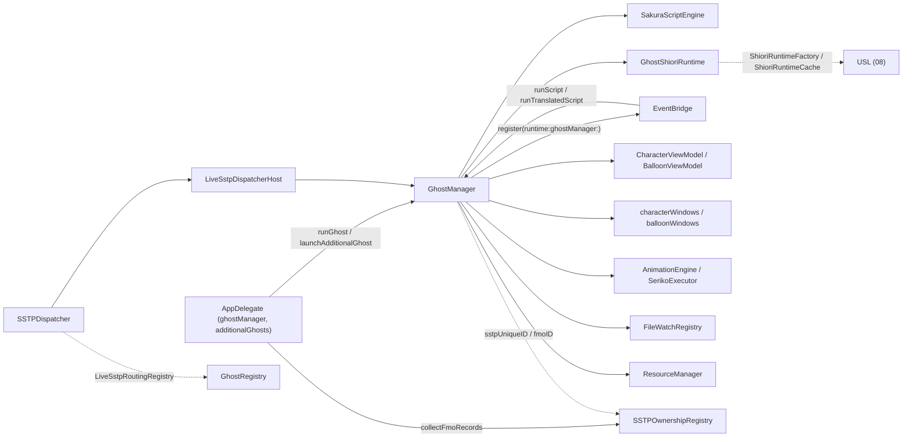
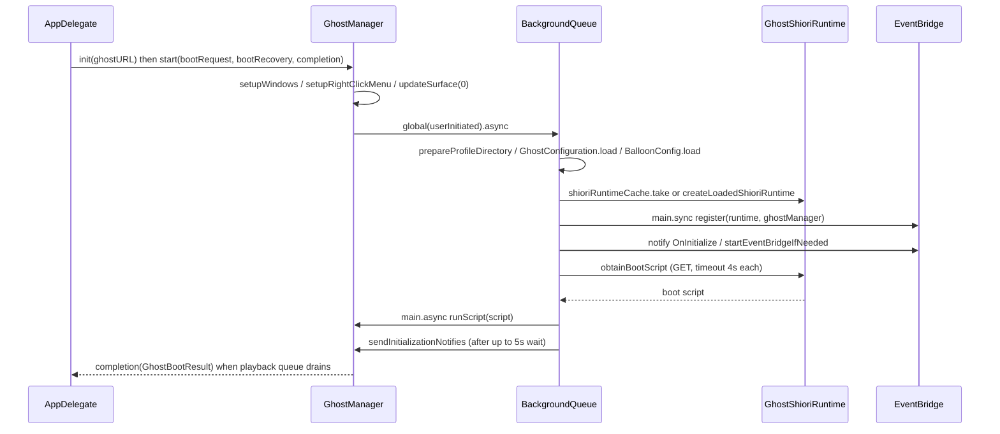
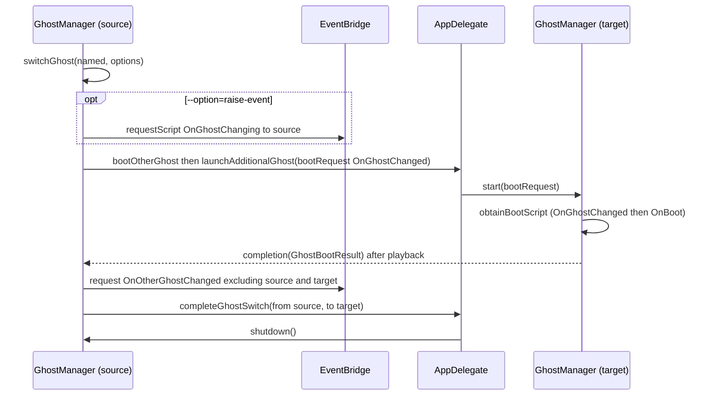
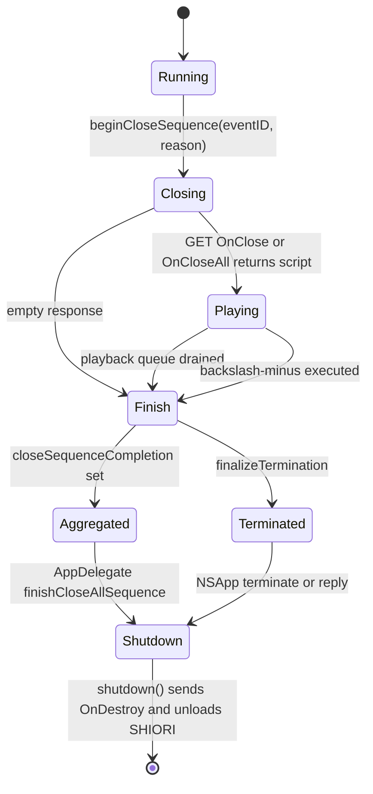

# 4 GhostManager（ゴースト実行の中核）

関連ソースファイル

このページは次のファイルをもとに作成した。

- [Ourin/Ghost/GhostManager.swift](../../Ourin/Ghost/GhostManager.swift)
- [Ourin/Ghost/GhostManager+System.swift](../../Ourin/Ghost/GhostManager+System.swift)
- [Ourin/Ghost/GhostManager+Animation.swift](../../Ourin/Ghost/GhostManager+Animation.swift)
- [Ourin/Ghost/GhostManager+Balloon.swift](../../Ourin/Ghost/GhostManager+Balloon.swift)
- [Ourin/Ghost/GhostManager+Display.swift](../../Ourin/Ghost/GhostManager+Display.swift)
- [Ourin/Ghost/GhostManager+Dressup.swift](../../Ourin/Ghost/GhostManager+Dressup.swift)
- [Ourin/Ghost/GhostManager+Effects.swift](../../Ourin/Ghost/GhostManager+Effects.swift)
- [Ourin/Ghost/GhostManager+Input.swift](../../Ourin/Ghost/GhostManager+Input.swift)
- [Ourin/Ghost/GhostManager+Surface.swift](../../Ourin/Ghost/GhostManager+Surface.swift)
- [Ourin/Ghost/GhostManager+TextArea.swift](../../Ourin/Ghost/GhostManager+TextArea.swift)
- [Ourin/Ghost/GhostManager+Window.swift](../../Ourin/Ghost/GhostManager+Window.swift)
- [Ourin/Web/GhostManager+WebSocket.swift](../../Ourin/Web/GhostManager+WebSocket.swift)
- [Ourin/Ghost/GhostTypes.swift](../../Ourin/Ghost/GhostTypes.swift)
- [Ourin/Ghost/GhostConfiguration.swift](../../Ourin/Ghost/GhostConfiguration.swift)
- [Ourin/Ghost/FileWatchRegistry.swift](../../Ourin/Ghost/FileWatchRegistry.swift)
- [Ourin/Ghost/ComponentUpdateTarget.swift](../../Ourin/Ghost/ComponentUpdateTarget.swift)
- [Ourin/Ghost/GhostUtilityWindows.swift](../../Ourin/Ghost/GhostUtilityWindows.swift)
- [Ourin/Ghost/SurfaceTestWindow.swift](../../Ourin/Ghost/SurfaceTestWindow.swift)
- [Ourin/Calendar/GhostSchedule.swift](../../Ourin/Calendar/GhostSchedule.swift)
- [Ourin/SHIORIEvents/HolidayInfo.swift](../../Ourin/SHIORIEvents/HolidayInfo.swift)
- [Ourin/SHIORIEvents/EventBridge.swift](../../Ourin/SHIORIEvents/EventBridge.swift)
- [Ourin/OurinApp.swift](../../Ourin/OurinApp.swift)
- [Ourin/SSTP/GhostRegistry.swift](../../Ourin/SSTP/GhostRegistry.swift)
- [Ourin/SSTP/SstpRoutingRegistry.swift](../../Ourin/SSTP/SstpRoutingRegistry.swift)
- [Ourin/SSTP/SSTPOwnershipRegistry.swift](../../Ourin/SSTP/SSTPOwnershipRegistry.swift)
- [Ourin/SSTP/SSTPDispatcher.swift](../../Ourin/SSTP/SSTPDispatcher.swift)
- [Ourin/SSTP/LiveSstpDispatcherHost.swift](../../Ourin/SSTP/LiveSstpDispatcherHost.swift)
- [Ourin/USL/MakotoTranslator.swift](../../Ourin/USL/MakotoTranslator.swift)
- [Ourin/ExternalServer/ExternalServerSecuritySettings.swift](../../Ourin/ExternalServer/ExternalServerSecuritySettings.swift)

`GhostManager` は「起動中のゴースト 1 体」を表すクラスで、ゴーストのフォルダ（`ghost/master` の `descript.txt`・SHIORI・シェル・バルーン）を読み込み、キャラクターウィンドウとバルーンウィンドウを作り、SHIORI に OnBoot などのイベントを送り、返ってきたさくらスクリプトを文字送りしながら再生する。Ourin の実行時処理のほぼすべて（サーフェス描画、バルーン、SERIKO、ダイアログ、ネットワーク系の `\![execute,...]`、更新、消滅）は、このクラスとその extension の上に載っている。

このページは GhostManager の骨格（保持する状態、起動から終了までのライフサイクル、ゴーストの切替・呼び出し、SHIORI ランタイムとイベント送信の入口、再生キューと割り込み、複数スコープ）と、周辺の小さな型（`GhostConfiguration`・`GhostTypes`・`FileWatchRegistry`・`ComponentUpdateTarget`）、SSTP 側のレジストリとの関係を扱う。さくらスクリプトの字句解析とタグごとの実行は [7 さくらスクリプト](./07-sakura-script.md)、サーフェスとアニメーションは [5 サーフェス・シェル・SERIKO アニメーション](./05-surface-shell-animation.md)、バルーン描画は [6 バルーンと入力 UI](./06-balloon.md)、SHIORI 呼び出しの内部は [8 SHIORI 層（USL）](./08-shiori-runtime.md)、SSTP は [10 SSTP スタック](./10-sstp.md) に任せる。

## 全体像と位置づけ

アプリ全体では `AppDelegate` が主ゴースト `ghostManager` と追加ゴースト `additionalGhosts` を持ち、各 `GhostManager` が SHIORI ランタイム・スクリプトエンジン・ウィンドウ群を個別に所有する。SHIORI イベントの全体配送は `EventBridge` が担い、GhostManager は起動時に自分を「セッション」として登録する。SSTP からの UI 操作は `LiveSstpDispatcherHost` が宛先の GhostManager を解決して呼ぶ。

**出典:** [Ourin/OurinApp.swift:145-163](../../Ourin/OurinApp.swift#L145-L163)、[Ourin/Ghost/GhostManager.swift:822-861](../../Ourin/Ghost/GhostManager.swift#L822-L861)、[Ourin/SHIORIEvents/EventBridge.swift:295-311](../../Ourin/SHIORIEvents/EventBridge.swift#L295-L311)、[Ourin/SSTP/LiveSstpDispatcherHost.swift:8-67](../../Ourin/SSTP/LiveSstpDispatcherHost.swift#L8-L67)、[Ourin/SSTP/SstpRoutingRegistry.swift:10-28](../../Ourin/SSTP/SstpRoutingRegistry.swift#L10-L28)

## extension ファイルごとの責務の地図

`GhostManager` は 1 つのクラス宣言（`GhostManager.swift`）と、責務ごとに分けた多数の `extension GhostManager` から成る。`GhostManager+*.swift` 以外にも、機能側のファイルが `extension GhostManager` を持つ。

| ファイル（行数） | 主な責務 | 代表的な関数（行） | 詳細ページ |
|---|---|---|---|
| `Ghost/GhostManager.swift`（5744） | ViewModel 定義、クラス本体、プロパティ、起動・終了、スクリプト実行入口、トークン実行（`\![...]` のディスパッチを含む）、再生キュー、メニュー操作 | `start` 1647、`shutdown` 1902、`runTranslatedScript` 2331、`sakuraEngine(_:didEmit:)` 2832、`processNextUnit` 4949、`obtainBootScript` 5226、`handleMenuAction` 5499 | このページ、[7](./07-sakura-script.md) |
| `Ghost/GhostManager+System.swift`（7295） | `\![...]` の実装群（イベント送出、選択肢、壁紙・トレイ、SNTP、ヘッドライン、HTTP/RSS/iCal、更新、消滅、アーカイブ、URL ドロップ、インストール、ping、ダイアログ、各種モード）、他ゴースト起動・切替・呼び出し、`NSWindowDelegate` | `bootOtherGhost` 773、`raiseOtherGhostEvent` 930、`handleChoiceCommand` 1370、`dispatchLocalEvent` 1513、`executeHTTP` 2605、`executeUpdate` 3287、`executeVanish` 4519、`switchGhost` 6307、`callGhost` 6394、`requestDialogEvent` 7245 | このページ、[7](./07-sakura-script.md) |
| `Ghost/GhostManager+Window.swift`（1705） | キャラクターウィンドウ生成（scope 0/1 の先行生成と遅延生成）、右クリックメニュー、移動・リサイズ・拡縮・透明度・Z オーダー・sticky-window、ウィンドウ状態、見切れ・重なり判定 | `setupWindows` 62、`ensureCharacterWindow` 75、`executeMoveCommand` 660、`executeSetScalingCommand` 922、`setWindowState` 1467、`overlapTransitionEvents` 1665 | [5](./05-surface-shell-animation.md) |
| `Ghost/GhostManager+Surface.swift`（765） | サーフェスの読込・合成、シェル切替、OnSurfaceRestore、PNA・カラーキー | `updateSurface` 108、`scheduleSurfaceRestoreIfTalkEnded` 215、`compositeSurfaceElements` 416、`switchShell` 667 | [5](./05-surface-shell-animation.md) |
| `Ghost/GhostManager+Animation.swift`（1059） | AnimationEngine / SerikoExecutor のコールバック配線、`\i`・`\![anim,...]` の処理、アニメーション完了待ちの再開 | `setupAnimationCallbacks` 223、`playAnimation` 299、`handleAnimAddOverlaySequence` 710、`startSerikoLoopIfNeeded` 1045 | [5](./05-surface-shell-animation.md) |
| `Ghost/GhostManager+Display.swift`（1102） | `descript.txt` 設定の適用、名前入力ダイアログ、サウンド・動画再生、URL/メール/ファイルを開く、デスクトップ吸着 | `applyGhostConfiguration` 14、`showNameInputDialog` 134、`playSound` 362、`openURL` 782、`enforceDesktopAlignment` 1047 | [5](./05-surface-shell-animation.md)、[16](./16-auxiliary-features.md) |
| `Ghost/GhostManager+Balloon.swift`（1433） | バルーン ViewModel の生成、本文追加、クリック・アンカー・ホバーの処理、バルーン位置、`\_b`・`\_l`・`\c` | `getBalloonVM` 44、`appendText` 167、`onBalloonClicked` 426、`onBalloonAnchorClicked` 481、`positionBalloonWindow` 709、`handleTextClear` 1346 | [6](./06-balloon.md) |
| `Ghost/GhostManager+Effects.swift`（460） | `\![effect]`・`\![filter]`、`\![bind]`、テキストアニメーション、バルーン切替 | `applyEffect` 19、`executeBindCommand` 262、`switchBalloon` 325/358/368 | [5](./05-surface-shell-animation.md)、[6](./06-balloon.md) |
| `Ghost/GhostManager+Dressup.swift`（370） | 着せ替え（MAYUNA bind）の適用・イベント・メニュー | `applyDressup` 113、`emitDressupEvents` 161、`toggleDressupBindGroup` 332 | [5](./05-surface-shell-animation.md) |
| `Ghost/GhostManager+Input.swift`（62） | `\![open,scriptbox]`・`\![open,textareabox]` の引数解析と再生キュー投入 | `openScriptBox` 35、`openTextAreaBox` 49 | [6](./06-balloon.md) |
| `Ghost/GhostManager+TextArea.swift`（167） | textareabox ダイアログ本体と結果イベント | `showTextAreaBoxDialog` 52、`closeTextAreaDialog` 40 | [6](./06-balloon.md) |
| `Web/GhostManager+WebSocket.swift`（114） | `\![execute,websocket]`・`\![send,websocket*]`・`\![close/cancel,websocket]` | `executeWebSocket` 12、`sendWebSocket` 53、`cancelAllWebSockets` 101 | [10.1](./10a-external-server-web.md) |
| `Ghost/GhostUtilityWindows.swift` | 発言履歴（backlog）とアドレスバー・エラーログ・画像/アーカイブビューア等の補助ウィンドウ | `recordBacklog` 28、`openAddressBar` 58、`openBacklogViewer` 81 | [16](./16-auxiliary-features.md) |
| `Ghost/SurfaceTestWindow.swift` | サーフェステスト窓 | `openSurfaceTestWindow` 290 | [5](./05-surface-shell-animation.md) |
| `Ghost/FileWatchRegistry.swift` | `\![execute,filewatch]` の監視本体と GhostManager 側入口 | `executeFileWatch` 404 | このページ |
| `Calendar/GhostSchedule.swift` | `\![execute,schedule-add/delete/get]` | `executeGhostSchedule` 339 | [16](./16-auxiliary-features.md) |
| `SHIORIEvents/HolidayInfo.swift` | 起動時の OnNotifyHolidayInfo | `sendHolidayInfoNotify` 116 | [9](./09-shiori-events.md) |

**出典:** [Ourin/Ghost/GhostManager+Window.swift:62-90](../../Ourin/Ghost/GhostManager+Window.swift#L62-L90)、[Ourin/Ghost/GhostManager+Surface.swift:108-112](../../Ourin/Ghost/GhostManager+Surface.swift#L108-L112)、[Ourin/Ghost/GhostManager+Animation.swift:223-262](../../Ourin/Ghost/GhostManager+Animation.swift#L223-L262)、[Ourin/Ghost/GhostManager+Display.swift:10-30](../../Ourin/Ghost/GhostManager+Display.swift#L10-L30)、[Ourin/Ghost/GhostManager+Balloon.swift:42-60](../../Ourin/Ghost/GhostManager+Balloon.swift#L42-L60)、[Ourin/Ghost/GhostManager+Effects.swift:10-35](../../Ourin/Ghost/GhostManager+Effects.swift#L10-L35)、[Ourin/Ghost/GhostManager+Input.swift:10-61](../../Ourin/Ghost/GhostManager+Input.swift#L10-L61)、[Ourin/Ghost/GhostManager+TextArea.swift:3-60](../../Ourin/Ghost/GhostManager+TextArea.swift#L3-L60)、[Ourin/Web/GhostManager+WebSocket.swift:3-20](../../Ourin/Web/GhostManager+WebSocket.swift#L3-L20)、[Ourin/Ghost/GhostUtilityWindows.swift:26-60](../../Ourin/Ghost/GhostUtilityWindows.swift#L26-L60)、[Ourin/Ghost/SurfaceTestWindow.swift:262-292](../../Ourin/Ghost/SurfaceTestWindow.swift#L262-L292)、[Ourin/Calendar/GhostSchedule.swift:336-345](../../Ourin/Calendar/GhostSchedule.swift#L336-L345)、[Ourin/SHIORIEvents/HolidayInfo.swift:114-120](../../Ourin/SHIORIEvents/HolidayInfo.swift#L114-L120)

### GhostManager.swift 内部の地図

| 行範囲 | 内容 |
|---|---|
| 8-781 | ViewModel 群。`CharacterViewModel`（11、サーフェス画像・拡縮・透明度・位置ロック・吸着・オーバーレイ・着せ替え）、`BalloonViewModel`（71、本文・行揃え・アンカー・改行送り）、`BalloonTextSegment`・`AnchorDecorationStyle`・`AnchorDecoration`・`BalloonAnchorRange`（722-781）。描画側は [5](./05-surface-shell-animation.md)・[6](./06-balloon.md) |
| 783-820 | 起動要求の値型 `GhostBootRequest`（789）、`GhostBootRecovery`（795）、`GhostBootResult`（799） |
| 822-1213 | `class GhostManager: NSObject, SakuraScriptEngineDelegate` とプロパティ、`PlaybackUnit`（924）、選択肢・着せ替えの型 |
| 1214-1327 | `init` / `deinit`、スコープ別 PROPERTY 値 |
| 1328-1558 | キャラクター名の永続化、着せ替え定義の読込（`loadDressupConfiguration` 1344） |
| 1559-2031 | Public API: `makeShioriLoadContext` 1563、`createLoadedShioriRuntime` 1632、`start` 1647、`requestLifecycleEvent` 1850、`shutdown` 1902 |
| 2032-2117 | `canPlayTalkNow` 2036 と終了シーケンス（`beginCloseSequence` 2051、`finalizeTermination` 2103） |
| 2118-2829 | 実体参照・`\j`、MAKOTO、`translateForDisplay` 2243、`runScript` 系 2290-2461、プラグイン向け OnOtherGhostTalk、`\![sound]`・`\![anim]`・`\![lock]`・`\![execute]`・`\![clipboard]` の実装 |
| 2830-4753 | `sakuraEngine(_:didEmit:)`（トークンを再生キューへ変換。詳細は [7](./07-sakura-script.md)） |
| 4754-4947 | スクリプト単位設定のリセット、`balloonwait`・`balloontimeout`、`\__v` 音声合成、`\_a` 範囲アンカー |
| 4949-5371 | `processNextUnit` 4949、`scheduleNext` 5200、`finishBootIfNeeded` 5207、`obtainBootScript` 5226、`startEventBridgeIfNeeded` 5353 |
| 5373-5494 | 起動時の初期化 NOTIFY（`sendInitializationNotifies` 5375） |
| 5496-5744 | オーナードローメニューの操作（ゴースト/シェル/バルーン切替、再読込、消滅、更新） |

**出典:** [Ourin/Ghost/GhostManager.swift:8-70](../../Ourin/Ghost/GhostManager.swift#L8-L70)、[Ourin/Ghost/GhostManager.swift:783-830](../../Ourin/Ghost/GhostManager.swift#L783-L830)、[Ourin/Ghost/GhostManager.swift:1559-1660](../../Ourin/Ghost/GhostManager.swift#L1559-L1660)、[Ourin/Ghost/GhostManager.swift:2830-2836](../../Ourin/Ghost/GhostManager.swift#L2830-L2836)、[Ourin/Ghost/GhostManager.swift:5373-5380](../../Ourin/Ghost/GhostManager.swift#L5373-L5380)、[Ourin/Ghost/GhostManager.swift:5496-5540](../../Ourin/Ghost/GhostManager.swift#L5496-L5540)

### GhostManager+System.swift の全体地図

ファイルの先頭は URL ドロップや SSTP 送信結果などのトップレベル型で、479 行目から 7278 行目までが 1 つの `extension GhostManager: NSWindowDelegate` である。

| 行範囲 | MARK / 内容 | 主な関数（行） |
|---|---|---|
| 1-476 | トップレベル型: `NarInstallDispatchOutcome` 11、`URLDropPolicy` 49、`URLDropFailureReason` 229、`URLDropDownloadDelegate` 281、`SSTPEventDeliveryResult` 434、`OtherGhostDispatchTarget` 450、`UpdateResultRecord` 464 | `URLDropPolicy.remoteURL` 54 |
| 477-702 | System Commands and Ghost Booting（オプション解析型） | `UpdateCommandOptions` 483、`HTTPCommandOptions` 548 |
| 703-1364 | Ghost Booting via SSTP | `bootOtherGhost` 773、`bootAllGhosts` 812、`sendSSTPNotify` 827、`makeSSTPEventRequest` 858、`raiseOtherGhostEvent` 930、`scheduleTimerRaiseOther` 1050、`dispatchPluginEvent` 1117、`scheduleTimerPluginEvent` 1214、`sendSSTPToLocalhost` 1239 |
| 1365-1819 | Choice Command Support | `handleChoiceCommand` 1370、`presentPendingChoices` 1419、`performChoiceSelection` 1466、`executeEmbeddedEvent` 1493、`dispatchLocalEvent` 1513、`scheduleLocalEventTimer` 1576、`showChoiceDialog` 1671 |
| 1820-3160 | System Commands Implementation | 壁紙 `setWallpaper` 1912、`setTaskTrayIcon` 1964、`setTrayBalloon` 2021、SNTP `executeSNTP` 2117、`executeHeadline` 2332、`executeBiff` 2532、`executeHTTP` 2605、`executeHTTPStreaming` 2706、`executeRSS` 3080 |
| 3161-6279 | iCal 以降の実装群 | `executeICal` 3167、`executeUpdate` 3287、`checkGhostUpdate` 3388、`checkPlatformUpdate` 3532、`checkAllGhostsUpdate` 4034、`executeVanish` 4519、`executeExtractArchive` 4754、`executeDumpSurface` 5022、`handleURLDropEvent` 5168、`executeInstall` 5623、`executePing` 5761、`executeReload` 5944、`installNarFile` 6076、`postSystemMessage` 6241 |
| 6280-6512 | Change / Open Command Helpers | `parseCommandArguments` 6282、`switchGhost` 6307、`callGhost` 6394、`collectCollisionNames` 6460、`executeSSF` 6478、`forceActivateWindows` 6495 |
| 6513-7278 | Dialog Commands と各種モード | `showInputBoxDialog` 6640、`showSystemDialog` 6828、`showTeachBoxDialog` 6872、`windowWillClose` 6978、`showCommunicateBoxDialog` 6989、`enterSelectMode` 7080 〜 `leaveOnlineMode` 7174、`setBalloonMarker` 7214、`requestDialogEvent` 7245 |
| 7280-7295 | `private extension String`（正規表現抽出） | `matches(for:)` 7281 |

**出典:** [Ourin/Ghost/GhostManager+System.swift:477-500](../../Ourin/Ghost/GhostManager+System.swift#L477-L500)、[Ourin/Ghost/GhostManager+System.swift:703-720](../../Ourin/Ghost/GhostManager+System.swift#L703-L720)、[Ourin/Ghost/GhostManager+System.swift:1365-1370](../../Ourin/Ghost/GhostManager+System.swift#L1365-L1370)、[Ourin/Ghost/GhostManager+System.swift:6280-6310](../../Ourin/Ghost/GhostManager+System.swift#L6280-L6310)、[Ourin/Ghost/GhostManager+System.swift:6513-6520](../../Ourin/Ghost/GhostManager+System.swift#L6513-L6520)

## 保持する状態（主要プロパティ）

GhostManager はメインスレッドで生成・操作する前提で（`init` で `assert(Thread.isMainThread)`）、状態の大半を素の `var` で持つ。

| 分類 | プロパティ（行） | 役割 |
|---|---|---|
| 識別 | `ghostURL` 831、`sstpUniqueID` 833、`fmoID` 835 | ゴーストのルート。`sstpUniqueID` は SHIORI へ `uniqueid` として通知し Owned SSTP の照合に使う。`fmoID` は FMO 行の接頭辞 |
| SHIORI | `shioriRuntime` 837、`yayaAdapter`、`ghostMakotoTranslator` / `shellMakotoTranslator`、`eventToken` 842 | ロード済みランタイム、MAKOTO、`EventBridge` 登録トークン |
| 設定 | `ghostConfig` 849、`activeShellName` 850（既定 `"master"`）、`balloonConfig` 910、`resourceManager` 848（ゴースト単位の名前空間） | `descript.txt` と現在のシェル・バルーン |
| スクリプト | `sakuraEngine` 841 | 字句解析器。`delegate = self` |
| ウィンドウ | `characterWindows` 866、`balloonWindows` 872、`utilityWindows` 880 | いずれもスコープ番号（または種別名）をキーにした辞書 |
| ViewModel | `characterViewModels` 906、`balloonViewModels` 907、`currentScope` 916 | スコープごとの表示状態と、現在話しているスコープ |
| 再生 | `playbackQueue` 961、`isPlaying` 962、`playbackGeneration` 972、`quickMode` 973、`preciseBase` 974、`typingInterval` 976（既定 0.1 秒）、`pendingClick` 981、`appendModeEnabled` 987 | 再生キューと文字送り状態（[7](./07-sakura-script.md)） |
| 選択肢 | `pendingChoices` 1042、`choiceTimeout` 1044、`choiceTimeoutDisabled` 1048、`inlineChoiceIndices` | `\q` 等で溜めた選択肢 |
| モード | `selectModeActive`・`collisionModeActive`・`passiveModeActive`・`inductionModeActive`・`noUserBreakModeActive` 1100、`timeCriticalActive` 1102 | `\![enter,...]`・`\t` の状態 |
| 終了 | `isShuttingDown` 1120、`terminateAfterPlayback` 1123、`closeSequenceCompletion` 1127、`pendingDestroyReason` 1129、`didShutdown` 845 | 終了シーケンスの進行 |
| 外部 I/O | `webSocketConnections` 1069、`fileWatchRegistry` 1071、`currentPlaybackIsExternal` 1073、`pendingHTTPWaits` 1092 | 非同期処理の保持と、外部（SSTP）由来スクリプトかどうか |
| 起動通知 | `bootCompletion` 862、`pendingBootResult` | 起動スクリプトの再生完了を呼び出し元へ一度だけ返す |

**出典:** [Ourin/Ghost/GhostManager.swift:829-923](../../Ourin/Ghost/GhostManager.swift#L829-L923)、[Ourin/Ghost/GhostManager.swift:961-990](../../Ourin/Ghost/GhostManager.swift#L961-L990)、[Ourin/Ghost/GhostManager.swift:1040-1130](../../Ourin/Ghost/GhostManager.swift#L1040-L1130)

## 生成と初期化

`init(ghostURL:)` はメインスレッド専用である（`NSWindow` 生成や共有 static 状態をロックなしで触るため）。初期化では次を行う。

1. `sakuraEngine.delegate = self`。
2. `sakuraEngine.propertyManager` を `PropertyManager.shared` に差し替え、`bindCurrentGhostRuntime(self)` する。これをしないと `\![set,property,...]` で書いた値が SSTP や ResourceBridge から見えない。
3. `resourceManager.username` を `%username` 用に `envExpander.username` へ入れる。
4. `loadPersistentCharacterNames()`（`UserDefaults` の `OurinSakuraName` / `OurinKeroName` を `%selfname` / `%keroname` に使う）、`setupAnimationCallbacks()`、`loadDressupConfiguration()`、`setupScreenChangeObserver()`。

`deinit` はメインスレッド上でだけ `shutdown()` を呼び、別スレッドで解放された場合は URL ドロップのダウンロードだけを止める（AppKit の停止処理をバックグラウンドから呼ぶと abort するため）。

**出典:** [Ourin/Ghost/GhostManager.swift:1214-1263](../../Ourin/Ghost/GhostManager.swift#L1214-L1263)、[Ourin/Ghost/GhostManager.swift:1328-1342](../../Ourin/Ghost/GhostManager.swift#L1328-L1342)

## 起動シーケンス（start から OnBoot まで）

`AppDelegate.runGhost(at:)` は既存の主ゴーストを `shutdown(preserveRuntimeForCache: true)` してから新しい GhostManager を作り `start(bootRequest:bootRecovery:completion:)` を呼ぶ。追加ゴーストは `launchAdditionalGhost` が作る（同じパスが既に起動中なら新規に作らず `requestLifecycleEvent` を送る）。

### 手順の詳細

1. メインスレッドで `setupWindows()`（scope 0 と 1 のキャラクターウィンドウを先行生成）と `setupRightClickMenu()` を行い、`updateSurface(id: 0)` を非同期に予約する。
2. バックグラウンドで `ghost/master/profile` を作り（`prepareProfileDirectory`）、`GhostConfiguration.load(from:)` で `descript.txt` を読む。成功すると `activeShellName` を `seriko.defaultsurfacedirectoryname`（空なら `master`）にし、異常終了復旧用の記録、使用率セッション開始、MAKOTO の読込、`applyGhostConfiguration` を行う。
3. バルーンは `configuredBalloonDirectory(for:ghostURL:baseDirectory:)`（Effects 437）が見つけたインストール済みバルーン、無ければゴーストフォルダの `balloon/` から `BalloonConfig.load` する。
4. SHIORI は `ShioriRuntimeFactory.moduleName(for:)` でモジュール名を決め、`makeShioriLoadContext` でロード入力を作る。`AppDelegate.shioriRuntimeCache.take(context:)` に同じ文脈のキャッシュがあればそれを使って NOTIFY `OnCacheRestore` を送り、無ければ `createLoadedShioriRuntime` で生成・ロードする。ロード失敗時は `succeeded: false` の結果で `finishBootIfNeeded` して終わる。
5. ロード成功後にだけ、メインスレッドで `shioriRuntime` を保持し `EventBridge.shared.register(runtime:ghostManager:)` する（失敗したランタイムを配送先に残さない）。続けて `OnDisplayHandover` の初期通知。
6. `OnInitialize` を NOTIFY し、`UserDefaults` の `OurinBootCount` を 1 増やす。テスト実行中（`XCTestConfigurationFilePath` / `XCTestBundlePath`）以外は `startEventBridgeIfNeeded(enableAutoEvents: true)` で自動イベント（タイマー・入力・スリープ等）を有効にする。
7. 別キューで `obtainBootScript` を呼び、空でないスクリプトが得られたら `pendingBootResult` を設定して `runScript` する。呼び出し元スレッドは最大 5 秒だけ待ち（`DispatchSemaphore`）、時間切れでもログを出して先へ進む。
8. 最後に `sendInitializationNotifies` と FMO 更新通知。

`obtainBootScript` の問い合わせ順は次のとおりで、各 GET の timeout は 4.0 秒、ヘッダは `Charset: UTF-8` / `SecurityLevel: local` / `Sender: Ourin` である。

| 順 | 条件 | イベント | Reference |
|---|---|---|---|
| 1 | `bootRequest` がある（呼出し・切替） | `OnGhostCalled` / `OnGhostChanged` 等 | 要求の Reference を 8 個に詰め、Reference7 にシェル名 |
| 2 | `OurinBootCount == 0` かつ `bootRequest` なし | `OnFirstBoot` | Reference0 = `OurinVanishCount` |
| 3 | 常に | `OnBoot` | Reference0 = シェル名。異常終了復旧時のみ Reference6 = `halt`、Reference7 = 前回ゴースト名 |
| 4 | 上がすべて空 | `BridgeToSHIORI.handle(event: "OnBoot")` | シェル名 |
| 5 | それでも空 | 何も表示しない（合成した挨拶は出さない） | — |

`finishBootIfNeeded` は再生キューが空になった時点（`processNextUnit` の末尾）で呼ばれ、`bootCompletion` を一度だけ実行する。起動スクリプトの再生完了を待ってから `OnGhostCallComplete` や `OnOtherGhostBooted` を送れるのはこのためである。

**出典:** [Ourin/OurinApp.swift:899-934](../../Ourin/OurinApp.swift#L899-L934)、[Ourin/OurinApp.swift:955-990](../../Ourin/OurinApp.swift#L955-L990)、[Ourin/Ghost/GhostManager.swift:1647-1752](../../Ourin/Ghost/GhostManager.swift#L1647-L1752)、[Ourin/Ghost/GhostManager.swift:1754-1843](../../Ourin/Ghost/GhostManager.swift#L1754-L1843)、[Ourin/Ghost/GhostManager.swift:5207-5335](../../Ourin/Ghost/GhostManager.swift#L5207-L5335)、[Ourin/Ghost/GhostManager.swift:5347-5371](../../Ourin/Ghost/GhostManager.swift#L5347-L5371)

### 起動時の初期化 NOTIFY

`sendInitializationNotifies(config:)` は次を順に送る。`hwnd`・`uniqueid`・`basewareversion`・`capability`・`ownerghostname` は `notifyCustom(..., ignoreResponseScript: true)`、その他は `EventBridge.shared.notify` である。

| イベント | 内容 |
|---|---|
| `hwnd` | Reference0 = キャラクターウィンドウ番号のカンマ区切り、Reference1 = バルーンウィンドウ番号 |
| `uniqueid` | `sstpUniqueID` |
| `basewareversion` | `Ourin/<CFBundleShortVersionString>` |
| `capability` | `response`, `nobreak`, `communicate`, `lock`, `notify` |
| `OnNotifySelfInfo` | Reference0/1 = `sakura.name`、2 = `kero.name`、3/4 = シェル名とパス、5/6 = バルーン名とパス |
| `OnNotifyShellInfo`・`OnNotifyDressupInfo`・`OnNotifyBalloonInfo` | シェル・着せ替え・バルーン情報 |
| プラグイン | `pluginDispatcher.onGhostBoot` / `onGhostInfoUpdate` |
| `OnNotifyUserInfo`・`OnNotifyHolidayInfo`・`OnNotifyOSInfo`・`OnNotifyFontInfo`・`OnNotifyInternationalInfo`・`OnLanguageChange` | 実環境の情報 |
| `ownerghostname` | `sakura.name` |

注意: `OnNotifySelfInfo` の Reference0 はコメントでは `ghostName` とあるが、実装は `config.sakuraName` を入れている。また `EventBridge.broadcastNotifyImmediate` は `OnNotifySelfInfo` を配送するときに **登録済みの全セッション** の `saveCharacterNames` を呼ぶため、複数ゴースト起動時は最後に通知したゴーストの名前で全ゴーストの `%selfname` / `%keroname`（と `UserDefaults` の `OurinSakuraName` / `OurinKeroName`）が上書きされる（コード読解による。実機未確認）。

**出典:** [Ourin/Ghost/GhostManager.swift:5375-5493](../../Ourin/Ghost/GhostManager.swift#L5375-L5493)、[Ourin/SHIORIEvents/EventBridge.swift:1202-1214](../../Ourin/SHIORIEvents/EventBridge.swift#L1202-L1214)、[Ourin/Ghost/GhostManager.swift:1546-1557](../../Ourin/Ghost/GhostManager.swift#L1546-L1557)

## GhostConfiguration（descript.txt の解釈と既定値）

`GhostConfiguration.load(from: ghostRoot)` は `ghostRoot/descript.txt` を `EncodingAdapter.decodeTextDefinition` で文字列化し、各行を **最初のカンマ** でキーと値に分ける（前後の空白は除く。キーは大文字小文字を区別し、同じキーは後の行が勝つ。コメント行の特別扱いは無く、カンマを含まない行だけが捨てられる）。`name` が無いと `nil`（＝設定なし）になる。

| キー | プロパティ | 既定値 / 解釈 |
|---|---|---|
| `name`（必須） | `name` | — |
| `sakura.name` / `sakura.name2` / `kero.name` | `sakuraName` / `sakuraName2` / `keroName` | `sakuraName` は省略時 `name` |
| `id` / `title` / `type` / `charset` | 同名 | — |
| `craftman` / `craftmanw` / `craftmanurl` / `homeurl` | 同名 | `homeurl` は `resourceManager.homeurl` へ |
| `shiori` / `shiori.macos` | `shiori` / `shioriMacOS` | `shiori` 既定 `shiori.dll` |
| `makoto` | `makoto` | 未指定時は `makoto.dll` を試す |
| `shiori.version` / `shiori.encoding` / `shiori.forceencoding` | 同名 | SHIORI 通信オプション |
| `shiori.cache` / `shiori.escape_unknown` | `Bool?` | 値が `"1"` のときだけ true |
| `sakura.seriko.defaultsurface` / `kero.seriko.defaultsurface` | `sakuraDefaultSurface` / `keroDefaultSurface` | 0 / 10 |
| `balloon.defaultsurface`、`sakura./kero.balloon.defaultsurface` | 同名 | — |
| `seriko.alignmenttodesktop`、`sakura./kero.seriko.alignmenttodesktop` | `AlignmentToDesktop` | `top` / `bottom` / `left` / `right` / `free` の rawValue のみ |
| `sakura./kero.defaultx` / `defaulty` / `defaultleft` / `defaulttop` | 同名 | `defaultleft/top` は吸着が `free` のときだけ ResourceManager へ |
| `seriko.defaultsurfacedirectoryname` | `defaultShellDirectory` | `master` |
| `sstp.allowunspecifiedsend` / `sstp.allowcommunicate` | `Bool` | 未指定 true、指定時は `"1"` のみ true |
| `sstp.alwaystranslate` | `Bool?` | `"1"` で SSTP 由来スクリプトの `notranslate` を無視して OnTranslate を通す |
| `balloon` / `default.balloon.path` / `recommended.balloon(.path)` | 同名 | 標準バルーンの探索順は `recommended.balloon.path` → `recommended.balloon` → `default.balloon.path` → `balloon`（`configuredBalloonDirectory`） |
| `balloon.dontmove` / `balloon.syncscale` | `Bool?` | 値が `"true"` のときだけ true（他の真偽キーと異なる） |
| `icon` / `icon.minimize` / `cursor`（または `mousecursor`）/ `mousecursor.*` / `menu.font.*` | 同名 | — |
| `name.allowoverride` | `Bool` | 未指定 true |
| `don't need onmousemove` / `don't need bind` / `don't need seriko talk` | `Bool?` | `"1"` で true |
| `shiori.logo.file` / `.x` / `.y` / `.align` | AI グラフ | `align` は `lefttop` 等 4 種 |
| `install.accept` | `[String]` | カンマ区切り |
| `readme` / `readme.charset` | 同名 | `readme` 既定 `readme.txt` |
| `char<N>.name` / `.seriko.defaultsurface` / `.balloon.defaultsurface` / `.seriko.alignmenttodesktop` / `.defaultx` / `.defaulty` / `.defaultleft` / `.defaulttop` | `charNames` 等の `[Int: ...]` | 正規表現 `^char(\d+)\.(.+)$` で抽出 |

**出典:** [Ourin/Ghost/GhostConfiguration.swift:1-60](../../Ourin/Ghost/GhostConfiguration.swift#L1-L60)、[Ourin/Ghost/GhostConfiguration.swift:265-300](../../Ourin/Ghost/GhostConfiguration.swift#L265-L300)、[Ourin/Ghost/GhostConfiguration.swift:300-423](../../Ourin/Ghost/GhostConfiguration.swift#L300-L423)、[Ourin/Ghost/GhostConfiguration.swift:425-515](../../Ourin/Ghost/GhostConfiguration.swift#L425-L515)、[Ourin/Ghost/GhostManager+Display.swift:14-90](../../Ourin/Ghost/GhostManager+Display.swift#L14-L90)、[Ourin/Ghost/GhostManager+Effects.swift:434-457](../../Ourin/Ghost/GhostManager+Effects.swift#L434-L457)、[Ourin/Ghost/GhostManager.swift:2243-2248](../../Ourin/Ghost/GhostManager.swift#L2243-L2248)

## SHIORI ランタイムとの接続

`makeShioriLoadContext(moduleName:ghostRoot:)` は `descript.txt` の `shiori.version` 等を `ShioriCommunicationOptions` にまとめ、`ShioriRuntimeFactory.kind(...)` が YAYA でなければそのまま `ShioriRuntimeLoadContext` を返す。YAYA の場合だけ `<DLL名>.txt`（既定 `yaya.txt`）を UTF-8 → Shift_JIS の順で読み、`include` を辿って辞書一覧・文字コード・関数深さ制限を集め、`basepath` を適用する（設定ファイルが無ければ同フォルダの全 `.dic`）。`createLoadedShioriRuntime` は `ShioriRuntimeFactory.makeRuntime` で生成し、`resourceManager` を渡してから `load(context:)` し、失敗したら `unload()` して `nil` を返す。

ランタイムキャッシュ: `shutdown(preserveRuntimeForCache: true)` は `shiori.cache` が `"1"` のときだけ NOTIFY `OnCacheSuspend` を送ってランタイムを返し、`AppDelegate.runGhost` が `ShioriRuntimeCache`（容量 2）へ格納する。次回 `start` で同じロード文脈なら再利用して `OnCacheRestore` を送る。

GhostManager から SHIORI を直接呼ぶ箇所（`runtime.request(method:id:headers:refs:timeout:)`）は、起動（OnBoot 系）、終了（OnClose 系 4.0 秒、OnDestroy 1.0 秒）、`OnTranslate`（2.0 秒）、`\![raise/notify]`（4.0 / 2.0 秒）、`\![embed]`、`\j`、`\a`（OnAITalk）、ダイアログ系の `requestDialogEvent`（4.0 秒）である。ランタイムの内部と選択ロジックは [8 SHIORI 層（USL）](./08-shiori-runtime.md) を参照。

**出典:** [Ourin/Ghost/GhostManager.swift:1563-1645](../../Ourin/Ghost/GhostManager.swift#L1563-L1645)、[Ourin/Ghost/GhostManager.swift:1717-1752](../../Ourin/Ghost/GhostManager.swift#L1717-L1752)、[Ourin/Ghost/GhostManager.swift:1975-2030](../../Ourin/Ghost/GhostManager.swift#L1975-L2030)、[Ourin/OurinApp.swift:159](../../Ourin/OurinApp.swift#L159)

## イベント送信の入口

GhostManager が SHIORI イベントを送る経路は複数あり、「誰に届くか」と「応答スクリプトをどう扱うか」が違う。

| 入口（定義位置） | 方式 | 宛先 | 応答の扱い |
|---|---|---|---|
| `EventBridge.shared.notify(_:params:)`（EventBridge.swift 331） | NOTIFY | 登録済み **全** ゴースト | 各ゴーストで処理（[9](./09-shiori-events.md)） |
| `EventBridge.shared.request(_:..., to: self)` / `requestCustom` / `requestScript` | GET | このゴーストのみ | 再生、または `requestScript` で文字列として受け取る |
| `requestDialogEvent(eventID:references:)`（System 7245） | GET | このゴースト | 応答があれば `runNotifyScript`、無ければ `notifyCustom(..., to: self)` |
| `dispatchLocalEvent(event:references:notifyOnly:preserveFollowingPlayback:)`（System 1513） | GET / NOTIFY | このゴースト | `\![raise]` は応答を再生し、後続キューを応答の後ろへ戻す |
| `runtime.request(...)` 直接 | GET / NOTIFY | このゴースト | OnBoot・OnClose・OnDestroy・OnTranslate など |
| `raiseOtherGhostEvent`（System 930） | SSTP `SEND` / `NOTIFY` | 他ゴースト | `sendSSTPToLocalhost`（`127.0.0.1:9801` へ TCP）経由。失敗は `dispatchOtherGhostEventFailure` |
| `dispatchPluginEvent`（System 1117） | PLUGIN Event | プラグイン | [12](./12-plugin.md) |
| `sendSSTPNotify`（System 827） | SSTP NOTIFY | 外部インスタンス | `\+` のフォールバック、`bootAllGhosts` |

スクリプト由来のイベント（`raise`/`notify`）を `EventBridge` の全体配送へ流さないのは、別ゴーストまでイベントを受け取ってしまうためである（コード中のコメント）。

**出典:** [Ourin/SHIORIEvents/EventBridge.swift:328-345](../../Ourin/SHIORIEvents/EventBridge.swift#L328-L345)、[Ourin/Ghost/GhostManager+System.swift:1513-1572](../../Ourin/Ghost/GhostManager+System.swift#L1513-L1572)、[Ourin/Ghost/GhostManager+System.swift:7245-7267](../../Ourin/Ghost/GhostManager+System.swift#L7245-L7267)、[Ourin/Ghost/GhostManager+System.swift:827-877](../../Ourin/Ghost/GhostManager+System.swift#L827-L877)、[Ourin/Ghost/GhostManager+System.swift:930-990](../../Ourin/Ghost/GhostManager+System.swift#L930-L990)、[Ourin/Ghost/GhostManager+System.swift:1239-1255](../../Ourin/Ghost/GhostManager+System.swift#L1239-L1255)

## スクリプト実行の入口・再生キューと割り込み

SHIORI 応答や SSTP のスクリプトは、次のいずれかの入口から再生される。共通の前処理は `translateForDisplay`（環境変数展開 → OnTranslate → ゴースト MAKOTO → シェル MAKOTO）で、詳細は [7 さくらスクリプト](./07-sakura-script.md)。

| 入口 | 翻訳 | 開始時のリセット | 用途 |
|---|---|---|---|
| `runScript(_:translationContext:)` 2290 | する | `runTranslatedScript` と同じ | 通常の GET 応答。On* イベントの裸の数値応答は捨てる |
| `runTranslatedScript(_:isExternal:)` 2331 | 済み | 世代番号を進め、キュー・クイック・`\t`・`\*`・アンカー・インライン選択肢を破棄。先頭が `\C` でなければ全スコープのバルーン本文を消す | 翻訳済みスクリプト（EventBridge の SSTP 経路など）。`isExternal` は `\![execute,filewatch]` 等の拒否判定に使う |
| `runNotifyScript` 2377 / `runTranslatedNotifyScript` 2387 | する / 済み | 本文テキストがある場合だけ上と同様に破棄・消去。無ければスクリプト単位設定だけリセット | NOTIFY 応答（表示を残してコマンドだけ適用） |
| `runPluginScript(_:options:originPluginID:)` 2422 | する（`plugin-script` 等の reason） | `nobreak` 指定時はキューへ追記するだけ、それ以外は破棄 | PLUGIN からのスクリプト |

どの入口も最後は `sakuraEngine.runPreprocessed(script:)` → デリゲートでトークンを `playbackQueue` に積み → `startPlaybackIfNeeded()` が `processNextUnit()` を非同期に開始する。`processNextUnit` は即時に処理できる単位を `continue` で連続処理し、文字・改行・待機のときだけ `scheduleNext(after:)`（`DispatchQueue.main.asyncAfter`）で次回を予約する。キューが空になると、アンカー確定・プラグイン通知・`finishBootIfNeeded`・終了シーケンス・選択肢提示・OnSurfaceRestore 予約のいずれかへ進む。

割り込み（スクリプトブレーク）の契機は次のとおり。

| 契機 | 処理 |
|---|---|
| 新しいスクリプトの開始 | 上表のリセット（`playbackGeneration &+= 1`） |
| 再生中のバルーンクリック | `cancelPlaybackForBalloonBreak()` でキューを捨て、選択肢・`\t` を解除し本文を消して `OnBalloonBreak`（Reference0 表示済みスクリプト、1 スコープ、2 中断位置）を GET。`\![enter,nouserbreakmode]` 中は無視 |
| `\x` 待機中のクリック | `pendingClick` を解き、`noclear` でなければ本文を消して `OnBalloonClose` を GET してから再開 |
| `\-` | 先行テキストの表示後に終了処理（後述） |

`canPlayTalkNow()` は「再生中でない・`\t` 中でない・passive/induction モードでない」を返し、OnSecondChange 等の Reference3 に使われる。

**出典:** [Ourin/Ghost/GhostManager.swift:2290-2373](../../Ourin/Ghost/GhostManager.swift#L2290-L2373)、[Ourin/Ghost/GhostManager.swift:2377-2461](../../Ourin/Ghost/GhostManager.swift#L2377-L2461)、[Ourin/Ghost/GhostManager.swift:4901-4913](../../Ourin/Ghost/GhostManager.swift#L4901-L4913)、[Ourin/Ghost/GhostManager.swift:4949-4975](../../Ourin/Ghost/GhostManager.swift#L4949-L4975)、[Ourin/Ghost/GhostManager.swift:5200-5205](../../Ourin/Ghost/GhostManager.swift#L5200-L5205)、[Ourin/Ghost/GhostManager+Balloon.swift:426-479](../../Ourin/Ghost/GhostManager+Balloon.swift#L426-L479)、[Ourin/Ghost/GhostManager.swift:2034-2038](../../Ourin/Ghost/GhostManager.swift#L2034-L2038)

## 複数キャラクター（スコープ）

スコープ（`\0`=sakura、`\1`=kero、`\p[N]`）ごとにキャラクターウィンドウ・バルーンウィンドウ・`CharacterViewModel`・`BalloonViewModel` を辞書で持つ。

- 起動時は scope 0/1 だけウィンドウを作り、scope 2 以降は `.scope` 単位の処理や参照時に `ensureCharacterWindow(for:)` で遅延生成する。
- `BalloonViewModel` は `getBalloonVM(for:)` で初回参照時に作られ、バルーン設定のアンカー・フォント既定値と、`balloon.syncscale` が true ならキャラクターの拡縮を引き継ぐ。
- 再生キューの `.scope(id)` を処理すると、別スコープへ移るときに SERIKO の endtalk を評価し、`currentScope` を更新し、表示中なら話し手のバルーンを最前面へ出す。キャラクターウィンドウはサーフェス画像があるときだけ前面に出し、未設定なら隠したままにする（`\pN` だけで空の窓を出さない）。最後に `positionBalloonWindow()`。
- スコープ切替ではどのスコープのバルーン本文も消さない（SSP と同じく複数キャラクターが同時にバルーンを出せる）。消えるのはスクリプト開始時の一括クリアと `\c` / `\x` 等の明示コマンドだけである。
- 追加キャラクターの名前・既定サーフェス・吸着・位置は `GhostConfiguration` の `char<N>.*` から取る。
- 注意: `\_s`（シンクロナイズセクション）は `syncEnabled` / `syncScopes` を切り替えるが、`appendText` 側の同時表示処理はコメントアウトされており、表示には影響しない。

**出典:** [Ourin/Ghost/GhostManager+Window.swift:62-81](../../Ourin/Ghost/GhostManager+Window.swift#L62-L81)、[Ourin/Ghost/GhostManager+Balloon.swift:44-60](../../Ourin/Ghost/GhostManager+Balloon.swift#L44-L60)、[Ourin/Ghost/GhostManager+Balloon.swift:167-187](../../Ourin/Ghost/GhostManager+Balloon.swift#L167-L187)、[Ourin/Ghost/GhostManager.swift:5006-5039](../../Ourin/Ghost/GhostManager.swift#L5006-L5039)、[Ourin/Ghost/GhostManager.swift:4252-4263](../../Ourin/Ghost/GhostManager.swift#L4252-L4263)

## ゴーストの切替・呼び出し・追加起動

複数ゴーストの同時起動は in-process で行う。`bootOtherGhost(name:bootRequest:completion:)`（`\+` と切替・呼出しの共通部）は名前が空ならインストール済みの他ゴーストから無作為に選び、`AppDelegate.launchAdditionalGhost(named:...)` で追加ゴーストを起動する。起動できない（未インストール等）ときだけ SSTP NOTIFY `OnBoot` にフォールバックする。新規起動で、かつ切替（`OnGhostChanged`）でない場合は他ゴーストへ `OnOtherGhostBooted` を GET で送る。

### ゴースト切替（`\![change,ghost,...]`、メニュー、`\_+`）

- `switchGhost(named:options:)` は `sequential`（`NarRegistry.sequentialGhostName` で次のゴースト）、`random`、名前を受け付け、切替先が自分自身なら何もしない。
- `OnGhostChanging`（Reference0 切替先本体名、1 `manual`、2 切替先ゴースト名、3 パス）は `--option=raise-event` のときだけ送る。メニューの `switch_ghost:` は常に `raise-event` 付きで呼ぶ。
- 切替先へは `OnGhostChanged`（Reference0 切替元本体名、2 切替元ゴースト名、3 切替元パス、7 シェル名）を起動時 GET として渡す。
- 完了後に `AppDelegate.completeGhostSwitch` が切替先を主ゴーストへ昇格し（切替元が追加ゴーストならリストから外す）、切替元を `shutdown()` する。昇格に失敗した場合も切替元は `shutdown()` される。
- `\_+` は再生キュー上で `switchGhost(named: "sequential", options: [])` になる。

### ゴースト呼び出し（`\![call,ghost,...]`、SSTP `callGhost`）

`callGhost(named:options:)` は `random` か名前を受け、`raise-event` なら呼出し元へ `OnGhostCalling` を GET、呼出し先へ `OnGhostCalled` を起動時 GET として渡し、呼出し先の起動スクリプト再生完了後に呼出し元へ `OnGhostCallComplete`（呼出し先本体名、起動スクリプト、ゴースト名、シェル名）を GET で送る。呼出し元は終了しない。

### 再読み込み

メニューの `menu_reload` は `pendingDestroyReason = "reload"` を立てて `beginCloseSequence(reason: "reload")` を開始し、完了後に `AppDelegate.runGhost(at: ghostURL)` で同じゴーストを起動し直す。OnDestroy の Reference0 が `reload` になる。

**出典:** [Ourin/Ghost/GhostManager+System.swift:722-809](../../Ourin/Ghost/GhostManager+System.swift#L722-L809)、[Ourin/Ghost/GhostManager+System.swift:6307-6392](../../Ourin/Ghost/GhostManager+System.swift#L6307-L6392)、[Ourin/Ghost/GhostManager+System.swift:6394-6456](../../Ourin/Ghost/GhostManager+System.swift#L6394-L6456)、[Ourin/OurinApp.swift:991-1016](../../Ourin/OurinApp.swift#L991-L1016)、[Ourin/Ghost/GhostManager.swift:5631-5683](../../Ourin/Ghost/GhostManager.swift#L5631-L5683)、[Ourin/Ghost/GhostManager.swift:5081-5086](../../Ourin/Ghost/GhostManager.swift#L5081-L5086)

### シェル・バルーンの切替

| 関数（定義位置） | 入口 | イベント |
|---|---|---|
| `switchShell(named:raiseEvent:)`（Surface 667） | `\![change,shell,...]`、メニュー `switch_shell:`（番号指定 `0` / `shell1` にもフォールバック） | `raiseEvent` 時のみ `OnShellChanging`、切替後は常に `OnShellChanged`。着せ替え・MAKOTO を読み直し、scope 0/1 を既定サーフェスへ |
| `switchBalloon(named:scope:raiseEvent:)`（Effects 368） | `\![change,balloon,...]`、メニュー、SSTP | `OnBalloonChange`（phase `changing` / `changed`）。数値なら `\b` と同じ ID 切替 |
| `switchBalloon(to:scope:)`（Effects 325） / `(to candidates:)`（358） | `\b[ID]`、`\b[ID,--fallback=...]` | — |

サーフェス・シェルの詳細は [5](./05-surface-shell-animation.md)、バルーンは [6](./06-balloon.md)。

**出典:** [Ourin/Ghost/GhostManager+Surface.swift:667-700](../../Ourin/Ghost/GhostManager+Surface.swift#L667-L700)、[Ourin/Ghost/GhostManager+Effects.swift:358-410](../../Ourin/Ghost/GhostManager+Effects.swift#L358-L410)、[Ourin/Ghost/GhostManager.swift:5686-5743](../../Ourin/Ghost/GhostManager.swift#L5686-L5743)

## 終了シーケンス

1. `beginCloseSequence(eventID:reason:replyToTermination:completion:)` は二重開始を防ぎ、バックグラウンドで終了イベント（既定 `OnClose`、アプリ終了時は `OnCloseAll`）を Reference0 = `reason` で GET する（timeout 4.0 秒。ランタイムが無ければ `BridgeToSHIORI`）。
2. 応答が空なら即 `finishCloseSequence()`。空でなければ `runScript` し、`applicationShouldTerminate` 由来の単独終了（completion なし）なら `terminateAfterPlayback = true` にする。
3. 再生中に `\-` が来るか、再生キューが空になると `finishCloseSequence()`。`closeSequenceCompletion` があればそれを呼ぶ（AppDelegate が全ゴーストの OnCloseAll 再生完了を集約する）。無ければ `finalizeTermination()` が `NSApp.reply(toApplicationShouldTerminate: true)` か `NSApplication.shared.terminate(nil)` を呼ぶ。
4. AppDelegate の `beginCloseAllSequence` は全ゴーストに `beginCloseSequence` を送り、全員の完了後に追加ゴーストと主ゴーストを `shutdown()` してから終了を許可する。

`shutdown(preserveRuntimeForCache:)` は一度だけ実行され、入力ボックス・URL ドロップ・非同期移動・WebSocket・ファイル監視・各種タイマー・タスクトレイアイコン・SERIKO ループ・インポートアニメーション・全ウィンドウ・動画・音声合成を止め、プラグインへ `onGhostExit` を通知し、使用率セッションを閉じる。最後に OnDestroy（キャッシュしない場合）または OnCacheSuspend（キャッシュする場合）を対象ゴーストへ **直接** NOTIFY し（`EventBridge.notify` は自動イベント無効時にキューへ溜まり全ゴーストへ配られるため使わない）、MAKOTO と SHIORI をアンロードして `EventBridge` から登録解除する。

`\![vanishbymyself]` やメニューの消滅は `executeVanish`（System 4519）が担い、OnVanishSelecting → 確認 → OnVanishSelected の再生完了 → `finishVanish` の順で進む（[15](./15-nar-install.md) とも関係する）。

**出典:** [Ourin/Ghost/GhostManager.swift:2040-2116](../../Ourin/Ghost/GhostManager.swift#L2040-L2116)、[Ourin/Ghost/GhostManager.swift:1900-1974](../../Ourin/Ghost/GhostManager.swift#L1900-L1974)、[Ourin/Ghost/GhostManager.swift:1975-2030](../../Ourin/Ghost/GhostManager.swift#L1975-L2030)、[Ourin/Ghost/GhostManager.swift:2928-2938](../../Ourin/Ghost/GhostManager.swift#L2928-L2938)、[Ourin/OurinApp.swift:1036-1083](../../Ourin/OurinApp.swift#L1036-L1083)、[Ourin/Ghost/GhostManager+System.swift:4519-4577](../../Ourin/Ghost/GhostManager+System.swift#L4519-L4577)

## SSTP・GhostRegistry・FMO との関係

- **Owned SSTP**: `AppDelegate.collectFmoRecords()` が全 GhostManager から FMO レコードを作るとき、`targetKeys`（`name`・`sakura.name`・フォルダ名）と `ids`（`sstpUniqueID`・`fmoID`）を `SSTPOwnershipRegistry.shared.replaceEntries` に渡す。SSTP の `ID` ヘッダはこの表と照合される（先頭エントリが主ゴースト）。
- **SSTP からの UI 操作**: `LiveSstpDispatcherHost.applyOnMain` が `AppDelegate.ghostManagerForShioriRequest(headers:)` で宛先 GhostManager を解決し、`updateSurface`・`switchBalloon(named:)`・`callGhost`・`moveWindowAsync`・`executeSSF`・`forceActivateWindows` 等を呼ぶ。SSTP SEND のスクリプトは EventBridge が `translateForDisplay` → `runTranslatedScript(_:isExternal: true)` で再生する。
- **GhostRegistry**: SSTP 側の `LiveSstpRoutingRegistry` は `ReceiverGhostName` の存在判定と `GetName` 系の EXECUTE に `GhostRegistry.shared` を使う。注意: リポジトリ内で `GhostRegistry.shared.register(name:path:)` を呼ぶのはテスト（`OurinTests/SSTPDispatcherEffectTests.swift`）だけで、アプリ側の GhostManager / AppDelegate は登録しない。そのため実行時は `hasGhosts()` が常に false となり、`SSTPDispatcher.routeToShiori` は `ReceiverGhostName` 付きの要求に 512 を返す（`SSTPDispatcher.swift:225-235`。登録呼び出しの有無と分岐からコード上確定できる帰結で、実機では未確認）。
- **他ゴーストへのイベント**: `\![raiseother]` / `\![notifyother]` は `ReceiverGhostName` 付きの SSTP を `127.0.0.1:9801` へ TCP で送る。生 TCP 受信口は `OurinExternalSSTPAllowTCP` が既定 false で、`enableTCP` も `enableHTTP` も偽なら 9801 のリスナー自体を起動しない（`OurinExternalServer.applyListenerState`）。このため既定設定では `connect` が失敗して `reason: notfound` の配送失敗になり、`OnRaiseOtherFailure` / `OnNotifyOtherFailure` が発生元ゴーストへ届く。TCP を有効にしても上記の GhostRegistry の問題で 512 が返り、`otherGhostFailureReason` は 512 を `minimized` に対応づける（いずれもコードからの帰結で、実機では未確認）。SSTP 全体は [10](./10-sstp.md)・[10.1](./10a-external-server-web.md)、FMO は [11](./11-fmo.md)。

**出典:** [Ourin/OurinApp.swift:880-889](../../Ourin/OurinApp.swift#L880-L889)、[Ourin/SSTP/SSTPOwnershipRegistry.swift:1-55](../../Ourin/SSTP/SSTPOwnershipRegistry.swift#L1-L55)、[Ourin/SSTP/LiveSstpDispatcherHost.swift:33-67](../../Ourin/SSTP/LiveSstpDispatcherHost.swift#L33-L67)、[Ourin/SHIORIEvents/EventBridge.swift:640-670](../../Ourin/SHIORIEvents/EventBridge.swift#L640-L670)、[Ourin/SSTP/GhostRegistry.swift:1-83](../../Ourin/SSTP/GhostRegistry.swift#L1-L83)、[Ourin/SSTP/SSTPDispatcher.swift:208-245](../../Ourin/SSTP/SSTPDispatcher.swift#L208-L245)、[Ourin/Ghost/GhostManager+System.swift:930-1027](../../Ourin/Ghost/GhostManager+System.swift#L930-L1027)、[Ourin/Ghost/GhostManager+System.swift:1239-1270](../../Ourin/Ghost/GhostManager+System.swift#L1239-L1270)、[Ourin/ExternalServer/ExternalServerSecuritySettings.swift:26-38](../../Ourin/ExternalServer/ExternalServerSecuritySettings.swift#L26-L38)、[Ourin/ExternalServer/ExternalServerSecuritySettings.swift:88-99](../../Ourin/ExternalServer/ExternalServerSecuritySettings.swift#L88-L99)、[Ourin/ExternalServer/OurinExternalServer.swift:111-125](../../Ourin/ExternalServer/OurinExternalServer.swift#L111-L125)

## FileWatchRegistry（`\![execute,filewatch]`）

`FileWatchRegistry` は UKADOC 2.8.91 の `\![execute,filewatch,パス,--async=...,--debounce=...]` / `\![cancel,filewatch,パス]` を FSEvents で実装する。GhostManager は初回の `executeFileWatch` で `ghost/master` を基準ディレクトリにしたレジストリを作り、イベントを `EventBridge.shared.notify`（`EventID` に無い名前は `notifyCustom`）へ流す。

| 項目 | 値・挙動 |
|---|---|
| 成功イベント | `OnExecuteFileWatchChange`（R0 `--async` 値、R1 指定パス、R2 種類、R3 フルパス）。種類はファイルなら `modified` / `created` / `deleted`、ディレクトリなら `changed` / `deleted` |
| 失敗イベント | `OnExecuteFileWatchFailure`（R2 = `notauthorized` / `invalid` / `notfound` / `limit`） |
| `--async=On...` | 成功はその ID、失敗は ID + `Failure` がイベント名になる |
| `--debounce` | 既定 500 ms |
| 外部スクリプト | `isExternal`（SSTP 由来）なら `notauthorized` |
| 上限 | 全ゴースト合計で監視ディレクトリ 63 種類（`directoryLimit`） |
| パス | 相対は `ghost/master` 基準。`/private/tmp` 等は `/tmp` 形に正規化して比較 |
| 終了 | `shutdown()` で `cancelAll()` |

**出典:** [Ourin/Ghost/FileWatchRegistry.swift:1-70](../../Ourin/Ghost/FileWatchRegistry.swift#L1-L70)、[Ourin/Ghost/FileWatchRegistry.swift:71-138](../../Ourin/Ghost/FileWatchRegistry.swift#L71-L138)、[Ourin/Ghost/FileWatchRegistry.swift:203-260](../../Ourin/Ghost/FileWatchRegistry.swift#L203-L260)、[Ourin/Ghost/FileWatchRegistry.swift:400-432](../../Ourin/Ghost/FileWatchRegistry.swift#L400-L432)、[Ourin/Ghost/GhostManager.swift:3703-3718](../../Ourin/Ghost/GhostManager.swift#L3703-L3718)

## ComponentUpdateTarget（`\![updateother]` の更新対象）

`ComponentUpdateTargetDiscovery.discover(types:)` は `balloon` / `shell` / `plugin` / `headline` / `language` のインストール済み対象を列挙し、`ComponentUpdateTarget`（type、name、path、aliases、homeURL）に正規化する。

- shell は各ゴーストの `ghost/<ghost>/shell/<shell>` と、旧形式の共有 `shell/<name>` の両方を拾う。それ以外は `NarRegistry.shared.installedItems(ofType:)`。
- `descript.txt`（または `Contents/Resources/descript.txt`）を `LegacyDescriptor.readDictionary` で読み、`name`（無ければフォルダ名）・フォルダ名・`id` を別名にし、`homeurl` → `updateurl` → `update.url` の順で更新 URL を取る。
- `matches(name:)` は大文字小文字とダイアクリティカルマークを無視して別名と比べる。
- 使う側は `GhostManager+System.swift` の `UpdateCommandOptions.componentSelectors` と `executeUpdate`（`update,ghost+shell+balloon` の複合指定は `executeCompositeUpdate` で結果を 1 回に集約）、`checkComponentUpdates`（3768）。

**出典:** [Ourin/Ghost/ComponentUpdateTarget.swift:1-113](../../Ourin/Ghost/ComponentUpdateTarget.swift#L1-L113)、[Ourin/Ghost/GhostManager+System.swift:483-546](../../Ourin/Ghost/GhostManager+System.swift#L483-L546)、[Ourin/Ghost/GhostManager+System.swift:3287-3386](../../Ourin/Ghost/GhostManager+System.swift#L3287-L3386)

## GhostTypes

| 型（行） | 役割 |
|---|---|
| `EffectConfig`（6） / `FilterConfig`（13） | `\![effect]` / `\![filter]` の設定。`CharacterViewModel.activeEffects` / `activeFilters` に積む |
| `TextAnimationConfig`（19） | `\![anim,add,text]` の表示内容 |
| `AnimAddTextParameters`（39） | `\![anim,add,text,x,y,幅,高さ,文字列,...]` の引数解析。8 引数未満は nil、省略値は幅 100・高さ 20・時間 1000 ms・RGB 0・サイズ 12・フォント `sans-serif` |
| `SurfaceOverlay`（84） | サーフェス重ね合わせ 1 枚（zOrder → 挿入順で並べる `sortedForDisplay`） |
| `DesktopAlignment`（111） | 吸着方向。`CharacterViewModel` 内に同名のネスト型があり、`alignment` プロパティはそちらを使う（トップレベル型を型名で参照する箇所は無く、未使用である。`GhostManager+Display.swift:101` も `CharacterViewModel.DesktopAlignment` と修飾して書いている。`grep` で確認） |
| `DressupPart`（122） | 着せ替えパーツ 1 個 |
| `NSImage.isValid`（135） | 幅・高さが正か |

**出典:** [Ourin/Ghost/GhostTypes.swift](../../Ourin/Ghost/GhostTypes.swift)、[Ourin/Ghost/GhostManager.swift:11-68](../../Ourin/Ghost/GhostManager.swift#L11-L68)、[Ourin/Ghost/GhostManager+Display.swift:98-101](../../Ourin/Ghost/GhostManager+Display.swift#L98-L101)

## 制約と注意点

- **スレッド**: GhostManager の状態はメインスレッド前提でロックが無い。`start` は設定・SHIORI のロードをバックグラウンドで行い、`ghostConfig` などをバックグラウンドから書き込んでいる（`ghostConfig` の代入は 1670 行、`DispatchQueue.global` のブロック内）。
- **起動待ち**: OnBoot の待ちは 5 秒で打ち切るが、打ち切っても boot スクリプトは届けば再生される。
- **起動通知のブロードキャスト**: `sendInitializationNotifies` の通知（`hwnd`・`uniqueid`・`OnNotifySelfInfo` など）は、宛先を指定しない `EventBridge.notify` / `notifyCustom` で登録済みの全セッションへ配られる（`EventBridge.swift:331-337`・`680-684`・`1393-1397`）。上記の `%selfname` 上書きの件と合わせ、複数ゴースト同時起動時に他ゴーストの SHIORI がこれらを受け取ることの実際の影響は未確認。
- **切替時の OnClose**: ゴースト切替では切替元へ `OnClose` を送らず、`completeGhostSwitch` から直接 `shutdown()`（OnDestroy のみ）する。`OnGhostChanging` も `raise-event` 指定時だけである。
- **GhostRegistry の未登録**: 前節のとおり、本番コードで登録されないため `ReceiverGhostName` を使う SSTP（`raiseother` を含む）は `SSTPDispatcher.routeToShiori` が 512 を返し、動かない。分岐と登録呼び出しの有無から確定できる（実機では未確認）。
- **再生ループの二重化（推測）**: `runTranslatedScript` は `playbackGeneration` を進めて `isPlaying = false` にしてから再生を始めるが、`scheduleNext` の `asyncAfter` は世代を確認しない（`waitForSyncObject` だけは確認する）。このため新しいスクリプト開始直後に古い `asyncAfter` が `processNextUnit` を呼ぶと、新しい再生ループと並走しうる。`\![raise]` の応答も `deferredCommand` の中から `runScript` → `startPlaybackIfNeeded` を呼ぶため同様である。コード上の条件は読み取れるが、文字送りが速まる等の実際の影響は未検証。
- **`quickSessionEnabled`**: `\![quicksession,...]` で書き込まれるが、読み出す箇所が無い（`grep` で確認）。
- 型名と実際の意味が食い違う箇所がある（`.openPreferences` は `\v` の最前面表示、`.openURL` / `.openEmail` は `\6` / `\7` の SNTP）。詳細は [7](./07-sakura-script.md)。

**出典:** [Ourin/Ghost/GhostManager.swift:1664-1700](../../Ourin/Ghost/GhostManager.swift#L1664-L1700)、[Ourin/Ghost/GhostManager.swift:4040-4046](../../Ourin/Ghost/GhostManager.swift#L4040-L4046)、[Ourin/Ghost/GhostManager.swift:1094-1097](../../Ourin/Ghost/GhostManager.swift#L1094-L1097)、[Ourin/Ghost/GhostManager.swift:2969-2982](../../Ourin/Ghost/GhostManager.swift#L2969-L2982)、[Ourin/Ghost/GhostManager+System.swift:6370-6391](../../Ourin/Ghost/GhostManager+System.swift#L6370-L6391)、[Ourin/Ghost/GhostManager.swift:2331-2352](../../Ourin/Ghost/GhostManager.swift#L2331-L2352)、[Ourin/Ghost/GhostManager.swift:4908-4913](../../Ourin/Ghost/GhostManager.swift#L4908-L4913)、[Ourin/Ghost/GhostManager.swift:5182-5186](../../Ourin/Ghost/GhostManager.swift#L5182-L5186)、[Ourin/Ghost/GhostManager.swift:5200-5204](../../Ourin/Ghost/GhostManager.swift#L5200-L5204)、[Ourin/SHIORIEvents/EventBridge.swift:331-337](../../Ourin/SHIORIEvents/EventBridge.swift#L331-L337)、[Ourin/SHIORIEvents/EventBridge.swift:680-684](../../Ourin/SHIORIEvents/EventBridge.swift#L680-L684)、[Ourin/SHIORIEvents/EventBridge.swift:1393-1397](../../Ourin/SHIORIEvents/EventBridge.swift#L1393-L1397)

## 関連ページ

- [3 アプリの起動とライフサイクル](./03-app-lifecycle.md) — AppDelegate が GhostManager を作る・終了させる流れ
- [5 サーフェス・シェル・SERIKO アニメーション](./05-surface-shell-animation.md) — `updateSurface` 以降の描画とアニメーション
- [6 バルーンと入力 UI](./06-balloon.md) — バルーン ViewModel・クリック・入力ダイアログ
- [7 さくらスクリプト](./07-sakura-script.md) — 字句解析、再生キュー、`\![...]` のディスパッチ表
- [8 SHIORI 層（USL）](./08-shiori-runtime.md) — `GhostShioriRuntime` とロード文脈
- [9 SHIORI イベント](./09-shiori-events.md) — EventBridge と各イベントの Reference
- [10 SSTP スタック](./10-sstp.md) — SSTPDispatcher・Owned SSTP・ルーティング
- [11 FMO](./11-fmo.md) — `fmoID` を使う共有メモリ
- [15 NAR インストールとパッケージ管理](./15-nar-install.md) — NarRegistry と更新・消滅
