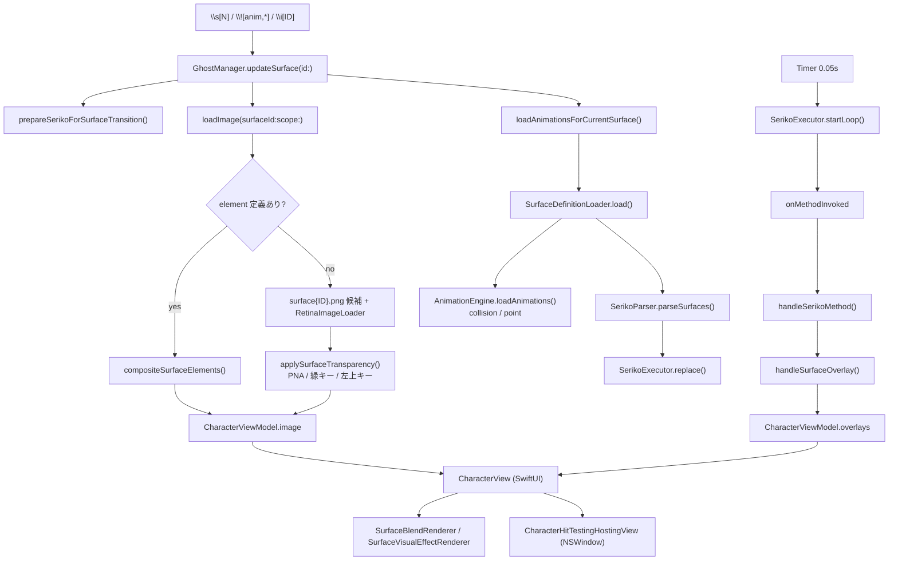
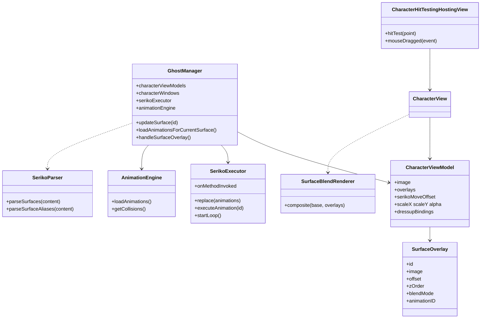

# 5 サーフェス・シェル・SERIKO アニメーション

関連ソースファイル

このページは次のファイルをもとに作成した。

- [Ourin/Ghost/CharacterView.swift](../../Ourin/Ghost/CharacterView.swift)
- [Ourin/Ghost/GhostManager+Surface.swift](../../Ourin/Ghost/GhostManager+Surface.swift)
- [Ourin/Ghost/GhostManager+Animation.swift](../../Ourin/Ghost/GhostManager+Animation.swift)
- [Ourin/Ghost/GhostManager+Display.swift](../../Ourin/Ghost/GhostManager+Display.swift)
- [Ourin/Ghost/GhostManager+Window.swift](../../Ourin/Ghost/GhostManager+Window.swift)
- [Ourin/Ghost/GhostManager+Dressup.swift](../../Ourin/Ghost/GhostManager+Dressup.swift)
- [Ourin/Ghost/GhostManager+Effects.swift](../../Ourin/Ghost/GhostManager+Effects.swift)
- [Ourin/Ghost/GhostManager.swift](../../Ourin/Ghost/GhostManager.swift)（`CharacterViewModel`、シェル descript の読み込み、`\![anim,*]` の振り分け）
- [Ourin/Ghost/GhostTypes.swift](../../Ourin/Ghost/GhostTypes.swift)
- [Ourin/Animation/AnimationEngine.swift](../../Ourin/Animation/AnimationEngine.swift)
- [Ourin/Animation/SerikoParser.swift](../../Ourin/Animation/SerikoParser.swift)
- [Ourin/Animation/SerikoExecutor.swift](../../Ourin/Animation/SerikoExecutor.swift)
- [Ourin/Animation/SurfaceTableParser.swift](../../Ourin/Animation/SurfaceTableParser.swift)
- [Ourin/Ghost/SurfaceBlendRenderer.swift](../../Ourin/Ghost/SurfaceBlendRenderer.swift)
- [Ourin/Ghost/SurfaceVisualEffectRenderer.swift](../../Ourin/Ghost/SurfaceVisualEffectRenderer.swift)
- [Ourin/Ghost/AnchorRasterOperation.swift](../../Ourin/Ghost/AnchorRasterOperation.swift)
- [Ourin/Ghost/AnchorRasterImageRenderer.swift](../../Ourin/Ghost/AnchorRasterImageRenderer.swift)
- [Ourin/Ghost/AnimatedSurfaceLoader.swift](../../Ourin/Ghost/AnimatedSurfaceLoader.swift)
- [Ourin/Ghost/SurfaceTestWindow.swift](../../Ourin/Ghost/SurfaceTestWindow.swift)
- [Ourin/Balloon/RetinaImageLoader.swift](../../Ourin/Balloon/RetinaImageLoader.swift)
- [Ourin/SHIORIEvents/SerikoCursorController.swift](../../Ourin/SHIORIEvents/SerikoCursorController.swift)
- [Ourin/SHIORIEvents/SerikoTooltipController.swift](../../Ourin/SHIORIEvents/SerikoTooltipController.swift)
- [Ourin/SHIORIEvents/InputMonitor.swift](../../Ourin/SHIORIEvents/InputMonitor.swift)（当たり判定の呼び出し箇所のみ）
- [docs/SERIKO_IMPLEMENTATION_ja-jp.md](../../docs/SERIKO_IMPLEMENTATION_ja-jp.md)
- [docs/SERIKO_OVERLAY_DRESSUP_RENDERING_SPEC_ja-jp.md](../../docs/SERIKO_OVERLAY_DRESSUP_RENDERING_SPEC_ja-jp.md)

このページは、ゴーストの「見た目」を担う層を扱う。シェル（`shell/<名前>/`）の `descript.txt`・`surfaces*.txt`・`surfaceNNNN.png`・PNA を読み込み、`SerikoParser` で SERIKO 定義へ変換し、`SerikoExecutor`（と旧来の `AnimationEngine`）で時間進行させ、`SurfaceBlendRenderer` などで合成した結果を `CharacterView` に描く。キャラクターウィンドウの生成・配置・複数ディスプレイ・位置の保存、着せ替え（bind）、`\![effect]`/`\![filter]` もここに含める。

さくらスクリプトの字句解析は [7 さくらスクリプト](./07-sakura-script.md)、`GhostManager` 本体（起動・切替・再生キュー）は [4 GhostManager](./04-ghost-manager.md)、イベント送信の仕組み（`EventBridge`・`InputMonitor`）は [9 SHIORI イベント](./09-shiori-events.md) を参照。バルーン側は [6 バルーンと入力 UI](./06-balloon.md) にまとめた。

## 全体の流れ

`\s[N]` が再生キューで実行されると `updateSurface(id:)` が呼ばれ、画像の読み込み・SERIKO 定義の差し替え・ウィンドウのサイズ変更・`OnSurfaceChange` 発火までを行う。アニメーションは 0.05 秒間隔の `Timer` が `SerikoExecutor.startLoop()` を呼んで進め、各フレームはコールバック経由で `CharacterViewModel.overlays` に積まれる。SwiftUI の `CharacterView` がそれを描画する。

**出典:** [Ourin/Ghost/GhostManager+Surface.swift:108-193](../../Ourin/Ghost/GhostManager+Surface.swift#L108-L193)、[Ourin/Ghost/GhostManager+Animation.swift:336-387](../../Ourin/Ghost/GhostManager+Animation.swift#L336-L387)、[Ourin/Ghost/GhostManager+Animation.swift:1045-1058](../../Ourin/Ghost/GhostManager+Animation.swift#L1045-L1058)、[Ourin/Ghost/CharacterView.swift:56-167](../../Ourin/Ghost/CharacterView.swift#L56-L167)

## 主要な型

| 型 | 役割 | 定義位置 |
|---|---|---|
| `CharacterViewModel` | スコープごとの表示状態（ベース画像、`overlays`、倍率、透明度、SERIKO move、着せ替え状態） | [Ourin/Ghost/GhostManager.swift:11-68](../../Ourin/Ghost/GhostManager.swift#L11-L68) |
| `SurfaceOverlay` | 合成レイヤー 1 枚。`zOrder`→`insertionOrder` で並ぶ。`animationID` で所有アニメを追跡 | [Ourin/Ghost/GhostTypes.swift:84-108](../../Ourin/Ghost/GhostTypes.swift#L84-L108) |
| `SurfaceBlendMode` | `normal`/`overlayFast`/`interpolate`/`asis`/`replace`/`reduce`/`blend(_, destinationAlphaAware:)` | [Ourin/Ghost/SurfaceBlendRenderer.swift:5-13](../../Ourin/Ghost/SurfaceBlendRenderer.swift#L5-L13) |
| `CharacterView` | SwiftUI の `View`。ベース＋オーバーレイ＋テキストアニメを `ZStack` で描く | [Ourin/Ghost/CharacterView.swift:43-168](../../Ourin/Ghost/CharacterView.swift#L43-L168) |
| `CharacterHitTestingHostingView` | `NSHostingView` の派生。透明画素をクリック対象外にし、ドラッグで窓を動かす | [Ourin/Ghost/CharacterView.swift:176-332](../../Ourin/Ghost/CharacterView.swift#L176-L332) |
| `SerikoInterval` / `SerikoMethod` / `SerikoPattern` | SERIKO の interval・method・pattern の値型 | [Ourin/Animation/SerikoParser.swift:3-339](../../Ourin/Animation/SerikoParser.swift#L3-L339) |
| `SerikoParser` | `surfaces*.txt` を `[Int: SerikoSurfaceDefinition]` へ変換。alias も解析 | [Ourin/Animation/SerikoParser.swift:355-849](../../Ourin/Animation/SerikoParser.swift#L355-L849) |
| `SurfaceDefinitionLoader` | シェル内の `surfaces*.txt` と `alias.txt` を SSP 互換順に連結 | [Ourin/Animation/SerikoParser.swift:851-940](../../Ourin/Animation/SerikoParser.swift#L851-L940) |
| `SurfaceTableParser` | `surfacetable.txt`（サーフィステスト用グループ）を解析 | [Ourin/Animation/SurfaceTableParser.swift:77-150](../../Ourin/Animation/SurfaceTableParser.swift#L77-L150) |
| `SerikoExecutor` | アニメーション状態機械。interval 判定・パターン進行・コールバック発行 | [Ourin/Animation/SerikoExecutor.swift:8-661](../../Ourin/Animation/SerikoExecutor.swift#L8-L661) |
| `AnimationEngine` | 旧来の実行経路。現在は主に collision / point の解析と当たり判定に使う | [Ourin/Animation/AnimationEngine.swift:245-754](../../Ourin/Animation/AnimationEngine.swift#L245-L754) |
| `CollisionRegion` | 矩形・楕円・円・多角形・画像色領域の当たり判定 | [Ourin/Animation/AnimationEngine.swift:75-200](../../Ourin/Animation/AnimationEngine.swift#L75-L200) |
| `SurfaceBlendRenderer` | 宛先アルファを使う合成を CPU で行う | [Ourin/Ghost/SurfaceBlendRenderer.swift:18-469](../../Ourin/Ghost/SurfaceBlendRenderer.swift#L18-L469) |
| `SurfaceVisualEffectRenderer` | `\![effect]`/`\![filter]` の Core Image 変換 | [Ourin/Ghost/SurfaceVisualEffectRenderer.swift:9-202](../../Ourin/Ghost/SurfaceVisualEffectRenderer.swift#L9-L202) |
| `AnimatedSurfaceLoader` | SERIKO `import` 用に GIF/APNG/WebP をフレーム列へ分解 | [Ourin/Ghost/AnimatedSurfaceLoader.swift:13-59](../../Ourin/Ghost/AnimatedSurfaceLoader.swift#L13-L59) |

注意: 作業依頼の範囲説明では `CharacterView` を NSView としていたが、実装は SwiftUI の `struct CharacterView: View` で、AppKit 側は `NSHostingView<CharacterView>` を継承した `CharacterHitTestingHostingView` である。

**出典:** [Ourin/Ghost/CharacterView.swift:43-56](../../Ourin/Ghost/CharacterView.swift#L43-L56)、[Ourin/Ghost/CharacterView.swift:176-188](../../Ourin/Ghost/CharacterView.swift#L176-L188)、[Ourin/Ghost/GhostManager.swift:1009-1034](../../Ourin/Ghost/GhostManager.swift#L1009-L1034)

## シェルの読み込み

### シェルの場所と descript.txt

現在のシェルは `ghostURL/shell/<activeShellName>/`（未設定なら `master`）である。シェルの `descript.txt` は `loadDressupConfiguration()` が読み、`EncodingAdapter.decodeTextDefinition` で文字コードを判定してから `LegacyDescriptor.parseDictionary` で辞書化する。ここで取り出すのは次の設定である。

| キー | 用途 | 反映先 |
|---|---|---|
| `seriko.use_self_alpha` | `1`/`true` → `useSelfAlpha`、`full` → `full`、それ以外 → `legacy` | `surfaceTransparencyMode` |
| `sakura.balloon.*` / `kero.balloon.*` / `charN.balloon.*` | バルーンの左右・オフセット（[6 バルーン](./06-balloon.md)） | `shellBalloonSettings` |
| `dressup,カテゴリ,パーツ,サーフェスID,x,y` | 着せ替えパーツ | `dressupConfigurations` |
| `(sakura\|kero\|charN).bindgroupN.name` / `.default` | 着せ替えグループ名・サムネイル・既定着衣 | `dressupBindGroupsByScope` |
| `(…).bindoptionN.group` | `mustselect` / `multiple` などカテゴリのオプション | `dressupBindOptionsByScope` |
| `menuitemN` 系 | 着せ替えメニューの並び | `dressupMenuItemsByScope` |

`switchShell(named:raiseEvent:)` はシェルディレクトリの存在を確認し、`OnShellChanging`（`raiseEvent` 時）→ 着せ替え設定・MAKOTO の再読込 → scope 0/1 を `sakuraDefaultSurface`（既定 0）/`keroDefaultSurface`（既定 10）へ切替 → `OnShellChanged` の順に処理する。

**出典:** [Ourin/Ghost/GhostManager+Surface.swift:660-701](../../Ourin/Ghost/GhostManager+Surface.swift#L660-L701)、[Ourin/Ghost/GhostManager.swift:1344-1394](../../Ourin/Ghost/GhostManager.swift#L1344-L1394)、[Ourin/Ghost/GhostManager.swift:1396-1477](../../Ourin/Ghost/GhostManager.swift#L1396-L1477)、[Ourin/Ghost/GhostManager+Surface.swift:8-20](../../Ourin/Ghost/GhostManager+Surface.swift#L8-L20)

### surfaces*.txt の収集

`SurfaceDefinitionLoader.load(from:)` はシェル直下で名前が `surfaces` で始まり `.txt` で終わる通常ファイルをすべて集め、小文字化したファイル名順に連結し、最後に `alias.txt` を付け足す。`surfacetable.txt` は書式が異なるため連結せず、`loadSurfaceTable(from:)` で別に読む。`loadAnimationsForCurrentSurface()` はサーフェス切替のたびにこの読み込みと `SerikoParser.parseSurfaces` を実行し、結果を `parsedSurfaceDefs` にキャッシュする（キャッシュは毎回上書きされる）。

**出典:** [Ourin/Animation/SerikoParser.swift:851-940](../../Ourin/Animation/SerikoParser.swift#L851-L940)、[Ourin/Ghost/GhostManager+Animation.swift:336-387](../../Ourin/Ghost/GhostManager+Animation.swift#L336-L387)

### サーフェス画像の解決と透過

`loadImage(surfaceId:scope:applyTransparency:transparencyMode:)` は次の順で画像を決める。

1. `surfacetable.txt` に `option,DisableNoDefineSurfaces` があり、`surfaces*.txt` にも `surfacetable.txt` にも ID が無ければ `nil`（描画しない）。
2. SERIKO/2.0 の `elementN` 定義があれば `compositeSurfaceElements` で合成する。各 element の method は `SurfaceBlendMode` に写され、`SurfaceBlendRenderer.composite(base: nil, …)` で 1 枚にする。
3. それ以外はファイル名候補を順に試す。scope 1 のときだけ `surface1<ID>.png`・`surface1<0000ID>.png` を先に、その後 `surface<ID>.png`・`surface<0000ID>.png`。拡張子は `.png` のみ。
4. 見つかった画像は `RetinaImageLoader.image(contentsOf:)` で読み、`@2x`/`@3x` の兄弟ファイルがあれば高解像度 representation として追加する（`NSImage.size` は 1x の論理ポイントに揃える）。

透過処理 `applySurfaceTransparency` は、同名 `.pna` があれば `CIBlendWithMask` で必ずそれを優先する。PNA が無い場合はモード別に分岐する。

| `surfaceTransparencyMode` | PNA が無い画像の扱い |
|---|---|
| `legacy`（既定） | 純緑（R≤8, G≥248, B≤8）を透明化する `applyGreenChromakey` |
| `useSelfAlpha` | 画像がアルファを持てばそのまま、持たなければ左上画素の色をキーにして透明化 |
| `full` | キー色透過をせず不透明のまま使う |

`\s[N]` の ID は `surfaceAliases`（`*.surface.alias` ブロックの数値別名）で先に置き換えられる。文字列別名（`\s[smile]` など）は `parseNamedSurfaceAliases` が作る `surfaceNameAliases` で解決する。

**出典:** [Ourin/Ghost/GhostManager+Surface.swift:258-320](../../Ourin/Ghost/GhostManager+Surface.swift#L258-L320)、[Ourin/Ghost/GhostManager+Surface.swift:323-397](../../Ourin/Ghost/GhostManager+Surface.swift#L323-L397)、[Ourin/Ghost/GhostManager+Surface.swift:416-558](../../Ourin/Ghost/GhostManager+Surface.swift#L416-L558)、[Ourin/Balloon/RetinaImageLoader.swift:13-42](../../Ourin/Balloon/RetinaImageLoader.swift#L13-L42)、[Ourin/Animation/SerikoParser.swift:739-838](../../Ourin/Animation/SerikoParser.swift#L739-L838)

### updateSurface の処理

`updateSurface(id:)` はスコープごとの世代番号 `surfaceRequestGenerationByScope` を進め、古い非同期要求が後から表示を上書きしないようにする。

1. `prepareSerikoForSurfaceTransition` で SERIKO ループ Timer・`AnimationEngine`・`import` 再生・`\![anim,add,overlay,…]` 列を止める（`shared-index` の判定のため executor の状態は残す）。
2. メインキューで `overlays` と `serikoMoveOffset` を消す。
3. `id < 0` なら画像を外して窓を `orderOut` し、`OnSurfaceChange`（新 ID = -1）を送る。
4. それ以外は `DispatchQueue.global(qos: .userInitiated)` で `loadImage` し、メインキューで世代を確認してから反映する。画像が無ければ現在のサーフェスを残す。
5. 反映時は `ensureCharacterWindow`（遅延生成）→ `vm.image` 更新 → `loadAnimationsForCurrentSurface` → `setContentSize(image.size)` と `orderFront` → `relayoutDefaultCharacterWindows` → `positionBalloonWindow` → `dispatchSurfaceChange`。

`dispatchSurfaceChange` は `OnSurfaceChange`（`sakuraSurface`・`keroSurface`・`changedScope`）を NOTIFY し、`notifyOtherSurfaceChange` と `.fmoNeedsRefresh` 通知も出す。`\![set,property,currentghost.scope(N).surface.num,ID]`・`seriko.defaultsurface`・`animation.num` の SET は `applyScopePropertySideEffect` が一時的に `currentScope` を切り替えて同じ API に流す。

トーク表示後の `OnSurfaceRestore` は、バルーンが閉じてから `surfaceRestoreDelay`（既定 15 秒）後に 1 回だけ GET で送る。パッシブモード・誘導モード中は送らない。

**出典:** [Ourin/Ghost/GhostManager+Surface.swift:25-63](../../Ourin/Ghost/GhostManager+Surface.swift#L25-L63)、[Ourin/Ghost/GhostManager+Surface.swift:68-106](../../Ourin/Ghost/GhostManager+Surface.swift#L68-L106)、[Ourin/Ghost/GhostManager+Surface.swift:108-193](../../Ourin/Ghost/GhostManager+Surface.swift#L108-L193)、[Ourin/Ghost/GhostManager+Surface.swift:195-256](../../Ourin/Ghost/GhostManager+Surface.swift#L195-L256)、[Ourin/Ghost/GhostManager+Animation.swift:97-104](../../Ourin/Ghost/GhostManager+Animation.swift#L97-L104)、[Ourin/Ghost/GhostManager.swift:1017](../../Ourin/Ghost/GhostManager.swift#L1017)

## SERIKO 定義の解析（SerikoParser）

`parseSurfaces(_:)` は 1 行ずつ処理する。`surface` で始まり `{` を含まない行をヘッダとみなし、`surface0,3,5` のようなカンマ区切りと `surface.append10` の追記形式から ID 列を作る。次の `{` 行から `}` 行までをブロックとして、含まれる全 ID に同じ行を適用する。コメントは `#` 以降と `//` 以降を除去する。ブロック内の行は次のいずれかとして解釈する。

| 行の形 | 解析結果 |
|---|---|
| `elementN,method,filename,x,y` | `SerikoElement`（index 順に整列） |
| `animationN.interval,値` | `SerikoInterval.parse` |
| `animationN.option,値` | `+` も区切りとして分解。`interval=`・`surface=`・`series=`・`pingpong`・`align`/`alignx`/`aligny` は専用フィールドへ、他（`exclusive`・`background`・`shared`・`shared-index` など）は `options` 配列へ |
| `animationN.overlay,ID,wait,x,y` | method `overlay` のパターンとして追加 |
| `animationN.patternM,[method,]ID,wait,x,y,...` | 先頭が数値なら旧形式（method=`overlay`）。wait は `100` か SSP 拡張の `50-150`（範囲）を受理 |

引数分割の `splitArguments` は `()`・`[]`・`{}` 内のカンマで分けない。これにより `alternativestart,(1,2,3)` の ID 列を 1 引数として保持し、`SerikoPattern.referencedAnimationIDs` で取り出す。

**出典:** [Ourin/Animation/SerikoParser.swift:392-557](../../Ourin/Animation/SerikoParser.swift#L392-L557)、[Ourin/Animation/SerikoParser.swift:597-737](../../Ourin/Animation/SerikoParser.swift#L597-L737)、[Ourin/Animation/SerikoParser.swift:283-339](../../Ourin/Animation/SerikoParser.swift#L283-L339)、[Ourin/Animation/SerikoParser.swift:840-849](../../Ourin/Animation/SerikoParser.swift#L840-L849)

### interval の対応表

`SerikoInterval.parse` は小文字化し、`+` で分割した複合指定も受け付ける。複合時の衝突解決は SSP 準拠とコメントされている（`never` は除去、`always` があれば `random`/`periodic` を落とす、`periodic` があれば `random` を落とす、パラメータ付きは 1 つまで・末尾のみ）。発火判定は `SerikoExecutor.shouldStart` が、Timer の各 tick（0.05 秒）で未実行の定義すべてに対して行う。

| interval | 別名 | 実行時の判定（`shouldStart`） |
|---|---|---|
| `always` | `alw`, `all` | 常に開始。終端後はループ |
| `sometimes` | `som` | tick ごとに乱数 < 0.2 |
| `rarely` | `rar` | tick ごとに乱数 < 0.05 |
| `random,N` | `ran,N` | tick ごとに 1/N（N 省略時 10） |
| `periodic,N` | `per,N` | 初回は基準時刻だけ記録し、N 秒（省略時 1）経過ごとに開始 |
| `runonce` | `run` | サーフェス単位で 1 回だけ。終端で完了 |
| `never` | `nev` | 自動では開始しない（`\i` などで明示起動） |
| `yen-e` | `yen` | `\e` 実行時の `triggerYenE()` 後の tick |
| `talk` | `tal` | `appendText` / 改行の `triggerTalk()` 後の tick |
| `talk,N` | `tal,N` | 表示文字数が前回発火から N 文字以上増えたとき |
| `starttalk` | `startt` | 実際の本文が表示された最初の tick（スコープ内で 1 回） |
| `endtalk` | `endt` | スコープ切替時の `triggerEndTalk()` で、starttalk 済みの場合 |
| `bind` | `bin` | 着せ替え状態が変わった時の `triggerBind()` 後の tick |
| `A+B` | — | すべての条件を同時に満たすときだけ開始 |
| `timer` など上記以外 | — | `.unknown` となり開始しない（`timer` は未実装） |

`replace(animations:)` はサーフェス切替時に定義を差し替え、`runonce`・`periodic`・`talk,N`・starttalk の状態をリセットする。例外として、旧定義と新定義の両方に `shared-index` option があり、現在の pattern index が新定義にも存在するアニメーションだけは継続し、新しいベースに対して現在フレームを再発行する。

**出典:** [Ourin/Animation/SerikoParser.swift:3-130](../../Ourin/Animation/SerikoParser.swift#L3-L130)、[Ourin/Animation/SerikoExecutor.swift:64-114](../../Ourin/Animation/SerikoExecutor.swift#L64-L114)、[Ourin/Animation/SerikoExecutor.swift:484-511](../../Ourin/Animation/SerikoExecutor.swift#L484-L511)、[Ourin/Animation/SerikoExecutor.swift:572-661](../../Ourin/Animation/SerikoExecutor.swift#L572-L661)、[Ourin/Ghost/GhostManager+Animation.swift:397-417](../../Ourin/Ghost/GhostManager+Animation.swift#L397-L417)

## SERIKO の実行（SerikoExecutor と GhostManager+Animation）

### 状態と進行

`SerikoExecutor` は `activeAnimations: [Int: AnimationState]` を持ち、`startLoop()` が呼ばれるたびに次を行う。

1. `startScheduledAnimations` で interval 条件を満たした定義を開始する。`series` 指定は同じ系列が実行中なら開始しない。`exclusive` は `background` 以外の実行中アニメを止める。
2. 各アクティブアニメについて、経過時間が `currentDuration`（範囲 wait はパターン開始時に 1 回だけ抽選）を超えたら次のパターンへ進む。`pingpong` は端で向きを反転する。`runonce` は終端で `.completed` として終了し、それ以外は先頭へ戻る。
3. `pendingIntervalEvents`（yen-e/talk/bind など）を消す。

`GhostManager` 側の Timer は `startSerikoLoopIfNeeded()` が 0.05 秒間隔で作り、tick 後にアクティブなアニメが 0 件なら `stopSerikoLoopIfIdle()` で止める。executor と Timer は ObjC の関連オブジェクトで `GhostManager` 1 個につき 1 組保持する。

**出典:** [Ourin/Animation/SerikoExecutor.swift:8-55](../../Ourin/Animation/SerikoExecutor.swift#L8-L55)、[Ourin/Animation/SerikoExecutor.swift:122-203](../../Ourin/Animation/SerikoExecutor.swift#L122-L203)、[Ourin/Animation/SerikoExecutor.swift:521-565](../../Ourin/Animation/SerikoExecutor.swift#L521-L565)、[Ourin/Ghost/GhostManager+Animation.swift:33-79](../../Ourin/Ghost/GhostManager+Animation.swift#L33-L79)、[Ourin/Ghost/GhostManager+Animation.swift:1045-1058](../../Ourin/Ghost/GhostManager+Animation.swift#L1045-L1058)

### method の対応表

`SerikoMethod.parse` が受け付ける method と、`executePattern` → `onMethodInvoked` → `handleSerikoMethod` の扱いを示す。サーフェス ID `-1` は自身を停止、`-2` は他のアニメをすべて停止する制御フレームとして扱う（`import` や `start` 系は対象外）。

| method（別名） | 実装 | 描画側の処理 |
|---|---|---|
| `overlay` | あり | `handleSurfaceOverlay`（`zOrder` 100、`blendMode` `.normal`）。同じ animationID の前フレームは置換 |
| `overlayfast`（`overlay-fast`） | あり | `.overlayFast`（宛先アルファを掛ける） |
| `base` | あり | `handleAnimAddBase` → 通常の `updateSurface` |
| `move` | あり | 座標を元位置からの相対値として `serikoMoveOffset` に設定し、キャラ描画全体を動かす |
| `scaling` | あり | `onScalingInvoked` で x/y を 1/100 倍してスコープ倍率へ積算 |
| `reduce` | あり | `.reduce`（宛先アルファ × ソースアルファ） |
| `replace`（`ccyr`） | あり | `.replace`（ソース矩形内を置換） |
| `interpolate` | あり | `.interpolate`（宛先が透明なほど強く合成） |
| `asis` | あり | `.asis`（ソースの透過を無視。透過処理なしで画像を読む） |
| `blend-*` / `overlay<モード>` | あり | `.blend(SerikoBlendMode, destinationAlphaAware:)`。`multiply` など 28 種 |
| `add` / `bind` / `auto` | あり | overlay として描画。`bind` は `zOrder` 200 の `dressup_bind_*` レイヤー |
| `start` / `insert` | あり | `executeAnimation(id: surfaceID)` で別アニメを起動（`insert` は `start` と同じ扱い） |
| `alternativestart`（`alternatestart`） | あり | 括弧内の ID 列から乱数で 1 つ選び起動 |
| `stop` | あり | 自身を停止 |
| `alternativestop`（`alternatestop`） | あり | ID 列から 1 つ選び停止 |
| `parallelstart` / `parallelstop` | あり | ID 列すべてを起動／停止（executor 内で完結） |
| `import` | あり | `filename,遅延,x,y` で `AnimatedSurfaceLoader` を使い別再生 |
| `noop` | あり | 何もしない |
| 上記以外 | `.unknown` | 何もしない |

option の `background` を持つアニメは `zOrder` -100 で描き、ベースの背後に回る。`align`/`alignx`/`aligny` 指定時はベース画像とオーバーレイ画像の寸法から位置を計算し直す。アニメ終了時（`handleAnimationFinished`）はオーバーレイを消すが、`bind+runonce` が正常完了した場合は最終フレームを `persistentSerikoAnimationIDsByScope` に残し、着せ替え変更かサーフェス変更まで表示を保つ。終了ごとに `OnAnimationFinished`（独自イベント、応答は無視）を NOTIFY し、`\i[ID,wait]` の待機を解除する。

**出典:** [Ourin/Animation/SerikoParser.swift:132-281](../../Ourin/Animation/SerikoParser.swift#L132-L281)、[Ourin/Animation/SerikoExecutor.swift:205-306](../../Ourin/Animation/SerikoExecutor.swift#L205-L306)、[Ourin/Animation/SerikoExecutor.swift:327-425](../../Ourin/Animation/SerikoExecutor.swift#L327-L425)、[Ourin/Ghost/GhostManager+Animation.swift:838-954](../../Ourin/Ghost/GhostManager+Animation.swift#L838-L954)、[Ourin/Ghost/GhostManager+Animation.swift:996-1034](../../Ourin/Ghost/GhostManager+Animation.swift#L996-L1034)

### さくらスクリプトとの接続

`\i[ID]` は再生キューの `.startAnimation` から `playAnimation(id:wait:)` に入る。まず `SerikoExecutor.executeAnimation` を試し、定義が無ければ旧 `AnimationEngine.playAnimation` に回す。`wait` 付きは `.waitAnimation(ID)` をキュー先頭へ積み、`handleAnimationFinished` の `processNextUnit()` で再開する。`\![anim,*]` は `executeAnimationCommand` が次へ振り分ける。

| コマンド | ハンドラ |
|---|---|
| `\![anim,clear,ID]` / `\![anim,stop,ID]` / 旧 `\![anim,stopID]` | `handleAnimClear` |
| `\![anim,pause,ID]` / `\![anim,resume,ID]` | `handleAnimPause` / `handleAnimResume` |
| `\![anim,stop]` | `handleAnimStop`（`always` の自動再起動も抑止） |
| `\![anim,offset,ID,x,y]` | `handleAnimOffset`（既存オーバーレイも差分移動） |
| `\![anim,add,overlay\|overlayfast,ID[,x,y]]` | `handleAnimAddOverlay(Fast)`。`ID,x,y,time,…[,always\|runonce]` は独立した列再生 |
| `\![anim,add,base,ID]` / `move,x,y` / `bind,ID` / `text,…` | `handleAnimAddBase` / `handleAnimAddMove` / `handleSurfaceOverlay(type:.bind)` / `addTextAnimation` |

`import` は `importAnimatedSurface` がシェルディレクトリ外を指すパスを拒否し、`AnimatedSurfaceLoader.load` で得たフレームを `Timer` で順に差し替える。`AnimatedSurfaceLoader` は ImageIO の `CGImageSource` で全フレームとフレームごとの `DelayTime`（無ければ 0.1 秒、最小 0.01 秒）を取り出し、元ファイルのループ回数は使わず 1 回だけ再生する。

**出典:** [Ourin/Ghost/GhostManager.swift:2588-2687](../../Ourin/Ghost/GhostManager.swift#L2588-L2687)、[Ourin/Ghost/GhostManager.swift:4994-4999](../../Ourin/Ghost/GhostManager.swift#L4994-L4999)、[Ourin/Ghost/GhostManager+Animation.swift:299-333](../../Ourin/Ghost/GhostManager+Animation.swift#L299-L333)、[Ourin/Ghost/GhostManager+Animation.swift:438-543](../../Ourin/Ghost/GhostManager+Animation.swift#L438-L543)、[Ourin/Ghost/GhostManager+Animation.swift:573-836](../../Ourin/Ghost/GhostManager+Animation.swift#L573-L836)、[Ourin/Ghost/AnimatedSurfaceLoader.swift:10-59](../../Ourin/Ghost/AnimatedSurfaceLoader.swift#L10-L59)

### 旧 AnimationEngine の役割

`AnimationEngine` は Metal デバイスを初期化するが、描画には使っていない（`prepareMetalTextures` はテクスチャを作るだけ）。アニメーション再生は旧数値形式の `animationN.patternM,ID,wait,x,y` だけを解釈し、60 Hz の Timer で進める。現在の主な役割は collision と point の解析である。

- `collisionN,x1,y1,x2,y2,名前`（矩形）と `collisionexN,名前,rect|ellipse|circle|polygon|region,…` を読む。`region` はシェル内画像の指定 RGB 画素を判定に使い、5 番目の引数が `true`/`1` なら反転する。
- `animationN.collision…` はそのアニメ実行中だけ有効な領域として別に保持し、`getCollisions` で通常領域より前に返す。
- `point.centerx` / `point.<名前>.centerx` 系を `points` に保持する。

**出典:** [Ourin/Animation/AnimationEngine.swift:14-71](../../Ourin/Animation/AnimationEngine.swift#L14-L71)、[Ourin/Animation/AnimationEngine.swift:280-466](../../Ourin/Animation/AnimationEngine.swift#L280-L466)、[Ourin/Animation/AnimationEngine.swift:471-596](../../Ourin/Animation/AnimationEngine.swift#L471-L596)、[Ourin/Animation/AnimationEngine.swift:657-672](../../Ourin/Animation/AnimationEngine.swift#L657-L672)、[Ourin/Animation/AnimationEngine.swift:727-748](../../Ourin/Animation/AnimationEngine.swift#L727-L748)

## 描画

### CharacterView

`CharacterView.body` はベース画像が無い間は `Color.clear`（既定 300×400 のキャンバス）だけを描き、オーバーレイや着せ替えが単独で浮かないようにする。ベースがある場合の分岐は次のとおり。

- いずれかのオーバーレイが `.normal` 以外、または effect/filter がある場合は `SurfaceBlendRenderer.composite` でビットマップ 1 枚に合成してから表示する（filter はさらに `SurfaceVisualEffectRenderer` を通す）。
- すべて `.normal` なら SwiftUI の `ZStack` で、`zOrder < 0` のオーバーレイ → ベース → `zOrder >= 0` のオーバーレイの順に重ねる。
- その上に `dressupParts`、`\![anim,add,text]` の `textAnimations`、`DragDropView` を置く。
- 最後に `serikoMoveOffset` の offset → `scaleEffect(scaleX, scaleY)` → `opacity(alpha)` を適用する。`repaintLocked` の間は hit test を無効にする。

**出典:** [Ourin/Ghost/CharacterView.swift:56-167](../../Ourin/Ghost/CharacterView.swift#L56-L167)、[Ourin/Ghost/GhostTypes.swift:84-130](../../Ourin/Ghost/GhostTypes.swift#L84-L130)

### SurfaceBlendRenderer

ベースを `zOrder 0, insertionOrder Int.min` の層として加え、全層を `sortedForDisplay` で並べて上端始まりの非乗算 RGBA バッファへ順に合成する。キャンバスはオーバーレイのはみ出し分まで広がるが、負のオフセットは切り捨てられる。

| モード | 実効アルファ／処理 |
|---|---|
| `normal` | ソースアルファ（source-over） |
| `overlayFast` | ソース × 宛先アルファ |
| `interpolate` | ソース × (1 − 宛先アルファ) |
| `asis` | 不透明度だけ（ソースの透過を無視） |
| `replace` | 宛先をソース画素で置き換える |
| `reduce` | 宛先 RGB を残し、アルファを宛先 × ソースにする |
| `blend` | `multiply`/`screen`/`overlay`/`soft-light`/HSL 系/`dither`（2×2 Bayer）など。`-fast` は宛先アルファを掛ける |

**出典:** [Ourin/Ghost/SurfaceBlendRenderer.swift:19-184](../../Ourin/Ghost/SurfaceBlendRenderer.swift#L19-L184)、[Ourin/Ghost/SurfaceBlendRenderer.swift:186-284](../../Ourin/Ghost/SurfaceBlendRenderer.swift#L186-L284)、[Ourin/Ghost/SurfaceBlendRenderer.swift:381-448](../../Ourin/Ghost/SurfaceBlendRenderer.swift#L381-L448)

### effect / filter

`applyEffect`/`applyFilter` は `EffectConfig`/`FilterConfig` を `activeEffects`/`activeFilters` に積むだけで、実際の変換は描画時に `SurfaceVisualEffectRenderer` が行う。対応名は `blur`・`gaussianblur`・`motionblur`・`zoomblur`・`colorcontrols`・`saturation`・`brightness`・`contrast`・`grayscale`・`sepia`・`invert`・`hue`・`vibrance`・`pixellate`・`crystallize`・`edges`・`posterize`・`opacity` とその別名で、Core Image の組み込みフィルタに写す。未知の名前は画像をそのまま返す（プラグイン名を勝手に別効果へ置き換えない方針がコメントにある）。`filter` は `time` ミリ秒後に自動で外れる。`surfaceID` 付き effect は同じ `surfaceID` を持つオーバーレイだけに適用する。

**出典:** [Ourin/Ghost/GhostManager+Effects.swift:19-61](../../Ourin/Ghost/GhostManager+Effects.swift#L19-L61)、[Ourin/Ghost/SurfaceVisualEffectRenderer.swift:4-160](../../Ourin/Ghost/SurfaceVisualEffectRenderer.swift#L4-L160)、[Ourin/Ghost/CharacterView.swift:57-94](../../Ourin/Ghost/CharacterView.swift#L57-L94)

### AnchorRaster*（バルーンのアンカー装飾）

`AnchorRasterOperation` は Win32 `SetROP2` の 16 種（`black`・`notmergepen`・…・`white`、`R2_` 接頭辞も可）と `none` を表し、チャネルごとのブール演算を実装する。`AnchorRasterImageRenderer.renderPatch` はバルーン背景画像を RGBA に展開し、アンカー矩形（角丸 2）の各画素にブラシ色との ROP2 演算を行ったパッチ画像を返す。`BalloonView` の square 装飾がこのパッチを文字の背後に置く（[6 バルーン](./06-balloon.md)）。

**出典:** [Ourin/Ghost/AnchorRasterOperation.swift:7-87](../../Ourin/Ghost/AnchorRasterOperation.swift#L7-L87)、[Ourin/Ghost/AnchorRasterImageRenderer.swift:9-162](../../Ourin/Ghost/AnchorRasterImageRenderer.swift#L9-L162)

## ヒットテスト・当たり判定・ドラッグ

透過部分のクリック抜けは `CharacterHitTestingHostingView.hitTest(_:)` が担う。`repaintLocked`・`alpha ≤ 0.01`・ベース未ロードのときは `nil` を返す。それ以外は座標を自身の左上原点へ変換し、`serikoMoveOffset` と倍率を逆算したうえで、ベース画像・オーバーレイ（上から）・着せ替えパーツ・テキストアニメの順に `NSImage.hitTest` で不透明画素かどうかを調べる。左ドラッグは `window?.performDrag(with:)` で窓を動かし、右ボタンを離すと `InputMonitor.shared.rightClickMenuHandler` を呼んでオーナードローメニューを出す（`menu(for:)` は `nil` を返して二重表示を防ぐ）。

当たり判定名（UKADOC の Reference4）は `InputMonitor.mouseParams` が `GhostCharacterWindow_<scope>` 窓上のイベントで `collisionRegionName(at:scope:)` を呼んで求める。現在の `activeAnimationIDsByScope` と executor の実行中 ID を `AnimationEngine.getCollisions` に渡し、最初に `contains` が真になった領域名を返す。`OnMouse*` 系イベントの発火自体は [9 SHIORI イベント](./09-shiori-events.md) の範囲である。

SERIKO のカーソル・ツールチップは当たり判定名を使う。`SerikoCursorController.update(scope:region:kind:)` は PROPERTY `currentghost.seriko.cursor.scope(ID).mouse{up,down,hover,wheel}list(<領域>).path` を引き、シェル → `ghost/master` の順に画像を探して中心ホットスポットの `NSCursor` を設定する（読めない `.cur` などは標準カーソルに戻す）。`SerikoTooltipController.show` は `currentghost.seriko.tooltip.scope(ID).textlist(<領域>).text` を、ボーダーレス窓（レベル `.popUpMenu`、`ignoresMouseEvents`）でカーソル右上に表示する。どちらも `InputMonitor` の hover・移動・押下処理から呼ばれる。

**出典:** [Ourin/Ghost/CharacterView.swift:194-331](../../Ourin/Ghost/CharacterView.swift#L194-L331)、[Ourin/Ghost/GhostManager+Surface.swift:740-764](../../Ourin/Ghost/GhostManager+Surface.swift#L740-L764)、[Ourin/SHIORIEvents/InputMonitor.swift:549-599](../../Ourin/SHIORIEvents/InputMonitor.swift#L549-L599)、[Ourin/SHIORIEvents/InputMonitor.swift:643-664](../../Ourin/SHIORIEvents/InputMonitor.swift#L643-L664)、[Ourin/SHIORIEvents/SerikoCursorController.swift:6-60](../../Ourin/SHIORIEvents/SerikoCursorController.swift#L6-L60)、[Ourin/SHIORIEvents/SerikoTooltipController.swift:6-89](../../Ourin/SHIORIEvents/SerikoTooltipController.swift#L6-L89)

## キャラクターウィンドウ（GhostManager+Window / +Display）

### 生成と初期配置

`start()` が `setupWindows()` で scope 0/1 だけ先に作り、scope 2 以降は `\p[N]` や `\s` の参照時に `ensureCharacterWindow` で遅延生成する。`setupCharacterWindow(for:)` の設定は次のとおり。

- ボーダーレス・非不透明・背景透明、レベルは `CGWindowLevelForKey(.floatingWindow)`、`collectionBehavior` は `.canJoinAllSpaces`・`.fullScreenAuxiliary`、識別子は `GhostCharacterWindow_<scope>`。
- 保存位置（`resourceManager.getCharDefaultLeft/Top`）があれば `clampToVisibleScreens` でいずれかの画面の可視領域に収めて復元する。無ければ `defaultCharacterFrame` で `NSScreen.main` の可視領域右下に scope 0 を置き、scope 1 以降をその左へ 10pt 間隔で並べる。
- サーフェスが読み込まれるまで `orderOut` のままにし、`updateSurface` が画像を設定した時だけ表示する（z-order・表示系コマンドも `orderCharacterWindowIfLoaded` で同じ条件に揃える）。
- 移動・リサイズ・最小化・復帰の通知を購読する。

**出典:** [Ourin/Ghost/GhostManager+Window.swift:62-195](../../Ourin/Ghost/GhostManager+Window.swift#L62-L195)、[Ourin/Ghost/GhostManager+Window.swift:1412-1462](../../Ourin/Ghost/GhostManager+Window.swift#L1412-L1462)、[Ourin/Ghost/GhostManager+Window.swift:1555-1577](../../Ourin/Ghost/GhostManager+Window.swift#L1555-L1577)、[Ourin/Ghost/GhostManager+Window.swift:1689-1705](../../Ourin/Ghost/GhostManager+Window.swift#L1689-L1705)、[Ourin/Ghost/GhostManager.swift:1650-1661](../../Ourin/Ghost/GhostManager.swift#L1650-L1661)

### 位置の保存と複数ディスプレイ

`characterWindowDidChangeFrame`（`GhostManager+Balloon.swift` にある）は、窓が動くたびにバルーンを置き直し、原点を `setCharDefaultLeft/Top` に保存し、`updateDisplayHandover` でモニタが変わったか調べる。保存した既定配置から 1pt 以上ずれたスコープは `defaultLayoutLeftEdges` から外し、以後の自動並べ直し対象から除く。モニタ判定は `DisplayObserver.snapshot` の display ID で行い、起動時は `OnDisplayHandover`（`state=init`、NOTIFY）、移動時は `state=update`（GET）を送る。

毎秒の tick から呼ばれる `overlapTransitionEvents()` は、表示中の窓が所属画面の可視領域からはみ出していれば見切れ、窓同士が交差していれば重なりとし、前回値から変化した時だけ `OnOffscreen`・`OnOverlap`（Reference0=現在、Reference1=直前、区切りは `\x01`）を返す。`mikireScopes()`/`kasanariScopes()` は `OnSecondChange` 用のカンマ区切り値を返す。

デスクトップ整列（descript の `seriko.alignmenttodesktop` / `sakura.`・`kero.`・`charN.` 接頭辞）は `desktopAlignment(for:)` で解決し、`enforceDesktopAlignment` が可視領域の上下左右から 20pt 離れた位置へ原点を合わせる。画面構成の変更（`NSApplication.didChangeScreenParametersNotification`）で再適用する。画面端への吸着（スナップ）を行うコードは見当たらない。

**出典:** [Ourin/Ghost/GhostManager+Balloon.swift:625-647](../../Ourin/Ghost/GhostManager+Balloon.swift#L625-L647)、[Ourin/Ghost/GhostManager+Window.swift:200-252](../../Ourin/Ghost/GhostManager+Window.swift#L200-L252)、[Ourin/Ghost/GhostManager+Window.swift:1579-1686](../../Ourin/Ghost/GhostManager+Window.swift#L1579-L1686)、[Ourin/Ghost/GhostManager+Display.swift:98-130](../../Ourin/Ghost/GhostManager+Display.swift#L98-L130)、[Ourin/Ghost/GhostManager+Display.swift:1047-1101](../../Ourin/Ghost/GhostManager+Display.swift#L1047-L1101)

### ウィンドウ操作コマンド

| 機能 | 関数 | 要点 |
|---|---|---|
| `\![move]` / `\![moveasync]` | `executeMoveCommand` → `moveWindow` / `moveWindowAsync` | `--X/--Y/--time/--base/--base-offset/--move-offset/--method/--option=ignore-sticky-window/--wait` と旧位置引数（`fix` 可）。`--base` 省略時はキャラのいる画面の左上原点・+Y 下向き。非同期移動は 60 Hz Timer で補間し `cancel` で途中停止 |
| `\4` / `\5` | `moveAwayFromPartner` / `moveTowardPartner` | 相方（scope 0 ↔ 1、他は 0）から 120pt 離れる／辺が接する位置へ |
| `\![set,scaling,…]` | `executeSetScalingCommand` → `animateUserScaling` | 60 Hz で補間し、完了時だけ `OnShellScaling`（同期時は `OnBalloonScaling`）を GET |
| `\![set,alpha,…]` | `executeSetAlphaCommand` | 負値は再描画のみ。0〜100% を補間 |
| `\![set,zorder,…]` / `sticky-window` | `setWindowZOrder` / `setStickyWindow` | z-order は後から生成された窓にも再適用。sticky は追従窓との相対位置を保存して master の移動に追従 |
| `\![set,windowstate,…]` | `setWindowState` | `stayontop`/`minimize`/`maximize`/`restore`/`hide`/`show`/`focus`。最小化・復帰で `OnWindowStateMinimize/Restore` |
| 位置リセット | `executeResetWindowPos` | `OnResetWindowPos` を GET し、応答が無い時だけ既定配置へ並べ直す |

`+Display` には他に、ゴースト descript の既定位置を `ResourceManager` へ写す `applyGhostConfiguration`、名前入力ダイアログ、サウンド・動画再生（[16 付帯機能](./16-auxiliary-features.md)）、URL・メール・ヘルプ・readme のオープン処理が同居している。

**出典:** [Ourin/Ghost/GhostManager+Window.swift:395-447](../../Ourin/Ghost/GhostManager+Window.swift#L395-L447)、[Ourin/Ghost/GhostManager+Window.swift:449-884](../../Ourin/Ghost/GhostManager+Window.swift#L449-L884)、[Ourin/Ghost/GhostManager+Window.swift:922-1130](../../Ourin/Ghost/GhostManager+Window.swift#L922-L1130)、[Ourin/Ghost/GhostManager+Window.swift:1158-1405](../../Ourin/Ghost/GhostManager+Window.swift#L1158-L1405)、[Ourin/Ghost/GhostManager+Window.swift:1467-1517](../../Ourin/Ghost/GhostManager+Window.swift#L1467-L1517)、[Ourin/Ghost/GhostManager+Display.swift:14-93](../../Ourin/Ghost/GhostManager+Display.swift#L14-L93)、[Ourin/Ghost/GhostManager+Display.swift:176-1042](../../Ourin/Ghost/GhostManager+Display.swift#L176-L1042)、[Ourin/Ghost/GhostManager+Animation.swift:173-207](../../Ourin/Ghost/GhostManager+Animation.swift#L173-L207)

## 着せ替え（GhostManager+Dressup / +Effects）

`\![bind,カテゴリ,パーツ,値,…]` と `\![bind-noevent,…]` は `executeBindCommand` が `parseDressupBindPlans` でタプル列に分解し、1 件ずつ `handleBindDressup` を completion でつないで実行する。値 `0`/`false`/`off`/`none`/`default` は脱衣、省略はトグル、パーツ空欄はカテゴリ単位の操作になる。

- `bindoption` の `mustselect` は最後の 1 パーツを外させず、`multiple` が無いカテゴリは 1 パーツだけを残す。
- 着衣時は `applyDressup` が `dressup,…` で定義したサーフェスの画像を `dressup_<カテゴリ>_<パーツ>_` 接頭辞のオーバーレイ（`zOrder` 200）として追加し、脱衣時は同じ接頭辞のオーバーレイを消す。どちらも `bind+runonce` の保持フレームを先に消す。
- 状態が変わり、対象が現在スコープなら `serikoExecutor.triggerBind()` で SERIKO の `bind` interval を起こす。
- `bind` ではイベントを `OnDressupChanged`（変更パーツごと、100 件以上なら省略）→ `OnNotifyDressupInfo`（全スコープの全定義を `\x01` 区切りの Reference で列挙）の順に送る。スクリプト起因は最後の 1 件だけ GET、`bind-noevent` は送らない。

右クリックメニューの「着せ替え(D)」は `dressupMenuEntries`（`menuitemN` の順、残りは bindgroup ID 順）から作り、選択時に `toggleDressupBindGroup` で `source=user`・GET の bind を行う。起動時の既定着衣（`bindgroupN.default,1`）は `applyDefaultDressupBindings` がイベントなしで反映する。

`+Effects` には、テキストアニメ（`addTextAnimation`、`time` ミリ秒後に除去）と、バルーンの切替（`switchBalloon`、[6 バルーン](./06-balloon.md) で説明）も入っている。

**出典:** [Ourin/Ghost/GhostManager+Dressup.swift:8-65](../../Ourin/Ghost/GhostManager+Dressup.swift#L8-L65)、[Ourin/Ghost/GhostManager+Dressup.swift:113-297](../../Ourin/Ghost/GhostManager+Dressup.swift#L113-L297)、[Ourin/Ghost/GhostManager+Dressup.swift:299-369](../../Ourin/Ghost/GhostManager+Dressup.swift#L299-L369)、[Ourin/Ghost/GhostManager+Effects.swift:75-292](../../Ourin/Ghost/GhostManager+Effects.swift#L75-L292)、[Ourin/Ghost/GhostManager+Effects.swift:297-319](../../Ourin/Ghost/GhostManager+Effects.swift#L297-L319)

## サーフィステストウィンドウ（デバッグ UI）

`\![open,surfacetest]` で `openSurfaceTestWindow()` が SwiftUI の `SurfaceTestView` を `NSWindow` に載せる。一覧は `SurfaceTestCatalog.makeGroups` が作り、`surfacetable.txt` のグループ（`__disabled` グループと `__parts` エントリは除外）を先に並べ、残りの ID（`surfaces*.txt` の定義とシェル内の `surface*.{png,jpg,gif,bmp,ico,cur}`、`@2x`/`@3x` 接尾辞と `surface1<ID>` 形式も考慮）を「未分類」グループにまとめる。行をクリックすると `selectSurfaceForTest(id:scope:)` が一時的に `currentScope` を切り替えて `updateSurface` を呼び、実際のキャラクターへ適用する。「再読み込み」ボタンは定義を読み直す。

**出典:** [Ourin/Ghost/SurfaceTestWindow.swift:21-121](../../Ourin/Ghost/SurfaceTestWindow.swift#L21-L121)、[Ourin/Ghost/SurfaceTestWindow.swift:175-260](../../Ourin/Ghost/SurfaceTestWindow.swift#L175-L260)、[Ourin/Ghost/SurfaceTestWindow.swift:262-315](../../Ourin/Ghost/SurfaceTestWindow.swift#L262-L315)、[Ourin/Animation/SurfaceTableParser.swift:8-55](../../Ourin/Animation/SurfaceTableParser.swift#L8-L55)

## 既存ドキュメントとの食い違い

- 注意: [docs/SERIKO_IMPLEMENTATION_ja-jp.md](../../docs/SERIKO_IMPLEMENTATION_ja-jp.md) の interval・method 一覧は古い。コードには `periodic`・`talk,N`・`starttalk`・`endtalk`・複合指定、および `scaling`・`interpolate`・`blend-*`・`import`・`insert`・`parallelstart/stop`・`alternativestop`・`noop` などがある（[Ourin/Animation/SerikoParser.swift:3-281](../../Ourin/Animation/SerikoParser.swift#L3-L281)）。同文書の「`move` -> `handleAnimAddMove`」も実装と異なり、SERIKO の `move` は `serikoMoveOffset` を設定する（`handleAnimAddMove` は `\![anim,add,move]` 用）。文書中のコールバックのコード例（引数 1 個）も現在のシグネチャと一致しない。
- 注意: [docs/SERIKO_OVERLAY_DRESSUP_RENDERING_SPEC_ja-jp.md](../../docs/SERIKO_OVERLAY_DRESSUP_RENDERING_SPEC_ja-jp.md) は実装計画書である。`OverlayView.swift`・`DressupPartView.swift` を新規作成するとしているが、実装では両 View とも `CharacterView.swift` 内にある。`\![anim,*]` を「未実装」としているが実装済みである。着せ替えを `dressupParts` と `applyDressupBindings()` で描く計画も実装されておらず、`dressupParts` に代入するコードは見当たらない（実際の着せ替えは `dressup_` 接頭辞のオーバーレイ）。

**出典:** [docs/SERIKO_IMPLEMENTATION_ja-jp.md:22-27](../../docs/SERIKO_IMPLEMENTATION_ja-jp.md#L22-L27)、[docs/SERIKO_IMPLEMENTATION_ja-jp.md:57-64](../../docs/SERIKO_IMPLEMENTATION_ja-jp.md#L57-L64)、[docs/SERIKO_OVERLAY_DRESSUP_RENDERING_SPEC_ja-jp.md:155-160](../../docs/SERIKO_OVERLAY_DRESSUP_RENDERING_SPEC_ja-jp.md#L155-L160)、[docs/SERIKO_OVERLAY_DRESSUP_RENDERING_SPEC_ja-jp.md:426-441](../../docs/SERIKO_OVERLAY_DRESSUP_RENDERING_SPEC_ja-jp.md#L426-L441)、[Ourin/Ghost/GhostManager+Animation.swift:899-902](../../Ourin/Ghost/GhostManager+Animation.swift#L899-L902)、[Ourin/Ghost/CharacterView.swift:7-38](../../Ourin/Ghost/CharacterView.swift#L7-L38)

## 制約と注意点

以下はコードを読んで判断したもので、実機での確認はしていない（未確認）。

- `SerikoExecutor` と `AnimationEngine` は `GhostManager` に 1 つずつで、`replace(animations:)` は直前に読み込んだスコープのサーフェス定義で全体を置き換える。オーバーレイの描画先もコールバック時点の `currentScope` である。推測: scope 0 と 1 の SERIKO を同時に動かすと、最後に `\s` したスコープの定義だけが残り、描画先が話者切替に引きずられる可能性がある。
- SERIKO の Timer はアクティブなアニメが 0 件になると止まり、サーフェス切替後も `shared-index` で継続したアニメが無ければ再開しない。`sometimes`/`rarely`/`random`/`periodic` の判定は Timer の tick 内でしか行われないため、推測: `always` アニメが無いシェルでは、トーク・`\e`・bind などで Timer が再起動された瞬間しか抽選されない。また確率は 0.05 秒 tick ごとの値である。
- `timer` interval は解析されず（`.unknown`）発火しない。
- サーフェスヘッダは `surface0,1,2` と `surface.appendN` だけを解釈し、`surface0-10` の範囲指定や `!` 除外、`surface0 {` のように同じ行に `{` を書く形式は扱わない。コメント除去は行中の `#` 以降も削る。
- `surfaceAliases`/`surfaceNameAliases` は空のときだけ解析し、消去するコードが無い。推測: シェル切替後も前のシェルの別名が残る。
- 透過の既定（`legacy`）は純緑キーで、`useSelfAlpha` 以外では左上画素キーを使わない。サーフェス画像の候補は `.png` だけである。
- `applyDressup` はパーツ画像を `NSImage(contentsOf: surface<ID>.png)` で直接読み、alias・ゼロ埋め・PNA・キー色透過を通さない。
- `updateSurface` は着せ替えオーバーレイを含む `overlays` を全消去し、着せ替えを再適用する処理は見当たらない。SERIKO の `bind` interval も bindgroup の着衣状態や ID 対応を見ず、着せ替え変更イベントで `bind` 定義をまとめて起動するだけである。
- `collisionRegionName` はウィンドウ座標をそのままサーフェス座標として扱い、倍率と `serikoMoveOffset` を考慮しない（コメントにも「将来的に拡張」とある）。`InputMonitor` は `AppDelegate.resolve()?.ghostManager` に問い合わせるため、推測: 複数ゴースト時は別ゴーストの窓で当たり判定を誤る可能性がある。
- `resetStickyWindow()` はキャラ窓の `didMoveNotification` の購読を observer 単位ですべて外すため、推測: `characterWindowDidChangeFrame` の購読も外れ、以後の位置保存とバルーン追従が止まる可能性がある。
- `SurfaceBlendRenderer` は `NSImage.size`（論理ポイント）を画素数として使う。推測: ビットマップ合成経路に入ると `@2x` 画像の解像度が 1x に落ちる。
- デスクトップ整列は 20pt の余白を固定で取る。`AnimationEngine` の Metal は描画に使われていない。

**出典:** [Ourin/Ghost/GhostManager+Animation.swift:55-79](../../Ourin/Ghost/GhostManager+Animation.swift#L55-L79)、[Ourin/Ghost/GhostManager+Animation.swift:361-387](../../Ourin/Ghost/GhostManager+Animation.swift#L361-L387)、[Ourin/Ghost/GhostManager+Animation.swift:1045-1058](../../Ourin/Ghost/GhostManager+Animation.swift#L1045-L1058)、[Ourin/Animation/SerikoParser.swift:708-717](../../Ourin/Animation/SerikoParser.swift#L708-L717)、[Ourin/Ghost/GhostManager+Dressup.swift:133-136](../../Ourin/Ghost/GhostManager+Dressup.swift#L133-L136)、[Ourin/Ghost/GhostManager+Surface.swift:118-126](../../Ourin/Ghost/GhostManager+Surface.swift#L118-L126)、[Ourin/Animation/SerikoExecutor.swift:629-630](../../Ourin/Animation/SerikoExecutor.swift#L629-L630)、[Ourin/Ghost/GhostManager+Window.swift:1357-1376](../../Ourin/Ghost/GhostManager+Window.swift#L1357-L1376)、[Ourin/Ghost/SurfaceBlendRenderer.swift:34-46](../../Ourin/Ghost/SurfaceBlendRenderer.swift#L34-L46)

## 関連ページ

- [4 GhostManager（ゴースト実行の中核）](./04-ghost-manager.md) — 再生キュー・起動・ゴースト切替
- [6 バルーンと入力 UI](./06-balloon.md) — バルーン窓の配置・描画、右クリックメニュー
- [7 さくらスクリプト](./07-sakura-script.md) — `\s`・`\i`・`\![anim]`・`\![bind]` の字句解析
- [9 SHIORI イベント](./09-shiori-events.md) — `InputMonitor`・`EventBridge`・`DisplayObserver`
- [14 プロパティシステムとリソース](./14-property-resource.md) — 位置の保存先 `ResourceManager`、SERIKO カーソル／ツールチップの PROPERTY
- [16 付帯機能](./16-auxiliary-features.md) — `+Display` に同居するサウンド・動画
- テスト: [OurinTests/](../../OurinTests/) の `SerikoParserTests`・`SerikoExecutorTests`・`SurfaceBlendTests`・`CollisionHitTests`・`CharacterHitTestTests` など（テスト全体は「18 テストと互換性検証」）
