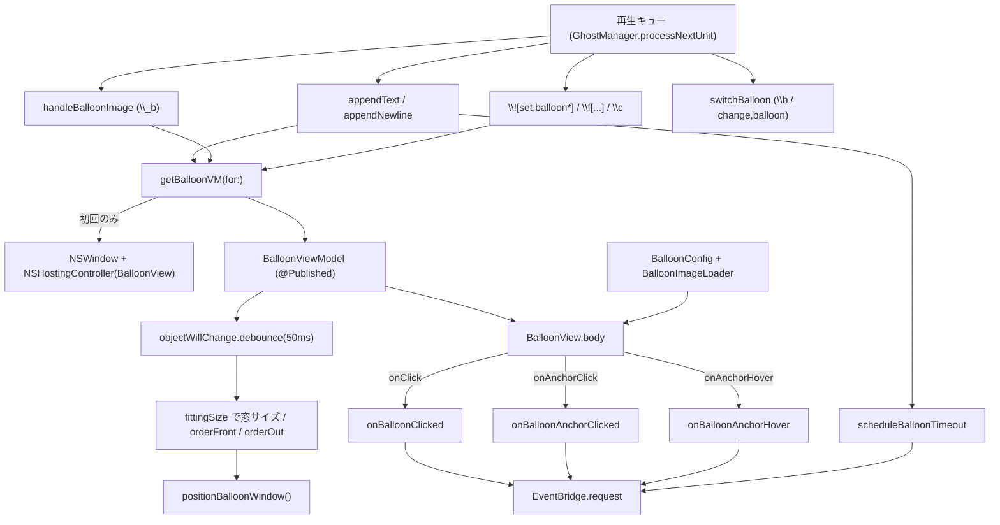
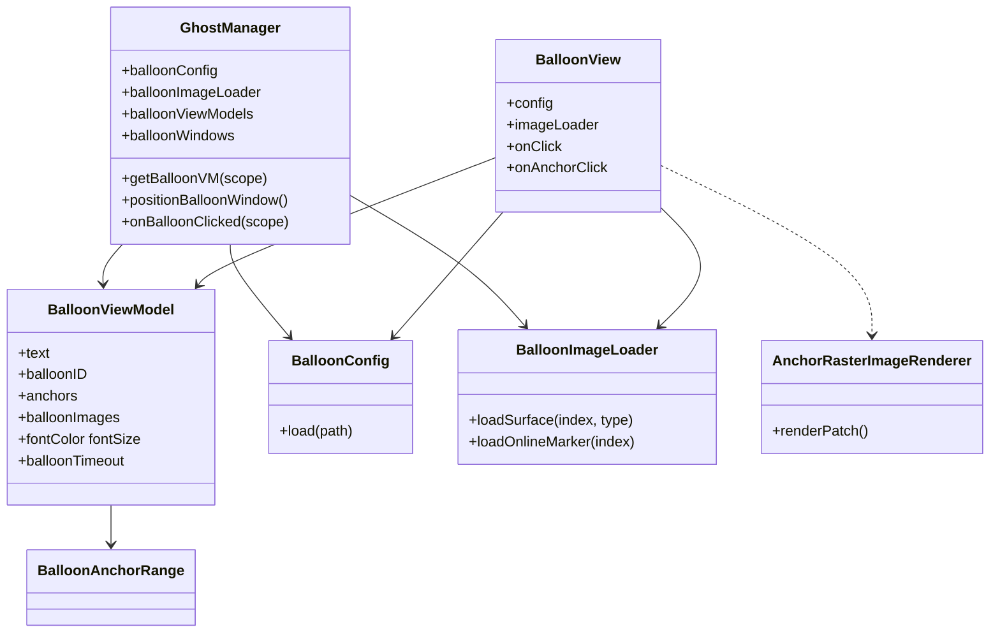
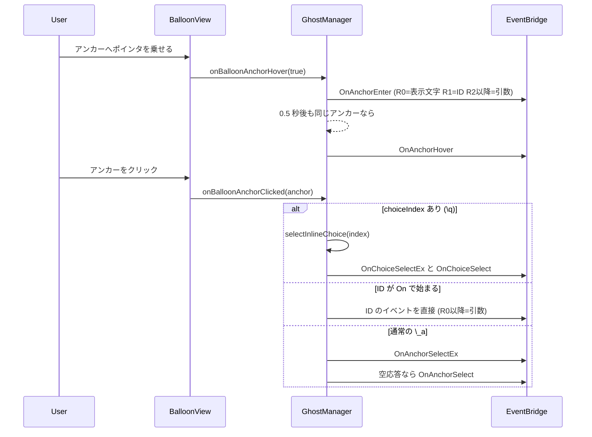

# 6 バルーンと入力 UI

関連ソースファイル

このページは次のファイルをもとに作成した。

- [Ourin/Ghost/BalloonView.swift](../../Ourin/Ghost/BalloonView.swift)
- [Ourin/Ghost/BalloonConfig.swift](../../Ourin/Ghost/BalloonConfig.swift)
- [Ourin/Ghost/BalloonRichTextViewModel.swift](../../Ourin/Ghost/BalloonRichTextViewModel.swift)
- [Ourin/Ghost/GhostManager+Balloon.swift](../../Ourin/Ghost/GhostManager+Balloon.swift)
- [Ourin/Ghost/GhostManager+TextArea.swift](../../Ourin/Ghost/GhostManager+TextArea.swift)
- [Ourin/Ghost/GhostManager+Input.swift](../../Ourin/Ghost/GhostManager+Input.swift)
- [Ourin/Ghost/GhostManager+Effects.swift](../../Ourin/Ghost/GhostManager+Effects.swift)（バルーン切替部分）
- [Ourin/Ghost/GhostManager.swift](../../Ourin/Ghost/GhostManager.swift)（`BalloonViewModel`、バルーン設定の読み込み、コマンド振り分け）
- [Ourin/Ghost/GhostManager+System.swift](../../Ourin/Ghost/GhostManager+System.swift)（入力ダイアログ・選択肢の該当部分）
- [Ourin/Ghost/GhostManager+Window.swift](../../Ourin/Ghost/GhostManager+Window.swift)（右クリックメニュー部分）
- [Ourin/Ghost/InputBoxView.swift](../../Ourin/Ghost/InputBoxView.swift)
- [Ourin/Ghost/ModelessInputDialog.swift](../../Ourin/Ghost/ModelessInputDialog.swift)
- [Ourin/Ghost/AnchorRasterImageRenderer.swift](../../Ourin/Ghost/AnchorRasterImageRenderer.swift)
- [Ourin/Balloon/DescriptorLoader.swift](../../Ourin/Balloon/DescriptorLoader.swift)
- [Ourin/Balloon/ImageLoader.swift](../../Ourin/Balloon/ImageLoader.swift)
- [Ourin/Balloon/RetinaImageLoader.swift](../../Ourin/Balloon/RetinaImageLoader.swift)
- [Ourin/Balloon/ICO.swift](../../Ourin/Balloon/ICO.swift)
- [Ourin/OwnerDrawMenu/OwnerDrawMenuModels.swift](../../Ourin/OwnerDrawMenu/OwnerDrawMenuModels.swift)
- [Ourin/OwnerDrawMenu/OwnerDrawMenuCoordinator.swift](../../Ourin/OwnerDrawMenu/OwnerDrawMenuCoordinator.swift)
- [Ourin/OwnerDrawMenu/OwnerDrawMenuPanel.swift](../../Ourin/OwnerDrawMenu/OwnerDrawMenuPanel.swift)
- [Ourin/OwnerDrawMenu/OwnerDrawMenuView.swift](../../Ourin/OwnerDrawMenu/OwnerDrawMenuView.swift)
- [Ourin/ResourceBridge/ResourceBridge.swift](../../Ourin/ResourceBridge/ResourceBridge.swift)（メニュー設定の取得部分）
- [Ourin/SHIORIEvents/EventBridge.swift](../../Ourin/SHIORIEvents/EventBridge.swift)（バルーン入力の振り分け部分）
- [docs/BALLOON_1.0M_SPEC_ja-jp.md](../../docs/BALLOON_1.0M_SPEC_ja-jp.md)

このページは、ゴーストの台詞を表示するバルーンと、それに付随する入力 UI（入力ボックス・選択肢・右クリックのオーナードローメニュー）を扱う。バルーンの `descript.txt` を `BalloonConfig` として読み、`BalloonViewModel` に積まれた本文・装飾・画像を SwiftUI の `BalloonView` が描き、クリック・アンカー・タイムアウトなどを SHIORI イベントへ変換する。

本文に何を積むか（`\f[...]`・`\_a`・`\q`・`\c` などの解析と再生キュー）は [7 さくらスクリプト](./07-sakura-script.md)、再生キューと `GhostManager` の中核は [4 GhostManager](./04-ghost-manager.md)、イベントの送信路（`EventBridge`・`InputMonitor`）は [9 SHIORI イベント](./09-shiori-events.md) を参照。キャラクター窓とアンカー装飾用の `AnchorRaster*` は [5 サーフェス・シェル・SERIKO](./05-surface-shell-animation.md) で説明した。

## 全体の流れ

再生キューのテキスト・改行・`\_b`・`\![set,...]` などは、すべて `getBalloonVM(for: currentScope)` で得た `BalloonViewModel` を書き換える。VM が無ければこのときにバルーン窓も生成する。VM の変更は `objectWillChange` を 50 ms デバウンスして窓のサイズ変更・表示/非表示・再配置に反映し、描画は `@ObservedObject` を通じて `BalloonView` が行う。ユーザー操作は `BalloonView` のコールバックから `GhostManager+Balloon` に戻り、`EventBridge` 経由で SHIORI へ送られる。

**出典:** [Ourin/Ghost/GhostManager+Balloon.swift:44-198](../../Ourin/Ghost/GhostManager+Balloon.swift#L44-L198)、[Ourin/Ghost/GhostManager+Balloon.swift:582-621](../../Ourin/Ghost/GhostManager+Balloon.swift#L582-L621)、[Ourin/Ghost/BalloonView.swift:5-16](../../Ourin/Ghost/BalloonView.swift#L5-L16)

## 主要な型

| 型 | 役割 | 定義位置 |
|---|---|---|
| `BalloonConfig` | バルーンの `descript.txt` から読んだ座標・色・フォントなどの値 | [Ourin/Ghost/BalloonConfig.swift:5-224](../../Ourin/Ghost/BalloonConfig.swift#L5-L224) |
| `BalloonImageLoader` | `balloon{s,k,c,d}N.png`・矢印・マーカー・オンラインマーカーを読み、キャッシュする | [Ourin/Ghost/BalloonConfig.swift:227-386](../../Ourin/Ghost/BalloonConfig.swift#L227-L386) |
| `BalloonViewModel` | スコープごとの本文・改行送り・行寄せ・アンカー・フォント状態・バルーン画像・タイムアウト等 | [Ourin/Ghost/GhostManager.swift:71-719](../../Ourin/Ghost/GhostManager.swift#L71-L719) |
| `BalloonAnchorRange` / `AnchorDecoration` / `AnchorDecorationStyle` | `\_a`・`\q` の範囲と装飾 | [Ourin/Ghost/GhostManager.swift:730-783](../../Ourin/Ghost/GhostManager.swift#L730-L783) |
| `BalloonView` | SwiftUI のバルーン描画 | [Ourin/Ghost/BalloonView.swift:5-705](../../Ourin/Ghost/BalloonView.swift#L5-L705) |
| `BalloonRichTextViewModel` | `NSAttributedString` ベースの装飾モデル（アプリ本体からは未使用） | [Ourin/Ghost/BalloonRichTextViewModel.swift:37-338](../../Ourin/Ghost/BalloonRichTextViewModel.swift#L37-L338) |
| `AnchorClickRouting` / `routeAnchorClick` | アンカー ID の `On` 接頭辞でイベントを振り分ける純関数 | [Ourin/Ghost/GhostManager+Balloon.swift:11-37](../../Ourin/Ghost/GhostManager+Balloon.swift#L11-L37) |
| `ModelessInputDialog` | `NSAlert` を非モーダルで出し、ボタンとタイムアウトを handler へ返す | [Ourin/Ghost/ModelessInputDialog.swift:6-93](../../Ourin/Ghost/ModelessInputDialog.swift#L6-L93) |
| `TextAreaInputView` | textareabox の複数行入力欄（Ctrl/⌘+Return で決定） | [Ourin/Ghost/GhostManager+TextArea.swift:121-167](../../Ourin/Ghost/GhostManager+TextArea.swift#L121-L167) |
| `InputBoxView` / `DateInputView` / `SliderInputView` | SwiftUI の入力 View（どこからも参照されていない） | [Ourin/Ghost/InputBoxView.swift:5-127](../../Ourin/Ghost/InputBoxView.swift#L5-L127) |
| `OwnerDrawMenuCoordinator` / `Panel` / `View` / `Models` | 右クリックのオーナードローメニュー | [OwnerDrawMenu/](../../Ourin/OwnerDrawMenu/) |
| `DescriptorLoader` / `ImageLoader` / `parseICOorCUR` / `RetinaImageLoader` | `Balloon/` 下の汎用ローダ群 | [Balloon/](../../Ourin/Balloon/) |

**出典:** [Ourin/Ghost/GhostManager.swift:905-917](../../Ourin/Ghost/GhostManager.swift#L905-L917)、[Ourin/Ghost/GhostManager.swift:722-783](../../Ourin/Ghost/GhostManager.swift#L722-L783)

## バルーンの選択と読み込み

### 起動時と切替時

ゴースト読み込み時、`configuredBalloonDirectory` が descript の `recommended.balloon.path` → `recommended.balloon` → `default.balloon.path` → `balloon` の順に、基準フォルダ・その `balloon/`・ゴーストフォルダからバルーンを探す（各ルートの外を指すパスは使わない）。見つからなければゴーストフォルダの `balloon/` を使う。そこの `descript.txt` を `BalloonConfig.load` で読み、`balloonConfig` と `BalloonImageLoader(balloonPath:)` を設定する。`balloonConfig` の `didSet` は作成済み VM のフォント・アンカー既定値を新しい設定で上書きする。

切替経路は 2 種類ある。

| 経路 | 関数 | 処理 |
|---|---|---|
| `\bN` / `\b[ID]` / `\b[ID,--fallback=ID2,…]` | `switchBalloon(to:scope:)` / `switchBalloon(to candidates:)` | `CharacterViewModel.currentBalloonID` と `BalloonViewModel.balloonID` を変える。`-1` はバルーン窓を隠すだけ。候補列は `balloons<ID>.png` が存在する最初の ID を選ぶ |
| `\![change,balloon,名前]`・メニュー | `switchBalloon(named:scope:raiseEvent:)` | 数値ならバルーン ID 切替。名前ならゴーストの `balloon/<名前>/`・`balloon/`・インストール済みバルーン（フォルダ名優先、次に descript の `name`）を探して `balloonConfig` を差し替える。`OnBalloonChange`（`phase=changing`/`changed`）を NOTIFY |

`\![reload,descript,balloon]` も `balloon/` から `BalloonConfig` を読み直す。バルーン名・一覧の取得は PROPERTY（`currentghost.balloon.*`、[14 プロパティ](./14-property-resource.md)）と SSTP の `getballoonname` 系で扱う。`%balloon` という環境変数展開は `EnvironmentExpander` に見当たらない。

**出典:** [Ourin/Ghost/GhostManager.swift:1700-1715](../../Ourin/Ghost/GhostManager.swift#L1700-L1715)、[Ourin/Ghost/GhostManager+Effects.swift:325-457](../../Ourin/Ghost/GhostManager+Effects.swift#L325-L457)、[Ourin/Ghost/GhostManager.swift:2858-2872](../../Ourin/Ghost/GhostManager.swift#L2858-L2872)、[Ourin/Ghost/GhostManager.swift:5733-5743](../../Ourin/Ghost/GhostManager.swift#L5733-L5743)、[Ourin/Ghost/GhostManager+System.swift:5961-5970](../../Ourin/Ghost/GhostManager+System.swift#L5961-L5970)

### BalloonConfig（descript.txt の解釈）

`load(from:)` は BOM か `charset,` 宣言があれば `EncodingAdapter.decodeTextDefinition`、無ければ Shift_JIS → UTF-8 の順にデコードする。`//` 行を除き、最初のカンマでキーと値に分ける（キーは大文字小文字を区別する）。色は `*.r/.g/.b` の 3 キーから作り、欠けた成分は既定色から補う。

| キー | 既定値 | 描画での使用 |
|---|---|---|
| `origin.x` / `origin.y` | 20 / 10 | 本文の開始位置 |
| `validrect.left/top/right/bottom` | 0 / 0 / 0 / -10 | 本文の有効領域（0 は画像端、負値は右端・下端から） |
| `wordwrappoint.x` / `wordwrappointright` | -34 / 0 | 折り返し位置（右寄せ時は `wordwrappointright` を優先） |
| `marginx` / `marginy` | 0 / 0 | 本文領域の内側余白 |
| `maxwidth` / `maxheight` | 0 / 0 | 背景画像が無い時のバルーン寸法 |
| `font.height` / `font.color.*` | 12 / 黒 | 本文の既定フォントサイズ・色 |
| `anchor.font.color.*` / `anchor.pen.color.*` / `anchor.brush.color.*` / `anchor.style` | 本文色ほか / `underline` | 選択中アンカーの装飾 |
| `anchor.notselect.*` / `anchor.visited.*` | `none` | 非選択・訪問済みアンカーの装飾 |
| `anchor.blendmethod` | `none` | 3 状態共通の ROP2 演算 |
| `cursor.style` / `cursor.blendmethod` / `cursor.*.color.*` | `square` / `none` | `\q` の選択肢マーカー（ダイアログのボタン装飾にも使う） |
| `onlinemarker.x/y` / `.filename` / `.interval` | 16 / 6 / `online` / 500 ms | `\![enter,onlinemode]` のマーカー画像とアニメ間隔 |
| `number.*`・`sstpmarker.*`・`sstpmessage.*`・`arrow0/1.*`・`communicatebox.*` | 各既定値 | 読むだけで描画には使っていない |

**出典:** [Ourin/Ghost/BalloonConfig.swift:97-223](../../Ourin/Ghost/BalloonConfig.swift#L97-L223)、[Ourin/Ghost/GhostManager.swift:354-379](../../Ourin/Ghost/GhostManager.swift#L354-L379)

### 画像の読み込み（BalloonImageLoader と Balloon/）

`BalloonImageLoader.loadSurface(index:type:)` は `balloon<type><index>.png` を読み、同名 `.pna` があれば `CIBlendWithMask` でアルファに使う。PNA が無ければ `RetinaImageLoader` で `@2x`/`@3x` を representation として追加する。PNA もアルファも無い画像にキー色透過はしない。結果はファイル名をキーにキャッシュする。`type` は `BalloonView.imageType(forScope:)` が scope 0 → `s`、1 → `k`、2 以降 → `d` を選び、無ければ `s` にフォールバックする。入力ダイアログのアイコンには `c`（`balloonc<ID>.png`）を使う。他に `arrow<N>.png`・`marker.png`・オンラインマーカー（`<prefix><N>.png`、拡張子付き prefix も可）・`sstp.png`/`sstp_new.png` を読む関数がある。

`Ourin/Balloon/` のファイルは次のとおり。実行時のバルーン描画で使うのは `RetinaImageLoader` だけである。

| ファイル | 内容 | 使用箇所 |
|---|---|---|
| `RetinaImageLoader.swift` | 1x を基準に `@2x`/`@3x` を追加。1x が無ければ最高解像度を論理サイズに縮める | シェル・バルーン画像の読み込み |
| `DescriptorLoader.swift` | `descript.txt` を読み、名前が `balloons` で始まる `.txt` を上書き合成する | NAR インストール画面のバルーン名取得とテスト |
| `ImageLoader.swift` | Image I/O + 内蔵 ICO/CUR パーサで `CGImage` を返し、隣の `.pna` を適用 | テストのみ |
| `ICO.swift` | ICONDIR/ICONDIRENTRY を読み、PNG ペイロードか 32bpp DIB（BGRA→RGBA、AND マスク）を返す。最も大きい PNG を優先 | `ImageLoader` |

**出典:** [Ourin/Ghost/BalloonConfig.swift:227-386](../../Ourin/Ghost/BalloonConfig.swift#L227-L386)、[Ourin/Ghost/BalloonView.swift:181-194](../../Ourin/Ghost/BalloonView.swift#L181-L194)、[Ourin/Balloon/RetinaImageLoader.swift:4-62](../../Ourin/Balloon/RetinaImageLoader.swift#L4-L62)、[Ourin/Balloon/DescriptorLoader.swift:5-41](../../Ourin/Balloon/DescriptorLoader.swift#L5-L41)、[Ourin/Balloon/ImageLoader.swift:11-83](../../Ourin/Balloon/ImageLoader.swift#L11-L83)、[Ourin/Balloon/ICO.swift:38-115](../../Ourin/Balloon/ICO.swift#L38-L115)、[Ourin/NarInstall/NarInstallViewModel.swift:126](../../Ourin/NarInstall/NarInstallViewModel.swift#L126)

## バルーンウィンドウの生成と配置

### 生成（getBalloonVM）

`getBalloonVM(for:)` は VM が無いときだけ次を行う。

1. `BalloonViewModel` を作り、`scope`・アンカー既定値・本文フォント既定値・`currentBalloonID` を設定する（`balloon.syncscale,true` ならシェル倍率も写す）。
2. `BalloonView(viewModel:onClick:onAnchorClick:onAnchorHover:config:imageLoader:)` を `NSHostingController` に載せ、ボーダーレス・透明背景・影なし・レベル `.popUpMenu`・`isMovableByWindowBackground = true`・識別子 `GhostBalloonWindow_<scope>` の `NSWindow` を作る。
3. 移動（位置保存）とリサイズ（再配置）の通知を購読する。
4. `objectWillChange` を 50 ms デバウンスし、本文・画像・`balloonmarker`・`balloonnum`・オンラインマーカーのいずれも無ければ `orderOut`、あれば `fittingSize` から窓サイズ（最小 250×50、等倍以下なら最大 400×600）を決め、5pt 以上変わった時だけ `setFrame` → `positionBalloonWindow()`、未表示なら `orderFront` する。

スコープ切替（再生キューの `.scope`）は他スコープのバルーンを消さず、話者のバルーンだけを `orderFront` する。

**出典:** [Ourin/Ghost/GhostManager+Balloon.swift:44-165](../../Ourin/Ghost/GhostManager+Balloon.swift#L44-L165)、[Ourin/Ghost/GhostManager.swift:5002-5040](../../Ourin/Ghost/GhostManager.swift#L5002-L5040)

### 配置と左右の決定

`positionBalloonWindow()` は全バルーンについて、対応するキャラ窓の frame から位置を決める。

1. ユーザーがドラッグして保存した位置（`resourceManager.getBalloonLeft/Top`）があれば、それをそのまま使う。
2. 無ければ `shellBalloonOrigin` で決める。左右は `\![set,balloonalign,left|right]` が優先で、無ければシェル descript の `<scope>.balloon.alignment`。`none`（自動）なら、シェルが画面左半分にあれば右、そうでなければ左に置き、はみ出す場合だけ反対側へ回す。上端はシェル上端に揃え、`offsetx`/`offsety`（左右別の `offsetxl/yl`・`offsetxr/yr` を優先）を適用する。
3. 可視領域から 8pt 内側に収める。

自動配置による移動は `isAutoPositioningBalloons` で保存対象から外す。`\![execute,resetballoonpos]` の `resetBalloonPositions()` は保存位置を消して置き直す。キャラ窓が動くと `characterWindowDidChangeFrame` が `positionBalloonWindow()` を呼ぶため、保存位置が無い限りバルーンはシェルに追従する。

**出典:** [Ourin/Ghost/GhostManager+Balloon.swift:625-707](../../Ourin/Ghost/GhostManager+Balloon.swift#L625-L707)、[Ourin/Ghost/GhostManager+Balloon.swift:709-784](../../Ourin/Ghost/GhostManager+Balloon.swift#L709-L784)、[Ourin/Ghost/GhostManager+Balloon.swift:1108-1133](../../Ourin/Ghost/GhostManager+Balloon.swift#L1108-L1133)

## バルーンの描画とテキストレイアウト（BalloonView）

`body` は本文・補助テキスト・オンラインマーカー・`\_b` 画像のいずれかがある時だけ描く。

- **背景**: `loadBackgroundImage(index: balloonID, scope:)` の画像を実寸で描く。画像が無ければ `maxwidth`/`maxheight`、それも無ければ 400×150 の角丸矩形を代わりに描く。
- **本文領域**: `textLayoutRect(for:size:alignment:)` が `validrect` → `origin`（有効領域内へ制限）→ `wordwrappoint`（右寄せ時は `wordwrappointright`）→ `marginx/y` の順に矩形を組み立てる。本文はその左上に `cursorX/Y`（`\_l`）と `balloonOffsetX/Y`（`\![set,balloonoffset]`）を足した位置へ置く。`\_n` の間は `lineLimit(1)` で折り返さずクリップする。
- **行**: 本文を `\n` で分け、行ごとに `lineAdvances`（`\n[half]`・`\n[150]` など）による上方向の余白／負のオフセット、`lineAlignments`/`lineVAlignments`（`\f[align]`/`\f[valign]`）を適用する。行内は `anchorSegments(lineIndex:)` でアンカー区間と通常区間に分ける。
- **文字**: フォント名（無ければシステムフォント）・サイズ・太さ・斜体・下線・打消し・上付き/下付き（0.85 倍、±0.2 倍のベースライン）を `Text` に付ける。影は `offset`（右下 1px）と `outline`（8 方向のオフセット影）。
- **画像**: `\_b` の非 inline 画像は背景側（既定・`--option=background`）と前景側（`--option=foreground`）に分けて描く。`--option=fixed` が無い画像は `cursorX/Y` に追従する。`--clipping=` は画像内の矩形だけを表示する。inline 画像は本文中の `U+FFFC` プレースホルダー位置に `Text(Image(...))` として挿入する。
- **補助表示**: 右下に `balloonmarker` と `balloonnum`（`file  current/max`）、指定位置にオンラインマーカー（負の座標は右端・下端から）を描く。
- **倍率**: 最後に `scaleEffect(scaleX, scaleY)` を掛け、窓サイズには絶対値を使う。背景全体のタップで `onClick` を呼ぶ。

**出典:** [Ourin/Ghost/BalloonView.swift:22-178](../../Ourin/Ghost/BalloonView.swift#L22-L178)、[Ourin/Ghost/BalloonView.swift:196-361](../../Ourin/Ghost/BalloonView.swift#L196-L361)、[Ourin/Ghost/BalloonView.swift:409-431](../../Ourin/Ghost/BalloonView.swift#L409-L431)、[Ourin/Ghost/BalloonView.swift:524-705](../../Ourin/Ghost/BalloonView.swift#L524-L705)、[Ourin/Ghost/GhostManager+Balloon.swift:789-932](../../Ourin/Ghost/GhostManager+Balloon.swift#L789-L932)、[Ourin/Ghost/GhostManager+Balloon.swift:995-1106](../../Ourin/Ghost/GhostManager+Balloon.swift#L995-L1106)

## 文字装飾とアンカー・選択肢

### 文字装飾の状態

`\f[...]` の解析結果は `BalloonViewModel` の `fontName`・`fontSize`・`fontColor`・`fontUnderline`・`shadowStyle`・アンカー／カーソル装飾などのプロパティに直接書かれる。`BalloonView` はこれらを描画時に本文全体へ一律に適用する。`GhostManager+Balloon` の補助関数は次のとおり。

| 関数 | 内容 |
|---|---|
| `parseFontHeight` | `default`・`+N`/`-N`・`N%`・絶対値 |
| `parseColor` | `#RRGGBB`・`#RRGGBBAA`・`r,g,b`・`none`（透明）・一部の色名・`default` |
| `parseTriState` | `1`/`true`・`0`/`false`・`default`・`disable` |
| `resetFontDefaults` / `setFontDisabled` | `\f[default]` / `\f[disable]` 相当（disable は 12pt・灰色・打消し） |

`BalloonRichTextViewModel` は範囲ごとに `NSAttributedString` 属性（フォント・色・下線・段落寄せ・影・上下付き・独自キー `OurinVerticalAlignment`）を付けるモデルだが、参照しているのは `OurinTests/BalloonRichTextViewModelTests.swift` だけで、アプリの描画経路には組み込まれていない。

**出典:** [Ourin/Ghost/GhostManager+Balloon.swift:1135-1344](../../Ourin/Ghost/GhostManager+Balloon.swift#L1135-L1344)、[Ourin/Ghost/GhostManager.swift:71-150](../../Ourin/Ghost/GhostManager.swift#L71-L150)、[Ourin/Ghost/BalloonView.swift:587-667](../../Ourin/Ghost/BalloonView.swift#L587-L667)、[Ourin/Ghost/BalloonRichTextViewModel.swift:37-139](../../Ourin/Ghost/BalloonRichTextViewModel.swift#L37-L139)

### アンカーの表示

アンカー区間の装飾は `BalloonViewModel.decoration(forAnchorAt:)` が、選択中（`activeAnchorIndex`）→ 訪問済み（`visited`）→ 非選択の優先順で選ぶ。形状は `none`・`underline`（ペン色の下線）・`square`（ブラシ色の背景＋ペン色の 1px 枠、角丸 2）・`square+underline`。`square` で ROP2 演算（`anchor.blendmethod` など）が `none` 以外のときは、`AnchorRasterImageRenderer.renderPatch` がバルーン背景画像の該当画素とブラシ色を演算したパッチ画像を背景にする。

**出典:** [Ourin/Ghost/GhostManager.swift:337-352](../../Ourin/Ghost/GhostManager.swift#L337-L352)、[Ourin/Ghost/BalloonView.swift:436-521](../../Ourin/Ghost/BalloonView.swift#L436-L521)、[Ourin/Ghost/AnchorRasterImageRenderer.swift:12-63](../../Ourin/Ghost/AnchorRasterImageRenderer.swift#L12-L63)

### アンカーと選択肢のイベント

- `onBalloonAnchorClicked` はクリックしたアンカーを訪問済みにする。`pluginOrigin` のアンカーは同じイベントをプラグインにも転送する。`nouserbreakmode` 中は無視する。
- アンカーから外れた時は Reference なしの `OnAnchorEnter` を送る。SwiftUI の再構成で入退場の順が入れ替わっても前のアンカーを閉じるようにしている。
- `\q` の選択肢は、再生時に `appendChoiceAnchor` が表題を本文に追加し、`choiceIndex` 付きのアンカーとして登録する。再生後の `presentPendingChoices` は、すべてが本文に描かれていればクリック待ちにして `choiceTimeout` のタイマー（`\*` で無効）を張り、時間切れで `OnChoiceTimeout`（Reference0 = 元スクリプト）を送る。本文に描けなかった選択肢があれば `showChoiceDialog`（`NSAlert` のボタン列、`OnChoiceEnter`/`OnChoiceHover` も実ポインタから発火）に切り替える。

**出典:** [Ourin/Ghost/GhostManager+Balloon.swift:8-37](../../Ourin/Ghost/GhostManager+Balloon.swift#L8-L37)、[Ourin/Ghost/GhostManager+Balloon.swift:481-580](../../Ourin/Ghost/GhostManager+Balloon.swift#L481-L580)、[Ourin/Ghost/GhostManager+System.swift:1399-1489](../../Ourin/Ghost/GhostManager+System.swift#L1399-L1489)、[Ourin/Ghost/GhostManager+System.swift:1671-1700](../../Ourin/Ghost/GhostManager+System.swift#L1671-L1700)

## クリック・タイムアウト・本文の消去

UI 側から発火するイベントを関数ごとにまとめる。

| 発生条件 | 関数 | イベント（送り方） |
|---|---|---|
| `\x` のクリック待ち中にバルーンをクリック（`noclear` でない） | `onBalloonClicked` | 本文を消して `OnBalloonClose`（GET、Reference0 = 表示中の本文） |
| 再生中にクリック | `onBalloonClicked` | 再生・選択肢待ちを中断して `OnBalloonBreak`（GET、`displayedScript`・`scope`・`breakPosition`） |
| 喋りタイムアウト | `scheduleBalloonTimeout` のタイマー | 本文を消して `OnBalloonTimeout`（GET、`remainingTime=0`）。`OnBalloonClose` は送らない |
| 消滅演出（`OnVanishSelected`）中のダブルクリック | `handleVanishButtonHold` | 演出を中断して `OnVanishButtonHold`（GET、元スクリプト上の中断位置を `vanishBreakPosition` で算出） |
| アンカー・選択肢 | 前節参照 | `OnAnchor*`・`OnChoice*` |
| `balloon.syncscale` 下での倍率変化 | `applySynchronizedBalloonScale`（`+Animation`） | `OnBalloonScaling`（GET） |

喋りタイムアウトは `appendText`・`appendNewline` のたびに張り直し、既定は 60 秒（`BalloonViewModel.defaultBalloonTimeout`）、`\![set,balloontimeout,ms]` で変更、0 以下で無効になる。スクリプト開始時の `resetScriptScopedBalloonSettings` がタイムアウト・`balloonwait`・`\_n`・再描画ロックを既定へ戻す。バルーンが閉じたこと（クリック・タイムアウト・選択）を起点に `scheduleSurfaceRestoreIfTalkEnded()` が `OnSurfaceRestore` の待ちを始める（[5 サーフェス](./05-surface-shell-animation.md)）。

本文操作は `handleTextClear`（`\c`、`\c[char,N[,start]]`・`\c[line,N[,start]]`・`all`、旧 `char=N` 形式も可）と `handleNewline`（`\n[half]`・`\n[N%]`）が行い、どちらも `BalloonViewModel` の `clearCharacters`/`clearLines`/`appendNewline` で改行送り・アンカー範囲を整合させる。`appendText` は表示文字数を `triggerSerikoTalkAnimationIfEnabled` に渡して SERIKO の `talk` 系 interval を起こす。

マウスホイールは `BalloonView` では扱わず、`InputMonitor` の `OnMouseWheel` になる。`InputMonitor` 経由のクリックは `EventBridge` が `ownsInputWindow`・`isBalloonInputWindow`・`consumesVanishBalloonInputClick`・`handleVanishInputClick` で、バルーン上の通常マウスイベントと消滅演出のダブルクリック判定を振り分ける。

**出典:** [Ourin/Ghost/GhostManager+Balloon.swift:167-308](../../Ourin/Ghost/GhostManager+Balloon.swift#L167-L308)、[Ourin/Ghost/GhostManager+Balloon.swift:426-478](../../Ourin/Ghost/GhostManager+Balloon.swift#L426-L478)、[Ourin/Ghost/GhostManager+Balloon.swift:582-621](../../Ourin/Ghost/GhostManager+Balloon.swift#L582-L621)、[Ourin/Ghost/GhostManager+Balloon.swift:1346-1430](../../Ourin/Ghost/GhostManager+Balloon.swift#L1346-L1430)、[Ourin/Ghost/GhostManager.swift:4761-4825](../../Ourin/Ghost/GhostManager.swift#L4761-L4825)、[Ourin/Ghost/GhostManager.swift:241-252](../../Ourin/Ghost/GhostManager.swift#L241-L252)、[Ourin/SHIORIEvents/EventBridge.swift:1060-1070](../../Ourin/SHIORIEvents/EventBridge.swift#L1060-L1070)

### バルーン関連の \![set,...]

| コマンド | 反映先 |
|---|---|
| `\![set,balloonoffset,x,y]` | `balloonOffsetX/Y`（本文の描画位置。`@` 付きは相対） |
| `\![set,balloonalign,dir]` | `balloonAlignment`（配置に効くのは `left`/`right` のみ） |
| `\![set,autoscroll,…]` | `autoscrollEnabled`（描画では未使用） |
| `\![set,balloontimeout,ms]` / `\![set,balloonwait,…]` | 喋りタイムアウト / 文字送り間隔（`N`・`N%`・`Nms`・`false`） |
| `\![set,balloonmarker,…]` / `\![set,balloonnum,file,cur,max]` | 右下の補助テキスト |
| `\![enter,onlinemode]` / `\![leave,onlinemode]` | `onlineModeActive`。`startOnlineMarkerAnimation` が `onlinemarker.interval` 間隔でフレームを進める |

**出典:** [Ourin/Ghost/GhostManager.swift:3855-3903](../../Ourin/Ghost/GhostManager.swift#L3855-L3903)、[Ourin/Ghost/GhostManager+System.swift:7184-7230](../../Ourin/Ghost/GhostManager+System.swift#L7184-L7230)

## 入力ボックス

`\![open,…]` の種類ごとの実装を示す。決定時のイベントは、ID が `On` で始まればその ID 名、そうでなければ `OnUserInput`（Reference0 = ID、1 = 入力、2 = 補足、3 以降 = `--reference=`）になる。取消・タイムアウトは `OnUserInputCancel`（Reference1 = `timeout`/`close`）で、タイムアウト時に応答が無ければ `OnUserInput`（入力 = `timeout`）を送り直す。送信は `requestDialogEvent` が自ゴーストの SHIORI へ GET し、応答スクリプトがあれば再生、無ければ自ゴーストへ NOTIFY する。

| コマンド | 関数 | UI と振る舞い |
|---|---|---|
| `inputbox` | `showInputBoxDialog` | 非モーダル（`ModelessInputDialog`）。先に `OnInputbox.autocomplete` を送る。`--limit`・`--option=noclose,noclear`・`--balloon=ID`（アイコンに `balloonc<ID>.png`） |
| `scriptbox` | `openScriptBox`（`+Input`） | SSP 拡張。`inputbox` と同じダイアログとイベント |
| `textareabox` | `openTextAreaBox` → `showTextAreaBoxDialog`（`+TextArea`） | モーダル（`NSAlert.runModal`）。改行は `\x01` で送受信。決定は `OnTextAreaInput` か ID 名、取消は常に `OnTextAreaInputCancel`（タイムアウトでも決定イベントへ投げ直さない）。`--placeholder=` |
| `passwordinput` / `ipinput` | `showPasswordInputDialog` / `showIPInputDialog` | 非モーダル。`NSSecureTextField` / `NSTextField` |
| `dateinput` / `timeinput` / `sliderinput` | `show{Date,Time,Slider}InputDialog` | 非モーダル。`NSDatePicker` / `NSSlider`（補足に `min,max`） |
| `communicatebox` | `showCommunicateBoxDialog` | モーダル。決定は `OnCommunicate`、取消は `OnCommunicateInputCancel` |
| `teachbox` | `showTeachBoxDialog` | 専用ユーティリティ窓 |
| `\![close,inputbox\|scriptbox,ID]` | `closeInputDialog` | イベントなしで閉じる（`__SYSTEM_ALL_INPUT__` で全部） |
| `\![close,textareabox\|communicatebox]` | `closeTextAreaDialog` / `closeCommunicateBoxDialog` | `abortModal` で閉じる |

`ModelessInputDialog.present` は `NSAlert` のボタンの target/action を自分に差し替え、窓を `.floating` で前面に出してタイムアウト Timer を張る。handler が `false` を返すと（`noclose`）閉じずにタイムアウトを数え直す。同じ ID のダイアログを開き直すと、前のものは結果イベントを送らずに閉じる。

`InputBoxView`・`DateInputView`・`SliderInputView`（SwiftUI）はどこからも生成されていない。

**出典:** [Ourin/Ghost/GhostManager.swift:3396-3509](../../Ourin/Ghost/GhostManager.swift#L3396-L3509)、[Ourin/Ghost/GhostManager.swift:3664-3690](../../Ourin/Ghost/GhostManager.swift#L3664-L3690)、[Ourin/Ghost/GhostManager+System.swift:6515-6603](../../Ourin/Ghost/GhostManager+System.swift#L6515-L6603)、[Ourin/Ghost/GhostManager+System.swift:6640-6800](../../Ourin/Ghost/GhostManager+System.swift#L6640-L6800)、[Ourin/Ghost/GhostManager+System.swift:6989-7080](../../Ourin/Ghost/GhostManager+System.swift#L6989-L7080)、[Ourin/Ghost/GhostManager+System.swift:7245-7276](../../Ourin/Ghost/GhostManager+System.swift#L7245-L7276)、[Ourin/Ghost/GhostManager+Input.swift:10-61](../../Ourin/Ghost/GhostManager+Input.swift#L10-L61)、[Ourin/Ghost/GhostManager+TextArea.swift:10-118](../../Ourin/Ghost/GhostManager+TextArea.swift#L10-L118)、[Ourin/Ghost/ModelessInputDialog.swift:6-93](../../Ourin/Ghost/ModelessInputDialog.swift#L6-L93)

注意: `GhostManager+Input.swift` はファイル名に反してマウス/キー入力のイベント化を扱わず、実際の内容は scriptbox/textareabox の引数解析と配線である。マウス・キー入力のイベント化は `SHIORIEvents/InputMonitor.swift`（[9 SHIORI イベント](./09-shiori-events.md)）が担う。

**出典:** [Ourin/Ghost/GhostManager+Input.swift:1-9](../../Ourin/Ghost/GhostManager+Input.swift#L1-L9)

## オーナードローメニュー（OwnerDrawMenu/）

キャラクター窓で右ボタンを離すと、`CharacterHitTestingHostingView` → `InputMonitor.shared.rightClickMenuHandler` → `showOwnerDrawMenu(at:)` と進む（ハンドラは `start()` 内の `setupRightClickMenu()` が設定する）。0.35 秒以内・24pt 以内の連続呼び出しは無視する。

1. 設定は `ResourceBridge.ownerDrawMenuConfig(base: shell/<シェル>)` が SHIORI Resource / シェルから集める。背景・前景・サイドバー画像（`menu.*.bitmap.filename`、またはシェルの `background.png` 等）、`menu.background.font.color` などの色、`menu.*.alignment`。
2. 項目は `ResourceBridge.menuItems()`、空なら `defaultMenuItems()`（ゴースト・シェル・バルーン・着せ替えのサブメニュー、情報・話しかける・再読み込み・設定・終了）。末尾にプラグインメニューを足す。
3. `OwnerDrawMenuCoordinator.showMenu` が文字幅から寸法（最小幅 100、+30 はサブメニュー三角）を計算し、`OwnerDrawMenuPanel` を作って表示する。選択されたアクション文字列は `handleMenuAction`（`switch_ghost:`・`switch_shell:`・`switch_balloon:`・`dressup_bindgroup:<scope>:<ID>`・`menu_*`・プラグイン）へ渡る。

| 型 | 役割 |
|---|---|
| `OwnerDrawMenuItem` / `MenuItemType` | `button(action:)`・`submenu(items:action:)`・`separator`。`visible`・`enabled`・`shortcut`・`indentation` |
| `OwnerDrawMenuConfig` / `MenuAlignment` | 画像・配置（`lefttop` など 11 種）・色・フォント・`itemHeight` 24・`textMarginLeft/Right` 10/20・`separatorHeight` 2 |
| `OwnerDrawMenuCoordinator` | ルートパネルとサブメニューの積み上げを管理。いずれかの項目決定で全体を閉じてから action を呼ぶ |
| `OwnerDrawMenuPanel` | `NSPanel`（`.borderless`・`.nonactivatingPanel`、レベル `.popUpMenu`）。key を失うと閉じる（サブメニュー表示中の親は閉じない）。フェードアウト後に `close` |
| `OwnerDrawMenuView` | 背景画像（不足部分は端の色で塗る）→ サイドバー → 項目（ホバー行だけ前景画像をスライス表示）→ 区切り線の順に描画。マウス移動・上下キー・Enter・Esc・ショートカット文字で操作。0.15 秒のフェードイン |

座標は Cocoa のスクリーン座標で、`point` をメニュー左上として `origin.y = point.y - height` に置き、可視領域からはみ出す辺だけ内側へ押し戻す。サブメニューは親パネルの右端・該当項目の上端に合わせ、画面右端を超える場合は親の左側に出す。

**出典:** [Ourin/Ghost/GhostManager+Window.swift:256-358](../../Ourin/Ghost/GhostManager+Window.swift#L256-L358)、[Ourin/ResourceBridge/ResourceBridge.swift:384-456](../../Ourin/ResourceBridge/ResourceBridge.swift#L384-L456)、[Ourin/Ghost/GhostManager.swift:5499-5537](../../Ourin/Ghost/GhostManager.swift#L5499-L5537)、[Ourin/OwnerDrawMenu/OwnerDrawMenuModels.swift:3-64](../../Ourin/OwnerDrawMenu/OwnerDrawMenuModels.swift#L3-L64)、[Ourin/OwnerDrawMenu/OwnerDrawMenuCoordinator.swift:3-136](../../Ourin/OwnerDrawMenu/OwnerDrawMenuCoordinator.swift#L3-L136)、[Ourin/OwnerDrawMenu/OwnerDrawMenuPanel.swift:3-125](../../Ourin/OwnerDrawMenu/OwnerDrawMenuPanel.swift#L3-L125)、[Ourin/OwnerDrawMenu/OwnerDrawMenuView.swift:3-420](../../Ourin/OwnerDrawMenu/OwnerDrawMenuView.swift#L3-L420)、[Ourin/Ghost/CharacterView.swift:236-315](../../Ourin/Ghost/CharacterView.swift#L236-L315)

## 既存ドキュメントとの食い違い

[docs/BALLOON_1.0M_SPEC_ja-jp.md](../../docs/BALLOON_1.0M_SPEC_ja-jp.md) は Draft の設計方針で、現行コードとは次の点が異なる。

- 注意: `descript.txt` と `balloons*s.txt` 等の上書き合成を「同等解釈する」とあるが、実行時の `BalloonConfig.load` は `descript.txt` しか読まない。上書き合成を行う `DescriptorLoader` は NAR インストール画面とテストでしか使われていない。
- 注意: MAG / PI / XBM の拡張デコーダ SPI は実装されていない。ICO/CUR の内蔵パーサ（`ImageLoader`）も実行時のバルーン画像読み込みには使われていない。
- 注意: ウィンドウは「NSPanel（nonactivating）」「`hitTest` で透明画素だけ背面へ通す」としているが、バルーン窓は通常の `NSWindow`（レベル `.popUpMenu`）で、透明画素のクリック抜け処理は無い（`contentShape(Rectangle())` で全体がクリック対象）。
- 注意: 太字等の装飾を `NSAttributedString` 属性で表現し `byCharWrapping` を既定とするとあるが、描画は SwiftUI の `Text` 連結で、`NSAttributedString` を使う `BalloonRichTextViewModel` は未使用。改行方式を明示的に指定するコードも見当たらない。
- 注意: `communicatebox.*` を NSTextView 相当で再現し `use_input_alpha` に対応するとあるが、communicatebox は `NSAlert` + `NSTextField` で、`communicatebox.*` の値は描画に使われていない。`viewDidChangeBackingProperties`・`use_input_alpha`・`paint_transparent_region_black`・`overlay_outside_balloon`・`windowposition.*` を扱うコードも見当たらない。
- 注意: 付録 A は `arrow`・`sstp`・`marker` を「そのままサポート」とするが、`BalloonImageLoader` の `loadArrow`・`loadMarker`・`loadSstpMarker` を呼ぶ箇所は無く、表示されない。

**出典:** [docs/BALLOON_1.0M_SPEC_ja-jp.md:25-95](../../docs/BALLOON_1.0M_SPEC_ja-jp.md#L25-L95)、[Ourin/Ghost/BalloonConfig.swift:97-127](../../Ourin/Ghost/BalloonConfig.swift#L97-L127)、[Ourin/Ghost/BalloonConfig.swift:305-385](../../Ourin/Ghost/BalloonConfig.swift#L305-L385)、[Ourin/Balloon/DescriptorLoader.swift:5-19](../../Ourin/Balloon/DescriptorLoader.swift#L5-L19)、[Ourin/NarInstall/NarInstallViewModel.swift:126](../../Ourin/NarInstall/NarInstallViewModel.swift#L126)、[Ourin/Balloon/ImageLoader.swift:11-47](../../Ourin/Balloon/ImageLoader.swift#L11-L47)、[Ourin/Ghost/BalloonRichTextViewModel.swift:36-48](../../Ourin/Ghost/BalloonRichTextViewModel.swift#L36-L48)、[Ourin/Ghost/GhostManager+Balloon.swift:72-90](../../Ourin/Ghost/GhostManager+Balloon.swift#L72-L90)、[Ourin/Ghost/BalloonView.swift:327-336](../../Ourin/Ghost/BalloonView.swift#L327-L336)、[Ourin/Ghost/GhostManager+System.swift:6989-7000](../../Ourin/Ghost/GhostManager+System.swift#L6989-L7000)

## 制約と注意点

以下はコードを読んで判断したもので、実機での確認はしていない（未確認）。

- `BalloonView` は生成時の `config` と `imageLoader` を値として保持する。`switchBalloon(named:)` や `\![reload,descript,balloon]` は `balloonConfig`/`balloonImageLoader` を差し替え、VM の既定値を更新するが、既存のバルーン窓を作り直すコードは見当たらない。推測: 窓が作り直されるまで背景画像と本文領域は前のバルーンのまま。
- 文字装飾は VM 全体で 1 組しか持たず、描画時に本文全体へ適用する（`styledTextPart` は `vm.fontItalic` などをその時点の VM から読み、`\f[color,…]` も `vm.fontColor` を書き換えるだけである）。このため本文の途中で装飾を変えると、それ以前に表示した文字も新しい装飾で描き直され、SSP のような範囲ごとの装飾にはならない（コードからの帰結で、実機では未確認）。
- `autoscrollEnabled` は値を保持するだけで、本文のスクロール処理は無い。本文領域を超えた文字はレイアウトに任される。
- 左右の配置は位置の計算だけで、左右に応じてバルーン ID や画像を切り替えるコードは見当たらない。`balloonalign` の `center`/`top`/`bottom` は自動配置と同じ扱いになる。
- ユーザーがバルーンを一度ドラッグすると絶対位置で保存され、以後はシェルを動かしても追従しない（`resetballoonpos` まで）。
- バルーン背景画像は PNA かアルファが無いとキー色透過されない。`\_b` 画像はアルファの無い画像だけ左上画素キーで透過する。`\_b` の絶対パスは `URL(string: filepath)!` で作るため、推測: 空白などを含むパスで強制アンラップが失敗する可能性がある。
- `parseICOorCUR` は 32bpp DIB のアルファがすべて 0 のとき AND マスクで透明画素を 0 にするだけで、不透明画素を 255 にしない。結果の RGBA を `ImageLoader.parseICO` は `premultipliedLast` の CGImage にするため、その種の ICO は全面透明になる（ただし `ImageLoader` は実行時に使われないので実害は無い）。
- textareabox と communicatebox は `NSAlert.runModal` を使うため、推測: 表示中はメイン RunLoop のモーダル状態になり、非モーダルの inputbox と違ってゴーストの動作が止まる。
- `InputMonitor.rightClickMenuHandler` は 1 つしか持てず、`setupRightClickMenu()` は各ゴーストの `start()` で上書きされる。ハンドラは窓の識別子（`GhostCharacterWindow_<scope>`）を見ないため、複数ゴースト起動時はどの窓で右クリックしても最後に `start()` したゴーストの `showOwnerDrawMenu` が呼ばれる（コードからの帰結で、実機では未確認）。
- `OwnerDrawMenuCoordinator` の高さ計算は区切り線も `itemHeight` 1 行分として数え、`separatorHeight` は描画の太さにしか使わない。`OwnerDrawMenuConfig` の既定色は `NSColor(red: 0, green: 0, blue: 255, …)` のように 0〜255 の値を 0〜1 の引数へ渡している（コメントは「RGB: 0-255」）。`defaultMenuItems()` の項目には `shortcut` が設定されていない。

**出典:** [Ourin/Ghost/GhostManager+Balloon.swift:61-70](../../Ourin/Ghost/GhostManager+Balloon.swift#L61-L70)、[Ourin/Ghost/GhostManager+Effects.swift:400-410](../../Ourin/Ghost/GhostManager+Effects.swift#L400-L410)、[Ourin/Ghost/BalloonView.swift:587-667](../../Ourin/Ghost/BalloonView.swift#L587-L667)、[Ourin/Ghost/GhostManager.swift:152](../../Ourin/Ghost/GhostManager.swift#L152)、[Ourin/Ghost/GhostManager+Balloon.swift:709-763](../../Ourin/Ghost/GhostManager+Balloon.swift#L709-L763)、[Ourin/Ghost/GhostManager+Balloon.swift:896-932](../../Ourin/Ghost/GhostManager+Balloon.swift#L896-L932)、[Ourin/Balloon/ICO.swift:87-113](../../Ourin/Balloon/ICO.swift#L87-L113)、[Ourin/Ghost/GhostManager+TextArea.swift:98-117](../../Ourin/Ghost/GhostManager+TextArea.swift#L98-L117)、[Ourin/OwnerDrawMenu/OwnerDrawMenuCoordinator.swift:107-135](../../Ourin/OwnerDrawMenu/OwnerDrawMenuCoordinator.swift#L107-L135)、[Ourin/OwnerDrawMenu/OwnerDrawMenuModels.swift:47-53](../../Ourin/OwnerDrawMenu/OwnerDrawMenuModels.swift#L47-L53)、[Ourin/Balloon/ImageLoader.swift:66-83](../../Ourin/Balloon/ImageLoader.swift#L66-L83)、[Ourin/Ghost/GhostManager+Window.swift:256-264](../../Ourin/Ghost/GhostManager+Window.swift#L256-L264)、[Ourin/Ghost/GhostManager.swift:1656](../../Ourin/Ghost/GhostManager.swift#L1656)、[Ourin/SHIORIEvents/InputMonitor.swift:93-106](../../Ourin/SHIORIEvents/InputMonitor.swift#L93-L106)

## 関連ページ

- [4 GhostManager（ゴースト実行の中核）](./04-ghost-manager.md) — 再生キュー・スコープ切替・ゴースト切替
- [5 サーフェス・シェル・SERIKO アニメーション](./05-surface-shell-animation.md) — キャラ窓、`AnchorRaster*`、`OnSurfaceRestore`
- [7 さくらスクリプト](./07-sakura-script.md) — `\f`・`\_a`・`\q`・`\b`・`\_b`・`\c` の解析
- [9 SHIORI イベント](./09-shiori-events.md) — `EventBridge`・`InputMonitor`（マウス・ホイール）
- [14 プロパティシステムとリソース](./14-property-resource.md) — `ResourceBridge`（メニュー設定）、バルーン位置の保存、`currentghost.balloon.*`
- [15 NAR インストールとパッケージ管理](./15-nar-install.md) — `DescriptorLoader` を使うインストール画面
- テスト: [OurinTests/](../../OurinTests/) の `BalloonTests`・`BalloonPlacementTests`・`OwnerDrawMenuTests`・`TextAreaBoxTests`・`ModelessInputDialogTests` など（テスト全体は「18 テストと互換性検証」）
