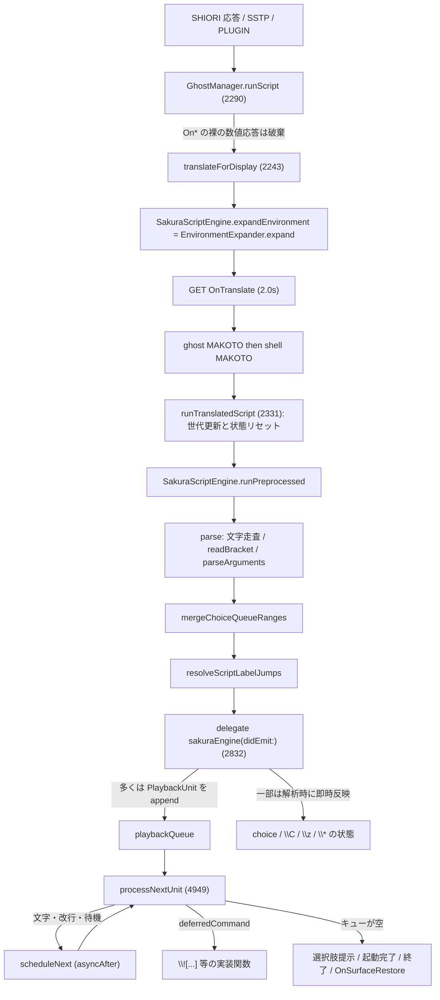
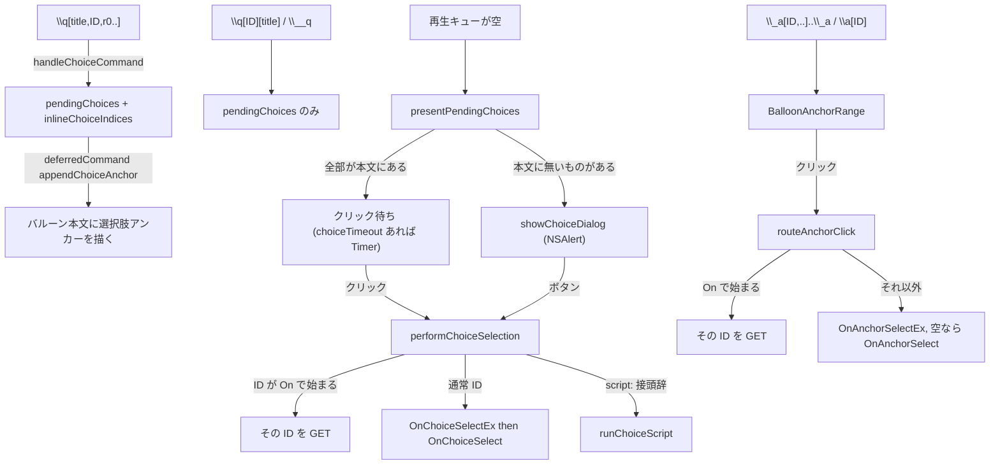

# 7 さくらスクリプト

関連ソースファイル

このページは次のファイルをもとに作成した。

- [Ourin/SakuraScript/SakuraScriptEngine.swift](../../Ourin/SakuraScript/SakuraScriptEngine.swift)
- [Ourin/SakuraScript/EnvironmentExpander.swift](../../Ourin/SakuraScript/EnvironmentExpander.swift)
- [Ourin/Resources/SakuraScriptLexicon.json](../../Ourin/Resources/SakuraScriptLexicon.json)
- [Ourin/Ghost/GhostManager.swift](../../Ourin/Ghost/GhostManager.swift)
- [Ourin/Ghost/GhostManager+System.swift](../../Ourin/Ghost/GhostManager+System.swift)
- [Ourin/Ghost/GhostManager+Balloon.swift](../../Ourin/Ghost/GhostManager+Balloon.swift)
- [Ourin/Ghost/GhostManager+Window.swift](../../Ourin/Ghost/GhostManager+Window.swift)
- [Ourin/Ghost/GhostManager+Effects.swift](../../Ourin/Ghost/GhostManager+Effects.swift)
- [Ourin/Ghost/GhostManager+Animation.swift](../../Ourin/Ghost/GhostManager+Animation.swift)
- [Ourin/Ghost/GhostManager+Display.swift](../../Ourin/Ghost/GhostManager+Display.swift)
- [Ourin/Ghost/GhostManager+Input.swift](../../Ourin/Ghost/GhostManager+Input.swift)
- [Ourin/Ghost/GhostManager+TextArea.swift](../../Ourin/Ghost/GhostManager+TextArea.swift)
- [Ourin/Web/GhostManager+WebSocket.swift](../../Ourin/Web/GhostManager+WebSocket.swift)
- [Ourin/Ghost/FileWatchRegistry.swift](../../Ourin/Ghost/FileWatchRegistry.swift)
- [Ourin/Ghost/GhostUtilityWindows.swift](../../Ourin/Ghost/GhostUtilityWindows.swift)
- [Ourin/Calendar/GhostSchedule.swift](../../Ourin/Calendar/GhostSchedule.swift)
- [Ourin/SHIORIEvents/EventBridge.swift](../../Ourin/SHIORIEvents/EventBridge.swift)
- [Ourin/USL/MakotoTranslator.swift](../../Ourin/USL/MakotoTranslator.swift)
- [docs/SUPPORTED_SAKURA_SCRIPT_ja-jp.md](../../docs/SUPPORTED_SAKURA_SCRIPT_ja-jp.md)
- [docs/SAKURASCRIPT_COMMANDS_SUPPORTED_ja-jp.md](../../docs/SAKURASCRIPT_COMMANDS_SUPPORTED_ja-jp.md)
- [docs/SAKURASCRIPT_FULL_1.0M_PATCHED_ja-jp.md](../../docs/SAKURASCRIPT_FULL_1.0M_PATCHED_ja-jp.md)
- [OurinTests/EnvironmentExpanderTests.swift](../../OurinTests/EnvironmentExpanderTests.swift)
- [OurinTests/SakuraScriptEngineTests.swift](../../OurinTests/SakuraScriptEngineTests.swift)

さくらスクリプトは、SHIORI が返す会話台本（`\0こんにちは\w8\1やあ\e` のような文字列）である。Ourin では `SakuraScriptEngine` が文字列をトークン列に分解し、`GhostManager` がデリゲートとしてトークンを受け取って「再生キュー」に積み、文字送り・待機・選択肢・`\![...]` コマンドを順に実行する。`%username` などの環境変数は `EnvironmentExpander` が展開する。

このページは、表示前の変換順序、字句解析とトークン種別、環境変数、`SakuraScriptLexicon.json`、GhostManager 側の再生キューとタグごとの実行（`\![...]` のカテゴリ別ディスパッチ表を含む）、エラー時の挙動、既存ドキュメントとの照合を扱う。GhostManager 全体のライフサイクルは [4 GhostManager](./04-ghost-manager.md)、サーフェス・アニメーションの描画は [5](./05-surface-shell-animation.md)、バルーンの描画と入力 UI は [6](./06-balloon.md)、SHIORI の呼び出しは [8](./08-shiori-runtime.md) を参照。

## 処理の流れ

表示前の変換は UKADOC の順序（環境変数 → OnTranslate → MAKOTO）に従う。`translateForDisplay` は `ScriptTranslationContext.reasons` に `notranslate` があれば環境変数展開だけで返す（ただし SSTP 由来で `sstp.alwaystranslate` が `1` なら OnTranslate を通す）。OnTranslate の要求には `SecurityLevel`・`Sender`・`SecurityOrigin`、Reference1 に理由、Reference2 にイベント ID、Reference3 に元の Reference（区切りはバイト値 1）を付ける。空応答や、元が数値でないのに数値だけの応答は採用しない。翻訳済みスクリプトは `runPreprocessed` に渡され、二度目の環境変数展開はしない。

**出典:** [Ourin/Ghost/GhostManager.swift:2243-2329](../../Ourin/Ghost/GhostManager.swift#L2243-L2329)、[Ourin/SakuraScript/SakuraScriptEngine.swift:57-96](../../Ourin/SakuraScript/SakuraScriptEngine.swift#L57-L96)、[Ourin/USL/MakotoTranslator.swift:72-108](../../Ourin/USL/MakotoTranslator.swift#L72-L108)

## SakuraScriptEngine の公開 API

| API（行） | 役割 |
|---|---|
| `delegate: SakuraScriptEngineDelegate`（4-6、29） | トークンごとに `sakuraEngine(_:didEmit:)` を受け取る。GhostManager が実装 |
| `propertyManager`（31） | `%property[...]` 用。代入すると `envExpander.propertyManager` も更新。GhostManager は `PropertyManager.shared` を入れる |
| `envExpander`（35） | `EnvironmentExpander` |
| `run(script:)`（57） | 環境変数を展開しながら解析してデリゲートへ流す |
| `expandEnvironment(in:)`（65） | スクリプト全体の環境変数展開だけを行う（`translateForDisplay` の先頭段） |
| `runPreprocessed(script:)`（92） | 展開済みスクリプトを展開なしで解析して流す（実再生の経路） |
| `containsText(in:)`（42） / `containsTextInPreprocessedScript(_:)`（69） | 表示テキストがあるか（NOTIFY 応答で本文を消すかの判定、プラグイン通知） |
| `displayText(from:)`（79） | テキストと改行だけを抜き出す（backlog 用） |
| `parse(script:expandEnvironment:)`（149） | 内部 API（`internal`）。トークン配列を返す |

**出典:** [Ourin/SakuraScript/SakuraScriptEngine.swift:1-96](../../Ourin/SakuraScript/SakuraScriptEngine.swift#L1-L96)

## 字句解析

### 走査規則

`parse` は文字配列を先頭から走査し、地の文は `buffer` に溜めてタグの直前で `.text` として吐き出す（`flush`、このとき `expandEnvironment` が true なら環境変数を展開）。

- `%*` は `.command(name: "!", args: ["*"])`（`\![*]` と同じ）。それ以外の `%` は地の文。
- `\\` → 文字 `\`、`\%` → 文字 `%`。スクリプト末尾の単独 `\` は文字 `\`。
- `\` の次の 1 文字でタグを判別する。角括弧 `[...]` は `readBracket` が読み、`\]` / `\[` を文字に戻し、入れ子の `[` `]` は深さを数えて閉じ括弧を探す。閉じ括弧が見つからなければ `nil` を返し、引数なしとして扱う（後述）。
- 引数は `parseArguments` がカンマで分割する。`"..."` で囲むとカンマを含められ、引用中の `""` は `"` 1 文字。引用外の `[` `]` の内側のカンマでは分割しない。末尾が空でも区切りがあれば空要素を残す。
- `\_` で始まるタグは名前を `_` + 1 文字（`\_!` / `\_?` / `\_+`）または `__` + 英字 1 文字（`\__w` 等）または `_` + 英字 1 文字で作る。
- `\_!...\_!` / `\_?...\_?` は閉じタグまでを解析せず `.text` にして、前後に `.command("_!"/"_?")` を置く。閉じタグが無ければ開始タグだけを出して通常の解析に戻る。
- 解析後に 2 つの後処理を行う（次節）。

**出典:** [Ourin/SakuraScript/SakuraScriptEngine.swift:149-253](../../Ourin/SakuraScript/SakuraScriptEngine.swift#L149-L253)、[Ourin/SakuraScript/SakuraScriptEngine.swift:537-612](../../Ourin/SakuraScript/SakuraScriptEngine.swift#L537-L612)、[Ourin/SakuraScript/SakuraScriptEngine.swift:742-789](../../Ourin/SakuraScript/SakuraScriptEngine.swift#L742-L789)

### トークン種別

`SakuraScriptEngine.Token` は 23 種類ある。多くのタグは汎用の `.command(name:args:)` になり、GhostManager 側で名前を見て処理する。

| トークン | 生成元のタグ | GhostManager での扱い（行） |
|---|---|---|
| `.text(String)` | 地の文、`\_?` 内 | `.textToken` と音声合成用 `.speakTextToken` を積む（2847） |
| `.scope(Int)` | `\0` `\h` → 0、`\1` `\u` → 1、`\pN` / `\p[N]` | `.scope`（2836） |
| `.surface(Int)` / `.surfaceNamed(String)` | `\sN` / `\s[N]`（数字なし・空は 0）、`\s[別名]` | `.surface`。別名は `surfaceNameAliases` で解決（2838-2846） |
| `.animation(Int, wait:)` | `\i[ID]` / `\i[ID,wait]` / `\iN` | `.startAnimation`（2882） |
| `.newline` / `.newlineVariation(String)` | `\n` / `\n[half]`・`\n[150]` 等 | `.newline` / `.newlineVariation`（2851-2857） |
| `.end` | `\e` | `.end`（2880） |
| `.moveAway` / `.moveClose` | `\4` / `\5` | `.moveAway` / `.moveClose`（2949-2955） |
| `.balloon(Int)` / `.balloonWithFallback` | `\bN` / `\b[ID]` / `\b[ID,--fallback=ID2]` | `switchBalloon` の deferredCommand（2858-2872） |
| `.appendMode` | `\C` | `appendModeEnabled = true`（解析時。2874） |
| `.wait` | `\t` | タイムクリティカルセクション開始の deferredCommand（2887） |
| `.endConversation(clearBalloon:)` | `\x` / `\x[noclear]` | `.clickWait`（2894） |
| `.choiceCancel` / `.choiceMarker` | `\z` / `\*` | 解析時に `choiceHasCancelOption` / `choiceTimeoutDisabled`（2898-2907） |
| `.anchor` | `\a`（角括弧なし） | 旧仕様: GET `OnAITalk` を送り応答を再生（2909） |
| `.choiceLineBr` | `\-` | ゴースト終了の deferredCommand（2928） |
| `.bootGhost` / `.bootAllGhosts` | `\+` / `\_+` | `bootOtherGhost()` / 順次切替（2957-2967） |
| `.openPreferences` | `\v` | 最前面表示（`setWindowState("stayontop")`）（2969） |
| `.openURL` / `.openEmail` | `\6` / `\7` | SNTP 補正適用 / SNTP 開始（2976-2982） |
| `.playSound(String)` | `\8[file]` | `.playSound`（2984） |
| `.choiceLegacy(title:id:numbered:)` | `\q[ID][title]` / `\q*[ID][title]` | `pendingChoices` へ（ダイアログ提示）（2940） |
| `.choiceQueue(title:id:references:)` | `\__q[ID,...]` / `\__q[ID,...]表示\__q` | `pendingChoices` へ（ダイアログ提示）（2988） |
| `.command(name:args:)` | 上記以外のすべて（`\w` `\!` `\c` `\f` `\q[...]` `\a[...]`→`_a` `\_w` `\__w` 等） | 名前で分岐（2998-4750） |

**出典:** [Ourin/SakuraScript/SakuraScriptEngine.swift:100-146](../../Ourin/SakuraScript/SakuraScriptEngine.swift#L100-L146)、[Ourin/SakuraScript/SakuraScriptEngine.swift:254-536](../../Ourin/SakuraScript/SakuraScriptEngine.swift#L254-L536)、[Ourin/Ghost/GhostManager.swift:2832-2997](../../Ourin/Ghost/GhostManager.swift#L2832-L2997)

### 後処理

- **`mergeChoiceQueueRanges`**: 引数付きの `\__q[ID,r0,...]` から引数なしの `\__q` までのテキスト・改行を連結して表示名にし、1 個の `.choiceQueue` にまとめる（`\s` 等の制御トークンは表示名から落とす）。閉じタグが無ければ表示名は空。単独の閉じタグは捨てる。
- **`resolveScriptLabelJumps`**: `\j[ID]` の ID が URL（`http://`・`https://`・`file://`・`mailto:`）でも `On` で始まるイベントでもなく、同じスクリプト内に `\_a[ID]`（`\a[ID]` を含む）があれば、`\j` を取り除いてその位置へ読み飛ばす（ラベルジャンプ）。同じ `\j` に 2 回目に来たら無限ループを避けるためそのジャンプだけ捨てる。解決できない `\j` は残り、GhostManager の `handleJumpCommand` が処理する。

**出典:** [Ourin/SakuraScript/SakuraScriptEngine.swift:614-740](../../Ourin/SakuraScript/SakuraScriptEngine.swift#L614-L740)

## EnvironmentExpander（% 変数の展開）

`EnvironmentExpander.expand(text:now:)` は正規表現で `%` 変数を置換する。3 つのパターンを順に試し、**前のパターンで 1 件でも一致したら、その結果を返して後のパターンは適用しない**。

| 順 | パターン | 例 |
|---|---|---|
| 1 | `%\(([^\)]+)\(([^\)]+)\)\)` | `%(charname(0))` |
| 2 | `%([a-zA-Z?*]+)(?:\[([^\]]+)\]\|\(([^\)]+)\))` | `%property[system.year]`、`%charname(1)` |
| 3 | `%([a-zA-Z?*]+)` | `%username`、`%ms`、`%m?` |

置換は後ろの一致から行い、キーは小文字化する。

| 変数 | 値 |
|---|---|
| `%month` `%day` `%hour` `%minute` `%second` | 現在時刻（`Calendar.current`） |
| `%username` | `envExpander.username`（ResourceManager / 名前入力ダイアログ）、無ければ macOS のフルネーム、それも空ならユーザー名 |
| `%selfname` / `%keroname` | `UserDefaults` の `OurinSakuraName` / `OurinKeroName`、または OnNotifySelfInfo 配送時に EventBridge が保存した値 |
| `%selfname2` | `selfname2`（コード中で値を設定する箇所は見当たらず、常に空） |
| `%charname[N]` | N=0 は `selfname`、1 は `keroname`、それ以外は空（Ourin 独自） |
| `%screenwidth` / `%screenheight` | `NSScreen.main` の大きさ |
| `%exh` | OS 起動からの時間（時、切り捨て） |
| `%et` | 乱数の時間・分・秒を `DateComponentsFormatter`（abbreviated）で整形 |
| `%wronghour` | 0〜23 の乱数 |
| `%ms` `%mz` `%ml` `%mc` `%mh` `%mt` `%me` `%mp` `%m?` `%dms` | `SakuraScriptLexicon.json` の該当リストから無作為に 1 語 |
| `%lastghostname` / `%lastobjectname` | 直前にインストールしたゴースト / オブジェクト名（static。`emitInstallCompletionEvents` が設定） |
| `%*` | `\![*]` に置き換える（通信マーカー） |
| `%property[名前]` | `propertyManager.get(名前)`、無ければ空 |
| 上記以外 | 元の形を残す（ただし引数付きは `%key[arg]` 形に正規化される） |

GhostManager での値の設定箇所: `init` で `resourceManager.username`（GhostManager.swift 1231-1233）、`loadPersistentCharacterNames`（1330）、`saveCharacterNames`（1546）、名前入力ダイアログ（Display 160-163）。

**出典:** [Ourin/SakuraScript/EnvironmentExpander.swift:1-122](../../Ourin/SakuraScript/EnvironmentExpander.swift#L1-L122)、[Ourin/SakuraScript/EnvironmentExpander.swift:124-203](../../Ourin/SakuraScript/EnvironmentExpander.swift#L124-L203)、[Ourin/Ghost/GhostManager.swift:1328-1342](../../Ourin/Ghost/GhostManager.swift#L1328-L1342)、[Ourin/Ghost/GhostManager+System.swift:6150-6158](../../Ourin/Ghost/GhostManager+System.swift#L6150-L6158)、[Ourin/SHIORIEvents/EventBridge.swift:1206-1213](../../Ourin/SHIORIEvents/EventBridge.swift#L1206-L1213)

### SakuraScriptLexicon.json

`Ourin/Resources/SakuraScriptLexicon.json` は「キー → 単語の配列」の 1 段の JSON オブジェクトで、UKADOC の単語系変数の既定語彙を持つ（93 行）。`SakuraScriptLexiconLoader.loadDefaultLexicon` が `Bundle.main` から（無ければ `Resources/` サブディレクトリから）読み、`[String: [String]]` にデコードし、対応キー以外を捨て、各語を trim して空と重複を除く。読めなければログを出して空辞書になり、単語系変数は空文字に展開される。

| キー | 意味（UKADOC） | 語数 | 例 |
|---|---|---|---|
| `ms` | 人 | 8 | 学生、先生、旅人 |
| `mz` | 物 | 8 | 時計、机、鍵 |
| `ml` | 集団 | 8 | 商店街、合唱団、研究会 |
| `mc` | 会社 | 6 | 桜鈴商事、青空電機 |
| `mh` | 店 | 6 | 喫茶こもれび、丸福食堂 |
| `mt` | 技 | 7 | 二段斬り、高速移動 |
| `me` | 食べ物 | 7 | おにぎり、カレー |
| `mp` | 場所 | 8 | 駅前、公園、港町 |
| `m?` | 何か | 7 | なにか、あれ、謎の箱 |
| `dms` | 文 | 6 | 公園に集合する人々 |

意味の欄はキー名と語彙からの対応づけで、JSON 自体には説明が無い（推測を含む）。

**出典:** [Ourin/Resources/SakuraScriptLexicon.json](../../Ourin/Resources/SakuraScriptLexicon.json)、[Ourin/SakuraScript/EnvironmentExpander.swift:205-247](../../Ourin/SakuraScript/EnvironmentExpander.swift#L205-L247)、[docs/SAKURASCRIPT_FULL_1.0M_PATCHED_ja-jp.md:2933-2975](../../docs/SAKURASCRIPT_FULL_1.0M_PATCHED_ja-jp.md#L2933-L2975)

## GhostManager 側の実行: 再生キュー

`sakuraEngine(_:didEmit:)` は `runPreprocessed` から同期的に全トークン分呼ばれる。このとき画面はまだ変えず、ほとんどのタグを `PlaybackUnit` として `playbackQueue` に積む。本文と同じ順序で実行するためで、例えば `\c` や `\_b` を解析時に実行すると、まだ表示していない本文に作用したり旧スコープに登録されたりする（コード中のコメント）。例外として、選択肢の登録（`\q[...]` の `pendingChoices` 追加）、`\z`・`\*`・`\C` は解析時に状態を変える。

`processNextUnit()` は単位を 1 つずつ取り出し、即時の単位は `continue` で続け、時間のかかる単位は `scheduleNext(after:)` で予約して `return` する。

| PlaybackUnit（処理行） | 処理 | 次へ |
|---|---|---|
| `.textToken`（4979） | 1 文字目を表示し、残りを `.text(Character)` に分けてキュー先頭へ戻す。クイックモード中は全文を即表示 | `typingInterval`（既定 0.1 秒）後 / 即時 |
| `.text`（5158） / `.textChunk`（5163） | 1 文字表示 / 一括表示（`\_u`・`\_m`・`\&`） | `typingInterval` 後 / 即時 |
| `.newline`（5173） / `.newlineVariation`（5178） | 改行（`half` は 0.5、数値は % / 100 の送り） | `typingInterval` 後 |
| `.scope`（5006） | スコープ切替（[4](./04-ghost-manager.md) 参照） | 即時 |
| `.surface`（5041） | `updateSurface(id:)` | 0.05 秒後 |
| `.startAnimation`（4994） | `playAnimation`。`wait` なら `.waitAnimation` を先頭に挿入 | 即時 |
| `.setScaling` / `.setAlpha`（5000-5005） | 時間付きなら `.waitForVisualEffect` を先頭に挿入しうる | 即時 |
| `.balloonImage`（5048） | `handleBalloonImage`（`\_b`） | 即時 |
| `.end`（5051） | SERIKO の yen-e を発火、クイック・同期・追記モード解除、スクリプト単位設定のリセット、未閉じアンカー確定、`\t` 解除 | 即時（後続も続けて処理） |
| `.wait`（5142） | 指定秒の待機 | 指定秒後 |
| `.waitUntil`（5099） / `.resetPrecise`（5096） | `preciseBase` からの絶対時刻まで待つ / 基準を今にする | 残り時間後 / 即時 |
| `.waitForAudio`（5105） | 効果音・音声合成・動画が残っていれば 0.05 秒ごとに再確認 | ポーリング |
| `.waitForHTTP`（5114） / `.waitForVisualEffect`（5120） | `--sync` HTTP の完了 / 補間タイマーの終了をポーリング | 0.05 秒 / 1/60 秒 |
| `.waitForSyncObject`（5128） | 別スレッドで `SyncCenter.wait` し、同じ世代のときだけ再開 | シグナルまたはタイムアウト |
| `.waitAnimation`（5145） | 対象 SERIKO アニメが再生中なら `waitingForAnimation` を立てて停止。完了コールバックが再開 | アニメ完了 |
| `.clickWait`（5155） | `pendingClick` を設定して停止。バルーンクリックで再開 | クリック |
| `.toggleQuickMode` / `.setQuickMode`（5066-5071） | クイックモード切替 | 即時 |
| `.voiceCommand` / `.speakTextToken`（5072、5170） | `\__v` の状態変更 / 合成音声で読み上げ（有効時のみ） | 即時 |
| `.moveAway` / `.moveClose` / `.bootGhost` / `.bootAllGhosts` / `.executeSNTP*` / `.playSound`（5075-5095） | 各実装関数 | 即時 |
| `.deferredCommand`（5182） | 解析時に作ったクロージャを実行 | 即時 |
| `.embeddedEvent`（5187） | `\![embed]`: 後続キューを退避し、GET 応答のトークンを先に積んでから戻す | 即時 |

`executeCommandAtPlaybackPosition`（2821）は、実行中のコマンドがキュー末尾へ追加した待機単位（HTTP/RSS/iCal の `--sync` 待ち）をキュー先頭へ移し、後続の本文がネットワーク完了を追い越さないようにする。

**出典:** [Ourin/Ghost/GhostManager.swift:924-960](../../Ourin/Ghost/GhostManager.swift#L924-L960)、[Ourin/Ghost/GhostManager.swift:2821-2828](../../Ourin/Ghost/GhostManager.swift#L2821-L2828)、[Ourin/Ghost/GhostManager.swift:4949-5065](../../Ourin/Ghost/GhostManager.swift#L4949-L5065)、[Ourin/Ghost/GhostManager.swift:5066-5198](../../Ourin/Ghost/GhostManager.swift#L5066-L5198)、[Ourin/Ghost/GhostManager+Animation.swift:246-258](../../Ourin/Ghost/GhostManager+Animation.swift#L246-L258)

### 待機系タグ

| タグ | 実装（行） | 挙動 |
|---|---|---|
| `\w[N]` / `\wN` | 3007 | N×50 ms。`\w10` のように複数桁を 1 つの値として読む（末尾の桁を本文に流さないため）。負値は無視、数値でない・省略時は既定 0.1 秒 |
| `\_w[ms]` | 3018 | ミリ秒待機。数値でなければ無視 |
| `\__w[ms]` | 3022 | `preciseBase`（スクリプト開始時刻）から ms 経過するまで待つ |
| `\__w[clear]` | 3025 | `preciseBase` を現在時刻にする |
| `\__w[animation,ID]` | 3027 | SERIKO アニメ ID の完了待ち |
| `\i[ID,wait]` | 4994 | アニメ開始後に完了待ち |
| `\![wait,timer,ms]` | 3274 | ミリ秒待機 |
| `\![wait,syncobject,名前,timeout]` / `\![signal,syncobject,名前]` / `\![set,syncobject,名前]` / `\![reset,syncobject,名前]` | 3265、3279、3785、3980 | `SyncCenter` による同期。timeout 0 以下は無期限 |
| `\_V` / `\![sound,wait]` | 3001、3768 | 音声・効果音・動画の終了待ち（`\_V` は大文字小文字を区別するため小文字化前に分岐） |
| `\x` / `\x[noclear]` | 2894、3035 | クリック待ち |
| `\t` | 2887 | 待機ではなくタイムクリティカルセクション（スクリプトブレークか `\e` まで `timeCriticalActive`） |

**出典:** [Ourin/Ghost/GhostManager.swift:2998-3037](../../Ourin/Ghost/GhostManager.swift#L2998-L3037)、[Ourin/Ghost/GhostManager.swift:3262-3283](../../Ourin/Ghost/GhostManager.swift#L3262-L3283)、[Ourin/Ghost/GhostManager.swift:3765-3791](../../Ourin/Ghost/GhostManager.swift#L3765-L3791)、[Ourin/Ghost/GhostManager.swift:2887-2896](../../Ourin/Ghost/GhostManager.swift#L2887-L2896)

### クイックセクション

`\_q` は `.toggleQuickMode`、`\![quicksection,1|true]` / `\![quicksection,0|false]` は `.setQuickMode` を積む。クイックモード中は `.textToken` を 1 文字ずつに分けず即時に表示するが、待機タグ・制御タグは通常どおりキュー上で実行する（UKADOC の「ウェイトタグは実行される」に合う）。改行は通常どおり `typingInterval` 待つ。`quickMode` は新しいスクリプト開始時と `\e` で false に戻る。

**出典:** [Ourin/Ghost/GhostManager.swift:3038-3039](../../Ourin/Ghost/GhostManager.swift#L3038-L3039)、[Ourin/Ghost/GhostManager.swift:3262-3264](../../Ourin/Ghost/GhostManager.swift#L3262-L3264)、[Ourin/Ghost/GhostManager.swift:4979-4993](../../Ourin/Ghost/GhostManager.swift#L4979-L4993)、[docs/SAKURASCRIPT_FULL_1.0M_PATCHED_ja-jp.md:1024-1047](../../docs/SAKURASCRIPT_FULL_1.0M_PATCHED_ja-jp.md#L1024-L1047)

### 選択肢とアンカー

| 要素 | 実装（行） | 挙動 |
|---|---|---|
| `\q[表示,ID,r0,...]` | `handleChoiceCommand`（System 1370） | 引数 2 未満は無視。`script:` 接頭辞はスクリプト実行、それ以外はイベント。タグ位置に本文として選択肢を描く（SSP 互換のインライン選択肢） |
| `\q[ID][表示]` / `\q*[ID][表示]` | 2940 | 旧形式。`*` は表示名に通し番号を付ける。本文には描かずダイアログで提示 |
| `\__q[ID,...]` / 範囲形式 | 2988 | `\q` と同じ ID 規則。ダイアログで提示 |
| `\z` | 2898 | ダイアログに「キャンセル」ボタンを足す。選ぶと GET `OnChoiceCancel` |
| `\*` | 2903 | このスクリプトの選択肢をタイムアウトさせない |
| `\![set,choicetimeout,ms]` | 3872 | 0 以下で無効。`\*` 指定中は上書きしない。既定は無期限（`nil`） |
| タイムアウト | `presentPendingChoices`（System 1419）、`showChoiceDialog`（1671） | GET `OnChoiceTimeout`（Reference0 = 選択肢を含むスクリプト） |
| ダイアログのホバー | `showChoiceDialog` | ボタン上の出入りで `OnChoiceEnter`、500 ms 静止で `OnChoiceHover` |
| `\_a[ID,r0,...]...\_a` / `\a[ID,...]` | 4269、`openAnchorRange` 4918 | 開始時の本文長を記録し、閉じタグ（または `\e`・スクリプト終端）で範囲を `BalloonAnchorRange` に確定 |
| アンカークリック | `onBalloonAnchorClicked`（Balloon 481） | `On` 始まりは直接 GET、それ以外は `OnAnchorSelectEx`（R0 表示文字列、R1 ID、R2 以降引数）、空応答なら `OnAnchorSelect` |
| プラグイン由来 | `forwardEventToPlugins`（System 1605） | 選択結果をスクリプトを送ったプラグインへも横流し |

新しいスクリプトの開始（`cancelInlineChoices`）や、選択・時間切れでインライン選択肢の状態は捨てられる。

**出典:** [Ourin/Ghost/GhostManager+System.swift:1370-1489](../../Ourin/Ghost/GhostManager+System.swift#L1370-L1489)、[Ourin/Ghost/GhostManager+System.swift:1671-1700](../../Ourin/Ghost/GhostManager+System.swift#L1671-L1700)、[Ourin/Ghost/GhostManager+System.swift:1770-1818](../../Ourin/Ghost/GhostManager+System.swift#L1770-L1818)、[Ourin/Ghost/GhostManager.swift:2898-2947](../../Ourin/Ghost/GhostManager.swift#L2898-L2947)、[Ourin/Ghost/GhostManager.swift:4915-4947](../../Ourin/Ghost/GhostManager.swift#L4915-L4947)、[Ourin/Ghost/GhostManager+Balloon.swift:8-38](../../Ourin/Ghost/GhostManager+Balloon.swift#L8-L38)、[Ourin/Ghost/GhostManager+Balloon.swift:481-535](../../Ourin/Ghost/GhostManager+Balloon.swift#L481-L535)

### `\!` 以外のコマンドタグ

`.command` の分岐（2998 以降）は、`\_V` を先に判定してから **タグ名を小文字化して** `switch` する。

| タグ | 行 | 実装 |
|---|---|---|
| `\_n` | 3050 | 次の `\_n` まで自動折り返しを切り替え（`wordWrapEnabled.toggle()`） |
| `\__t` / `\__c` | 3040 / 3045 | `showTeachBoxDialog` / `showCommunicateBoxDialog`（System 6872 / 6989） |
| `\__v[enable\|disable\|alternate,読み]...\__v` | 3059、4835 | 音声合成の範囲制御。既定は読み上げ無効 |
| `\b[...]`（数値以外を含む） | 4235 | 候補を数値化して `switchBalloon(to:)`、候補が無ければログ |
| `\_s` / `\_s[ID,...]` | 4252 | `syncEnabled` / `syncScopes` を設定（表示には未反映。[4](./04-ghost-manager.md) 参照） |
| `\q[...]` | 4265 | `handleChoiceCommand` |
| `\_a[...]` / `\a[...]` | 4269 | 範囲アンカー |
| `\_b[...]` | 4287 | `.balloonImage` → `handleBalloonImage`（Balloon 789） |
| `\_l[x,y]` | 4293 | `handleCursorMove`（Balloon 995） |
| `\_v[file]` | 4303 | `.playSound` |
| `\_u[0xXXXX]` / `\_m[0xNN]` | 4309 / 4317 | Unicode 文字 / ASCII 1 バイト（0x7F 超は無視）を本文に追加 |
| `\&[ID]` | 4328 | `resolveEntityReference`（2121）: `#NNN`・`#xHHHH`・`0x...` と `amp` `lt` `gt` `quot` `apos` `nbsp` `copy` `reg` `trade` `hellip` `mdash` `ndash`。未知は無視 |
| `\j[ID]` | 4339 | `handleJumpCommand`（2165）: `http(s)://` はブラウザ、`file://` は実在の絶対パスか `ghost/master` 相対、それ以外は任意 ID の GET（3.0 秒）として応答を再生 |
| `\m[umsg,wparam,lparam]` | 4345 | GET `OnMessage` |
| `\c` / `\c[char\|line,N,start]` | 4355 | `handleTextClear`（Balloon 1346） |
| `\f[...]` | 4363-4746 | 書式。`align` `valign` `name` `height` `color` `shadowcolor` `shadowstyle` `bold` `italic` `strike` `underline` `sub` `sup` `default` `disable` `outline`、アンカー装飾（`anchor.font.color` `anchorstyle` `anchor*color` `anchor*method` 等）、カーソル装飾（`cursorstyle` `cursor*color` `cursormethod` 等）。未知のサブコマンドはログを出して無視 |

**出典:** [Ourin/Ghost/GhostManager.swift:3038-3062](../../Ourin/Ghost/GhostManager.swift#L3038-L3062)、[Ourin/Ghost/GhostManager.swift:4235-4372](../../Ourin/Ghost/GhostManager.swift#L4235-L4372)、[Ourin/Ghost/GhostManager.swift:4725-4750](../../Ourin/Ghost/GhostManager.swift#L4725-L4750)、[Ourin/Ghost/GhostManager.swift:2118-2208](../../Ourin/Ghost/GhostManager.swift#L2118-L2208)、[Ourin/Ghost/GhostManager.swift:4827-4866](../../Ourin/Ghost/GhostManager.swift#L4827-L4866)

## `\![...]` コマンドのディスパッチ

`\![...]` のディスパッチ本体は `GhostManager+System.swift` ではなく、`GhostManager.swift` の `sakuraEngine(_:didEmit:)` 内の `case "!"`（3063-4233）にある。第 1 引数を小文字化した `first` に対する長い `if / else if` 連鎖で、多くは `.deferredCommand` に包んで再生キューへ積み、実装関数を呼ぶ。実装関数の多くが `GhostManager+System.swift` にある。どの分岐にも当たらない `\![...]` は何もしない（ログは冒頭の `NSLog` のみ）。

以下、「行」は GhostManager.swift の分岐位置、実装は定義ファイルと行。

### ウィンドウ

| コマンド | 行 | 実装 |
|---|---|---|
| `hide` / `show` / `focus` / `b` | 3342-3358 | `setCurrentWindowHidden` / `focusCurrentWindow`（Window 1519 / 1530） |
| `minimize` / `maximize` | 3359-3366 | `setWindowState("minimize")`（Window 1467） / `maximizeCurrentWindow`（Window 1538） |
| `set,windowstate,stayontop\|!stayontop\|minimize` | 3947 | `setWindowState`（Window 1467） |
| `move,...` / `move,window,...` | 4161 | `executeMoveCommand(args:async: false)`（Window 660） |
| `moveasync,...` / `moveasync,cancel[,scope]` | 4171 | `executeMoveCommand(async: true)` / `cancelMoveWindowAsync`（Window 619） |
| `resize,...` | 4184 | `executeResizeCommand`（Window 702） |
| `set,position,x,y,scope` / `reset,position` | 3816 / 3984 | `setWindowPosition` / `resetWindowPosition`（Window 1195 / 1218） |
| `set,zorder,...` / `reset,zorder` | 3823 / 3987 | `executeSetZOrderCommand` / `resetWindowZOrder`（Window 1158 / 1273） |
| `set,sticky-window,...` / `reset,sticky-window` | 3827 / 3990 | `executeSetStickyWindowCommand` / `resetStickyWindow`（Window 1168 / 1357） |
| `reset`（引数なし） | 3995 | Z オーダーと sticky の両方を解除 |
| `set,alignmenttodesktop\|alignmentondesktop,方向` | 3794 | `CharacterViewModel.alignment` を設定し `enforceDesktopAlignment`（Display 1047） |
| `set,scaling,...` / `set,alpha,...` | 3783 / 3792 | `.setScaling` / `.setAlpha` → `executeSetScalingCommand` / `executeSetAlphaCommand`（Window 922 / 978） |
| `execute,resetwindowpos` | 2742 | `executeResetWindowPos`（Window 1378） |

### サーフェス・アニメーション・着せ替え

| コマンド | 行 | 実装 |
|---|---|---|
| `anim,clear\|pause\|resume\|stop\|offset\|add,...`、`anim,pauseID` / `anim,stopID` | 4120 | `executeAnimationCommand`（GhostManager 2589）→ `handleAnim*`（Animation 573-824）。`add` は `overlay` `overlayfast` `base` `move` `bind` `text` |
| `bind,カテゴリ,パーツ,値` / `bind-noevent,...` | 4001 | `executeBindCommand`（Effects 262） |
| `reload,surfaces.txt` | 4005 | `reloadSurfacesDefinition`（Animation 389） |
| `reloadsurface` | 4100 | `executeReloadSurface`（System 5938） |
| `effect,...` / `effect2,ID,...` / `filter,...` / `filter` | 4128-4160 | `applyEffect` / `applyFilter` / `clearFilters`（Effects 19 / 33 / 55） |
| `lock\|unlock,repaint[,manual]` | 4012 / 4016 | `executeLockCommand` / `executeUnlockCommand`（GhostManager 2691 / 2716）。`manual` 以外はスクリプト終了で自動解除 |
| `set,serikotalk,...` | 3963 | `setSerikoTalk`（System 7231）。このスクリプトだけの上書き |
| `set,othersurfacechange,true\|false` | 3938 | `setOtherSurfaceChange`（System 2110） |
| `execute,dumpsurface,...` | 2764 | `executeDumpSurface`（System 5022） |

### バルーン・テキスト

| コマンド | 行 | 実装 |
|---|---|---|
| `set,balloonoffset,x,y`（`@` で相対） | 3837 | `handleBalloonOffset`（Balloon 1067） |
| `set,balloonalign,方向` | 3847 | `handleBalloonAlignment`（Balloon 1108） |
| `set,autoscroll,値` | 3855 | `0` `false` `disable` `disabled` `off` 以外は有効 |
| `set,balloontimeout[,ms]` | 3866 | `applyBalloonTimeout`（4814）。省略で既定へ |
| `set,balloonwait[,倍率\|N%\|Nms\|true\|false\|default]` | 3884 | `applyBalloonWait`（4805）。`typingInterval` を変える |
| `set,timerinterval,ms` | 3831 | `typingInterval` を直接設定 |
| `set,balloonmarker,文字列` / `*` `#` `x` `<` `>` | 3890 / 3367 | `setBalloonMarker`（System 7214） |
| `set,balloonnum,file,cur,max` | 3897 | `setBalloonNumber`（System 7221） |
| `lock\|unlock,balloonrepaint[,manual]` / `lock\|unlock,balloonmove` | 4012 / 4016 | `executeLockCommand`（2691）/ `executeUnlockCommand`（2716） |
| `enter\|leave,onlinemode` | 3737 / 3759 | `enterOnlineMode` / `leaveOnlineMode`（System 7164 / 7174） |
| `execute,resetballoonpos` | 2744 | `resetBalloonPositions`（Balloon 765） |

### サウンド・メディア

| コマンド | 行 | 実装 |
|---|---|---|
| `sound,play\|load\|loop,file[,options]` | 3765 | `executeSoundCommand`（2513）→ 動画拡張子なら `playVideo` / `loadVideo`、それ以外は `playSound` / `loadSound`（Display 362 / 424 / 554 / 604） |
| `sound,pause\|resume\|stop[,file]` | 3765 | ファイル省略時は全体。`stop` 省略で `stopAllSounds`（Display 718） |
| `sound,option,file,...` | 3765 | `applySoundOptions`（Display 479） |
| `sound,cdplay` | 3765 | macOS 非対応として `notifySoundError`（`audio_cd_unsupported`） |
| `sound,wait` | 3768 | `.waitForAudio` |

### ネットワーク・外部連携

| コマンド | 行 | 実装 |
|---|---|---|
| `execute,http-get\|http-post\|http-*,URL,...` | 2752 | `executeHTTP`（System 2605）。`--async` / `--sync` / `--file` / `--param` / `--header` 等は `HTTPCommandOptions`（System 548） |
| `execute,http-stream*,URL` / `cancel,http,URL` | 2748 / 3715 | `executeHTTPStreaming` / `cancelHTTPStreaming`（System 2706 / 2779） |
| `execute,rss-*,URL` | 2756 | `executeRSS`（System 3080） |
| `execute,ical-get\|ical-post,...` / `cancel,ical` | 2780 / 3711 | `executeICal` / `cancelICal`（System 3167 / 3249） |
| `execute,headline,名前` | 2746 | `executeHeadline`（System 2332） |
| `execute,ping\|nslookup,...` | 2774 / 2776 | `executePing` / `executeNslookup`（System 5761 / 5806） |
| `execute,websocket,URL` / `send,websocket\|websocket-binary,...` / `close\|cancel,websocket` | 2778 / 3691 / 3685・3709 | `executeWebSocket` / `sendWebSocket` / `closeWebSocket` / `cancelWebSocket`（WebSocket 12 / 53 / 84 / 93） |
| `biff[,account]` | 4052 | `executeBiff`（System 2532） |
| `executesntp` | 4047 | `executeSNTP`（System 2117）。`\6` / `\7` も SNTP 系 |
| `update,...` / `updatebymyself` / `updateother` / `update,http,URL` | 4058-4085 | `executeUpdate(target:options:)`（System 3287）。`update,http` は `executeHTTP("http-get")` |
| `open,http,URL` / `open,send,URL,body` | 3539 / 3548 | `executeHTTP("http-get" / "http-post")` |

### ゴースト操作・イベント

| コマンド | 行 | 実装 |
|---|---|---|
| `raise,イベント,r0,...` | 3067 | `dispatchLocalEvent(notifyOnly: false, preserveFollowingPlayback: true)`（System 1513）: 応答を再生し後続キューを後ろへ戻す |
| `notify,イベント,...` | 3082 | `dispatchLocalEvent(notifyOnly: true)`。応答は捨てる |
| `embed,イベント,...` | 3097 | `.embeddedEvent` → `executeEmbeddedEvent`（System 1493）: GET 応答をその位置へ挿入 |
| `timerraise` / `timernotify,ms,repeat,イベント,...` | 3102 / 3111 | `scheduleLocalEventTimer`（System 1576）。ms=0 でそのイベントのタイマーを取消、repeat は `isRepeatingTimerSpec` で判定 |
| `raiseother` / `notifyother,ゴースト,イベント,...` | 3089 / 3148 | `raiseOtherGhostEvent`（System 930）。SSTP を `127.0.0.1:9801` へ送る |
| `timerraiseother` / `timernotifyother` | 3120 / 3156 | `scheduleTimerRaiseOther`（System 1050） |
| `change,ghost\|shell\|balloon,名前[,--option=raise-event]` | 3184 | `switchGhost` / `switchShell` / `switchBalloon(named:)`（System 6307 / Surface 667 / Effects 368） |
| `call,ghost,名前` | 3202 | `callGhost`（System 6394） |
| `get,property,イベント,プロパティ,...` | 3211 | 各プロパティ値を Reference0 以降に並べて `requestDialogEvent`（GET） |
| `get,word\|string\|integer\|wordcount\|wordposition,...` | 3225 | `OnGetWord` 等を GET |
| `vanishbymyself[,次のゴースト][,--option=query]` | 4086 | `executeVanish(uninstall: true, ...)`（System 4519） |
| `reload,対象,...` / `unload,対象` / `load,対象` | 4104-4119 | `executeReload` / `executeUnload` / `executeLoad`（System 5944 / 5984 / 6002） |
| `execute,install,...` / `createnar` / `createupdatedata` / `extractarchive` / `compressarchive` | 2760-2771 | `executeInstall`（5623）、`executeCreateNar`（5671）、`executeCreateUpdateData`（5686）、`executeExtractArchive`（4754）、`executeCompressArchive`（4818） |

### 設定・モード

| コマンド | 行 | 実装 |
|---|---|---|
| `set,property,名前,値` | 3242 | `sakuraEngine.propertyManager.set`（＝ `PropertyManager.shared`。[14](./14-property-resource.md)） |
| `set,shioridebugmode,値` | 3955 | `UserDefaults` の `OurinShioriDebugMode` と `OnShioriDebugModeChanged` |
| `set,otherghosttalk,true\|false\|before\|after` | 3930 | `setOtherGhostTalk`（System 2098） |
| `set,wallpaper,file,...` / `save,wallpaper` / `restore,wallpaper` | 3905 / 3252 / 3257 | `setWallpaper` / `saveWallpaper` / `restoreWallpaper`（System 1912 / 1830 / 1842） |
| `set,tasktrayicon\|trayicon,file,text,...` / `set,trayballoon,...` | 3912 / 3922 | `setTaskTrayIcon` / `setTrayBalloon`（System 1964 / 2021） |
| `enter\|leave,selectmode\|selectrect\|collisionmode\|passivemode\|inductionmode\|nouserbreakmode` | 3719 / 3743 | `enterSelectMode` 〜 `leaveNoUserBreakMode`（System 7080-7160） |
| `quicksection,値` / `quicksession,true\|false` | 3262 / 4040 | クイックモード / `quickSessionEnabled`（読み出し箇所なし） |
| `set,choicetimeout,ms` | 3872 | 前節 |

### ダイアログ・open / close

| コマンド | 行 | 実装 |
|---|---|---|
| `open,inputbox\|passwordinput\|dateinput\|sliderinput\|timeinput\|ipinput,ID,timeout,...` | 3396-3487 | `showInputBoxDialog` 等（System 6640-6801）。`--id` `--timeout` `--text` 形も受理 |
| `open,scriptbox` / `open,textareabox` | 3404 / 3408 | `openScriptBox` / `openTextAreaBox`（Input 35 / 49） |
| `input,textbox\|pass\|date\|choice\|capture,...` | 3284 | 互換別名。`capture` は文字入力で代用 |
| `open,dialog,open\|save\|folder\|color,...` / `file,open\|save,ID` | 3488 / 3329 | `showSystemDialog`（System 6828） |
| `open,teachbox` / `open,communicatebox` / `open,messenger` | 3496 / 3501 / 3625 | `showTeachBoxDialog` / `showCommunicateBoxDialog` / `showCommunicateBox` |
| `close,inputbox\|scriptbox\|textareabox\|communicatebox\|dialog\|teachbox\|websocket,...` | 3662 | 各 close。`close,dialog` は `emitSystemDialogCancel` |
| `open,configurationdialog\|config[,setup]` | 3385 | `setup` なら名前入力（Display 134）、それ以外は設定画面 |
| `open,browser\|mailer,...` | 3532 / 3558 | `openURL` / `openEmail`（Display 782 / 937） |
| `open,editor\|file,パス[,行]` / `open,explorer,...` / `open,*explorer` | 3565-3616 | `openFilePath` / `revealInExplorer` / `openInstalledTypeDirectory`（Display 970 / 1005 / 1031） |
| `open,addressbar\|errorlog\|pictureviewer\|archiveviewer\|backlogviewer\|aigraph\|rateofusegraph*` | 3510-3531、3621、3652 | GhostUtilityWindows（58 / 71 / 169 / 199 / 81 / 98 / 133） |
| `open,calendar` / `open,surfacetest` / `open,readme` / `open,terms` / `open,help` / `open,developer\|shiorirequest\|dressupexplorer` | 3617-3651 | `CalendarWindowController.shared.show()`、`openSurfaceTestWindow`、`openGhostReadme`、`handleGhostTermsConsent`、`openHelp`、`openDeveloperTool` |
| `open,その他` | 3656 | 第 2 引数を URL として `openURL` |

### プラグイン

| コマンド | 行 | 実装 |
|---|---|---|
| `raiseplugin` / `notifyplugin,プラグイン,イベント,...` | 3130 / 3166 | `dispatchPluginEvent`（System 1117）。対象は id / name / filename / `random` / `lastinstalled` |
| `timerraiseplugin` / `timernotifyplugin` | 3138 / 3174 | `scheduleTimerPluginEvent`（System 1214） |
| `set,trayballoon` のクリック等 | 3922 | プラグイン由来スクリプトならそのプラグインへ返す |

詳細は [12 PLUGIN](./12-plugin.md)。

### その他

| コマンド | 行 | 実装 |
|---|---|---|
| `clipboard,set\|copy\|get\|paste\|clear[,...]` | 4032 | `executeClipboardCommand`（2792）。`get` は指定イベントを GET、省略時は `OnClipboardRead` を NOTIFY |
| `systemmessage,...` / `system,message,...` | 4036 | `postSystemMessage`（System 6241） |
| `create,shortcut,...` | 4024 | `executeCreateShortcut`（System 5922） |
| `execute,emptyrecyclebin` | 2772 | `executeEmptyRecycleBin`（System 5703） |
| `execute,filewatch,パス,...` / `cancel,filewatch,パス` | 2784 / 3713 | `executeFileWatch`（FileWatchRegistry 404）。外部スクリプトからは `notauthorized`（[4](./04-ghost-manager.md)） |
| `execute,schedule-add\|schedule-delete\|schedule-get` | 2786 | `executeGhostSchedule`（GhostSchedule 339） |

注意: 連鎖の後半には到達しない分岐がある。`bind`（4124）、`open`（4194）、マーカー `* # x < >`（4219）はそれぞれ前方（4001、3382、3367）の同条件の分岐が先に一致するため実行されない。

**出典:** [Ourin/Ghost/GhostManager.swift:3063-3200](../../Ourin/Ghost/GhostManager.swift#L3063-L3200)、[Ourin/Ghost/GhostManager.swift:3200-3290](../../Ourin/Ghost/GhostManager.swift#L3200-L3290)、[Ourin/Ghost/GhostManager.swift:3329-3400](../../Ourin/Ghost/GhostManager.swift#L3329-L3400)、[Ourin/Ghost/GhostManager.swift:3488-3600](../../Ourin/Ghost/GhostManager.swift#L3488-L3600)、[Ourin/Ghost/GhostManager.swift:3600-3720](../../Ourin/Ghost/GhostManager.swift#L3600-L3720)、[Ourin/Ghost/GhostManager.swift:3719-3830](../../Ourin/Ghost/GhostManager.swift#L3719-L3830)、[Ourin/Ghost/GhostManager.swift:3831-3945](../../Ourin/Ghost/GhostManager.swift#L3831-L3945)、[Ourin/Ghost/GhostManager.swift:3946-4060](../../Ourin/Ghost/GhostManager.swift#L3946-L4060)、[Ourin/Ghost/GhostManager.swift:4058-4160](../../Ourin/Ghost/GhostManager.swift#L4058-L4160)、[Ourin/Ghost/GhostManager.swift:4161-4233](../../Ourin/Ghost/GhostManager.swift#L4161-L4233)、[Ourin/Ghost/GhostManager.swift:2513-2588](../../Ourin/Ghost/GhostManager.swift#L2513-L2588)、[Ourin/Ghost/GhostManager.swift:2691-2820](../../Ourin/Ghost/GhostManager.swift#L2691-L2820)

## タグ解析エラー・未知タグのときの挙動

例外を投げる経路は無く、解析できない部分は「無視」か「地の文として表示」になる。

| 状況 | 挙動 |
|---|---|
| 閉じ `]` の無い角括弧（例 `\![raise,OnX`） | `readBracket` が nil を返し、タグは引数なしで出力、`[raise,OnX` は地の文として表示される。引数なしの `\!` は何もしない |
| `\s[`（閉じなし）・`\s` だけ | `.surface(0)` |
| `\p[abc]` | `Int` 変換に失敗して scope 0 |
| `\i[abc]` / `\b[abc]` | `.command("i")`（何もしない） / `.command("b")`（候補なしのログ） |
| `\s[別名]` が未登録 | ログを出して無視 |
| `\w[abc]` / `\w[-1]` / `\_w[abc]` | 既定 0.1 秒待機 / 無視 / 無視 |
| `\q` の引数が 2 未満 | ログを出して無視 |
| `\e[...]` | `\e` は角括弧を読まないため `[...]` が地の文になる |
| 未知のタグ（`\X` 等） | `.command(name:)` になり、GhostManager の `default: break` で無視される。ただし名前は小文字化して照合するため、`\Q[...]` が `\q` として、`\F[...]` が `\f` として処理されうる（コード読解） |
| `\_!` / `\_?` の閉じタグなし | 開始タグだけ出し、以降は通常解析 |
| 未知の `\![...]` / `\f[...]` サブコマンド | 何もしない / ログを出して無視 |
| On* イベントへの数値だけの応答 | 再生しない（`shouldIgnoreNumericEventResponse`） |
| `\f[...]` を対象スコープの BalloonViewModel 生成前に実行 | `guard let vm = balloonViewModels[currentScope]` で何もしない |

**出典:** [Ourin/SakuraScript/SakuraScriptEngine.swift:161-199](../../Ourin/SakuraScript/SakuraScriptEngine.swift#L161-L199)、[Ourin/SakuraScript/SakuraScriptEngine.swift:262-332](../../Ourin/SakuraScript/SakuraScriptEngine.swift#L262-L332)、[Ourin/SakuraScript/SakuraScriptEngine.swift:591-603](../../Ourin/SakuraScript/SakuraScriptEngine.swift#L591-L603)、[Ourin/Ghost/GhostManager.swift:2998-3017](../../Ourin/Ghost/GhostManager.swift#L2998-L3017)、[Ourin/Ghost/GhostManager.swift:4363-4373](../../Ourin/Ghost/GhostManager.swift#L4363-L4373)、[Ourin/Ghost/GhostManager.swift:4746-4752](../../Ourin/Ghost/GhostManager.swift#L4746-L4752)、[Ourin/Ghost/GhostManager+System.swift:1370-1374](../../Ourin/Ghost/GhostManager+System.swift#L1370-L1374)、[Ourin/Ghost/GhostManager.swift:2301-2329](../../Ourin/Ghost/GhostManager.swift#L2301-L2329)

## 既存ドキュメント・仕様との照合

`docs/SUPPORTED_SAKURA_SCRIPT_ja-jp.md`（要約）と `docs/SAKURASCRIPT_COMMANDS_SUPPORTED_ja-jp.md`（網羅版）、仕様の写し `docs/SAKURASCRIPT_FULL_1.0M_PATCHED_ja-jp.md` を実装と照合した結果、次の食い違いがある。

- 注意: SUPPORTED 28 行は明示的消去コマンドに `\e[clear]` を挙げるが、パーサーは `\e` の後ろの角括弧を読まず、`.end` もバルーンを消さない。`[clear]` は地の文として表示される。
- 注意: SUPPORTED 27 行は一括クリアを「`runScript` …の各 `vm.text = ""`」とするが、実装は `runTranslatedScript` / `runTranslatedNotifyScript` / `runPluginScript` で `vm.resetBalloonContent()` を呼ぶ。
- 注意: SUPPORTED 119 行の `\![get,property,key]` は 3 引数形だが、実装は `\![get,property,イベント名,プロパティ名,...]`（4 引数以上）で、指定イベントを GET してプロパティ値を Reference に渡す。3 引数形は何もしない。
- 注意: SUPPORTED 72 行は `\t` を「待機コマンド」に、79 行は `\a` を「選択肢コマンド」に分類しているが、実装の `\t` はタイムクリティカルセクション（待機しない）、`\a`（角括弧なし）は旧仕様の OnAITalk 発生である。パーサー側のコメントも `\t` を "Quick wait / click wait"、`\a` を "anchor marker" と書いており、GhostManager の実装と一致しない。トークン名 `.openPreferences`（`\v`）・`.openURL`（`\6`）・`.openEmail`（`\7`）も実際の意味（最前面表示・SNTP）と異なる。
- 注意: COMMANDS は `\sN` / `\pN` を「0-9」、`\bN` を「0-9 のみ」とするが、パーサーは連続する数字をすべて読む（`\s10` はサーフェス 10）。仕様（FULL 23・39 行）の 1 桁形とも異なる。`\w` も同様に複数桁を読むが、これはコード中で意図的とされている。
- 注意: COMMANDS 末尾の参考資料 `docs/SAKURASCRIPT_FULL_1.0M_PATCHED.md` は存在せず、実在するのは `_ja-jp.md` / `_en-us.md` である。
- 注意: 仕様（FULL 1450-1457 行）では `\e` 以降のスクリプトは実行・表示されないが、Ourin の `.end` は状態をリセットして後続の単位をそのまま処理するため、`\e` の後ろの本文も表示される（コード読解。テストでの確認は見当たらない）。
- 注意: 仕様（FULL 997-999 行）では `\x` のクリック後にスコープが `\0` に戻り `\f` の効果が解除されるが、実装はクリックしたスコープの本文を消して `OnBalloonClose` を送るだけで、`currentScope` と書式は変えない。また仕様の「`\__w` はクリック待ちでも 0 から数え直す」に対し、`preciseBase` を戻すのはスクリプト開始と `\__w[clear]` だけである。
- 注意: 仕様の `\_s`（シンクロナイズセクション、FULL 1049-1062 行）は状態を持つだけで表示に反映されない。
- 両ドキュメントに記載が無いが実装されているもの: `\_q`、`\_s`、`\j`、`\&`、`\m`、`\_u`、`\_m`、`\![quicksection]`、`\![quicksession]`、`\![execute,filewatch]`、`\![execute,schedule-*]`、`%charname`。
- 推測: `translateForDisplay` はパーサーより前にスクリプト全体へ環境変数展開をかけるため、`\%month` のように `\%` の直後が既知の変数名だと、先に展開されて `\` と数字が並び（例 `\11`）、エスケープとして働かない可能性がある。同じ理由で `\_?...\_?` 内の `%変数` も展開される。`SakuraScriptEngineTests` は `parse` 単体で `\%` を検証しており、`runScript` 経路のテストは見当たらない。
- EnvironmentExpander: パターンの短絡（前段で一致すると後段を適用しない）により、`%username と %property[system.year]` のように括弧付きと括弧なしの変数が同じテキストにあると、括弧なしの `%username` が展開されずに残る（コード読解。`EnvironmentExpanderTests` はこの組み合わせを扱っていない）。

**出典:** [docs/SUPPORTED_SAKURA_SCRIPT_ja-jp.md:23-30](../../docs/SUPPORTED_SAKURA_SCRIPT_ja-jp.md#L23-L30)、[docs/SUPPORTED_SAKURA_SCRIPT_ja-jp.md:66-120](../../docs/SUPPORTED_SAKURA_SCRIPT_ja-jp.md#L66-L120)、[docs/SAKURASCRIPT_COMMANDS_SUPPORTED_ja-jp.md:56-95](../../docs/SAKURASCRIPT_COMMANDS_SUPPORTED_ja-jp.md#L56-L95)、[docs/SAKURASCRIPT_COMMANDS_SUPPORTED_ja-jp.md:100-108](../../docs/SAKURASCRIPT_COMMANDS_SUPPORTED_ja-jp.md#L100-L108)、[docs/SAKURASCRIPT_COMMANDS_SUPPORTED_ja-jp.md:560-570](../../docs/SAKURASCRIPT_COMMANDS_SUPPORTED_ja-jp.md#L560-L570)、[docs/SAKURASCRIPT_FULL_1.0M_PATCHED_ja-jp.md:990-1062](../../docs/SAKURASCRIPT_FULL_1.0M_PATCHED_ja-jp.md#L990-L1062)、[docs/SAKURASCRIPT_FULL_1.0M_PATCHED_ja-jp.md:1448-1458](../../docs/SAKURASCRIPT_FULL_1.0M_PATCHED_ja-jp.md#L1448-L1458)、[Ourin/SakuraScript/SakuraScriptEngine.swift:330-332](../../Ourin/SakuraScript/SakuraScriptEngine.swift#L330-L332)、[Ourin/SakuraScript/SakuraScriptEngine.swift:418-421](../../Ourin/SakuraScript/SakuraScriptEngine.swift#L418-L421)、[Ourin/Ghost/GhostManager.swift:5051-5065](../../Ourin/Ghost/GhostManager.swift#L5051-L5065)、[Ourin/Ghost/GhostManager+Balloon.swift:436-452](../../Ourin/Ghost/GhostManager+Balloon.swift#L436-L452)、[OurinTests/SakuraScriptEngineTests.swift:50-56](../../OurinTests/SakuraScriptEngineTests.swift#L50-L56)、[OurinTests/EnvironmentExpanderTests.swift](../../OurinTests/EnvironmentExpanderTests.swift)

## 制約と注意点

- `EnvironmentExpander` は展開のたびに `NSLog` で一致件数・置換結果を出力する（本文を含む）。ログ量が多い。
- `%selfname` / `%keroname` はゴースト単位ではなく `UserDefaults` の共有キーと EventBridge の全セッション一括保存に依存する。起動時は OnBoot の再生が OnNotifySelfInfo の送信より先に始まるため、初回起動の OnBoot 内の `%selfname` は前回の値になりうる（推測）。
- `\_s` の同時表示は未実装（状態のみ）。`\![quicksession]` は書き込みのみ。
- `\j` の URL / ファイル / イベント処理は `deferredCommand` の中からさらに `deferredCommand` をキュー末尾へ足すため、実行はそのスクリプトの残りを再生した後になる（コード読解）。また `mailto:` はラベル解決からは除外されるが `handleJumpCommand` では扱われず、`mailto:...` という ID の GET になる。
- `\![raise]` の応答再生は `runScript` を経由するため、応答の開始時に全スコープのバルーン本文が消える（`\C` で始まる応答を除く）。
- 再生ループの並走の可能性（`scheduleNext` が世代番号を見ない、`deferredCommand` 内の `runScript`）は [4](./04-ghost-manager.md) の「制約と注意点」を参照（推測）。
- 対応表のインライン例は `OurinTests/SakuraScriptDocumentationCoverageTests.swift`、パーサーの境界条件は `OurinTests/SakuraScriptEngineTests.swift` が検証する（[18 テストと互換性検証](./18-testing.md)）。

**出典:** [Ourin/SakuraScript/EnvironmentExpander.swift:38-60](../../Ourin/SakuraScript/EnvironmentExpander.swift#L38-L60)、[Ourin/Ghost/GhostManager+Balloon.swift:167-178](../../Ourin/Ghost/GhostManager+Balloon.swift#L167-L178)、[Ourin/Ghost/GhostManager.swift:2165-2200](../../Ourin/Ghost/GhostManager.swift#L2165-L2200)、[Ourin/Ghost/GhostManager+System.swift:1536-1555](../../Ourin/Ghost/GhostManager+System.swift#L1536-L1555)、[Ourin/Ghost/GhostManager.swift:1783-1841](../../Ourin/Ghost/GhostManager.swift#L1783-L1841)

## 関連ページ

- [4 GhostManager（ゴースト実行の中核）](./04-ghost-manager.md) — 再生の入口、割り込み、スコープ、起動と終了
- [5 サーフェス・シェル・SERIKO アニメーション](./05-surface-shell-animation.md) — `\s`・`\i`・`\![anim]`・`\![bind]` の描画側
- [6 バルーンと入力 UI](./06-balloon.md) — 本文描画、`\f`・`\_b`・`\_l`・`\c`、入力ダイアログ
- [8 SHIORI 層（USL）](./08-shiori-runtime.md) — OnTranslate・MAKOTO・イベント GET の送信先
- [9 SHIORI イベント](./09-shiori-events.md) — OnChoiceSelectEx・OnAnchorSelectEx 等の Reference
- [12 PLUGIN](./12-plugin.md) — `raiseplugin` とプラグイン由来スクリプト
- [14 プロパティシステムとリソース](./14-property-resource.md) — `%property[...]` と `\![set,property]`
- [16 付帯機能](./16-auxiliary-features.md) — HTTP・RSS・SNTP・メディア・補助ウィンドウ
- [18 テストと互換性検証](./18-testing.md) — さくらスクリプト関連テスト
