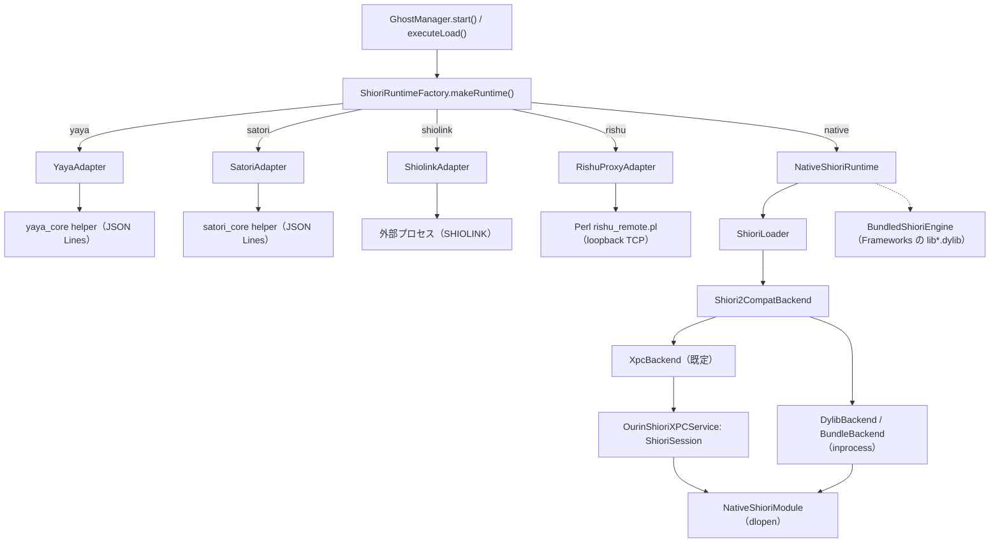
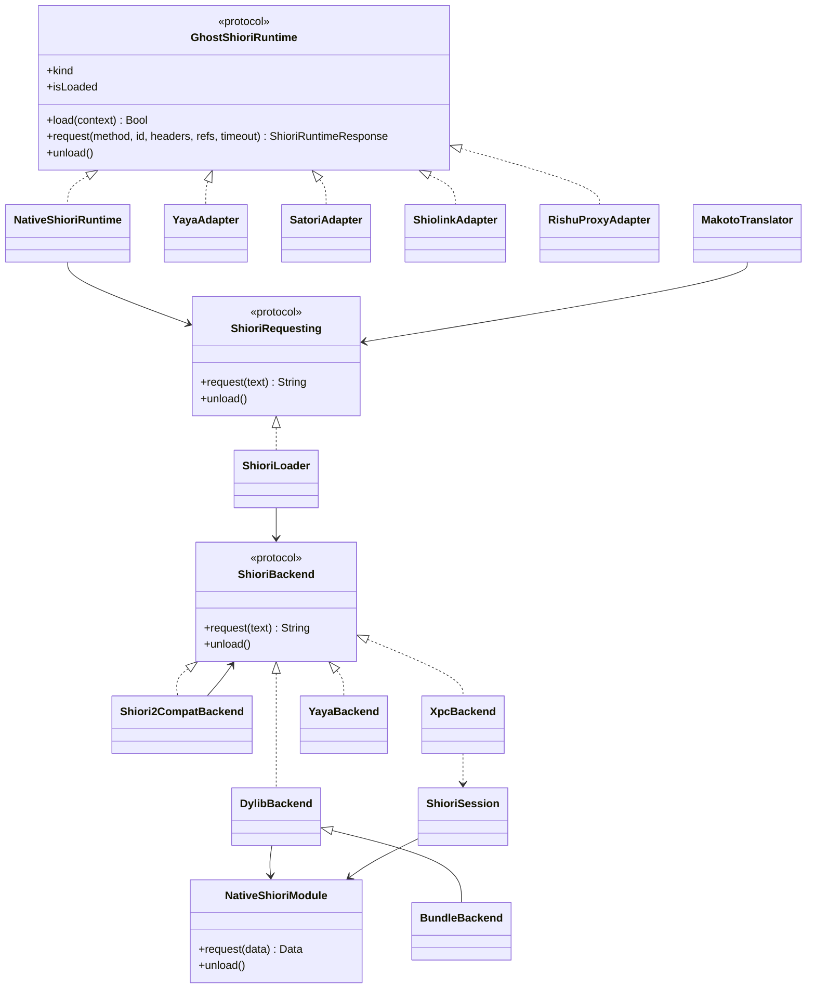
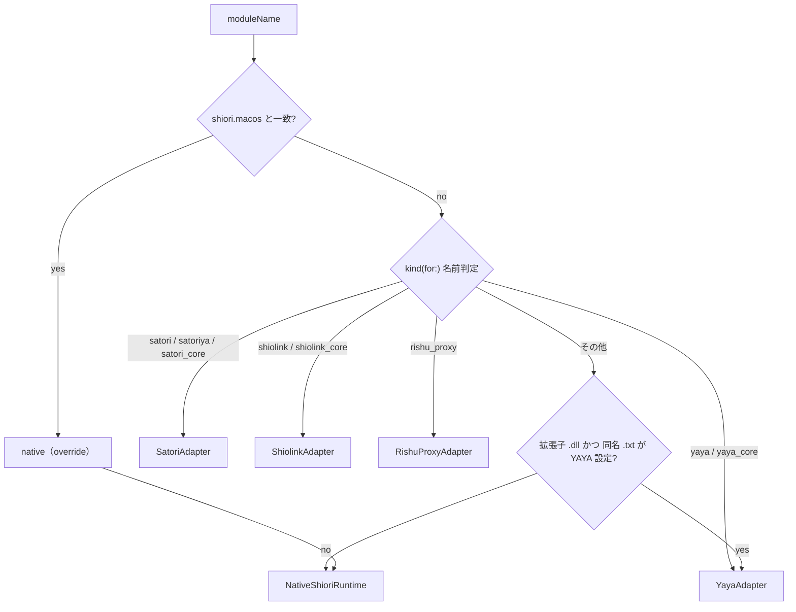
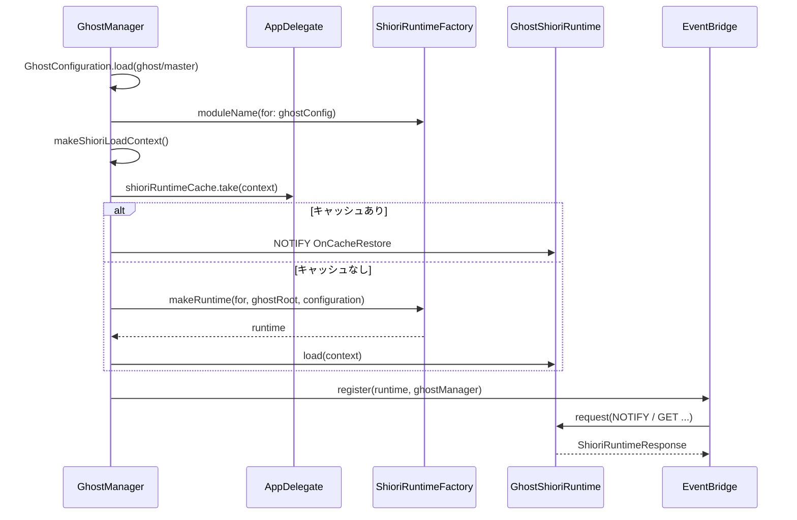
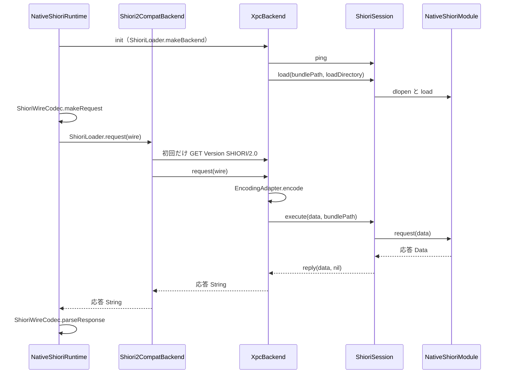

# 8 SHIORI 層（USL）

<details>
<summary>関連ソースファイル</summary>

このページは次のファイルをもとに作成した。

- [Ourin/USL/ShioriRuntime.swift](../../Ourin/USL/ShioriRuntime.swift)
- [Ourin/USL/ShioriRuntimeFactory.swift](../../Ourin/USL/ShioriRuntimeFactory.swift)
- [Ourin/USL/ShioriRuntimeCache.swift](../../Ourin/USL/ShioriRuntimeCache.swift)
- [Ourin/USL/ShioriLoader.swift](../../Ourin/USL/ShioriLoader.swift)
- [Ourin/USL/NativeShioriModule.swift](../../Ourin/USL/NativeShioriModule.swift)
- [Ourin/USL/BundledShioriEngine.swift](../../Ourin/USL/BundledShioriEngine.swift)
- [Ourin/USL/Shiori2CompatAdapter.swift](../../Ourin/USL/Shiori2CompatAdapter.swift)
- [Ourin/USL/MakotoTranslator.swift](../../Ourin/USL/MakotoTranslator.swift)
- [Ourin/USL/SatoriAdapter.swift](../../Ourin/USL/SatoriAdapter.swift)
- [Ourin/USL/ShiolinkAdapter.swift](../../Ourin/USL/ShiolinkAdapter.swift)
- [Ourin/USL/RishuProxyAdapter.swift](../../Ourin/USL/RishuProxyAdapter.swift)
- [Ourin/Yaya/YayaAdapter.swift](../../Ourin/Yaya/YayaAdapter.swift)
- [Ourin/SHIORI/ShioriStatusStore.swift](../../Ourin/SHIORI/ShioriStatusStore.swift)
- [Ourin/Compat/UkagakaModuleABI.swift](../../Ourin/Compat/UkagakaModuleABI.swift)
- [Ourin/Compat/SSPCompat.swift](../../Ourin/Compat/SSPCompat.swift)
- [Ourin/Compat/LegacyDescriptor.swift](../../Ourin/Compat/LegacyDescriptor.swift)
- [OurinShioriXPCService/main.swift](../../OurinShioriXPCService/main.swift)
- [OurinShioriXPCService/Info.plist](../../OurinShioriXPCService/Info.plist)
- [OurinShioriXPCService/OurinShioriXPCService.entitlements](../../OurinShioriXPCService/OurinShioriXPCService.entitlements)
- [Ourin/Ghost/GhostManager.swift](../../Ourin/Ghost/GhostManager.swift)
- [Ourin/Ghost/GhostManager+System.swift](../../Ourin/Ghost/GhostManager+System.swift)
- [Ourin/Ghost/GhostConfiguration.swift](../../Ourin/Ghost/GhostConfiguration.swift)
- [Ourin/OurinApp.swift](../../Ourin/OurinApp.swift)
- [Ourin/SHIORIEvents/EventBridge.swift](../../Ourin/SHIORIEvents/EventBridge.swift)
- [Ourin/SSTP/EncodingAdapter.swift](../../Ourin/SSTP/EncodingAdapter.swift)
- [Ourin/SSTP/SSTPDispatcher.swift](../../Ourin/SSTP/SSTPDispatcher.swift)
- [Ourin/SSTP/SstpBreakPolicy.swift](../../Ourin/SSTP/SstpBreakPolicy.swift)
- [Ourin/Property/GhostPropertyProvider.swift](../../Ourin/Property/GhostPropertyProvider.swift)
- [Ourin.xcodeproj/project.pbxproj](../../Ourin.xcodeproj/project.pbxproj)
- [docs/NATIVE_SHIORI_ABI_ja-jp.md](../../docs/NATIVE_SHIORI_ABI_ja-jp.md)
- [docs/OURIN_USL_1.0M_SPEC_ja-jp.md](../../docs/OURIN_USL_1.0M_SPEC_ja-jp.md)
- [docs/SHIORI_2X_COMPAT_SPEC_ja-jp.md](../../docs/SHIORI_2X_COMPAT_SPEC_ja-jp.md)
- [docs/SHIORI_RUNTIME_COMPATIBILITY_MATRIX_ja-jp.md](../../docs/SHIORI_RUNTIME_COMPATIBILITY_MATRIX_ja-jp.md)

</details>

このページは、ゴーストの人格エンジンである SHIORI（栞）を Ourin がどう選び、読み込み、要求・応答をやりとりするかを扱う。ディレクトリ名の `USL` は「Universal-SHIORI Loader」の略で、`Ourin/USL/` に SHIORI 実行系の共通境界（`GhostShioriRuntime`）、選択規則（`ShioriRuntimeFactory`）、ネイティブモジュールのローダ（`ShioriLoader` / `NativeShioriModule`）、XPC 隔離、SHIORI/2.x 互換、MAKOTO 翻訳がまとまっている。

ベースウェアの残りの部分（[4 GhostManager](./04-ghost-manager.md)、[9 SHIORI イベント](./09-shiori-events.md)、[10 SSTP スタック](./10-sstp.md)）は、SHIORI の実装言語を意識せず `GhostShioriRuntime` の `load` / `request` / `unload` だけを呼ぶ。YAYA と里々の内部は [8.1 YAYA](./08a-yaya.md) と [8.2 里々](./08b-satori.md)、SHIOLINK・里珠・同梱の追加エンジンは [8.3](./08c-external-engines.md) で説明する。ここでは各ランタイムが「アダプタとして接続される」ところまでを扱う。

## 全体像

`GhostManager` は `descript.txt` の値からモジュール名を決め、`ShioriRuntimeFactory` にランタイムを作らせる。ランタイムは 5 種類（`ShioriRuntimeKind`）で、うち `native` だけが `ShioriLoader` を通じて macOS 用の動的ライブラリを読む。ネイティブモジュールは既定で XPC サービス `jp.ourin.shiori`（別プロセス）の中でロードされる。



**出典:** [Ourin/USL/ShioriRuntime.swift:7-13](../../Ourin/USL/ShioriRuntime.swift#L7-L13)、[Ourin/USL/ShioriRuntimeFactory.swift:81-95](../../Ourin/USL/ShioriRuntimeFactory.swift#L81-L95)、[Ourin/USL/ShioriRuntimeFactory.swift:135-164](../../Ourin/USL/ShioriRuntimeFactory.swift#L135-L164)、[Ourin/USL/ShioriLoader.swift:833-873](../../Ourin/USL/ShioriLoader.swift#L833-L873)

## SHIORI/3.0 の要求・応答の型表現

SHIORI/3.0 の電文（`GET` / `NOTIFY`、CRLF 区切りのヘッダ、末尾の空行）は、Ourin 内部では次の型で表す。ワイヤ文字列との相互変換は `ShioriWireCodec` に一本化されている（Native だけが独自のヘッダ生成を持つとヘッダ差分が出るため、とコメントにある）。

| SHIORI/3.0 の要素 | Ourin 内部の表現 | 備考 |
|---|---|---|
| 要求メソッド `GET` / `NOTIFY` | `request(method:)` の `String` | `makeRequest` は大文字化して `NOTIFY` 以外をすべて `GET` にする |
| `ID` | `request(id:)` | `makeRequest` が `ID` ヘッダとして必ず上書き設定 |
| `Reference0..N` | `request(refs: [String])` | 配列の添字がそのまま `ReferenceN` になる |
| `Charset`・`Sender`・`SecurityLevel` 等 | `request(headers: [String: String])` | 既定値は `Charset`=送出 charset、`Sender: Ourin`、`SecurityLevel: local`、`SecurityOrigin: null` |
| プロトコル版 | `ShioriCommunicationOptions.version`（`shiori.version`） | 既定 `SHIORI/3.0`。`SHIORI/` で始まらなければ `SHIORI/3.0` |
| 送出 charset | `ShioriCommunicationOptions.outboundCharset` | `forceEncoding ?? encoding ?? "UTF-8"` |
| 応答ステータス行 `SHIORI/3.0 200 OK` | `ShioriRuntimeResponse.status: Int` | 理由句は保持しない |
| `Value` ヘッダ | `ShioriRuntimeResponse.value: String?` | `Value` だけは `headers` に入れず分離する |
| その他の応答ヘッダ | `ShioriRuntimeResponse.headers: [String: String]?` | 同名ヘッダは後勝ち。空なら `nil` |
| 通信の成否 | `ShioriRuntimeResponse.ok: Bool` | SHIORI ステータスの成否ではなく「通信と解析が完了した」ことを示す。204/400 でも `true` |
| 失敗 | `request` の戻り値 `nil` | タイムアウト・切断・解析失敗など |

`ShioriRuntimeResponse` には `error` と `loaded_dics`（yaya_core IPC の診断用）もあり、`YayaResponse` はその移行用の別名である。

`makeRequest` はヘッダを SSP の `MakeShiori30Request` と同じ順序に並べる。

```swift
// Ourin/USL/ShioriRuntime.swift（抜粋）
private static func headerSortKey(_ key: String) -> String {
    // SSP MakeShiori30Request 順: Charset → SecurityLevel → SecurityOrigin → Sender → SenderType → ID → BaseID → ReferenceN
    let lower = key.lowercased()
    if lower == "charset" { return "00" }
    if lower == "securitylevel" { return "01" }
    ...
    if lower.hasPrefix("reference"), let index = Int(lower.dropFirst("reference".count)) {
        return String(format: "07-%08d", index)
    }
    return "08-\(lower)"
}
```

ヘッダ名・値に含まれる CR / LF は `sanitize` で削除される。`parseResponse` は CRLF を LF に正規化し、先頭行が `SHIORI/` で始まり 2 語目が整数のときだけ応答として受け付ける。

**出典:** [Ourin/USL/ShioriRuntime.swift:16-33](../../Ourin/USL/ShioriRuntime.swift#L16-L33)、[Ourin/USL/ShioriRuntime.swift:76-99](../../Ourin/USL/ShioriRuntime.swift#L76-L99)、[Ourin/USL/ShioriRuntime.swift:132-171](../../Ourin/USL/ShioriRuntime.swift#L132-L171)、[Ourin/USL/ShioriRuntime.swift:173-206](../../Ourin/USL/ShioriRuntime.swift#L173-L206)、[Ourin/USL/ShioriRuntime.swift:220-239](../../Ourin/USL/ShioriRuntime.swift#L220-L239)

## GhostShioriRuntime プロトコルと実装

`GhostShioriRuntime` はゴーストから見た SHIORI 実行系の共通境界で、`kind`・`isLoaded`・`resourceManager` と、`load(context:)`・`request(method:id:headers:refs:timeout:)`・`unload()` を持つ。ロード入力は `ShioriRuntimeLoadContext` に集約され、YAYA 専用の辞書一覧（`dictionaryEntries` / `dictionaryEncoding` / `functionDepthLimit`）も同じ構造体に入るが、他のランタイムは無視してよい。



| 実装 | kind | 実体・通信 | 定義 |
|---|---|---|---|
| `YayaAdapter` | `yaya` | アプリ同梱の `yaya_core` を `Process` で起動し JSON Lines で通信（[8.1](./08a-yaya.md)） | [Ourin/Yaya/YayaAdapter.swift:40-68](../../Ourin/Yaya/YayaAdapter.swift#L40-L68) |
| `SatoriAdapter` | `satori` | アプリ同梱の `satori_core` を起動し JSON Lines で通信（[8.2](./08b-satori.md)） | [Ourin/USL/SatoriAdapter.swift:39-60](../../Ourin/USL/SatoriAdapter.swift#L39-L60) |
| `ShiolinkAdapter` | `shiolink` | `SHIOLINK.INI` の外部プロセスと stdin/stdout（[8.3](./08c-external-engines.md)） | [Ourin/USL/ShiolinkAdapter.swift:101-123](../../Ourin/USL/ShiolinkAdapter.swift#L101-L123) |
| `RishuProxyAdapter` | `rishu` | Perl の `rishu_remote.pl` と loopback TCP（[8.3](./08c-external-engines.md)） | [Ourin/USL/RishuProxyAdapter.swift:6-30](../../Ourin/USL/RishuProxyAdapter.swift#L6-L30) |
| `NativeShioriRuntime` | `native` | `ShioriLoader` 経由で `.dylib` / `.bundle` を dlopen（既定は XPC 内） | [Ourin/USL/ShioriRuntimeFactory.swift:120-205](../../Ourin/USL/ShioriRuntimeFactory.swift#L120-L205) |

`NativeShioriRuntime` は `ShioriWireCodec.makeRequest` で構造化要求をワイヤ文字列にし、`ShioriRequesting.request(_:)`（文字列→文字列）を呼んで `parseResponse` で構造化応答に戻す。`timeout` 引数は使わない（直接ロード型は同期 ABI で、XPC の期限は `XpcBackend` が管理する、とコメントにある）。`ShioriBackend` と `ShioriRequesting` はどちらも「文字列の SHIORI 電文を受け取り、応答文字列を返す」境界で、前者は `ShioriLoader` 内部、後者は外部公開用である。

**出典:** [Ourin/USL/ShioriRuntime.swift:39-70](../../Ourin/USL/ShioriRuntime.swift#L39-L70)、[Ourin/USL/ShioriRuntime.swift:106-129](../../Ourin/USL/ShioriRuntime.swift#L106-L129)、[Ourin/USL/ShioriRuntimeFactory.swift:166-204](../../Ourin/USL/ShioriRuntimeFactory.swift#L166-L204)、[Ourin/USL/ShioriLoader.swift:48-51](../../Ourin/USL/ShioriLoader.swift#L48-L51)、[Ourin/USL/ShioriLoader.swift:926-931](../../Ourin/USL/ShioriLoader.swift#L926-L931)

## ランタイムの選択（ShioriRuntimeFactory）

### モジュール名の決定

`ShioriRuntimeFactory.moduleName(for:)` が通常起動と再ロードで共有される唯一の選択規則である。

1. `descript.txt` の `shiori.macos` が空でなければ、それをモジュール名にする（ネイティブの明示指定）。
2. そうでなければ `shiori` の値。
3. `GhostConfiguration` が無い（`descript.txt` を読めない、または `name` が無く `parse` が `nil`）ときは `yaya.dll`。

注意: `descript.txt` に `name` はあるが `shiori` が無い場合、`GhostConfiguration` の初期値 `shiori.dll` が使われる。`yaya.dll` へのフォールバックは設定自体が無いときだけである。

`shiori.version` / `shiori.encoding` / `shiori.forceencoding` / `shiori.escape_unknown` / `shiori.cache` は `ShioriCommunicationOptions` に入り、ワイヤ境界まで運ばれる。

**出典:** [Ourin/USL/ShioriRuntimeFactory.swift:7-21](../../Ourin/USL/ShioriRuntimeFactory.swift#L7-L21)、[Ourin/Ghost/GhostConfiguration.swift:268-284](../../Ourin/Ghost/GhostConfiguration.swift#L268-L284)、[Ourin/Ghost/GhostConfiguration.swift:296-301](../../Ourin/Ghost/GhostConfiguration.swift#L296-L301)、[Ourin/Ghost/GhostConfiguration.swift:318-331](../../Ourin/Ghost/GhostConfiguration.swift#L318-L331)、[Ourin/Ghost/GhostManager.swift:1563-1570](../../Ourin/Ghost/GhostManager.swift#L1563-L1570)

### 判定表（モジュール名 → ランタイム）

`kind(for:)` はパスの最後の要素から拡張子を除き、小文字化し、先頭の `lib` を取ってから名前で判定する。Windows の `\` 区切り（`shiori\aya.dll`）も `/` に直して扱う。

| `descript.txt` の指定例 | 判定の根拠 | kind | 生成されるランタイム / 実体 |
|---|---|---|---|
| `shiori.macos,native/libyaya.dylib`（空でない `shiori.macos`） | `usesNativeOverride` | `native` | `NativeShioriRuntime`。指定ファイルを大文字小文字無視で解決し、同梱エンジンや yaya_core に置き換えない |
| `yaya.dll`、`libyaya.dylib`、`yaya_core` | 名前 `yaya` / `yaya_core` | `yaya` | `YayaAdapter` |
| `aya.dll` など（名前で決まらない `.dll`） | DLL と同じフォルダの `<DLL名>.txt` に `dic` / `dicdir` / `include` 行がある | `yaya` | `YayaAdapter`（例: Taromati2 の `shiori/aya.dll`） |
| `satori.dll`、`satoriya.dll`、`satori_core` | 名前 | `satori` | `SatoriAdapter` |
| `SHIOLINK.dll`、`shiolink_core` | 名前 `shiolink` / `shiolink_core` | `shiolink` | `ShiolinkAdapter` |
| `rishu_proxy.dll` | 名前 `rishu_proxy` | `rishu` | `RishuProxyAdapter` |
| `kawari.dll`、`kosui.dll`、`kagari.dll`、`akari.dll` ほか 7 栞、`aosora.dll` | 上記以外 | `native` | `NativeShioriRuntime` → 同梱エンジンへ解決（`BundledShioriEngine`） |
| `shiori.dll`（同フォルダに `kawarirc.ini` / `kawarirc.kis`） | 上記以外 | `native` | 同梱の華和梨へ解決 |
| その他の `*.dll` / `*.dylib` / `*.bundle` / `*.so` | 上記以外 | `native` | ゴースト内の macOS モジュールを探索 |
| 設定なし | `yaya.dll` へフォールバック | `yaya` | `YayaAdapter` |

YAYA 判定に使う設定ファイルは `isYayaConfig` が Latin-1 で読み、`//` 以降のコメントを除いた各行のカンマ前のキーだけを見る（値の文字コードを問わないため）。



**出典:** [Ourin/USL/ShioriRuntimeFactory.swift:23-78](../../Ourin/USL/ShioriRuntimeFactory.swift#L23-L78)、[Ourin/USL/ShioriRuntimeFactory.swift:81-116](../../Ourin/USL/ShioriRuntimeFactory.swift#L81-L116)、[Ourin/USL/BundledShioriEngine.swift:68-90](../../Ourin/USL/BundledShioriEngine.swift#L68-L90)

## ロードとライフサイクル（GhostManager との接続）

`GhostManager` 側の入口は次の 3 つである。

| 関数 | 役割 | 定義 |
|---|---|---|
| `makeShioriLoadContext(moduleName:ghostRoot:)` | `ShioriCommunicationOptions` を組み立てる。YAYA のときだけ `<DLL名>.txt` を `collectDicEntries` で解析し、`basepath` を反映した `ghostRoot` と辞書一覧を詰める | [Ourin/Ghost/GhostManager.swift:1561-1617](../../Ourin/Ghost/GhostManager.swift#L1561-L1617) |
| `createLoadedShioriRuntime(moduleName:ghostRoot:)` | Factory で生成 → `resourceManager` 設定 → `load(context:)`。失敗時は `unload()` して `nil` | [Ourin/Ghost/GhostManager.swift:1631-1645](../../Ourin/Ghost/GhostManager.swift#L1631-L1645) |
| `shutdown(preserveRuntimeForCache:)` | `OnCacheSuspend` または `OnDestroy` を送ってから unload（またはキャッシュへ渡す） | [Ourin/Ghost/GhostManager.swift:1994-2030](../../Ourin/Ghost/GhostManager.swift#L1994-L2030) |

起動は `start()` のバックグラウンドキュー（`DispatchQueue.global(qos: .userInitiated)`）で行う。`AppDelegate.shioriRuntimeCache` からキャッシュ済みランタイムを取り出せれば `NOTIFY OnCacheRestore` を送って再利用し、無ければ新規にロードする。ロードに成功したときだけメインキューで `shioriRuntime` に保持し、`EventBridge.shared.register(runtime:ghostManager:)` で配送先に登録する（失敗したランタイムを配送先に残さない）。



イベント配送では `EventBridge` が `NOTIFY` を 2.0 秒、`GET` を 3.0 秒の期限で `runtime.request` を呼び、`ok` かつ `value` があるときだけスクリプトとして扱う（詳細は [9 SHIORI イベント](./09-shiori-events.md)）。

さくらスクリプトの `\![load,shiori]` / `\![unload,shiori]` / `\![reload,shiori]` は `executeLoad` / `executeUnload` / `executeReload` に入る。`executeLoad` は `createLoadedShioriRuntime` を使い、成功すると `OnShioriLoaded`（`name` と `kind`）、失敗すると `OnShioriLoadFailure` を通知する。`executeUnload` は `unload()` して EventBridge の登録を外し `OnShioriUnloaded` を通知する。

注意: `executeReload(target: "shiori")` は `executeLoad` を呼ぶだけで、`executeLoad` は `shioriRuntime == nil` のときしか動かない。つまり SHIORI がロード済みの状態で `\![reload,shiori]` を実行してもコード上は何も起きない（意図した仕様かは未確認）。

**出典:** [Ourin/Ghost/GhostManager.swift:1715-1760](../../Ourin/Ghost/GhostManager.swift#L1715-L1760)、[Ourin/Ghost/GhostManager.swift:4104-4119](../../Ourin/Ghost/GhostManager.swift#L4104-L4119)、[Ourin/Ghost/GhostManager+System.swift:5972-5978](../../Ourin/Ghost/GhostManager+System.swift#L5972-L5978)、[Ourin/Ghost/GhostManager+System.swift:5984-6027](../../Ourin/Ghost/GhostManager+System.swift#L5984-L6027)、[Ourin/SHIORIEvents/EventBridge.swift:1552-1559](../../Ourin/SHIORIEvents/EventBridge.swift#L1552-L1559)、[Ourin/SHIORIEvents/EventBridge.swift:1621-1628](../../Ourin/SHIORIEvents/EventBridge.swift#L1621-L1628)

## ShioriRuntimeCache（shiori.cache）

`ShioriRuntimeCache` は SHIORI の応答を記憶するものではなく、`shiori.cache,1` のゴーストを切り替える間だけランタイムそのものを保持する、容量制限付きの LRU である。`AppDelegate` が容量 2 で 1 つ持つ。

- キーは `ghostURL`・`ghostRoot`・小文字化した `moduleName`・override の有無・`version`・`encoding`・`forceEncoding`・`escapeUnknown` を `U+001F` で連結した文字列。どれかが変わると別エントリになる。
- `store` は `lastUsed` の論理時計を進めて登録し、容量を超えたら最古を追い出す。追い出したランタイムには `NOTIFY OnDestroy`（`Reference0` = `cache`）を 1.0 秒期限で送ってから `unload()` する。
- `take` は取り出すと同時にエントリを削除する（同じランタイムを二重に使わない）。
- `removeAll` はアプリ終了時に呼ばれ、残り全部に `OnDestroy`（`Reference0` = `shutdown`）を送って unload する。

`AppDelegate.runGhost` は既存ゴーストを `shutdown(preserveRuntimeForCache: true)` で止め、戻り値の `CachedRuntime` を `store` する。`shutdown` 側は `shiori.cache == true` のときだけ `NOTIFY OnCacheSuspend` を送り、`resourceManager` を外してランタイムを返す。

**出典:** [Ourin/USL/ShioriRuntimeCache.swift:1-89](../../Ourin/USL/ShioriRuntimeCache.swift#L1-L89)、[Ourin/OurinApp.swift:159](../../Ourin/OurinApp.swift#L159)、[Ourin/OurinApp.swift:899-908](../../Ourin/OurinApp.swift#L899-L908)、[Ourin/Ghost/GhostManager.swift:823-826](../../Ourin/Ghost/GhostManager.swift#L823-L826)、[Ourin/Ghost/GhostManager.swift:1994-2015](../../Ourin/Ghost/GhostManager.swift#L1994-L2015)

## ShioriLoader（ネイティブモジュールのローダ）

### NativeShioriRuntime からローダを作る

`NativeShioriRuntime.defaultLoaderFactory` は `load` 用ディレクトリ（`ghostRoot` + モジュールの相対パスの親）を先に決め、次の順でローダを作る。

1. `nativeModuleOverride`（`shiori.macos`）なら、そのファイルを `UkagakaModuleABI.resolveCaseInsensitive` で解決する。無ければロード失敗。
2. `BundledShioriEngine.resolveModuleURL` がゴースト内のモジュールまたは同梱エンジンを返せば、その URL で `ShioriLoader(moduleURL:)`。
3. どちらでもなければ `ShioriLoader(module:base:)` で名前から探索する。

### バックエンドの選択

`ShioriLoader.makeBackend` は XPC サービス名があれば `XpcBackend`、無ければ拡張子が `bundle` / `plugin` なら `BundleBackend`、それ以外は `DylibBackend` を作る。`shiori2Compatibility` が `true`（既定）なら、どれも `Shiori2CompatBackend` で包む。XPC の接続やロードに失敗しても in-process ロードへ切り替えず、`ShioriLoader` の初期化が `nil` になる。

| 環境変数 | 既定 | 意味 | 定義 |
|---|---|---|---|
| `SHIORI_XPC_SERVICE_NAME` | なし | XPC サービス名を明示（最優先） | [Ourin/USL/ShioriLoader.swift:833-845](../../Ourin/USL/ShioriLoader.swift#L833-L845) |
| `OURIN_SHIORI_XPC_SERVICE` | なし | 同上（第 2 候補） | 同上 |
| `OURIN_SHIORI_ISOLATION_MODE` | なし | `inprocess` のときだけ XPC を使わない。それ以外は `jp.ourin.shiori` | 同上 |

`ShioriLoader(module:base:)` は名前の最後の要素が `yaya.dll` なら旧来の `YayaBackend`（`ghost/master/yaya.txt` を読み `YayaAdapter` を内部に持つ）を使う。注意: 現在の Factory は `yaya.dll` を `yaya` と判定して `YayaAdapter` を直接作るので、通常起動でこの分岐には到達しない（テストからは呼ばれている）。`YayaBackend` は TEACH や SHIORI/2.x の要求行も 3.0 に読み替える。

**出典:** [Ourin/USL/ShioriRuntimeFactory.swift:135-164](../../Ourin/USL/ShioriRuntimeFactory.swift#L135-L164)、[Ourin/USL/ShioriLoader.swift:748-829](../../Ourin/USL/ShioriLoader.swift#L748-L829)、[Ourin/USL/ShioriLoader.swift:846-873](../../Ourin/USL/ShioriLoader.swift#L846-L873)、[Ourin/USL/ShioriLoader.swift:55-115](../../Ourin/USL/ShioriLoader.swift#L55-L115)、[Ourin/USL/ShioriLoader.swift:517-602](../../Ourin/USL/ShioriLoader.swift#L517-L602)

### 探索パスと名前の正規化

`searchPaths(base:)` は `ghost/master`、`ghost/master/modules`、アプリの `Contents/Frameworks` の 3 か所。`normalizedNames(for:)` は元の名前に加えて `<stem>.dylib`、`lib<stem>.dylib`、`<stem>.bundle`、`<stem>.plugin`、`<stem>.so`、`lib<stem>.so` を候補にする（相対ディレクトリ付きの名前はそのディレクトリを保つ）。macOS では `.dll` 候補を飛ばす。`.dll` を先に返すと dlopen 失敗後に代替候補へ到達できないためである。各候補は `resolveCaseInsensitive` で大文字小文字を無視して解決される。

YAYA 設定の解析（`DicEntry`・`DicCollector`・`collectDicEntries`・`applyYayaBasePath`）も同じファイルにあるが、YAYA 専用なので [8.1 YAYA](./08a-yaya.md) を参照。

**出典:** [Ourin/USL/ShioriLoader.swift:876-923](../../Ourin/USL/ShioriLoader.swift#L876-L923)、[Ourin/USL/ShioriLoader.swift:117-166](../../Ourin/USL/ShioriLoader.swift#L117-L166)

### 文字コード変換

`DylibBackend` と `XpcBackend` は同じ規則で文字列とバイト列を変換する（`EncodingAdapter` は [10 SSTP](./10-sstp.md) のファイル）。

| 方向 | 使う charset |
|---|---|
| 要求（String → Data） | `forceEncoding ?? encoding ?? 要求文の Charset ヘッダ`。`escape_unknown` なら変換できない文字を `?escape!unicode[0xXXXX]` に退避 |
| 応答（Data → String） | `forceEncoding ?? 応答の Charset ヘッダ（無ければ要求と同じ）`。失敗時は UTF-8 で再試行。`escape_unknown` なら退避表記を元の文字に戻す |

XPC サービス側の `ShioriSession` はバイト列をそのままモジュールに渡すので、変換はすべてアプリ側で行われる。

**出典:** [Ourin/USL/ShioriLoader.swift:666-712](../../Ourin/USL/ShioriLoader.swift#L666-L712)、[Ourin/USL/ShioriLoader.swift:725-745](../../Ourin/USL/ShioriLoader.swift#L725-L745)、[Ourin/SSTP/EncodingAdapter.swift:99-130](../../Ourin/SSTP/EncodingAdapter.swift#L99-L130)、[Ourin/SSTP/EncodingAdapter.swift:155-158](../../Ourin/SSTP/EncodingAdapter.swift#L155-L158)

### エラー時の挙動

| 状況 | 挙動 |
|---|---|
| dlopen 失敗・必須シンボル欠落・ABI 宣言不足 | `NativeShioriModule` が `NSError(domain: "Ourin.NativeShiori")` を投げ、`ShioriLoader` は `nil`、`NativeShioriRuntime.load` は `false`（`[NativeShioriRuntime] Failed to load` をログ） |
| XPC の ping / load が期限（既定 5 秒）内に返らない | 接続を invalidate して `ShioriLoaderError.xpcUnavailable`。in-process へは切り替えない |
| XPC 要求のタイムアウト | `[XpcBackend] Request timeout` をログし、接続を invalidate して `nil` |
| リモートエラー・接続エラー | ログして `nil` |

注意: 要求が失敗しても `NativeShioriRuntime.isLoaded` は `true` のまま残る。XPC 接続を invalidate した後に自動再接続する処理はコード上に無いため、以後の要求は `nil` を返し続けると読める（invalidate 済みの `NSXPCConnection` が再利用できないという Foundation の仕様に基づく推測。再ロードするには `\![unload,shiori]` で `shioriRuntime` を捨ててから `\![load,shiori]` を実行する必要がある。`executeLoad` は `shioriRuntime` が残っていると何もしない）。

`ShioriLoaderError` には `openFailed`・`missingRequiredSymbol`・`xpcUnavailable`・`requestTimeout`・`requestFailed` が定義されているが、`XpcBackend` 以外で投げているのは確認できなかった。

**出典:** [Ourin/USL/ShioriLoader.swift:23-44](../../Ourin/USL/ShioriLoader.swift#L23-L44)、[Ourin/USL/ShioriLoader.swift:607-664](../../Ourin/USL/ShioriLoader.swift#L607-L664)、[Ourin/USL/ShioriLoader.swift:688-702](../../Ourin/USL/ShioriLoader.swift#L688-L702)、[Ourin/USL/ShioriRuntimeFactory.swift:166-204](../../Ourin/USL/ShioriRuntimeFactory.swift#L166-L204)、[Ourin/Ghost/GhostManager+System.swift:5984-6009](../../Ourin/Ghost/GhostManager+System.swift#L5984-L6009)

## NativeShioriModule と ABI

`NativeShioriModule` はアプリ内（`DylibBackend`）と XPC サービスの両方でコンパイルされる共通実装で、`dlopen(RTLD_NOW | RTLD_LOCAL)` でライブラリを開き、ABI に応じたクロージャ `performRequest` / `performUnload` を組み立てる。`.bundle` / `.plugin` は `Bundle.executableURL` を開く。

### ABI の決定

1. `.bundle` / `.plugin` は `Info.plist`、単体 dylib は隣接する `<ファイル名>.plist`（例: `libakari.dylib.plist`）を読む。ライブラリが `Frameworks` 直下にあるときは `Contents/Resources/EngineMetadata/<ファイル名>.plist` も見る（署名済み Frameworks にはコードしか置けないため）。
2. `OurinShioriABI` があればその値。未知の値はロードエラー。
3. 宣言が無く `kagari_request` があれば `kagari`。
4. 宣言が無く `shiori_request` があれば `ourin`。無印の `request` しか無いときは「Unprefixed request requires an explicit OurinShioriABI declaration」で拒否する（同名で互換性の無い 2 種の ABI があるため）。

| `OurinShioriABI` | load | request | unload | 所有権 |
|---|---|---|---|---|
| `ourin` | `bool(const char *)` | `bool(const uchar *, size_t, uchar **, size_t *)` | `void(void)` | 入力はホスト所有。応答は `shiori_free`（無ければ `free`）で解放 |
| `ukagaka-long` | `int32_t(void *, long)` | `void *(void *, long *)` | `int32_t(void)` | 入力は malloc した NUL 終端領域をモジュールへ渡す。応答はホストが複製後 `free` |
| `ukagaka-int32` | `int32_t(void *, int32_t)` | `void *(void *, int32_t *)` | `int32_t(void)` | 同上（長さが 32bit） |
| `kagari` | `int32_t(void *, long)` → instance ID（負で失敗） | `void *(int32_t, void *, long *)` | `int32_t(int32_t)` | 同上 |
| `aosora` | `long(void *, long)` → instance ID（0 以下で失敗） | `void *(long, void *, long *)` | `int32_t(long)` | 同上 |

シンボルは load が `shiori_loadu` → `loadu` → `shiori_load` → `load`、request が `shiori_request` → `request`、unload が `shiori_unloadu` → `unloadu` → `shiori_unload` → `unload` の順に探す（`kagari` / `aosora` は専用名のみ）。`load` は省略可能で、存在して失敗を返すとロード全体が失敗する。`load` に渡すディレクトリは UTF-8・末尾 `/` 付き。応答長が負または 64 MiB を超える応答は捨てる。ロード中の例外では `dlclose` してから再送出する。

**出典:** [Ourin/USL/NativeShioriModule.swift:4-36](../../Ourin/USL/NativeShioriModule.swift#L4-L36)、[Ourin/USL/NativeShioriModule.swift:38-89](../../Ourin/USL/NativeShioriModule.swift#L38-L89)、[Ourin/USL/NativeShioriModule.swift:90-186](../../Ourin/USL/NativeShioriModule.swift#L90-L186)、[Ourin/USL/NativeShioriModule.swift:188-207](../../Ourin/USL/NativeShioriModule.swift#L188-L207)、[docs/NATIVE_SHIORI_ABI_ja-jp.md:20-57](../../docs/NATIVE_SHIORI_ABI_ja-jp.md#L20-L57)

### ドキュメントとの照合

`docs/NATIVE_SHIORI_ABI_ja-jp.md` の ABI 表・シンボル順・所有権・64 MiB 制限・「XPC 失敗時に in-process へ切り替えない」はコードと一致する。`Resources/EngineMetadata` を参照する点はこの文書には無く、[docs/KAWARI_KAGARI_ENGINES_ja-jp.md](../../docs/KAWARI_KAGARI_ENGINES_ja-jp.md) 側に書かれている。

注意: 2025-07 付けの草案 `docs/OURIN_USL_1.0M_SPEC_ja-jp.md` は現行コードと次の点で食い違う。コードを優先すること。

| 草案の記述 | 現行コード |
|---|---|
| `request` の入力バッファは呼出中のみ有効でモジュールは解放しない | `ukagaka-*` / `kagari` / `aosora` では malloc した入力の所有権をモジュールへ渡す（`ourin` だけホスト所有） |
| `load` には CP932 でパスを渡す | すべて UTF-8 |
| ファイル名の大文字小文字は厳格に一致 | `resolveCaseInsensitive` で大文字小文字を無視 |
| load/unload/request は 10 秒、タイムアウト時は再ロード | XPC は 5 秒、サービス側 watchdog も 5 秒で `_exit(124)`。自動再ロードなし |
| 探索に `@rpath` / `DYLD_*` を含む | `ghost/master`・`ghost/master/modules`・`Frameworks` の 3 か所のみ |

**出典:** [docs/OURIN_USL_1.0M_SPEC_ja-jp.md:52-104](../../docs/OURIN_USL_1.0M_SPEC_ja-jp.md#L52-L104)、[Ourin/USL/NativeShioriModule.swift:83-88](../../Ourin/USL/NativeShioriModule.swift#L83-L88)、[OurinShioriXPCService/main.swift:38-41](../../OurinShioriXPCService/main.swift#L38-L41)

## BundledShioriEngine（同梱エンジンへの解決）

`BundledShioriEngine` は Windows の `*.dll` 名を、明示的に対応づけた macOS 同梱エンジンへ解決する列挙型である。`resolveModuleURL` はまず `ShioriLoader.searchPaths` / `find` でモジュールを探し、見つからなければ `recognize` でエンジンを特定して `bundledURL` を返す。

| case | 認識する名前（`lib` 除去後） | 成果物の候補名 | `shioriABI` | 上書き環境変数 |
|---|---|---|---|---|
| `kawari` | `kawari`、`kosui`、（`kawarirc.*` がある）`shiori` | `libkawari_shiori.dylib` ほか 3 名 | `ukagaka-long` | `OURIN_KAWARI_ENGINE` |
| `kagari` | `kagari` | `libkagari.dylib`、`kagari.dylib`、`libkagari.so` | `kagari` | `OURIN_KAGARI_ENGINE` |
| `akari` / `eseShiori` / `niseShiori` / `shino` / `hisui` / `yuhna` / `misaka` | `akari`、`ese-shiori`、`niseshiori`・`nise-shiori`、`shino`、`hisui`、`yuhna`、`misaka` | `lib<名前>.dylib` | `ukagaka-int32` | `OURIN_AKARI_ENGINE` など |
| `aosora` | `aosora` | `libaosora.dylib` | `aosora` | `OURIN_AOSORA_ENGINE`（これ以外では解決しない） |

`bundledURL` は環境変数の上書き（実在するファイルのみ）を最優先し、`aosora` は上書きが無ければ `nil`（ソース由来ライブラリの再配布許諾が無いため）。それ以外は `Contents/Frameworks`、`Resources/Engines`、`privateFrameworksURL` を順に探す。`shioriABI` プロパティはビルドスクリプトが plist に書く値と対応しているが、ロード時の ABI は plist（`NativeShioriModule`）から読まれる。

`load` に渡す辞書ディレクトリは Frameworks ではなくゴースト側の DLL の場所である（`NativeShioriRuntime` が `loadDirectory` を別に渡す）。注意: `searchPaths` に `Frameworks` が含まれるため、`akari.dll` のような名前は `recognize` より先に `find` の段階で `Frameworks/libakari.dylib` に一致しうる。結果は同じファイルになる。

ビルド・同梱の手順と各エンジンの検証状況は [8.3](./08c-external-engines.md) を参照。

**出典:** [Ourin/USL/BundledShioriEngine.swift:3-66](../../Ourin/USL/BundledShioriEngine.swift#L3-L66)、[Ourin/USL/BundledShioriEngine.swift:68-138](../../Ourin/USL/BundledShioriEngine.swift#L68-L138)

## XPC 隔離（OurinShioriXPCService）

既定ではネイティブ SHIORI はアプリ本体ではなく、アプリに埋め込まれた XPC サービス `OurinShioriXPCService.xpc`（bundle id `jp.ourin.shiori`、`ServiceType` = `Application`）の中で dlopen される。このターゲットがコンパイルするのは `OurinShioriXPCService/main.swift` と `Ourin/USL/NativeShioriModule.swift` だけで、エンタイトルメントは `com.apple.security.cs.disable-library-validation`（署名の異なる dylib を読むため。推測）のみである。

| 要素 | 役割 | 定義 |
|---|---|---|
| `@objc protocol OurinShioriXPC` | ping / load / execute / unload。アプリ側（`ShioriLoader.swift`）とサービス側で同じ宣言を二重に持つ | [OurinShioriXPCService/main.swift:4-14](../../OurinShioriXPCService/main.swift#L4-L14)、[Ourin/USL/ShioriLoader.swift:8-21](../../Ourin/USL/ShioriLoader.swift#L8-L21) |
| `ServiceDelegate` | 接続ごとに新しい `ShioriSession` を作って export。invalidation / interruption でセッションを unload | [OurinShioriXPCService/main.swift:138-153](../../OurinShioriXPCService/main.swift#L138-L153) |
| `ShioriSession` | 1 接続に 1 つの `NativeShioriModule`。直列キュー `jp.ourin.shiori.session` で処理 | [OurinShioriXPCService/main.swift:38-108](../../OurinShioriXPCService/main.swift#L38-L108) |
| `runWithWatchdog` | 各操作に 5 秒の watchdog。超過するとサービスプロセスごと `_exit(124)` | [OurinShioriXPCService/main.swift:110-136](../../OurinShioriXPCService/main.swift#L110-L136) |
| `WireEncoding` | 要求の `Charset` を読む補助（現行の `ShioriSession` からは使われていない） | [OurinShioriXPCService/main.swift:16-36](../../OurinShioriXPCService/main.swift#L16-L36) |

サービスは SHIORI/2.x 変換をしない（`shiori2Compatibility` 引数は無視し、変換はクライアント側の adapter が担う）。`execute(_:bundlePath:shiori2Compatibility:)` は接続確立時にロード済みのモジュールへそのまま渡す。



`ShioriLoader.swift` の `ShioriXPCServiceHost` はサービス側の同等実装（ローダの辞書を `compat:` / `raw:` + パスで管理）で、アプリの XPC サービス本体ではなく `OurinTests/ShioriLoaderTests.swift` から使われている。

**出典:** [OurinShioriXPCService/main.swift:38-153](../../OurinShioriXPCService/main.swift#L38-L153)、[OurinShioriXPCService/Info.plist:17-21](../../OurinShioriXPCService/Info.plist#L17-L21)、[OurinShioriXPCService/OurinShioriXPCService.entitlements:1-8](../../OurinShioriXPCService/OurinShioriXPCService.entitlements#L1-L8)、[Ourin.xcodeproj/project.pbxproj:459-465](../../Ourin.xcodeproj/project.pbxproj#L459-L465)、[Ourin.xcodeproj/project.pbxproj:522](../../Ourin.xcodeproj/project.pbxproj#L522)、[Ourin/USL/ShioriLoader.swift:934-1115](../../Ourin/USL/ShioriLoader.swift#L934-L1115)

## SHIORI/2.x 互換（Shiori2CompatBackend / Shiori2CompatAdapter）

`Shiori2CompatBackend` は 3.0 の要求を、相手が 2.x と判明したときだけ 2.x へ変換するラッパーである。

1. 要求が解析できない、または既に `SHIORI/2.` 形式なら素通し（XPC 内での二重変換を避けるため）。
2. 判定モードが未確定なら `GET Version SHIORI/2.0`（`Charset: Shift_JIS`）を 1 回送り、応答が `SHIORI/2.x` の 2xx なら 2.x、それ以外は 3.0 と確定する。`shiori.version` が `SHIORI/2.` で始まれば問い合わせずに 2.x とする。
3. 2.x モードでは `Shiori2CompatAdapter.buildRequest` で変換する。対応表に無いイベントは SHIORI を呼ばずに `204 No Content` を返す。`NOTIFY` に 200 が返ったときも 204 にする。

| 3.0 の ID | 2.x 要求行 |
|---|---|
| `TEACH` メソッド / `OnTeach` | `TEACH SHIORI/2.4`（`Word`） |
| `Resource` | `GET String SHIORI/2.5` |
| `OwnerGhostName` | `NOTIFY OwnerGhostName SHIORI/2.3` |
| `OtherGhostName` / `InstalledGhostName` | `NOTIFY OtherGhostName SHIORI/2.3`（`GhostEx` を複数行） |
| `OnCommunicate` | `GET Sentence SHIORI/2.3`（Reference0 = Sender、Reference1 = Sentence） |
| `OnTalkRequest` | `GET Sentence SHIORI/2.0`（`Sender: User`） |
| `Word` / `GetWord` | `GET Word SHIORI/2.0` |
| `Status` / `GetStatus` | `GET Status SHIORI/2.0` |
| `shiori2EventIDs` に含まれるイベント（`OnBoot`、`OnMouseClick` など約 50 件） | `GET Sentence SHIORI/2.2`（`Event`、Reference は 8 個まで） |

いずれも `SecurityLevel` と `Charset: Shift_JIS` を付ける。応答は `normalizeResponse` で 3.0 形式に戻す。`310` は 204 にし、`Sentence` / `Word` / `String` を `Value` に、`Status` は `Status` ヘッダと `Value` の両方に、`To` は `To` と（無ければ）`Reference0` にする。仕様の背景は [docs/SHIORI_2X_COMPAT_SPEC_ja-jp.md](../../docs/SHIORI_2X_COMPAT_SPEC_ja-jp.md)。

**出典:** [Ourin/USL/Shiori2CompatAdapter.swift:7-90](../../Ourin/USL/Shiori2CompatAdapter.swift#L7-L90)、[Ourin/USL/Shiori2CompatAdapter.swift:205-262](../../Ourin/USL/Shiori2CompatAdapter.swift#L205-L262)、[Ourin/USL/Shiori2CompatAdapter.swift:264-325](../../Ourin/USL/Shiori2CompatAdapter.swift#L264-L325)、[Ourin/USL/Shiori2CompatAdapter.swift:327-440](../../Ourin/USL/Shiori2CompatAdapter.swift#L327-L440)

## MAKOTO 翻訳（MakotoTranslator）

`MakotoTranslator` はゴースト（`descript.txt` の `makoto`、既定 `makoto.dll`）とシェルの MAKOTO モジュールを SHIORI とは別に保持する。`base` と `base/modules` から `ShioriLoader.find` で探し、`ShioriLoader(moduleURL:communication: .init(version: "MAKOTO/2.0"), shiori2Compatibility: false)` で読む。既定の XPC 経路では 2.x 変換を通さない raw backend になる（MAKOTO は 2.x 変換を通せないため）。

`MakotoWireCodec.makeRequest` は `TRANSLATE Sentence MAKOTO/2.0` と `Charset` / `Sender: Ourin` / `String: <改行を除いたスクリプト>` を作り、`parseResponse` は `MAKOTO/x 200` の `String` ヘッダを返す。表示直前の変換順は `GhostManager.translateForDisplay` にあり、環境変数展開 → `GET OnTranslate`（Reference1 = 理由、Reference2 = 元イベント ID、Reference3 = 元 Reference 群を `U+0001` で連結）→ ゴースト MAKOTO → シェル MAKOTO の順である。`notranslate` 理由があれば変換しない（SSTP で `sstp.alwaystranslate` が有効なら強制）。`ScriptTranslationContext` がこの文脈を運ぶ。

`reloadMakotoTranslators()` は起動時と `\![reload,makoto]` / `\![load,makoto]` で呼ばれ、最後に FMO 更新通知を出す（[11 FMO](./11-fmo.md) の `modulestate` に反映）。

**出典:** [Ourin/USL/MakotoTranslator.swift:5-70](../../Ourin/USL/MakotoTranslator.swift#L5-L70)、[Ourin/USL/MakotoTranslator.swift:72-108](../../Ourin/USL/MakotoTranslator.swift#L72-L108)、[Ourin/Ghost/GhostManager.swift:2210-2233](../../Ourin/Ghost/GhostManager.swift#L2210-L2233)、[Ourin/Ghost/GhostManager.swift:2241-2288](../../Ourin/Ghost/GhostManager.swift#L2241-L2288)

## ShioriStatusStore

`ShioriStatusStore.shared` は SHIORI 互換の状態文字列（既定 `online`）をプロセス全体で 1 つ保持するキャッシュで、`NSLock` で保護される。空白だけの値では更新しない。

| 利用箇所 | 内容 |
|---|---|
| `SSTPDispatcher` | SSTP 由来の `Status` ヘッダや SHIORI 応答の `Status` で更新。`EXECUTE Quiet` で `quiet`、`Restore` で `talking`。要求に `Status` が無いとき現在値を SHIORI ヘッダへ補う |
| `LiveSstpBreakPolicy.isBusy()` | `busy` なら SSTP の割り込みを待たせる |
| `GhostPropertyProvider` | `currentghost.status` の値 |

**出典:** [Ourin/SHIORI/ShioriStatusStore.swift:1-31](../../Ourin/SHIORI/ShioriStatusStore.swift#L1-L31)、[Ourin/SSTP/SSTPDispatcher.swift:311-335](../../Ourin/SSTP/SSTPDispatcher.swift#L311-L335)、[Ourin/SSTP/SSTPDispatcher.swift:643-650](../../Ourin/SSTP/SSTPDispatcher.swift#L643-L650)、[Ourin/SSTP/SSTPDispatcher.swift:1081-1085](../../Ourin/SSTP/SSTPDispatcher.swift#L1081-L1085)、[Ourin/SSTP/SstpBreakPolicy.swift:14-20](../../Ourin/SSTP/SstpBreakPolicy.swift#L14-L20)、[Ourin/Property/GhostPropertyProvider.swift:301-304](../../Ourin/Property/GhostPropertyProvider.swift#L301-L304)

## Compat/（モジュール ABI と SSP 互換の補助）

`Ourin/Compat/` は SHIORI に限らず、伺かモジュールや SSP 由来のパス・記述ファイルを扱う共通補助である。

| 型 / 関数 | 役割 | 主な利用者 | 定義 |
|---|---|---|---|
| `UkagakaModuleABI.Convention` / `conventionInfoKey`（`OurinModuleABI`） | SAORI / PLUGIN / HEADLINE 用の request 規約（`ukagaka`＝`hglobal`/`dll`/`windows`、`ourin`＝`native`）。SHIORI の `OurinShioriABI` とは別のキー | SaoriHost・PluginHost・HeadlineHost | [Ourin/Compat/UkagakaModuleABI.swift:13-41](../../Ourin/Compat/UkagakaModuleABI.swift#L13-L41) |
| `directoryArgument` / `makeOwnedBuffer` / `callLoad` / `callRequest` | 末尾 `/` 付きディレクトリ、malloc 所有権移譲バッファ、`load`（0 で失敗）と `request`（応答を複製して `free`） | 同上 | [Ourin/Compat/UkagakaModuleABI.swift:43-80](../../Ourin/Compat/UkagakaModuleABI.swift#L43-L80) |
| `nativeModuleCandidates(forDLLName:)` | `.dll` 名から `.dylib`・`lib*.dylib`・`.plugin`・`.bundle`・`.so` 候補（`.dll` 自体は含めない） | SAORI / PLUGIN | [Ourin/Compat/UkagakaModuleABI.swift:82-115](../../Ourin/Compat/UkagakaModuleABI.swift#L82-L115) |
| `resolveCaseInsensitive` | 相対パスを要素ごとに大文字小文字無視で解決 | `ShioriLoader.find`、`BundledShioriEngine`、`NativeShioriRuntime` ほか | [Ourin/Compat/UkagakaModuleABI.swift:117-143](../../Ourin/Compat/UkagakaModuleABI.swift#L117-L143) |
| `isWindowsPortableExecutable` / `executableURL` / `infoDictionary` | `MZ` ヘッダ判定、bundle の実行体と Info.plist | 同上 | [Ourin/Compat/UkagakaModuleABI.swift:145-167](../../Ourin/Compat/UkagakaModuleABI.swift#L145-L167) |
| `SSPCompat` | `ssp.exe` / `mcp.exe` / `SSPH.exe` の代替パス、`C:\ssp\...` などの Windows 風パスを Ourin のデータフォルダへ解決、`%TEMP%` などの展開 | `GhostManager+Display`、`GhostUtilityWindows`、`BasewarePropertyProvider` | [Ourin/Compat/SSPCompat.swift:3-85](../../Ourin/Compat/SSPCompat.swift#L3-L85)、[Ourin/Compat/SSPCompat.swift:119-134](../../Ourin/Compat/SSPCompat.swift#L119-L134) |
| `LegacyDescriptor` | `descript.txt` 型（`key,value`）を文字コード自動判定で読む。`#` / `//` 行は無視、キーは小文字化。`literalValue` は先頭 `\` / `%` の値を捨て、`\\` / `\%` を戻す | PluginRegistry、CalendarRegistry、ComponentUpdateTarget ほか | [Ourin/Compat/LegacyDescriptor.swift:3-40](../../Ourin/Compat/LegacyDescriptor.swift#L3-L40) |

**出典:** [Ourin/Compat/UkagakaModuleABI.swift:1-168](../../Ourin/Compat/UkagakaModuleABI.swift#L1-L168)、[Ourin/Compat/SSPCompat.swift:1-135](../../Ourin/Compat/SSPCompat.swift#L1-L135)、[Ourin/Compat/LegacyDescriptor.swift:1-41](../../Ourin/Compat/LegacyDescriptor.swift#L1-L41)

## 制約と注意点

- **同一エンジンの多重ロード**: 同梱の追加栞や Aosora は上流がプロセス内 singleton で、同じプロセスへの 2 回目の load は失敗する。XPC は接続ごとにセッションを作るが、接続ごとに別 PID になるとは限らないため、同じ栞を使う複数ゴーストの同時起動は対応済みと扱われていない（[8.3](./08c-external-engines.md)、`docs/ADDITIONAL_SHIORI_ja-jp.md`）。
- **XPC の期限は固定**: `NativeShioriRuntime` は呼び出し側の `timeout` を使わず、`XpcBackend` の既定 5 秒とサービス側 watchdog 5 秒で打ち切る。watchdog 発火時はサービスプロセスが `_exit(124)` するため、同じプロセスにいた他のセッションも巻き込まれうる（推測）。
- **失敗後の状態**: 要求失敗で `isLoaded` は戻らず、XPC 接続の再確立もしない。FMO の `modulestate` は `isLoaded` を見るので `shiori:running` のままになる。
- **`\![reload,shiori]`**: ロード済みなら何もしない（上記）。
- **初回の 2.x 判定**: `shiori2Compatibility` 有効時、3.0 のネイティブ SHIORI にも最初の 1 回 `GET Version SHIORI/2.0` が届く。
- **応答ヘッダの重複**: `ShioriWireCodec.parseResponse` は同名ヘッダを辞書で後勝ちにするため、同名の複数行は保持されない。
- **USL 草案との差**: `docs/OURIN_USL_1.0M_SPEC_ja-jp.md` は草案で、メモリ所有権・文字コード・タイムアウトが現行と異なる（上記の照合表）。

**出典:** [Ourin/USL/ShioriRuntimeFactory.swift:179-198](../../Ourin/USL/ShioriRuntimeFactory.swift#L179-L198)、[Ourin/USL/ShioriLoader.swift:615-631](../../Ourin/USL/ShioriLoader.swift#L615-L631)、[OurinShioriXPCService/main.swift:110-119](../../OurinShioriXPCService/main.swift#L110-L119)、[Ourin/USL/Shiori2CompatAdapter.swift:58-85](../../Ourin/USL/Shiori2CompatAdapter.swift#L58-L85)、[Ourin/USL/ShioriRuntime.swift:184-197](../../Ourin/USL/ShioriRuntime.swift#L184-L197)、[docs/SHIORI_RUNTIME_COMPATIBILITY_MATRIX_ja-jp.md:15-22](../../docs/SHIORI_RUNTIME_COMPATIBILITY_MATRIX_ja-jp.md#L15-L22)

## 関連ページ

- [4 GhostManager](./04-ghost-manager.md) — ゴーストの起動・切替・終了と SHIORI ロードの呼び出し元
- [8.1 YAYA（YayaAdapter と yaya_core）](./08a-yaya.md) — `yaya` ランタイムと YAYA 設定解析
- [8.2 里々（SatoriAdapter と satori_core）](./08b-satori.md) — `satori` ランタイム
- [8.3 SHIOLINK・里珠・追加栞・華和梨/篝/Aosora](./08c-external-engines.md) — 外部プロセス型と同梱エンジン
- [9 SHIORI イベント](./09-shiori-events.md) — `EventBridge` からの GET / NOTIFY 配送
- [10 SSTP スタック](./10-sstp.md) — SSTP から SHIORI への橋渡しと `EncodingAdapter`
- [11 FMO](./11-fmo.md) — `modulestate` による SHIORI / MAKOTO 状態の公開
- [2 ビルド・パッケージング・CI](./02-build-and-ci.md) — `OurinShioriXPCService` ターゲットとエンジン同梱フェーズ
