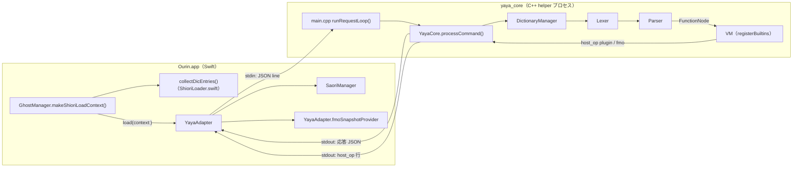
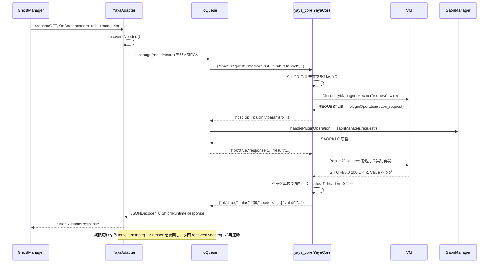

# 8.1 YAYA（YayaAdapter と yaya_core）

関連ソースファイル

このページは次のファイルをもとに作成した。

- [Ourin/Yaya/YayaAdapter.swift](../../Ourin/Yaya/YayaAdapter.swift)
- [Ourin/USL/ShioriRuntime.swift](../../Ourin/USL/ShioriRuntime.swift)
- [Ourin/USL/ShioriRuntimeFactory.swift](../../Ourin/USL/ShioriRuntimeFactory.swift)
- [Ourin/USL/ShioriLoader.swift](../../Ourin/USL/ShioriLoader.swift)
- [Ourin/Ghost/GhostManager.swift](../../Ourin/Ghost/GhostManager.swift)
- [Ourin/OurinApp.swift](../../Ourin/OurinApp.swift)
- [Ourin/Utils/ProcessKiller.swift](../../Ourin/Utils/ProcessKiller.swift)
- [Ourin/PluginHost/PluginEngine.swift](../../Ourin/PluginHost/PluginEngine.swift)
- [yaya_core/src/main.cpp](../../yaya_core/src/main.cpp)
- [yaya_core/src/YayaCore.hpp](../../yaya_core/src/YayaCore.hpp)
- [yaya_core/src/YayaCore.cpp](../../yaya_core/src/YayaCore.cpp)
- [yaya_core/src/DictionaryManager.hpp](../../yaya_core/src/DictionaryManager.hpp)
- [yaya_core/src/DictionaryManager.cpp](../../yaya_core/src/DictionaryManager.cpp)
- [yaya_core/src/Lexer.hpp](../../yaya_core/src/Lexer.hpp)
- [yaya_core/src/Lexer.cpp](../../yaya_core/src/Lexer.cpp)
- [yaya_core/src/Parser.hpp](../../yaya_core/src/Parser.hpp)
- [yaya_core/src/Parser.cpp](../../yaya_core/src/Parser.cpp)
- [yaya_core/src/AST.hpp](../../yaya_core/src/AST.hpp)
- [yaya_core/src/VM.hpp](../../yaya_core/src/VM.hpp)
- [yaya_core/src/VM.cpp](../../yaya_core/src/VM.cpp)
- [yaya_core/src/Value.hpp](../../yaya_core/src/Value.hpp)
- [yaya_core/src/Value.cpp](../../yaya_core/src/Value.cpp)
- [yaya_core/src/MessageManager.hpp](../../yaya_core/src/MessageManager.hpp)
- [yaya_core/src/MessageManager.cpp](../../yaya_core/src/MessageManager.cpp)
- [yaya_core/src/Base64.hpp](../../yaya_core/src/Base64.hpp)
- [yaya_core/src/Base64.cpp](../../yaya_core/src/Base64.cpp)
- [yaya_core/src/Digest.hpp](../../yaya_core/src/Digest.hpp)
- [yaya_core/src/Digest.cpp](../../yaya_core/src/Digest.cpp)
- [yaya_core/src/RandomEngine.hpp](../../yaya_core/src/RandomEngine.hpp)
- [yaya_core/src/JsonValue.hpp](../../yaya_core/src/JsonValue.hpp)
- [yaya_core/CMakeLists.txt](../../yaya_core/CMakeLists.txt)
- [yaya_core/build.sh](../../yaya_core/build.sh)
- [yaya_core/README.md](../../yaya_core/README.md)
- [yaya_core/FUNCTION_REFERENCE.md](../../yaya_core/FUNCTION_REFERENCE.md)
- [yaya_core/IMPLEMENTATION_STATUS.md](../../yaya_core/IMPLEMENTATION_STATUS.md)
- [yaya_core/examples/README.md](../../yaya_core/examples/README.md)
- [yaya_core/tests/](../../yaya_core/tests/)
- [yaya_core/third_party/yaya/](../../yaya_core/third_party/yaya/)
- [CORE_SAMPLES/yaya-shiori-500/sysfunc.cpp](../../CORE_SAMPLES/yaya-shiori-500/sysfunc.cpp)
- [docs/OURIN_YAYA_ADAPTER_SPEC_1.0M_ja-jp.md](../../docs/OURIN_YAYA_ADAPTER_SPEC_1.0M_ja-jp.md)
- [docs/YAYA_CORE_INDEX_en-us.md](../../docs/YAYA_CORE_INDEX_en-us.md)
- [docs/YAYA_CORE_ARCHITECTURE_ja-jp.md](../../docs/YAYA_CORE_ARCHITECTURE_ja-jp.md)
- [docs/YAYA_CORE_IMPLEMENTATION_PLAN_ja-jp.md](../../docs/YAYA_CORE_IMPLEMENTATION_PLAN_ja-jp.md)
- [docs/REAL_GHOST_VERIFICATION_2026-10-25.md](../../docs/REAL_GHOST_VERIFICATION_2026-10-25.md)
- [Ourin.xcodeproj/project.pbxproj](../../Ourin.xcodeproj/project.pbxproj)
- [.github/workflows/macOS.yml](../../.github/workflows/macOS.yml)
- [AGENTS.md](../../AGENTS.md)

YAYA（AYA 互換の栞言語）で書かれたゴーストを Ourin で動かす経路は、Swift 側の `YayaAdapter`（[Ourin/Yaya/YayaAdapter.swift](../../Ourin/Yaya/YayaAdapter.swift)）と、C++ で再実装した YAYA のパーサ / VM である helper プロセス `yaya_core`（[yaya_core/](../../yaya_core/)）の 2 つで構成される。両者は標準入出力上の **JSON line IPC**（1 行 = 1 個の JSON オブジェクト）で通信する。Windows の `yaya.dll` は読み込まない。

`YayaAdapter` は `GhostShioriRuntime` プロトコルの実装の 1 つで、`ShioriRuntimeFactory` がモジュール名から選ぶ（選択規則と他ランタイムは [8 SHIORI 層](./08-shiori-runtime.md)）。ゴーストの起動やイベント送出の側は [4 GhostManager](./04-ghost-manager.md) と [9 SHIORI イベント](./09-shiori-events.md)、`LOADLIB` などで呼ばれる SAORI の実体は [13 SAORI](./13-saori.md) が扱う。

`AGENTS.md` は保護する制約として、`yaya_core/` を helper process の JSON line IPC で通信する C++ 製 YAYA parser / VM とし、**互換性問題は仕様・再現入力・実装を照合し、ゴーストデータを改変して症状を隠さない** と定めている。このページの各所で述べる挙動はこの制約を前提にしている。

**出典:** [AGENTS.md:9](../../AGENTS.md#L9)、[Ourin/Yaya/YayaAdapter.swift:39-51](../../Ourin/Yaya/YayaAdapter.swift#L39-L51)、[Ourin/USL/ShioriRuntimeFactory.swift:23-48](../../Ourin/USL/ShioriRuntimeFactory.swift#L23-L48)

## 全体構成

| 層 | 主な型・関数 | 定義位置 |
|---|---|---|
| ロード入力 | `ShioriRuntimeLoadContext`（`dictionaryEntries`・`dictionaryEncoding`・`functionDepthLimit`） | [Ourin/USL/ShioriRuntime.swift:39-70](../../Ourin/USL/ShioriRuntime.swift#L39-L70) |
| 応答型 | `ShioriRuntimeResponse`（旧名 `YayaResponse` は typealias） | [Ourin/USL/ShioriRuntime.swift:72-132](../../Ourin/USL/ShioriRuntime.swift#L72-L132) |
| 設定解析 | `DicEntry`、`DicCollector`、`collectDicEntries`、`applyYayaBasePath` | [Ourin/USL/ShioriLoader.swift:117-371](../../Ourin/USL/ShioriLoader.swift#L117-L371) |
| Swift アダプタ | `YayaRequest`、`YayaAdapter` | [Ourin/Yaya/YayaAdapter.swift:3-593](../../Ourin/Yaya/YayaAdapter.swift#L3-L593) |
| helper 入口 | `main()`、`runRequestLoop()` | [yaya_core/src/main.cpp:1-38](../../yaya_core/src/main.cpp#L1-L38) |
| コマンド分岐 | `YayaCore::processCommand()`、`VMCallback` 実装 | [yaya_core/src/YayaCore.cpp:40-512](../../yaya_core/src/YayaCore.cpp#L40-L512) |
| 辞書読み込み | `DictionaryManager` | [yaya_core/src/DictionaryManager.cpp:101-481](../../yaya_core/src/DictionaryManager.cpp#L101-L481) |
| 字句・構文解析 | `Lexer`、`Parser`、`AST::*Node` | [yaya_core/src/Lexer.hpp:6-110](../../yaya_core/src/Lexer.hpp#L6-L110)、[yaya_core/src/Parser.hpp:7-59](../../yaya_core/src/Parser.hpp#L7-L59)、[yaya_core/src/AST.hpp:10-36](../../yaya_core/src/AST.hpp#L10-L36) |
| 実行 | `VM`（関数表・組み込み関数・変数） | [yaya_core/src/VM.hpp:47-257](../../yaya_core/src/VM.hpp#L47-L257) |

**出典:** [Ourin/Ghost/GhostManager.swift:1563-1616](../../Ourin/Ghost/GhostManager.swift#L1563-L1616)、[yaya_core/src/YayaCore.hpp:9-32](../../yaya_core/src/YayaCore.hpp#L9-L32)、[yaya_core/src/VM.hpp:15-45](../../yaya_core/src/VM.hpp#L15-L45)

## 設定ファイルと辞書一覧の解決（Swift 側）

`yaya.txt` の解釈は yaya_core ではなく Swift 側で行い、結果の辞書一覧だけを `load` コマンドで渡す。`GhostManager.makeShioriLoadContext(moduleName:ghostRoot:)` は、ランタイム種別が `.yaya` のときだけ次の手順を踏む（他ランタイムには YAYA の規則を持ち込まない）。

1. `ShioriRuntimeFactory.yayaBaseURL` で DLL のあるフォルダを基準にし、`yayaConfigURL` で `<DLL名>.txt` を設定ファイルとする（`yaya.dll` → `yaya.txt`、`shiori/aya.dll` → `shiori/aya.txt`）。名前で YAYA と決まらない `.dll` も、同名 `.txt` に `dic` / `dicdir` / `include` があれば YAYA とみなす。
2. 設定ファイルを UTF-8、失敗したら Shift_JIS で読み、`collectDicEntries` で再帰的に解析する。設定が無ければ基準フォルダの `*.dic` を全部読む。
3. `applyYayaBasePath` で `basepath` を反映する。ゴーストのフォルダ外を指す、または存在しない `basepath` は無視する。

`collectDicEntries` が解釈する指示は次のとおり。

| 指示 | 扱い |
|---|---|
| `charset` / `charset.dic` | 最初の指定だけを全体の辞書文字コードにする。`canonicalCharset` は UTF-8 と Shift_JIS 系だけを正規化し、他の名前（Big5 など）はそのまま渡す |
| `basepath, X` | 相対パスなら基準フォルダを移す。絶対パスは受け付けない |
| `fncdepth, N` | 最初の指定を `functionDepth` として保持し、yaya_core へ渡す |
| `dic, path[, enc]` | `DicEntry` を追加（3 列目は辞書ごとの文字コード）。同じ相対パスは大文字小文字を無視して最初の 1 件だけ残す |
| `dicdir, dir` | `_loading_order.txt`（`_loading_order_override.txt` 優先）があればその順、無ければ走査して展開 |
| `include, file` | 再帰解析。訪問済みパスで循環を防ぐ |
| その他（`log` など） | 読み飛ばす |

保存ファイルのパスは `YayaAdapter.saveFilePath(for:)` が決める。本家 YAYA と同じく、`basepath` に関係なくモジュールの横に `<module>_variable.cfg` を置き、ゴーストのパッケージ外を指す場合は nil にする。

**出典:** [Ourin/Ghost/GhostManager.swift:1563-1616](../../Ourin/Ghost/GhostManager.swift#L1563-L1616)、[Ourin/USL/ShioriRuntimeFactory.swift:40-73](../../Ourin/USL/ShioriRuntimeFactory.swift#L40-L73)、[Ourin/USL/ShioriLoader.swift:117-331](../../Ourin/USL/ShioriLoader.swift#L117-L331)、[Ourin/USL/ShioriLoader.swift:345-371](../../Ourin/USL/ShioriLoader.swift#L345-L371)、[Ourin/Yaya/YayaAdapter.swift:306-315](../../Ourin/Yaya/YayaAdapter.swift#L306-L315)

## YayaAdapter のライフサイクル

### 起動

`YayaAdapter()` は `Bundle.main.url(forAuxiliaryExecutable: "yaya_core")` で helper を探し、無ければ nil を返す。テストや再起動では `init?(executableURL:)` で実行ファイルを明示できる。`launchHelper()` は毎回新しい `Process` と 3 本の `Pipe`（stdin / stdout / stderr）を作って起動する。stderr は `readabilityHandler` で行ごとに読み、`Log.verbose` でないときは `error` / `failed` を含む行だけを `NSLog("[yaya_core stderr] …")` に出す。

1 ゴーストにつき 1 つの helper プロセスを持つ。アプリ起動時は `ProcessKiller.killOrphanedYaya()` が、親を失った（親 PID が 1 の）`yaya_core` だけを片付ける。

### load(context:)

`load(context:)` はまず SAORI の探索パスを用意する（`saoriManager.discover(under:)`、`ghost/master/.saori`、`ghost/master/saori`、さらに `ghost/master` 自体を最優先で追加）。内蔵 SAORI の `--async` 結果は `EventBridge.shared.notifyCustom` でこのゴーストへ届ける。続く `load(ghostRoot:dicEntries:…)` は次の順で helper とやり取りする。

1. `ghost/master/messagetxt/` があれば、`japanese.txt` → `english.txt` → … の最初に見つかった 1 ファイルを `load_messages` で送る（失敗してもロードは続ける）。
2. `load` を送る。辞書は `dic`（パスの配列）と `dic_entries`（`path` と `encoding` の辞書の配列）の両方で送り、yaya_core は後者を優先する。
3. `ok` が真なら `isLoaded = true` にし、`shioriHandshake` が真なら `GET capability` を送る。応答が得られなければ helper を強制終了して失敗にする。

成功した `context` は `lastLoadContext` に保存し、再起動時の復元に使う。

### タイムアウト・再起動・終了

すべての往復は直列キュー `ioQueue`（`yaya.adapter.io`）上で行い、呼び出し側は `DispatchGroup.wait` で期限まで待つ。期限切れ、または応答が nil（EOF・デコード失敗・例外）のときは `forceTerminate()` で helper を止める。コメントによれば、読み取りタスクを残すと直列キューが詰まり、遅れて届いた応答を次の要求へ誤配送するため、プロセスを殺して pipe を EOF にし、その世代を確実に捨てる。

| 操作 | 期限 | 備考 |
|---|---|---|
| `load_messages` | 10 秒 | 失敗はログのみ |
| `load` | 60 秒 | 期限切れで helper を破棄（辞書パースの無限ループで起動スレッドを塞がないため） |
| `request` | 引数 `timeout`（既定 10 秒） | `GhostManager` の `OnBoot` は 4 秒、`EventBridge` の NOTIFY は 2 秒など、呼び出し側が指定 |
| `raw_request` | 既定 10 秒 | PLUGIN 用 |
| `unload` | 1 秒 | その後 `terminate()`、0.3 秒待って残っていれば `SIGKILL` |

`forceTerminate()` は `unload` コマンドを送らずに `terminate()` し、0.2 秒後も生きていれば `SIGKILL` を送る。次の `request` / `rawRequest` の入口で `recoverIfNeeded()` が働き、`isLoaded` かつプロセス稼働中ならそのまま進む。そうでなければ `recoveryLock` を取り、前の世代の `ioQueue` が 2 秒以内に空になるのを待ってから `launchHelper()` と `load` をやり直し、直前の辞書を復元する。`unload()` を明示的に呼んだ後は `lastLoadContext` が nil なので復元しない。`deinit` も `unload()` を呼ぶ。

**出典:** [Ourin/Yaya/YayaAdapter.swift:61-117](../../Ourin/Yaya/YayaAdapter.swift#L61-L117)、[Ourin/Yaya/YayaAdapter.swift:201-304](../../Ourin/Yaya/YayaAdapter.swift#L201-L304)、[Ourin/Yaya/YayaAdapter.swift:317-390](../../Ourin/Yaya/YayaAdapter.swift#L317-L390)、[Ourin/Yaya/YayaAdapter.swift:466-495](../../Ourin/Yaya/YayaAdapter.swift#L466-L495)、[Ourin/OurinApp.swift:373-374](../../Ourin/OurinApp.swift#L373-L374)、[Ourin/Utils/ProcessKiller.swift:121-138](../../Ourin/Utils/ProcessKiller.swift#L121-L138)、[Ourin/Ghost/GhostManager.swift:5292](../../Ourin/Ghost/GhostManager.swift#L5292)

## JSON line IPC のメッセージ形式

文字コードは UTF-8 に固定され、Swift は `JSONEncoder` で 1 オブジェクトを書いて `\n` を足し、応答は 1 バイトずつ `\n` まで読む。`YayaRequest` の nil のフィールドは JSON から省かれる。helper 側は `std::getline(std::cin, line)` で 1 行ずつ読み、`processCommand` の戻り値を `std::cout << … << std::endl` で書く。

### Ourin → yaya_core（コマンド）

| `cmd` | 読まれるフィールド | 応答 | 送信元 |
|---|---|---|---|
| `load_messages` | `message_path` | `ok`、`status`（200 / 400 / 500）、`error` | `YayaAdapter.load` |
| `load` | `ghost_root`、`dic_entries`（優先）または `dic`、`encoding`（既定 `auto`）、`save_file`、`fncdepth`（整数のときだけ）、`host_execute`（既定 false） | `ok`、`status`（200 / 500）、`loaded_dics` | `YayaAdapter.load`、`engines/plugins/yaya_adapter.cpp` |
| `request` | `method`（既定 `GET`）、`id`、`headers`、`ref` | `ok`、`status`、`headers`、`value`（NOTIFY の一部イベントでは `value` なしで 204） | `YayaAdapter.request` |
| `raw_request` | `raw` | `ok`、`status`、`value`（辞書の `request` の戻り値そのまま。関数が無ければ 500） | `YayaAdapter.rawRequest` |
| `plugin_request` | `wire`（`GET/NOTIFY PLUGIN/2.0[M]` で始まる 1 MiB 以下の電文） | `ok`、`status`、`wire`。枠が不正なら 400、`request` 関数が無ければ 501、応答が不正なら 502 | `engines/plugins/yaya_adapter.cpp`（Swift からは送らない） |
| `get_loaded_dics` | なし | `ok`、`status`、`loaded_dics` | 呼び出し元なし（リポジトリ全体を検索しても送信箇所は無く、受け口の `YayaCore.cpp:473` だけがある） |
| `unload` | なし | `ok`、`status` 200 | `YayaAdapter.unload` |
| その他 | — | `ok:false`、`status:400`、`error:"unknown command"` | — |

`YayaRequest` は `env`（`LANG=ja_JP.UTF-8`）と `headers`（`Charset: UTF-8`）も `load` に載せるが、`processCommand` の `load` 分岐はこれらを読まない。JSON の解析失敗や C++ 例外は `ok:false`、`status:500`、`error:<what()>` になる。

### yaya_core → Ourin（host_op 要求）

VM が外部機能を必要とすると、`YayaCore::requestHostOperation` が `{"host_op": <種別>, "params": {...}}` を stdout に書き、続く stdin の 1 行を応答として同期的に読む。Swift 側の `exchange` は読んだ行に `host_op` があれば `handleHostOperation` で処理して返信し、本来の応答が来るまで読み続ける。

| `host_op` | `params` | 発生元（VM） | Swift の返信 |
|---|---|---|---|
| `plugin` | `operation`（`saori_load` / `saori_unload` / `saori_request`）、`params.module`、`params.request`、`params.charset` | `LOADLIB`、`UNLOADLIB`、`REQUESTLIB`（`FUNCTIONLOAD` / `FUNCTIONEX` / `SAORI` 経由を含む） | `handlePluginOperation` の結果（`ok`、`response`、`status`、`result`、`values`） |
| `fmo` | `operation:"read"`、`params.name` | `READFMO` | `{"ok":true,"snapshot":…}`（`fmoSnapshotProvider` の文字列） |
| `execute` | `command`、`wait`、`arguments` | `EXECUTE` / `EXECUTE_WAIT`（`host_execute` が真のときだけ） | `YayaAdapter` は `unsupported host_op` を返す |
| `file` | `operation`、`params` | `YayaCore::fileOperation`（VM から呼ばれない） | 同上 |

`YayaCore::pluginOperation` は 3 種以外の操作を helper 内で `unsupported plugin operation` として断るので、Swift 側にある `saori_execute` 分岐は yaya_core からは届かない（Swift 内の他経路とテストから使われる）。

**出典:** [Ourin/Yaya/YayaAdapter.swift:3-37](../../Ourin/Yaya/YayaAdapter.swift#L3-L37)、[Ourin/Yaya/YayaAdapter.swift:119-199](../../Ourin/Yaya/YayaAdapter.swift#L119-L199)、[yaya_core/src/main.cpp:13-21](../../yaya_core/src/main.cpp#L13-L21)、[yaya_core/src/YayaCore.cpp:45-153](../../yaya_core/src/YayaCore.cpp#L45-L153)、[yaya_core/src/YayaCore.cpp:163-275](../../yaya_core/src/YayaCore.cpp#L163-L275)、[yaya_core/src/YayaCore.cpp:473-512](../../yaya_core/src/YayaCore.cpp#L473-L512)、[yaya_core/src/VM.cpp:4172-4241](../../yaya_core/src/VM.cpp#L4172-L4241)、[yaya_core/src/VM.cpp:4501-4545](../../yaya_core/src/VM.cpp#L4501-L4545)、[engines/plugins/yaya_adapter.cpp:219-246](../../engines/plugins/yaya_adapter.cpp#L219-L246)

## 1 リクエストの往復

`GhostManager` が `OnBoot` を問い合わせ、辞書が途中で SAORI を呼ぶ場合の流れを示す。

`request` は送る前に、`ResourceManager` が持つ既知の SHIORI リソース（`username`、`homeurl`、`sakura.defaultleft` など、`char*.default*`）の `GET` に限り、値が設定済みならその値で 200 を返し helper へは送らない。

**出典:** [Ourin/Yaya/YayaAdapter.swift:148-175](../../Ourin/Yaya/YayaAdapter.swift#L148-L175)、[Ourin/Yaya/YayaAdapter.swift:392-426](../../Ourin/Yaya/YayaAdapter.swift#L392-L426)、[Ourin/Ghost/GhostManager.swift:5288-5303](../../Ourin/Ghost/GhostManager.swift#L5288-L5303)、[yaya_core/src/YayaCore.cpp:275-472](../../yaya_core/src/YayaCore.cpp#L275-L472)

## SHIORI 要求の組み立てと応答の解析（YayaCore）

`processCommand` の `request` 分岐は、JSON の要求から SHIORI/3.0 の電文を作り、辞書のフレームワーク関数 `request` に渡す。

- 1 行目は `<method> SHIORI/3.0`。続いて呼び出し側のヘッダに無ければ既定値 `Charset: UTF-8`、`Sender: Ourin`、`SenderType: Plugin`、`SecurityLevel: local` を出す（大文字小文字を区別しない比較）。
- `ID` は呼び出し側ヘッダの値を優先し、無ければ `id`。残りのヘッダは大文字小文字を区別せず重複を除いて 1 回ずつ出し、最後に `ref` 配列を `Reference0..n` として上書き・延長する。
- 辞書に `request` 関数があれば実行し、戻り値をヘッダ単位で解析する（`Value: ` の部分文字列検索は本文の誤検出を招くので行わない）。1 行目からステータスコードを取り、全ヘッダを `headers` に入れる。
- フレームワークが GET に対してステータスも `Value` も無い不正な空応答を返し、かつ同名のイベント関数があるときは、その関数を直接呼んで値を回収する。
- `request` 関数が無い単純な辞書では、`id` の関数を直接呼ぶ。
- `On` で始まるイベントが文字列・配列以外を返した場合と、値が数値だけの場合（`OnTranslate` を除く）は、制御値とみなして `Value` を空にする。Emily4 の `OnMouseMove` が整数 0 を返す例がコメントにある。
- `NOTIFY` で、UKADOC で戻り値を無視すべき ID（`basewareversion`、`hwnd`、`uniqueid`、`capability`、`installedghostname`、`OnNotifySelfInfo` など）は `status: 204` とし `value` を付けない。それ以外はフレームワークが返したステータス（無ければ 200）と `value` を返す。

`load` 成功後には `RESTOREVAR` を実行し、辞書に `load` 関数があれば `ghost_root` に `/` を付けたパスを引数に呼ぶ。`unload` では `unload` 関数、`SAVEVAR`、`DictionaryManager::unload()` の順に実行する。

**出典:** [yaya_core/src/YayaCore.cpp:15-36](../../yaya_core/src/YayaCore.cpp#L15-L36)、[yaya_core/src/YayaCore.cpp:183-244](../../yaya_core/src/YayaCore.cpp#L183-L244)、[yaya_core/src/YayaCore.cpp:275-472](../../yaya_core/src/YayaCore.cpp#L275-L472)、[yaya_core/src/YayaCore.cpp:491-500](../../yaya_core/src/YayaCore.cpp#L491-L500)

## SAORI と FMO の往復（Swift 側）

`handlePluginOperation` は `host_op: "plugin"` を次のように処理する。

| `operation` | 処理 |
|---|---|
| `saori_load` | `internal_*` の内蔵モジュールは名前の存在だけ確認（読み込み不要）。`string.dll` などの互換モジュールは DLL を読まず内蔵機能を用意。それ以外は `saoriManager.loadModule(named:)` |
| `saori_unload` | 内蔵モジュールは何もしない。他は `unloadModule(named:)` |
| `saori_request` | `saoriManager.request(moduleName:requestText:charset:)` の生応答を `response` に入れ、`SaoriProtocol.parseResponse` で解析できれば `status`、`result`、`ValueN` を番号順に並べた `values` も付ける |
| `saori_execute` | 引数配列・`securityLevel`・`securityOrigin` 付きで `saoriManager.execute` を呼ぶ（yaya_core からは届かない） |

VM の `REQUESTLIB` は、文字コードを `CHARSETLIB` の設定、第 3 引数、`UTF-8` の順で決める。応答が `SAORI/1.0 204` なら Void を返し（200 で空の `Result` とは区別する）、Swift が解析済みの `result` を付けていればそれを優先し、無ければ生応答の `Result` と `ValueN` を大文字小文字を区別せず読む。`ValueN` は番号の欠けがあっても全部集め、`valueex()` / `valueex0`〜`valueex15` で取り出せる。

`READFMO` は `host_op: "fmo"` で問い合わせる。`YayaAdapter.fmoSnapshotProvider` は `AppDelegate` が起動時に設定し、起動中ゴーストのレコードから SSP 互換の `id.key\x01value\r\n` 文字列を作って返す。FMO 自体は [11 FMO](./11-fmo.md) を参照。

**出典:** [Ourin/Yaya/YayaAdapter.swift:177-199](../../Ourin/Yaya/YayaAdapter.swift#L177-L199)、[Ourin/Yaya/YayaAdapter.swift:497-592](../../Ourin/Yaya/YayaAdapter.swift#L497-L592)、[Ourin/OurinApp.swift:390-396](../../Ourin/OurinApp.swift#L390-L396)、[yaya_core/src/VM.cpp:4524-4683](../../yaya_core/src/VM.cpp#L4524-L4683)、[yaya_core/src/VM.cpp:4224-4241](../../yaya_core/src/VM.cpp#L4224-L4241)

## 文字コード

- **IPC**: UTF-8 固定。辞書の文字コードにかかわらず、VM 内部の文字列は UTF-8 である。
- **設定ファイル**: Swift が UTF-8、だめなら Shift_JIS で読む（`include` 先も同じ）。
- **辞書（`.dic`）**: `DictionaryManager::decodeContent` が読み込み時に UTF-8 へ正規化する。辞書ごとの指定が空なら `load` の `encoding` を使う。

| 状況 | 処理 |
|---|---|
| 先頭に UTF-8 BOM | BOM を除いて UTF-8 として確定 |
| 指定が UTF-8 | 妥当な UTF-8 ならそのまま。不正なら CP932 として iconv 変換を試み、警告を出す |
| 指定が CP932 / CP950 / CP936 / GB18030 / CP949 | 内容が非 ASCII を含む妥当な UTF-8 なら UTF-8 として扱う（charset の更新忘れ対策）。そうでなければ iconv で変換 |
| `auto`・空・不明な名前 | 妥当な UTF-8 ならそのまま、そうでなければ CP932 として変換 |
| 変換失敗 | エラーを出して生のバイト列のまま読む（誤解析の可能性あり） |

名前の正規化（`normalizeEncodingName`）は小文字化して `-`・`_`・空白を除き、`shiftjis`・`sjis`・`windows31j`・`ms932` などを `CP932`、`big5` を `CP950`、`gb2312`・`gbk` を `CP936`、`euckr`・`uhc` を `CP949` にまとめる。VM の `FCHARSET`（既定 1 = UTF-8、0 = CP932、127 = OS 既定を UTF-8 扱い）はテキストファイル関数の既定、JSON 関数（`FREADJSON` など）は `FCHARSET` と独立した文字コード（既定 UTF-8）を使う。

**出典:** [yaya_core/src/DictionaryManager.cpp:15-97](../../yaya_core/src/DictionaryManager.cpp#L15-L97)、[yaya_core/src/DictionaryManager.cpp:124-181](../../yaya_core/src/DictionaryManager.cpp#L124-L181)、[yaya_core/src/VM.hpp:136-138](../../yaya_core/src/VM.hpp#L136-L138)、[yaya_core/src/VM.cpp:2997-3024](../../yaya_core/src/VM.cpp#L2997-L3024)、[Ourin/USL/ShioriLoader.swift:168-180](../../Ourin/USL/ShioriLoader.swift#L168-L180)

## yaya_core の内部構造

### main.cpp と YayaCore

`main()` は 512 MiB のスタックを指定したスレッドを作り、その中で `YayaCore` を 1 つ生成して要求ループを回す。YAYA の辞書は `fncdepth,0`（無制限）で深い再帰を書けるため、既定 8 MB のスタックでは VM の再帰上限より先に落ちるという理由がコメントにある。スレッドを作れなければ警告を出してメインスレッドで回す。`YayaCore` は `VMCallback` を実装し、自分を `DictionaryManager` 経由で VM のコールバックに登録する。

### DictionaryManager

`load(dicEntries, defaultEncoding)` は毎回 VM を作り直し（コールバック・ゴーストのルート・`fncdepth`・保存ファイルを引き継ぐ）、`#globaldefine` の表を空にしてから各ファイルを処理する。

1. `loadFile` でバイナリとして読む（空なら失敗として数える）。
2. `decodeContent` で UTF-8 へ正規化する。
3. `preprocessDirectives` で行頭の `#define`（そのファイル内のみ）と `#globaldefine`（以降のファイルにも有効、VM の表にも登録）を、宣言行より後ろの行へ登録順に単純置換する。
4. `Lexer` → `Parser` で関数の AST を作り、`vm_->beginSource(path)` の後で `registerFunction` する。3 秒を超えると警告を出す。

1 ファイルの失敗では止まらず、**全ファイルが失敗したときだけ** `load` が失敗する。成功したパスは `loadedDicFiles_` に残り、`loaded_dics` として返る。`dicLoad` / `dicUnload`（`DICLOAD` / `DICUNLOAD`）は絶対パスと `..` を拒否し、ゴーストのルート基準で 1 ファイルを追加・削除する。`appendRuntimeDic` は `__runtime__` という名前のソースとして解析する。

### Lexer・Parser・AST

| 要素 | 内容 | 出典 |
|---|---|---|
| `Lexer` | `TokenType` は識別子・文字列・整数、算術・比較・複合代入（`,=` を含む）、`_in_`、区切り記号、`if` / `elseif` / `while` / `foreach` / `for` / `switch` / `case` / `when` などのキーワード。コメントは `//`、`/* */`、行頭の `#`、文頭の `--`。先頭 BOM を読み飛ばす。文字列にバックスラッシュのエスケープは無く、同じ引用符を 2 つ重ねて 1 文字にする。行末の `/` は次行へ継続。`<<'` / `<<"` のヒアドキュメント。識別子は `.` と UTF-8 を含められる | [yaya_core/src/Lexer.hpp:6-110](../../yaya_core/src/Lexer.hpp#L6-L110)、[yaya_core/src/Lexer.cpp:36-115](../../yaya_core/src/Lexer.cpp#L36-L115)、[yaya_core/src/Lexer.cpp:166-260](../../yaya_core/src/Lexer.cpp#L166-L260) |
| `Parser` | 再帰下降。`parse()` は関数単位で読み、位置が進まなければ強制的に 1 トークン進め、100 万回で打ち切る（進行保証）。関数名は `.` 区切り可、`: void` / `array` / `sequential` / `nonoverload` / `when` の修飾子を複数持てる。`parseExpressionOnly` は `ISEVALUABLE` 用 | [yaya_core/src/Parser.hpp:7-59](../../yaya_core/src/Parser.hpp#L7-L59)、[yaya_core/src/Parser.cpp:53-135](../../yaya_core/src/Parser.cpp#L53-L135) |
| `AST` | `NodeType` は Function・Block・Return・Assignment・If・While・For・Foreach・Switch・Case・WhenClause・Break・Continue・Combine・Void・BinaryOp・UnaryOp・Ternary・Call・Variable・Literal・ArrayAccess・Parallel。代入や添字は `__assign__`・`__index__` などの名前の `CallNode` で表すものもある | [yaya_core/src/AST.hpp:10-274](../../yaya_core/src/AST.hpp#L10-L274)、[yaya_core/src/VM.cpp:1231-1470](../../yaya_core/src/VM.cpp#L1231-L1470) |

### VM の実行モデル

| 項目 | 挙動 | 出典 |
|---|---|---|
| 関数表 | 同名の宣言を複数持つ（`FunctionDecl`: 所属ソース・宣言順・`enabled`・`nonoverload`・`isWhen`）。既定は同名の宣言を宣言順に連結、`nonoverload` は最後の定義が勝つ | [yaya_core/src/VM.hpp:54-78](../../yaya_core/src/VM.hpp#L54-L78)、[yaya_core/src/VM.cpp:611-707](../../yaya_core/src/VM.cpp#L611-L707) |
| 名前解決 | **組み込み関数がユーザー関数より先**。どちらにも無ければ警告を出して Void | [yaya_core/src/VM.cpp:746-756](../../yaya_core/src/VM.cpp#L746-L756) |
| 深さ制限 | `fncdepth`（既定 32、0 は無制限、1 は 2 に補正）を超えた呼び出しは本体を実行せず Void。`shiori.OnCallLimit` があれば上限を外して呼び、無ければエラー `E_E 97` を記録。別に再帰上限 `MAX_RECURSION_DEPTH = 1000` | [yaya_core/src/VM.hpp:93-99](../../yaya_core/src/VM.hpp#L93-L99)、[yaya_core/src/VM.hpp:182-188](../../yaya_core/src/VM.hpp#L182-L188)、[yaya_core/src/VM.cpp:716-790](../../yaya_core/src/VM.cpp#L716-L790) |
| 実行時間 | トップレベル関数の開始から 120 秒（`MAX_EXECUTION_TIME_MS`）を超えると `executeNode` が空値を返して打ち切る | [yaya_core/src/VM.hpp:190-192](../../yaya_core/src/VM.hpp#L190-L192)、[yaya_core/src/VM.cpp:1031-1043](../../yaya_core/src/VM.cpp#L1031-L1043) |
| 変数 | `_` で始まる名前は関数ごとのローカルスコープ（例外で抜けても必ず戻す）。ユーザー関数への配列引数は 1 段展開して `_argv` に入れ、前置 `&` の引数は終了時に呼び出し元へ書き戻す | [yaya_core/src/VM.cpp:800-830](../../yaya_core/src/VM.cpp#L800-L830)、[yaya_core/src/VM.cpp:1534-1541](../../yaya_core/src/VM.cpp#L1534-L1541) |
| 型修飾子 | `array` / `sequential` は各文の値を候補として集め、`parallel` 文は配列を 1 段平らにして候補に加える | [yaya_core/src/VM.cpp:925-940](../../yaya_core/src/VM.cpp#L925-L940) |
| 文字列埋め込み | `%(…)` を名前に関係なく `TOSTR(…)` として評価し、`%[n]` は同じ文字列内の n 個前の埋め込み値。SSP の `%username` のような括弧なしはベースウェアへ残す | [yaya_core/src/VM.cpp:4920-4924](../../yaya_core/src/VM.cpp#L4920-L4924) |
| ファイルパス | 相対パスはゴーストのルート基準で解決し、`\` を区切りとして扱う。絶対パスと `..` は拒否（`FENUM` の互換用に絶対パスを保持する箇所あり）。JSON 関数は正規化後もルート内に収まることを確認する | [yaya_core/src/VM.cpp:2974-3036](../../yaya_core/src/VM.cpp#L2974-L3036) |
| 永続化 | `SAVEVAR` はグローバル変数を型付き JSON（`t` = `s`/`i`/`r`/`a`/`d`/`v`、区切り文字付き）で保存し、`REGISTERTEMPVAR` 登録分は除く。既存ファイルが Ourin 形式でなければ上書きを拒否する。既定の保存先は `save_file`、無ければ `yaya_variable.cfg` | [yaya_core/src/VM.cpp:3937-4012](../../yaya_core/src/VM.cpp#L3937-L4012) |

### Value と補助モジュール

| ファイル | 役割 | 出典 |
|---|---|---|
| `Value.hpp` / `Value.cpp` | `Type` は Void・String・Integer（int64）・Real・Array・Dictionary。`asString()` は配列なら共有乱数で 1 要素を選ぶ（YAYA の候補配列の挙動） | [yaya_core/src/Value.hpp:10-72](../../yaya_core/src/Value.hpp#L10-L72)、[yaya_core/src/Value.cpp:38-60](../../yaya_core/src/Value.cpp#L38-L60) |
| `RandomEngine.hpp` | プロセスで 1 つの `std::mt19937`（`yaya_rng::engine()`）。`RAND`・`ANY`・配列の文字列化が共有し、`SRAND` で再シードすると全ランダム選択が再現できる | [yaya_core/src/RandomEngine.hpp:1-16](../../yaya_core/src/RandomEngine.hpp#L1-L16) |
| `JsonValue.hpp` | `YayaJson::decode` / `encode` / `parse`。オブジェクトは hash、真偽値は整数、null は Void、int64 を double を経由せず保持、深さ 128 で打ち切り、BOM とコメントを許可 | [yaya_core/src/JsonValue.hpp:9-70](../../yaya_core/src/JsonValue.hpp#L9-L70) |
| `Base64.*` | yaya-shiori-500 の `misc.cpp` から移した Base64 | [yaya_core/src/Base64.hpp:1-8](../../yaya_core/src/Base64.hpp#L1-L8) |
| `Digest.*` | `third_party/yaya` の MD5・SHA-1・CRC32 を 16 進文字列で返すラッパー | [yaya_core/src/Digest.cpp:1-48](../../yaya_core/src/Digest.cpp#L1-L48) |
| `MessageManager.*` | `messagetxt` の `!!!msgf` / `msge` / `msgw` / `msgn` / `msgj` 節と `*error E0001 : …` 行を読み込む。`getMessage` を呼ぶ箇所はリポジトリ内に無く、読み込んだ文言は現状使われない | [yaya_core/src/MessageManager.cpp:6-132](../../yaya_core/src/MessageManager.cpp#L6-L132) |
| `third_party/yaya/` | `md5c.c`・`sha1.c`・`crc32.c`・`posix_utils.cpp` と各ヘッダ | [yaya_core/CMakeLists.txt:49-64](../../yaya_core/CMakeLists.txt#L49-L64) |

**出典:** [yaya_core/src/main.cpp:6-38](../../yaya_core/src/main.cpp#L6-L38)、[yaya_core/src/YayaCore.cpp:40-43](../../yaya_core/src/YayaCore.cpp#L40-L43)、[yaya_core/src/DictionaryManager.cpp:183-481](../../yaya_core/src/DictionaryManager.cpp#L183-L481)

## 組み込み関数の地図（VM.cpp）

`VM::registerBuiltins()`（1980〜4918 行）が `builtins_` に関数を登録する。登録名は 196 個（`HASH_KEYS` / `HASH_VALUES` と `valueex0`〜`15` を個別に数えた値）である。下表の行番号は登録位置。

| カテゴリ（ソースの区切り） | 関数（行） |
|---|---|
| 基本（区切り前） | `RAND` 1982、`STRLEN` 2001、`STRFORM` 2008、`SPRINTF` 2015、`GETTIME` 2021、`ISVAR` 2039、`ISFUNC` 2046、`EVAL` 2052、`E.EvalEmbedValue` 2134、`ARRAYSIZE` 2187、`IARRAY` 2202、`IHASH` 2208、`HASH_EXIST` 2215、`HASH_SIZE` 2220、`HASH_KEYS` / `HASH_VALUES` 2225 |
| 型変換（2236〜） | `TOINT` 2239、`TOSTR` 2245、`TOREAL` 2251、`GETTYPE` 2257、`CVINT` / `CVSTR` / `CVREAL` 2271-2273 |
| 文字列（2275〜） | `TOUPPER` 2278、`TOLOWER` 2288、`STRSTR` 2299、`SUBSTR` 2333、`REPLACE` 2348、`ERASE` 2365、`INSERT` 2384、`CUTSPACE` 2402、`CHR` 2416、`CHRCODE` 2429 |
| 数学（2436〜） | `FLOOR` 2439、`CEIL` 2445、`ROUND` 2451、`SQRT` 2457、`POW` 2463、`LOG` 2469、`LOG10` 2477、`EXP` 2485、`SIN`〜`TANH` 2491-2539、`SRAND` 2548 |
| 配列（2554〜） | `SPLIT` 2557、`ASEARCH` 2613、`ASORT` 2632、`ARRAYDEDUP` 2714、`ANY` 2738 |
| 型判定（2750〜） | `ISINTSTR` 2753、`ISREALSTR` 2771 |
| ビット演算（2795〜） | `BITWISE_AND` / `OR` / `XOR` / `NOT` / `SHIFT` 2798-2822 |
| 16 進・2 進（2834〜） | `TOHEXSTR` 2837、`HEXSTRTOI` 2848、`TOBINSTR` 2860、`BINSTRTOI` 2873 |
| 変数・関数管理（2884〜） | `ERASEVAR` 2887、`GETFUNCLIST` 2900、`GETVARLIST` 2920、`GETSYSTEMFUNCLIST` 2931 |
| システム（2940〜） | `GETTICKCOUNT` 2944、`GETSECCOUNT` 2953、`GETENV` 2959 |
| ファイル・JSON（2966〜） | `PARSEJSON` 3038、`DUMPJSON` 3044、`FREADJSON` 3049、`FWRITEJSON` 3067、`FOPEN` 3106、`FCLOSE` 3132、`FREAD` 3137、`FWRITE` 3151、`FWRITE2` 3166、`FSIZE` 3200、`FENUM` 3220、`FCOPY` 3251、`FMOVE` 3286、`FDEL` 3313、`FRENAME` 3334、`MKDIR` 3358、`RMDIR` 3374、`FSEEK` 3389、`FTELL` 3405、`FCHARSET` 3419、`FATTRIB` 3447、`FREADBIN` 3487、`FWRITEBIN` 3496、`FREADENCODE` 3511、`FWRITEDECODE` 3525、`FDIGEST` 3552 |
| 正規表現（3570〜、`std::regex`） | `RE_SEARCH` 3639、`RE_MATCH` 3658、`RE_GREP` 3677、`RE_GETSTR` 3697、`RE_GETPOS` 3702、`RE_GETLEN` 3707、`RE_OPTION` 3712、`RE_REPLACE` 3721、`RE_REPLACEEX` 3735、`RE_SPLIT` 3741、`RE_ASEARCH` 3768、`RE_ASEARCHEX` 3784 |
| 符号化（3800〜） | `STRENCODE` 3850、`STRDECODE` 3863、`GETSTRURLENCODE` 3876、`GETSTRURLDECODE` 3880、`STRDIGEST` 3886、`CHARSETTEXTTOID` 3900、`CHARSETIDTOTEXT` 3913、`ZEN2HAN` 3926、`HAN2ZEN` 3932 |
| 追加の変数・関数管理（3937〜） | `SAVEVAR` 3959、`RESTOREVAR` 4013、`DUMPVAR` 4052、`REGISTERTEMPVAR` 4064、`UNREGISTERTEMPVAR` 4074、`LOGGING` 4085、`ZEN2HAN` / `HAN2ZEN` 4096 / 4102（同じ実装で再登録）、`LETTONAME` 4108、`LSO` 4117、`ISEVALUABLE` 4125、`DICLOAD` 4144、`DICUNLOAD` 4155、`UNDEFFUNC` 4164 |
| 追加のシステム・ユーティリティ（4169〜） | `EXECUTE` 4172、`EXECUTE_WAIT` 4189、`SLEEP` 4205、`GETMEMINFO` 4215、`READFMO` 4228、`SETTAMAHWND` 4243、`TRANSLATE` 4255、`LICENSE` 4334、`SPLITPATH` 4343、`GETSTRBYTES` 4368、`ASEARCHEX` 4374、`ASEARCHPOS` 4394、`GETDELIM` 4414、`SETDELIM` 4419、`GETSETTING` 4425、`SETSETTING` 4439、`GETLASTERROR` 4446、`SETLASTERROR` 4452、`GETERRORLOG` 4459、`CLEARERRORLOG` 4470、`GETCALLSTACK` 4480、`GETFUNCINFO` 4487 |
| SAORI（同上の区画内） | `LOADLIB` 4501、`UNLOADLIB` 4513、`REQUESTLIB` 4527、`CHARSETLIB` 4641、`CHARSETLIBEX` 4647、`valueex` 4653、`valueex0`〜`15` 4665-4667、`FUNCTIONLOAD` 4671、`FUNCTIONEX` 4672、`SAORI` 4683 |
| 型情報・ヘッダ（同上の区画内） | `GETTYPEEX` 4686、`TOAUTO` 4763、`TOAUTOEX` 4770、`PARSEHEADER` 4777、`CVAUTO` / `CVAUTOEX` 4812-4813 |
| 高度・非公開（4815〜） | `ISGLOBALDEFINE` 4818、`SETGLOBALDEFINE` 4824、`UNDEFGLOBALDEFINE` 4831、`PROCESSGLOBALDEFINE` 4837、`APPEND_RUNTIME_DIC` 4859、`FUNCDECL_READ` / `WRITE` / `ERASE` 4879-4892、`OUTPUTNUM` 4900、`EmBeD_HiStOrY` 4909 |

`builtins_` 以外に、`executeNode` の `Call` 分岐が `SETDELIM` / `GETDELIM`（変数の参照が必要なため）、変数を直接渡した `ARRAYSIZE`（擬似配列の区切りを見るため）、`E.Swap(&a, &b)`（参照の入れ替え）を特別扱いする。

**出典:** [yaya_core/src/VM.cpp:1488-1532](../../yaya_core/src/VM.cpp#L1488-L1532)、[yaya_core/src/VM.cpp:1972-2275](../../yaya_core/src/VM.cpp#L1972-L2275)、[yaya_core/src/VM.cpp:2436-2966](../../yaya_core/src/VM.cpp#L2436-L2966)、[yaya_core/src/VM.cpp:3570](../../yaya_core/src/VM.cpp#L3570)、[yaya_core/src/VM.cpp:3800-3937](../../yaya_core/src/VM.cpp#L3800-L3937)、[yaya_core/src/VM.cpp:4094-4108](../../yaya_core/src/VM.cpp#L4094-L4108)、[yaya_core/src/VM.cpp:4169-4172](../../yaya_core/src/VM.cpp#L4169-L4172)、[yaya_core/src/VM.cpp:4650-4690](../../yaya_core/src/VM.cpp#L4650-L4690)、[yaya_core/src/VM.cpp:4815-4918](../../yaya_core/src/VM.cpp#L4815-L4918)

## ビルドと配置

| 項目 | 内容 |
|---|---|
| CMake | `cmake_minimum_required(VERSION 3.20)`、C++17、`CMAKE_OSX_ARCHITECTURES "arm64;x86_64"`（Universal 2）。deployment target は指定しない |
| nlohmann/json | `find_package(nlohmann_json 3.11.0 QUIET)`。パッケージ設定が無ければ `nlohmann/json.hpp` のヘッダだけでもよく、VTK 同梱の `vtknlohmann` 版には互換ヘッダを `build/generated/include` に生成して対応する。どれも無ければ `FATAL_ERROR` |
| iconv | `target_link_libraries(yaya_core PRIVATE nlohmann_json::nlohmann_json iconv)`。辞書の CP932 → UTF-8 変換に使う（macOS 標準の libiconv） |
| `build.sh` | Homebrew のパスを `PATH` に足し、`cmake` と `make` の有無を確認、`build/` で `cmake ..` → `make -j<CPU数>`。成果物は `yaya_core/build/yaya_core` |
| Xcode | `Build yaya_core` の Run Script が、成果物が無い・`CMakeLists.txt` や `build.sh` が新しい・`src` / `third_party` に新しいファイルがあるときだけ `./build.sh` を呼ぶ。`Copy helper cores` フェーズ（`dstSubfolderSpec = 6` = Executables）が `Contents/MacOS/yaya_core` へコピーし、`CodeSignOnCopy` で署名する。同じファイル参照は Resources フェーズにも入っている |
| CI | `helper-cores` ジョブが `./yaya_core/build.sh` を単独で実行し、`lipo -info` で arm64 / x86_64 の両スライスを確認する。`release-gate` は Release ビルドの `Contents/MacOS/yaya_core` の存在と Universal を確認する |

`yaya_core/.gitignore` は `build/` と `*.txt` を無視する。`CMakeLists.txt` は追跡済みなので影響しないが、新しく `.txt` を足すときは注意が要る。

**出典:** [yaya_core/CMakeLists.txt:1-71](../../yaya_core/CMakeLists.txt#L1-L71)、[yaya_core/.gitignore:1-2](../../yaya_core/.gitignore#L1-L2)、[yaya_core/build.sh:1-41](../../yaya_core/build.sh#L1-L41)、[Ourin.xcodeproj/project.pbxproj:54-65](../../Ourin.xcodeproj/project.pbxproj#L54-L65)、[Ourin.xcodeproj/project.pbxproj:424-442](../../Ourin.xcodeproj/project.pbxproj#L424-L442)、[.github/workflows/macOS.yml:126-155](../../.github/workflows/macOS.yml#L126-L155)、[.github/workflows/macOS.yml:201-229](../../.github/workflows/macOS.yml#L201-L229)

## テスト・サンプル・別のホスト

| 場所 | 内容 |
|---|---|
| [yaya_core/tests/](../../yaya_core/tests/) | 実 helper（`build/yaya_core`）へ JSON line を流す Python `unittest`。辞書はすべて自作。`test_file_persistence.py`（FOPEN/FREAD の登録表・EOF、保存の別プロセス復元、他形式の保存を上書きしない、`save_file` と `basepath` の分離）、`test_hash_foreach.py`（YAYA 600 の `foreach` 意味論）、`test_json_files.py`（JSON の BOM・コメント・int64・文字コード・パス脱出拒否）、`test_saori_no_content.py`（SAORI 204 は Void、host_op への応答を stdin に流して検証）、`test_user_arguments.py`（配列引数の展開と参照の書き戻し） |
| [yaya_core/examples/](../../yaya_core/examples/) | `simple_ghost.dic`、`phase2_features.dic`、`all_functions_test.dic`、`re_test*.dic` と使い方の README。手でパイプ入力して試す例 |
| `yaya_core/test_*.dic` | `test_b64.dic`、`test_eval.dic`、`test_strstr.dic` など 10 個の小さな辞書。ファイル名でこれらを参照するテストやスクリプトはリポジトリ全体を検索しても無い（手動確認用と推測） |
| `OurinTests/Yaya*Tests.swift` | Swift 側から helper を起動する回帰テスト（[18 テストと互換性検証](./18-testing.md)）。`YayaEmily4RegressionTests` は `OURIN_EMILY4_DIR` を指定したときだけ実ゴーストを読む |
| [engines/plugins/yaya_adapter.cpp](../../engines/plugins/yaya_adapter.cpp) | YAYA 製 PLUGIN を `.plugin` 化するためのネイティブアダプタ。自分で `yaya_core` を `posix_spawn` し、`host_execute: true` 付きの `load` と `plugin_request` を送り、`host_op` に自前で答える（[12 PLUGIN](./12-plugin.md)） |
| `PluginEngine`（Swift） | `yaya.dll` を PLUGIN として使うとき `YayaAdapter.loadModule(root:configName:)` と `rawRequest` を使う。`loadModule` は SHIORI の `capability` を送らない |

CI の `test` ジョブは `yaya_core/tests` のうち `test_file_persistence.py`・`test_hash_foreach.py`・`test_json_files.py`・`test_user_arguments.py` の 4 本を実行する。`test_saori_no_content.py` は CI の実行リストに無い。

**出典:** [yaya_core/tests/test_saori_no_content.py:1-31](../../yaya_core/tests/test_saori_no_content.py#L1-L31)、[yaya_core/tests/test_file_persistence.py:1-12](../../yaya_core/tests/test_file_persistence.py#L1-L12)、[yaya_core/examples/README.md:1-25](../../yaya_core/examples/README.md#L1-L25)、[.github/workflows/macOS.yml:92-109](../../.github/workflows/macOS.yml#L92-L109)、[Ourin/PluginHost/PluginEngine.swift:44-60](../../Ourin/PluginHost/PluginEngine.swift#L44-L60)、[Ourin/Yaya/YayaAdapter.swift:428-458](../../Ourin/Yaya/YayaAdapter.swift#L428-L458)

## 既存ドキュメントと実装の照合

### FUNCTION_REFERENCE.md と IMPLEMENTATION_STATUS.md

`FUNCTION_REFERENCE.md` の表に載る関数（152 個）はすべて `builtins_` に登録されている。README と `FUNCTION_REFERENCE.md` は関数数を「160」「~160」と書くが、実際の登録名は 196 個、表の行は 152 個で、どちらとも一致しない。逆に、実装にあって表に無いもののうち、`FUNCDECL_*`・`*GLOBALDEFINE`・`APPEND_RUNTIME_DIC`・`OUTPUTNUM`・`EmBeD_HiStOrY`・`FUNCTIONLOAD` / `FUNCTIONEX` / `SAORI`・`valueex` 系は表の後の注記で触れられている。文書のどこにも名前が出ないのは `CLEARERRORLOG`、`DUMPJSON`、`E.EvalEmbedValue`、`EXP`、`FREADJSON`、`FWRITEJSON`、`HASH_EXIST`、`HASH_KEYS`、`HASH_SIZE`、`HASH_VALUES`、`IHASH`、`PARSEHEADER`、`PARSEJSON`、`SPRINTF` である（照合はこのページの執筆時に、文書中の関数名と `builtins_` の登録名を機械的に突き合わせた）。

`IMPLEMENTATION_STATUS.md` は自ら「100% の再実装ではない」とし、既知の制限として、入れ子の計算済み左辺値（`&array[i][j]`）の参照渡し、単独の `when` の暗黙ディスパッチ、ラベル付きブロック `{{LABEL … }}LABEL` が「partial」であることを挙げている。

注意: `IMPLEMENTATION_STATUS.md` の Integration 節は「`host_op` 要求（file、execute、plugin/SAORI）は `YayaAdapter` が処理する」と書くが、コードの `YayaAdapter.handleHostOperation` が処理するのは `plugin` と `fmo` だけで、`file` と `execute` には `unsupported host_op` を返す。VM は `fileOperation` を呼ばず、`execute` は `host_execute` が真のとき（PLUGIN アダプタ経由）だけ発生する。

### 本家との差（未実装関数）

参照用の上流ソース `CORE_SAMPLES/yaya-shiori-500/sysfunc.cpp` の関数表（103〜330 行、166 個）と比べると、yaya_core に無いのは `LINT.GetFuncUsedBy`、`LINT.GetUserDefFuncUsedBy`、`LINT.GetGlobalVarUsedBy`、`LINT.GetLocalVarUsedBy`、`LINT.GetGlobalVarLetted`、`LINT.GetLocalVarLetted` の 6 個である。逆に yaya_core 独自（この版の上流表に無い）のものは、JSON・hash 系（`PARSEJSON`、`HASH_*`、`IHASH` など）、`FUNCTIONEX` / `FUNCTIONLOAD` / `SAORI` のラッパー、`valueex` 系、`REGISTERTEMPVAR` / `UNREGISTERTEMPVAR`、`EXP`、`SPRINTF`、`PARSEHEADER`、`ASEARCHPOS`、`E.EvalEmbedValue` である。JSON・hash 系は tests のコメントが新しい上流（`YAYA-shiori/yaya-shiori` 3ccd7c26 / Tc600-2）を契約として挙げている。

### yaya_core/README.md

注意: README の記述には古い部分がある。構成図とディレクトリ一覧に `ShioriAdapter` と `BuiltinFunctions.{cpp,hpp}` があるが、実在しない（組み込み関数は `VM.cpp` にある）。「In Progress」に SAORI 対応を挙げるが、`LOADLIB` / `REQUESTLIB` は実装済みである。Swift の統合例 `adapter.load(ghostRoot:dics:encoding:)` は現在のシグネチャ（`dicEntries:`）と合わない。また、ルートの `README.md` は nlohmann/json を「3.12.0+」と書くが、`CMakeLists.txt` は 3.11.0 以上で受け付ける。

### docs/ の YAYA 文書

| 文書 | 状態 |
|---|---|
| [docs/OURIN_YAYA_ADAPTER_SPEC_1.0M_ja-jp.md](../../docs/OURIN_YAYA_ADAPTER_SPEC_1.0M_ja-jp.md) | 本文あり（英語版は翻訳待ちの雛形）。IPC の `load` / `request` / `unload` と応答の形は実装と一致する |
| `docs/YAYA_CORE_IMPLEMENTATION_PLAN_ja-jp.md`、`YAYA_CORE_INVESTIGATION_REPORT_ja-jp.md` | 日本語版に本文（英語版は雛形）。2025 年当時の計画・調査で、現状は `IMPLEMENTATION_STATUS.md` を見るよう書かれている |
| `docs/YAYA_CORE_ARCHITECTURE_*`、`EXECUTIVE_SUMMARY_*`、`INDEX_*`、`TECHNICAL_SPEC_*` | 英語版に本文、日本語版は「翻訳待ち」の雛形。`YAYA_CORE_INDEX_en-us.md` は冒頭で歴史的文書と明記 |
| `docs/YAYA_DIC_COMPAT_IMPLEMENTATION_PLAN*.md` | 辞書互換の実装計画（3 ファイル） |
| [docs/REAL_GHOST_VERIFICATION_2026-10-25.md](../../docs/REAL_GHOST_VERIFICATION_2026-10-25.md) | 実ゴーストを helper で検証した記録（画面は対象外） |

注意: アダプタ仕様の第 10 節は既定タイムアウトを 5 秒、連続クラッシュ時の指数バックオフとし、実装状況の節は「自動再起動」と「SAORI ブリッジ」を未実装としている。コードでは `request` の既定は 10 秒（呼び出し側が 1〜4 秒などを渡す）、バックオフは無く、`recoverIfNeeded()` による再起動と `host_op: "plugin"` による SAORI ブリッジが実装済みである。配置も仕様の `Helpers/` ではなく `Contents/MacOS/` である。

**出典:** [yaya_core/FUNCTION_REFERENCE.md:1-40](../../yaya_core/FUNCTION_REFERENCE.md#L1-L40)、[yaya_core/FUNCTION_REFERENCE.md:285-296](../../yaya_core/FUNCTION_REFERENCE.md#L285-L296)、[yaya_core/README.md:1-5](../../yaya_core/README.md#L1-L5)、[yaya_core/IMPLEMENTATION_STATUS.md:1-21](../../yaya_core/IMPLEMENTATION_STATUS.md#L1-L21)、[yaya_core/IMPLEMENTATION_STATUS.md:124-145](../../yaya_core/IMPLEMENTATION_STATUS.md#L124-L145)、[CORE_SAMPLES/yaya-shiori-500/sysfunc.cpp:103-330](../../CORE_SAMPLES/yaya-shiori-500/sysfunc.cpp#L103-L330)、[yaya_core/README.md:36-39](../../yaya_core/README.md#L36-L39)、[yaya_core/README.md:85-104](../../yaya_core/README.md#L85-L104)、[yaya_core/README.md:162-189](../../yaya_core/README.md#L162-L189)、[yaya_core/README.md:209-221](../../yaya_core/README.md#L209-L221)、[README.md:160](../../README.md#L160)、[docs/OURIN_YAYA_ADAPTER_SPEC_1.0M_ja-jp.md:64-130](../../docs/OURIN_YAYA_ADAPTER_SPEC_1.0M_ja-jp.md#L64-L130)、[docs/OURIN_YAYA_ADAPTER_SPEC_1.0M_ja-jp.md:234-273](../../docs/OURIN_YAYA_ADAPTER_SPEC_1.0M_ja-jp.md#L234-L273)、[docs/YAYA_CORE_INDEX_en-us.md:1-12](../../docs/YAYA_CORE_INDEX_en-us.md#L1-L12)、[docs/YAYA_CORE_ARCHITECTURE_ja-jp.md:1-32](../../docs/YAYA_CORE_ARCHITECTURE_ja-jp.md#L1-L32)

## CORE_SAMPLES/yaya-shiori-500 の位置づけ

[CORE_SAMPLES/yaya-shiori-500/](../../CORE_SAMPLES/yaya-shiori-500/) は本家 YAYA（`aya5.cpp`、`sysfunc.cpp`、`parser0.cpp` などの C++ ソース、Visual Studio / makefile 群、`messagetxt/`）をそのまま置いた参照用の上流ソースで、Ourin のビルドには組み込まれない（`yaya_core/CMakeLists.txt` の対象は `yaya_core/src` と `yaya_core/third_party/yaya` だけ）。`third_party/yaya` の MD5・SHA-1・CRC32 と `Base64.cpp` はここから移したとコメントにある。互換性調査では挙動の根拠として参照され、たとえば実ゴースト検証記録は `sysfunc.cpp` の `FOPEN` / `FREAD` の行を引いて「ゴーストの while を書き換える修正は不適切」と判断している。

注意: `docs/YAYA_CORE_INDEX_en-us.md` と `docs/YAYA_CORE_IMPLEMENTATION_PLAN_ja-jp.md` は `CORE_SAMPLES/` を「C# SHIORI 実装（例）」と書くが、実体は C++ の yaya-shiori-500 である。

**出典:** [yaya_core/CMakeLists.txt:49-64](../../yaya_core/CMakeLists.txt#L49-L64)、[yaya_core/src/Base64.hpp:4](../../yaya_core/src/Base64.hpp#L4)、[yaya_core/src/Digest.hpp:4](../../yaya_core/src/Digest.hpp#L4)、[docs/REAL_GHOST_VERIFICATION_2026-10-25.md:66](../../docs/REAL_GHOST_VERIFICATION_2026-10-25.md#L66)、[docs/YAYA_CORE_INDEX_en-us.md:224](../../docs/YAYA_CORE_INDEX_en-us.md#L224)、[docs/YAYA_CORE_IMPLEMENTATION_PLAN_ja-jp.md:496](../../docs/YAYA_CORE_IMPLEMENTATION_PLAN_ja-jp.md#L496)

## 制約と注意点

- **ゴーストデータを書き換えて直さない**（`AGENTS.md`、`CONTRIBUTING.md`）。辞書が動かないときは、上流 YAYA（`CORE_SAMPLES` や固定コミット）と UKADOC を根拠に最小再現を作り、yaya_core 側を直す。テストの辞書はすべて自作で、第三者の辞書や保存データは開かない方針がテストの docstring にも書かれている。
- **一部の辞書だけ失敗してもロードは成功する**。`DictionaryManager::load` は全ファイル失敗のときだけ偽を返すので、`loaded_dics` を見ないと欠落に気づかない。PLUGIN アダプタはこの点を補うため、全 `dic_entries` が `loaded_dics` にあることを自分で確かめている。
- **`EXECUTE` / `EXECUTE_WAIT` は SHIORI 経路では helper 内の `system()` で実行される**。`YayaAdapter` は `host_execute` を送らないため、コマンドは `" &"` を付けて（`EXECUTE`）または待って（`EXECUTE_WAIT`）helper プロセスから直接起動される。
- **Swift のタイムアウトが VM の打ち切りより短い**。VM の 120 秒打ち切りより先に、Swift 側の `load`（60 秒）や `request`（呼び出し側の数秒）の期限で helper が破棄されるのが通常の順序になる（コード上の値からの帰結）。
- `load` の `env` と `headers`、`load_messages` で読んだ `messagetxt` の文言は、現状どれも VM の動作に使われない。
- `SAVEVAR` の形式は Ourin 独自の型付き JSON で、本家 YAYA の保存形式とは異なる。既存の本家形式・暗号化形式のファイルは上書きしない（読み込みも JSON として解釈できる場合に限られる）。
- `ZEN2HAN` / `HAN2ZEN` は 2 回登録されている（3926/3932 行と 4096/4102 行）。後の登録が有効になるが実装は同じ。
- `get_loaded_dics` コマンドを送るコードはリポジトリ内に無い（リポジトリ全体を検索して確認した。外部ツール用か残置かは不明で、未確認）。

**出典:** [AGENTS.md:9](../../AGENTS.md#L9)、[CONTRIBUTING.md:23-25](../../CONTRIBUTING.md#L23-L25)、[yaya_core/src/DictionaryManager.cpp:380-381](../../yaya_core/src/DictionaryManager.cpp#L380-L381)、[engines/plugins/yaya_adapter.cpp:226-236](../../engines/plugins/yaya_adapter.cpp#L226-L236)、[yaya_core/src/VM.cpp:4172-4201](../../yaya_core/src/VM.cpp#L4172-L4201)、[yaya_core/src/VM.cpp:3945-3955](../../yaya_core/src/VM.cpp#L3945-L3955)、[yaya_core/tests/test_json_files.py:1-6](../../yaya_core/tests/test_json_files.py#L1-L6)

## 関連ページ

- [8 SHIORI 層（USL）](./08-shiori-runtime.md) — `GhostShioriRuntime` とランタイム選択、`ShioriLoader`
- [8.2 里々（SatoriAdapter と satori_core）](./08b-satori.md) — 同じ JSON Lines 方式のもう 1 つの helper
- [4 GhostManager](./04-ghost-manager.md) — ゴーストの起動と SHIORI ロード
- [13 SAORI](./13-saori.md) — `SaoriManager` と内蔵・互換 SAORI
- [12 PLUGIN](./12-plugin.md) — `PluginEngine` と YAYA 製 PLUGIN のネイティブ化
- [11 FMO](./11-fmo.md) — `READFMO` が読むスナップショット
- [2 ビルド・パッケージング・CI](./02-build-and-ci.md) — helper のビルドフェーズと CI
- [18 テストと互換性検証](./18-testing.md) — YAYA の Swift / Python テストと実ゴースト検証
