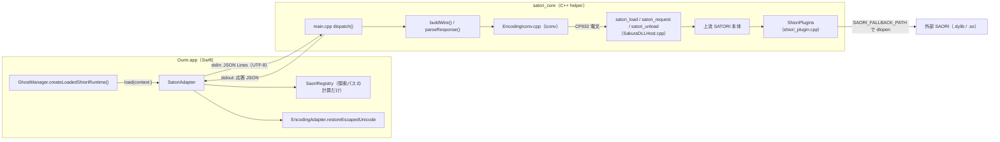
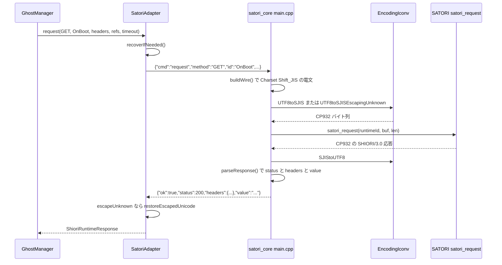

# 8.2 里々（SatoriAdapter と satori_core）

関連ソースファイル

このページは次のファイルをもとに作成した。

- [Ourin/USL/SatoriAdapter.swift](../../Ourin/USL/SatoriAdapter.swift)
- [Ourin/USL/ShioriRuntime.swift](../../Ourin/USL/ShioriRuntime.swift)
- [Ourin/USL/ShioriRuntimeFactory.swift](../../Ourin/USL/ShioriRuntimeFactory.swift)
- [Ourin/Ghost/GhostManager.swift](../../Ourin/Ghost/GhostManager.swift)
- [Ourin/SaoriHost/SaoriRegistry.swift](../../Ourin/SaoriHost/SaoriRegistry.swift)
- [Ourin/SSTP/EncodingAdapter.swift](../../Ourin/SSTP/EncodingAdapter.swift)
- [satori_core/src/main.cpp](../../satori_core/src/main.cpp)
- [satori_core/src/EncodingIconv.cpp](../../satori_core/src/EncodingIconv.cpp)
- [satori_core/CMakeLists.txt](../../satori_core/CMakeLists.txt)
- [satori_core/build.sh](../../satori_core/build.sh)
- [satori_core/README.md](../../satori_core/README.md)
- [satori_core/UPSTREAM.md](../../satori_core/UPSTREAM.md)
- [satori_core/PATCHES.md](../../satori_core/PATCHES.md)
- [satori_core/tests/test_encoding.py](../../satori_core/tests/test_encoding.py)
- [satori_core/tests/fixtures/external_saori.cpp](../../satori_core/tests/fixtures/external_saori.cpp)
- [satori_core/tests/fixtures/basic/](../../satori_core/tests/fixtures/basic/)
- [satori_core/tests/fixtures/external/](../../satori_core/tests/fixtures/external/)
- [satori_core/third_party/satoriya-shiori/satoriya/satori/makefile.posix](../../satori_core/third_party/satoriya-shiori/satoriya/satori/makefile.posix)
- [satori_core/third_party/satoriya-shiori/satoriya/satori/SakuraDLLHost.cpp](../../satori_core/third_party/satoriya-shiori/satoriya/satori/SakuraDLLHost.cpp)
- [satori_core/third_party/satoriya-shiori/satoriya/satori/shiori_plugin.cpp](../../satori_core/third_party/satoriya-shiori/satoriya/satori/shiori_plugin.cpp)
- [satori_core/third_party/satoriya-shiori/satoriya/satori/SakuraDLLClient.cpp](../../satori_core/third_party/satoriya-shiori/satoriya/satori/SakuraDLLClient.cpp)
- [satori_core/third_party/satoriya-shiori/satoriya/satori/ssu.cpp](../../satori_core/third_party/satoriya-shiori/satoriya/satori/ssu.cpp)
- [OurinTests/ShioriRuntimeTests.swift](../../OurinTests/ShioriRuntimeTests.swift)
- [Ourin.xcodeproj/project.pbxproj](../../Ourin.xcodeproj/project.pbxproj)
- [.github/workflows/macOS.yml](../../.github/workflows/macOS.yml)

里々（SATORI）で書かれたゴーストは、Swift 側の `SatoriAdapter`（[Ourin/USL/SatoriAdapter.swift](../../Ourin/USL/SatoriAdapter.swift)）と helper プロセス `satori_core`（[satori_core/](../../satori_core/)）で動く。`satori_core` は上流 `ukatech/satoriya-shiori` の固定版を静的リンクした実行ファイルで、Swift とは UTF-8 の JSON Lines、内部の SATORI とは CP932（Shift_JIS）の SHIORI 電文で話す。YAYA の [yaya_core](./08a-yaya.md) と違い、言語処理系は再実装せず **上流のコードをそのまま使う**。

モジュール名（`satori.dll`・`satoriya`・`satori_core`、拡張子と `lib` 接頭辞は無視）から `ShioriRuntimeFactory` が `.satori` と判定し、`SatoriAdapter()` を作る。ランタイムの選び方は [8 SHIORI 層](./08-shiori-runtime.md)、上流 SATORI の言語仕様そのものはこのページの対象外である（`third_party/satoriya-shiori` は上流コードなので内部構造は扱わない）。

**出典:** [Ourin/USL/ShioriRuntimeFactory.swift:23-31](../../Ourin/USL/ShioriRuntimeFactory.swift#L23-L31)、[Ourin/USL/ShioriRuntimeFactory.swift:81-92](../../Ourin/USL/ShioriRuntimeFactory.swift#L81-L92)、[satori_core/README.md:1-3](../../satori_core/README.md#L1-L3)

## 全体構成

| 要素 | 役割 | 定義位置 |
|---|---|---|
| `SatoriRequest` | Swift → helper の要求（`cmd`、`ghost_root`、`dic`、`method`、`id`、`headers`、`ref`、`protocol_version`、`escape_unknown`、`saori_paths`） | [Ourin/USL/SatoriAdapter.swift:3-33](../../Ourin/USL/SatoriAdapter.swift#L3-L33) |
| `SatoriAdapter` | `GhostShioriRuntime` 実装。プロセス管理・往復・再起動 | [Ourin/USL/SatoriAdapter.swift:35-263](../../Ourin/USL/SatoriAdapter.swift#L35-L263) |
| `main.cpp` | JSON Lines 境界（Ourin 独自。上流には無い） | [satori_core/src/main.cpp:1-258](../../satori_core/src/main.cpp#L1-L258) |
| `EncodingIconv.cpp` | 上流 POSIX ソースが要求する `SJIStoUTF8` / `UTF8toSJIS` を iconv で実装 | [satori_core/src/EncodingIconv.cpp:1-133](../../satori_core/src/EncodingIconv.cpp#L1-L133) |
| `third_party/satoriya-shiori/` | 上流の固定版（211 ファイル。`satoriya/satori` 86、`satoriya/_` 83、`sodate`・`obu`・`httpc` など） | [satori_core/UPSTREAM.md:1-10](../../satori_core/UPSTREAM.md#L1-L10) |

**出典:** [satori_core/README.md:14-23](../../satori_core/README.md#L14-L23)、[satori_core/PATCHES.md:13-15](../../satori_core/PATCHES.md#L13-L15)

## SatoriAdapter（Swift 側）

### 起動とロード

`SatoriAdapter()` は `Bundle.main.url(forAuxiliaryExecutable: "satori_core")` で helper を探し、`init?(executableURL:)` で起動する。`launchHelper()` は YAYA と同じく、毎回新しい `Process` と stdin / stdout / stderr の `Pipe` を作る。stderr は `Log.verbose` のときだけ `NSLog("[satori_core stderr] …")` に出す（YAYA のような `error` 行の抽出は無い）。

`load(context:)` の処理は次のとおり。

1. `SaoriRegistry()` を作り、`discoverSaoriDirectory(under: ghostURL)`（`.saori`、`ghost/master/.saori`、`ghost/master/saori` のうち存在するもの）と、`ghostRoot/.saori`・`ghostRoot/saori` を探索パスに加える。`SaoriRegistry` の既定パス（Ourin のデータフォルダの `saori/` と `Contents/Resources/saori`）も最初から入っている。
2. 実在するパスだけを `saori_paths` にする。`SaoriRegistry` は **パスの計算にだけ** 使い、SAORI の読み込みは helper 内の上流コードが行う。
3. `cmd: "load"` に `ghost_root`（`ghost/master`）、`dic`、`protocol_version`（`descript.txt` の `shiori.version`、無ければ `SHIORI/3.0`）、`escape_unknown`（`shiori.escape_unknown`）、`saori_paths` を載せて送る。期限は 10 秒。
4. 応答の `ok` が真なら `isLoaded` を立て、通信設定 `communication` と `lastLoadContext` を保存する。

`dic` には `context.dictionaryEntries` のパスを入れるが、`GhostManager.makeShioriLoadContext` は YAYA 以外では辞書一覧を作らないので通常は空配列で、helper 側も `dic` を読まない。辞書（`dic*.txt`）は上流 SATORI が `ghost_root` から自分で探す。

### 要求・終了・再起動

| 操作 | 期限 | 処理 |
|---|---|---|
| `load` | 10 秒 | 上記 |
| `request` | 呼び出し側の `timeout` | `recoverIfNeeded()` の後で `cmd: "request"` を送る。`escapeUnknown` が真なら応答の `headers`・`value`・`error` に `EncodingAdapter.restoreEscapedUnicode` をかける |
| `unload` | 3 秒 | `cmd: "unload"` の後、生きていれば `terminate()`、10 ms 間隔で最大 30 回待ち、残れば `SIGKILL`。最後に 3 本の pipe を閉じる |

往復は直列キュー `satori.adapter.io` 上で「1 行送って 1 行読む」だけで、YAYA のような `host_op` の折り返しは無い。期限切れ・EOF・デコード失敗では `forceTerminate()`（`terminate()`、0.2 秒後に `SIGKILL`）で helper を捨てる。次の `request` で `recoverIfNeeded()` が前の世代のキューが 2 秒以内に空くのを待ち、`launchHelper()` と `load` をやり直す。

注意: `recoverIfNeeded()` の再ロードは `load(ghostRoot:dicEntries:communication:)` を `saoriPaths` 無しで呼ぶ。そのため再起動後の helper には `saori_paths` が渡らず、`SAORI_FALLBACK_PATH` が未設定になる。コード上は、helper の再起動後に外部 SAORI の代替ライブラリを探せなくなる（実機での確認はしていない）。

**出典:** [Ourin/USL/SatoriAdapter.swift:54-93](../../Ourin/USL/SatoriAdapter.swift#L54-L93)、[Ourin/USL/SatoriAdapter.swift:95-180](../../Ourin/USL/SatoriAdapter.swift#L95-L180)、[Ourin/USL/SatoriAdapter.swift:198-262](../../Ourin/USL/SatoriAdapter.swift#L198-L262)、[Ourin/SaoriHost/SaoriRegistry.swift:8-37](../../Ourin/SaoriHost/SaoriRegistry.swift#L8-L37)、[Ourin/SaoriHost/SaoriRegistry.swift:162-172](../../Ourin/SaoriHost/SaoriRegistry.swift#L162-L172)、[Ourin/Ghost/GhostManager.swift:1563-1580](../../Ourin/Ghost/GhostManager.swift#L1563-L1580)、[Ourin/Ghost/GhostManager.swift:1665](../../Ourin/Ghost/GhostManager.swift#L1665)、[Ourin/USL/ShioriRuntime.swift:15-33](../../Ourin/USL/ShioriRuntime.swift#L15-L33)

## JSON Lines プロトコル（main.cpp）

`main()` は 1 行ずつ JSON を読み、`dispatch()` の結果を 1 行の JSON で返す。応答は常に `ok`・`status`・`headers`・`value` の 4 つを持つ。**エラー文言も `value` に入り**、`error` フィールドは使わない。

| `cmd` | 読まれるフィールド | 応答 |
|---|---|---|
| `ping` | なし | `ok:true`、`status:200`、`value:"pong"`（Swift からは送らない） |
| `load` | `ghost_root`（必須）、`protocol_version`（`SHIORI/` で始まらなければ `SHIORI/3.0`）、`escape_unknown`、`saori_paths` | 成功で 200。`ghost_root` 無しは 400、`satori_load` 失敗と事後 probe 失敗は 500 |
| `request` | `method`（既定 `GET`）、`id`、`headers`、`ref` | SATORI の応答を解析した `status`・`headers`・`value`。未ロードなら `ok:false`、503、`value:"not loaded"` |
| `unload` | なし | `satori_unload` を呼んで 200 |
| その他 | — | `ok:false`、400、`value:"unknown command"` |

`ok` は「通信と応答の解析が終わったこと」を表し、SHIORI のステータスとは別である（コード中のコメントによる）。応答の 1 行目が `SHIORI/` で始まらないと `ok:false`・500 になる。例外は捕まえて `ok:false`・500・`value:<what()>` を返す。

### load の流れ

1. 既にロード済みなら `satori_unload` で前の実体を捨てる。
2. `ghost_root` の末尾に `/` を足し、`malloc` した領域へコピーする（上流の `satori_load` が `free` する）。
3. `configureSaoriSearchPath` で `saori_paths` を `:` でつないで `SAORI_FALLBACK_PATH` に設定し、`SAORI_FALLBACK_ALWAYS=1` にする。配列が無い・空なら両方を `unsetenv` する。
4. `satori_load(root, len)` で実体を作り、返った ID を保持する（0 以下は失敗）。
5. 事後確認として `GET <protocol> / ID: version` を送り、応答が `SHIORI/` で始まらなければ失敗にして実体を捨てる。

### request の電文

`buildWire` は `<method> <protocol_version>` の後に、固定の `Charset: Shift_JIS`、`Sender: Ourin`、`ID: <id>` を出し、残りの `headers` を出す（名前が `Charset`・`Sender`・`ID` に一致するものは除く。比較は大文字小文字を区別する）。最後に `ref` を `Reference0..n` として足す。Swift 側の YAYA 経路のような `SecurityLevel` などの既定値補完は、この helper では行わない。

### stdout の保護

`main()` は最初に stdout を `dup` して JSON 専用の記述子を確保し、元の fd 1 を `dup2` で stderr に向け直してからエンジンを読む。上流の `Family.h::select_all` が `std::cout` に出す条件選択の診断や、ネイティブ SAORI の stdout が JSON Lines を壊さないようにするためである。stdin が閉じるとループを抜け、ロード中なら `satori_unload` してから終了する。

**出典:** [satori_core/src/main.cpp:21-85](../../satori_core/src/main.cpp#L21-L85)、[satori_core/src/main.cpp:108-221](../../satori_core/src/main.cpp#L108-L221)、[satori_core/src/main.cpp:225-258](../../satori_core/src/main.cpp#L225-L258)、[satori_core/PATCHES.md:13](../../satori_core/PATCHES.md#L13)、[satori_core/third_party/satoriya-shiori/satoriya/satori/SakuraDLLHost.cpp:31-39](../../satori_core/third_party/satoriya-shiori/satoriya/satori/SakuraDLLHost.cpp#L31-L39)、[satori_core/third_party/satoriya-shiori/satoriya/satori/SakuraDLLHost.cpp:60-90](../../satori_core/third_party/satoriya-shiori/satoriya/satori/SakuraDLLHost.cpp#L60-L90)

## 1 リクエストの往復

**出典:** [Ourin/USL/SatoriAdapter.swift:140-153](../../Ourin/USL/SatoriAdapter.swift#L140-L153)、[satori_core/src/main.cpp:87-106](../../satori_core/src/main.cpp#L87-L106)、[satori_core/src/main.cpp:207-212](../../satori_core/src/main.cpp#L207-L212)

## 文字コードの境界（EncodingIconv.cpp）

| 関数 | 変換 | 挙動 |
|---|---|---|
| `SJIStoUTF8` | CP932 → UTF-8 | 厳密変換。不正なバイト列は例外 |
| `UTF8toSJIS` | UTF-8 → CP932 | 先頭の UTF-8 BOM は符号化の目印として除く（途中の U+FEFF は除かない）。CP932 に無い **妥当な** Unicode 文字は空白 1 つに置き換える（上流 `CUnicodeF::utf16be_to_sjis` と同じ）。不正な UTF-8・サロゲート・途中で切れた列は例外 |
| `UTF8toSJISEscapingUnknown` | UTF-8 → CP932 | 1 文字ずつ変換し、変換できない文字を `?escape!unicode[0x<16進>]` に置き換える。`shiori.escape_unknown` が真のときの要求で使う |

`convertEncoding` は出力バッファを入力の 4 倍 + 32 で確保し、`E2BIG` なら倍に広げて続ける。`escape_unknown` の往復では、Swift の `EncodingAdapter.restoreEscapedUnicode` が正規表現 `\?escape!unicode\[0x([0-9A-Fa-f]{1,8})\]` で元の文字に戻す。

`PATCHES.md` は、この境界は「CP932 互換」であって「Unicode 辞書の無損失対応ではない」と明記し、1 つの表現不能文字で辞書全体のロードが止まらないようにするための置換だと説明している。辞書ファイル自体は書き換えない。

**出典:** [satori_core/src/EncodingIconv.cpp:10-133](../../satori_core/src/EncodingIconv.cpp#L10-L133)、[satori_core/PATCHES.md:15](../../satori_core/PATCHES.md#L15)、[Ourin/SSTP/EncodingAdapter.swift:117-130](../../Ourin/SSTP/EncodingAdapter.swift#L117-L130)、[satori_core/README.md:20-21](../../satori_core/README.md#L20-L21)

## ビルドと Windows 依存の回避

### CMakeLists.txt

| 項目 | 設定 |
|---|---|
| 基本 | CMake 3.20 以上、C++17、`CMAKE_OSX_DEPLOYMENT_TARGET` 11.0、未指定なら `arm64;x86_64` |
| nlohmann/json | `yaya_core` と同じ探索（3.11.0 のパッケージ → ヘッダのみ → VTK の `vtknlohmann` を互換ヘッダで包む） |
| ビルド対象 | `src/main.cpp`、`src/EncodingIconv.cpp`、上流 `satoriya/_/` の 7 ファイル（`Sender`・`Utilities`・`calc`・`calc_float`・`stltool`・`mt19937ar`・`random`）、`satoriya/satori/` の 18 ファイル（`SakuraCS`・`SakuraClient`・`SakuraDLLClient`・`SakuraDLLHost`・`SaoriClient`・`SaoriHost`・`satori`・`satoriTranslate`・`satori_AnalyzeRequest`・`satori_CreateResponce`・`satori_EventOperation`・`satori_Kakko`・`satori_load_dict`・`satori_load_unload`・`satori_sentence`・`satori_tool`・`shiori_plugin`・`ssu`） |
| 定義 | `POSIX`、`SATORI_DLL` |
| インクルード | `satoriya/_`、`satoriya/satori` |
| 警告 | `-Wno-deprecated-declarations`、`-Wno-invalid-source-encoding`（上流ソースは CP932）、`-Werror=return-type` |
| リンク | `nlohmann_json::nlohmann_json`、`iconv` |
| テスト用 | `tests/fixtures/external_saori.cpp` から共有ライブラリ `external_saori`（接頭辞なし。macOS では `build/external_saori.dylib`）を作る。アプリには同梱しない |

上流 25 ファイルの選び方は、上流自身の POSIX 用 `makefile.posix` の `LIBSATORI_OBJ` と同じである。Windows 依存の回避は次の組み合わせで成り立っている。

- **Windows 専用ソースをビルドしない**。`_/` の `Win32.cpp`・`Window.cpp`・`Dialog.cpp`・`RegKey.cpp`・`Socket.cpp`・`TCPSocket.cpp`・`FTP.cpp`・`Font.cpp`・`DisplayMode.cpp`・`Thread.cpp`・`Task.cpp`・`dsstp.cpp`・`bregexp.cpp`・`charset.cpp` など 27 ファイル、`satori/` の `WinMain.cpp`・`SSTPClient.cpp`・`SakuraFMO.cpp`・`satoriFMO.cpp`・`ShioriClient.cpp`・`SakuraScript.cpp`・`TimeCommands.cpp`・`cn.cpp`・`main.cpp` の 9 ファイル、`sodate`・`obu`・`httpc` の各ディレクトリは対象外。
- **`POSIX` を定義して上流の POSIX 分岐を選ぶ**。たとえば `SakuraDLLHost.cpp` は `#ifdef POSIX` で `DllMain` を外し、`GlobalAlloc` ではなく `malloc` / `free` で受け渡す複数インスタンス用の入口 `satori_load` / `satori_request` / `satori_unload` を公開する。`main.cpp` はこの 3 つを `extern "C"` で呼ぶ。
- **文字コード変換を差し替える**。上流の `_/charset.cpp`（独自の変換表）はビルドせず、POSIX ソースが要求する `SJIStoUTF8` / `UTF8toSJIS` を `EncodingIconv.cpp` が iconv で提供する。
- **Windows DLL の SAORI を読まない**（次節）。

`-Werror=return-type` は、戻り値を返さずに関数末尾へ到達するコードをエラーにする。`PATCHES.md` の 3 件のうち 2 件（`SakuraDLLClient.cpp`・`ssu.cpp`）はまさにこの種の欠陥への修正である。

### build.sh と Xcode・CI

`build.sh` は `cmake -S . -B build -DCMAKE_OSX_ARCHITECTURES="arm64;x86_64" -DCMAKE_OSX_DEPLOYMENT_TARGET="11.0"` の後 `cmake --build build --parallel <CPU数>` を行う。構成（configure）に失敗したとき（依存が一時的に無いなど）は、既存の `build/satori_core` が実行可能で、`CMakeLists.txt`・`build.sh`・`src`・`third_party`・`tests` のどれも成果物より新しくなく、`lipo -verify_arch arm64 x86_64` が通る場合に限り、警告を出してその成果物を再利用し成功で終わる。それ以外は失敗する。

Xcode の `Build satori_core` Run Script は、成果物が無いか入力（`CMakeLists.txt`・`build.sh`・`src`・`third_party`・`tests`）が新しいときだけ `./build.sh` を呼ぶ。`Copy helper cores` フェーズが `yaya_core` と一緒に `Contents/MacOS/satori_core` へコピーし、`CodeSignOnCopy` で署名する。CI の `helper-cores` ジョブは単独ビルドと `lipo -info` による Universal 確認の後で `python3 satori_core/tests/test_encoding.py -v` を実行し、`release-gate` は Release ビルドの `Contents/MacOS/satori_core` の存在と両アーキテクチャを確認する。

**出典:** [satori_core/CMakeLists.txt:1-101](../../satori_core/CMakeLists.txt#L1-L101)、[satori_core/third_party/satoriya-shiori/satoriya/satori/makefile.posix:23-49](../../satori_core/third_party/satoriya-shiori/satoriya/satori/makefile.posix#L23-L49)、[satori_core/third_party/satoriya-shiori/satoriya/satori/SakuraDLLHost.cpp:22-39](../../satori_core/third_party/satoriya-shiori/satoriya/satori/SakuraDLLHost.cpp#L22-L39)、[satori_core/src/main.cpp:13-19](../../satori_core/src/main.cpp#L13-L19)、[satori_core/build.sh:1-47](../../satori_core/build.sh#L1-L47)、[Ourin.xcodeproj/project.pbxproj:404-422](../../Ourin.xcodeproj/project.pbxproj#L404-L422)、[Ourin.xcodeproj/project.pbxproj:54-65](../../Ourin.xcodeproj/project.pbxproj#L54-L65)、[.github/workflows/macOS.yml:141-163](../../.github/workflows/macOS.yml#L141-L163)、[.github/workflows/macOS.yml:209-229](../../.github/workflows/macOS.yml#L209-L229)

## 上流の固定とローカル patch

### UPSTREAM.md

| 項目 | 値 |
|---|---|
| リポジトリ | `https://github.com/ukatech/satoriya-shiori` |
| tag | `Mc172-3` |
| commit | `a574669478e6086d85f63beb6c52a31c7dcc43cf` |
| source tree | `7625117c445d3f8869433db22e365fef8ea16d69` |
| 取り込み日 | 2026-07-13 |
| ライセンス | BSD 2-Clause（`third_party/satoriya-shiori/LICENSE`） |

ソースアーカイブを Git メタデータ無しで取り込み、ビルドにネットワークを要さない再現性を確保している。

### PATCHES.md（ローカル patch の一覧）

| 対象 | 変更 | 位置 |
|---|---|---|
| `satori/SakuraDLLClient.cpp` | POSIX の要求経路で、生成した応答を返すようにした（上流は non-void 関数の末尾に到達していた） | [satori_core/third_party/satoriya-shiori/satoriya/satori/SakuraDLLClient.cpp:53-57](../../satori_core/third_party/satoriya-shiori/satoriya/satori/SakuraDLLClient.cpp#L53-L57) |
| `satori/ssu.cpp` | POSIX の `_lsimg` で `"0"` を返す（上流は空の TODO。`0` は既存の空・エラー結果と同じ） | [satori_core/third_party/satoriya-shiori/satoriya/satori/ssu.cpp:1040-1043](../../satori_core/third_party/satoriya-shiori/satoriya/satori/ssu.cpp#L1040-L1043) |
| `satori/shiori_plugin.cpp` | 設定された Windows の `name.dll` を、`SAORI_FALLBACK_PATH` 配下の `name.dylib`・`libname.dylib`・`name.so`・`libname.so` に解決する。Windows DLL 自体は読まない | [satori_core/third_party/satoriya-shiori/satoriya/satori/shiori_plugin.cpp:44-92](../../satori_core/third_party/satoriya-shiori/satoriya/satori/shiori_plugin.cpp#L44-L92) |

上流外の Ourin 独自ファイルは `src/EncodingIconv.cpp`（CP932 / UTF-8 変換）と `src/main.cpp`（JSON Lines 境界、ゴーストごとの `SAORI_FALLBACK_PATH` 設定、stdout の保護）である。

**出典:** [satori_core/UPSTREAM.md:1-10](../../satori_core/UPSTREAM.md#L1-L10)、[satori_core/PATCHES.md:1-15](../../satori_core/PATCHES.md#L1-L15)

## 外部 SAORI の扱い

里々の SAORI は **helper 内の上流コード（`ShioriPlugins`）が直接読む**。YAYA のように Swift の `SaoriManager` へ `host_op` で問い合わせる経路は無く、Swift の内蔵 SAORI・互換 SAORI（[13 SAORI](./13-saori.md)）は里々からは使えない。

1. ゴーストの設定（fixture では `satori_conf.txt` の `＠SAORI` 節に `external,saori/external_saori.dll`）で SAORI が宣言される。
2. 上流の POSIX 分岐は、`SAORI_FALLBACK_ALWAYS` が空でも `0` でもなければ、宣言された `.dll` を `dlopen` で試すことをせず、最初から代替ライブラリを探す。Ourin は `saori_paths` があれば常に `SAORI_FALLBACK_ALWAYS=1` にするので、Windows DLL を開くことはない。
3. `posix_search_fallback_dll` が `SAORI_FALLBACK_PATH` の各ディレクトリで、拡張子を除いた名前の `.dylib`・`lib*.dylib`・`.so`・`lib*.so` を順に `stat` し、最初に見つかったものを使う（stderr に `SAORI: using …` を出す）。
4. 見つからなければ「This is not usable in this platform」とエラーを出し、その SAORI の登録を消す。

探索パスの一覧は上流側で一度だけ読んで静的変数に保持する（`posix_dll_search_path_is_ready`）。1 helper = 1 ゴーストの運用では問題にならないが、同じプロセスで別のゴーストを読み直すと古いパスが残る（コードからの推測。Ourin は 1 プロセスで 1 ゴーストしか読まない）。

**出典:** [satori_core/third_party/satoriya-shiori/satoriya/satori/shiori_plugin.cpp:44-92](../../satori_core/third_party/satoriya-shiori/satoriya/satori/shiori_plugin.cpp#L44-L92)、[satori_core/third_party/satoriya-shiori/satoriya/satori/shiori_plugin.cpp:196-250](../../satori_core/third_party/satoriya-shiori/satoriya/satori/shiori_plugin.cpp#L196-L250)、[satori_core/src/main.cpp:28-52](../../satori_core/src/main.cpp#L28-L52)、[satori_core/tests/fixtures/external/satori_conf.txt](../../satori_core/tests/fixtures/external/satori_conf.txt)、[satori_core/README.md:18](../../satori_core/README.md#L18)

## テストと fixture

| ファイル | 内容 |
|---|---|
| [satori_core/tests/test_encoding.py](../../satori_core/tests/test_encoding.py) | `test_bom_signature_and_strict_conversion`: `clang++` で `EncodingIconv.cpp` と小さな C++ を直接ビルドし、BOM の除去、往復、表現不能文字の空白置換（`噓` → 空白）、サロゲート・切れた列・`\xFF` の例外を確かめる（`clang++` が無ければ skip）。`test_real_helper_utf8_bom_dictionary_lifecycle`: 実 `build/satori_core` に一時ディレクトリの BOM 付き UTF-8 辞書を読ませ、`load` → 3 イベント → `unload` の 5 応答がすべて `ok`、条件選択の診断（`selecting`）が stdout ではなく stderr に出ること、辞書ファイルの SHA-256 が変わらないことを確かめる（helper 未ビルドなら skip） |
| [satori_core/tests/fixtures/external_saori.cpp](../../satori_core/tests/fixtures/external_saori.cpp) | POSIX の Sakura DLL ABI（`load(char*, long)`・`unload()`・`request(char*, long*)`、入力は `free`、出力は `malloc`）を実装した最小 SAORI。`GET Version` には 200 だけ、それ以外には `Result: external-saori-ok`・`Value0: fixture-value` を Shift_JIS 宣言で返す |
| [satori_core/tests/fixtures/basic/](../../satori_core/tests/fixtures/basic/) | `satori_bootconf.txt`（`is_utf8_all,1`）と `dic01_basic.txt`（`＊OnBoot`・`＊OnClose`・`＊OnEchoReference` の `（Ｒ０）`） |
| [satori_core/tests/fixtures/external/](../../satori_core/tests/fixtures/external/) | 上記の外部 SAORI を `＠SAORI` で宣言し、`OnBoot` で `（external）` を呼ぶ辞書 |

Swift 側では `OurinTests/ShioriRuntimeTests.swift` が、偽の helper（zsh スクリプト）で期限切れ後の再起動と復元を、`basic` fixture で実 helper の `OnBoot`・`escape_unknown` による絵文字の往復・`unload` 後の `satori_savedata.txt` の生成を、`external` fixture（Windows DLL の代わりに `MZ` の 2 バイトだけの `external_saori.dll` と、ビルド済み `external_saori.dylib`）で外部 SAORI の代替読み込みを確かめる。`external_saori.dylib` は `SaoriLoaderTests`・`SaoriHostIntegrationTests`・`SaoriRegistryTests` の Swift SAORI ホストの試験にも流用される（[18 テストと互換性検証](./18-testing.md)）。

これらは fixture と実 helper の試験であり、配布ゴーストでの会話・保存・画面の確認とは別物である（`CONTRIBUTING.md` の区別）。

**出典:** [satori_core/tests/test_encoding.py:13-63](../../satori_core/tests/test_encoding.py#L13-L63)、[satori_core/tests/fixtures/external_saori.cpp:1-30](../../satori_core/tests/fixtures/external_saori.cpp#L1-L30)、[OurinTests/ShioriRuntimeTests.swift:488-597](../../OurinTests/ShioriRuntimeTests.swift#L488-L597)、[satori_core/README.md:24-26](../../satori_core/README.md#L24-L26)、[CONTRIBUTING.md:24](../../CONTRIBUTING.md#L24)

## 制約と注意点

- **完全な Unicode 対応ではない**。SATORI 本体は CP932 で動くため、UTF-8 辞書でも CP932 に無い文字は空白になる。要求側の未知文字は `escape_unknown` を有効にしたときだけ `?escape!unicode[…]` で保持される。
- **SAORI は Swift の SAORI ホストを通らない**。内蔵・互換 SAORI は使えず、macOS ネイティブの `.dylib` / `.so` が探索パスにある場合だけ動く。
- **helper の再起動後は `saori_paths` が渡らない**（`recoverIfNeeded()` の実装による。前述）。
- エラー文言が `value` に入るため、`ok:false` のときに `value` を発話として扱わないよう呼び出し側で注意が要る（`ShioriRuntimeResponse.error` は常に nil になる）。
- deployment target が 11.0 のままで、アプリ（13.0）と揃っていない。`docs/RELEASE_GATES_2026-10-25.md` は 13.0 への引き上げを推奨事項として挙げている。
- `buildWire` のヘッダ除外は大文字小文字を区別するので、Swift から `charset` のような小文字のヘッダが来ると `Charset` と二重に出る（コードからの推測。実際にそうしたヘッダを送る呼び出し元があるかは未確認）。

**出典:** [satori_core/PATCHES.md:15](../../satori_core/PATCHES.md#L15)、[Ourin/USL/SatoriAdapter.swift:242-262](../../Ourin/USL/SatoriAdapter.swift#L242-L262)、[satori_core/src/main.cpp:61-85](../../satori_core/src/main.cpp#L61-L85)、[satori_core/CMakeLists.txt:6](../../satori_core/CMakeLists.txt#L6)、[docs/RELEASE_GATES_2026-10-25.md:44-48](../../docs/RELEASE_GATES_2026-10-25.md#L44-L48)

## 関連ページ

- [8 SHIORI 層（USL）](./08-shiori-runtime.md) — `GhostShioriRuntime`、ランタイム選択、`ShioriRuntimeCache`
- [8.1 YAYA（YayaAdapter と yaya_core）](./08a-yaya.md) — 同じ JSON line 方式で SAORI を Swift に委ねるもう 1 つの helper
- [8.3 SHIOLINK・里珠・追加栞](./08c-external-engines.md) — 他の外部プロセス型・ネイティブ型エンジン
- [13 SAORI](./13-saori.md) — Swift 側の SAORI ホスト（里々からは使われない）
- [2 ビルド・パッケージング・CI](./02-build-and-ci.md) — helper のビルドフェーズと CI ジョブ
- [18 テストと互換性検証](./18-testing.md) — fixture と実ゴースト検証の区別
