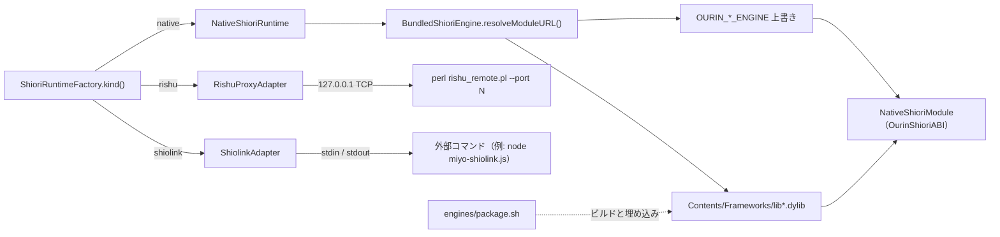
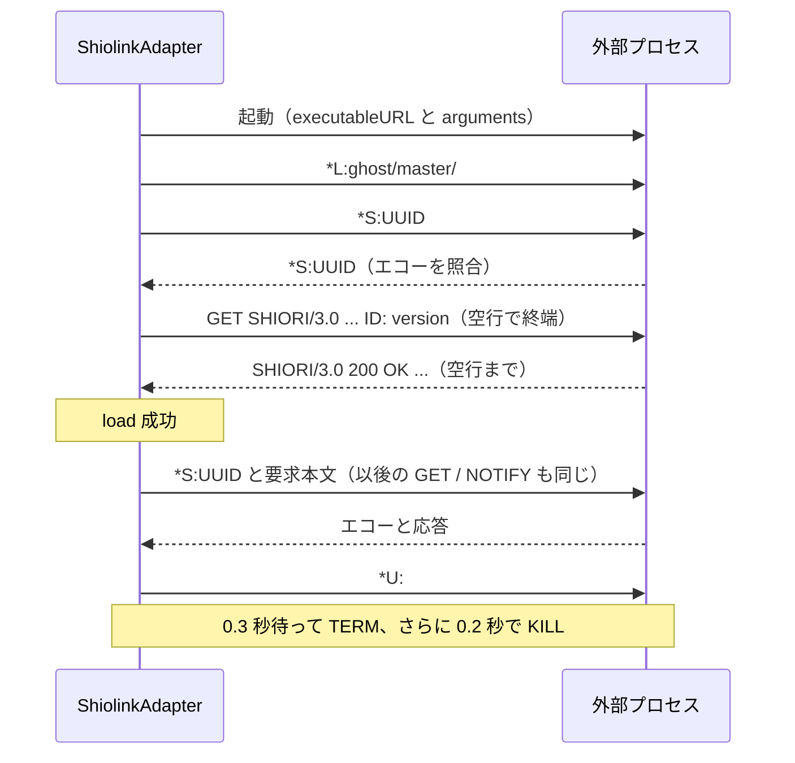

# 8.3 SHIOLINK・里珠・追加栞・華和梨/篝/Aosora

関連ソースファイル

このページは次のファイルをもとに作成した。

- [Ourin/USL/ShiolinkAdapter.swift](../../Ourin/USL/ShiolinkAdapter.swift)
- [Ourin/USL/RishuProxyAdapter.swift](../../Ourin/USL/RishuProxyAdapter.swift)
- [Ourin/USL/BundledShioriEngine.swift](../../Ourin/USL/BundledShioriEngine.swift)
- [Ourin/USL/ShioriRuntimeFactory.swift](../../Ourin/USL/ShioriRuntimeFactory.swift)
- [Ourin/USL/NativeShioriModule.swift](../../Ourin/USL/NativeShioriModule.swift)
- [Ourin/USL/ShioriRuntime.swift](../../Ourin/USL/ShioriRuntime.swift)
- [Ourin/Ghost/GhostConfiguration.swift](../../Ourin/Ghost/GhostConfiguration.swift)
- [engines/PINNED_UPSTREAM.json](../../engines/PINNED_UPSTREAM.json)
- [engines/package.sh](../../engines/package.sh)
- [engines/additional/build.sh](../../engines/additional/build.sh)
- [engines/additional/macos13.patch](../../engines/additional/macos13.patch)
- [engines/additional/akari-plugin.patch](../../engines/additional/akari-plugin.patch)
- [engines/additional/akari-values.patch](../../engines/additional/akari-values.patch)
- [engines/additional/verify.py](../../engines/additional/verify.py)
- [engines/additional/test_akari_values.py](../../engines/additional/test_akari_values.py)
- [engines/additional/AkariValueRegressionTests.swift](../../engines/additional/AkariValueRegressionTests.swift)
- [engines/kawari/build.sh](../../engines/kawari/build.sh)
- [engines/kagari/build.sh](../../engines/kagari/build.sh)
- [engines/kagari/DEPENDENCIES.json](../../engines/kagari/DEPENDENCIES.json)
- [engines/kagari/patches/001-apple-unix.patch](../../engines/kagari/patches/001-apple-unix.patch)
- [engines/kagari/patches/002-kagari-unix-load-failure.patch](../../engines/kagari/patches/002-kagari-unix-load-failure.patch)
- [engines/kagari/patches/003-sol2-optional-ref-emplace.patch](../../engines/kagari/patches/003-sol2-optional-ref-emplace.patch)
- [engines/kagari/patches/004-bundled-lua-modules.patch](../../engines/kagari/patches/004-bundled-lua-modules.patch)
- [engines/kagari/modules/DEPENDENCIES.json](../../engines/kagari/modules/DEPENDENCIES.json)
- [engines/kagari/modules/build.py](../../engines/kagari/modules/build.py)
- [engines/kagari/modules/native_modules.cpp](../../engines/kagari/modules/native_modules.cpp)
- [engines/kagari/tests/test_native_modules.py](../../engines/kagari/tests/test_native_modules.py)
- [engines/kagari/verify_kagari_mosu.py](../../engines/kagari/verify_kagari_mosu.py)
- [engines/aosora/adapter.cpp](../../engines/aosora/adapter.cpp)
- [engines/aosora/build.py](../../engines/aosora/build.py)
- [engines/aosora/DEPENDENCIES.json](../../engines/aosora/DEPENDENCIES.json)
- [engines/aosora/test_native.py](../../engines/aosora/test_native.py)
- [engines/aosora/probe_corpus.py](../../engines/aosora/probe_corpus.py)
- [Ourin.xcodeproj/project.pbxproj](../../Ourin.xcodeproj/project.pbxproj)
- [docs/ADDITIONAL_SHIORI_ja-jp.md](../../docs/ADDITIONAL_SHIORI_ja-jp.md)
- [docs/SHIOLINK_ja-jp.md](../../docs/SHIOLINK_ja-jp.md)
- [docs/RISHU_ja-jp.md](../../docs/RISHU_ja-jp.md)
- [docs/KAWARI_KAGARI_ENGINES_ja-jp.md](../../docs/KAWARI_KAGARI_ENGINES_ja-jp.md)
- [docs/SHIORI_RUNTIME_COMPATIBILITY_MATRIX_ja-jp.md](../../docs/SHIORI_RUNTIME_COMPATIBILITY_MATRIX_ja-jp.md)
- [docs/SHIORI_EXPANSION_VERIFICATION_2026-10-25.md](../../docs/SHIORI_EXPANSION_VERIFICATION_2026-10-25.md)
- [docs/compatibility-corpus/kagari-fixes.md](../../docs/compatibility-corpus/kagari-fixes.md)
- [docs/compatibility-corpus/aosora.md](../../docs/compatibility-corpus/aosora.md)

このページは、YAYA・里々以外の SHIORI を Ourin がどう動かすかを扱う。方式は 2 つに分かれる。

- **外部プロセス型**: `ShiolinkAdapter`（SHIOLINK 経由の MiyoJS など）と `RishuProxyAdapter`（里珠 / Rishu Proxy）。`GhostShioriRuntime` を直接実装し、別プロセスと行プロトコルや TCP で話す。
- **同梱ネイティブ型**: 華和梨（KAWARI）、KAGARI（篝）、追加 7 栞（灯・ese-shiori・偽栞・忍・翡翠・結奈・美坂）、任意導入の Aosora。いずれも `NativeShioriRuntime` から `BundledShioriEngine` 経由で macOS 用 dylib に解決され、`NativeShioriModule` が `OurinShioriABI` に従って呼ぶ。

ランタイム選択・XPC 隔離・ABI の共通部分は [8 SHIORI 層（USL）](./08-shiori-runtime.md) にある。ここでは各エンジン固有の接続方法、`engines/` 以下のビルドと固定版、ドキュメントに記録された検証状況をまとめる。

## 対応エンジンと検証状況

検証状況は `docs/` の記録（2026-10-25 時点）の要約であり、このページの執筆時に再実行したものではない。いずれも公開版 v0.0.1.21 には未収録と記載されている。

| エンジン | `descript.txt` の `shiori` | kind / 経路 | 実体 | ABI / プロトコル | 配布物への同梱 | 記録された検証範囲 | 残件（記録上） |
|---|---|---|---|---|---|---|---|
| YAYA | `yaya.dll` | `yaya` | `yaya_core` | JSON Lines | 同梱 | [8.1](./08a-yaya.md) | — |
| 里々 | `satori.dll` | `satori` | `satori_core` | JSON Lines | 同梱 | [8.2](./08b-satori.md) | — |
| 華和梨 | `kawari.dll`、`kosui.dll`、`kawarirc.*` 付き `shiori.dll` | `native` | `libkawari_shiori.dylib` | `ukagaka-long` | 同梱 | 実エンジン in-process / XPC、LOBO の起動・会話・終了・保存・別プロセス再ロード | GUI 上の操作、辞書網羅 |
| KAGARI | `kagari.dll` | `native` | `libkagari.dylib` + `liblua.5.4.dylib` | `kagari`（instance ID） | 同梱 | 実エンジン in-process / XPC、配布 NAR 4 件で load・OnBoot・ダブルクリック・OnClose・unload を 2 周 | もすの実ゴースト確認、ゴースト固有 SAORI |
| 灯・ese-shiori・偽栞・忍・翡翠・結奈（実験的）・美坂 | `akari.dll` など | `native` | `lib<名前>.dylib` | `ukagaka-int32` | 同梱 | 最小辞書で arm64 / Rosetta x86_64、6 種は別プロセス再ロード、アプリ経路の XPC / factory | 配布ゴースト全体、全構文、Windows 保存形式、同一栞の同時起動 |
| Aosora | `aosora.dll` | `native` | 利用者がビルドした `libaosora.dylib`（`OURIN_AOSORA_ENGINE`） | `aosora`（64bit instance ID） | 非同梱 | 実配布 2 件で load → OnBoot → OnClose → unload → 再ロードを 2 周 | 会話網羅、GUI、Intel 実機、再配布許諾 |
| MiyoJS ほか SHIOLINK | `SHIOLINK.dll` | `shiolink` | `SHIOLINK.INI` の外部コマンド（Node.js 等） | `*L` / `*S` / `*U` 行プロトコル | 実行環境は別途 | MiyoJS 2.0.3 + 最小 YAML 辞書で起動・日本語 / 絵文字・終了・PID 回収 | MiyoPreview など配布ゴースト |
| 里珠 | `rishu_proxy.dll` | `rishu` | Perl + ゴースト同梱 `rishu_remote.pl` | `RISHU/1.1` over loopback TCP | Perl は別途 | 公式 1.1.32 の echo サンプルで LOAD / GET / NOTIFY / UNLOAD / EXIT | 人格ゴースト、追加 Perl 依存 |

**出典:** [docs/SHIORI_RUNTIME_COMPATIBILITY_MATRIX_ja-jp.md:24-37](../../docs/SHIORI_RUNTIME_COMPATIBILITY_MATRIX_ja-jp.md#L24-L37)、[docs/SHIORI_EXPANSION_VERIFICATION_2026-10-25.md:43-57](../../docs/SHIORI_EXPANSION_VERIFICATION_2026-10-25.md#L43-L57)、[docs/compatibility-corpus/kagari-fixes.md:1-16](../../docs/compatibility-corpus/kagari-fixes.md#L1-L16)、[docs/compatibility-corpus/aosora.md:1-29](../../docs/compatibility-corpus/aosora.md#L1-L29)、[Ourin/USL/ShioriRuntimeFactory.swift:23-38](../../Ourin/USL/ShioriRuntimeFactory.swift#L23-L38)、[Ourin/USL/BundledShioriEngine.swift:4-43](../../Ourin/USL/BundledShioriEngine.swift#L4-L43)

## 2 つの方式の位置づけ

外部プロセス型はどちらも `NSLock` で要求を直列化し、パイプ / ソケットを非ブロッキングにして `poll` で待つ。1 回の要求（送信・同期・受信）全体に単調時計（`systemUptime`）の期限を 1 つだけ設ける。期限は `min(max(timeout, 0.001), 60)` 秒で、無限大などは 5 秒。失敗するとセッションを閉じて子プロセスを止め、自動再起動はしない。

**出典:** [Ourin/USL/ShiolinkAdapter.swift:99-123](../../Ourin/USL/ShiolinkAdapter.swift#L99-L123)、[Ourin/USL/ShiolinkAdapter.swift:199-214](../../Ourin/USL/ShiolinkAdapter.swift#L199-L214)、[Ourin/USL/RishuProxyAdapter.swift:147-160](../../Ourin/USL/RishuProxyAdapter.swift#L147-L160)、[Ourin/USL/BundledShioriEngine.swift:61-66](../../Ourin/USL/BundledShioriEngine.swift#L61-L66)

## ShiolinkAdapter（SHIOLINK 外部プロセス）

`shiori,SHIOLINK.dll` のゴーストを、Windows DLL ではなく SHIOLINK を話す外部プロセスへ接続する。コード中のコメントは「SHIOLINK *L / *S / *U transport」で、SHIORIPROXY や JSON Lines helper とは別物と明記している（SHIOLINK2 と呼ばれる形式に当たると思われるが、コード中にその呼称は無い。推測）。

### 設定ファイル（ShiolinkConfiguration）

モジュールの相対パス（`..` や絶対パスは拒否）の親ディレクトリで、`SHIOLINK.ourin.ini` を優先し、無ければ `SHIOLINK.INI` を読む（大文字小文字無視。同名候補が複数あれば不正）。優先ファイルが不正でも共通設定へは切り替えない。64 KiB を超えるファイル、キーの重複、`[SHIOLINK]` 以外のセクションのキーは無視または不正扱いになる。

| キー | 意味 | 制約 |
|---|---|---|
| `executable` | 実行ファイル（Ourin 拡張） | `commandline` と同時指定不可 |
| `arguments` | JSON 文字列配列（Ourin 拡張）。既定 `[]` | `executable` と組でのみ有効 |
| `commandline` | 共通形式。引用符（`"` / `'`）で区切るだけの簡易トークナイザで分割 | 引用符の外にパイプ記号・`;`・`&`・`<`・`>`・`$`・バッククォートがあると不正。入れ子・エスケープ・変数展開なし |
| `charmode` | 文字コード。既定 `UTF-8` | UTF-8 と Shift_JIS のみ（UTF-16/32 は行区切りに合わないため拒否） |

実行ファイル名に `\` や `:` があるもの、拡張子 `exe` / `com` / `bat` / `cmd` / `ps1`、引数中の NUL / CR / LF は拒否する。単独の名前はゴーストのディレクトリ、`/opt/homebrew/bin`、`/usr/local/bin`、`/usr/bin`、`/bin` の順に実行可能ファイルを探す。シェルは挟まない。

**出典:** [Ourin/USL/ShiolinkAdapter.swift:5-74](../../Ourin/USL/ShiolinkAdapter.swift#L5-L74)、[Ourin/USL/ShiolinkAdapter.swift:76-96](../../Ourin/USL/ShiolinkAdapter.swift#L76-L96)

### ワイヤと処理の流れ

`load` は `Process` を起動し（作業ディレクトリは DLL のディレクトリ、stderr は `/dev/null` へ捨てる）、stdin 書き込み側と stdout 読み出し側を `O_NONBLOCK`、書き込みに `F_SETNOSIGPIPE` を設定する。次に `*L:<ディレクトリ>/` を送り、`GET` の `ID: version` を交換できたらロード成功とする（SHIOLINK に load 専用の成功応答が無いため、これは通信確認であって辞書の正常性ではない）。

各要求は `exchange` が行う。`*S:<UUID>` を送り、同じ行が返ることを確かめてから `ShioriWireCodec.makeRequest` の電文を送り、空行まで読む。文字コードは `forceEncoding ?? encoding ?? charmode` で、応答の `Charset` ヘッダがあればそれで復号する（`forceEncoding` が最優先）。`escape_unknown` なら退避表記を戻す。要求・応答とも 1 MiB（1,048,576 バイト）を超えると失敗。

| 失敗の種類 | 挙動 |
|---|---|
| 設定不正・起動失敗 | `SHIOLINK configuration or launch failed: ...` をログし `load` は `false` |
| 初期化の期限超過（既定 5 秒） | `SHIOLINK initialization failed` |
| 同期違反・EOF・不正応答・期限超過・サイズ超過 | `SHIOLINK response timed out, exceeded the limit, or was malformed` をログし、セッションを閉じて `nil` |

`lastProcessIdentifier` は診断・テスト用に起動直後の PID を保持する。

**出典:** [Ourin/USL/ShiolinkAdapter.swift:125-174](../../Ourin/USL/ShiolinkAdapter.swift#L125-L174)、[Ourin/USL/ShiolinkAdapter.swift:176-197](../../Ourin/USL/ShiolinkAdapter.swift#L176-L197)、[Ourin/USL/ShiolinkAdapter.swift:216-285](../../Ourin/USL/ShiolinkAdapter.swift#L216-L285)

### MiyoJS

`docs/SHIOLINK_ja-jp.md` は、npm の `miyojs@2.0.3` を `executable=<node の絶対パス>`、`arguments=["./node_modules/miyojs/bin/miyo-shiolink.js", "./dic"]`、`charmode=UTF-8` で起動する例と、`/tmp` に最小辞書の検証用 master を作って `python3 scripts/verify_external_shiori.py miyo <dir>` で確認する手順を記録している。MiyoJS 2.0.3 は `safeLoad` を使うため js-yaml 3 系が必要とある。Ourin は Node.js や npm パッケージを自動導入しない。外部プロセスは Ourin の権限を引き継ぎ、追加のサンドボックスや SAORI の中継は無い。

**出典:** [docs/SHIOLINK_ja-jp.md:9-46](../../docs/SHIOLINK_ja-jp.md#L9-L46)、[docs/SHIOLINK_ja-jp.md:58-90](../../docs/SHIOLINK_ja-jp.md#L58-L90)

## RishuProxyAdapter（里珠 / Rishu Proxy）

`shiori,rishu_proxy.dll` のゴーストを、ゴーストに同梱された Perl スクリプト `rishu_remote.pl` へ接続する。上流 Rishu/Proxy 1.1 の `--port` モード（子が親の listener へ接続しに来る）を、ゴーストの Perl ファイルを変えずに使う。

### 起動

1. モジュールの相対パス（`..` / 絶対パスは拒否）の親ディレクトリで `rishu_remote.pl` を大文字小文字無視で探す（ちょうど 1 つであること）。
2. Perl は `/usr/bin/perl`、または環境変数 `OURIN_RISHU_PERL_EXECUTABLE`（絶対パスでなければロード失敗）。実行可能であること。
3. `127.0.0.1`、ポート 0 で listen して割り当てポートを得る（backlog 1、非ブロッキング、`SO_NOSIGPIPE`）。
4. `perl rishu_remote.pl --port <port>` を、作業ディレクトリ = DLL のディレクトリ、stdin/stdout/stderr = `/dev/null` で起動する。シェルや `rishu_proxy.ini` のコマンドは実行しない。
5. 期限内に接続が来たら `accept` し、listener を閉じる。`PROXY LOAD RISHU/1.1` + `Directory: <dir>/`（Shift_JIS で表現できること）を送り、`RISHU/1.1 2xx` が返ればロード成功。

**出典:** [Ourin/USL/RishuProxyAdapter.swift:25-71](../../Ourin/USL/RishuProxyAdapter.swift#L25-L71)、[Ourin/USL/RishuProxyAdapter.swift:120-145](../../Ourin/USL/RishuProxyAdapter.swift#L120-L145)

### RISHU/1.1 フレーム

| 方向 | 内容 |
|---|---|
| 要求 | `PROXY REQUEST RISHU/1.1\r\nCommand: ` の直後に SHIORI/3.0 電文全体（`ShioriWireCodec.makeRequest`）を連結。文字コードは `forceEncoding ?? encoding ?? Shift_JIS`（UTF-8 も可）。`escape_unknown` なら退避して符号化 |
| 応答 | `\r\n\r\n` までをヘッダとして Latin-1 で読み、`Content-Length`（任意。重複・非数字・上限超過は不正）があれば本体を足して 1 フレームとする。先頭行が `RISHU/1.1` かつ 2xx であること |
| 元応答 | ヘッダ中の `Original-Response: ` 行の値から末尾までを SHIORI 応答として取り出し、`Charset` ヘッダ（無ければ要求と同じ）で復号して `parseResponse` |
| 終了 | `PROXY UNLOAD RISHU/1.1` を送って応答を待ち、`PROXY EXIT RISHU/1.1`。その後 0.3 秒待って TERM、0.2 秒で KILL |

フレームは 1 MiB まで。要求の失敗（期限・切断・不正応答）では `Rishu response timed out, exceeded the limit, or was malformed` をログし、ソケットを閉じて子を止める。

**出典:** [Ourin/USL/RishuProxyAdapter.swift:73-118](../../Ourin/USL/RishuProxyAdapter.swift#L73-L118)、[Ourin/USL/RishuProxyAdapter.swift:162-240](../../Ourin/USL/RishuProxyAdapter.swift#L162-L240)、[docs/RISHU_ja-jp.md:11-25](../../docs/RISHU_ja-jp.md#L11-L25)

## 上流の固定版（engines/PINNED_UPSTREAM.json ほか）

`engines/PINNED_UPSTREAM.json` は同梱する 3 系統の上流を固定する。`engines/package.sh` がこのファイルを `Resources/EngineLicenses` にもコピーする。

| キー | リポジトリ | revision | ライセンス | 成果物 / 製品 | `ourin_shiori_abi` |
|---|---|---|---|---|---|
| `kawari` | `https://github.com/ukatech/kawari` | `8098dfb8f264a60d2d917c1b128ac87222bb65ec`（submodule `build/src/uka_regexp`） | 上流 `LICENSE` | `build/engines/kawari/libkawari_shiori.dylib` | `ukagaka-long` |
| `kagari_shiori` | `https://github.com/Tatakinov/kagari_shiori` | `ba87ccbd850c787aeeea7d31bed293d64bc09f01`（依存 Lua 5.4.4、sol2 3.2.2） | 上流 `LICENSE` | `libkagari.dylib` | `kagari` |
| `utatane_modules` | `https://github.com/opera7133/utatane-modules.git` | `d0cc4cfa3d06aade166363d3864b56e750852328`（`git archive REV native LICENSE` の SHA-256 `613ca0cf…c4054`） | MIT（Copyright (c) 2026 opera7133） | `akari`・`ese-shiori`・`niseshiori`・`shino`・`hisui`・`yuhna`・`misaka`（deployment target 13.0） | `ukagaka-int32` |

このファイル以外にも固定情報がある。

| ファイル | 固定対象 |
|---|---|
| `engines/kagari/DEPENDENCIES.json` | Lua 5.4.4（lua.org の tarball）と sol2 v3.2.2 の URL・SHA-256。sol2 には Ourin の patch 003 を当てる |
| `engines/kagari/modules/DEPENDENCIES.json` | luachild（`efcb09bd…`）、luautf8（`a47b1433…`）、luasocket（`95b7efa9…`）、LPeg 1.1.0 の URL・SHA-256・ライセンス |
| `engines/aosora/DEPENDENCIES.json` | aosora-shiori `b9f6641c58ca4bfdaa775960e4b666c7282339db`、アーカイブ SHA-256、`"redistributable": false` |

**出典:** [engines/PINNED_UPSTREAM.json:1-44](../../engines/PINNED_UPSTREAM.json#L1-L44)、[engines/kagari/DEPENDENCIES.json:1-22](../../engines/kagari/DEPENDENCIES.json#L1-L22)、[engines/kagari/modules/DEPENDENCIES.json:1-34](../../engines/kagari/modules/DEPENDENCIES.json#L1-L34)、[engines/aosora/DEPENDENCIES.json:1-8](../../engines/aosora/DEPENDENCIES.json#L1-L8)

## engines/package.sh（ビルドとアプリへの埋め込み）

アプリターゲットの Run Script フェーズ「Build and embed native SHIORI engines」が `bash "${SRCROOT}/engines/package.sh"` を実行する。

1. `engines/` 以下の拡張子 `.sh` / `.json` / `.patch` / `.cpp` / `.c` / `.h` / `.py` のファイル（パスと内容）から SHA-256 の指紋を作る。
2. 指紋が `build/engines/.build-inputs` と違うか、10 本の成果物（`libkawari_shiori.dylib`、`libkagari.dylib`、`liblua.5.4.dylib`、追加 7 栞）のどれかが無ければ、`kawari/build.sh`、`OURIN_KAGARI_UNIVERSAL=1 kagari/build.sh`、`additional/build.sh` を実行して指紋を保存する。
3. すべての dylib に `lipo -verify_arch arm64 x86_64` をかける（Universal 2 でなければ失敗）。
4. `TARGET_BUILD_DIR` / `CONTENTS_FOLDER_PATH` が無ければ（Xcode 外の実行）ここで終了。
5. `Contents/Frameworks` に dylib をコピーし（`*.arm64.dylib` / `*.x86_64.dylib` の中間物は除く）、`CODE_SIGNING_ALLOWED` が `NO` でなければ `EXPANDED_CODE_SIGN_IDENTITY`（無ければ ad-hoc）で署名する。
6. `*.plist`（ABI 宣言）は `Resources/EngineMetadata` へ置き、過去のビルドが Frameworks に残した同名 plist を消す。Frameworks に plist を置くとアプリ署名が失敗するため、とドキュメントにある。
7. `LICENSE*` と `PINNED_UPSTREAM.json` を `Resources/EngineLicenses` へコピーする。

Aosora はここでは一切ビルド・同梱されない。

**出典:** [engines/package.sh:1-52](../../engines/package.sh#L1-L52)、[Ourin.xcodeproj/project.pbxproj:444-454](../../Ourin.xcodeproj/project.pbxproj#L444-L454)、[docs/KAWARI_KAGARI_ENGINES_ja-jp.md:47-51](../../docs/KAWARI_KAGARI_ENGINES_ja-jp.md#L47-L51)

## 追加 7 栞（engines/additional）

灯・ese-shiori・偽栞・忍・翡翠・結奈・美坂は、元の Windows DLL ではなく、opera7133/utatane-modules の MIT ライセンスによる独立した macOS 互換実装を、固定ソースから SwiftPM でビルドしたものである。

| 栞 | `shiori` | ライブラリ | 辞書の主な入力（docs 記載） | 状態ファイル（docs 記載） |
|---|---|---|---|---|
| 灯 | `akari.dll` | `libakari.dylib` | `.txt` / `.azr` | `akari-vars.json` |
| ese-shiori | `ese-shiori.dll` | `libese-shiori.dylib` | `eseai.ini` / `eseai_*.txt` | `ese-shiori-state.json` |
| 偽栞 | `niseshiori.dll`（`nise-shiori.dll` も可） | `libniseshiori.dylib` | `ai*.txt` / `.dtx` | `nise-shiori-state.json` |
| 忍 | `shino.dll` | `libshino.dylib` | `ai*.txt` | `shino-state.json` |
| 翡翠 | `hisui.dll` | `libhisui.dylib` | `hisui_base/*.tlk` など | `hisui-state.json` |
| 結奈（実験的） | `yuhna.dll` | `libyuhna.dylib` | `dic.ydf`（YDF/1.07） | `yuhna-state.json` |
| 美坂 | `misaka.dll` | `libmisaka.dylib` | `misaka.ini` / 辞書 | `misaka_vars.json` |

`engines/additional/build.sh` の流れ:

1. `PINNED_UPSTREAM.json` から revision と期待 SHA-256 を読む。
2. `build/engine-sources/utatane-modules` に clone（`OURIN_ENGINE_SOURCE_CACHE` で変更可）し、可変の checkout ではなく commit から `git archive REV native LICENSE` を作って SHA-256 を照合する。
3. 毎回アーカイブを展開し直し（古いローカル編集を混入させない）、3 つの patch を当てる。
4. Xcode の Run Script が持ち込むビルド設定が SwiftPM に漏れると全製品名が Ourin.app になりうるため、`env -i` で `PATH` / `HOME` / `TMPDIR` などだけを残して `xcrun swift build -c release --arch arm64 --arch x86_64 --product <名前>` を 7 回実行する。
5. 各 dylib の install name を `@rpath/lib<名前>.dylib` にし、Universal 2 を確認して ad-hoc 署名、`{'OurinShioriABI': 'ukagaka-int32'}` の plist を書く。
6. MIT 本文・帰属 NOTICE（Ourin の変更点を列挙）・`SHA256SUMS`・`REVISION` を出力する。

| patch | 内容 |
|---|---|
| `macos13.patch` | `native/Package.swift` の `platforms` を `.macOS(.v14)` から `.macOS(.v13)` へ |
| `akari-plugin.patch` | 灯のモジュールが `PLUGIN/2.0` / `PLUGIN/2.0M` の要求も受け、`engine.pluginResponse` へ回す。終了時に AZR の `unload` / `unloadPlugin` を呼ぶ。204 応答に要求の版を使う |
| `akari-values.patch` | 型付き宣言（`string` / `int` / `array` / `dict` …）の初期化子を型に合わせてキャストする。`_eventdict` を初期化し、`_customrequest` が配送を担うときに GET を再実行して副作用を重複させる処理を削除 |

検証用の補助は 3 つある。`verify.py` は `OurinTests/Fixtures/additional-shiori` の最小辞書を `nested/日本語辞書` という一時フォルダへコピーし、ctypes で `loadu` / `request` / `unload`（int32 長）を呼ぶ。同じ辞書で 2 回（2 回目は `--reload`）を別プロセスで走らせ、辞書が書き換わらないこと・状態ファイルが保存されることを確かめる。`test_akari_values.py` は固定ソースと全 patch から灯の自作回帰を組み立て、`AkariValueRegressionTests.swift`（`_eventdict` / `_customrequest` 例に基づく自作 fixture）を実行する。

**出典:** [engines/additional/build.sh:1-66](../../engines/additional/build.sh#L1-L66)、[engines/additional/macos13.patch:1-11](../../engines/additional/macos13.patch#L1-L11)、[engines/additional/akari-plugin.patch:1-49](../../engines/additional/akari-plugin.patch#L1-L49)、[engines/additional/akari-values.patch:1-110](../../engines/additional/akari-values.patch#L1-L110)、[engines/additional/verify.py:26-124](../../engines/additional/verify.py#L26-L124)、[engines/additional/test_akari_values.py:1-15](../../engines/additional/test_akari_values.py#L1-L15)、[engines/additional/AkariValueRegressionTests.swift:1-20](../../engines/additional/AkariValueRegressionTests.swift#L1-L20)、[docs/ADDITIONAL_SHIORI_ja-jp.md:7-31](../../docs/ADDITIONAL_SHIORI_ja-jp.md#L7-L31)

## 華和梨（engines/kawari）

`engines/kawari/build.sh` は arm64 と x86_64 で別々に上流を clone / checkout（`build/engine-sources/kawari-<arch>`）し、submodule `build/src/uka_regexp` を更新して `make -f gcc.mak MACH_TYPE=darwin` でビルドする。上流 POSIX 版の成果物 `build/mach/darwin/libshiori.bundle` を `libkawari_shiori.<arch>.dylib` としてコピーし、`lipo -create` で結合して install name を `@rpath/libkawari_shiori.dylib` にする。ABI 宣言 plist（`ukagaka-long`）、`LICENSE.kawari`、`LICENSE.uka_regexp`、`REVISION.kawari` を出力する。

ゴースト側の指定は `kawari.dll` / `kosui.dll`、または `shiori.dll` で同じフォルダに `kawarirc.ini` / `kawarirc.kis` があるとき華和梨に解決される（`BundledShioriEngine.recognize`）。

**出典:** [engines/kawari/build.sh:1-32](../../engines/kawari/build.sh#L1-L32)、[Ourin/USL/BundledShioriEngine.swift:68-122](../../Ourin/USL/BundledShioriEngine.swift#L68-L122)

## KAGARI（engines/kagari）

### ビルド

`engines/kagari/build.sh` は Homebrew を使わず、依存をタスクローカル（`build/deps/kagari`、`OURIN_KAGARI_DEPS` で変更可）に取得する。

| 関数 | 処理 |
|---|---|
| `fetch_verified` | `curl` で取得し SHA-256 が違えば終了コード 3 |
| `ensure_deps` | Lua 5.4.4 と sol2 3.2.2 を展開。sol2 に patch 003 が当たっていることを確認 |
| `ensure_kagari_src` | 上流を固定 revision へ `checkout --force` し、patch 001・002・004 を当てる（既に当たっていれば目印の文字列で判定し、無ければ終了コード 4） |
| `build_lua_dylib` | Lua コアを `-DLUA_USE_MACOSX -mmacosx-version-min=13.0` で `liblua.5.4.dylib`（`@rpath`）に |
| `build_kagari_dylib` | `modules/build.py` で Lua 拡張をビルドし、`kagari.cpp` / `kagari_unix.cpp` と静的にリンク。`-liconv`、`ApplicationServices`、`liblua` を `@loader_path` で参照 |
| `main` | `OURIN_KAGARI_UNIVERSAL=1` なら arm64 / x86_64 を別ビルドして `lipo`（既定はホスト arch のみ）。`libkagari.dylib.plist`（`kagari`）とライセンス類を出力 |

| patch | 対象 | 内容 |
|---|---|---|
| `001-apple-unix.patch` | `kagari.cpp` | `__APPLE__` を UNIX 扱いにし、区切り `/`・拡張子 `so` を使う |
| `002-kagari-unix-load-failure.patch` | `kagari_unix.cpp` | `Shiori::load` が失敗したら instance を登録せず `-1` を返す |
| `003-sol2-optional-ref-emplace.patch` | sol2 `optional_implementation.hpp` | Apple Clang + libc++ で壊れる `optional<T&>::emplace` を参照の再設定として実装し直す |
| `004-bundled-lua-modules.patch` | `kagari.cpp` | Lua 状態の初期化直後に `ourin_kagari_preload_modules(lua_, path)` を呼ぶ |

**出典:** [engines/kagari/build.sh:1-200](../../engines/kagari/build.sh#L1-L200)、[engines/kagari/patches/001-apple-unix.patch:1-11](../../engines/kagari/patches/001-apple-unix.patch#L1-L11)、[engines/kagari/patches/002-kagari-unix-load-failure.patch:1-15](../../engines/kagari/patches/002-kagari-unix-load-failure.patch#L1-L15)、[engines/kagari/patches/003-sol2-optional-ref-emplace.patch:1-21](../../engines/kagari/patches/003-sol2-optional-ref-emplace.patch#L1-L21)、[engines/kagari/patches/004-bundled-lua-modules.patch:1-19](../../engines/kagari/patches/004-bundled-lua-modules.patch#L1-L19)

### 同梱 Lua モジュール

`modules/build.py` は `modules/DEPENDENCIES.json` の各アーカイブを取得（16 MiB 上限、SHA-256 照合、シンボリックリンクや `..` を含むエントリは拒否、展開後 64 MiB 上限）し、毎回展開し直す。luachild の `posix_spawnp` 呼び出しの直前に `posix_spawn_file_actions_addchdir_np` を差し込み、子プロセスだけに作業ディレクトリを設定する（ソースの目印が見つからなければ失敗）。luautf8 の `luaopen_utf8` は `ourin_luaopen_utf8` に改名してリンクする。

`native_modules.cpp` の `ourin_kagari_preload_modules` は Lua 状態ごとのルートを registry（`ourin.kagari.cwd`）に置き、`io.open` / `io.lines` / `loadfile` / `dofile` の相対パスをそのルート基準に包み直したうえで、`package.preload` に次を登録する。プロセス全体の `chdir` は使わない。

| モジュール名 | 実装 |
|---|---|
| `luachild` | 固定版 luachild（`dir` / `dirent` / `currentdir` / `chdir` をルート基準に包む） |
| `lua-utf8` | 固定版 luautf8 |
| `socket.core` | 固定版 LuaSocket |
| `lpeg` | LPeg 1.1.0 |
| `clipboard` | CP932 → UTF-8 で macOS のペーストボードへ書く Ourin 実装 |
| `rand.native` | `std::mt19937` による Ourin 実装 |
| `fh` | `poll` / `fcntl` による readable / blocking 操作 |
| `iconv` | macOS の iconv による変換 |
| `saori_universal.native` | 同じ stem の `.dylib` / `.so` を `loadu`（無ければ `load`）/ `request` / `unload` で呼ぶ POSIX SAORI。Windows DLL は開かない |

`tests/test_native_modules.py` は自作 fixture で上記モジュールを検査し（ネットワーク・クリップボードに触れない）、`verify_kagari_mosu.py` は『もす』NAR の一時コピーを子プロセスで時間制限付きに実行する（終了コード 2 は「実ゴースト互換が未完」）。

**出典:** [engines/kagari/modules/build.py:15-93](../../engines/kagari/modules/build.py#L15-L93)、[engines/kagari/modules/native_modules.cpp:262-306](../../engines/kagari/modules/native_modules.cpp#L262-L306)、[engines/kagari/tests/test_native_modules.py:1-16](../../engines/kagari/tests/test_native_modules.py#L1-L16)、[engines/kagari/verify_kagari_mosu.py:1-30](../../engines/kagari/verify_kagari_mosu.py#L1-L30)、[docs/compatibility-corpus/kagari-fixes.md:18-32](../../docs/compatibility-corpus/kagari-fixes.md#L18-L32)

### ABI

KAGARI の POSIX 版は Windows 版の 2 引数 `load` / `request` とは別の `kagari_load` / `kagari_request(int id, …)` / `kagari_unload` を使う。`NativeShioriModule` は `OurinShioriABI` = `kagari` の宣言、または宣言が無くても `kagari_request` シンボルがあればこの ABI を選び、`kagari_load` が負の ID を返したらロード失敗にする。

**出典:** [Ourin/USL/NativeShioriModule.swift:70-82](../../Ourin/USL/NativeShioriModule.swift#L70-L82)、[Ourin/USL/NativeShioriModule.swift:155-176](../../Ourin/USL/NativeShioriModule.swift#L155-L176)、[docs/KAWARI_KAGARI_ENGINES_ja-jp.md:9-14](../../docs/KAWARI_KAGARI_ENGINES_ja-jp.md#L9-L14)

## Aosora（engines/aosora、任意導入）

Aosora は上流の利用条件上、ソースから作ったライブラリの再配布許諾が確認できていないため、通常のビルド・配布には含めない（`DEPENDENCIES.json` の `"redistributable": false`、`BundledShioriEngine.bundledURL` が `OURIN_AOSORA_ENGINE` 以外では `nil`）。

| ファイル | 役割 |
|---|---|
| `build.py` | 固定 revision のアーカイブを取得して SHA-256 を照合し、シンボリックリンクを除いて安全に展開。上流 `ScriptExecutor.h` の root frame コンストラクタで未初期化だった `loopDepth` / `loopMode` / `tryDepth` を初期化する書き換えを行い（目印が 1 か所でなければ失敗）、`-std=c++20` で `libaosora.dylib` を単一 arch でビルド。`libaosora.dylib.plist`（`aosora`）、ライセンス、`PERSONAL-USE-ONLY.txt` を出力し ad-hoc 署名 |
| `adapter.cpp` | 上流 `dllmain.cpp` を同じ翻訳単位に取り込み、`aosora_load` を包んで「既にインスタンスがある（プロセス singleton）」「起動エラー（`HasBootError`）」を 0 として返す。`aosora_unload` は `Unload()`（保存）してから上流の unload |
| `test_native.py` | 自作辞書でライフサイクル、辞書欠落・不正の拒否、実行時エラー、2 つ目のインスタンスが 1 つ目を壊さないこと、保存と再ロード、クラス宣言後の初期化を検査 |
| `probe_corpus.py` | 共通のコーパス probe を包み、`.as` / `.asproj` の内容が実行前後で変わらないことを確認 |

利用時は `python3 engines/aosora/build.py --output build/engines/aosora` でビルドし、`OURIN_AOSORA_ENGINE` にそのパスを与えて Ourin を起動する、と `docs/compatibility-corpus/aosora.md` にある（Finder 起動で環境変数が渡るかは保証しない、とも記載）。

**出典:** [engines/aosora/build.py:1-85](../../engines/aosora/build.py#L1-L85)、[engines/aosora/adapter.cpp:1-29](../../engines/aosora/adapter.cpp#L1-L29)、[engines/aosora/test_native.py:37-80](../../engines/aosora/test_native.py#L37-L80)、[engines/aosora/probe_corpus.py:15-44](../../engines/aosora/probe_corpus.py#L15-L44)、[Ourin/USL/BundledShioriEngine.swift:92-99](../../Ourin/USL/BundledShioriEngine.swift#L92-L99)、[docs/compatibility-corpus/aosora.md:5-18](../../docs/compatibility-corpus/aosora.md#L5-L18)

## ドキュメントとコードの食い違い

注意: 以下はコードを優先して読むこと。

| 文書の記述 | コード上の事実 |
|---|---|
| `docs/RISHU_ja-jp.md` は `shiori.force_encoding` と書く | `GhostConfiguration` が読むキーは `shiori.forceencoding`（アンダースコア無し）。互換性マトリクスの P1 条件も `forceencoding` |
| `docs/ADDITIONAL_SHIORI_ja-jp.md` は Ourin の変更を「最低 macOS を 14 から 13 にするパッチのみ」とする | `additional/build.sh` は `macos13.patch` に加えて `akari-plugin.patch` と `akari-values.patch` を当て、NOTICE にも 3 点を列挙している |
| `docs/KAWARI_KAGARI_ENGINES_ja-jp.md` は「3 本の dylib を Frameworks へコピー」とする | `package.sh` は華和梨 1・KAGARI 2（`libkagari` と `liblua`）・追加 7 の計 10 本を検証・コピーする |
| `docs/KAWARI_KAGARI_ENGINES_ja-jp.md` と互換性マトリクスは「もすは macOS 版 `saori_universal.native` 不足」とする | `native_modules.cpp` は `saori_universal.native` を `package.preload` に登録している（`kagari-fixes.md` も実装済みと記載）。もすが現在ロードできるかは未確認 |
| `docs/compatibility-corpus/kagari-fixes.md` は `LICENSE*` を「ThirdPartyNotices」に取り込むとする | `package.sh` のコピー先は `Resources/EngineLicenses` |

**出典:** [docs/RISHU_ja-jp.md:23](../../docs/RISHU_ja-jp.md#L23)、[Ourin/Ghost/GhostConfiguration.swift:327-331](../../Ourin/Ghost/GhostConfiguration.swift#L327-L331)、[docs/ADDITIONAL_SHIORI_ja-jp.md:26](../../docs/ADDITIONAL_SHIORI_ja-jp.md#L26)、[engines/additional/build.sh:34-39](../../engines/additional/build.sh#L34-L39)、[docs/KAWARI_KAGARI_ENGINES_ja-jp.md:49](../../docs/KAWARI_KAGARI_ENGINES_ja-jp.md#L49)、[engines/package.sh:19-28](../../engines/package.sh#L19-L28)、[docs/KAWARI_KAGARI_ENGINES_ja-jp.md:56](../../docs/KAWARI_KAGARI_ENGINES_ja-jp.md#L56)、[engines/kagari/modules/native_modules.cpp:294-306](../../engines/kagari/modules/native_modules.cpp#L294-L306)、[docs/compatibility-corpus/kagari-fixes.md:53](../../docs/compatibility-corpus/kagari-fixes.md#L53)、[engines/package.sh:34-52](../../engines/package.sh#L34-L52)

## 制約と注意点

- **同一栞の同時起動**: 追加栞と Aosora は上流がプロセス内 singleton で、同じプロセスへの 2 回目の load は失敗する。XPC は接続ごとのセッションを持つが別 PID を保証しないため、同じ栞を使う複数ゴーストの同時実行は対応済みとされていない（`docs/ADDITIONAL_SHIORI_ja-jp.md`）。
- **状態ファイルの保存先**: 追加栞の状態ファイルは既定で辞書フォルダ、上流互換の `UTATANE_GHOST_STATE_DIR` があればそちら。Ourin はこの環境変数をゴーストごとに切り替えない（docs 記載。上流コードはリポジトリに無く未確認）。
- **ビルド時のネットワーク**: 初回ビルドは `git clone` / `curl` / `urllib` で上流を取得する。取得物は `build/engine-sources` と `build/deps/kagari` にキャッシュされる。
- **指紋の範囲**: `package.sh` の指紋は `engines/` 全体（`plugins/`・`tts/`・`aosora/` も含む）の対象拡張子を対象にするため、それらを変えても 3 系統すべてが再ビルドされる。逆に `.swift`（`AkariValueRegressionTests.swift`）の変更は指紋に入らない。
- **外部プロセスの責任範囲**: SHIOLINK / 里珠とも、子プロセスがさらに起動した孫プロセスやスクリプト固有のファイル保存はエンジン側の責任。直接の子だけを TERM → KILL で回収する。
- **SHIOLINK の文字コード**: UTF-8 と Shift_JIS 以外は拒否。変換できない送信文字は失敗（`escape_unknown` は応答側の復元にのみ使われる）。
- **里珠の LOAD**: ディレクトリパスが Shift_JIS で表せないとロードできない。

**出典:** [docs/ADDITIONAL_SHIORI_ja-jp.md:17-19](../../docs/ADDITIONAL_SHIORI_ja-jp.md#L17-L19)、[docs/ADDITIONAL_SHIORI_ja-jp.md:46](../../docs/ADDITIONAL_SHIORI_ja-jp.md#L46)、[engines/package.sh:7-25](../../engines/package.sh#L7-L25)、[engines/aosora/adapter.cpp:9-22](../../engines/aosora/adapter.cpp#L9-L22)、[Ourin/USL/ShiolinkAdapter.swift:181-185](../../Ourin/USL/ShiolinkAdapter.swift#L181-L185)、[Ourin/USL/RishuProxyAdapter.swift:45-50](../../Ourin/USL/RishuProxyAdapter.swift#L45-L50)、[docs/SHIOLINK_ja-jp.md:36-46](../../docs/SHIOLINK_ja-jp.md#L36-L46)

## 関連ページ

- [8 SHIORI 層（USL）](./08-shiori-runtime.md) — ランタイム選択、`NativeShioriModule` の ABI、XPC 隔離
- [8.1 YAYA（YayaAdapter と yaya_core）](./08a-yaya.md) — JSON Lines helper 型の代表例
- [8.2 里々（SatoriAdapter と satori_core）](./08b-satori.md) — 固定上流を helper として同梱する例
- [2 ビルド・パッケージング・CI](./02-build-and-ci.md) — Xcode の Run Script フェーズと配布物
- [12 PLUGIN](./12-plugin.md) — `engines/plugins` など他のネイティブ移植と灯の PLUGIN 経路
- [18 テストと互換性検証](./18-testing.md) — `ShiolinkTests`・`RishuProxyTests`・`AdditionalShioriEngineTests`・`KawariKagariEngineTests`・`AosoraEngineTests` とコーパス検証
