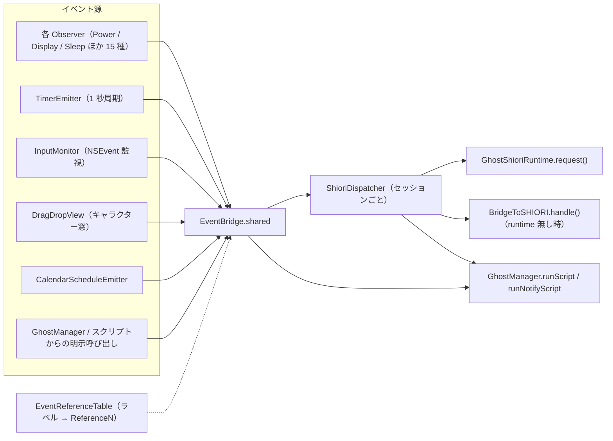
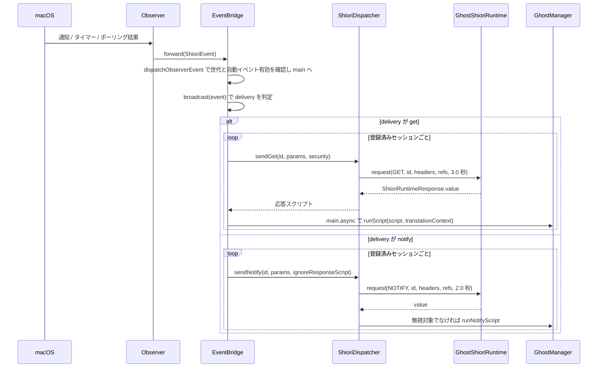

# 9 SHIORI イベント

関連ソースファイル

このページは次のファイルをもとに作成した。

- [Ourin/SHIORIEvents/EventBridge.swift](../../Ourin/SHIORIEvents/EventBridge.swift)
- [Ourin/SHIORIEvents/EventID.swift](../../Ourin/SHIORIEvents/EventID.swift)
- [Ourin/SHIORIEvents/EventReferenceSpec.swift](../../Ourin/SHIORIEvents/EventReferenceSpec.swift)
- [Ourin/SHIORIEvents/AppearanceObserver.swift](../../Ourin/SHIORIEvents/AppearanceObserver.swift)
- [Ourin/SHIORIEvents/DesktopWallpaperObserver.swift](../../Ourin/SHIORIEvents/DesktopWallpaperObserver.swift)
- [Ourin/SHIORIEvents/DeviceObserver.swift](../../Ourin/SHIORIEvents/DeviceObserver.swift)
- [Ourin/SHIORIEvents/DisplayObserver.swift](../../Ourin/SHIORIEvents/DisplayObserver.swift)
- [Ourin/SHIORIEvents/GamepadObserver.swift](../../Ourin/SHIORIEvents/GamepadObserver.swift)
- [Ourin/SHIORIEvents/LocaleObserver.swift](../../Ourin/SHIORIEvents/LocaleObserver.swift)
- [Ourin/SHIORIEvents/NetworkObserver.swift](../../Ourin/SHIORIEvents/NetworkObserver.swift)
- [Ourin/SHIORIEvents/OSUpdateObserver.swift](../../Ourin/SHIORIEvents/OSUpdateObserver.swift)
- [Ourin/SHIORIEvents/PowerObserver.swift](../../Ourin/SHIORIEvents/PowerObserver.swift)
- [Ourin/SHIORIEvents/RecycleBinObserver.swift](../../Ourin/SHIORIEvents/RecycleBinObserver.swift)
- [Ourin/SHIORIEvents/SessionObserver.swift](../../Ourin/SHIORIEvents/SessionObserver.swift)
- [Ourin/SHIORIEvents/SleepObserver.swift](../../Ourin/SHIORIEvents/SleepObserver.swift)
- [Ourin/SHIORIEvents/SpaceObserver.swift](../../Ourin/SHIORIEvents/SpaceObserver.swift)
- [Ourin/SHIORIEvents/SpeechObserver.swift](../../Ourin/SHIORIEvents/SpeechObserver.swift)
- [Ourin/SHIORIEvents/SystemLoadObserver.swift](../../Ourin/SHIORIEvents/SystemLoadObserver.swift)
- [Ourin/SHIORIEvents/TimerEmitter.swift](../../Ourin/SHIORIEvents/TimerEmitter.swift)
- [Ourin/SHIORIEvents/InputMonitor.swift](../../Ourin/SHIORIEvents/InputMonitor.swift)
- [Ourin/SHIORIEvents/DragDropView.swift](../../Ourin/SHIORIEvents/DragDropView.swift)
- [Ourin/SHIORIEvents/DragDropReceiver.swift](../../Ourin/SHIORIEvents/DragDropReceiver.swift)
- [Ourin/SHIORIEvents/HolidayInfo.swift](../../Ourin/SHIORIEvents/HolidayInfo.swift)
- [Ourin/SHIORIEvents/SystemNotificationData.swift](../../Ourin/SHIORIEvents/SystemNotificationData.swift)
- [Ourin/Resources/Holidays/](../../Ourin/Resources/Holidays/)
- [scripts/gen_holidays.py](../../scripts/gen_holidays.py)
- [Ourin/Ghost/GhostManager.swift](../../Ourin/Ghost/GhostManager.swift)（EventBridge の登録・起動・起動時 Notify）
- [Ourin/Ghost/GhostManager+Window.swift](../../Ourin/Ghost/GhostManager+Window.swift)（D&D ハンドラ）
- [Ourin/Ghost/GhostManager+System.swift](../../Ourin/Ghost/GhostManager+System.swift)（URL ドロップ）
- [Ourin/USL/ShioriRuntime.swift](../../Ourin/USL/ShioriRuntime.swift)（`GhostShioriRuntime`）
- [docs/SHIORI_EVENTS_3.0M_SPEC_ja-jp.md](../../docs/SHIORI_EVENTS_3.0M_SPEC_ja-jp.md)
- [docs/OURIN_SHIORI_EVENTS_3.0M_SPEC_ja-jp.md](../../docs/OURIN_SHIORI_EVENTS_3.0M_SPEC_ja-jp.md)
- [docs/OURIN_EXTENSIONS_ja-jp.md](../../docs/OURIN_EXTENSIONS_ja-jp.md)

このページは、Ourin が macOS の状態変化・ユーザー入力・ドラッグ＆ドロップなどを SHIORI イベント（`OnXxx`）に変換し、起動中ゴーストの SHIORI へ `GET` / `NOTIFY` で届け、返ってきたさくらスクリプトを再生へ渡すまでの層（`Ourin/SHIORIEvents/`）を扱う。中心は `EventBridge`（シングルトン）で、各 Observer・`TimerEmitter`・`InputMonitor`・D&D ビューはすべて `ShioriEvent` 値を作って `EventBridge` に渡す。

SHIORI モジュール本体（YAYA・里々などのランタイム）は [8 SHIORI 層](./08-shiori-runtime.md)、返ってきたスクリプトの実行は [7 さくらスクリプト](./07-sakura-script.md) と [4 GhostManager](./04-ghost-manager.md) が担う。外部から SSTP で届くイベントは [10 SSTP スタック](./10-sstp.md) を通り、最終的に同じ `EventBridge` の再生 API（`playTranslatedScriptOnGhostsResolving` など）を使う。

## 全体の構成

`EventBridge` はゴーストごとに `ShioriDispatcher` を 1 つ持つ「セッション」辞書を保持し、イベントを全セッションへ配る（ブロードキャスト）か、特定ゴーストだけへ送る。ゴーストは SHIORI のロードに成功した時点で `EventBridge.shared.register(runtime:ghostManager:)` により登録される。

**出典:** [Ourin/SHIORIEvents/EventBridge.swift:31-67](../../Ourin/SHIORIEvents/EventBridge.swift#L31-L67)、[Ourin/SHIORIEvents/EventBridge.swift:296-312](../../Ourin/SHIORIEvents/EventBridge.swift#L296-L312)、[Ourin/Ghost/GhostManager.swift:1754-1760](../../Ourin/Ghost/GhostManager.swift#L1754-L1760)

## EventBridge の配送フロー

### 起動・停止と自動イベント

`EventBridge.start(enableAutoEvents:)` は `enableAutoEvents == true` のときだけ 15 種の Observer、`TimerEmitter`、`InputMonitor`、`CalendarScheduleEmitter` を開始し、それまでに積まれていた NOTIFY キュー（`pendingNotifies`）を `flushPendingNotifies()` で吐き出す。`false` の場合は何も開始せず、`\![raise,...]` のようなスクリプト由来の明示イベントだけが流れる。

実ゴーストの SHIORI ロード完了後、`GhostManager` が `startEventBridgeIfNeeded(enableAutoEvents: !GhostManager.isRunningUnderTests)` を呼ぶ。テスト判定は環境変数 `XCTestConfigurationFilePath` / `XCTestBundlePath` の有無で、テスト中は自動イベントを止める。既に起動済みで自動イベントが必要な場合は `stop()` → `start(enableAutoEvents: true)` で張り直す。

`stop()` は全 Observer を止め、`observerGeneration` を進め、`pendingNotifies` と見切れ・重なりの直前状態を捨てる。`OnClose` は送らない（`GhostManager.beginCloseSequence` が GET で送るため、とコメントにある）。

**出典:** [Ourin/SHIORIEvents/EventBridge.swift:69-158](../../Ourin/SHIORIEvents/EventBridge.swift#L69-L158)、[Ourin/SHIORIEvents/EventBridge.swift:280-293](../../Ourin/SHIORIEvents/EventBridge.swift#L280-L293)、[Ourin/Ghost/GhostManager.swift:1772-1781](../../Ourin/Ghost/GhostManager.swift#L1772-L1781)、[Ourin/Ghost/GhostManager.swift:5347-5371](../../Ourin/Ghost/GhostManager.swift#L5347-L5371)

### Observer イベントの配送シーケンス

- Observer は Network / Speech / GameController など任意のキューから呼ぶため、`dispatchObserverEvent` が main queue へ直列化する。捕捉した世代番号が現在の `observerGeneration` と違う、または `started` / `autoEventsEnabled` が偽ならイベントを捨てる（stop→start をまたいだ古いイベントの誤配送防止）。
- 公開 API（`notify` / `request` / `notifyCustom` など）は `performOnMain`（main 上なら直接、それ以外は `DispatchQueue.main.sync`）で実行し、自動イベントの有効状態には依存しない。キュー（`pendingNotifies`）に積まれるのは `broadcastNotify` / `broadcastNotifyCustom` を通る経路だけである。
- `ShioriEvent.delivery` の既定は `.get`。UKADOC が `[NOTIFY]` と明記しないイベントは GET と定義されている、というのがコメントの根拠で、起動時だけ NOTIFY になるイベントは Observer 側で `.notify` と `ignoreResponseScript: true` を指定する。
- `OnLocaleChange` を配送したときは、続けて `OnNotifyInternationalInfo` を NOTIFY（応答無視）で再通知する。

**出典:** [Ourin/SHIORIEvents/EventBridge.swift:1078-1151](../../Ourin/SHIORIEvents/EventBridge.swift#L1078-L1151)、[Ourin/SHIORIEvents/EventBridge.swift:1417-1467](../../Ourin/SHIORIEvents/EventBridge.swift#L1417-L1467)、[Ourin/SHIORIEvents/EventBridge.swift:1552-1575](../../Ourin/SHIORIEvents/EventBridge.swift#L1552-L1575)、[Ourin/SHIORIEvents/EventBridge.swift:1621-1636](../../Ourin/SHIORIEvents/EventBridge.swift#L1621-L1636)

### GET / NOTIFY の振り分け規則

`broadcastNotifyImmediate` / `broadcastGetImmediate` は、イベント ID によって送信方法を変える。

| 対象 | 規則 | 定義 |
|---|---|---|
| 時刻系 `OnSecondChange` / `OnMinuteChange` / `OnHourTimeSignal` / `OnIdle` | セッションごとに `canPlayTalkNow()` を見て `Reference3` を `1`/`0` に上書きし、`Reference1`（見切れ `mikireScopes()`）・`Reference2`（重なり `kasanariScopes()`）も上書きする。会話可能なら GET して再生、不能なら NOTIFY（応答無視） | `timeSignalEvents` |
| `OnSecondChange` のあと | `dispatchOverlapTransitions` で `OnOffscreen` / `OnOverlap`（自ゴースト）と `OnOtherOffscreen` / `OnOtherOverlap`（全ゴースト横断）の状態遷移を検出し GET。Reference0=現在、Reference1=直前、区切りはバイト値 1。初回 tick はベースライン確立のみ | `dispatchOverlapTransitions` |
| マウス系 20 イベント | ゴーストが `\t`（タイムクリティカル）中ならそのセッションには送らない | `mouseEvents` |
| `OnMouseClick` / `OnMouseDoubleClick` / `OnMouseMultipleClick`（各 Ex 含む 6 種） | NOTIFY 経路で呼ばれても GET に切り替え、応答を再生 | `mouseTalkEvents` |
| `OnNotifySelfInfo` | 送信前に各ゴーストへ `saveCharacterNames` でさくら名・けろ名を保存 | `broadcastNotifyImmediate` |
| それ以外の NOTIFY | `sendNotify`。応答が空でなく、`ignoreResponseScript` が偽で、`EventReferenceTable.notifyReturnIgnoredIDs` に含まれないときだけ `runNotifyScript` で再生 | `ShioriDispatcher.sendNotify` |

**出典:** [Ourin/SHIORIEvents/EventBridge.swift:1165-1196](../../Ourin/SHIORIEvents/EventBridge.swift#L1165-L1196)、[Ourin/SHIORIEvents/EventBridge.swift:1203-1326](../../Ourin/SHIORIEvents/EventBridge.swift#L1203-L1326)、[Ourin/SHIORIEvents/EventBridge.swift:1331-1390](../../Ourin/SHIORIEvents/EventBridge.swift#L1331-L1390)

### SHIORI リクエストと Reference の組み立て

`ShioriDispatcher` はセッション 1 つにつき 1 個作られ、`GhostShioriRuntime`（YAYA などの実ランタイム）を保持する。

- ヘッダは `ShioriSecurityContext.shioriHeaders()` が作る `Charset: UTF-8` / `Sender: Ourin` / `SecurityLevel`（`local` か `external`）と、あれば `SecurityOrigin`。内部システムイベントの既定は `.local`、外部由来は `.external(origin:)`。
- `params` の `ReferenceN` キーは `orderedRefs` で数値順の配列に並べ替え、欠番は空文字で埋める。`modifiers` のような `Reference` 以外のキーは位置引数に混ぜない。
- ランタイムが無い場合は `BridgeToSHIORI.handle(event:references:headers:)` へフォールバックする（[10 SSTP スタック](./10-sstp.md) の SHIORI ブリッジ）。
- タイムアウトは NOTIFY 2.0 秒、GET 3.0 秒。`fetchDictionaryEntry`（辞書エントリ直接取得）は GET 2.0 秒。
- `buildRequest` が組むワイヤ文字列（`GET SHIORI/3.0` + `ID:` + Reference 数値順 + その他キー順）はデバッグログ出力にだけ使われ、実際の送信は `runtime.request(method:id:headers:refs:timeout:)` に構造化して渡す。

返ってきたスクリプトは `ScriptTranslationContext(eventID:references:)` を付けて `GhostManager.runScript`（GET）または `runNotifyScript`（NOTIFY）へ `DispatchQueue.main.async` で渡す。

**出典:** [Ourin/SHIORIEvents/EventBridge.swift:6-29](../../Ourin/SHIORIEvents/EventBridge.swift#L6-L29)、[Ourin/SHIORIEvents/EventBridge.swift:1469-1550](../../Ourin/SHIORIEvents/EventBridge.swift#L1469-L1550)、[Ourin/SHIORIEvents/EventBridge.swift:1174-1185](../../Ourin/SHIORIEvents/EventBridge.swift#L1174-L1185)、[Ourin/USL/ShioriRuntime.swift:106](../../Ourin/USL/ShioriRuntime.swift#L106)

### EventBridge の主な公開 API

| API | 方式 | 宛先 | 用途 |
|---|---|---|---|
| `notify(_:params:security:)` / `notify(_:refs:security:)` | NOTIFY | 全セッション | 内部イベント（起動時 Notify など）。`refs:` 版は意味ラベル辞書を受ける |
| `notify(_:params:to:)` / `notify(_:refs:to:)` | NOTIFY | 指定ゴースト | |
| `request(_:params:security:)` | GET | 全セッション | `\![raise,...]` 用。応答を再生 |
| `request(_:params:to:)` / `requestScript(...)` | GET | 指定ゴースト | 応答本文を後続イベントへ渡す用途（`playResponse: false` 可） |
| `request(_:params:excluding:)` | GET | 指定以外 | `OnOtherGhostBooted` など |
| `notifyCustom` / `requestCustom` | NOTIFY / GET | 全 / 指定 / 指定以外 / URL 指定 | `EventID` に無い名前（`ownerghostname` など） |
| `notifyOtherSurfaceChange(from:...)` | GET | `observesOtherSurfaceChange` が真の他ゴースト | `OnOtherSurfaceChange`。PLUGIN にも転送 |
| `dispatch(_ event:)` | event 指定 | 全セッション | D&D など EventBridge 外で作られたイベント |
| `playScriptOnGhosts` / `playScriptOnGhostsResolving` / `playTranslatedScriptOnGhostsResolving` | なし（直接再生） | 名前一致 or 全セッション | SSTP の `Script` / `IfGhost` 振り分け |
| `dispatchPluginResponseEvent` / `runPluginResponseScript` | GET / NOTIFY | PLUGIN の Target 解決結果 | [12 PLUGIN](./12-plugin.md) |
| `isAnyGhostPlaying()` / `runningGhostNames()` / `runningGhost(named:)` | 照会 | | SSTP nobreak 判定、インストール先解決 |

`playTranslatedScriptOnGhostsResolving` は、`ReceiverGhostName` が無いとき AppDelegate の起動順で並べ、ゴーストごとに 1 回だけ `translateForDisplay` した結果を再生し、先頭（プライマリ）の翻訳結果を SSTP 応答値として返す。名前照合は `descript.txt` の `name`、`sakuraName`、ゴーストディレクトリ名のいずれか（小文字比較）。

**出典:** [Ourin/SHIORIEvents/EventBridge.swift:329-578](../../Ourin/SHIORIEvents/EventBridge.swift#L329-L578)、[Ourin/SHIORIEvents/EventBridge.swift:587-677](../../Ourin/SHIORIEvents/EventBridge.swift#L587-L677)、[Ourin/SHIORIEvents/EventBridge.swift:885-925](../../Ourin/SHIORIEvents/EventBridge.swift#L885-L925)

## EventID

`EventID` は `String` の `rawValue` を持つ `public enum EventID: String, CaseIterable` で、**490 件**の case を持つ。先頭のコメントは「docs から生成」とあり、1 行目から 451 行目までの 447 件はほぼアルファベット順、453 行目のコメント以降の 43 件は「`EventReferenceTable` に定義済みの Ourin 拡張／補助イベント」である。`rawValue` にはドットを含むもの（`OnHeadlinesense.OnFind`、`OnUpdate.OnDownloadBegin` など）もある。

`EventID` 自体にカテゴリ情報は無い。下表は、各 case を `EventReferenceTable` の `category` で数えたもの（spec がある 325 件）と、spec の無い 165 件を接頭辞で分けたものである。

| 区分 | 件数 | 例 |
|---|---:|---|
| system | 72 | `OnBatteryNotify`、`OnDisplayChange`、`OnSessionLock`、`OnSysSuspend`、`OnNotifySelfInfo`、`OnShioriLoaded` |
| network | 49 | `OnBIFFComplete`、`OnExecuteHTTPComplete`、`OnExecuteWebSocketOpen`、`OnSNTPCompare`、`OnNetworkStatusChange` |
| update | 48 | `OnInstallComplete`、`OnUpdateReady`、`OnUpdate.OnDownloadBegin`、`OnNarCreated`、`OnExtractArchiveComplete` |
| ui | 30 | `OnChoiceSelect`、`OnAnchorSelect`、`OnBalloonClose`、`OnSelectModeBegin`、`OnTrayBalloonClick` |
| mouse | 20 | `OnMouseClick` ～ `OnMouseGesture` |
| dragdrop | 19 | `OnFileDrop`、`OnFileDrop2`、`OnURLDrop`、`OnURLQuery`、`OnDragEnter` |
| shell | 17 | `OnSurfaceChange`、`OnShellChanged`、`OnOverlap`、`OnOtherSurfaceChange` |
| ghost | 13 | `OnGhostChanged`、`OnGhostCalled`、`OnOtherGhostBooted`、`OnNameChanged` |
| lifecycle | 12 | `OnBoot`、`OnFirstBoot`、`OnClose`、`OnVanished` |
| calendar | 11 | `OnSchedule5MinutesToGo`、`OnSchedulesenseComplete` |
| media | 8 | `OnMusicPlay`、`OnSoundStop`、`OnVideoPlayEx` |
| input | 5 | `OnGamepadConnected` ほか |
| time / communication / sstp / key / file / saori / talk / sound / general | 4 / 4 / 3 / 3 / 2 / 2 / 1 / 1 / 1 | `OnSecondChange`、`OnRaisePluginFailure`、`OnSSTPBreak`、`OnKeyDown`、`OnExecuteFileWatchChange`、`OnInternalSaoriComplete`、`OnAITalk`、`OnSoundSpectrum`、`OnXUkagakaLinkOpen` |
| spec 無し: `OnElonaOmakeMMAEvent*` | 60 | 外部ゲーム連携の語彙 |
| spec 無し: `OnElin*` | 9 | 同上 |
| spec 無し: 入力ボックス・ダイアログ | 11 | `OnTeach*`、`OnUserInput*`、`OnTextAreaInput*`、`OnSystemDialog*`、`OnCommunicateInputCancel`、`OnConfigurationDialogHelp` |
| spec 無し: `OnApplication*` | 6 | `OnApplicationBoot` ほか |
| spec 無し: `OnGet*` / `OnRequestValues` | 7 | `OnGetWord` ほか |
| spec 無し: その他 | 72 | `OnCacheSuspend`、`OnTabletMode`、`OnTranslate`、`OnSatolist*`、`OnKinoko*`、`OnNekodorif*` など |

`EventID` に無い名前（`OnClaudeCode` のような任意イベントや `ownerghostname` などの小文字 ID）は `notifyCustom` / `requestCustom` で文字列のまま送る。

**出典:** [Ourin/SHIORIEvents/EventID.swift:1-12](../../Ourin/SHIORIEvents/EventID.swift#L1-L12)、[Ourin/SHIORIEvents/EventID.swift:445-498](../../Ourin/SHIORIEvents/EventID.swift#L445-L498)、[Ourin/SHIORIEvents/EventReferenceSpec.swift:54-120](../../Ourin/SHIORIEvents/EventReferenceSpec.swift#L54-L120)

## EventReferenceSpec と EventReferenceTable

`EventReferenceSpec` はイベント 1 つ分の Reference 仕様で、`EventReferenceTable.allSpecs` に **348 件**が定義されている（うち 23 件は `basewareversion` などの小文字 ID で `EventID` には無い）。

| フィールド / API | 内容 |
|---|---|
| `id` | イベント ID（`OnBoot`、`basewareversion` など） |
| `references` | `Reference0`, `Reference1`, ... に対応する意味ラベル（`shellName`、`x`、`y` など）。空配列は「Reference 無し／未定義」 |
| `notifyReturnIgnored` | UKADOC「Notify イベント（戻り値無視）」か。真は 33 件（小文字 ID 23 件、`OnNotify*` 9 件、`OnLanguageChange`） |
| `category` | 分類文字列。21 種（system 95、network 49、update 48、ui 30、mouse 20、dragdrop 19、shell 17、ghost 13、lifecycle 12、calendar 11、media 8、input 5、time 4、communication 4、key 3、sstp 3、file 2、saori 2、talk / sound / general 各 1） |
| `EventReferenceTable.specs` | `id` → spec の辞書 |
| `EventReferenceTable.notifyReturnIgnoredIDs` | `ShioriDispatcher.notifyReturnIgnored` の単一ソース |
| `params(forEvent:refs:)` | 意味ラベル辞書を `ReferenceN` 辞書へ変換。添字は `references` 内の位置（`firstIndex`）。`ReferenceN` 形式のキーはそのまま通す。未知ラベルは DEBUG で `assertionFailure`、リリースでは生ヘッダとして残す |
| `label(forEvent:index:)` | 添字からラベルを引く（DevTools 用） |
| `duplicateLabelEvents` | ラベル重複のあるイベント一覧（逆写像の一意性をテストで検査） |

代表的な定義:

| イベント | Reference0.. のラベル |
|---|---|
| `OnBoot` | `shellName`, `unused1`..`unused5`, `haltReason`, `previousGhostName` |
| `OnSecondChange` など時刻系 | `uptimeHours`, `mikire`, `kasanari`, `canTalk`, `idleSecondsSSP` |
| `OnMouseClick` | `x`, `y`, `wheelDelta`, `scopeID`, `collisionID`, `button`, `deviceType` |
| `OnCommunicate` | `sender`, `sentence` |
| `OnSSTPBreak` | `script`, `scope`, `breakPosition` |
| `OnNotifyOSInfo` | `osInfo`, `cpuInfo`, `memoryInfo`, `uptimeMinutes` |
| `OnBatteryNotify` ほか Battery 系 | `percent`, `remainingMinutes`, `powerState`, `status` |

Observer や `InputMonitor` は `ShioriEvent(id:refs:)` または `EventBridge.notify(_:refs:)` で意味ラベルを渡し、ReferenceN への変換はこの表に集約されている。

**出典:** [Ourin/SHIORIEvents/EventReferenceSpec.swift:3-52](../../Ourin/SHIORIEvents/EventReferenceSpec.swift#L3-L52)、[Ourin/SHIORIEvents/EventReferenceSpec.swift:97-120](../../Ourin/SHIORIEvents/EventReferenceSpec.swift#L97-L120)、[Ourin/SHIORIEvents/EventReferenceSpec.swift:297-345](../../Ourin/SHIORIEvents/EventReferenceSpec.swift#L297-L345)、[Ourin/SHIORIEvents/EventReferenceSpec.swift:468-577](../../Ourin/SHIORIEvents/EventReferenceSpec.swift#L468-L577)

## Observer 一覧

すべて `static let shared` のシングルトンで、`start(_ handler:)` / `stop()` を持つ。表の「配送」は `ShioriEvent.delivery`。「初回 NOTIFY」は `start` 直後の初期状態通知を NOTIFY（応答無視）で送り、以後の変化を GET で送るもの。

| Observer | 購読する macOS API / 通知 | 発火イベント | 配送 |
|---|---|---|---|
| `AppearanceObserver` | `NotificationCenter.default` の `AppleInterfaceThemeChangedNotification`、`NSApp.effectiveAppearance`、`UserDefaults` の `AppleInterfaceStyle` | `OnAppearanceChanged`（R0=`light`/`dark`）、`OnDarkTheme`（R0=アプリ、R1=システム、`1`/`0`） | `OnDarkTheme` は初回 NOTIFY |
| `DesktopWallpaperObserver` | `NSWorkspace.activeSpaceDidChangeNotification`、`NSApplication.didChangeScreenParametersNotification`、3 秒周期 `Timer` で `desktopImageURL(for:)` / `desktopImageOptions(for:)` | `OnDesktopWallpaperChange`（R0=`init`/`update`、R1=`self`/`unknown`、R2/R3=現在/直前、R4=スタイル、R5=色、R6～=画面別） | 初回 NOTIFY |
| `DeviceObserver` | `NSWorkspace.didMountNotification` / `NSWorkspace.didUnmountNotification` | `OnDeviceArrival` / `OnDeviceRemove`（R0=ボリュームパス） | GET |
| `DisplayObserver` | `NSApplication.didChangeScreenParametersNotification`、`CGMainDisplayID`、`CGDisplayPixelsWide/High`、`NSScreen.screens` | `OnDisplayChange`（R0=bpp、R1=幅、R2=高さ）、`OnDisplayChangeEx`（R0=`init`/`update`、R1～=`minX,minY,maxX,maxY,bpp,主画面か`） | 初回 NOTIFY |
| `GamepadObserver` | GameController の `GCControllerDidConnect` / `GCControllerDidDisconnect`、`startWirelessControllerDiscovery`、各ボタン・スティックのハンドラ | `OnGamepadConnected` / `OnGamepadDisconnected` / `OnGamepadButtonDown` / `OnGamepadButtonUp` / `OnGamepadAxisMove` | GET |
| `LocaleObserver` | `NSLocale.currentLocaleDidChangeNotification` | `OnLocaleChange`、`OnLanguageChange`（＋EventBridge が `OnNotifyInternationalInfo` を再送） | GET |
| `NetworkObserver` | Network.framework `NWPathMonitor`（global queue） | `OnNetworkStatusChange`（R0=`online`/`offline`）、`OnNetworkOnline` / `OnNetworkOffline`、`OnNetworkHeavy`（`isExpensive` が真になったとき） | 状態系は初回 NOTIFY |
| `OSUpdateObserver` | `/usr/sbin/softwareupdate --history` と `--list` を 300 秒ごとに実行（utility queue） | `OnOSUpdateInfo`（R0=確認日時、R1=実行日時、R2～=履歴） | 初回 NOTIFY、履歴変化時のみ GET |
| `PowerObserver` | IOKit `IOPSNotificationCreateRunLoopSource` / `IOPSCopyPowerSourcesInfo`、`NSProcessInfoPowerStateDidChangeNotification`、`ProcessInfo.thermalStateDidChangeNotification` | `OnPowerSourceChanged`、`OnBatteryNotify`、`OnBatteryLow`（33% 以下へ遷移）、`OnBatteryCritical`（5% 以下へ遷移）、`OnBatteryChargingStart` / `OnBatteryChargingStop`、`OnThermalStateChanged`（R0=`nominal`/`fair`/`serious`/`critical`） | 電源・Notify は初回 NOTIFY |
| `RecycleBinObserver` | `~/.Trash` と各ボリュームの `.Trashes/<uid>` を `DispatchSource.makeFileSystemObjectSource`（`O_EVTONLY`）で監視、マウント通知で張り直し | `OnRecycleBinStatusUpdate`（R0=件数、R1=サイズ、R2/R3=差分、R4=常に `1`） | 初回 NOTIFY |
| `SessionObserver` | `DistributedNotificationCenter` の `com.apple.screenIsLocked` / `com.apple.screenIsUnlocked`、`NSWorkspace` の `didActivateApplicationNotification` / `activeSpaceDidChangeNotification`（`CGWindowListCopyWindowInfo` で全画面判定）、`sessionDidResignActiveNotification` / `sessionDidBecomeActiveNotification` | `OnSessionLock`+`OnScreenLock`、`OnSessionUnlock`+`OnScreenUnlock`、`OnFullScreenAppMinimize` / `OnFullScreenAppRestore`（R0=`fullscreen`）、`OnSessionDisconnect` / `OnSessionReconnect` | GET |
| `SleepObserver` | `NSWorkspace.willSleepNotification` / `didWakeNotification` / `screensDidSleepNotification` / `screensDidWakeNotification`、`DistributedNotificationCenter` の `com.apple.screensaver.didstart` / `com.apple.screensaver.didstop` | `OnSysSuspend`（NOTIFY）+`OnSleep`、`OnSysResume`（R0=`normal`）+`OnWake`、`OnDisplayPowerStatus`（R0=`0`/`1`）、`OnScreenSaverStart`（NOTIFY）/ `OnScreenSaverEnd`（R0..2=名前・パス・タイムアウト秒） | 表記のもの以外 GET |
| `SpaceObserver` | `NSWorkspace.activeSpaceDidChangeNotification` | `OnSpaceChanged`、`OnVirtualDesktopChanged` | GET |
| `SpeechObserver` | 0.5 秒周期 `Timer`、`NSSpeechSynthesizer.isAnyApplicationSpeaking`、`SFSpeechRecognizer.authorizationStatus()`、許可済みなら `AVAudioEngine` + `SFSpeechAudioBufferRecognitionRequest` | `OnSpeechSynthesisStatus`、`OnVoiceRecognitionStatus`（R1=`available`/`denied`/`not_determined` など）、`OnVoiceRecognitionWord`（R0=スコープ、R1=認識語） | GET |
| `SystemLoadObserver` | 5 秒周期 `DispatchSourceTimer`、`SystemPropertyProvider` の `cpu.load` / `memory.load` | `OnCPULoadHigh` / `OnCPULoadLow`、`OnMemoryLoadHigh` / `OnMemoryLoadLow`（80% 超かどうかの遷移時のみ） | GET |

**出典:** [Ourin/SHIORIEvents/AppearanceObserver.swift:12-51](../../Ourin/SHIORIEvents/AppearanceObserver.swift#L12-L51)、[Ourin/SHIORIEvents/DesktopWallpaperObserver.swift:12-103](../../Ourin/SHIORIEvents/DesktopWallpaperObserver.swift#L12-L103)、[Ourin/SHIORIEvents/DeviceObserver.swift:12-36](../../Ourin/SHIORIEvents/DeviceObserver.swift#L12-L36)、[Ourin/SHIORIEvents/DisplayObserver.swift:49-108](../../Ourin/SHIORIEvents/DisplayObserver.swift#L49-L108)、[Ourin/SHIORIEvents/GamepadObserver.swift:11-122](../../Ourin/SHIORIEvents/GamepadObserver.swift#L11-L122)、[Ourin/SHIORIEvents/LocaleObserver.swift:20-26](../../Ourin/SHIORIEvents/LocaleObserver.swift#L20-L26)、[Ourin/SHIORIEvents/NetworkObserver.swift:16-52](../../Ourin/SHIORIEvents/NetworkObserver.swift#L16-L52)、[Ourin/SHIORIEvents/OSUpdateObserver.swift:40-155](../../Ourin/SHIORIEvents/OSUpdateObserver.swift#L40-L155)、[Ourin/SHIORIEvents/PowerObserver.swift:18-51](../../Ourin/SHIORIEvents/PowerObserver.swift#L18-L51)、[Ourin/SHIORIEvents/PowerObserver.swift:126-157](../../Ourin/SHIORIEvents/PowerObserver.swift#L126-L157)、[Ourin/SHIORIEvents/PowerObserver.swift:201-265](../../Ourin/SHIORIEvents/PowerObserver.swift#L201-L265)、[Ourin/SHIORIEvents/RecycleBinObserver.swift:26-49](../../Ourin/SHIORIEvents/RecycleBinObserver.swift#L26-L49)、[Ourin/SHIORIEvents/RecycleBinObserver.swift:172-218](../../Ourin/SHIORIEvents/RecycleBinObserver.swift#L172-L218)、[Ourin/SHIORIEvents/SessionObserver.swift:104-136](../../Ourin/SHIORIEvents/SessionObserver.swift#L104-L136)、[Ourin/SHIORIEvents/SleepObserver.swift:130-208](../../Ourin/SHIORIEvents/SleepObserver.swift#L130-L208)、[Ourin/SHIORIEvents/SpaceObserver.swift:12-17](../../Ourin/SHIORIEvents/SpaceObserver.swift#L12-L17)、[Ourin/SHIORIEvents/SpeechObserver.swift:34-83](../../Ourin/SHIORIEvents/SpeechObserver.swift#L34-L83)、[Ourin/SHIORIEvents/SpeechObserver.swift:143-185](../../Ourin/SHIORIEvents/SpeechObserver.swift#L143-L185)、[Ourin/SHIORIEvents/SystemLoadObserver.swift:15-49](../../Ourin/SHIORIEvents/SystemLoadObserver.swift#L15-L49)

### Observer の補足

- **権限要求をしない設計**: `SpeechObserver` は自動イベントのポーリング中に `SFSpeechRecognizer.requestAuthorization` を呼ばない。usage description の無いプロセスを TCC が SIGABRT で終了させるため、とコメントにある。権限要求は設定画面などから `requestSpeechAuthorization()` を明示的に呼んだときだけ行う。未許可の間は認識器も生成しない。
- **全画面判定**: `SessionObserver` は `CGWindowListCopyWindowInfo` が取れない（権限不足など）場合 `.unavailable` として状態を変えず、「全画面解除」と誤認しない。
- **壁紙の self 判定**: macOS では利用者の変更とスライドショー等を区別できないため、`\![set,wallpaper]` 直後 10 秒以内に検知した変化だけ `self`、それ以外は `unknown` とする（`noteSelfChange`）。
- **OS 更新**: 確認日時は `--list` が成功した時刻で、`UserDefaults` キー `OurinOSUpdateLastCheckDate` に保存する。
- **画面情報の共有**: `DisplayObserver.snapshot(for:)` の書式は `OnDisplayHandover` でも使われる（発火側は GhostManager。[5 サーフェス](./05-surface-shell-animation.md) 参照）。

**出典:** [Ourin/SHIORIEvents/SpeechObserver.swift:75-117](../../Ourin/SHIORIEvents/SpeechObserver.swift#L75-L117)、[Ourin/SHIORIEvents/SessionObserver.swift:159-170](../../Ourin/SHIORIEvents/SessionObserver.swift#L159-L170)、[Ourin/SHIORIEvents/DesktopWallpaperObserver.swift:17-75](../../Ourin/SHIORIEvents/DesktopWallpaperObserver.swift#L17-L75)、[Ourin/SHIORIEvents/OSUpdateObserver.swift:109-127](../../Ourin/SHIORIEvents/OSUpdateObserver.swift#L109-L127)、[Ourin/SHIORIEvents/DisplayObserver.swift:6-46](../../Ourin/SHIORIEvents/DisplayObserver.swift#L6-L46)

## TimerEmitter（時刻系イベント）

`TimerEmitter.start` は 1 秒周期の `DispatchSourceTimer`（既定キュー）を作り、`tick(now:)` を呼ぶ。

| イベント | 発火条件 |
|---|---|
| `OnIdle` | 毎秒（`OnSecondChange` の直前） |
| `OnSecondChange` | 毎秒 |
| `OnMinuteChange` | 分が前回 tick と変わったとき |
| `OnHourTimeSignal` | 時が前回 tick と変わったとき |

4 イベントとも `timeEventReferences()` の同じ Reference を持つ: R0=`uptimeHours`（`ProcessInfo.systemUptime` の時間）、R1/R2=見切れ・重なり（空。EventBridge がセッションごとに上書き）、R3=トーク可否（EventBridge が設定）、R4=`idleSecondsSSP`（`CGEventSource.secondsSinceLastEventType(.combinedSessionState, ...)` によるシステム全体の放置秒数）。

`lastMinute` / `lastHour` は `start` 時点で `nil` のため、開始後最初の tick で `OnMinuteChange` と `OnHourTimeSignal` が 1 回ずつ発火する。`handler` が `nil`（停止中）の tick は分・時の追跡も更新しない。`isTesting` を切り替える通知購読はコメントアウトされている。

**出典:** [Ourin/SHIORIEvents/TimerEmitter.swift:7-110](../../Ourin/SHIORIEvents/TimerEmitter.swift#L7-L110)

## InputMonitor（入力監視）

`InputMonitor.start(handler:)` は 2 つの `NSEvent` モニタを張る。

| モニタ | 対象イベント | 範囲 |
|---|---|---|
| `addLocalMonitorForEvents` | `keyDown` / `keyUp` / `flagsChanged`、左右・その他ボタンの down/up、`mouseMoved`、各 dragged、`scrollWheel` | Ourin 自身のウィンドウに届くイベント |
| `addGlobalMonitorForEvents` | `mouseMoved`、`scrollWheel` のみ | 他アプリ上を含む全画面 |

- キー入力は local モニタだけなので、Ourin のウィンドウがキーを受けている間しかイベントにならない。コード中にアクセシビリティ／入力監視権限の確認・要求は無い（推測: グローバルなキー監視を避けているのはこの権限が必要になるためと考えられるが、コメントでの明言は無い）。
- クリック判定はウィンドウ識別子が `GhostCharacterWindow` / `GhostBalloonWindow` で始まる窓だけで行う。down→up の移動 5pt 未満・1 秒未満で `OnMouseClick`（Ex ボタンなら `OnMouseClickEx` も）、0.35 秒以内の連続で `OnMouseDoubleClick`、3 回以上で `OnMouseMultipleClick`（R7=回数）。右クリック up ではゴーストメニュー（`rightClickMenuHandler`）を呼び、右ドラッグ 20pt 以上で `OnMouseGesture`（方向）を出す。
- クリック配送の前に `ghostClickHandler`（EventBridge が設定）を呼び、消滅選択中などで `true` が返ればクリックを消費する。
- ゴースト窓への出入りで `OnMouseEnter` / `OnMouseEnterAll` / `OnMouseLeave` / `OnMouseLeaveAll`、0.8 秒静止で `OnMouseHover`、ドラッグ開始・終了で `OnMouseDragStart` / `OnMouseDragEnd`。hover 時は SERIKO カーソル・ツールチップ（[5 サーフェス](./05-surface-shell-animation.md) の `SerikoCursorController` / `SerikoTooltipController`）を更新する。
- 座標は、ゴースト／バルーン窓内なら窓左上原点に反転した値、それ以外は `convertToScreen` によるスクリーン座標。キャラクター窓なら識別子末尾からスコープを取り、当たり判定名（R4）を求める。
- `\![enter,selectrect]` 用の選択モード中は `OnSelectModeMouseDown` / `OnSelectModeMouseUp` だけを出し、通常のクリック合成をしない。

**出典:** [Ourin/SHIORIEvents/InputMonitor.swift:5-160](../../Ourin/SHIORIEvents/InputMonitor.swift#L5-L160)、[Ourin/SHIORIEvents/InputMonitor.swift:199-290](../../Ourin/SHIORIEvents/InputMonitor.swift#L199-L290)、[Ourin/SHIORIEvents/InputMonitor.swift:292-455](../../Ourin/SHIORIEvents/InputMonitor.swift#L292-L455)、[Ourin/SHIORIEvents/InputMonitor.swift:557-598](../../Ourin/SHIORIEvents/InputMonitor.swift#L557-L598)、[Ourin/SHIORIEvents/EventBridge.swift:1054-1075](../../Ourin/SHIORIEvents/EventBridge.swift#L1054-L1075)

## ドラッグ＆ドロップ（DragDropView / DragDropReceiver）

現行実装は `DragDropView`（SwiftUI の `NSViewRepresentable`）と内部の `DragDropReceiverView` で、キャラクター窓ごとに `CharacterView` のオーバーレイとして置かれる。登録型は `.fileURL` / `.URL` / `.string` / `public.item` / `public.data`。

| 契機 | 発火イベント | Reference |
|---|---|---|
| `draggingEntered` | `OnDragEnter`（＋下段の dropping 系） | なし |
| `draggingEntered` / `draggingUpdated` | URL 項目ごとに `OnURLDragDropping`。ファイル URL があれば `OnFileDropping`、URL も文字列も無ければ `OnOtherObjectDropping` | `OnFileDropping`: R0=パス（複数はバイト値 1 区切り）、R1=スコープ。`OnURLDragDropping`: R0=URL、R1=スコープ。`OnOtherObjectDropping`: R0=スコープ、R1=名前、R2=独自 UTI |
| `draggingExited` | `OnDragLeave` | なし |
| ドロップ（`.nar` を含む） | イベントは出さず `AppDelegate.application(_:open:)` に渡す | — |
| ドロップ（ファイル） | `OnDragDrop`（旧互換: R0.. に file URL を列挙）、`OnFileDropped`、`OnFileDrop`、`OnFileDropEx`、`OnFileDrop2` | R0=パス、R1=スコープ、R2=MIME（`UTType.preferredMIMEType`、ディレクトリは `inode/directory`） |
| ドロップ（ディレクトリ） | `OnDirectoryDrop` | R0=パス、R1=スコープ |
| ドロップ（URL） | `OnURLDrop` | R0=URL、R1=スコープ |
| ドロップ（文字列） | `OnTextDrop` | R0=テキスト |
| ドロップ（その他の Pasteboard） | `OnOtherObjectDropped` | R0=スコープ、R1=名前、R2=独自 UTI |

キャラクター窓のハンドラ（`GhostManager.setupCharacterWindow`）は、`OnURLDrop` だけを `handleURLDropEvent` に回し、それ以外を `EventBridge.shared.dispatch(event)` で配送する。`dispatch` は全セッションへのブロードキャストなので、ファイルドロップ系のイベントはドロップ先以外の起動中ゴーストにも GET される。`handleURLDropEvent` は対象ゴーストだけへ `OnURLDrop` を GET し、応答が無いときに標準の URL ドロップ処理（`OnURLQuery` → ダウンロード → `OnURLDropped` / `OnURLDropFailure`、詳細は [15 NAR インストール](./15-nar-install.md)）へ進む。

`DragDropReceiver`（`NSView`）は `@available(*, deprecated)` の旧実装で、`NSHostingController` との階層問題があるとして `DragDropView` への移行を促す注記がある。

**出典:** [Ourin/SHIORIEvents/DragDropView.swift:7-157](../../Ourin/SHIORIEvents/DragDropView.swift#L7-L157)、[Ourin/SHIORIEvents/EventReferenceSpec.swift:175-194](../../Ourin/SHIORIEvents/EventReferenceSpec.swift#L175-L194)、[Ourin/SHIORIEvents/DragDropView.swift:159-276](../../Ourin/SHIORIEvents/DragDropView.swift#L159-L276)、[Ourin/SHIORIEvents/DragDropReceiver.swift:1-37](../../Ourin/SHIORIEvents/DragDropReceiver.swift#L1-L37)、[Ourin/Ghost/GhostManager+Window.swift:83-104](../../Ourin/Ghost/GhostManager+Window.swift#L83-L104)、[Ourin/Ghost/GhostManager+System.swift:5168-5198](../../Ourin/Ghost/GhostManager+System.swift#L5168-L5198)

## HolidayInfo と祝日データ

`OnNotifyHolidayInfo`（R0=祝日名、R1=`YYYY,MM,DD`、R2=国コード）は、起動時 Notify の中で `OnNotifyUserInfo` の直後に、今日が祝日の場合だけ送られる（`GhostManager.sendHolidayInfoNotify`）。

`HolidayInfoProvider.today()` の探索順:

1. 候補ファイル名: `holidays-<地域コード>`（`Locale.current.regionCode` を大文字化）→ 既定の `holidays`。国別の表が見つかった時点で、その表に今日が無ければ `nil` を返し、既定表へは進まない。
2. 各ファイルの場所: ユーザーの `calendar/<言語>/` → `calendar/` → バンドルの `<言語>.lproj` → バンドルの `Holidays/` → バンドル直下（同梱時はフォルダの中身が Resources 直下に置かれる、とコメントにある）。言語は `Bundle.main.preferredLocalizations.first`。読み込みは UTF-8。

表の形式は `年/月/日,名称` の行で、`#` で始まる行と日付で始まらない行は無視する（`HolidayTable`）。

| データ | 件数 | 内容 |
|---|---:|---|
| `Ourin/Resources/Holidays/holidays-XX.txt` | 248 | 各国の既定言語での祝日名。2020〜2050 年、python-holidays 0.107 由来 |
| `Ourin/Resources/Holidays/holidays-JP.txt` | （上の内数） | 1955 年からの内閣府「国民の祝日について」を元に、「休日」を振替休日／国民の休日に分け、2028〜2050 年を python-holidays の日本語名で補ったもの |
| `Ourin/en.lproj/holidays-XX.txt` | 165 | 既定言語が英語でない国（と JP）の英語名 |
| 既定の `holidays.txt` | 0 | 同梱されていない |

これらは `scripts/gen_holidays.py` が生成する。`holidays==0.107` を入れた venv で実行し、`list_supported_countries()` の 2 文字コード（JP 以外）について既定言語の表を `Resources/Holidays/` へ、英語の表を `en.lproj/` へ書く。JP は既存ファイルの内閣府データを読み直して加工する。ライセンス表記は `Ourin/Resources/Licenses/Holidays_JP.txt` と `Holidays_python-holidays.txt`。

**出典:** [Ourin/SHIORIEvents/HolidayInfo.swift:3-120](../../Ourin/SHIORIEvents/HolidayInfo.swift#L3-L120)、[scripts/gen_holidays.py:1-36](../../scripts/gen_holidays.py#L1-L36)、[scripts/gen_holidays.py:67-142](../../scripts/gen_holidays.py#L67-L142)、[Ourin/Resources/Holidays/holidays-JP.txt:1-6](../../Ourin/Resources/Holidays/holidays-JP.txt#L1-L6)、[Ourin/Ghost/GhostManager.swift:5460-5477](../../Ourin/Ghost/GhostManager.swift#L5460-L5477)

## SystemNotificationData（起動時 Notify の実データ）

`SystemNotificationData` は OS の実データから Notify イベントの Reference を組み立てる。取得できない値は空欄のままにし、固定値で補わない方針がコメントに書かれている。

| メソッド / 型 | イベント | 値の出どころ |
|---|---|---|
| `currentUserInfo(addressName:)` → `SystemUserInfo` | `OnNotifyUserInfo` | 呼び名は設定値 → `NSFullUserName()` → `NSUserName()`。誕生日は空、性別は `undef` |
| `currentOSInfo()` → `SystemOSInfo` | `OnNotifyOSInfo` | R0=`macOS,バージョン,表示名`、R1=sysctl `machdep.cpu.brand_string` / `hw.cpufrequency` とコア数、R2=物理・仮想メモリ KB、R3=稼働分 |
| `fontParameters(currentFontNames())` | `OnNotifyFontInfo` | `NSFontManager.availableFontFamilies` を重複除去・並べ替えて R0.. に 1 件ずつ |
| `currentInternationalInfo()` → `SystemInternationalInfo` | `OnNotifyInternationalInfo` | R0=UTC オフセット分（UKADOC に合わせ東側が負）、R1=夏時間、R2=国、R3=言語 |
| `currentLanguageInfo(bundle:)` → `SystemLanguageInfo` | `OnLanguageChange` | 実際に選ばれた lproj の ID・その言語自身での名前・lproj のパス |

起動時は `GhostManager.sendInitializationNotifies` が `OnNotifyUserInfo` → `OnNotifyHolidayInfo` → `OnNotifyOSInfo` → `OnNotifyFontInfo` → `OnNotifyInternationalInfo` → `OnLanguageChange` → `ownerghostname` の順に NOTIFY する。

**出典:** [Ourin/SHIORIEvents/SystemNotificationData.swift:5-197](../../Ourin/SHIORIEvents/SystemNotificationData.swift#L5-L197)、[Ourin/Ghost/GhostManager.swift:5460-5486](../../Ourin/Ghost/GhostManager.swift#L5460-L5486)

## 制約と注意点

- **既存ドキュメントとの食い違い**（コード優先）:
  - 注意: `docs/OURIN_SHIORI_EVENTS_3.0M_SPEC_ja-jp.md` の「実装状況」は `OnSleep`/`OnResume`、`OnNetworkConnect`/`OnNetworkDisconnect`、`OnAppearanceChange`、`OnSendSSTP`/`OnNotifySSTP` を挙げるが、コード上の名前は `OnSysSuspend`/`OnSleep`/`OnSysResume`/`OnWake`、`OnNetworkStatusChange`/`OnNetworkOnline`/`OnNetworkOffline`、`OnAppearanceChanged`/`OnDarkTheme`、SSTP の既定イベントは `OnSend`/`OnNotify` である。同節の「未実装」（入力ボックス、BIFF、音声認識など）や「ShioriLoader 経由で YAYA へ送信」という流れも現行コード（`GhostShioriRuntime.request`）と合わない。
  - 注意: `docs/SHIORI_EVENTS_3.0M_SPEC_ja-jp.md` に載る `OnDpiChanged` 相当、`OnBatteryLevel` 系、`OnInputSourceChanged` は `EventID` に存在しない。`OnAppearanceChanged` の値は `light` / `dark` のみで `highcontrast` は出さない。座標は同文書の「左下原点」ではなく、ゴースト窓内では左上原点に変換している。
  - 注意: 上記 2 文書の Observer 一覧（OURIN 側は「実装済みのコンポーネント」節）に `DesktopWallpaperObserver` / `OSUpdateObserver` / `RecycleBinObserver` は載っていない（`SystemLoadObserver` は OURIN 側の一覧にある）が、`EventBridge.start` はこれらもすべて開始する。`docs/OURIN_EXTENSIONS_ja-jp.md` は SHIORI イベントには触れていない。
- **ブロードキャストの範囲**: Observer・`InputMonitor`・D&D（URL 以外）のイベントは全セッションへ配られる。`InputMonitor` の当たり判定名は `AppDelegate.resolve()?.ghostManager`（プライマリゴースト）で求めるため、追加ゴーストの窓でも主ゴーストの当たり判定表で R4 を求める（窓の識別子は `GhostCharacterWindow_<scope>` でゴーストを区別しないため。コードからの帰結で、実機では未確認）。
- **負荷**: グローバルモニタの `mouseMoved` も `OnMouseMove` として毎回全セッションへ GET（タイムアウト 3 秒）を main queue 上で同期送信する。
- **AppearanceObserver の購読先**: `AppleInterfaceThemeChangedNotification` を `NotificationCenter.default` に登録している。推測: この通知は通常 `DistributedNotificationCenter` で配信されるため、テーマ切替時の再通知が届かない可能性がある（未確認）。初回の状態通知は `start` 時に必ず送られる。
- **時刻系の初回発火**: `TimerEmitter` は開始直後に `OnMinuteChange` / `OnHourTimeSignal` を 1 回出す（上記）。
- **旧 D&D 実装**: `DragDropReceiver` は deprecated のまま残っている。
- [5 サーフェス](./05-surface-shell-animation.md) が扱う `SerikoCursorController` / `SerikoTooltipController` は同じ `SHIORIEvents/` にあるが本ページでは詳述しない。`CalendarScheduleEmitter`（`EventBridge` が保持）は [16 付帯機能](./16-auxiliary-features.md) を参照。

**出典:** [docs/OURIN_SHIORI_EVENTS_3.0M_SPEC_ja-jp.md:260-350](../../docs/OURIN_SHIORI_EVENTS_3.0M_SPEC_ja-jp.md#L260-L350)、[docs/SHIORI_EVENTS_3.0M_SPEC_ja-jp.md:39-113](../../docs/SHIORI_EVENTS_3.0M_SPEC_ja-jp.md#L39-L113)、[Ourin/SHIORIEvents/InputMonitor.swift:557-578](../../Ourin/SHIORIEvents/InputMonitor.swift#L557-L578)、[Ourin/SHIORIEvents/AppearanceObserver.swift:12-25](../../Ourin/SHIORIEvents/AppearanceObserver.swift#L12-L25)、[Ourin/SHIORIEvents/EventBridge.swift:98-121](../../Ourin/SHIORIEvents/EventBridge.swift#L98-L121)、[Ourin/SHIORIEvents/InputMonitor.swift:93-106](../../Ourin/SHIORIEvents/InputMonitor.swift#L93-L106)、[Ourin/SHIORIEvents/InputMonitor.swift:666-669](../../Ourin/SHIORIEvents/InputMonitor.swift#L666-L669)

## 関連ページ

- [4 GhostManager](./04-ghost-manager.md) — ゴーストの起動と EventBridge への登録、起動時 Notify の送出
- [5 サーフェス・シェル・SERIKO アニメーション](./05-surface-shell-animation.md) — 見切れ・重なり、`OnDisplayHandover`、SERIKO カーソル
- [7 さくらスクリプト](./07-sakura-script.md) — 応答スクリプトの再生、`\![raise]` / `\![notify]`
- [8 SHIORI 層（USL）](./08-shiori-runtime.md) — `GhostShioriRuntime` とランタイム実装
- [10 SSTP スタック](./10-sstp.md) — 外部から届くイベントと `BridgeToSHIORI`
- [12 PLUGIN](./12-plugin.md) — PLUGIN からのイベント応答の橋渡し
- [15 NAR インストールとパッケージ管理](./15-nar-install.md) — URL ドロップと NAR インストールのイベント
- [16 付帯機能](./16-auxiliary-features.md) — カレンダー・ヘッドライン・ネットワーク系イベントの発火元
