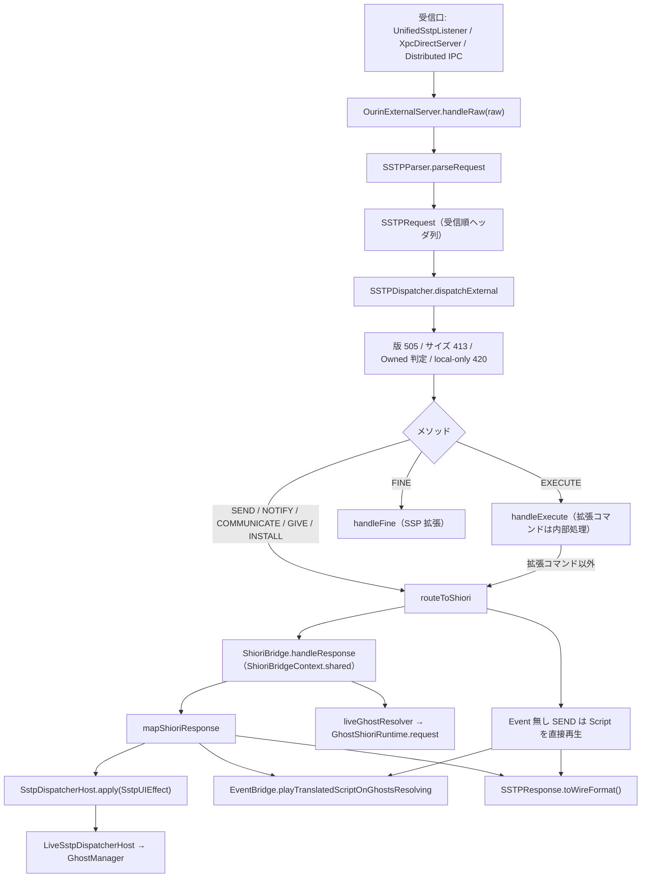
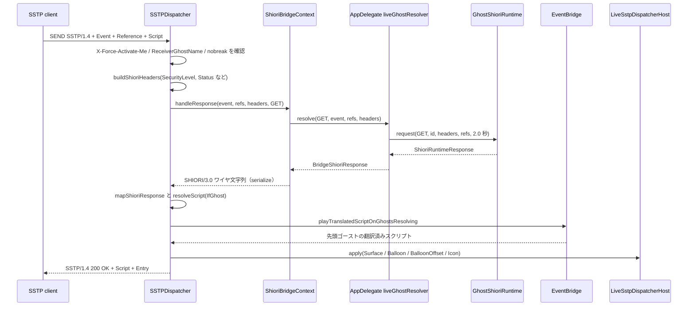
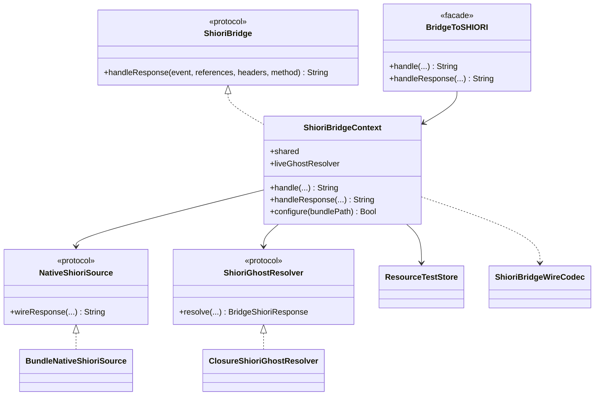

# 10 SSTP スタック

関連ソースファイル

このページは次のファイルをもとに作成した。

- [Ourin/SSTP/SSTPParser.swift](../../Ourin/SSTP/SSTPParser.swift)
- [Ourin/SSTP/SSTPRequest.swift](../../Ourin/SSTP/SSTPRequest.swift)
- [Ourin/SSTP/SSTPResponse.swift](../../Ourin/SSTP/SSTPResponse.swift)
- [Ourin/SSTP/SSTPDispatcher.swift](../../Ourin/SSTP/SSTPDispatcher.swift)
- [Ourin/SSTP/SstpDispatcherHost.swift](../../Ourin/SSTP/SstpDispatcherHost.swift)
- [Ourin/SSTP/LiveSstpDispatcherHost.swift](../../Ourin/SSTP/LiveSstpDispatcherHost.swift)
- [Ourin/SSTP/SstpRoutingRegistry.swift](../../Ourin/SSTP/SstpRoutingRegistry.swift)
- [Ourin/SSTP/GhostRegistry.swift](../../Ourin/SSTP/GhostRegistry.swift)
- [Ourin/SSTP/SSTPOwnershipRegistry.swift](../../Ourin/SSTP/SSTPOwnershipRegistry.swift)
- [Ourin/SSTP/SstpSessionStore.swift](../../Ourin/SSTP/SstpSessionStore.swift)
- [Ourin/SSTP/SSTPBreakQueue.swift](../../Ourin/SSTP/SSTPBreakQueue.swift)
- [Ourin/SSTP/SstpBreakPolicy.swift](../../Ourin/SSTP/SstpBreakPolicy.swift)
- [Ourin/SSTP/SstpUIEffect.swift](../../Ourin/SSTP/SstpUIEffect.swift)
- [Ourin/SSTP/ShioriBridgeContext.swift](../../Ourin/SSTP/ShioriBridgeContext.swift)
- [Ourin/SSTP/ShioriBridgeWireCodec.swift](../../Ourin/SSTP/ShioriBridgeWireCodec.swift)
- [Ourin/SSTP/BridgeToSHIORI.swift](../../Ourin/SSTP/BridgeToSHIORI.swift)
- [Ourin/SSTP/EncodingAdapter.swift](../../Ourin/SSTP/EncodingAdapter.swift)
- [Ourin/SSTP/HTTPBridge.swift](../../Ourin/SSTP/HTTPBridge.swift)
- [Ourin/SSTP/SSTPListener.swift](../../Ourin/SSTP/SSTPListener.swift)
- [Ourin/SSTP/DirectSSTPXPC.swift](../../Ourin/SSTP/DirectSSTPXPC.swift)
- [Ourin/ExternalServer/OurinExternalServer.swift](../../Ourin/ExternalServer/OurinExternalServer.swift)（入口 `handleRaw`）
- [Ourin/OurinApp.swift](../../Ourin/OurinApp.swift)（`liveGhostResolver`、所有権登録、宛先解決）
- [Ourin/SHIORIEvents/EventBridge.swift](../../Ourin/SHIORIEvents/EventBridge.swift)（再生 API）
- [OurinTests/ExternalServerTests.swift](../../OurinTests/ExternalServerTests.swift)
- [AGENTS.md](../../AGENTS.md)
- [docs/SSTP_1.xM_SPEC_ja-jp.md](../../docs/SSTP_1.xM_SPEC_ja-jp.md)
- [docs/SSTP_DISPATCHER_GUIDE_ja-jp.md](../../docs/SSTP_DISPATCHER_GUIDE_ja-jp.md)
- [docs/AUDITS_COMPLETED.md](../../docs/AUDITS_COMPLETED.md)

このページは、外部から届いた SSTP/1.x テキストを解析し、メソッドごとに処理して起動中ゴーストの SHIORI に橋渡しし、SSTP 応答を組み立てて返すまでの層（`Ourin/SSTP/`）を扱う。TCP / HTTP / XPC / Distributed IPC の各受信口そのものは [10.1 外部受信口と Web 連携](./10a-external-server-web.md) に分けた。

Ourin の SSTP 処理は **`SSTPParser` → `SSTPRequest` → `SSTPDispatcher` の単一スタック**である。`AGENTS.md` は「外部TCP／HTTP／XPCのSSTPは `SSTPParser` → `SSTP/SSTPDispatcher` の単一stackへ接続する。旧 `SstpRouter` を別経路として復活させない」と定めており、`docs/AUDITS_COMPLETED.md` とテスト `ExternalServerTests` も `SstpRouter` / `SstpMessage` の廃止を記録している。新しい受信口やメソッドを足すときも、この経路に合流させること。

**出典:** [AGENTS.md:8](../../AGENTS.md#L8)、[OurinTests/ExternalServerTests.swift:5-11](../../OurinTests/ExternalServerTests.swift#L5-L11)、[docs/AUDITS_COMPLETED.md:108](../../docs/AUDITS_COMPLETED.md#L108)

## 単一スタックの全体像

実運用で `SSTPDispatcher` を呼ぶのは `OurinExternalServer.handleRaw` の `dispatchExternal` だけで、受信口はすべてここに合流する（後述の `SSTPListener` / `HTTPBridge` / `DirectSSTPXPC` は旧受信口でインスタンス化されていない）。`dispatch(request:)`（外部扱いしない入口）は本体コードからは呼ばれていない。

**出典:** [Ourin/ExternalServer/OurinExternalServer.swift:71-92](../../Ourin/ExternalServer/OurinExternalServer.swift#L71-L92)、[Ourin/SSTP/SSTPDispatcher.swift:3-87](../../Ourin/SSTP/SSTPDispatcher.swift#L3-L87)

## SSTPParser と SSTPRequest

`SSTPParser.parseRequest(text:body:)` は次の順で解析する。

1. 単独の LF を CRLF に正規化してから CRLF で分割する（LF だけを送るツールで終端を検出できず 408 になるのを防ぐ寛容な受信）。
2. 先頭行を空白で分割し、1 番目を `method`、2 番目を `version` に入れる（`FINE <subcommand>` のように 2 番目が版でない場合の扱いは Dispatcher 側）。
3. 空行までの `Key: Value` 行を受信順のまま `appendHeader` する（同名ヘッダの重複を残す）。
4. 空行以降は本文として保持し、`body` 引数が空なら末尾の空行を除いて `body` に入れる。

`SSTPRequest` の主なプロパティ:

| 名前 | 内容 |
|---|---|
| `headerEntries` | 受信順の `(key, value)` 配列。`IfGhost` と `Script` の対応付け、重複 `Option` に使う |
| `headers` | 辞書表現（重複は後勝ち） |
| `headerValue(_:)` | 完全一致 → 大文字小文字無視の順で最初の値 |
| `setHeader(_:_:)` | 大文字小文字無視で最初の出現を上書き、無ければ末尾に追加 |
| `scriptBindings` | `IfGhost` と直後の `Script` の組。`IfGhost` の後ろに無い `Script` は `ifGhost == nil`（既定スクリプト） |
| `options` | すべての `Option` ヘッダを `,` `;` 空白で分割し `notify` / `notranslate` / `nobreak` / `nodescript` を集合化（未知トークンは捨てる） |
| `receiverGhostName` | 空白除去後に空なら `nil` |
| `entry` | `Entry: id=script;id2=script2` を辞書化 |
| `hWnd` / `receiverGhostHWnd` | 10 進または `0x` 付き 16 進 |
| `document` / `song` | `Document` / `Song` ヘッダ |

**出典:** [Ourin/SSTP/SSTPParser.swift:3-47](../../Ourin/SSTP/SSTPParser.swift#L3-L47)、[Ourin/SSTP/SSTPRequest.swift:3-173](../../Ourin/SSTP/SSTPRequest.swift#L3-L173)

## SSTPDispatcher の前処理

`dispatch(...)`（private の共通本体）は、メソッド分岐の前に次を行う。

| 順 | 処理 | 結果 |
|---|---|---|
| 1 | メソッドが `FINE` で 2 番目のトークンが `SSTP/` 版でなければ、それをサブコマンドとし、応答版を `SSTP/1.4` にする | |
| 2 | 版が `SSTP/1.` で始まらなければ | `505` |
| 3 | `requestSize`（メソッド＋版＋本文＋各ヘッダ長）が 1 MiB 超なら | `413` |
| 4 | Owned 判定: 受信口が Owned を許す（`origin` が無い、または localhost 系）かつ `SSTPOwnershipRegistry.matches(id:receiverGhostName:)` が真なら `isOwned` | SHIORI へは `SecurityLevel: local` |
| 5 | local-only: `securityLocalOnly` 引数（無ければ環境変数 `OURIN_SSTP_LOCAL_ONLY == "1"`）が真で、Owned でなく、要求の `SecurityOrigin` / `SecurityLevel` が external を示すなら `OnSSTPBlacklisting` を NOTIFY して | `420` |
| 6 | `Entry` ヘッダを `SstpSessionStore` にマージ | |
| 7 | `SEND` に `Option: notify` があれば `NOTIFY` として扱う | |

`dispatchExternal` は SHIORI へ渡すセキュリティ文脈を常に `.external(origin:)` にし、Owned のときだけ `.local` に昇格させる。外部 HTTP の Origin（localhost 以外）は ID が一致しても昇格しない。

**出典:** [Ourin/SSTP/SSTPDispatcher.swift:72-157](../../Ourin/SSTP/SSTPDispatcher.swift#L72-L157)、[Ourin/SSTP/SSTPDispatcher.swift:939-946](../../Ourin/SSTP/SSTPDispatcher.swift#L939-L946)、[Ourin/SSTP/SSTPDispatcher.swift:1399-1424](../../Ourin/SSTP/SSTPDispatcher.swift#L1399-L1424)

## メソッド別の挙動

| メソッド | 実装 | SHIORI へ | 既定イベント（`Event` 無し） | Reference | 応答 |
|---|---|---|---|---|---|
| `SEND`（`Event` 無し） | `routeToShiori` | 送らない | — | — | `Script`（`IfGhost` 振り分け後）を直接再生し `200` |
| `SEND`（`Event` 有り） | `routeToShiori` | `GET` | — | `Reference0..` | SHIORI 応答を再生 |
| `NOTIFY` / `SEND`+`Option: notify` | `handleNotify` → `routeToShiori` | `NOTIFY` | `OnNotify` | `Reference0..` | `ValueNotify` があれば `200` で通知系再生、無ければ `204` |
| `COMMUNICATE` | `handleCommunicate` → `routeToShiori` | `GET` | `OnCommunicate` | R0=`Sender`、R1=`Sentence`、R2 以降に要求の `Reference0..` を 2 つずらして入れる | 応答を再生 |
| `EXECUTE` | `handleExecute` | 拡張コマンドは送らない。それ以外は `GET` | `OnExecute` | R0=`Command`、R1 以降に要求の Reference を 1 つずらす | 下記 |
| `GIVE` | `handleGive` → `routeToShiori` | `GET` | `OnChoiceSelect` | `Reference0..` | 応答を再生 |
| `INSTALL` | `handleInstall` → `routeToShiori` | `GET` | `OnInstall` | `Reference0..` | 応答を再生 |
| `FINE`（SSP 拡張） | `handleFine` | 送らない | — | — | 下記 |
| その他 | — | — | — | — | `501` |

- `SEND` と `NOTIFY` は、`Sender` と `User-Agent` の両方が空なら `400`（SSP `ProcNotify` 互換）。
- Reference は `Reference0`〜`Reference31` を読む。連続した先頭部分だけを配列でランタイムへ渡し、欠番以降は `ReferenceN` ヘッダとして SHIORI ヘッダに入れる。
- SHIORI の応答が空文字（宛先ゴーストが無い・応答不能）で、メソッドが NOTIFY 以外なら `503`。

**出典:** [Ourin/SSTP/SSTPDispatcher.swift:156-206](../../Ourin/SSTP/SSTPDispatcher.swift#L156-L206)、[Ourin/SSTP/SSTPDispatcher.swift:272-349](../../Ourin/SSTP/SSTPDispatcher.swift#L272-L349)、[Ourin/SSTP/SSTPDispatcher.swift:755-773](../../Ourin/SSTP/SSTPDispatcher.swift#L755-L773)、[Ourin/SSTP/SSTPDispatcher.swift:976-1054](../../Ourin/SSTP/SSTPDispatcher.swift#L976-L1054)

### routeToShiori の流れ（Event 付き SEND）

1. `X-Force-Activate-Me` が `true` / `enable` / 非 0 数値なら `.forceActivate` 効果を出す。
2. `ReceiverGhostName` があり `SstpRoutingRegistry.hasGhosts()` が偽なら `512`、名前（パーセントデコード後）が登録に無ければ `404`。
3. `Option: nobreak` の SEND / NOTIFY で `SstpBreakPolicy.isBusy()` なら、`OnSSTPBreak`（R0=Script、R1=Scope、R2=BreakPosition）を NOTIFY して最大 5 秒待つ。待っても解消しなければもう一度 `OnSSTPBreak` を送り `409`。解消すれば通常処理を続ける。
4. SHIORI ヘッダを組む（下表）。`Status` は要求値か `ShioriStatusStore.shared.currentStatus`。
5. NOTIFY は `NOTIFY`、それ以外は `GET` で `bridge.handleResponse` を呼ぶ。
6. 応答をマップし、`Script` → `Value` の順で再生候補を選ぶ（NOTIFY は `ValueNotify`）。`resolveScript` が `IfGhost` 一致 > SHIORI 応答 > 既定 `Script` ヘッダの順で決める。
7. `Option: nodescript` または応答 `ScriptOption` に `nodescript` があればバルーン再生だけを抑止する（応答の `Script` には残す）。
8. 応答ヘッダ `Surface` / `Balloon` / `BalloonOffset` / `Icon` を `SstpUIEffect` にして `host.apply` する。

SHIORI に渡すヘッダ（`buildShioriHeaders`）:

| ヘッダ | 値 |
|---|---|
| `Charset` | 要求の `Charset`、無ければ `UTF-8` |
| `Sender` / `SenderType` | 要求値。無ければ `Ourin` / `external,sstp` |
| `SecurityLevel` / `SecurityOrigin` | 上記のセキュリティ文脈。Origin が無ければ要求の `SecurityOrigin`、それも無ければリテラル `null` |
| `Status` | 要求値か `ShioriStatusStore` の現在値 |
| コピーするもの | `BaseID`、`Marker`、`ErrorLevel`、`ErrorDescription`、`Surface`、`BalloonOffset`、`Age`、`MarkerSend`、`ReceiverGhostName`、`ReceiverGhostHWnd`、`X-UKATEC-Spec`、`HWnd`、PassThru 系、欠番以降の `ReferenceN` |

**出典:** [Ourin/SSTP/SSTPDispatcher.swift:208-453](../../Ourin/SSTP/SSTPDispatcher.swift#L208-L453)、[Ourin/SSTP/SSTPDispatcher.swift:455-464](../../Ourin/SSTP/SSTPDispatcher.swift#L455-L464)、[Ourin/SSTP/SSTPDispatcher.swift:1056-1108](../../Ourin/SSTP/SSTPDispatcher.swift#L1056-L1108)、[Ourin/SSTP/SSTPDispatcher.swift:1264-1272](../../Ourin/SSTP/SSTPDispatcher.swift#L1264-L1272)

## EXECUTE のサブコマンド

`Command` ヘッダが無ければ `400`。`Command[arg1,arg2]` 形式なら括弧内、そうでなければ Reference（R0 に Command を載せたあとの R1 以降）を引数とする。名前は小文字化して照合する。下表のコマンドは `handleExtendedExecuteCommand` が内部で処理し、成功時は `200` で値を `Data` と `Reference0` に入れる。一致しないコマンドは `GET OnExecute`（R0=Command）として SHIORI へ送る。

| コマンド | 動作 | 制限 |
|---|---|---|
| `GetName` / `GetGhostName` | `currentghost.name` プロパティ（無ければ `GhostRegistry` 先頭、さらに無ければ `Ourin`） | |
| `GetNames` / `GetNameList` / `GetGhostNameList` | `GhostRegistry` の全名をカンマ区切り | |
| `GetFMO` | `host.collectFmoRecords()` から FMO スナップショット（[11 FMO](./11-fmo.md)） | 要求が local でなければ `420` |
| `GetShellName` / `GetBalloonName` | `currentghost.shelllist.current.name` など / `balloonlist.index(0).name` | |
| `GetShellNameList` / `GetBalloonNameList` / `GetHeadlineNameList` / `GetPluginNameList` | 各 `*list.index(i).name` をカンマ区切り | |
| `GetVersion` / `GetShortVersion` | `CFBundleVersion` / `CFBundleShortVersionString` | |
| `Quiet` / `Restore` | `SstpSessionStore` の quiet フラグと `ShioriStatusStore`（`quiet` / `talking`）を更新 | |
| `SetProperty` / `GetProperty` | `PropertyManager` の set / get（[14 プロパティ](./14-property-resource.md)） | 引数不足は `400` |
| `SetCookie` / `GetCookie` | `Sender` ごとの Cookie | 引数不足は `400` |
| `DumpSurface` / `MoveAsync` / `SetTrayIcon`（`SetTaskTrayIcon`）/ `SetTrayBalloon` / `CallGhost` / `URLExec` / `SSFExec` / `TaskListExec` | 対応する `SstpUIEffect` を `host.apply` | `MoveAsync` は 5 引数必須 |
| `GetCollision` | 現在ゴーストの当たり判定名一覧 | local 以外は `420` |
| `CompressArchive` / `ExtractArchive` | 圧縮・展開の効果 | local 以外は `420`、2 引数必須 |

ここでの「local」は `resolveSecurityLevel(from: requestHeaders)` の結果、つまり要求自身の `SecurityOrigin`（localhost 系なら local）または `SecurityLevel` ヘッダ（既定 `local`）であり、受信口が付ける external 文脈とは別の判定である。

**出典:** [Ourin/SSTP/SSTPDispatcher.swift:474-557](../../Ourin/SSTP/SSTPDispatcher.swift#L474-L557)、[Ourin/SSTP/SSTPDispatcher.swift:559-753](../../Ourin/SSTP/SSTPDispatcher.swift#L559-L753)、[Ourin/SSTP/SSTPDispatcher.swift:917-966](../../Ourin/SSTP/SSTPDispatcher.swift#L917-L966)

## FINE（SSP 拡張メソッド）

要求行は `FINE <subcommand> [SSTP/x.y]`。サブコマンドが無い・不一致なら `501`。

| サブコマンド | 動作 | 応答 |
|---|---|---|
| `MessageSend` | R0=宛先さくら名、R1=けろ名、R3=内容。`EventBridge.playFineScript` で一意に解決できたゴーストだけに再生（さくら名優先、未指定・不一致・複数一致は配送しない） | 内容が空 `400`、宛先不在 `420`、成功 `200` |
| `SetScript` / `SetScriptPartial` | R0 を初期文字列にスクリプト入力ボックスを表示（`OnFineSetScript` / `OnFineSetScriptPartial`） | `200` |

**出典:** [Ourin/SSTP/SSTPDispatcher.swift:775-915](../../Ourin/SSTP/SSTPDispatcher.swift#L775-L915)、[Ourin/SHIORIEvents/EventBridge.swift:805-855](../../Ourin/SHIORIEvents/EventBridge.swift#L805-L855)

## ルーティングと所有権

| 型 | 役割 | 実体 |
|---|---|---|
| `SstpRoutingRegistry`（protocol） | `matches(id:receiverGhostName:)`、`hasGhosts()`、`contains(ghostName:)`、`allGhostNames()` | 注入用の境界。テストで差し替える |
| `LiveSstpRoutingRegistry.live` | 上記を `SSTPOwnershipRegistry.shared` と `GhostRegistry.shared` に委譲 | 実運用 |
| `GhostRegistry` | ゴースト名 → パスの表（NSLock、テスト時はスレッドローカル） | `register(name:path:)` |
| `SSTPOwnershipRegistry` | 起動中ゴーストごとの `targetKeys`（名前・さくら名・フォルダ名を小文字・パーセントデコード）と `ids`。先頭がプライマリ | `replaceEntries` / `matches` |

Owned SSTP の ID は、`AppDelegate.collectFmoRecords()` が FMO レコードを作るたびに `[config.name, config.sakuraName, フォルダ名]` → `[gm.sstpUniqueID, gm.fmoID]` で登録し直す。`matches` は `ReceiverGhostName` があればその宛先のエントリだけ、無ければ先頭（プライマリ）だけを照合する。

`ReceiverGhostName` の宛先解決は 2 箇所ある。SHIORI 要求の送り先は `AppDelegate.shioriRuntimeForShioriRequest(headers:)`、UI 効果の宛先は `ghostManagerForShioriRequest(headers:)` で、どちらも `ReceiverGhostName`（パーセントデコード・小文字）を `descript.txt` の `name` かフォルダ名と比べ、無ければプライマリにフォールバックする。スクリプト再生先は `EventBridge.playTranslatedScriptOnGhostsResolving(ghostName:)` が `name` / `sakuraName` / フォルダ名で絞る。

`IfGhost` 振り分け: `IfGhost: さくら名[,けろ名]` と直後の `Script` の組を見て、さくら名（とけろ名を書いた場合はけろ名も）が大文字小文字無視で一致した `Script` を使う。最初の `IfGhost` より前の `Script` と、`IfGhost` が `さくら` / `エミリ` / `えみりぃ` の `Script` は既定スクリプトになる。

**出典:** [Ourin/SSTP/SstpRoutingRegistry.swift:1-28](../../Ourin/SSTP/SstpRoutingRegistry.swift#L1-L28)、[Ourin/SSTP/GhostRegistry.swift:1-83](../../Ourin/SSTP/GhostRegistry.swift#L1-L83)、[Ourin/SSTP/SSTPOwnershipRegistry.swift:1-55](../../Ourin/SSTP/SSTPOwnershipRegistry.swift#L1-L55)、[Ourin/OurinApp.swift:882-889](../../Ourin/OurinApp.swift#L882-L889)、[Ourin/OurinApp.swift:178-192](../../Ourin/OurinApp.swift#L178-L192)、[Ourin/OurinApp.swift:289-305](../../Ourin/OurinApp.swift#L289-L305)、[Ourin/SSTP/SSTPDispatcher.swift:1280-1350](../../Ourin/SSTP/SSTPDispatcher.swift#L1280-L1350)

## 割り込み待ち（SstpBreakPolicy / SSTPBreakQueue）

| 型 | 内容 |
|---|---|
| `SstpBreakPolicy`（protocol） | `isBusy()` と `waitWhileBusy()` |
| `LiveSstpBreakPolicy.live` | `timeout: 5.0`、`pollInterval: 0.02`。`ShioriStatusStore` の現在値が `busy`、または `EventBridge.isAnyGhostPlaying()` なら busy。`Thread.sleep` で同期ポーリングするため、メインスレッドから呼ぶと最大 5 秒 UI を止める、とコメントにある |
| `SSTPBreakQueue` | `@available(*, deprecated)` の旧 API。`waitWhileBusy(timeout:)` を `LiveSstpBreakPolicy` に委譲するだけ |

`210 Break` は `SSTPResponse` のメッセージ表には残っているが、Dispatcher は返さない（実行中スクリプトを実際に中断した場合の応答なので nobreak 待ちには使わない、とコメントにある）。

**出典:** [Ourin/SSTP/SstpBreakPolicy.swift:1-35](../../Ourin/SSTP/SstpBreakPolicy.swift#L1-L35)、[Ourin/SSTP/SSTPBreakQueue.swift:1-11](../../Ourin/SSTP/SSTPBreakQueue.swift#L1-L11)、[Ourin/SSTP/SSTPDispatcher.swift:248-269](../../Ourin/SSTP/SSTPDispatcher.swift#L248-L269)

## SHIORI への橋渡し（ShioriBridge 系）

| 型 | 役割 |
|---|---|
| `ShioriBridge` | `SSTPDispatcher` / `OurinExternalServer` が依存する境界。完全な SHIORI/3.0 ワイヤ応答を返す `handleResponse` だけを持つ |
| `ShioriBridgeContext` | 可変状態（ネイティブソース・ゴーストリゾルバ・テスト Resource）を 1 つの `NSLock` で保護する実体。`shared` は環境変数 `SHIORI_BUNDLE_PATH` があれば `BundleNativeShioriSource` を持って生成される。外部 IPC やリゾルバはロックを外してから呼ぶ |
| 解決順序 | (1) `Resource` 疑似イベントの登録値（`ResourceTestStore`）→ (2) ネイティブ SHIORI バンドル（`ShioriLoader` 経由、応答ワイヤをそのまま返す）→ (3) 稼働中ゴースト（`liveGhostResolver`、構造化応答を `serialize`）→ どれも無ければ空文字 |
| `handle(...)` | 同じ順序で「値（Value）」だけを返す。`EventBridge`（ランタイム無し時）・`ResourceBridge`・Web などが使う |
| `BridgeToSHIORI` | 呼び出し元互換のための public static ファサード。すべて `ShioriBridgeContext.shared` へ委譲 |
| `BridgeToSHIORI.BridgeShioriResponse` | `status` / `headers` / `value` の構造化応答。改行を含む Value を文字列ワイヤ経由で行注入させないため |
| `ShioriBridgeWireCodec` | 純関数群。`value(fromWire:)`、`serialize`（Reference は数値順、他はキー順、CR/LF を除去）、`synthesizeWire(value:)`、`statusMessage`（`311 Communicate`、`312 Not Enough` など） |

`liveGhostResolver` は `applicationDidFinishLaunching` で設定される。`ReceiverGhostName` から宛先ランタイムを main で解決し、IPC 自体は呼び出し元キューで同期実行する（タイムアウト 2.0 秒）。`Resource` 疑似イベントは `GET`（ID=リソース名、Reference 無し）に正規化する。`res.ok` が偽なら `nil` を返す。

**出典:** [Ourin/SSTP/ShioriBridgeContext.swift:1-60](../../Ourin/SSTP/ShioriBridgeContext.swift#L1-L60)、[Ourin/SSTP/ShioriBridgeContext.swift:188-257](../../Ourin/SSTP/ShioriBridgeContext.swift#L188-L257)、[Ourin/SSTP/ShioriBridgeContext.swift:127-139](../../Ourin/SSTP/ShioriBridgeContext.swift#L127-L139)、[Ourin/SSTP/ShioriBridgeContext.swift:359-402](../../Ourin/SSTP/ShioriBridgeContext.swift#L359-L402)、[Ourin/SSTP/BridgeToSHIORI.swift:1-85](../../Ourin/SSTP/BridgeToSHIORI.swift#L1-L85)、[Ourin/SSTP/ShioriBridgeWireCodec.swift:1-82](../../Ourin/SSTP/ShioriBridgeWireCodec.swift#L1-L82)、[Ourin/OurinApp.swift:467-486](../../Ourin/OurinApp.swift#L467-L486)

## SHIORI 応答から SSTP 応答へ

`mapShioriResponse` は、`SHIORI/` で始まらない応答を丸ごとスクリプトとして扱い（寛容なマッピング）、`SHIORI/` 応答なら先頭行のステータスと次のヘッダを取り出す: `Script`、`Value`、`ValueNotify`、`Data`、`Status`、`Surface`、`Balloon`、`Icon`、`ScriptOption`、`BaseID`、`Marker`、`ErrorLevel`、`ErrorDescription`、`BalloonOffset`、`Age`、`MarkerSend`、すべての `ReferenceN`、`X-SSTP-PassThru*` / `X-SSTP-Return-*`。

ステータスは `convertShioriStatusToSSTP` で、`200` / `400` / `408` / `409` / `501` / `503` はそのまま、それ以外（`204`、`311`、`312`、`500` など）は `204` にする（SSP `SPSSTPServer_ConvertShioriResultToSSTPResult` 互換）。応答ヘッダには要求の PassThru（無ければ `X-SSTP-Return-*`）、SHIORI 応答ヘッダ、`X-UKATEC-Spec: 1`、`SstpSessionStore` の `Entry` を載せる。

UI 効果は `SstpUIEffect`（AppKit に依存しない値型）として作り、`SstpDispatcherHost.apply` へ渡す。実運用の `LiveSstpDispatcherHost.live` はステートレスな値型で、`DispatchQueue.main.async` 上で `AppDelegate.ghostManagerForShioriRequest(headers:)` により宛先を解決してから適用する。

| `SstpUIEffect.Kind` | 出どころ | 適用先 |
|---|---|---|
| `updateSurface(id:)` | 応答 `Surface` | `updateSurface` |
| `switchBalloon(name:)` | 応答 `Balloon` | `switchBalloon(named:scope:raiseEvent: true)` |
| `balloonOffset(x:y:isRelative:)` | 応答 `BalloonOffset`（`x,y`） | `handleBalloonOffset` |
| `setTaskTrayIcon(filename:text:)` | 応答 `Icon` / EXECUTE `SetTrayIcon` | `setTaskTrayIcon` |
| `dumpSurface` / `moveWindowAsync` / `setTrayBalloon` / `callGhost` / `openURL` / `ssfExec` / `taskListExec` / `compressArchive` / `extractArchive` | EXECUTE 拡張 | 同名の GhostManager メソッド |
| `forceActivate` | `X-Force-Activate-Me` | `forceActivateWindows` |

`SstpDispatcherHost` はほかに `collectFmoRecords()`（GetFMO 用）と `collectCollisionList(params:)`（GetCollision 用）を持つ。

**出典:** [Ourin/SSTP/SSTPDispatcher.swift:1129-1262](../../Ourin/SSTP/SSTPDispatcher.swift#L1129-L1262)、[Ourin/SSTP/SSTPDispatcher.swift:406-452](../../Ourin/SSTP/SSTPDispatcher.swift#L406-L452)、[Ourin/SSTP/SstpUIEffect.swift:1-50](../../Ourin/SSTP/SstpUIEffect.swift#L1-L50)、[Ourin/SSTP/SstpDispatcherHost.swift:1-21](../../Ourin/SSTP/SstpDispatcherHost.swift#L1-L21)、[Ourin/SSTP/LiveSstpDispatcherHost.swift:1-69](../../Ourin/SSTP/LiveSstpDispatcherHost.swift#L1-L69)

## SSTPResponse とステータスコード

`SSTPResponse` は既定版 `SSTP/1.4`。`toWireFormat()` は `版 コード メッセージ` 行のあと、`Charset`、`Sender`、`Script`、`ValueNotify`、`Data`、`Reference0`、`Status`、`BaseID`、`Marker`、`MarkerSend`、`Age`、`BalloonOffset`、`ErrorLevel`、`ErrorDescription`、`X-SSTP-PassThru` の順に、残りをキー名順に出し、空行 2 つ（CRLF）で終える。値が空のヘッダは出さない。

| コード | メッセージ | Ourin で返す場面 |
|---|---|---|
| 200 | OK | 成功。Event 無し SEND、EXECUTE 拡張、ValueNotify 付き NOTIFY、FINE |
| 204 | No Content | ValueNotify の無い NOTIFY、標準外の SHIORI ステータス |
| 210 | Break | メッセージ表のみ（Dispatcher は返さない） |
| 400 | Bad Request | `Sender` と `User-Agent` が無い SEND/NOTIFY、EXECUTE の `Command` 無し・引数不足、FINE MessageSend の内容無し、`handleRaw` の解析失敗、SHIORI 400 |
| 401 / 403 / 500 | Unauthorized / Forbidden / Internal Server Error | メッセージ表のみ（SSTP 応答としては返さない。HTTP 層の 403 は [10.1](./10a-external-server-web.md)） |
| 404 | Not Found | `ReceiverGhostName` が `GhostRegistry` に無い |
| 408 | Request Timeout | SHIORI 408 の透過（TCP 層のタイムアウトは受信口が返す） |
| 409 | Conflict | nobreak 待機のタイムアウト、SHIORI 409 |
| 413 | Payload Too Large | 要求サイズ 1 MiB 超 |
| 420 | Refuse | local-only で external 申告、GetFMO / GetCollision / CompressArchive / ExtractArchive が非 local、FINE MessageSend の宛先不在 |
| 501 | Not Implemented | 未知メソッド、FINE のサブコマンド無し・不一致、SHIORI 501 |
| 503 | Service Unavailable | SHIORI 応答が空（NOTIFY 以外）、SHIORI 503 |
| 505 | HTTP Version Not Supported | 版が `SSTP/1.` 以外 |
| 512 | Invisible | `ReceiverGhostName` 指定時に `GhostRegistry` が空 |

**出典:** [Ourin/SSTP/SSTPResponse.swift:1-101](../../Ourin/SSTP/SSTPResponse.swift#L1-L101)、[Ourin/SSTP/SSTPDispatcher.swift:1218-1235](../../Ourin/SSTP/SSTPDispatcher.swift#L1218-L1235)、[Ourin/ExternalServer/OurinExternalServer.swift:77-82](../../Ourin/ExternalServer/OurinExternalServer.swift#L77-L82)

## セッション状態（SstpSessionStore）

`SstpSessionStore.shared`（`NSLock` 保護）は次を持つ。

| 状態 | 操作 | 内容 |
|---|---|---|
| Entry | `mergeEntries` / `allEntriesHeaderValue` | 要求の `Entry: id=script;...` を蓄積し、応答の `Entry` ヘッダにキー順で全件を返す |
| Cookie | `setCookie(sender:name:value:)` / `getCookie` | `Sender` 名ごとの辞書。永続化有効時は 1 秒遅延でまとめて保存 |
| quiet | `setQuietMode` / `isQuietModeEnabled` | EXECUTE `Quiet` / `Restore` が設定 |

Cookie はアプリ起動時に `enablePersistence()` → `loadFromDisk()` され、`~/Library/Application Support/Ourin/sstp_cookie.txt`（`FileManager` の Application Support 解決結果）に SSP の `sp_cookie.obj` 互換形式で保存される: 先頭 `#charset,UTF-8`、送信者ごとに `#cookie,0.0.0.0,<Sender>` と `<Sender>,`、各 Cookie を `<name>,<value>,`。読み込みは UTF-8、失敗すれば Shift_JIS。

**出典:** [Ourin/SSTP/SstpSessionStore.swift:1-157](../../Ourin/SSTP/SstpSessionStore.swift#L1-L157)、[Ourin/SSTP/SstpSessionStore.swift:160-200](../../Ourin/SSTP/SstpSessionStore.swift#L160-L200)、[Ourin/OurinApp.swift:488-490](../../Ourin/OurinApp.swift#L488-L490)

## EncodingAdapter（Charset 変換）

`EncodingAdapter` は SHIORI / SSTP / SAORI / PLUGIN / HEADLINE の `Charset` と、`descript.txt` などテキスト定義ファイルの `charset,` 宣言で共通に使う変換表である。

| API | 内容 |
|---|---|
| `knownEncoding(for:)` | 大文字小文字・`-` `_` を無視して名前を引く。`Shift_JIS` / `CP932` / `Windows-31J` 系は `.shiftJIS`、`EUC-JP`、`ISO-2022-JP`、UTF-16 各種、`Big5`→CP950、`GB2312`/`GBK`→CP936、`EUC-KR`/`UHC`→CP949、`windows-NNNN`・`cpNNNN` のコードページ番号、最後に IANA 名。未知は `nil` |
| `encoding(for:)` | 未知名を UTF-8 に倒す |
| `charsetName(for:)` | 逆変換（`Shift_JIS`、`UTF-8` は SSP 表記） |
| `decodeTextDefinition(_:)` | BOM → `charset,` / `charset:` 宣言（先頭 4KB）→ UTF-8 → Shift_JIS の順 |
| `decode` / `encode(_:charset:escapeUnknown:)` | `escapeUnknown` 時は表せない文字を `?escape!unicode[0xNNNN]` に退避、`restoreEscapedUnicode` で戻す |
| `declaredCharset(in:)` / `detectCharset` | バイト列から `Charset:` 行を ASCII として探す（受信口が本文デコード前に使う） |

**出典:** [Ourin/SSTP/EncodingAdapter.swift:1-171](../../Ourin/SSTP/EncodingAdapter.swift#L1-L171)

## 旧受信口: SSTPListener / HTTPBridge / DirectSSTPXPC

`Ourin/SSTP/` には、`ExternalServer/` の受信口より前の実装が残っている。どれも Ourin ターゲットにコンパイルはされる（`Ourin/` は同期フォルダ）が、本体コードからインスタンス化・呼び出しされていない。いずれも `SSTPDispatcher.dispatchExternal` を呼ぶので、使われたとしても単一スタックからは外れない。

| 型 | 内容 | 現行の相当物 |
|---|---|---|
| `SSTPListener` | `127.0.0.1:9801` の `NWListener`。まず `HTTPBridge.tryHandle` を試し、だめなら生 SSTP として解析。`Charset` ヘッダが無ければ `400` | `UnifiedSstpListener` |
| `HTTPBridge` | `POST /api/sstp/v1` の本文を SSTP として処理し常に HTTP 200 で返す。Origin が `null` / localhost 以外なら 403 | `SstpHttpServer` |
| `DirectSSTPXPC` | `NSXPCListener.service()` で `OurinSSTPXPC` を公開する XPC サービス用エンドポイント。プロトコル `OurinSSTPXPC`（`executeSSTP(_:withReply:)`）自体は `XpcDirectServer` も採用している | `XpcDirectServer` |

テストでは `DirectSSTPXPCEncodingTests` が `DirectSSTPXPC.decodeRequest` を検査している。

**出典:** [Ourin/SSTP/SSTPListener.swift:1-78](../../Ourin/SSTP/SSTPListener.swift#L1-L78)、[Ourin/SSTP/HTTPBridge.swift:1-70](../../Ourin/SSTP/HTTPBridge.swift#L1-L70)、[Ourin/SSTP/DirectSSTPXPC.swift:1-57](../../Ourin/SSTP/DirectSSTPXPC.swift#L1-L57)、[Ourin.xcodeproj/project.pbxproj:88-95](../../Ourin.xcodeproj/project.pbxproj#L88-L95)、[OurinTests/DirectSSTPXPCEncodingTests.swift:7-29](../../OurinTests/DirectSSTPXPCEncodingTests.swift#L7-L29)

## 制約と注意点

- **`GhostRegistry` が実運用で空のまま**: `GhostRegistry.shared.register(name:path:)` の呼び出しはテスト（`OurinTests/SSTPDispatcherEffectTests.swift`）にしか無い。このため `ReceiverGhostName` を付けた SEND / NOTIFY / COMMUNICATE / GIVE / INSTALL（と EXECUTE の非拡張コマンド）は `512 Invisible` になり、`GetNames` 系は空、`GetName` は `currentghost.name` プロパティに依存する（静的解析による推論。実機では未確認）。`docs/SSTP_1.xM_SPEC_ja-jp.md` の「ReceiverGhostName 未発見は 404」とも食い違う。
- **応答の文字コード**: 応答の `Charset` ヘッダには要求の `Charset` をそのまま書くが、受信口はバイト列を常に UTF-8 でエンコードして返す（[10.1](./10a-external-server-web.md)）。`Charset: Shift_JIS` の要求には宣言と実際が食い違う応答が返る。
- **EXECUTE の local 判定は自己申告**: `GetFMO` などの制限は要求ヘッダの `SecurityLevel` / `SecurityOrigin` で判定するため、これらを付けない TCP / XPC クライアントは local 扱いになる。
- **到達しないコード**: `handleExecute` 内の `setcookie` / `getcookie` 分岐は、先に `handleExtendedExecuteCommand` が同名を必ず処理して非 `nil` を返すため実行されない。
- **quiet モードの未使用**: `SstpSessionStore.isQuietModeEnabled()` は本体コードのどこからも参照されていない（`ShioriStatusStore` の値は SHIORI の `Status` ヘッダに反映される）。
- **Cookie の鍵**: Cookie は自己申告の `Sender` ごとに保持され、接続元 IP は保存しない（ファイル上は `0.0.0.0`）。
- **ドキュメントとの食い違い**（コード優先）:
  - 注意: `docs/SSTP_DISPATCHER_GUIDE_ja-jp.md` は「非対応メソッドは 400」とするが、コードは `501`。同ガイドは SSP 拡張 `FINE` と EXECUTE 拡張コマンドに触れていない。「Dispatcher は意図的にステートレス」とあるが、実際は `SstpSessionStore` / `ShioriStatusStore` / `SSTPOwnershipRegistry` の共有状態を読み書きする。`serializeWire` という名前は現行では `ShioriBridgeWireCodec.serialize`。
  - 注意: `docs/SSTP_1.xM_SPEC_ja-jp.md` は「Charset ヘッダは必須」とするが、現行の受信経路（`handleRaw`）は `Charset` 無しでも `UTF-8` とみなして処理する（必須チェックは未使用の `SSTPListener` にだけある）。同文書の付録にある XPC サービス名 `app.ourin.sstp` / `ukagaka.sstp.xpc` は、コードの mach service 名 `jp.ourin.sstp` と異なる。
- 旧 `SstpRouter` は削除済みで、`Samples/OurinExternalEventServers/` にある `OurinSstpRouter` は Ourin ターゲット外のサンプルである（`Ourin.xcodeproj` から参照されていない）。これを本体経路として復活させないこと（`AGENTS.md`）。

**出典:** [Ourin/SSTP/GhostRegistry.swift:12-23](../../Ourin/SSTP/GhostRegistry.swift#L12-L23)、[OurinTests/SSTPDispatcherEffectTests.swift:220](../../OurinTests/SSTPDispatcherEffectTests.swift#L220)、[Ourin/SSTP/SSTPDispatcher.swift:225-246](../../Ourin/SSTP/SSTPDispatcher.swift#L225-L246)、[Ourin/SSTP/SSTPDispatcher.swift:488-557](../../Ourin/SSTP/SSTPDispatcher.swift#L488-L557)、[Ourin/SSTP/SstpSessionStore.swift:57-67](../../Ourin/SSTP/SstpSessionStore.swift#L57-L67)、[docs/SSTP_DISPATCHER_GUIDE_ja-jp.md:5-18](../../docs/SSTP_DISPATCHER_GUIDE_ja-jp.md#L5-L18)、[docs/SSTP_DISPATCHER_GUIDE_ja-jp.md:120-143](../../docs/SSTP_DISPATCHER_GUIDE_ja-jp.md#L120-L143)、[docs/SSTP_1.xM_SPEC_ja-jp.md:37-40](../../docs/SSTP_1.xM_SPEC_ja-jp.md#L37-L40)、[docs/SSTP_1.xM_SPEC_ja-jp.md:50-58](../../docs/SSTP_1.xM_SPEC_ja-jp.md#L50-L58)、[docs/SSTP_1.xM_SPEC_ja-jp.md:198-205](../../docs/SSTP_1.xM_SPEC_ja-jp.md#L198-L205)

## 関連ページ

- [4 GhostManager](./04-ghost-manager.md) — SSTP 応答の再生先、`GhostRegistry` との関係
- [8 SHIORI 層（USL）](./08-shiori-runtime.md) — `GhostShioriRuntime`、`ShioriLoader`、`ShioriStatusStore`
- [9 SHIORI イベント](./09-shiori-events.md) — `EventBridge` の再生 API と `OnSSTPBreak` / `OnSSTPBlacklisting`
- [10.1 外部受信口と Web 連携](./10a-external-server-web.md) — TCP / HTTP / XPC / Distributed IPC の受信口と設定
- [11 FMO](./11-fmo.md) — `EXECUTE GetFMO` と Owned SSTP の ID
- [13 SAORI](./13-saori.md) — Direct SSTP 上の SAORI/1.0（`InternalSaoriRouting`）
- [14 プロパティシステムとリソース](./14-property-resource.md) — `EXECUTE GetProperty` / `SetProperty`
