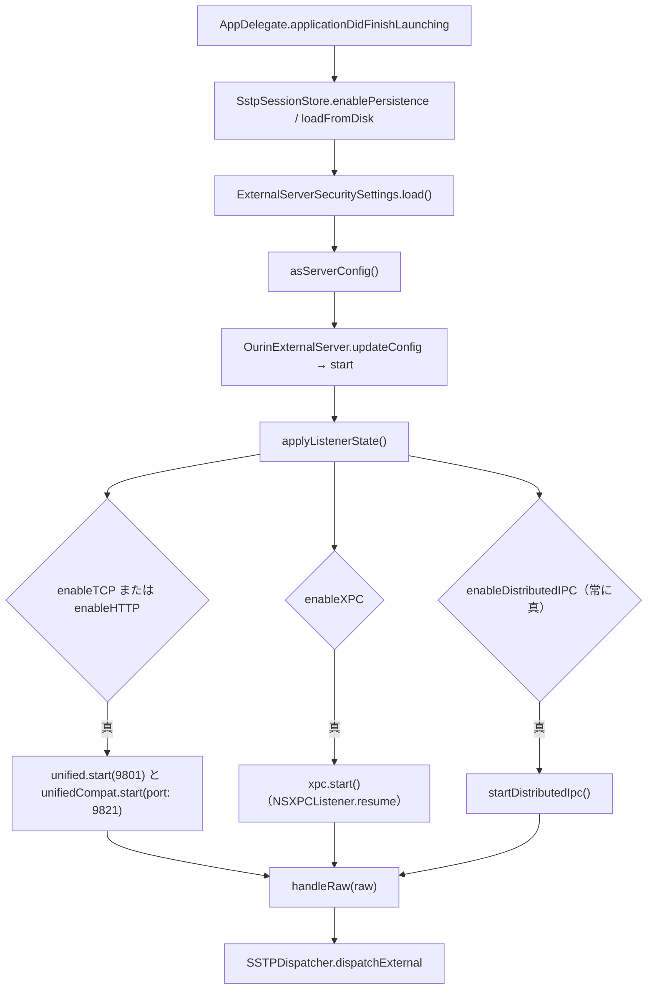
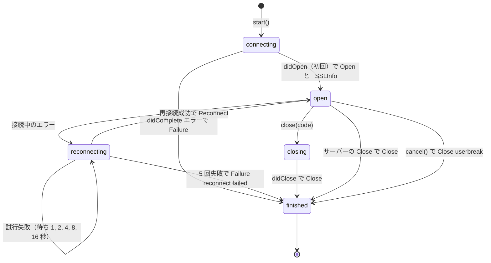

# 10.1 外部受信口と Web 連携

<details>
<summary>関連ソースファイル</summary>

このページは次のファイルをもとに作成した。

- [Ourin/ExternalServer/OurinExternalServer.swift](../../Ourin/ExternalServer/OurinExternalServer.swift)
- [Ourin/ExternalServer/UnifiedSstpListener.swift](../../Ourin/ExternalServer/UnifiedSstpListener.swift)
- [Ourin/ExternalServer/SstpTcpServer.swift](../../Ourin/ExternalServer/SstpTcpServer.swift)
- [Ourin/ExternalServer/SstpHttpServer.swift](../../Ourin/ExternalServer/SstpHttpServer.swift)
- [Ourin/ExternalServer/XpcDirectServer.swift](../../Ourin/ExternalServer/XpcDirectServer.swift)
- [Ourin/ExternalServer/ExternalServerSecuritySettings.swift](../../Ourin/ExternalServer/ExternalServerSecuritySettings.swift)
- [Ourin/ExternalServer/ServerMetrics.swift](../../Ourin/ExternalServer/ServerMetrics.swift)
- [Ourin/ExternalServer/EncodingNormalizer.swift](../../Ourin/ExternalServer/EncodingNormalizer.swift)
- [Ourin/Web/WebHandler.swift](../../Ourin/Web/WebHandler.swift)
- [Ourin/Web/WebNarInstaller.swift](../../Ourin/Web/WebNarInstaller.swift)
- [Ourin/Web/WebSocketConnection.swift](../../Ourin/Web/WebSocketConnection.swift)
- [Ourin/Web/GhostManager+WebSocket.swift](../../Ourin/Web/GhostManager+WebSocket.swift)
- [Ourin/OurinApp.swift](../../Ourin/OurinApp.swift)（起動、`handleWebHomeURL`）
- [Ourin/Ourin.entitlements](../../Ourin/Ourin.entitlements)
- [Ourin/Resources/Info.plist](../../Ourin/Resources/Info.plist)
- [Ourin/ContentView.swift](../../Ourin/ContentView.swift)（XPC のサンプル送信）
- [Ourin/SaoriHost/Internal/InternalSaori.swift](../../Ourin/SaoriHost/Internal/InternalSaori.swift)（`InternalSaoriRouting`）
- [Ourin/Ghost/GhostManager.swift](../../Ourin/Ghost/GhostManager.swift)（WebSocket タグの振り分け）
- [Ourin/Ghost/GhostManager+System.swift](../../Ourin/Ghost/GhostManager+System.swift)（`URLDropPolicy`）
- [Ourin/SSTP/SSTPDispatcher.swift](../../Ourin/SSTP/SSTPDispatcher.swift)
- [README.md](../../README.md)（「外部 SSTP と Claude Code 連携」節）
- [docs/WEB_1.0M_SPEC_ja-jp.md](../../docs/WEB_1.0M_SPEC_ja-jp.md)
- [docs/SSTP_1.xM_SPEC_ja-jp.md](../../docs/SSTP_1.xM_SPEC_ja-jp.md)

</details>

このページは、外部プロセスが Ourin へ SSTP を届ける受信口（`Ourin/ExternalServer/`）と、ブラウザ・Web との連携（`x-ukagaka-link` スキーム、NAR の Web インストール、ゴーストからの WebSocket 通信。`Ourin/Web/`）を扱う。受信口はどれも生の SSTP テキストを `OurinExternalServer.handleRaw` に渡し、そこから先は [10 SSTP スタック](./10-sstp.md) の単一スタック（`SSTPParser` → `SSTPDispatcher`）で処理される。

README の「外部 SSTP と Claude Code 連携」節に書かれた受信口表と Claude Code からの実況送信も、ここでコードと照合する。

## 受信口の一覧

| 経路 | 既定 | 宛先 | 有効化 | 実装ファイル |
|---|---|---|---|---|
| HTTP SSTP | 無効 | `POST http://127.0.0.1:9801/api/sstp/v1`（9821 でも同じ） | `OurinExternalSSTPAllowHTTP` | `UnifiedSstpListener.swift` → `SstpHttpServer.swift` |
| 生 SSTP（TCP） | 無効 | `127.0.0.1:9801`（9821 でも同じ） | `OurinExternalSSTPAllowTCP` | `UnifiedSstpListener.swift` → `SstpTcpServer.swift` |
| XPC（Direct SSTP） | 有効 | mach service `jp.ourin.sstp`、`OurinSSTPXPC.executeSSTP(_:withReply:)` | `OurinExternalSSTPAllowXPC` | `XpcDirectServer.swift` |
| Distributed IPC | 有効 | 通知 `jp.ourin.sstp.request`（`id`, `request`）→ `jp.ourin.sstp.response`（`id`, `response`） | 設定キー無し（常に有効） | `OurinExternalServer.swift` |
| URL スキーム | 常時 | `x-ukagaka-link:type=...` | `Info.plist` の `CFBundleURLTypes` | `WebHandler.swift` |

HTTP と生 SSTP は同じ待受を共有し、`9801` に加えて SSP 互換の副ポート `9821` も開く。待受アドレスは `127.0.0.1` 固定で、変更する設定は無い。

**出典:** [Ourin/ExternalServer/OurinExternalServer.swift:13-62](../../Ourin/ExternalServer/OurinExternalServer.swift#L13-L62)、[Ourin/ExternalServer/OurinExternalServer.swift:111-140](../../Ourin/ExternalServer/OurinExternalServer.swift#L111-L140)、[Ourin/ExternalServer/UnifiedSstpListener.swift:38-53](../../Ourin/ExternalServer/UnifiedSstpListener.swift#L38-L53)、[Ourin/ExternalServer/XpcDirectServer.swift:7-18](../../Ourin/ExternalServer/XpcDirectServer.swift#L7-L18)、[Ourin/Resources/Info.plist:34-46](../../Ourin/Resources/Info.plist#L34-L46)、[README.md:186-205](../../README.md#L186-L205)

## OurinExternalServer の起動条件



- 設定は起動時に 1 回だけ読む（`updateConfig` を呼ぶのは `applicationDidFinishLaunching` だけ）。README の「有効化し、Ourin を再起動する」はこの挙動に一致する。
- `start()` は `try? unified.start()` のようにエラーを握りつぶす（ポート使用中などで起動に失敗しても通知されない）。
- `handleRaw` は `SAORI/1.0` の要求なら `InternalSaoriRouting.directSSTPOnlyResponse` を返し（SAORI over Direct SSTP は XPC だけで受け付ける）、それ以外を `SSTPParser.parseRequest` で解析する。メソッドが空なら `400`。`SecurityOrigin` ヘッダの値を `origin` として `dispatchExternal(securityLocalOnly: config.securityLocalOnly, ...)` を呼び、所要時間を `ServerMetrics` に記録する。
- `tcpRunning` / `httpRunning` は表示用で、どちらも同じ `unified.isRunning` と設定値の論理積である。

**出典:** [Ourin/OurinApp.swift:488-495](../../Ourin/OurinApp.swift#L488-L495)、[Ourin/ExternalServer/OurinExternalServer.swift:64-156](../../Ourin/ExternalServer/OurinExternalServer.swift#L64-L156)、[Ourin/SaoriHost/Internal/InternalSaori.swift:298-318](../../Ourin/SaoriHost/Internal/InternalSaori.swift#L298-L318)

## 設定キー（ExternalServerSecuritySettings）

`ExternalServerSecuritySettings.load(defaults:)` は `UserDefaults.standard` から読み、キーが無ければ既定値を使う。

| キー | 型 | 既定 | サーバ設定への反映 |
|---|---|---|---|
| `OurinExternalSSTPAllowTCP` | Bool | `false` | `enableTCP = allowTCP && allowIncomingNetwork` |
| `OurinExternalSSTPAllowHTTP` | Bool | `false` | `enableHTTP = allowHTTP && allowIncomingNetwork` |
| `OurinExternalSSTPAllowExternalSecurityLevel` | Bool | `false` | `securityLocalOnly = !allowExternalSecurityLevel` |
| `OurinExternalSSTPAllowXPC` | Bool | `true` | `enableXPC` |
| `OurinExternalSSTPMaxPayloadSize` | Int | 1 MiB（下限 8 KiB に丸める） | 受信口の最大バイト数 |
| `OurinExternalSSTPTimeoutSeconds` | Double | 30（下限 1） | 受信口のタイムアウト |
| `OurinAcceptCP932` | Bool | `true` | `EncodingNormalizer` の Shift_JIS フォールバック（設定画面のトグル） |

`allowIncomingNetwork` は「サンドボックス外」または「`com.apple.security.network.server` 権限あり」のとき真で、`SecTaskCopyValueForEntitlement` で判定する。`Ourin/Ourin.entitlements` には `com.apple.security.app-sandbox` が無い（`disable-library-validation` のみ）。

README は、設定が `~/Library/Preferences/furin-lab.Ourin.plist` から読まれ、`defaults write furin-lab.Ourin …` ではコンテナ側の plist に書かれることがあるのでフルパスで書くよう案内している（コード側は `UserDefaults.standard` を読むだけで、パスは指定していない）。

**出典:** [Ourin/ExternalServer/ExternalServerSecuritySettings.swift:1-100](../../Ourin/ExternalServer/ExternalServerSecuritySettings.swift#L1-L100)、[Ourin/ExternalServer/EncodingNormalizer.swift:3-18](../../Ourin/ExternalServer/EncodingNormalizer.swift#L3-L18)、[Ourin/ContentView.swift:583](../../Ourin/ContentView.swift#L583)、[Ourin/Ourin.entitlements:1-8](../../Ourin/Ourin.entitlements#L1-L8)、[README.md:197-203](../../README.md#L197-L203)

## UnifiedSstpListener（同一ポートの多重化）

`UnifiedSstpListener.start(host:port:)` は `SstpTcpServer.makeListener` で `NWListener` を作り（リスナーは main queue、各接続は global queue）、接続ごとに `route(conn:)` で先頭行を覗く。

1. 4096 バイトずつ受信してバッファに足す。`config.maxSize` を超えたら、または `config.timeout` を過ぎたら接続を切る。
2. 最初の CRLF までの 1 行を大文字化し、` HTTP/` を含めば HTTP（`<METHOD> <path> HTTP/1.x`）、含まなければ生 SSTP（`<METHOD> SSTP/1.x`）と判定する。
3. 読み済みバッファごと `SstpHttpServer.adopt` / `SstpTcpServer.adopt` に引き渡す。両ハンドラは自前のリスナーを持たず、引き継いだ接続だけを処理する。

`timeout` / `maxSize` の既定は 5 秒 / 64 KiB だが、`OurinExternalServer.applyRuntimeConfig` が設定値（既定 30 秒 / 1 MiB）で上書きする。

**出典:** [Ourin/ExternalServer/UnifiedSstpListener.swift:1-84](../../Ourin/ExternalServer/UnifiedSstpListener.swift#L1-L84)、[Ourin/ExternalServer/OurinExternalServer.swift:101-109](../../Ourin/ExternalServer/OurinExternalServer.swift#L101-L109)

## SstpTcpServer（生 SSTP）

- `makeListener(host:port:)`: `127.0.0.1` / `localhost` / `::1` など特定アドレスなら `NWParameters.requiredLocalEndpoint` でそのアドレスにだけバインドする。`0.0.0.0` / `::` / `*` / 空のときだけ全インターフェース（現行の呼び出し元は常に `127.0.0.1`）。
- 受信: `\r\n\r\n`（ヘッダ終端）が揃った時点で、本文を含むバッファ全体を `EncodingNormalizer.decode(data, charset: EncodingAdapter.declaredCharset(in: data))` で文字列化し、`onRequest`（= `handleRaw`）に渡す。
- 応答: SSTP 応答を UTF-8 で送って接続を閉じる（1 接続 1 要求）。
- エラー: `maxSize` 超過は `SSTP/1.1 413 Payload Too Large`、期限切れは `SSTP/1.1 408 Request Timeout`。

**出典:** [Ourin/ExternalServer/SstpTcpServer.swift:1-116](../../Ourin/ExternalServer/SstpTcpServer.swift#L1-L116)

## SstpHttpServer（POST /api/sstp/v1）

ヘッダ終端が届いたら次の順に検査する。HTTP 層のエラーは `HTTP/1.1 <code> <text>` と `Content-Length: 0` で返す。

| 順 | 検査 | 失敗時 |
|---|---|---|
| 1 | バッファが `maxSize` 以下 | `413` |
| 2 | 要求行が `<METHOD> <target> HTTP/1.x` | `400` |
| 3 | メソッドが `POST` | `405` |
| 4 | パスが `/api/sstp/v1` | `404` |
| 5 | `Content-Length` がある | `411` |
| 6 | `Origin` が無い、または `null`、または host が `localhost` / `127.0.0.1` / `::1` | `403` |
| 7 | 本文が `Content-Length` 分届くまで待つ（期限切れは `408`） | |

本文は TCP と同じ方法でデコードし、`Origin` があれば `injectSecurityHeaders` で SSTP ヘッダ終端の直前に `SecurityOrigin: <Origin>` と `SecurityLevel: local|external`（localhost 系なら local）を挿入してから `handleRaw` に渡す。応答は SSTP の結果にかかわらず常に `HTTP/1.1 200 OK`、`Content-Type: text/plain; charset=UTF-8` で、本文が SSTP 応答になる。

ヘッダ行の分割は `components(separatedBy: .newlines)` を使う。コメントによれば、以前は `split(separator: "\n")` が CRLF を 1 文字として扱うため分割できず常に `411` になっており、挿入ヘッダが最終ヘッダと連結する不具合もあった（README「互換性の修正」節と一致）。

`Origin` による扱いの違い（既定の `OurinExternalSSTPAllowExternalSecurityLevel = false` の場合）:

| `Origin` | HTTP 層 | 挿入ヘッダ | Owned 昇格 | Dispatcher の local-only 判定 | SHIORI が見る `SecurityLevel` |
|---|---|---|---|---|---|
| 無し | 通過 | 無し | 可 | 本文の自己申告次第 | `external`（Owned なら `local`） |
| `null` | 通過 | `SecurityLevel: external` | 不可 | `420`（`OnSSTPBlacklisting` を通知） | — |
| `http://localhost:…` など | 通過 | `SecurityLevel: local` | 可 | 通過 | `external`（Owned なら `local`） |
| それ以外 | `403` | — | — | — | — |

**出典:** [Ourin/ExternalServer/SstpHttpServer.swift:44-127](../../Ourin/ExternalServer/SstpHttpServer.swift#L44-L127)、[Ourin/ExternalServer/SstpHttpServer.swift:129-209](../../Ourin/ExternalServer/SstpHttpServer.swift#L129-L209)、[Ourin/SSTP/SSTPDispatcher.swift:72-88](../../Ourin/SSTP/SSTPDispatcher.swift#L72-L88)、[Ourin/SSTP/SSTPDispatcher.swift:130-155](../../Ourin/SSTP/SSTPDispatcher.swift#L130-L155)、[README.md:230-233](../../README.md#L230-L233)

## XpcDirectServer（mach service jp.ourin.sstp）

- `NSXPCListener(machServiceName: "jp.ourin.sstp")` を作り、`start()` で `resume()` する。
- `shouldAcceptNewConnection` はすべての接続を受け入れ、`OurinSSTPXPC` を公開する（接続元のコード署名などは検査しない）。
- `executeSSTP(_:withReply:)`: 512 KiB を超える、またはデコードできない要求には `SSTP/1.1 400 Bad Request` を返す。デコードは TCP / HTTP と同じ `EncodingNormalizer`。
- `OurinExternalServer` は XPC の `onRequest` だけ、`SAORI/1.0` 要求を `InternalSaoriRouting.respond(to:)`（内蔵 SAORI、[13 SAORI](./13-saori.md)）へ回す。それ以外は `handleRaw`。
- 設定画面（`ContentView`）には `NSXPCConnection(machServiceName: "jp.ourin.sstp")` でサンプル要求を送る機能がある。

注意（推測・未確認）: リポジトリ全体を検索しても launchd の `MachServices` 登録（LaunchAgent の plist など）は見当たらない（`NSXPCListener(machServiceName:)` を使うコードと設定画面のサンプル送信、テスト、`Samples/` だけがある）。一般に `NSXPCListener(machServiceName:)` は launchd に登録された名前でないと受け付けられないため、通常のアプリ起動ではこの受信口が実際には機能していない可能性がある。

**出典:** [Ourin/ExternalServer/XpcDirectServer.swift:1-69](../../Ourin/ExternalServer/XpcDirectServer.swift#L1-L69)、[Ourin/ExternalServer/OurinExternalServer.swift:54-60](../../Ourin/ExternalServer/OurinExternalServer.swift#L54-L60)、[Ourin/ContentView.swift:1619-1630](../../Ourin/ContentView.swift#L1619-L1630)

## Distributed IPC（jp.ourin.sstp.request / response）

`OurinExternalServer.startDistributedIpc()` が `DistributedNotificationCenter.default()` に `jp.ourin.sstp.request` の観察者を `queue: nil` で登録する。`userInfo` の `id`（String）と `request`（生 SSTP の String）が揃っていれば `handleRaw` で処理し、`jp.ourin.sstp.response` を `userInfo: ["id": 要求 ID, "response": 応答]`、`options: [.deliverImmediately]` で投稿する。どちらかが欠けた通知は黙って捨てる。

- 認証は無く、同じログインセッションの任意のプロセスが要求を投げられ、応答通知も任意のプロセスが購読できる。
- `enableDistributedIPC` を `false` にする設定キーは無い（`asServerConfig` が値を渡さず、`Config` の既定 `true` のまま）。
- 推測（未確認）: `queue: nil` の観察者は通知を受けたスレッド（通常はメインスレッド）で実行されるため、`handleRaw` 以下の SHIORI 同期呼び出しや nobreak の待機（最大 5 秒）がメインスレッドを止める可能性がある。

**出典:** [Ourin/ExternalServer/OurinExternalServer.swift:158-191](../../Ourin/ExternalServer/OurinExternalServer.swift#L158-L191)、[Ourin/ExternalServer/ExternalServerSecuritySettings.swift:88-99](../../Ourin/ExternalServer/ExternalServerSecuritySettings.swift#L88-L99)、[README.md:194](../../README.md#L194)

## EncodingNormalizer と ServerMetrics

| 型 | 内容 |
|---|---|
| `EncodingNormalizer.decode(_:charset:)` | `Charset:` 宣言があれば `EncodingAdapter.decode`（CP932 などのラベルは `EncodingAdapter.knownEncoding` が解決）。宣言が無ければ UTF-8、失敗かつ `OurinAcceptCP932`（既定 `true`）なら Shift_JIS。どれも失敗すれば `nil`（TCP / HTTP はその時点では応答せず受信を続け、XPC は 400） |
| `ServerMetrics.shared` | 直列キューで件数・エラー件数・累計時間を数え、`averageLatency` / `requestCount` / `errorRate` を返す（`requestCount` は DevTools のステータス表示用とコメントにある） |

`ServerMetrics.record` は TCP / HTTP / XPC の各ハンドラと `handleRaw` の両方から呼ばれるため、正常な 1 要求が 2 件として数えられる（エラー判定も呼び出し元で異なる）。

**出典:** [Ourin/ExternalServer/EncodingNormalizer.swift:1-19](../../Ourin/ExternalServer/EncodingNormalizer.swift#L1-L19)、[Ourin/ExternalServer/ServerMetrics.swift:1-34](../../Ourin/ExternalServer/ServerMetrics.swift#L1-L34)、[Ourin/ExternalServer/SstpTcpServer.swift:66-83](../../Ourin/ExternalServer/SstpTcpServer.swift#L66-L83)、[Ourin/ExternalServer/OurinExternalServer.swift:89-91](../../Ourin/ExternalServer/OurinExternalServer.swift#L89-L91)

## Claude Code からの実況（README）

README によれば、Claude Code の mod `ghost-narrator`（リポジトリ外）は次の SSP 互換 `SEND` を送る。

```
SEND SSTP/1.4
Sender: Claude Code
Charset: UTF-8
Event: OnClaudeCode
Reference0: <kind>
Reference1: <detail>
Script: <fallback script>\e
```

`Reference0` は `start` / `prompt` / `edit` / `run` / `pass` / `fail` / `denied` / `done` / `aborted` / `say`、`Reference1` はコマンドやファイル名。README は送信内容だけを示し、どの受信口を使うかは書いていない。送信側の mod はリポジトリ外にあるため、実際の経路は確認できない（未確認）。

Ourin 側では、`Event` 付き SEND なので `SSTPDispatcher.routeToShiori` が `GET OnClaudeCode`（R0/R1 は要求の Reference）を稼働中ゴーストへ送る。`OnClaudeCode` は `EventID` に無い任意イベント名で、そのまま SHIORI の `ID` になる。

- ゴーストが値を返せば、それが再生され応答の `Script` になる。
- ゴーストが空の値や `204` を返した場合、`resolveScript` が `Script` ヘッダ（IfGhost 無しなので既定スクリプト）を採用して再生する。README の「処理しなければ `Script` を再生する」はこの経路である。
- 稼働中ゴーストが無い・SHIORI が応答しない（ブリッジが空文字を返す）場合は `503` で、`Script` のフォールバックも再生されない。

`done` / `fail` / `denied` / `aborted` の台詞に付く `\q[セッションを開く,script:\![open,browser,claude://code/continue?session=local_…]]` は mod 側が作るスクリプトで、Ourin は通常のさくらスクリプトとして実行する（[7 さくらスクリプト](./07-sakura-script.md)）。

**出典:** [README.md:207-228](../../README.md#L207-L228)、[Ourin/SSTP/SSTPDispatcher.swift:272-334](../../Ourin/SSTP/SSTPDispatcher.swift#L272-L334)、[Ourin/SSTP/SSTPDispatcher.swift:1287-1312](../../Ourin/SSTP/SSTPDispatcher.swift#L1287-L1312)

## WebHandler（x-ukagaka-link スキーム）

`Info.plist` の `CFBundleURLTypes` が `x-ukagaka-link`（`CFBundleURLName` は `org.ukagaka.link`）を登録し、`applicationDidFinishLaunching` で `WebHandler.shared.register()` が `NSAppleEventManager` に `kInternetEventClass` / `kAEGetURL` のハンドラを設定する。受け取った URL は `handleURL(_:)` が `x-ukagaka-link:` 以降を `parseForm`（`&` 区切り、`+` を空白、パーセントデコード）で辞書化し、`type` で分岐する。

| `type` | 動作 | SHIORI への配送 |
|---|---|---|
| `event` | `ghost` / `info` を取り出し、`.ourinWebEventReceived` を投稿 | `OnXUkagakaLinkOpen` を GET（`requestCustom`）、R0=`info`、`SecurityLevel: external`、`SecurityOrigin: x-ukagaka-link`。`ghost` が空なら全セッション、名前（`name` / `sakuraName` / フォルダ名 / `install.accept`）が一致すればそのゴーストだけ、見つからなければログのみ |
| `install` | `url` をさらにパーセントデコードし、`.ourinWebInstallRequested` を投稿して `WebNarInstaller.install(from:)` | インストールイベント（下記） |
| `homeurl` | `.ourinWebHomeURLReceived` を投稿。`AppDelegate.handleWebHomeURL` が http / https のときだけ `homeurl` をリソース・ゴースト設定に入れ、`checkGhostUpdate(options: ["web-homeurl"])` を呼ぶ | 更新処理に委ねる |
| `query` | `ghost` / `query` を取り出し、`.ourinWebEventReceived` を投稿 | `OnURLQuery` を GET、R0=`query`（宛先規則は `event` と同じ） |
| その他 | `unsupported type` をログ | なし |

送信は `ExternalEventDispatcher` 境界の 1 回だけで、`EventBridge.notify` と `BridgeToSHIORI` の二重発火を避ける、とコメントにある（テストではこの境界を差し替える）。

**出典:** [Ourin/Web/WebHandler.swift:1-141](../../Ourin/Web/WebHandler.swift#L1-L141)、[Ourin/OurinApp.swift:413-420](../../Ourin/OurinApp.swift#L413-L420)、[Ourin/OurinApp.swift:626-640](../../Ourin/OurinApp.swift#L626-L640)、[Ourin/Resources/Info.plist:34-46](../../Ourin/Resources/Info.plist#L34-L46)、[Ourin/SHIORIEvents/EventBridge.swift:782-803](../../Ourin/SHIORIEvents/EventBridge.swift#L782-L803)

## WebNarInstaller（Web からの NAR インストール）

1. URL を解析し、`http` は既定で拒否して `OnSecurityWarning`（`source: nar_install_blocked`、`detail: http_scheme`）を通知する。環境変数 `OURIN_ALLOW_HTTP_NAR=1` または `UserDefaults` の `OurinAllowInsecureNarInstall = true` で許可でき、その場合も `OnSecurityWarning`（`nar_install_insecure_allowed`）を出す。
2. `URLDropPolicy.remoteURL` で形式を検査し、背景キューで `URLDropPolicy.isPublicRemoteHost` により接続先が公開アドレスかを確認する。私設アドレスなら `OnSecurityWarning`（`private_host`）と `OnInstallFailure`（`fileio`）。
3. `URLSessionConfiguration.ephemeral`（キャッシュ・Cookie 無効）でダウンロードする。要求タイムアウト 30 秒、全体 300 秒、上限 256 MiB（`URLDropPolicy` の定数）。リダイレクト先は `URLDropDownloadDelegate` が同じ検査を再適用する。
4. 完了時: 通信エラーや非 2xx は `OnInstallFailure`（理由は `URLDropFailureReason`）。拡張子が `.nar` / `.zip` でなければ応答のファイル名・元 URL から補う。起動中ゴーストがあれば `GhostManager.installNarFile` に渡し、成功時は PLUGIN に `onInstallComplete` を通知する。ゴーストが無ければ `NarInstaller().installWithResult` を直接呼び、`OnInstallBegin` / `OnInstallComplete` を自分で通知する。

`WebHandler` と `WebNarInstaller` の中には、インストール前の確認 UI は無い（`installNarFile` 側の挙動は [15 NAR インストール](./15-nar-install.md) を参照）。

**出典:** [Ourin/Web/WebNarInstaller.swift:1-245](../../Ourin/Web/WebNarInstaller.swift#L1-L245)、[Ourin/Ghost/GhostManager+System.swift:49-56](../../Ourin/Ghost/GhostManager+System.swift#L49-L56)、[Ourin/Ghost/GhostManager+System.swift:6076-6082](../../Ourin/Ghost/GhostManager+System.swift#L6076-L6082)

## WebSocket（GhostManager+WebSocket / WebSocketConnection）

ゴーストのさくらスクリプトから WebSocket を張る機能（UKADOC 2.8.05 の WebSocket 系コマンド）。`GhostManager` が `\![execute,websocket,...]` / `\![send,websocket(-binary),...]` / `\![close,websocket,...]` / `\![cancel,websocket,...]` を拾って `GhostManager+WebSocket.swift` の各メソッドへ渡し、ゴースト終了時には `cancelAllWebSockets()` を呼ぶ。

| タグ | メソッド | 動作 |
|---|---|---|
| `\![execute,websocket,URL,オプション...]` | `executeWebSocket` | `ws` / `wss` 以外は Failure（R2=`invalid url`）。`--async` / `--header` / `--timeout` は HTTP 系と共通の `HTTPCommandOptions`。同じ URL の既存接続は `cancel` して張り替える |
| `\![send,websocket,URL,data1,data2,...]` / `\![send,websocket-binary,URL,base64]` | `sendWebSocket` | テキストは複数データを CRLF で結合。成功で `OnExecuteWebSocketSend`、失敗で `OnExecuteWebSocketError`（Ourin 拡張）。接続が無ければ無視 |
| `\![close,websocket,URL(,code)]` | `closeWebSocket` | Close フレームを送る（既定 1000）。応答が無くても 5 秒後に Close を通知 |
| `\![cancel,websocket,URL]` | `cancelWebSocket` | Close フレーム無しで中断し、Close の R2=`userbreak` |

`WebSocketConnection` は `URLSessionWebSocketTask` 1 本を包み、専用直列キュー `jp.ourin.websocket` で状態を管理する。



イベントの Reference は共通で R0=`--async` の識別子、R1=URL、R2 以降がイベント固有（Open/Reconnect は `200`、Receive は opcode `1`=テキスト / `2`=バイナリと本文、Close は切断コード、Failure はエラー文字列）。受信テキストの改行はバイト値 1 に、バイナリは base64 にする。`--async` でイベント ID を指定した場合は `<ID>Open` / `<ID>` / `<ID>Reconnect` / `<ID>Close` / `<ID>Failure` を使う（`_SSLInfo` は置き換えない）。発火は `EventID` にあれば `EventBridge.notify`、無ければ `notifyCustom`（いずれも NOTIFY・全セッション）。

**出典:** [Ourin/Web/GhostManager+WebSocket.swift:1-114](../../Ourin/Web/GhostManager+WebSocket.swift#L1-L114)、[Ourin/Web/WebSocketConnection.swift:1-142](../../Ourin/Web/WebSocketConnection.swift#L1-L142)、[Ourin/Web/WebSocketConnection.swift:144-289](../../Ourin/Web/WebSocketConnection.swift#L144-L289)、[Ourin/Ghost/GhostManager.swift:2778-2779](../../Ourin/Ghost/GhostManager.swift#L2778-L2779)、[Ourin/Ghost/GhostManager.swift:3685-3712](../../Ourin/Ghost/GhostManager.swift#L3685-L3712)、[Ourin/Ghost/GhostManager.swift:1906-1910](../../Ourin/Ghost/GhostManager.swift#L1906-L1910)

## セキュリティ上の注意

- **TCP と HTTP は片方だけ有効にできない**: `UnifiedSstpListener` は `enableTCP || enableHTTP` で起動し、接続の振り分けで設定値を見ない。`OurinExternalSSTPAllowHTTP` だけを有効にしても生 SSTP が、`OurinExternalSSTPAllowTCP` だけでも HTTP が `127.0.0.1:9801` / `9821` で受け付けられる。
- **ループバックでも external**: TCP / HTTP / XPC / Distributed IPC の要求は、Owned（`ID` が FMO / `uniqueid` と一致）でない限り SHIORI に `SecurityLevel: external` で渡る。一方、`OurinExternalSSTPAllowExternalSecurityLevel = false` の local-only は「クライアントが external と申告した要求」を拒否するだけで、申告しない要求は通す（[10 SSTP スタック](./10-sstp.md)）。
- **自己申告の local**: `EXECUTE GetFMO` / `GetCollision` / `CompressArchive` / `ExtractArchive` の local 制限は要求ヘッダで判定するため、ヘッダを付けない TCP / XPC / Distributed IPC のクライアントは通る。
- **XPC と Distributed IPC は接続元を検査しない**: XPC は全接続を受け入れ、Distributed IPC は同一セッションの全プロセスから要求でき、応答も他プロセスに見える。
- **ブラウザ由来の HTTP**: `Origin` が localhost 系・`null` 以外なら HTTP 層で `403`。`null`（ファイルから開いたページなど）は `SecurityLevel: external` で local-only により `420`。ローカルのツールは `Origin` を付けずに送る（README）。
- **x-ukagaka-link の install**: 任意の Web ページのリンクから、確認無しにダウンロードとインストール処理が始まる。スキーム（既定 https のみ）・公開アドレス・サイズ・タイムアウトの検査はあるが、ドメイン許可リストやハッシュ検証（`docs/WEB_1.0M_SPEC_ja-jp.md` の推奨）は実装されていない。

**出典:** [Ourin/ExternalServer/OurinExternalServer.swift:111-125](../../Ourin/ExternalServer/OurinExternalServer.swift#L111-L125)、[Ourin/ExternalServer/UnifiedSstpListener.swift:57-83](../../Ourin/ExternalServer/UnifiedSstpListener.swift#L57-L83)、[Ourin/ExternalServer/SstpHttpServer.swift:90-91](../../Ourin/ExternalServer/SstpHttpServer.swift#L90-L91)、[Ourin/ExternalServer/SstpHttpServer.swift:135-164](../../Ourin/ExternalServer/SstpHttpServer.swift#L135-L164)、[Ourin/SSTP/SSTPDispatcher.swift:130-155](../../Ourin/SSTP/SSTPDispatcher.swift#L130-L155)、[Ourin/SSTP/SSTPDispatcher.swift:559-753](../../Ourin/SSTP/SSTPDispatcher.swift#L559-L753)、[Ourin/ExternalServer/XpcDirectServer.swift:36-41](../../Ourin/ExternalServer/XpcDirectServer.swift#L36-L41)、[Ourin/Web/WebHandler.swift:91-100](../../Ourin/Web/WebHandler.swift#L91-L100)、[docs/WEB_1.0M_SPEC_ja-jp.md:63-68](../../docs/WEB_1.0M_SPEC_ja-jp.md#L63-L68)、[README.md:204-205](../../README.md#L204-L205)

## 制約と注意点

- **応答の文字コード**: TCP / HTTP / XPC はいずれも応答を UTF-8 で送る。SSTP 応答の `Charset` ヘッダは要求の値をそのまま写すため、`Charset: Shift_JIS` の要求には宣言と実際が食い違う応答が返る。XPC 経由の SAORI 応答は `InternalSaoriRouting.respond` が要求の Charset でエンコードしたバイト列を `String(decoding:as: UTF8.self)` で文字列に戻してから再び UTF-8 で返すため、UTF-8 以外の Charset では、応答に非 ASCII 文字があると化ける（不正な UTF-8 バイト列は `String(decoding:as:)` が U+FFFD に置き換えるため。コード上の帰結で、実機では未確認）。
- **起動失敗が見えない**: リスナー起動のエラーは `try?` で捨てられる。`xpc.isRunning` は `resume()` を呼んだだけで真になる。
- **ドキュメントとの食い違い**（コード優先）:
  - 注意: README の受信口表は `9801` だけを挙げるが、コードは `9821` でも同じ受信口を開く。README の「`Origin` ヘッダ付きの HTTP 要求は `external` になり `420`」は、localhost 系の Origin では `420` にならず、localhost 系・`null` 以外では HTTP `403` になる点で不正確。
  - 注意: `docs/SSTP_1.xM_SPEC_ja-jp.md` の「Origin が localhost 以外の場合は強制的に external」は、実装では `403` 拒否（`null` だけが external）。同文書の「`host` に `0.0.0.0` を指定すれば全インターフェース（オプトイン）」は `makeListener` の機能としては正しいが、それを設定する手段は無い。
  - 注意: `docs/WEB_1.0M_SPEC_ja-jp.md` は `type=event` / `install` / `homeurl` の 3 種だが、コードは `query`（`OnURLQuery`）も受け付ける。同文書の「インストール前に確認ダイアログ」は本ページ範囲のコードには無い。同文書は `.nar` の UTI を `com.ourin.nar` とするが、`Info.plist` の `UTExportedTypeDeclarations` / `CFBundleDocumentTypes` は `jp.ourin.nar`（`public.zip-archive` 準拠、拡張子 `nar`、MIME `application/x-nar` / `application/x-ukagaka-nar` / `application/zip`）を宣言している。
- **WebSocket のイベント**: Open / Receive などは全セッションへ NOTIFY される。接続を開いたゴースト以外にも届く。

**出典:** [Ourin/ExternalServer/SstpTcpServer.swift:72-79](../../Ourin/ExternalServer/SstpTcpServer.swift#L72-L79)、[Ourin/ExternalServer/SstpHttpServer.swift:101-113](../../Ourin/ExternalServer/SstpHttpServer.swift#L101-L113)、[Ourin/ExternalServer/OurinExternalServer.swift:54-60](../../Ourin/ExternalServer/OurinExternalServer.swift#L54-L60)、[Ourin/SaoriHost/Internal/InternalSaori.swift:306-311](../../Ourin/SaoriHost/Internal/InternalSaori.swift#L306-L311)、[Ourin/ExternalServer/XpcDirectServer.swift:20-34](../../Ourin/ExternalServer/XpcDirectServer.swift#L20-L34)、[README.md:190-205](../../README.md#L190-L205)、[docs/SSTP_1.xM_SPEC_ja-jp.md:78-80](../../docs/SSTP_1.xM_SPEC_ja-jp.md#L78-L80)、[docs/SSTP_1.xM_SPEC_ja-jp.md:181-183](../../docs/SSTP_1.xM_SPEC_ja-jp.md#L181-L183)、[docs/WEB_1.0M_SPEC_ja-jp.md:34-39](../../docs/WEB_1.0M_SPEC_ja-jp.md#L34-L39)、[docs/WEB_1.0M_SPEC_ja-jp.md:55-60](../../docs/WEB_1.0M_SPEC_ja-jp.md#L55-L60)、[Ourin/Resources/Info.plist:7-21](../../Ourin/Resources/Info.plist#L7-L21)、[Ourin/Resources/Info.plist:59-84](../../Ourin/Resources/Info.plist#L59-L84)、[Ourin/Web/GhostManager+WebSocket.swift:107-113](../../Ourin/Web/GhostManager+WebSocket.swift#L107-L113)、[Ourin/SaoriHost/Internal/InternalSaori.swift:299-317](../../Ourin/SaoriHost/Internal/InternalSaori.swift#L299-L317)

## 関連ページ

- [3 アプリの起動とライフサイクル](./03-app-lifecycle.md) — `applicationDidFinishLaunching` での外部サーバ・`WebHandler` の起動
- [7 さくらスクリプト](./07-sakura-script.md) — `\![execute,websocket]` などのタグ
- [9 SHIORI イベント](./09-shiori-events.md) — `EventBridge` によるイベント配送
- [10 SSTP スタック](./10-sstp.md) — `handleRaw` 以降の解析・ディスパッチ・SHIORI 橋渡し
- [11 FMO](./11-fmo.md) — Owned SSTP の ID と `GetFMO`
- [13 SAORI](./13-saori.md) — XPC 上の SAORI/1.0（`InternalSaoriRouting`）
- [15 NAR インストールとパッケージ管理](./15-nar-install.md) — `installNarFile` と URL ドロップ
- [17 DevTools と Ourin Migrator](./17-devtools-migrator.md) — `ServerMetrics` の表示
