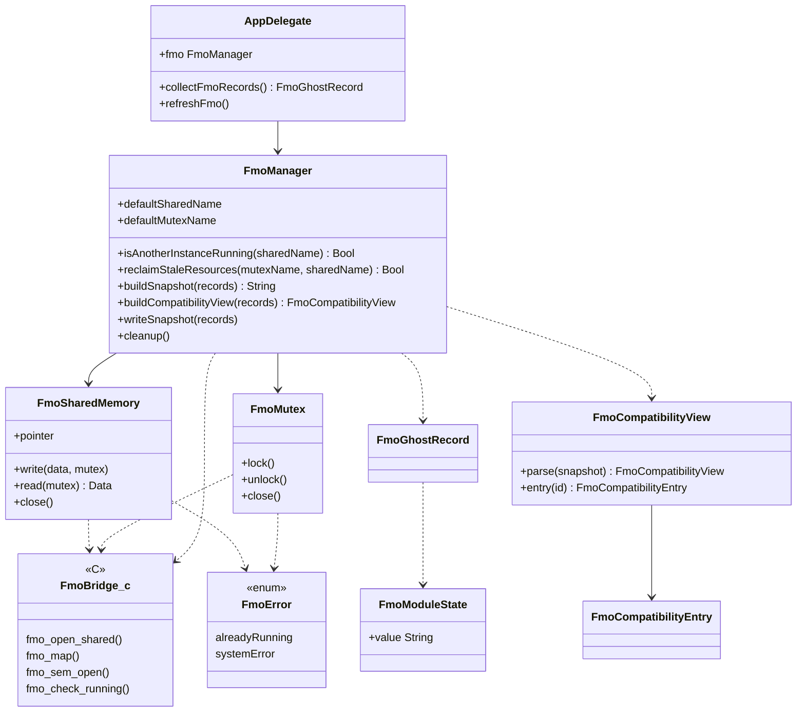
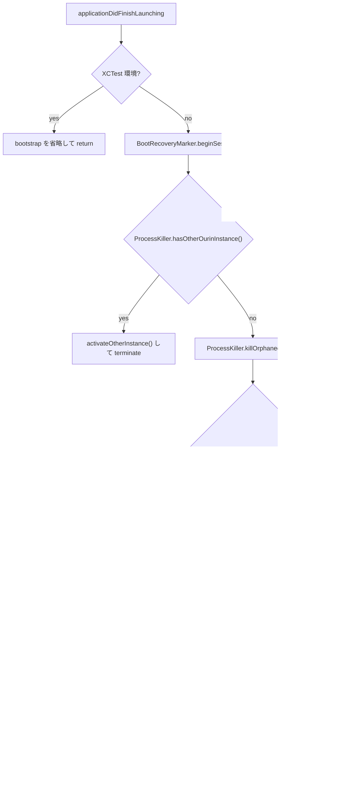

# 11 FMO（共有メモリと単一インスタンス）

<details>
<summary>関連ソースファイル</summary>

このページは次のファイルをもとに作成した。

- [Ourin/FMO/FmoBridge.h](../../Ourin/FMO/FmoBridge.h)
- [Ourin/FMO/FmoBridge.c](../../Ourin/FMO/FmoBridge.c)
- [Ourin/FMO/FmoSharedMemory.swift](../../Ourin/FMO/FmoSharedMemory.swift)
- [Ourin/FMO/FmoMutex.swift](../../Ourin/FMO/FmoMutex.swift)
- [Ourin/FMO/FmoManager.swift](../../Ourin/FMO/FmoManager.swift)
- [Ourin/FMO/FmoError.swift](../../Ourin/FMO/FmoError.swift)
- [Ourin/Ourin-Bridging-Header.h](../../Ourin/Ourin-Bridging-Header.h)
- [Ourin/OurinApp.swift](../../Ourin/OurinApp.swift)
- [Ourin/Utils/ProcessKiller.swift](../../Ourin/Utils/ProcessKiller.swift)
- [Ourin/Ghost/GhostManager.swift](../../Ourin/Ghost/GhostManager.swift)
- [Ourin/Ghost/GhostManager+Surface.swift](../../Ourin/Ghost/GhostManager+Surface.swift)
- [Ourin/Ghost/GhostManager+Effects.swift](../../Ourin/Ghost/GhostManager+Effects.swift)
- [Ourin/Ghost/GhostManager+System.swift](../../Ourin/Ghost/GhostManager+System.swift)
- [Ourin/SSTP/SSTPDispatcher.swift](../../Ourin/SSTP/SSTPDispatcher.swift)
- [Ourin/SSTP/SstpDispatcherHost.swift](../../Ourin/SSTP/SstpDispatcherHost.swift)
- [Ourin/SSTP/LiveSstpDispatcherHost.swift](../../Ourin/SSTP/LiveSstpDispatcherHost.swift)
- [Ourin/Yaya/YayaAdapter.swift](../../Ourin/Yaya/YayaAdapter.swift)
- [Ourin.xcodeproj/project.pbxproj](../../Ourin.xcodeproj/project.pbxproj)
- [OurinTests/FmoTests.swift](../../OurinTests/FmoTests.swift)
- [AGENTS.md](../../AGENTS.md)
- [docs/About_FMO_ja-jp.md](../../docs/About_FMO_ja-jp.md)
- [docs/KNOWN_ISSUES_ja-jp.md](../../docs/KNOWN_ISSUES_ja-jp.md)

</details>

FMO（Forged Memory Object）は、SSP などの伺かベースウェアが「いま起動しているゴーストの一覧」を他プロセスへ公開するための共有メモリである。Ourin は Windows の名前付き FileMapping を再現するのではなく、POSIX 共有メモリ（`shm_open`）と名前付きセマフォ（`sem_open`）で**意味的に**互換な情報を公開する。互換の境界は、SSP 風のテキスト形式 `id.key\x01value\r\n` と SSTP の `EXECUTE GetFMO` である。

このページでは `Ourin/FMO/` の C ブリッジと Swift ラッパー、FMO に書く内容と更新タイミング、起動時の単一インスタンス判定との関係を説明する。FMO を読む側の SSTP 処理は [10 SSTP スタック](./10-sstp.md)、起動処理全体は [3 アプリの起動とライフサイクル](./03-app-lifecycle.md)、記録の元になるゴースト状態は [4 GhostManager](./04-ghost-manager.md) を参照。

## 契約の保護（変更時の注意）

`AGENTS.md` は保護する制約として「FMO は POSIX shared memory と named semaphore による process 間通信／単一 instance 制御。共有メモリや lock の契約を Swift 側だけの都合で変更しない」と定めている。外部プロセスは次の値に依存しうるので、変えるときは外部の読み手（`docs/About_FMO_ja-jp.md` が案内する直接アクセス手順を含む）と合わせて扱う必要がある。

| 契約 | 現在の値 | 定義 |
|---|---|---|
| 共有メモリ名 | `/ourin_fmo` | [Ourin/FMO/FmoManager.swift:121](../../Ourin/FMO/FmoManager.swift#L121) |
| セマフォ名（排他） | `/ourin_fmo_mutex` | [Ourin/FMO/FmoManager.swift:122](../../Ourin/FMO/FmoManager.swift#L122) |
| 領域サイズ | 64 KiB（65,536 バイト） | [Ourin/FMO/FmoSharedMemory.swift:27](../../Ourin/FMO/FmoSharedMemory.swift#L27) |
| 先頭 4 バイト | 本文長（`UInt32`、ホストのバイト順） | [Ourin/FMO/FmoSharedMemory.swift:60-69](../../Ourin/FMO/FmoSharedMemory.swift#L60-L69) |
| 本文 | UTF-8 の `id.key\x01value\r\n` 列、直後に NUL 1 バイト | [Ourin/FMO/FmoManager.swift:186-208](../../Ourin/FMO/FmoManager.swift#L186-L208) |
| 権限 | 共有メモリ・セマフォとも `0666` | [Ourin/FMO/FmoBridge.c:13-23](../../Ourin/FMO/FmoBridge.c#L13-L23)、[Ourin/FMO/FmoMutex.swift:20-55](../../Ourin/FMO/FmoMutex.swift#L20-L55) |

注意: 現行コードでは「単一インスタンス制御」の判定そのものはプロセス一覧（`ProcessKiller`）で行い、FMO は残留リソースの検出と情報公開に使われている（後述）。`AGENTS.md` の記述は役割をまとめて述べたもので、判定手段は変わっている。

**出典:** [AGENTS.md:7-9](../../AGENTS.md#L7-L9)、[Ourin/FMO/FmoManager.swift:120-175](../../Ourin/FMO/FmoManager.swift#L120-L175)

## 構成



| ファイル | 役割 |
|---|---|
| `FMO/FmoBridge.h` / `FmoBridge.c` | libc の `shm_open`・`ftruncate`・`mmap`・`munmap`・`shm_unlink`・`sem_*` を Swift から呼ぶ薄い C ラッパー。起動判定用の `fmo_check_running` と、作成しない `fmo_open_existing_shared` を持つ |
| `Ourin-Bridging-Header.h` | `FMO/FmoBridge.h` を Swift へ公開する。同じヘッダで `IOKit/ps/IOPowerSources.h`（電源状態）と `mach/mach.h`・`mach/mach_host.h` も取り込む（FMO とは無関係。PowerObserver・PropertyManager などが使う） |
| `FMO/FmoSharedMemory.swift` | 共有メモリの作成・マップ・長さ付き書き込み・解放 |
| `FMO/FmoMutex.swift` | 名前付きセマフォ（初期値 1）を 2 値ミューテックスとして使う |
| `FMO/FmoManager.swift` | 起動判定・残留回収・スナップショット生成・書き込み・後始末。レコード型と互換ビューも定義 |
| `FMO/FmoError.swift` | `alreadyRunning` と `systemError(String)`。`alreadyRunning` を投げている箇所は無い |

Xcode プロジェクトは `SWIFT_OBJC_BRIDGING_HEADER = "Ourin/Ourin-Bridging-Header.h"` を指定している。

**出典:** [Ourin/FMO/FmoBridge.h:1-34](../../Ourin/FMO/FmoBridge.h#L1-L34)、[Ourin/FMO/FmoBridge.c:1-106](../../Ourin/FMO/FmoBridge.c#L1-L106)、[Ourin/Ourin-Bridging-Header.h:1-6](../../Ourin/Ourin-Bridging-Header.h#L1-L6)、[Ourin/FMO/FmoError.swift:1-7](../../Ourin/FMO/FmoError.swift#L1-L7)、[Ourin.xcodeproj/project.pbxproj:724](../../Ourin.xcodeproj/project.pbxproj#L724)

## C ブリッジ（FmoBridge.c / .h）

| 関数 | 処理 | 戻り値 |
|---|---|---|
| `fmo_open_shared(name, size)` | `shm_open(name, O_CREAT \| O_RDWR, 0666)` のあと `ftruncate(fd, size)`。失敗時は fd を閉じる | fd または -1 |
| `fmo_open_existing_shared(name)` | `shm_open(name, O_RDWR, 0)`（作成しない） | fd または -1 |
| `fmo_map(fd, size)` | `mmap(NULL, size, PROT_READ \| PROT_WRITE, MAP_SHARED, fd, 0)` | アドレス（失敗時は `MAP_FAILED`） |
| `fmo_ftruncate` / `fmo_close_fd` / `fmo_shm_unlink` / `fmo_munmap` | 対応する libc 関数そのまま | libc と同じ |
| `fmo_sem_open(name, oflag, mode, value)` | `sem_open` そのまま | `sem_t *`（失敗時は `SEM_FAILED`） |
| `fmo_sem_wait` / `fmo_sem_trywait` / `fmo_sem_post` / `fmo_sem_close` / `fmo_sem_unlink` | 対応する libc 関数そのまま | libc と同じ |
| `fmo_check_running(shm_name)` | `shm_open(name, O_RDWR, 0)` が成功すれば閉じて 1、`ENOENT` なら 0、それ以外は -1（ninix の判定方式に倣う、とコメントにある） | 1 / 0 / -1 |

**出典:** [Ourin/FMO/FmoBridge.c:7-28](../../Ourin/FMO/FmoBridge.c#L7-L28)、[Ourin/FMO/FmoBridge.c:51-79](../../Ourin/FMO/FmoBridge.c#L51-L79)、[Ourin/FMO/FmoBridge.c:80-106](../../Ourin/FMO/FmoBridge.c#L80-L106)

## 共有メモリのレイアウトと Swift ラッパー

### FmoSharedMemory

`init(name:size:createNew:)` は `createNew: true`（既定）なら `fmo_open_shared` で作成（既存なら開いて同じサイズへ `ftruncate`）、`false` なら `fmo_open_existing_shared` で既存を開く。続けて `fmo_map` でマップし、fd は `close()` まで開いたままにする。作成した側（`isCreator`）だけが `close()` で `shm_unlink` する。作成直後の unlink はしないので、プロセスが生きている間は外部から名前で開ける。

`write(_:mutex:)` はミューテックスを取ってから次のように書く。

| オフセット | 長さ | 内容 |
|---|---|---|
| 0 | 4 | 本文長 `len`（`UInt32`。`min(data.count, size - 5)` で最大 65,531） |
| 4 | `len` | FMO テキスト（UTF-8） |
| 4 + `len` | 1 | `0x00` |
| 5 + `len` 以降 | 残り | 書き換えない（前回の内容が残りうる） |

`read(mutex:)` は先頭の長さを読んでその分を返すが、アプリ内に呼び出し元は無い（Ourin 自身は共有メモリを読み返さず、必要なときは後述のとおりスナップショットを作り直す）。

### FmoMutex

`init(name:createNew:)` は `createNew: true` なら `sem_open(name, O_CREAT | O_EXCL, 0666, 1)` で新規作成し、`EEXIST`（クラッシュ後の残留）なら `sem_unlink` して作り直す。`lock()` は `sem_wait`（タイムアウト無し）、`unlock()` は `sem_post`、`close()` は `sem_close` し、作成者なら `sem_unlink` する。

**出典:** [Ourin/FMO/FmoSharedMemory.swift:1-87](../../Ourin/FMO/FmoSharedMemory.swift#L1-L87)、[Ourin/FMO/FmoMutex.swift:1-72](../../Ourin/FMO/FmoMutex.swift#L1-L72)

## FMO に書く内容

### テキスト形式

`FmoManager.buildSnapshot(records:)` が唯一の生成関数で、共有メモリへの書き込み、SSTP `EXECUTE GetFMO` の応答、YAYA の `READFMO` のすべてがこの出力を使う。1 ゴースト = 1 レコードで、各行は `<ID>.<キー>` + `U+0001`（SOH）+ 値 + CRLF。

| キー | 値の出どころ（`AppDelegate.collectFmoRecords`） | 区分 |
|---|---|---|
| `name` | `GhostConfiguration.sakuraName` | 標準 |
| `keroname` | `keroName`（無ければ空） | 標準 |
| `fullname` | `GhostConfiguration.name` | 標準 |
| `ghostname` | `GhostConfiguration.name`（`fullname` と同じ値） | 標準 |
| `path` | ゴーストのディレクトリ（`ghostURL.path`） | 標準 |
| `ghostpath` | 同上 | 標準 |
| `sakura.surface` / `kero.surface` | `characterViewModels[0/1]` の現在サーフェス（既定 0 / 10） | 標準 |
| `hwnd` / `kerohwnd` | スコープ 0 / 1 の `NSWindow.windowNumber`。取れなければゴーストのパスとスコープの `Hasher` 値から作る非ゼロ整数 | 標準（値は Win32 HWND ではない） |
| `hwndlist` | 実ウィンドウがあるスコープの識別子をスコープ順にカンマ連結。無ければ `hwnd,kerohwnd` | 標準 |
| `modulestate` | `FmoModuleState.value`。`shiori:running`（`shioriRuntime.isLoaded`）/ `shiori:critical`、MAKOTO があれば `makoto-ghost:running`・`makoto-shell:running` | 標準 |
| `shell` | `activeShellName` | Ourin 拡張 |
| `balloon` | `balloonConfig?.name` | Ourin 拡張 |

レコード ID は `GhostManager.fmoID`（`GhostManager` 生成時に作る UUID からハイフンを除いた小文字 32 文字）。`validRecordID` が空・`.`・SOH・CR・LF を含む ID を拒否した場合だけ、旧呼び出し互換で配列の添字を使う。`descript.txt` を読めていない（`ghostConfig == nil`）ゴーストはレコードに含めない。`FmoModuleState` には `compatible` もあるが、`collectFmoRecords` は設定していない。

```text
0123456789abcdef0123456789abcdef.name<SOH>Emily4<CRLF>
0123456789abcdef0123456789abcdef.keroname<SOH>Teddy<CRLF>
...
0123456789abcdef0123456789abcdef.modulestate<SOH>shiori:running<CRLF>
0123456789abcdef0123456789abcdef.shell<SOH>master<CRLF>
0123456789abcdef0123456789abcdef.balloon<SOH><CRLF>
```

`collectFmoRecords` は副作用として、各ゴーストの名前と `sstpUniqueID` / `fmoID` を `SSTPOwnershipRegistry.shared.replaceEntries` に登録し直す（Owned SSTP の照合用。[10 SSTP](./10-sstp.md)）。

**出典:** [Ourin/FMO/FmoManager.swift:5-56](../../Ourin/FMO/FmoManager.swift#L5-L56)、[Ourin/FMO/FmoManager.swift:177-218](../../Ourin/FMO/FmoManager.swift#L177-L218)、[Ourin/OurinApp.swift:822-890](../../Ourin/OurinApp.swift#L822-L890)、[Ourin/Ghost/GhostManager.swift:831-835](../../Ourin/Ghost/GhostManager.swift#L831-L835)

### 構造化ビュー

`FmoCompatibilityView.parse(_:)` は CRLF で行に分け、SOH で 1 回だけ分割し、最初の `.` までを ID、残りをキーとして ID ごとの辞書にする。不正な行は無視し、ID の昇順で並べる。`FmoManager.buildCompatibilityView(records:)` は `buildSnapshot` の結果をこのビューにして返す。テスト・診断用の内部 API であり、共有メモリや SSTP の出力形式は文字列のまま変わらない。`OurinTests/FmoTests.swift` は形式（SOH・CRLF・`key=value` 形式でないこと・ID 接頭辞・`modulestate`）とこのビューを検査するが、共有メモリとセマフォ自体は対象にしていない。

**出典:** [Ourin/FMO/FmoManager.swift:58-117](../../Ourin/FMO/FmoManager.swift#L58-L117)、[Ourin/FMO/FmoManager.swift:220-226](../../Ourin/FMO/FmoManager.swift#L220-L226)、[OurinTests/FmoTests.swift:7-194](../../OurinTests/FmoTests.swift#L7-L194)

## 起動時の流れと単一インスタンス判定

`AppDelegate.applicationDidFinishLaunching` での順序は次のとおり（XCTest 環境ではこの手前で戻る）。



1. **単一インスタンス判定**: `ProcessKiller.hasOtherOurinInstance()` が自分以外の PID の実行ファイルパスを調べ、`/Ourin.app/Contents/MacOS/Ourin` で終わり、かつ環境変数が XCTest のホストでないものを「稼働中の Ourin」とみなす（環境を読めない場合は稼働中扱い）。見つかれば `NSRunningApplication.activate()` で前面に出し、自分は終了する。他の Ourin を強制終了しない。
2. **残留 FMO の回収**: 上の判定で他の Ourin が居ないのに `fmo_check_running("/ourin_fmo")` が 1 を返すなら、クラッシュや強制終了の残りとみなして `reclaimStaleResources()` が `shm_unlink` と `sem_unlink` を行う（`ENOENT` は成功扱い）。`fmo_check_running` が -1（`ENOENT` 以外のエラー）のときは「起動していない」と扱い、回収しない。
3. **初期化**: `FmoManager()` が `FmoMutex(name: "/ourin_fmo_mutex")` と `FmoSharedMemory(name: "/ourin_fmo")` を作る。失敗しても起動は続け、`fmo` は `nil` になる（以後 `refreshFmo()` は何もしない）。
4. **READFMO の提供**: `YayaAdapter.fmoSnapshotProvider` に `buildSnapshot(records: collectFmoRecords())` を返すクロージャを入れる。
5. **更新通知の購読**: `Notification.Name.fmoNeedsRefresh` を `handleFmoRefresh` → `refreshFmo()` に結ぶ。

**出典:** [Ourin/OurinApp.swift:365-396](../../Ourin/OurinApp.swift#L365-L396)、[Ourin/OurinApp.swift:422-429](../../Ourin/OurinApp.swift#L422-L429)、[Ourin/OurinApp.swift:622-624](../../Ourin/OurinApp.swift#L622-L624)、[Ourin/OurinApp.swift:893-897](../../Ourin/OurinApp.swift#L893-L897)、[Ourin/Utils/ProcessKiller.swift:75-118](../../Ourin/Utils/ProcessKiller.swift#L75-L118)、[Ourin/FMO/FmoManager.swift:127-175](../../Ourin/FMO/FmoManager.swift#L127-L175)

## 更新タイミング

FMO の書き込みは常に「全ゴーストを集め直してスナップショットを丸ごと書く」方式で、差分更新はしない。きっかけは `NotificationCenter` の `.fmoNeedsRefresh` 通知で、投稿されたスレッドで同期的に `refreshFmo()` が走る。

| きっかけ | 投稿箇所 |
|---|---|
| ゴースト起動完了（OnBoot 後、初期化 NOTIFY を送った直後。メインキュー） | [Ourin/Ghost/GhostManager.swift:1836-1840](../../Ourin/Ghost/GhostManager.swift#L1836-L1840) |
| ゴースト終了（`shutdown()`） | [Ourin/Ghost/GhostManager.swift:1921](../../Ourin/Ghost/GhostManager.swift#L1921) |
| MAKOTO の再読み込み（起動時の `start()` 内と `\![reload,makoto]` / `\![load,makoto]`） | [Ourin/Ghost/GhostManager.swift:2232](../../Ourin/Ghost/GhostManager.swift#L2232) |
| サーフェス変更（`OnSurfaceChange` 送出後） | [Ourin/Ghost/GhostManager+Surface.swift:60](../../Ourin/Ghost/GhostManager+Surface.swift#L60) |
| シェル変更（`OnShellChanged` 送出後） | [Ourin/Ghost/GhostManager+Surface.swift:698](../../Ourin/Ghost/GhostManager+Surface.swift#L698) |
| バルーン変更（`OnBalloonChange` 送出後） | [Ourin/Ghost/GhostManager+Effects.swift:408](../../Ourin/Ghost/GhostManager+Effects.swift#L408) |
| `\![unload,makoto]` / `\![unload,shiori]` / `\![load,shiori]` | [Ourin/Ghost/GhostManager+System.swift:5984-6027](../../Ourin/Ghost/GhostManager+System.swift#L5984-L6027) |
| 追加ゴーストの起動・ゴースト切替の完了・追加ゴーストの終了・全追加ゴーストの終了 | [Ourin/OurinApp.swift:971](../../Ourin/OurinApp.swift#L971)、[Ourin/OurinApp.swift:1016](../../Ourin/OurinApp.swift#L1016)、[Ourin/OurinApp.swift:1025](../../Ourin/OurinApp.swift#L1025)、[Ourin/OurinApp.swift:1033](../../Ourin/OurinApp.swift#L1033) |

注意: MAKOTO の再読み込みはゴースト起動時に `start()` のバックグラウンドキュー（`DispatchQueue.global`）から呼ばれる。`NotificationCenter` は投稿スレッドで observer を呼ぶので、この経路では `collectFmoRecords()`（ウィンドウやビューモデルを参照する）がメインスレッド以外で走る。スレッド安全性が保証されているかはコードから確認できなかった（未確認）。

**出典:** [Ourin/Ghost/GhostManager.swift:1664-1682](../../Ourin/Ghost/GhostManager.swift#L1664-L1682)、[Ourin/Ghost/GhostManager.swift:2210-2233](../../Ourin/Ghost/GhostManager.swift#L2210-L2233)、[Ourin/OurinApp.swift:1117](../../Ourin/OurinApp.swift#L1117)

## 終了処理

`applicationWillTerminate`（XCTest ホストでは何もしない）は `.fmoNeedsRefresh` の observer を外したあと `fmo?.cleanup()` を呼ぶ。`cleanup()` は空のスナップショット（長さ 0）を書き、`munmap`・`close`・`shm_unlink` してから、セマフォを `sem_close`・`sem_unlink` する。その後でゴーストの終了処理が走るが、observer は外れているので FMO は再度書かれない。異常終了時は名前が残り、次回起動時に前節の回収処理で消される。

**出典:** [Ourin/OurinApp.swift:562-586](../../Ourin/OurinApp.swift#L562-L586)、[Ourin/FMO/FmoManager.swift:239-244](../../Ourin/FMO/FmoManager.swift#L239-L244)

## 外部・内部からの参照

| 経路 | 仕組み | 共有メモリを読むか |
|---|---|---|
| SSTP `EXECUTE GetFMO` | `SecurityLevel` が `local` でなければ `420`。`local` なら `host.collectFmoRecords()` から `buildSnapshot` を作って返す（`LiveSstpDispatcherHost` が `AppDelegate.collectFmoRecords()` に委譲） | 読まない（その場で生成） |
| YAYA の `READFMO` | yaya_core からの `host_op: "fmo"`・`operation: "read"` に `fmoSnapshotProvider()` の結果を `snapshot` として返す（[8.1](./08a-yaya.md)） | 読まない（その場で生成） |
| 外部プロセスの直接参照 | `shm_open("/ourin_fmo", O_RDWR, 0)` で開き、先頭 4 バイトの長さと UTF-8 本文を読む。排他には `/ourin_fmo_mutex` を使う（`docs/About_FMO_ja-jp.md` の案内） | 読む |

`docs/About_FMO_ja-jp.md` は外部アプリには SSTP `EXECUTE GetFMO` を推奨している（セキュリティレベルの制御が掛かるため）。

**出典:** [Ourin/SSTP/SSTPDispatcher.swift:603-616](../../Ourin/SSTP/SSTPDispatcher.swift#L603-L616)、[Ourin/SSTP/SSTPDispatcher.swift:934-937](../../Ourin/SSTP/SSTPDispatcher.swift#L934-L937)、[Ourin/SSTP/SstpDispatcherHost.swift:17](../../Ourin/SSTP/SstpDispatcherHost.swift#L17)、[Ourin/SSTP/LiveSstpDispatcherHost.swift:20-24](../../Ourin/SSTP/LiveSstpDispatcherHost.swift#L20-L24)、[Ourin/Yaya/YayaAdapter.swift:184-194](../../Ourin/Yaya/YayaAdapter.swift#L184-L194)、[Ourin/OurinApp.swift:390-396](../../Ourin/OurinApp.swift#L390-L396)、[docs/About_FMO_ja-jp.md:105-121](../../docs/About_FMO_ja-jp.md#L105-L121)

## docs/About_FMO_ja-jp.md との照合

名前（`/ourin_fmo` / `/ourin_fmo_mutex`）、`id.key\x01value\r\n` 形式、32 文字 ID、キー一覧、先頭 4 バイト長 + 本文 + NUL のレイアウト、`hwnd` が Win32 HWND でないこと、更新タイミングの列挙はコードと一致する。食い違いは次のとおり（コードを優先）。

| 文書の記述 | コード上の事実 |
|---|---|
| `isAnotherInstanceRunning()` は「共有メモリの存在で他インスタンスの起動を判定」 | 関数自体はそのとおりだが、起動時の単一インスタンス判定はプロセス一覧（`ProcessKiller.hasOtherOurinInstance()`）で先に行い、FMO の存在は「他の Ourin が居ないのに残っている＝残留」の判定にだけ使う |
| `ghostname` は「descript / ディレクトリ由来」で例は `emily4`、`fullname` の例は `Emily/Phase4` | どちらも `GhostConfiguration.name` を入れており、常に同じ値になる |
| クラッシュ後の残留共有メモリは「次回起動時に安全に上書き・初期化」 | 実際には起動時に `reclaimStaleResources()` で unlink してから作り直す。`fmo_open_shared` 自体は既存領域を消去しない |

また、`FmoManager.buildSnapshot` のコメントには「レコード ID（先頭の `id.`）は配列インデックス」と書かれているが、実装は `record.id`（32 文字 ID）を優先し、無効なときだけ添字を使う。コード内コメントが古い。

**出典:** [docs/About_FMO_ja-jp.md:12-48](../../docs/About_FMO_ja-jp.md#L12-L48)、[docs/About_FMO_ja-jp.md:85-103](../../docs/About_FMO_ja-jp.md#L85-L103)、[docs/About_FMO_ja-jp.md:123-142](../../docs/About_FMO_ja-jp.md#L123-L142)、[Ourin/FMO/FmoManager.swift:179-189](../../Ourin/FMO/FmoManager.swift#L179-L189)、[Ourin/OurinApp.swift:840-843](../../Ourin/OurinApp.swift#L840-L843)

## 制約と注意点

- **Windows との非互換**: Windows の FileMapping 名・メモリ形式・HWND とは互換しない。Windows 向けツールは Win32 API で読めない。FineFMO の Windows 共有メモリ契約は保留と `docs/KNOWN_ISSUES_ja-jp.md` にある。
- **サイズ上限と切り詰め**: 本文は最大 65,531 バイトで、超えた分は黙って切り捨てられる。行やマルチバイト文字の途中で切れうる。ゴーストを多数同時起動したときの影響は未確認。
- **残りバイト**: 書き込み時に領域をゼロクリアしないので、前回より短い本文のあとに古いバイトが残る。読み手は長さ（または NUL）で止める必要がある。
- **`hwnd` の安定性**: 代替値は Swift の `Hasher` で作る。`Hasher` のシードは実行ごとに変わる（Swift 標準ライブラリの仕様）ため、同一プロセス内でのみ安定である。
- **失敗検出（推測）**: `FmoSharedMemory` は `fmo_map` の結果を `nil` かどうかで判定し、`FmoMutex` は `fmo_sem_open` の結果を `nil` かどうかで判定している。C ブリッジの `fmo_map` と `fmo_sem_open` は `mmap` と `sem_open` の戻り値をそのまま返し、`MAP_FAILED` や `SEM_FAILED` を `NULL` に変換していない。POSIX の `mmap` は失敗時に `MAP_FAILED`（`(void *)-1`）を返し、Darwin の `sem_open` は `SEM_FAILED`（`(sem_t *)-1`）を返すので、これらの失敗は `nil` 判定では捕まらないと考えられる（推測。macOS 実機での確認が必要）。その場合 `FmoMutex` は失敗に気づかず成功扱いで戻り、`EEXIST` の残留セマフォを再作成する分岐にも入らない。続く `sem_wait` が無効なポインタに対して `-1` を返して `FMO writeSnapshot failed` のログに現れるのか、プロセスが異常終了するのかは分からない（未確認）。
- **ロックにタイムアウトが無い**: `sem_wait` は無期限に待つ。外部プロセスが `/ourin_fmo_mutex` を取ったまま止まると、`refreshFmo()` を呼んだスレッド（多くはメインスレッド）が止まる。
- **アプリ名への依存**: 単一インスタンス判定は実行ファイルのパスが `/Ourin.app/Contents/MacOS/Ourin` で終わることを条件にしているので、`.app` の名前を変えた Ourin 同士は互いを検出しない。
- **初期化失敗時の文言**: FMO 初期化に失敗すると「single instance enforcement disabled」とログに出るが、プロセス一覧による判定はその前に済んでいる。

**出典:** [docs/KNOWN_ISSUES_ja-jp.md:19](../../docs/KNOWN_ISSUES_ja-jp.md#L19)、[docs/About_FMO_ja-jp.md:69-88](../../docs/About_FMO_ja-jp.md#L69-L88)、[Ourin/FMO/FmoSharedMemory.swift:47-69](../../Ourin/FMO/FmoSharedMemory.swift#L47-L69)、[Ourin/FMO/FmoMutex.swift:23-60](../../Ourin/FMO/FmoMutex.swift#L23-L60)、[Ourin/FMO/FmoBridge.c:25-28](../../Ourin/FMO/FmoBridge.c#L25-L28)、[Ourin/FMO/FmoBridge.c:50-53](../../Ourin/FMO/FmoBridge.c#L50-L53)、[Ourin/FMO/FmoManager.swift:228-237](../../Ourin/FMO/FmoManager.swift#L228-L237)、[Ourin/OurinApp.swift:855-867](../../Ourin/OurinApp.swift#L855-L867)、[Ourin/Utils/ProcessKiller.swift:75-101](../../Ourin/Utils/ProcessKiller.swift#L75-L101)、[Ourin/OurinApp.swift:382-388](../../Ourin/OurinApp.swift#L382-L388)

## 関連ページ

- [3 アプリの起動とライフサイクル](./03-app-lifecycle.md) — `applicationDidFinishLaunching` / `applicationWillTerminate` と `ProcessKiller`
- [4 GhostManager](./04-ghost-manager.md) — FMO レコードの元になるゴースト状態と `fmoID`
- [8 SHIORI 層（USL）](./08-shiori-runtime.md) — `modulestate` に出る SHIORI / MAKOTO のロード状態
- [8.1 YAYA](./08a-yaya.md) — `READFMO` の host_op
- [10 SSTP スタック](./10-sstp.md) — `EXECUTE GetFMO` と Owned SSTP（`SSTPOwnershipRegistry`）
