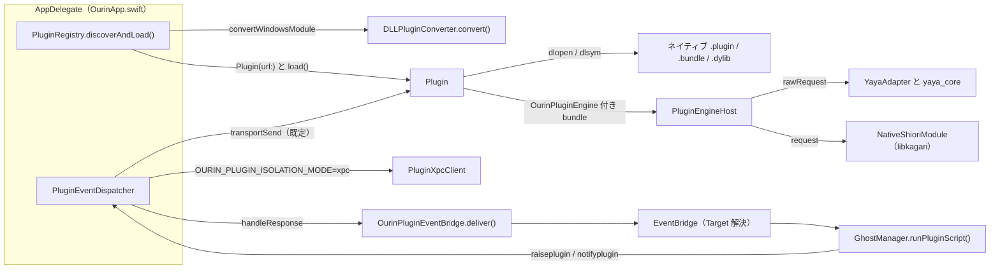
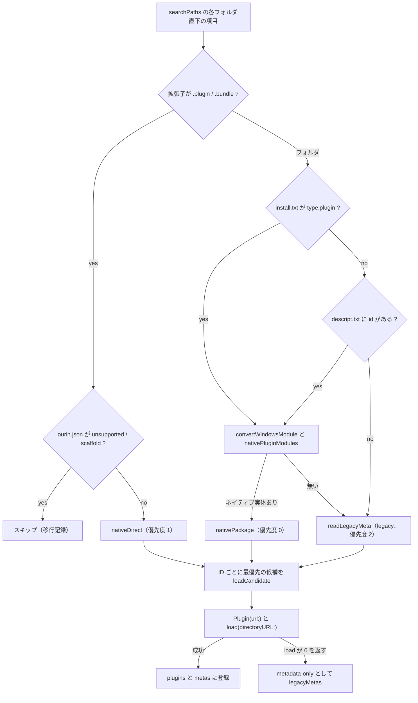
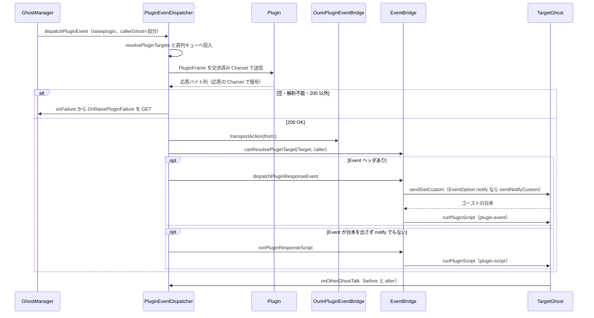

# 12 PLUGIN

関連ソースファイル

このページは次のファイルをもとに作成した。

- [Ourin/PluginHost/Plugin.swift](../../Ourin/PluginHost/Plugin.swift)
- [Ourin/PluginHost/PluginEngine.swift](../../Ourin/PluginHost/PluginEngine.swift)
- [Ourin/PluginHost/PluginProtocol.swift](../../Ourin/PluginHost/PluginProtocol.swift)
- [Ourin/PluginHost/PluginRegistry.swift](../../Ourin/PluginHost/PluginRegistry.swift)
- [Ourin/PluginHost/PluginXpcBackend.swift](../../Ourin/PluginHost/PluginXpcBackend.swift)
- [Ourin/PluginHost/DLLPluginConverter.swift](../../Ourin/PluginHost/DLLPluginConverter.swift)
- [Ourin/PluginEvent/PluginEventDispatcher.swift](../../Ourin/PluginEvent/PluginEventDispatcher.swift)
- [Ourin/PluginEvent/OurinPluginEventBridge.swift](../../Ourin/PluginEvent/OurinPluginEventBridge.swift)
- [Ourin/PluginEvent/PluginFrame.swift](../../Ourin/PluginEvent/PluginFrame.swift)
- [Ourin/PluginEvent/ListDelimiter.swift](../../Ourin/PluginEvent/ListDelimiter.swift)
- [Ourin/PluginEvent/PathNormalizer.swift](../../Ourin/PluginEvent/PathNormalizer.swift)
- [Ourin/PluginEvent/PluginEncodingNormalizer.swift](../../Ourin/PluginEvent/PluginEncodingNormalizer.swift)
- [Ourin/PluginEvent/WindowIDMapper.swift](../../Ourin/PluginEvent/WindowIDMapper.swift)
- [Ourin/Compat/UkagakaModuleABI.swift](../../Ourin/Compat/UkagakaModuleABI.swift)
- [Ourin/Compat/LegacyDescriptor.swift](../../Ourin/Compat/LegacyDescriptor.swift)
- [Ourin/NarInstall/Paths.swift](../../Ourin/NarInstall/Paths.swift)
- [Ourin/OurinApp.swift](../../Ourin/OurinApp.swift)
- [Ourin/Ghost/GhostManager.swift](../../Ourin/Ghost/GhostManager.swift)
- [Ourin/Ghost/GhostManager+System.swift](../../Ourin/Ghost/GhostManager+System.swift)
- [Ourin/Ghost/GhostManager+Window.swift](../../Ourin/Ghost/GhostManager+Window.swift)
- [Ourin/SHIORIEvents/EventBridge.swift](../../Ourin/SHIORIEvents/EventBridge.swift)
- [Ourin/RightClickMenu.swift](../../Ourin/RightClickMenu.swift)
- [Ourin/Property/PropertyManager.swift](../../Ourin/Property/PropertyManager.swift)
- [Ourin/ContentView.swift](../../Ourin/ContentView.swift)
- [Ourin/DevTools/DevToolsCommands.swift](../../Ourin/DevTools/DevToolsCommands.swift)
- [Ourin/Web/WebNarInstaller.swift](../../Ourin/Web/WebNarInstaller.swift)
- [Plugins/ScriptBridge/](../../Plugins/ScriptBridge/)（`build.sh`、`Info.plist`、`.gitignore`、`package/*`、`src/scriptbridge.c`）
- [engines/plugins/](../../engines/plugins/)（`catalog.json`、`generate.py`、`build.sh`、`prepare_collector.py`、`yaya_adapter.cpp`、`akari_adapter.cpp`、`akari_helper.cpp`、`ugm_http_helper.cpp`、`bouyomi_backend.hpp`、`local_tts_backend.hpp`、`verify_*.py`、`test_*.py`）
- [engines/plugin-native/](../../engines/plugin-native/)（`native_saori.mm`、`tmidi_plugin.mm`、`tmidi_windows_bridge.py`、`build.sh`、`build_tmidi.sh`、`test_native.py`、`test_tmidi.py`）
- [engines/tts/](../../engines/tts/)（`server.py`、`irodori_worker.py`、`SETUP.md`、`DEPENDENCIES.json`、`download_model.py`、`requirements-lock.txt`、`verify_plugins.py`、`test_server.py`、`test_irodori_worker.py`）
- [docs/SPEC_PLUGIN_2.0M_ja-jp.md](../../docs/SPEC_PLUGIN_2.0M_ja-jp.md)
- [docs/PLUGIN_EVENT_2.0M_SPEC_ja-jp.md](../../docs/PLUGIN_EVENT_2.0M_SPEC_ja-jp.md)
- [docs/PLUGIN_BRIDGE_COMPLETION_PLAN_ja-jp.md](../../docs/PLUGIN_BRIDGE_COMPLETION_PLAN_ja-jp.md)
- [docs/PLUGIN_COMPAT_FIX_PROPOSAL_ja-jp.md](../../docs/PLUGIN_COMPAT_FIX_PROPOSAL_ja-jp.md)
- [docs/compatibility-corpus/plugin-ports.md](../../docs/compatibility-corpus/plugin-ports.md)
- [Samples/PLUGIN_2_0M/xpc/PluginWorker.swift](../../Samples/PLUGIN_2_0M/xpc/PluginWorker.swift)

このページは、伺かの PLUGIN/2.0（Ourin の差分仕様では PLUGIN/2.0M）を Ourin がどう実装しているかを扱う。対象は、プラグインの探索とロード（`PluginRegistry`・`Plugin`）、ネイティブモジュールの呼び出し規約、Windows DLL プラグインを内蔵エンジンで動かす変換（`DLLPluginConverter`・`PluginEngineHost`）、ベースウェアイベントの配送（`PluginEventDispatcher`）、プラグイン応答のゴーストへの送り返し（`OurinPluginEventBridge`・`EventBridge`）である。リポジトリに同梱されている C 実装のプラグイン `Plugins/ScriptBridge` と、実在プラグインの移植用ツール群 `engines/plugins`・`engines/plugin-native`・`engines/tts` もここで扱う。

PLUGIN は SHIORI・SAORI と同じ「伺か DLL 共通 ABI」（`load` / `request` / `unload`）を使う。その macOS 版の読み替えは `UkagakaModuleABI` に集約されており、SAORI（[13 SAORI](./13-saori.md)）や HEADLINE と共有している。プラグインが返したスクリプトは GhostManager のさくらスクリプト実行（[7 さくらスクリプト](./07-sakura-script.md)）へ、`Event` 応答は SHIORI イベント（[9 SHIORI イベント](./09-shiori-events.md)）へ渡る。

## 全体構成

起動時に `AppDelegate` が `PluginRegistry` を作って `discoverAndLoad()` を呼び、ロード後に `PluginEventDispatcher` を作る。ディスパッチャには、応答のスクリプトとイベントをアクティブゴーストへ渡すコールバック（`onScript` / `onEmitEvent`）と、`raiseplugin` 失敗をゴーストへ返す `onFailure` が配線される。終了時は `pluginRegistry?.unloadAll()` の後に `pluginDispatcher?.stop()` でタイマーを止める。

| 型・ファイル | 役割 | 定義位置 |
|---|---|---|
| `PluginRegistry` | 探索・候補選択・ロード・メタデータ（`PluginMeta`）・メニュー項目 | `Ourin/PluginHost/PluginRegistry.swift` |
| `Plugin` | 1 モジュールのラッパー。`load` / `send` / `unload` と `get` / `notify` | `Ourin/PluginHost/Plugin.swift` |
| `PluginEngineKind` / `PluginEngineHost` | 変換 bundle を内蔵 YAYA / KAGARI で処理 | `Ourin/PluginHost/PluginEngine.swift` |
| `PluginRequest` / `PluginResponse` / `PluginProtocolParser` / `PluginProtocolBuilder` / `PluginWireCodec` | ワイヤテキストの型・解析・組立・文字コード | `Ourin/PluginHost/PluginProtocol.swift` |
| `OurinPluginXPC` / `PluginXpcClient` / `PluginIsolation` | 別プロセス実行用のクライアント側 | `Ourin/PluginHost/PluginXpcBackend.swift` |
| `PEImageInfo` / `DLLPluginConverter` | DLL の PE ヘッダ解析と `.plugin` 生成 | `Ourin/PluginHost/DLLPluginConverter.swift` |
| `PluginEventDispatcher` | ベースウェアイベントの組立・プラグインごとの直列送信・応答処理 | `Ourin/PluginEvent/PluginEventDispatcher.swift` |
| `PluginTransportAction` / `OurinPluginEventBridge` | 応答から Script/Event/Target を取り出して配送する規則 | `Ourin/PluginEvent/OurinPluginEventBridge.swift` |
| `PluginFrame` / `PluginSecurityLevel` | 要求フレームの組立 | `Ourin/PluginEvent/PluginFrame.swift` |
| `ListDelimiter` / `PathNormalizer` / `PluginEncodingNormalizer` / `WindowIDMapper` | 0x01 区切り、パス、文字コード、ウィンドウ ID | `Ourin/PluginEvent/*.swift` |
| `UkagakaModuleABI` | DLL 共通 ABI の macOS 読み替え（PLUGIN / SAORI / HEADLINE 共通） | `Ourin/Compat/UkagakaModuleABI.swift` |

**出典:** [Ourin/OurinApp.swift:136-142](../../Ourin/OurinApp.swift#L136-L142)、[Ourin/OurinApp.swift:431-465](../../Ourin/OurinApp.swift#L431-L465)、[Ourin/OurinApp.swift:574-579](../../Ourin/OurinApp.swift#L574-L579)

## PLUGIN/2.0(M) の要求と応答

### 要求フレーム

実運用の要求は `PluginFrame.build()` が組み立てる。要求行は SSP 本体と同じ `GET PLUGIN/2.0` / `NOTIFY PLUGIN/2.0` で、要求行を完全一致で判定するプラグインがあるため `2.0M` を付けない。ヘッダは次の順に並び、CRLF 区切りで空行終端する。

| 順 | ヘッダ | 値 |
|---|---|---|
| 1 | `Charset` | プラグインごとの送信文字コード（後述の交渉結果） |
| 2 | `ID` | イベント名 |
| 3 | `Sender` | ホスト発は `Ourin`（`PluginFrame.hostSender`）。ゴースト由来の `raiseplugin`・メニューの `OnMenuExec` 等はゴースト名 |
| 4 | `SecurityLevel` | `local`（既定）または `external`（`PluginSecurityLevel`） |
| 5 | `Language` | `Locale.preferredLanguages` の先頭から `Japanese` / `Chinese-Traditional` / `Chinese-Simplified` / `Hangeoul` / `English` |
| 6.. | `Reference0`… | 配列の順に連番 |

`PluginProtocolBuilder.buildRequest`（`Plugin.get` / `notify` が使う構造化 API）は別の組立で、`ID` → `Charset` → `Sender` → `Target` → `ReferenceN`（数値順に並べ替え）→ その他ヘッダ（キー順）を出す。`PluginRequest` の既定版表記は `PLUGIN/2.0`、`Plugin.get` の既定 `Sender` は `Host` である。

**出典:** [Ourin/PluginEvent/PluginFrame.swift:6-57](../../Ourin/PluginEvent/PluginFrame.swift#L6-L57)、[Ourin/PluginHost/PluginProtocol.swift:12-41](../../Ourin/PluginHost/PluginProtocol.swift#L12-L41)、[Ourin/PluginHost/PluginProtocol.swift:233-271](../../Ourin/PluginHost/PluginProtocol.swift#L233-L271)、[Ourin/PluginHost/Plugin.swift:136-158](../../Ourin/PluginHost/Plugin.swift#L136-L158)

### 応答の解析

`PluginProtocolParser.parseResponse` は先頭行を `版 ステータス 理由` に分け（版表記は問わない）、空行までのヘッダを読む。既知ヘッダは `PluginResponse` の個別フィールドに入り、それ以外（`Event`、`ReferenceN` など）は `otherHeaders` に残る。ヘッダ名の照合は大文字小文字を区別しない。

| フィールド | 応答ヘッダ | 用途 |
|---|---|---|
| `statusCode` / `statusMessage` | 先頭行 | 200 以外は失敗扱い（`raiseplugin` 経路では失敗イベントへ） |
| `charset` | `Charset` | 既定 `UTF-8`（解析上の既定。送信文字コードの交渉とは別） |
| `value` | `Value` | `version` の版、`property.get` の値。`Script` が無いとき台本の代わりにも使う |
| `script` / `scriptOption` | `Script` / `ScriptOption` | ゴーストで再生する台本と `nobreak`・`notranslate` 等 |
| `eventOption` / `target` | `EventOption` / `Target` | `notify` 指定、配送先ゴースト |
| `otherHeaders` | `Event`、`ReferenceN` ほか | ゴーストへ発火するイベントとその Reference |

**出典:** [Ourin/PluginHost/PluginProtocol.swift:44-79](../../Ourin/PluginHost/PluginProtocol.swift#L44-L79)、[Ourin/PluginHost/PluginProtocol.swift:171-225](../../Ourin/PluginHost/PluginProtocol.swift#L171-L225)

### 送信文字コードの交渉

文字列からバイト列への変換は `PluginWireCodec` が `EncodingAdapter`（[10 SSTP スタック](./10-sstp.md)）へ委ねる。応答は応答自身の `Charset` ヘッダ → 要求の文字コード → UTF-8 の順で復号する。送信側の文字コードは `PluginEventDispatcher` がプラグインごとに決める。

1. 初期値は descript.txt の `charset`。未指定なら SSP の省略時と同じ `Shift_JIS`（`declaredCharset`）。
2. 初期化時に全プラグインへ `version`（GET）を送り、応答に `Charset:` 行があればその値、無ければ `Shift_JIS` を以後の文字コードとして保存する（`negotiatedCharset`）。
3. 各要求は送信直前に同じ直列キュー上で組み立てるので、`version` 直後のイベントにも交渉結果が反映される。

**出典:** [Ourin/PluginHost/PluginProtocol.swift:91-106](../../Ourin/PluginHost/PluginProtocol.swift#L91-L106)、[Ourin/PluginEvent/PluginEventDispatcher.swift:45-72](../../Ourin/PluginEvent/PluginEventDispatcher.swift#L45-L72)、[Ourin/PluginEvent/PluginEventDispatcher.swift:150-161](../../Ourin/PluginEvent/PluginEventDispatcher.swift#L150-L161)、[Ourin/PluginEvent/PluginEventDispatcher.swift:270-286](../../Ourin/PluginEvent/PluginEventDispatcher.swift#L270-L286)

## プラグインの探索と descript.txt（PluginRegistry）

### 探索フォルダ

`PluginRegistry.searchPaths()` は次の 3 か所を順に返し、`discoverAndLoad()` は各フォルダの直下（1 階層）を列挙する。

| 順 | フォルダ | 備考 |
|---|---|---|
| 1 | `Bundle.main.builtInPlugInsURL`（`Ourin.app/Contents/PlugIns`） | アプリ同梱 |
| 2 | `~/Library/Application Support/Ourin/PlugIns` | 旧来の配置 |
| 3 | `OurinPaths.subdirectory("plugin")` | 公開リソースの `plugin/`。既定の基準は `~/Documents/Ourin`（使えなければ `~/Library/Application Support/Ourin`）。NAR の設置先と同じ（[15 NAR インストール](./15-nar-install.md)） |

**出典:** [Ourin/PluginHost/PluginRegistry.swift:584-597](../../Ourin/PluginHost/PluginRegistry.swift#L584-L597)、[Ourin/NarInstall/Paths.swift:45-102](../../Ourin/NarInstall/Paths.swift#L45-L102)

### 候補の収集と優先順位

各項目は `PluginCandidate` として ID ごとに集められ、ID ごとに優先度の最も高い 1 件だけがロードされる（同一 ID の二重ロード抑止。`PLUGIN_COMPAT_FIX_PROPOSAL` の修正 2）。

- `nativePluginModules` は descript.txt の `filename`（または `dllname`）から `UkagakaModuleABI.nativeModuleCandidates` で `Foo.dylib` / `libFoo.dylib` / `Foo.plugin` / `Foo.bundle` / `Foo.so` / `libFoo.so` を大小文字を区別せずに探し、`MZ` で始まる PE ファイルは除く。見つからなければフォルダ内の全 `.plugin` / `.bundle` を返す。
- `load` に渡すディレクトリは、package 候補ならプラグインのフォルダ、直置き候補なら bundle 自身のパスである（`loadCandidate`）。
- `load` が失敗したモジュールはメタデータだけ `isNative: false` で登録し、request / unload の対象から外す。
- `ourin.json` の `mode` が `unsupported` / `scaffold` の移行記録（Migrator が作る実行体なし雛形。[17 DevTools と Migrator](./17-devtools-migrator.md)）は実行対象にしない。

**出典:** [Ourin/PluginHost/PluginRegistry.swift:242-267](../../Ourin/PluginHost/PluginRegistry.swift#L242-L267)、[Ourin/PluginHost/PluginRegistry.swift:380-502](../../Ourin/PluginHost/PluginRegistry.swift#L380-L502)、[Ourin/PluginHost/PluginRegistry.swift:537-582](../../Ourin/PluginHost/PluginRegistry.swift#L537-L582)、[Ourin/PluginHost/PluginRegistry.swift:697-754](../../Ourin/PluginHost/PluginRegistry.swift#L697-L754)、[Ourin/Compat/UkagakaModuleABI.swift:82-153](../../Ourin/Compat/UkagakaModuleABI.swift#L82-L153)

### descript.txt と message.*.txt

descript.txt は `LegacyDescriptor.readDictionary` で読む（BOM・`charset,` 宣言・UTF-8・Shift_JIS の順に判定）。値は `LegacyDescriptor.literalValue` を通り、先頭が `\` / `%` の値は破棄、`\\` / `\%` は文字に戻る。`name`・`id`・`filename` のどれかが空ならメタデータを作らない。メタデータの descript.txt は、package ルート → bundle の `Resources/descript.txt` → モジュールと同じフォルダの順で探す。

| キー | `PluginMeta` のフィールド | 意味・既定 |
|---|---|---|
| `name` / `id` | `name` / `id` | 必須。`id` は重複抑止と Target 照合に使う |
| `filename`（別名 `dllname`） | `filename`、`compatibilityPath` | 必須。元 DLL 名。`compatibilityPath` は `pluginlist.index(n).path` が返す互換パス |
| `charset` | `charset` | 送信文字コードの初期値。未指定は Shift_JIS 扱い |
| `secondchangeinterval` | `secondChangeInterval` | `OnSecondChange` の秒間隔。未指定は 1、0 で送らない |
| `otherghosttalk` | `otherGhostTalk` / `otherGhostTalkTiming` | `0`/`false`/`no`/`off` で無効、`before` で発話前、それ以外の値は発話後（`after`） |
| `othersurfacechange` | `otherSurfaceChange` | 他ゴーストのサーフェス変更を受け取る |
| `craftman` / `craftmanw`、`craftmanurl` / `homeurl` | `craftman`、`craftmanURL` | 作者情報 |
| `menu`、`menu.<id>`、`menu.title` | `menuDefinitions` | ホストのプラグインメニュー項目（後述） |

`message.<言語>.txt` は `message.` で始まり `.txt` で終わるファイルを言語別辞書として読み、`ja*` / `japanese` は `japanese`、`en*` / `english` は `english` に正規化する。`PluginMeta.message(for:)` は指定言語 → OS の優先言語 → japanese → english → 任意の順で引く。`install.txt` は `InstallTxtParser` で読み、`type` と `directory` をメタデータに持つ。

`PluginCompatibilityEntry` は UI・プロパティ向けの互換ビューで、`native`（ロード済みなら true）・`executionState`（`native` / `metadataOnly`）・`canDispatchRequests`・`compatibilityPath`・`executablePath`・`packagePath` を持つ。プロパティシステムの `pluginlist.*` はこれを使う（[14 プロパティシステム](./14-property-resource.md)）。

**出典:** [Ourin/PluginHost/PluginRegistry.swift:50-160](../../Ourin/PluginHost/PluginRegistry.swift#L50-L160)、[Ourin/PluginHost/PluginRegistry.swift:599-695](../../Ourin/PluginHost/PluginRegistry.swift#L599-L695)、[Ourin/PluginHost/PluginRegistry.swift:756-787](../../Ourin/PluginHost/PluginRegistry.swift#L756-L787)、[Ourin/Compat/LegacyDescriptor.swift:4-40](../../Ourin/Compat/LegacyDescriptor.swift#L4-L40)、[Ourin/Property/PropertyManager.swift:95-125](../../Ourin/Property/PropertyManager.swift#L95-L125)

### プラグインメニュー

メニュー項目は descript.txt の `menu`（`,` または 0x01 区切りの項目 ID 列）、`menu.<id>`（表示名の既定値）、`message.*.txt` の `menu.<id>` キーから作る。どれも無く `menu.title` だけがある場合は、プラグイン ID を項目 ID にした 1 項目を作る。どれも無いプラグインはメニューに出ない。項目は `plugin_menu:<pluginID>:<itemID>`（パーセントエンコード）のアクション ID を持ち、右クリックメニュー（SwiftUI）とオーナードローメニューの両方に「プラグイン(P)」として並ぶ。metadata-only の項目は無効表示になる。選ぶと `GhostManager.executePluginMenuAction` が対象プラグインだけへ `OnMenuExec` を送る。

**出典:** [Ourin/PluginHost/PluginRegistry.swift:3-47](../../Ourin/PluginHost/PluginRegistry.swift#L3-L47)、[Ourin/PluginHost/PluginRegistry.swift:206-235](../../Ourin/PluginHost/PluginRegistry.swift#L206-L235)、[Ourin/PluginHost/PluginRegistry.swift:789-840](../../Ourin/PluginHost/PluginRegistry.swift#L789-L840)、[Ourin/RightClickMenu.swift:166-179](../../Ourin/RightClickMenu.swift#L166-L179)、[Ourin/Ghost/GhostManager+Window.swift:291-300](../../Ourin/Ghost/GhostManager+Window.swift#L291-L300)、[Ourin/Ghost/GhostManager.swift:5541-5570](../../Ourin/Ghost/GhostManager.swift#L5541-L5570)

## ネイティブモジュールの ABI（Plugin / UkagakaModuleABI）

`Plugin.init(url:)` は、まず bundle の Info.plist に `OurinPluginEngine` があるかを見て、あれば内蔵エンジン（次節）に任せる。無ければ `UkagakaModuleABI.executableURL` で実行体（`.plugin` / `.bundle` は `Contents/MacOS/<name>`、それ以外はそのパス）を求め、`dlopen(RTLD_NOW | RTLD_LOCAL)` で開く。CFBundle の識別子検索を使わないのは、`CFBundleIdentifier` の無い移植 bundle や単体 dylib を扱うためである。

| 規約（`UkagakaModuleABI.Convention`） | request の型 | 所有権 | 選ばれる条件 |
|---|---|---|---|
| `.ourin`（Ourin C ABI） | `const uchar* request(const uchar* buf, size_t len, size_t* out_len)` | 入力はホスト所有、戻り値はモジュール所有（ホストは複製するだけ） | bundle の既定。Info.plist `OurinModuleABI` = `ourin` / `native` |
| `.ukagaka`（Windows DLL 互換） | `void* request(void* h, long* len)` | 入力は `malloc` 確保でモジュールが free、戻り値はホストが複製後に `free` | 単体 `.dylib` の既定。`OurinModuleABI` = `ukagaka` / `hglobal` / `dll` / `windows` |

シンボルは名前の候補を順に試す。

| 関数 | 探すシンボル（先にあるものを採用） |
|---|---|
| request | `request`、`plugin_request`（無ければ例外 `request not found`） |
| load | `loadu`、`load`、`plugin_loadu`、`plugin_load`（無ければ成功扱い） |
| unload | `unloadu`、`unload`、`plugin_unloadu`、`plugin_unload` |

`load` は規約によらず `UkagakaModuleABI.callLoad` で呼ぶ。引数は `malloc` で確保した NUL 終端のディレクトリ文字列（UTF-8、末尾 `/` 付き）と長さで、所有権はモジュールへ移る。`int load(const char*)` しか受けない旧来の実装にも同じポインタが渡る。戻り値 0 はロード失敗。`Plugin` は `unload` を呼ぶが `dlclose` はしない。`Plugin` の等価性とハッシュは URL だけで決まる。

**出典:** [Ourin/PluginHost/Plugin.swift:3-90](../../Ourin/PluginHost/Plugin.swift#L3-L90)、[Ourin/PluginHost/Plugin.swift:92-127](../../Ourin/PluginHost/Plugin.swift#L92-L127)、[Ourin/PluginHost/Plugin.swift:167-175](../../Ourin/PluginHost/Plugin.swift#L167-L175)、[Ourin/Compat/UkagakaModuleABI.swift:4-80](../../Ourin/Compat/UkagakaModuleABI.swift#L4-L80)、[Ourin/Compat/UkagakaModuleABI.swift:155-160](../../Ourin/Compat/UkagakaModuleABI.swift#L155-L160)

## Windows DLL プラグインの変換（DLLPluginConverter / PluginEngineHost）

伺かのプラグインには、本体 DLL が汎用エンジン（YAYA・KAGARI）で処理は同梱の辞書に書かれているものが多い。DLL 自体は x86 の Windows コードで macOS では動かないが、同じエンジンの macOS 版に要求文をそのまま渡せば辞書は同じように動く。`PluginRegistry` はフォルダを走査するたびに `DLLPluginConverter.convert(pluginDirectory:)` を呼ぶ。

1. descript.txt の `filename` / `dllname` から元モジュールを大小文字無視で解決し、`PEImageInfo.read` で PE ヘッダだけを読む（実行しない）。読むのは CPU 種別（`0x014C` x86 / `0x8664` x64 / `0xAA64` arm64）、エクスポート名（最大 4096）、インポート DLL 名（最大 512）、本体に残る `YAYA` / `KAGARI` / `kagari` の文字列。
2. macOS 向けの候補（`Foo.dylib` 等）が既にあれば、それが `OurinPluginEngine` 付きなら `.converted`、そうでなければ `.nativeModuleExists` で終わる。
3. エンジン種別を、ファイル名の stem（`lib` 接頭辞を除く）が `yaya` / `aya` / `aya5` なら YAYA、`kagari` なら KAGARI、それ以外は埋め込み文字列で決める。決まらなければ `.unsupported`（CPU 種別と先頭 8 個のインポートを理由に残す）。
4. エクスポートに `request` と `load` / `loadu` が無ければ `.unsupported`。
5. DLL の隣に `<DLL名>.plugin/Contents/Info.plist` だけを書く（実行体は無い）。元の DLL・descript.txt・辞書は変更しない。

| Info.plist キー | 値 |
|---|---|
| `OurinPluginEngine` | `yaya` / `kagari` |
| `OurinOriginalModule` | 元の `filename` |
| `OurinOriginalMachine` / `OurinOriginalExports` / `OurinOriginalImports` | PE ヘッダの内容 |
| `OurinConverterVersion` | `1` |
| `CFBundleIdentifier` | `jp.ourin.converted-plugin.<id を英数字と - にしたもの>` |

結果は `PluginRegistry.conversionReports`（キーはフォルダのパス）とログ（`Plugin DLL converted:` / `Plugin DLL not convertible:`）に残る。

`PluginEngineHost` は `Plugin` から参照型として共有され、最初の `load` または `request` でエンジンを起動する。

- YAYA: `YayaAdapter` を起動し、`loadModule(root: DLL のフォルダ, configName: "<stem>.txt")` で辞書を読む（yaya.dll → yaya.txt）。要求は `EncodingAdapter.detectCharset`（既定 Shift_JIS）で復号して `rawRequest` で辞書の `request` へそのまま渡し、応答は応答自身の `Charset`（無ければ要求の文字コード）で書き戻す。yaya_core 側は [8.1 YAYA](./08a-yaya.md) を参照。
- KAGARI: 同梱の `libkagari.dylib`（`BundledShioriEngine.bundledURL(for: .kagari)`）を `NativeShioriModule` でプラグインのフォルダを指定して開き、要求バイト列をそのまま渡す（[8 SHIORI 層](./08-shiori-runtime.md)、[8.3 外部エンジン](./08c-external-engines.md)）。

**出典:** [Ourin/PluginHost/DLLPluginConverter.swift:7-130](../../Ourin/PluginHost/DLLPluginConverter.swift#L7-L130)、[Ourin/PluginHost/DLLPluginConverter.swift:140-249](../../Ourin/PluginHost/DLLPluginConverter.swift#L140-L249)、[Ourin/PluginHost/PluginEngine.swift:1-104](../../Ourin/PluginHost/PluginEngine.swift#L1-L104)、[Ourin/PluginHost/PluginRegistry.swift:504-522](../../Ourin/PluginHost/PluginRegistry.swift#L504-L522)

## イベント配送（PluginEventDispatcher）

### スレッドと送信経路

`PluginEventDispatcher` は初期化時に、その時点の `registry.plugins` ごとに直列キュー `plugin.queue.<ファイル名>` と `OnSecondChange` 用の `DispatchSourceTimer` を作り、続けて全プラグインへ `version` を送る。`sendFrame` は対象プラグインのキューへ非同期で積み、キュー上で文字コードを引いて `PluginFrame` を組み、`transportSend` で送る。3 秒を超えるとログに `timeout: <ID> >3s` を出すが、処理は打ち切らない。`raiseplugin` / `notifyplugin` 由来の要求（`reportsFailure: true`）だけは空応答・解析失敗・200 以外を失敗として報告する。応答の台本・イベントを処理する `handleResponse` へ進むのは GET だけで、NOTIFY の応答の台本は捨てる。

`transportSend` は XPC 分離が有効で、かつ内蔵エンジン型でないプラグインだけを `PluginXpcClient` へ送る。それ以外は `Plugin.send` でインプロセス実行する。

**出典:** [Ourin/PluginEvent/PluginEventDispatcher.swift:6-43](../../Ourin/PluginEvent/PluginEventDispatcher.swift#L6-L43)、[Ourin/PluginEvent/PluginEventDispatcher.swift:74-123](../../Ourin/PluginEvent/PluginEventDispatcher.swift#L74-L123)、[Ourin/PluginEvent/PluginEventDispatcher.swift:125-208](../../Ourin/PluginEvent/PluginEventDispatcher.swift#L125-L208)

### イベント一覧

| ID | 方式 | 送り先 | Reference | 発生元 |
|---|---|---|---|---|
| `version` | GET | 全ロード済み | なし | ディスパッチャ初期化 |
| `installedplugin` | NOTIFY | 全 | 1 プラグイン 1 Reference、`名前 0x01 ID`（metadata-only も含む） | `notifyPluginCatalogs`（起動時） |
| `installedghostname` | NOTIFY | 全 | Ref0 ゴースト名、Ref1 本体側名、Ref2 相方名（各 0x01 区切り） | 同上 |
| `installedballoonname` | NOTIFY | 全 | Ref0 バルーン名（0x01 区切り） | 同上 |
| `pluginpathlist` / `ghostpathlist` / `balloonpathlist` / `headlinepathlist` / `calendarskinpathlist` / `calendarpluginpathlist` | NOTIFY | 全 | 1 フォルダ 1 Reference（末尾 `/`）。plugin は `plugin/` と探索フォルダ、ghost 等は格納フォルダ | 同上 |
| `OnSecondChange` | GET | プラグインごと | なし | `secondchangeinterval` 秒ごとのタイマー |
| `OnGhostBoot` | GET | 全 | Ref0 CGWindowID 列（0x01）、Ref1 ゴースト名、Ref2 シェル名、Ref3 `fmoID`、Ref4 ゴーストフォルダ（末尾 `/`） | ゴースト起動完了時 |
| `OnGhostInfoUpdate` | NOTIFY | 全 | 同上 | 起動完了時（`OnGhostBoot` の直後） |
| `OnGhostExit` | NOTIFY | 全 | 同上 | ゴースト終了時 |
| `OnMenuExec` | GET | 選んだ項目のプラグインだけ | Ref0〜4 は同上、Ref5 に項目 ID（Ourin 拡張）。Sender はゴースト名 | プラグインメニュー |
| `OnInstallComplete` | GET | 全 | Ref0 種別、Ref1 名前、Ref2 パス（各 0x01 区切り。設置された全対象） | NAR インストール完了（アプリ・Web 経由） |
| `OnOtherGhostTalk` | GET | `otherghosttalk` が有効でタイミングが一致するもの | Ref0 ゴースト名、Ref1 本体側名、Ref2 原因（カンマ区切り）、Ref3 イベント ID、Ref4 台本、Ref5 Reference 群（0x01） | ゴーストの発話前後 |
| `OnOtherSurfaceChange` | GET | `othersurfacechange` が有効なもの | SHIORI の `OnOtherSurfaceChange` と同じ並び | `EventBridge` のサーフェス変更通知 |
| `OnChoiceSelect(Ex)` / `OnAnchorSelect(Ex)` / `\q` の任意 ID | GET | その台本を返したプラグイン（不明なら全） | SHIORI イベントと同じ | 選択肢・アンカーの選択 |
| `OnTrayBalloonClick` / `OnTrayBalloonTimeout` | GET | トレイバルーンを出したプラグイン | 通知 ID、タイトル（Click はメッセージも） | `\![set,trayballoon]` の結果 |
| `\![raiseplugin]` の任意名 | GET | 指定（下記） | 指定引数 | ゴーストのさくらスクリプト |
| `\![notifyplugin]` の任意名 | NOTIFY | 指定 | 指定引数 | 同上 |
| `property.get` / `property.set` | GET（同期） | ID / 名前 / パスで一致した 1 件 | Ref0 キー（set は Ref1 に値） | `pluginlist(...).ext.*` プロパティ |

`timerraiseplugin` / `timernotifyplugin` は `GhostManager.scheduleTimerPluginEvent` が `Timer` で遅延・反復させ、発火時に同じ `dispatchPluginEvent` を呼ぶ（間隔 0 で取り消し）。開発者向けの DevTools のプラグインコンソールは `onArbitraryEvent` で任意イベントを全プラグインへ送る。

**出典:** [Ourin/PluginEvent/PluginEventDispatcher.swift:288-484](../../Ourin/PluginEvent/PluginEventDispatcher.swift#L288-L484)、[Ourin/PluginEvent/PluginEventDispatcher.swift:542-560](../../Ourin/PluginEvent/PluginEventDispatcher.swift#L542-L560)、[Ourin/OurinApp.swift:777-820](../../Ourin/OurinApp.swift#L777-L820)、[Ourin/Web/WebNarInstaller.swift:180](../../Ourin/Web/WebNarInstaller.swift#L180)、[Ourin/Ghost/GhostManager.swift:5442-5458](../../Ourin/Ghost/GhostManager.swift#L5442-L5458)、[Ourin/Ghost/GhostManager.swift:1924-1933](../../Ourin/Ghost/GhostManager.swift#L1924-L1933)、[Ourin/Ghost/GhostManager.swift:3130-3183](../../Ourin/Ghost/GhostManager.swift#L3130-L3183)、[Ourin/Ghost/GhostManager+System.swift:1214-1230](../../Ourin/Ghost/GhostManager+System.swift#L1214-L1230)、[Ourin/Ghost/GhostManager+System.swift:1466-1484](../../Ourin/Ghost/GhostManager+System.swift#L1466-L1484)、[Ourin/Ghost/GhostManager+System.swift:1605-1613](../../Ourin/Ghost/GhostManager+System.swift#L1605-L1613)、[Ourin/Ghost/GhostManager+System.swift:2058-2087](../../Ourin/Ghost/GhostManager+System.swift#L2058-L2087)、[Ourin/OurinApp.swift:589-600](../../Ourin/OurinApp.swift#L589-L600)、[Ourin/SHIORIEvents/EventBridge.swift:379-380](../../Ourin/SHIORIEvents/EventBridge.swift#L379-L380)、[Ourin/ContentView.swift:1379-1387](../../Ourin/ContentView.swift#L1379-L1387)

### OnOtherGhostTalk の発火タイミング

GhostManager は台本の再生開始時に `beginPluginTalkNotification` で `before` 段の `OnOtherGhostTalk` を送り、再生キューが空になったとき（`emitPluginTalkAfterIfNeeded`）に `after` 段を送る。本文の無い台本では送らない。通常の SHIORI 応答（翻訳済み台本の再生）では原因が `owned`、プラグイン由来の台本では `ScriptOption` との共通部分（`plugin-script` / `plugin-event` / `notranslate`）が原因になる。`isEmittingPluginTalk` で再入を防ぐ。DEBUG ビルドでは、原因に仕様外の語（`break`、`communicate`、`sstp-send`、`owned`、`remote`、`notranslate`、`plugin-script`、`plugin-event` 以外）があると警告する。

**出典:** [Ourin/Ghost/GhostManager.swift:2331-2337](../../Ourin/Ghost/GhostManager.swift#L2331-L2337)、[Ourin/Ghost/GhostManager.swift:2480-2509](../../Ourin/Ghost/GhostManager.swift#L2480-L2509)、[Ourin/Ghost/GhostManager.swift:4950-4957](../../Ourin/Ghost/GhostManager.swift#L4950-L4957)、[Ourin/PluginEvent/PluginEventDispatcher.swift:430-461](../../Ourin/PluginEvent/PluginEventDispatcher.swift#L430-L461)

### raiseplugin / notifyplugin と失敗イベント

`\![raiseplugin,plugin,event,ref...]` / `\![notifyplugin,...]` はスクリプト再生キューの遅延コマンドとして積まれ、順番が来ると `GhostManager.dispatchPluginEvent` が呼ばれる。ディスパッチャがあれば `dispatch`（GET）または `dispatchNotifyPlugin`（NOTIFY 固定）を、呼び出し元ゴーストを `callerGhost` に入れて呼ぶ。宛先指定（`resolvePluginTargets`）は次のとおり。

| 指定 | 解決 |
|---|---|
| `random` | ロード済みからランダムに 1 件 |
| `lastinstalled` | `registry.plugins` の最後の 1 件 |
| それ以外 | `id` / `name` / `filename`（大小無視）、`compatibilityPath` / `executablePath` / `packagePath`（完全一致）、メタデータが無ければ bundle 名 |

一致が無ければ `notfound`、空応答・解析不能は `error`、200 以外はそのステータスコードを理由として `onFailure` が呼ばれ、呼び出し元ゴーストの SHIORI へ `OnRaisePluginFailure` / `OnNotifyPluginFailure` を GET で送る。Reference0〜2 は理由・プラグイン・イベント、Reference3 以降に元の引数が並ぶ。

ディスパッチャが無い場合（起動前など）は、`OurinPluginEventBridge.dispatch` / `dispatchNotify` が `Plugin.get` / `notify` で同期的に送る代替経路になる。

**出典:** [Ourin/Ghost/GhostManager+System.swift:1117-1212](../../Ourin/Ghost/GhostManager+System.swift#L1117-L1212)、[Ourin/PluginEvent/PluginEventDispatcher.swift:485-540](../../Ourin/PluginEvent/PluginEventDispatcher.swift#L485-L540)、[Ourin/PluginEvent/PluginEventDispatcher.swift:578-598](../../Ourin/PluginEvent/PluginEventDispatcher.swift#L578-L598)、[Ourin/PluginEvent/OurinPluginEventBridge.swift:33-129](../../Ourin/PluginEvent/OurinPluginEventBridge.swift#L33-L129)、[Ourin/OurinApp.swift:452-460](../../Ourin/OurinApp.swift#L452-L460)

### 補助型

| 型 | 内容 | 定義位置 |
|---|---|---|
| `ListDelimiter` | `split` / `join` をバイト値 0x01（U+0001）で行う。`installedplugin`・`OnInstallComplete`・ウィンドウ ID 列で使う | [Ourin/PluginEvent/ListDelimiter.swift:4-14](../../Ourin/PluginEvent/ListDelimiter.swift#L4-L14) |
| `PathNormalizer.posix` | `file://` と `/` 始まりはそのまま、相対は基準 URL から解決、それ以外は `URL(fileURLWithPath:)` | [Ourin/PluginEvent/PathNormalizer.swift:10-26](../../Ourin/PluginEvent/PathNormalizer.swift#L10-L26) |
| `PathNormalizer.directory` | `posix` の結果に末尾 `/` を付ける（`load` と同じ規約）。`OnGhostBoot` の Ref4 や `*pathlist` で使う | [Ourin/PluginEvent/PathNormalizer.swift:29-34](../../Ourin/PluginEvent/PathNormalizer.swift#L29-L34) |
| `PluginEncodingNormalizer` | `shift_jis` / `windows-31j` / `cp932` / `ms932` / `sjis` を CP932、それ以外を UTF-8 に対応付ける | [Ourin/PluginEvent/PluginEncodingNormalizer.swift:9-24](../../Ourin/PluginEvent/PluginEncodingNormalizer.swift#L9-L24) |
| `WindowIDMapper.ids` | 各キャラクターウィンドウの `windowNumber` を `CGWindowListCopyWindowInfo` で確かめて `CGWindowID` 文字列にし（無ければ `0`）、0x01 で連結する。Windows の HWND 列の代わり | [Ourin/PluginEvent/WindowIDMapper.swift:5-20](../../Ourin/PluginEvent/WindowIDMapper.swift#L5-L20) |

注意: `PluginEncodingNormalizer` は本番コードから呼ばれていない。実際の文字コード変換は `PluginWireCodec`（`EncodingAdapter`）が行う。

**出典:** [Ourin/PluginEvent/PluginEventDispatcher.swift:295-329](../../Ourin/PluginEvent/PluginEventDispatcher.swift#L295-L329)、[Ourin/PluginEvent/PluginEventDispatcher.swift:397-402](../../Ourin/PluginEvent/PluginEventDispatcher.swift#L397-L402)

## プラグイン応答のゴーストへの送り返し

GET の応答はステータス 200 のときだけ処理する。`OurinPluginEventBridge.transportAction` は `Script`（無ければ `Value`）を台本、`Event` ヘッダをイベント名、`ReferenceN` を `Reference<N>` に正規化し、`ScriptOption` / `EventOption` をカンマ・空白区切りの小文字集合にする。台本もイベントも無ければ何もしない。応答元のプラグイン ID は `originPluginID` に入り、その台本から出た選択肢・アンカーの横流し先になる。

`OurinPluginEventBridge.deliver` の規則は次のとおり。

1. `Event` があれば先にゴーストへ送る。`EventOption` に `notify` があれば NOTIFY（返った台本は無視）、無ければ GET。
2. GET の結果ゴーストが台本を返した場合、プラグインの `Script` は再生しない。台本が空だった場合だけ `Script` を再生する。`notify` 指定時は `Script` も再生しない。

`Target` の解決は `EventBridge.resolvePluginTarget` が行う。解決できない Target の応答は破棄する（ログ `ignored target:`）。

| `Target`（小文字化） | 配送先 |
|---|---|
| `baseware` / `ourin` | ベースウェア自身（何も実行せず処理済み扱い） |
| `__system_all_ghost__` / `system_all_ghost` / `all` | 起動中の全ゴースト |
| 空・`self`・`ghost`・`any`・`systemany` | 呼び出し元ゴースト → アクティブゴースト → 最初のセッション |
| その他 | `GhostManager.matchesPluginTarget` が一致するゴースト（ゴーストのパス・フォルダ名、descript の `name` / `id` / `title`、本体側・相方名、ウィンドウ番号） |

`GhostManager.runPluginScript` は原因（`plugin-script` / `plugin-event` / `notranslate`）を付けて `translateForDisplay` を通し（`notranslate` は翻訳処理側で扱う）、`ScriptOption: nobreak` なら再生中の台本を止めずに後ろへ積み、そうでなければ再生キューとバルーンを初期化してから再生する。システムイベント（`OnGhostBoot` など）の応答は `callerGhost` が無いので、空 Target はアクティブゴーストへ届く。

**出典:** [Ourin/PluginEvent/OurinPluginEventBridge.swift:3-16](../../Ourin/PluginEvent/OurinPluginEventBridge.swift#L3-L16)、[Ourin/PluginEvent/OurinPluginEventBridge.swift:155-217](../../Ourin/PluginEvent/OurinPluginEventBridge.swift#L155-L217)、[Ourin/PluginEvent/PluginEventDispatcher.swift:228-267](../../Ourin/PluginEvent/PluginEventDispatcher.swift#L228-L267)、[Ourin/SHIORIEvents/EventBridge.swift:924-1041](../../Ourin/SHIORIEvents/EventBridge.swift#L924-L1041)、[Ourin/Ghost/GhostManager.swift:2422-2478](../../Ourin/Ghost/GhostManager.swift#L2422-L2478)、[Ourin/OurinApp.swift:437-451](../../Ourin/OurinApp.swift#L437-L451)

## プロセス分離（PluginXpcBackend）

`PluginIsolation.resolvedXpcServiceName` は環境変数で分離モードを決める。既定はインプロセス実行である。

| 環境変数 | 効果 |
|---|---|
| `OURIN_PLUGIN_XPC_SERVICE` | 空でなければその mach サービス名を使う（最優先） |
| `OURIN_PLUGIN_ISOLATION_MODE=xpc` | 既定名 `jp.ourin.plugin` を使う |

`PluginXpcClient` は `NSXPCConnection(machServiceName:)` で `OurinPluginXPC.executePlugin(_:bundlePath:withReply:)` を呼び、セマフォで最大 5 秒待つ同期 API である。失敗時は nil を返し、ディスパッチャはインプロセスへ戻らず空応答として扱う（ログ `plugin XPC send failed`）。内蔵エンジン型は yaya_core が既に別プロセスか同梱モジュールなので、XPC を経由しない。

注意: リポジトリ内に `OurinPluginXPC` を実装するワーカー（XPC サービスのターゲット）は見当たらない。`Samples/PLUGIN_2_0M/xpc` の骨組みは `PluginWorker.roundTrip` という別のプロトコルである。このため、分離モードを有効にするには外部で同名サービスを用意する必要がある（未確認: 実運用例）。仕様書が XPC 分離を推奨する理由は、クラッシュ隔離と権限最小化である。

**出典:** [Ourin/PluginHost/PluginXpcBackend.swift:4-86](../../Ourin/PluginHost/PluginXpcBackend.swift#L4-L86)、[Ourin/PluginEvent/PluginEventDispatcher.swift:31-43](../../Ourin/PluginEvent/PluginEventDispatcher.swift#L31-L43)、[Samples/PLUGIN_2_0M/xpc/PluginWorker.swift:1-5](../../Samples/PLUGIN_2_0M/xpc/PluginWorker.swift#L1-L5)、[docs/SPEC_PLUGIN_2.0M_ja-jp.md:166-169](../../docs/SPEC_PLUGIN_2.0M_ja-jp.md#L166-L169)

## 同梱プラグイン Plugins/ScriptBridge

ScriptBridge は、他の伺か形式の辞書・台本を解釈してさくらスクリプトとして再生させる C 実装のプラグインである。Ourin C ABI（Info.plist `OurinModuleABI` = `ourin`）で、`load` / `loadu` / `unload` / `request` をエクスポートする。`build.sh` が arm64 + x86_64、macOS 10.15 以上の bundle を clang で作り（`-liconv`）、`build/ScriptBridge/`（`plugin/` に置くフォルダ）と `build/ScriptBridge.nar` を出力する。アプリ本体には組み込まれず、テスト（`OurinTests/ScriptBridgePluginTests.swift`）がビルドしてロードする。

| ID | 動作 | 応答 |
|---|---|---|
| `version` | 版を返す | `Value: ScriptBridge/1.0` |
| `OnMenuExec` | `scripts/` 内の `.txt` / `.kis` / `.kawari` / `.aya` / `.dic` / `.satori` を選択肢に並べ、選ぶと `\![raiseplugin,scriptbridge,OnScriptBridgePlay,ファイル]` を実行する台本を作る | `Script` |
| `OnScriptBridgePlay` | Ref0 ファイル（`scripts/` 優先、`..` 拒否）、Ref1 エントリ名、Ref2 形式（`auto` / `satori` / `kawari` / `aya` / `sakura`）、Ref3 乱数の種 | `Script` か 204 |
| `OnScriptBridgeEval` | Ref0 の本文（改行は U+0001）をその場で解釈 | `Script` か 204 |
| `OnScriptBridgeConvert` | Ref0 の旧仕様タグを現行タグへ変換 | `Value` か 204 |
| その他 | — | 204 |

解釈するのは基本構文だけである（里々の `＊` / `＠` / `（）` / `：`、華和梨の `name : 単語` / `${name}`、AYA の `関数 { "候補" }` / `%(関数)`、空行区切りのさくらスクリプト）。入力は UTF-8 として不正なら CP932 とみなして変換し、すべての出力に旧仕様タグ（`\q[ID][題]`、`\z`、`\a`、`\![move,X,Y,...]` 等）の現行形への変換をかける。応答は常に `PLUGIN/2.0M <status>` と `Charset: UTF-8` である。

注意: descript.txt に `menu` / `menu.title` が無く、`message.*.txt` も同梱していないため、`PluginRegistry.parseMenuDefinitions` の規則ではホストのプラグインメニューに項目が出ない。readme の「プラグインメニューから ScriptBridge を選ぶ」とは食い違う（推測: SSP のように全プラグインをメニューに並べるホストを想定した記述）。

**出典:** [Plugins/ScriptBridge/src/scriptbridge.c:1-25](../../Plugins/ScriptBridge/src/scriptbridge.c#L1-L25)、[Plugins/ScriptBridge/src/scriptbridge.c:192-216](../../Plugins/ScriptBridge/src/scriptbridge.c#L192-L216)、[Plugins/ScriptBridge/src/scriptbridge.c:845-966](../../Plugins/ScriptBridge/src/scriptbridge.c#L845-L966)、[Plugins/ScriptBridge/build.sh:1-17](../../Plugins/ScriptBridge/build.sh#L1-L17)、[Plugins/ScriptBridge/Info.plist:19-20](../../Plugins/ScriptBridge/Info.plist#L19-L20)、[Plugins/ScriptBridge/package/descript.txt:1-5](../../Plugins/ScriptBridge/package/descript.txt#L1-L5)、[Plugins/ScriptBridge/package/readme.txt:3-26](../../Plugins/ScriptBridge/package/readme.txt#L3-L26)

## 実在プラグインの移植ツール（engines/plugins）

`engines/plugins` は、利用者が別途入手した SSP 用プラグイン（YAYA 製・灯製）を、元の辞書を変更せずに包む macOS `.plugin` を生成する。Ourin はプラグイン本体を再配布せず、`catalog.json` には調査・検証結果だけを記録する。生成物は利用者のローカル（`build/plugin-ports/`、git 対象外）に置く。`PluginEngineHost`（アプリ内の変換）との違いは、helper プロセスを bundle 自身が起動し、Windows 依存機能を明示指定した代替実装だけに接続する点である。

### 生成と構成

`build.sh` は adapter dylib（`OurinYayaPlugin.dylib`、`OurinAkariPlugin.dylib`）と `akari_helper`、`ugm_http_helper` を Universal 2（macOS 13 以上、nlohmann/json と iconv が必要）でビルドし、ad-hoc 署名する。出力先は `OURIN_PLUGIN_BUILD_DIR`（既定 `build/engines/plugins`）。`prepare_collector.py` は YAYA 設定（`<DLL名>.txt`）から辞書一覧を集める collector を `scripts/corpus_probe` のソースから swiftc でビルドする。

`generate.py` の主な処理と生成される bundle は次のとおり。出力の既存・source 内への出力・シンボリックリンク・2 万項目超・512 MiB 超は拒否する。

| 生成物 | 内容 |
|---|---|
| `Contents/MacOS/OurinPluginAdapter` | `--adapter` の dylib をコピー |
| `Contents/Resources/payload/` | 元プラグインフォルダの完全コピー |
| `Contents/Resources/yaya_core` または `libakari.dylib` + `akari_helper` | エンジン helper |
| `Contents/Resources/adapter.json` | `engine`、`load`（collector の出力。`save_file` は `state/yaya-variables.json` に固定）、`saori_backends`、opt-in の `ugm_http_helper` / `bouyomi_tcp_backend` / `local_tts_backend` |
| `Contents/Resources/descript.txt` | 元の descript.txt のコピー |
| `Contents/Info.plist` | `OurinModuleABI` = `ourin`、`OurinPluginID`、`OurinPluginPortEngine`、`OurinPluginSourceURL`、`LSMinimumSystemVersion` 13.0 |

`--saori-backend module.dll=/path/to/trusted.dylib` は、辞書が呼ぶ SAORI 名を信頼済み dylib に対応付け、`backends/<sha256 先頭16桁>.dylib` として同梱する。`--local-tts-backend` は YAYA 限定で、他の helper backend と併用できない。

**出典:** [engines/plugins/build.sh:1-42](../../engines/plugins/build.sh#L1-L42)、[engines/plugins/prepare_collector.py:1-19](../../engines/plugins/prepare_collector.py#L1-L19)、[engines/plugins/generate.py:34-134](../../engines/plugins/generate.py#L34-L134)、[engines/plugins/generate.py:137-155](../../engines/plugins/generate.py#L137-L155)、[docs/compatibility-corpus/plugin-ports.md:67-90](../../docs/compatibility-corpus/plugin-ports.md#L67-L90)

### adapter と helper

| ファイル | 役割 |
|---|---|
| `yaya_adapter.cpp` | `plugin_loadu` が `dladdr` で自分の `Resources` を求め、`adapter.json` を読んで yaya_core を別プロセス（自前のプロセスグループ）で起動し、辞書を読ませる。期待した辞書が全部読めていなければロードを拒否する。`plugin_request` は要求の `Charset` から UTF-8 へ変換して `plugin_request` コマンドで渡し、応答をその `Charset` に戻す（上限 4 MiB、20 秒）。helper からの `host_op` は `execute`（UGM・Bouyomi・ローカル TTS の対応コマンドだけ）と `plugin`（SAORI 操作）だけを処理し、それ以外は `501 Host Capability Unavailable` |
| `akari_adapter.cpp` / `akari_helper.cpp` | 灯のエンジン（Swift 製 dylib）を 1 プロセス 1 エンジンで動かす。要求・応答は 16 進文字列で JSON-lines 中継し、helper は要求行の `2.0M` を `2.0` に直して `loadu` / `request` / `unload` を呼ぶ。Swift イメージは unload せずプロセス終了で解放する |
| `ugm_http_helper.cpp` | UkagakaGhostMessenger の `localweb/ugm_server.exe` の代わりに、`localweb/html` を 127.0.0.1 だけで GET/HEAD 配信する。ポートは `ugm_config.txt` の `localhost_number`（1024〜65535、9801・9821 は不可、既定 8000）。bind・listen に成功してから標準出力へ `READY <port>` を出し（adapter はこれを 3 秒待つ）、親プロセスが終わると止まる |
| `bouyomi_backend.hpp` | 棒読みちゃんプラグインの `proxy_ex.dll` 経由の `core.exe` 呼び出しを、標準音声 0〜8 の TCP コマンド（127.0.0.1、既定 50001、`OURIN_BOUYOMI_PORT`）に置き換える |
| `local_tts_backend.hpp` | CeVIO / A.I.VOICE プラグインの helper（`myserver.exe` / `server.exe`、`checkcevio.exe` / `check.exe`、`client.exe`）を、`engines/tts` の Irodori サービス（127.0.0.1、既定 50731、`OURIN_LOCAL_TTS_PORT`）への JSON-lines RPC に置き換える |

`catalog.json`（schema 1、2026-10-25 時点）は 15 件を記録する。各項目は配布 URL、作者、エンジン（`yaya` 11 件・`akari` 3 件・`native` 1 件）、ライセンス根拠、上流リビジョン、アーカイブ SHA-256、移植方針（`port_strategy`）、検証結果（`verification.status` は `partial` か `unsupported`、イベントごとの応答メタデータ）を持つ。集計では生成 15/15、ネイティブロード 13/15、GUI 検証 0 で、完全互換は主張しない。CeVIO / A.I.VOICE の 2 件は標準生成では Windows helper に依存するためロード拒否で、ローカル TTS backend を明示選択した場合だけロード・再生を確認している。

`verify_bundle.py` は実 bundle の `plugin_loadu` / `plugin_request` / `plugin_unload` を ctypes で呼び、応答の状態行・バイト数・SHA-256・ヘッダ名だけを出力する（台本本文は出さない）。`verify_ugm_bundle.py` / `verify_bouyomi_bundle.py` は使い捨てコピー上で UGM・Bouyomi の経路を検証する。`test_*.py` は自作辞書だけを使う回帰テストである。

**出典:** [engines/plugins/yaya_adapter.cpp:141-192](../../engines/plugins/yaya_adapter.cpp#L141-L192)、[engines/plugins/yaya_adapter.cpp:209-257](../../engines/plugins/yaya_adapter.cpp#L209-L257)、[engines/plugins/akari_adapter.cpp:73-93](../../engines/plugins/akari_adapter.cpp#L73-L93)、[engines/plugins/akari_helper.cpp:16-35](../../engines/plugins/akari_helper.cpp#L16-L35)、[engines/plugins/ugm_http_helper.cpp:1-2](../../engines/plugins/ugm_http_helper.cpp#L1-L2)、[engines/plugins/ugm_http_helper.cpp:89-110](../../engines/plugins/ugm_http_helper.cpp#L89-L110)、[engines/plugins/bouyomi_backend.hpp:96-120](../../engines/plugins/bouyomi_backend.hpp#L96-L120)、[engines/plugins/bouyomi_backend.hpp:176-213](../../engines/plugins/bouyomi_backend.hpp#L176-L213)、[engines/plugins/local_tts_backend.hpp:1-120](../../engines/plugins/local_tts_backend.hpp#L1-L120)、[engines/plugins/catalog.json:1-30](../../engines/plugins/catalog.json#L1-L30)、[engines/plugins/catalog.json:1412-1439](../../engines/plugins/catalog.json#L1412-L1439)、[engines/plugins/catalog.json:1507-1521](../../engines/plugins/catalog.json#L1507-L1521)、[engines/plugins/verify_bundle.py:1-73](../../engines/plugins/verify_bundle.py#L1-L73)

推測: 生成した `.plugin` は `plugin/` に直置きすると `nativeDirect` 候補になり、`Resources/descript.txt` の `id` で登録される（`peekID` と `readMeta` が bundle 内の descript.txt を読むため）。実アプリでの配置手順を示す文書は見当たらない。

## ネイティブ代替モジュール（engines/plugin-native）

| ファイル | 内容 |
|---|---|
| `native_saori.mm` | 移植プラグインの `--saori-backend` 用 SAORI dylib。`build.sh` が `OurinGetWindowTitle.dylib`（`proxy_ex` 経由の `getwindowtitle.exe` の代替。アクセシビリティ API で前面ウィンドウのタイトルを取得。権限が無ければ 420、取得できなければ 503 で、権限の要求や変更はしない）と `OurinSendTalk.dylib`（`../sendtalk.exe` の代替。棒読みちゃん TCP コマンド 1 を 127.0.0.1 へ送る）の 2 つを作る。`GET Version` と `EXECUTE` だけを受ける。GetWindowTitle 版は `/charset` 指定を受理だけする（応答は常に UTF-8）。対応表に無い引数は 501。Ourin ABI（`loadu` / `request` / `unload`） |
| `tmidi_plugin.mm` / `build_tmidi.sh` | tmidi_msg（TMIDI Player の曲名通知）の受信部の独自実装。`OnSecondChange` のたびに loopback TCP の bridge（`OURIN_TMIDI_BRIDGE_PORT` か `Resources/tmidi-bridge.json` の `port`）へ `ourin-tmidi-dde/1` の snapshot を問い合わせ、再生ファイルが変わったら `sstp_sample.txt` のテンプレート（`$title` / `$format`）から台本を作る。bridge 未設定は `503 X-Ourin-Error: tmidi_bridge_not_configured` |
| `tmidi_windows_bridge.py` | Windows + TMIDI Player 上で動く読み取り専用の DDE クライアント（既定ポート 50002、loopback のみ。Mac からは SSH ポート転送で接続する）。macOS の回帰では Windows 実行を検証していない |
| `test_native.py` / `test_tmidi.py` | 実プロセスの ABI・TCP・状態遷移の回帰 |

**出典:** [engines/plugin-native/build.sh:1-13](../../engines/plugin-native/build.sh#L1-L13)、[engines/plugin-native/native_saori.mm:1-34](../../engines/plugin-native/native_saori.mm#L1-L34)、[engines/plugin-native/native_saori.mm:74-103](../../engines/plugin-native/native_saori.mm#L74-L103)、[engines/plugin-native/native_saori.mm:161-205](../../engines/plugin-native/native_saori.mm#L161-L205)、[engines/plugin-native/tmidi_plugin.mm:41-58](../../engines/plugin-native/tmidi_plugin.mm#L41-L58)、[engines/plugin-native/tmidi_plugin.mm:157-239](../../engines/plugin-native/tmidi_plugin.mm#L157-L239)、[engines/plugin-native/build_tmidi.sh:1-20](../../engines/plugin-native/build_tmidi.sh#L1-L20)、[engines/plugin-native/tmidi_windows_bridge.py:1-19](../../engines/plugin-native/tmidi_windows_bridge.py#L1-L19)

## ローカル TTS サーバー（engines/tts）

CeVIO / A.I.VOICE プラグインが前提とする Windows 製品の代わりに、Apple Silicon 上の Irodori-TTS（MLX）で発声する任意導入のランタイムである。製品の音声そのものは再現しない。

| ファイル | 役割 |
|---|---|
| `server.py` | 127.0.0.1（既定ポート 50731）の JSON-lines TCP サーバー。`product`（`cevio` / `aivoice`）と `session` を検証し、`status` / `start` / `check` / `stop` / `client` を処理する。`client` は `GetCharList` 等の問い合わせか発話要求で、発話は区切って worker に生成させ、ffmpeg で速度・音程・音量を加工し `afplay` で再生する（`--no-play` で生成のみ） |
| `irodori_worker.py` | モデルを読み込んで常駐し、標準入力の JSON 1 行ごとに WAV を生成するオフライン worker。声は `IrodoriAkari` / `IrodoriAoi` / `IrodoriNagi` の 3 種、1 要求 240 文字・生成 30 秒まで。マーカーファイルと `SIGUSR1` で協調的に取り消せる |
| `download_model.py` / `DEPENDENCIES.json` / `requirements-lock.txt` | 固定リビジョンのモデル取得と SHA-256 検証、Python 3.13.11・mlx-audio 0.6.1・MLX 0.32.4 の固定 |
| `verify_plugins.py` | 生成済みの CeVIO / AIVOICE bundle を使い捨てコピーで動かし、稼働中のサーバーを通した検証結果をハッシュ等で出す |
| `SETUP.md` / `test_server.py` / `test_irodori_worker.py` | 導入手順とプロトコル回帰（worker のテストはモデルを読み込まない） |

`engines/plugins/local_tts_backend.hpp` がこのサーバーの RPC クライアントで、移植 bundle を `--local-tts-backend` 付きで生成したときだけ使われる。

**出典:** [engines/tts/server.py:1-35](../../engines/tts/server.py#L1-L35)、[engines/tts/server.py:145-157](../../engines/tts/server.py#L145-L157)、[engines/tts/server.py:238-288](../../engines/tts/server.py#L238-L288)、[engines/tts/server.py:320-341](../../engines/tts/server.py#L320-L341)、[engines/tts/server.py:420-443](../../engines/tts/server.py#L420-L443)、[engines/tts/irodori_worker.py:1-30](../../engines/tts/irodori_worker.py#L1-L30)、[engines/tts/SETUP.md:1-89](../../engines/tts/SETUP.md#L1-L89)、[engines/tts/DEPENDENCIES.json:1-42](../../engines/tts/DEPENDENCIES.json#L1-L42)、[engines/tts/verify_plugins.py:1-6](../../engines/tts/verify_plugins.py#L1-L6)

## 既存ドキュメントとの食い違い

| 文書の記述 | コードの実態 |
|---|---|
| `SPEC_PLUGIN_2.0M` §6: 先頭行は `PLUGIN/2.0M`、Charset 未指定時は UTF-8 | 要求行は `PLUGIN/2.0`。送信文字コードの既定は Shift_JIS（同じ文書の §13 チェックリストと §19.2 はコードと一致） |
| `PLUGIN_EVENT_2.0M_SPEC` §2: 既定は UTF-8、改行は LF 推奨 | 既定 Shift_JIS、送信は常に CRLF |
| `PLUGIN_EVENT_2.0M_SPEC` §6: 既定タイムアウト 3 秒で応答無しなら次のイベントへ | 3 秒超はログ警告だけで、送信は打ち切らない（XPC 経由のみ 5 秒で打ち切り） |
| `PLUGIN_EVENT_2.0M_SPEC` §7 の例: Reference0 の CGWindowID 列がカンマ区切り | 0x01 区切り（`WindowIDMapper`） |
| `SPEC_PLUGIN_2.0M` §8・§11.2: `OnSecondChange` は NOTIFY 強制 | ディスパッチャは GET で送り、応答の台本を処理する。NOTIFY で送る `PluginRegistry.dispatchOnSecondChange` はアプリから呼ばれていない |
| `SPEC_PLUGIN_2.0M` §12.2: `descript.txt` の `secondchange.interval` を解析 | 読むキーは `secondchangeinterval` |
| `SPEC_PLUGIN_2.0M` §12.2: `PluginRegistry.swift` でイベントディスパッチを実装 | `PluginRegistry.dispatchGet` 等はテストからしか呼ばれず、実配送は `PluginEventDispatcher` |
| `SPEC_PLUGIN_2.0M` §12.1: XPC 隔離は実装済み | クライアントだけで、`OurinPluginXPC` のワーカーはリポジトリに無い |
| `PluginEventDispatcher` のコメント: `GhostManager+System.swift:173-187` と同じルーティング規則、`shouldHandleTarget` を再利用 | 実際の判定は `EventBridge.resolvePluginTarget`。`shouldHandleTarget` はテストからしか呼ばれない |

**出典:** [docs/SPEC_PLUGIN_2.0M_ja-jp.md:108-111](../../docs/SPEC_PLUGIN_2.0M_ja-jp.md#L108-L111)、[docs/SPEC_PLUGIN_2.0M_ja-jp.md:138-144](../../docs/SPEC_PLUGIN_2.0M_ja-jp.md#L138-L144)、[docs/SPEC_PLUGIN_2.0M_ja-jp.md:195-259](../../docs/SPEC_PLUGIN_2.0M_ja-jp.md#L195-L259)、[docs/SPEC_PLUGIN_2.0M_ja-jp.md:274-276](../../docs/SPEC_PLUGIN_2.0M_ja-jp.md#L274-L276)、[docs/PLUGIN_EVENT_2.0M_SPEC_ja-jp.md:43-46](../../docs/PLUGIN_EVENT_2.0M_SPEC_ja-jp.md#L43-L46)、[docs/PLUGIN_EVENT_2.0M_SPEC_ja-jp.md:139-161](../../docs/PLUGIN_EVENT_2.0M_SPEC_ja-jp.md#L139-L161)、[Ourin/PluginHost/PluginRegistry.swift:323-338](../../Ourin/PluginHost/PluginRegistry.swift#L323-L338)、[Ourin/PluginEvent/PluginEventDispatcher.swift:162-168](../../Ourin/PluginEvent/PluginEventDispatcher.swift#L162-L168)、[Ourin/PluginEvent/OurinPluginEventBridge.swift:138-153](../../Ourin/PluginEvent/OurinPluginEventBridge.swift#L138-L153)

`PLUGIN_BRIDGE_COMPLETION_PLAN` のチェックリストは全項目 ✅ だが、同文書の 2026-07-08 監査記録は、fixture や plugin menu 統合などが実装より先に ✅ になっていたことを認めている。現在の fixture は `OurinTests/Fixtures/plugin/` と `PluginBridgeIntegrationTests` などに実在する（[18 テスト](./18-testing.md)）。

**出典:** [docs/PLUGIN_BRIDGE_COMPLETION_PLAN_ja-jp.md:425-463](../../docs/PLUGIN_BRIDGE_COMPLETION_PLAN_ja-jp.md#L425-L463)

## 制約と注意点

- Windows の DLL / PE プラグインの機械語は実行しない。汎用エンジン DLL（YAYA・KAGARI）だけを内蔵エンジンへ置き換え、独自コードの DLL（`akari.dll` も内蔵エンジンが無いので対象外）は metadata-only として一覧に出るだけである。Win32 API（ウィンドウ列挙、レジストリ、COM、名前付きパイプ等）に依存する辞書は動かない。
- 再読み込み（設定画面・DevTools の reload）は `PluginRegistry.unloadAll()` と `discoverAndLoad()` だけを呼び、`PluginEventDispatcher` は作り直さない。キュー・タイマー・交渉済み文字コードは初期化時のプラグイン集合のままで、新たに追加されたプラグインはキューが無いため配送されず、`version` も再送されない（`Plugin` の等価性は URL なので、同じパスのものはキューを引き継ぐ）。推測: タイマーが保持する旧 `Plugin` 値で送るため、内蔵エンジン型ではアンロード済みのエンジンが `request` 時に再起動し得る。
- descript.txt に `id` が無いプラグインは候補キーが空文字列にまとまり、その中で 1 件しかロードされない。
- `propertyGet` / `propertySet` はプラグインの直列キューを通らず、呼び出しスレッドで同期送信する。同じプラグインへのキュー上の要求と並行し得る。
- `Plugin` は `unload` を呼んでも `dlclose` しない。
- 推測: `Event` 応答のゴーストへの送信が台本を返さなかった場合、`onEmitEvent` 経由でアクティブゴーストへ同じイベントをもう一度送る（`AppDelegate` の配線は Target を渡さず、`EventOption` を `ScriptOption` として渡している）。
- `OnOtherGhostTalk` の Ref3（イベント ID）と Ref5（Reference 群）は、現在の呼び出し元がどこも値を渡さないため常に空である。
- XPC 分離モードは、外部にワーカーを用意しない限り全要求が失敗する。

**出典:** [Ourin/ContentView.swift:97-104](../../Ourin/ContentView.swift#L97-L104)、[Ourin/DevTools/DevToolsCommands.swift:61-85](../../Ourin/DevTools/DevToolsCommands.swift#L61-L85)、[Ourin/PluginEvent/PluginEventDispatcher.swift:84-90](../../Ourin/PluginEvent/PluginEventDispatcher.swift#L84-L90)、[Ourin/PluginEvent/PluginEventDispatcher.swift:136-148](../../Ourin/PluginEvent/PluginEventDispatcher.swift#L136-L148)、[Ourin/PluginEvent/PluginEventDispatcher.swift:249-265](../../Ourin/PluginEvent/PluginEventDispatcher.swift#L249-L265)、[Ourin/PluginHost/PluginRegistry.swift:261-266](../../Ourin/PluginHost/PluginRegistry.swift#L261-L266)、[Ourin/OurinApp.swift:443-451](../../Ourin/OurinApp.swift#L443-L451)、[docs/SPEC_PLUGIN_2.0M_ja-jp.md:403-440](../../docs/SPEC_PLUGIN_2.0M_ja-jp.md#L403-L440)

## 関連ページ

- [13 SAORI](./13-saori.md) — 同じ DLL 共通 ABI を使う SAORI ホストと `proxy_ex` 内蔵実装
- [8 SHIORI 層（USL）](./08-shiori-runtime.md) — `UkagakaModuleABI`・`NativeShioriModule`・`BundledShioriEngine`
- [8.1 YAYA](./08a-yaya.md) — 変換プラグインを処理する yaya_core と `raw_request`
- [8.3 SHIOLINK・里珠・追加栞・華和梨/篝/Aosora](./08c-external-engines.md) — KAGARI・灯エンジンの同梱
- [7 さくらスクリプト](./07-sakura-script.md) — `\![raiseplugin]` / `\![notifyplugin]` と台本の再生
- [9 SHIORI イベント](./09-shiori-events.md) — `EventBridge` と `OnRaisePluginFailure` 等
- [14 プロパティシステムとリソース](./14-property-resource.md) — `pluginlist.*` と `property.get` / `property.set`
- [15 NAR インストールとパッケージ管理](./15-nar-install.md) — `plugin/` 設置先と `OnInstallComplete`
- [17 DevTools と Ourin Migrator](./17-devtools-migrator.md) — プラグインコンソールと移行記録（`ourin.json`）
- [18 テストと互換性検証](./18-testing.md) — プラグイン fixture と互換性コーパス
