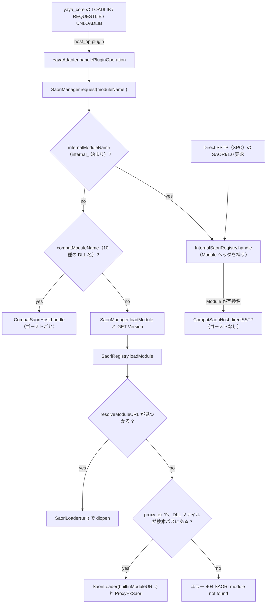
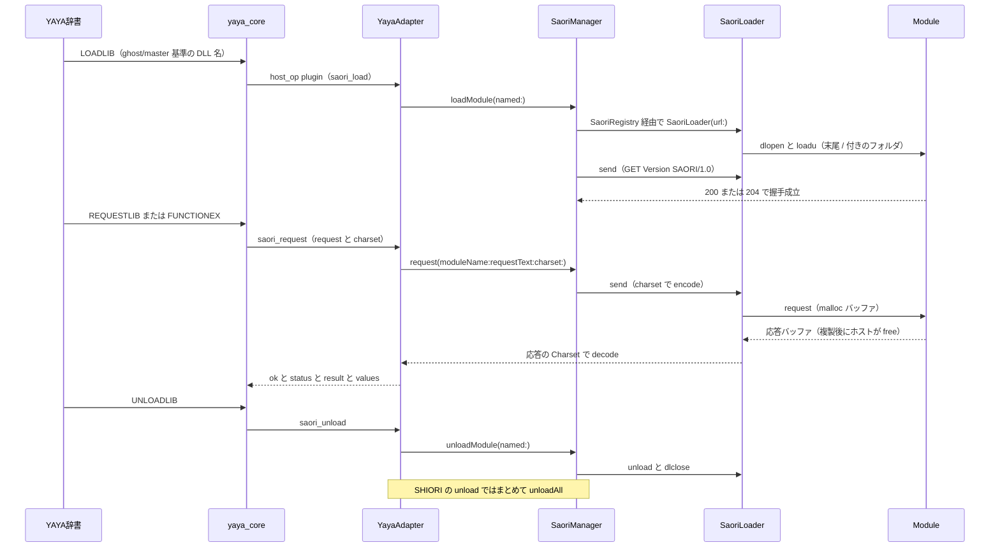

# 13 SAORI

<details>
<summary>関連ソースファイル</summary>

このページは次のファイルをもとに作成した。

- [Ourin/SaoriHost/SaoriProtocol.swift](../../Ourin/SaoriHost/SaoriProtocol.swift)
- [Ourin/SaoriHost/SaoriLoader.swift](../../Ourin/SaoriHost/SaoriLoader.swift)
- [Ourin/SaoriHost/SaoriManager.swift](../../Ourin/SaoriHost/SaoriManager.swift)
- [Ourin/SaoriHost/SaoriRegistry.swift](../../Ourin/SaoriHost/SaoriRegistry.swift)
- [Ourin/SaoriHost/BuiltinSaori.swift](../../Ourin/SaoriHost/BuiltinSaori.swift)
- [Ourin/SaoriHost/Internal/](../../Ourin/SaoriHost/Internal/)（`InternalSaori.swift`、`InternalSaoriModules.swift`、`InternalSaoriCodec.swift`、`InternalTimeModule.swift`、`InternalDataModule.swift`、`InternalCryptoModule.swift`、`InternalCryptoSupport.swift`、`InternalCryptoPasswords.swift`、`InternalCryptoProtect.swift`、`InternalCryptoKeyAgreement.swift`、`InternalJWTModule.swift`、`InternalFileModule.swift`、`InternalSHA3.swift`、`InternalBlake2.swift`、`InternalScrypt.swift`、`InternalArgon2.swift`、`InternalArgon2Core.swift`、`InternalBcrypt.swift`、`BlowfishTables.swift`、`InternalUnixCrypt.swift`、`InternalDES.swift`、`InternalEd25519.swift`、`InternalSecp256k1.swift`、`InternalBigInt.swift`、`InternalRSA.swift`、`InternalKeyCodec.swift`、`RawInflate.swift`）
- [Ourin/SaoriHost/Compat/](../../Ourin/SaoriHost/Compat/)（`CompatSaori.swift`、`CompatSimpleModules.swift`、`CompatHanayuModule.swift`、`CompatHttpcModule.swift`、`CompatMCIAudioModule.swift`、`CompatStringModule.swift`、`CompatNetwork.swift`）
- [Ourin/Compat/UkagakaModuleABI.swift](../../Ourin/Compat/UkagakaModuleABI.swift)
- [Ourin/SSTP/EncodingAdapter.swift](../../Ourin/SSTP/EncodingAdapter.swift)
- [Ourin/Yaya/YayaAdapter.swift](../../Ourin/Yaya/YayaAdapter.swift)
- [Ourin/PluginHost/PluginEngine.swift](../../Ourin/PluginHost/PluginEngine.swift)
- [Ourin/USL/SatoriAdapter.swift](../../Ourin/USL/SatoriAdapter.swift)
- [Ourin/SSTP/DirectSSTPXPC.swift](../../Ourin/SSTP/DirectSSTPXPC.swift)
- [Ourin/ExternalServer/OurinExternalServer.swift](../../Ourin/ExternalServer/OurinExternalServer.swift)
- [Ourin/ExternalServer/XpcDirectServer.swift](../../Ourin/ExternalServer/XpcDirectServer.swift)
- [Ourin/SSTP/HTTPBridge.swift](../../Ourin/SSTP/HTTPBridge.swift)
- [Ourin/SSTP/SSTPListener.swift](../../Ourin/SSTP/SSTPListener.swift)
- [Ourin/NarInstall/Paths.swift](../../Ourin/NarInstall/Paths.swift)
- [yaya_core/src/VM.cpp](../../yaya_core/src/VM.cpp)
- [satori_core/src/main.cpp](../../satori_core/src/main.cpp)
- [satori_core/PATCHES.md](../../satori_core/PATCHES.md)
- [README.md](../../README.md)
- [docs/SAORI_IMPLEMENTATION_ja-jp.md](../../docs/SAORI_IMPLEMENTATION_ja-jp.md)
- [docs/THIRD_PARTY_TRUST_MODEL_ja-jp.md](../../docs/THIRD_PARTY_TRUST_MODEL_ja-jp.md)

</details>

このページは、ゴーストの辞書から呼ばれる外部関数モジュール SAORI/1.0 を Ourin がどう扱うかを説明する。範囲は `Ourin/SaoriHost/` の全体で、プロトコル（`SaoriProtocol`）、ネイティブ dylib のロード（`SaoriLoader`）、ゴーストごとのインスタンス管理（`SaoriManager`）、モジュール名の解決（`SaoriRegistry`）、Windows 専用の汎用 SAORI の内蔵代替（`BuiltinSaori`）、UKADOC の「内蔵モジュール」（`Internal/`）、よく使われた Windows SAORI DLL の互換実装（`Compat/`）を扱う。

macOS では Windows の SAORI DLL（PE 形式）を読み込めない。そこで Ourin は、DLL 名を macOS ネイティブのモジュール（`.dylib` など）へ読み替えるか、ベースウェア内蔵の実装で同じ振る舞いをさせる。README は SAORI ホストを ukatech/csaori の境界（入力の文字コード、戻り値、モジュールのロード・アンロード）に合わせると定めている。SAORI を呼ぶ側の辞書処理系は [8.1 YAYA](./08a-yaya.md) と [8.2 里々](./08b-satori.md)、同じ DLL 共通 ABI を使うプラグインは [12 PLUGIN](./12-plugin.md) を参照。

**出典:** [README.md:35](../../README.md#L35)、[README.md:60-61](../../README.md#L60-L61)

## 全体構成

SaoriHost を使うのは主に `YayaAdapter`（YAYA ゴーストの SHIORI ランタイム）で、インスタンスごとに 1 つの `SaoriManager` を持つ。`SaoriManager.request` は、モジュール名を内蔵モジュール → 互換モジュール → ファイルとして解決するモジュールの順に振り分ける。



| 型 | 役割 | 定義位置 |
|---|---|---|
| `SaoriRequest` / `SaoriResponse` / `SaoriProtocol` | 要求・応答の型、解析と組立、文字コード変換 | `Ourin/SaoriHost/SaoriProtocol.swift` |
| `SaoriLoader` | 1 モジュールの dlopen / load / request / unload、または内蔵ハンドラ | `Ourin/SaoriHost/SaoriLoader.swift` |
| `SaoriRegistry` | 検索パス、名前解決、ローダーのキャッシュ | `Ourin/SaoriHost/SaoriRegistry.swift` |
| `SaoriManager` | 呼び出し口。振り分け、`GET Version` の握手、`execute`、yaya_core の操作 | `Ourin/SaoriHost/SaoriManager.swift` |
| `BuiltinSaori` / `ProxyExSaori` | `proxy_ex.dll` の内蔵代替 | `Ourin/SaoriHost/BuiltinSaori.swift` |
| `InternalSaoriRegistry` ほか | `internal_*` モジュールの枠組みと 8 モジュール | `Ourin/SaoriHost/Internal/` |
| `CompatSaoriRegistry` / `CompatSaoriHost` ほか | Windows SAORI DLL 10 種の互換実装 | `Ourin/SaoriHost/Compat/` |

**出典:** [Ourin/SaoriHost/SaoriManager.swift:84-98](../../Ourin/SaoriHost/SaoriManager.swift#L84-L98)、[Ourin/SaoriHost/SaoriRegistry.swift:88-136](../../Ourin/SaoriHost/SaoriRegistry.swift#L88-L136)、[Ourin/SaoriHost/Internal/InternalSaori.swift:145-156](../../Ourin/SaoriHost/Internal/InternalSaori.swift#L145-L156)、[Ourin/Yaya/YayaAdapter.swift:55](../../Ourin/Yaya/YayaAdapter.swift#L55)

## SAORI/1.0 の要求と応答

SAORI/1.0 は HTTP に似た CRLF 区切りのテキストで、Ourin が扱う形は次のとおり。

```text
EXECUTE SAORI/1.0                      GET Version SAORI/1.0
Argument0: <関数名やコマンド>            Charset: UTF-8
Argument1: ...                         Sender: Ourin
Charset: UTF-8
Sender: Ourin
SecurityLevel: local   （任意）
SecurityOrigin: ...    （任意）

SAORI/1.0 200 OK
Charset: UTF-8
Result: <戻り値>
Value0: <追加の戻り値>
```

| 要素 | 扱い |
|---|---|
| 要求行 | `SaoriProtocol.parseRequest` は `METHOD VERSION` と `METHOD TARGET VERSION`（`GET Version SAORI/1.0`）の 2 形を受ける |
| `ArgumentN` | `SaoriManager.execute` が配列の順に `Argument0`… を作る。内蔵・互換モジュールは `Argument0` から連続する番号だけを読む（欠番で止まる）。`proxy_ex` は `Argument0`〜`Argument63` を調べ、欠番は飛ばして詰める |
| `Charset` | 要求の文字コード。応答側も `Charset` で自分の文字コードを示す |
| `Sender` | `execute` と `GET Version` の握手では `Ourin` |
| `SecurityLevel` / `SecurityOrigin` | `execute` の引数で指定されたときだけ付ける |
| `Result` / `ValueN` | 戻り値と追加の戻り値。YAYA では `Result` が関数値、`ValueN` が `valueex` になる |
| `ErrorDescription` | 内蔵・互換モジュールが 400 / 500 で返す英語の理由 |
| 状態コード | `SaoriProtocol.statusMessage`: 200 OK、204 No Content、400 Bad Request、401 Unauthorized、404 Not Found、311 Insecure、312 No Content (Not Trusted)、500 Internal Server Error、503 Service Unavailable |

解析と組立の細部:

- 解析前に CR / LF / CRLF をすべて CRLF にそろえ、最初の空行で頭部と本文を分ける。空行が無いと `missingSeparator` で失敗する。
- `buildRequest` / `buildResponse` はヘッダをキー名の辞書順に並べる。
- 文字コードの名前は `EncodingAdapter.knownEncoding` で解決する（UTF-8、Shift_JIS 系の別名 `sjis` / `cp932` / `windows-31j` 等、EUC-JP、ISO-2022-JP、UTF-16 系、Big5、GBK、EUC-KR、Latin-1、`windows-NNNN` のコードページ）。知らない名前は `unsupportedEncoding`。

**出典:** [Ourin/SaoriHost/SaoriProtocol.swift:3-29](../../Ourin/SaoriHost/SaoriProtocol.swift#L3-L29)、[Ourin/SaoriHost/SaoriProtocol.swift:57-218](../../Ourin/SaoriHost/SaoriProtocol.swift#L57-L218)、[Ourin/SaoriHost/SaoriManager.swift:100-121](../../Ourin/SaoriHost/SaoriManager.swift#L100-L121)、[Ourin/SaoriHost/SaoriManager.swift:193-211](../../Ourin/SaoriHost/SaoriManager.swift#L193-L211)、[Ourin/SaoriHost/BuiltinSaori.swift:50](../../Ourin/SaoriHost/BuiltinSaori.swift#L50)、[Ourin/SaoriHost/Internal/InternalSaori.swift:167](../../Ourin/SaoriHost/Internal/InternalSaori.swift#L167)、[Ourin/SaoriHost/Compat/CompatSaori.swift:204](../../Ourin/SaoriHost/Compat/CompatSaori.swift#L204)、[Ourin/SSTP/EncodingAdapter.swift:27-49](../../Ourin/SSTP/EncodingAdapter.swift#L27-L49)

## SaoriManager（ゴーストごとのインスタンスとライフサイクル）

### インスタンスの持ち主と検索パス

`SaoriManager` は `YayaAdapter` のプロパティなので、YAYA ランタイム 1 つ（ゴースト 1 体）につき 1 つ存在し、ロード済みモジュールのキャッシュ（`SaoriRegistry.cache`）と互換モジュールのインスタンス（`compatHost`）もゴーストごとに分かれる。`YayaAdapter.load(context:)` は辞書を読む前に次の順で準備する。

1. `discover(under: ゴーストのフォルダ)`: `<ghost>/.saori`、`<ghost>/ghost/master/.saori`、`<ghost>/ghost/master/saori` のうち存在するものを検索パスの末尾に足す。
2. `internalContext` に `ghostRoot`（`ghost/master`）と `deliverEvent`（`EventBridge.notifyCustom(_:params:toGhostAt:)` でこのゴーストへイベントを届ける）を設定する。設定すると互換モジュールのホストも同じゴーストで作り直される。
3. `ghost/master/.saori` と `ghost/master/saori` を末尾に足す（重複は無視）。
4. `ghost/master` 自身を先頭に入れる（`prioritized: true`）。YAYA の `LOADLIB` に渡るパスは `saori\foo.dll` のような `ghost/master` 基準の相対パスだからである。

`SaoriRegistry` の既定の検索パスは `OurinPaths.subdirectory("saori")`（既定 `~/Documents/Ourin/saori`）と `Ourin.app/Contents/Resources/saori` なので、最終的な順は `ghost/master` → 既定 2 か所 → ゴースト内の `.saori` / `saori` になる。

プラグインの内蔵 YAYA（[12 PLUGIN](./12-plugin.md) の `PluginEngineHost`）も `YayaAdapter.loadModule(root:configName:)` 経由で同じ仕組みを使い、プラグインのフォルダとその `saori/` を検索パスに足す。このときは `internalContext` を設定しないので、内蔵・互換モジュールは「ゴーストなし」として動く。

**出典:** [Ourin/Yaya/YayaAdapter.swift:317-340](../../Ourin/Yaya/YayaAdapter.swift#L317-L340)、[Ourin/Yaya/YayaAdapter.swift:428-450](../../Ourin/Yaya/YayaAdapter.swift#L428-L450)、[Ourin/SaoriHost/SaoriManager.swift:3-25](../../Ourin/SaoriHost/SaoriManager.swift#L3-L25)、[Ourin/SaoriHost/SaoriRegistry.swift:8-37](../../Ourin/SaoriHost/SaoriRegistry.swift#L8-L37)、[Ourin/SaoriHost/SaoriRegistry.swift:162-172](../../Ourin/SaoriHost/SaoriRegistry.swift#L162-L172)、[Ourin/NarInstall/Paths.swift:45-102](../../Ourin/NarInstall/Paths.swift#L45-L102)、[Ourin/PluginHost/PluginEngine.swift:45-58](../../Ourin/PluginHost/PluginEngine.swift#L45-L58)

### ロードとアンロードのタイミング



| 時点 | 処理 |
|---|---|
| `LOADLIB` / `FUNCTIONLOAD`（`saori_load`） | 内蔵名なら存在確認だけ（未知名は `unknown module`）。互換名なら互換インスタンスを用意（houchi のタイマー開始など）。それ以外は `loadModule` |
| 初回のファイル型モジュール | `ensureVersionHandshake` が `GET Version SAORI/1.0`（`Charset: UTF-8`、`Sender: Ourin`）を一度だけ送り、200 / 204 以外ならロード失敗。成功したローダーは `handshaken` に記録 |
| `REQUESTLIB`（`saori_request`）・`saori_execute` | 事前の `LOADLIB` が無くても `loadModule` を通るので、ロードと握手は必ず先に行われる |
| `UNLOADLIB`（`saori_unload`） | 互換名ならそのインスタンスを `unload`。内蔵名は何もしない。それ以外はキャッシュから外して `SaoriLoader.unload()` |
| ゴーストの SHIORI unload | `YayaAdapter.unload()` が yaya_core を止めた後に `saoriManager.unloadAll()`（互換インスタンス、握手記録、全ローダー） |
| `SaoriLoader` の解放 | `deinit` でも `unload()` を呼ぶ |

`YayaAdapter.handlePluginOperation` は `SaoriManager.handlePluginOperation` とほぼ同じ処理を自前で持ち、`saori_request` の応答をさらに解析して `status`・`result`・`values`（`ValueN` を番号順）を yaya_core へ返す。yaya_core 側では、`REQUESTLIB` の文字コードは `CHARSETLIB` / `CHARSETLIBEX` の指定 → 第 3 引数 → `UTF-8` の順で決まり、204 応答は値なしになる。`FUNCTIONEX` / `SAORI` は引数から `EXECUTE SAORI/1.0` 要求を組み立てて `REQUESTLIB` を呼ぶ。

**出典:** [Ourin/SaoriHost/SaoriManager.swift:44-98](../../Ourin/SaoriHost/SaoriManager.swift#L44-L98)、[Ourin/SaoriHost/SaoriManager.swift:124-211](../../Ourin/SaoriHost/SaoriManager.swift#L124-L211)、[Ourin/Yaya/YayaAdapter.swift:177-199](../../Ourin/Yaya/YayaAdapter.swift#L177-L199)、[Ourin/Yaya/YayaAdapter.swift:466-592](../../Ourin/Yaya/YayaAdapter.swift#L466-L592)、[yaya_core/src/VM.cpp:4500-4561](../../yaya_core/src/VM.cpp#L4500-L4561)、[yaya_core/src/VM.cpp:4640-4683](../../yaya_core/src/VM.cpp#L4640-L4683)

## SaoriRegistry（DLL 名の解決規則）

ゴーストが渡す名前は Windows 形式（`saori\foo.dll`）なので、`\` を `/` にしてから解決する。`SaoriManager.request` と `SaoriRegistry.loadModule` を合わせた解決規則は次のとおり。

| 順 | 条件 | 解決先 | 実装 |
|---|---|---|---|
| 1 | ファイル名部分が `internal_` で始まる（`.dll` の有無は問わない） | 内蔵モジュール（DLL を探さない） | `SaoriManager.internalModuleName` |
| 2 | ファイル名部分から `.dll` を除いた小文字が `houchi` / `clipcopy` / `textcopy` / `saori_ip` / `saori_cpuid` / `mciaudio` / `cpuusage` / `httpc` / `string` / `hanayu` | 互換モジュール（ゴーストの DLL があっても読まない） | `CompatSaoriRegistry.compatName` |
| 3 | 絶対パス（`/` 始まり） | 同じフォルダのネイティブ候補、無ければ PE でないそのファイル | `resolveAbsolute` |
| 4 | 相対パスのままのネイティブ候補が、いずれかの検索パスにある | そのモジュール | `resolveModuleURL` 手順 1 |
| 5 | ファイル名だけのネイティブ候補が、いずれかの検索パスにある | そのモジュール | 同 手順 2 |
| 6 | 指定名そのもの（相対・ファイル名）が存在し、PE（`MZ`）でない | そのファイル | 同 手順 3 |
| 7 | 4〜6 で見つからず、stem が `proxy_ex` で、元の DLL ファイルが検索パスにある（絶対パスなら存在不問） | 内蔵の `ProxyExSaori` | `builtinLoader` |
| 8 | どれでもない | `NSError(domain: "SaoriRegistry", code: 404)` | `loadModule` |

ネイティブ候補は `UkagakaModuleABI.nativeModuleCandidates` が作る `foo.dylib`、`libfoo.dylib`、`foo.plugin`、`foo.bundle`、`foo.so`、`libfoo.so`（元の拡張子が `dylib` / `so` / `plugin` / `bundle` ならそれも先頭に）で、`resolveCaseInsensitive` が大文字小文字を区別せずに 1 階層ずつ照合する。手順 4〜6 は「候補の種類」ごとに全検索パスを順に見るので、相対パスの候補がどこかで見つかればファイル名だけの候補より優先される。ローダーのキャッシュキーは `standardizedFileURL.resolvingSymlinksInPath()` である。

**出典:** [Ourin/SaoriHost/SaoriManager.swift:27-37](../../Ourin/SaoriHost/SaoriManager.swift#L27-L37)、[Ourin/SaoriHost/SaoriRegistry.swift:39-160](../../Ourin/SaoriHost/SaoriRegistry.swift#L39-L160)、[Ourin/SaoriHost/Compat/CompatSaori.swift:65-86](../../Ourin/SaoriHost/Compat/CompatSaori.swift#L65-L86)、[Ourin/Compat/UkagakaModuleABI.swift:82-153](../../Ourin/Compat/UkagakaModuleABI.swift#L82-L153)

## SaoriLoader（dylib の load / request / unload）

`SaoriLoader(url:)` は `.bundle` / `.plugin` なら `Bundle.executableURL` で中の実行体を求め、それ以外はパスのまま `dlopen(RTLD_NOW)` する（`RTLD_LOCAL` は指定していない）。

| 関数 | 探すシンボル（先にあるものを採用） | 呼び方 |
|---|---|---|
| request | `request`、`saori_request` | 必須。無ければ `missingRequestSymbol` で dlclose |
| load | `loadu`、`saori_loadu`、`load`、`saori_load` | 任意。モジュールのあるフォルダ（`url.deletingLastPathComponent()`）を末尾 `/` 付きで `UkagakaModuleABI.callLoad` に渡す。0 なら `moduleLoadFailed` |
| unload | `unloadu`、`unload`、`saori_unloadu`、`saori_unload` | `unload()` で呼んでから dlclose |

`send(_:charset:)` は要求テキストを指定の文字コードでバイト列にし、`UkagakaModuleABI.callRequest` で呼ぶ。入力は `malloc` で確保した NUL 終端のバッファで所有権はモジュールへ移り、`*len` に入力長を入れて呼ぶと出力長が返る。戻り値は複製してからホストが `free` する。応答は応答自身の `Charset` ヘッダ → 要求の文字コード → UTF-8 の順で復号を試す。内蔵ハンドラ付きのローダー（`init(builtinModuleURL:handler:)`）は dlopen せず、要求文字列をハンドラへそのまま渡す。

**出典:** [Ourin/SaoriHost/SaoriLoader.swift:31-151](../../Ourin/SaoriHost/SaoriLoader.swift#L31-L151)、[Ourin/Compat/UkagakaModuleABI.swift:4-80](../../Ourin/Compat/UkagakaModuleABI.swift#L4-L80)

## BuiltinSaori（proxy_ex の内蔵代替）

`BuiltinSaori` は機能が OS に依存しない仲介系の SAORI を置き換える。現在の対象は ukatech/csaori の `impl_saori/proxy_ex` に当たる `proxy_ex.dll` だけで、Windows 版 DLL が置かれたフォルダをモジュールのフォルダとして扱う。

| `Argument0` | 動作 | 応答 |
|---|---|---|
| `hwnd` | 何もしない | 204 |
| `/delim` | 出力中の改行（CRLF と LF）を置き換える文字列を `Argument1` にする（既定は空白 1 個） | 204（`Argument1` が無ければ 400） |
| `/charset` | 子プロセスの標準出力の文字コード（既定 `Shift_JIS`） | 204 |
| それ以外 | 実行ファイル名。モジュールのフォルダ基準の相対パスか絶対パス。`foo.exe` は同じ場所の `foo`（拡張子なし）・`foo.command`・`foo.sh` に読み替え、PE でない実行可能ファイルを `Argument1` 以降を引数にして起動し（作業フォルダは実行ファイルの場所、標準入力・標準エラーは捨てる）、終了まで待って標準出力を `Result` で返す | 200、起動できなければ 400 |

`GET Version` には 200 を返す。応答は常に `Charset: UTF-8` で、状態（`/delim`・`/charset`）はローダーのインスタンスごとにロックで守られる。

**出典:** [Ourin/SaoriHost/BuiltinSaori.swift:1-123](../../Ourin/SaoriHost/BuiltinSaori.swift#L1-L123)、[Ourin/SaoriHost/SaoriRegistry.swift:108-136](../../Ourin/SaoriHost/SaoriRegistry.swift#L108-L136)

## 内蔵モジュール（Internal/）

### 枠組み

UKADOC の「SAORI over DirectSSTP と内蔵モジュール」（SSP 2.9.13〜）に当たる。`internal_` で始まる名前のモジュールをベースウェア自身が実装し、DLL としては存在しない。`InternalSaoriRegistry.shared` が標準の 8 モジュールを持ち、`handle(request:context:)` が次の順で処理する。

1. `Module` ヘッダ（SHIORI からの呼び出しでは `SaoriManager.internalRequest` が補う）でモジュールを引く。無ければ、互換名なら `CompatSaoriHost.directSSTP` へ、そうでなければ 400 `unknown module`。
2. `GET Version` なら `Result: Ourin Internal` の 200。
3. `EXECUTE` の `Argument0` が関数名（大小無視）、`Argument1` 以降を位置引数とオプションに分ける。位置引数は関数ごとに必須数と最大数が決まり、その後ろには `--名前=値` のオプションしか書けない。知らないオプションは 400 `invalid parameter`。`--async` はどの関数でも使える。
4. 結果が空で `values` も無ければ 204、あれば 200（`Result`、`Value0`…）。失敗は `ErrorDescription` 付きの 400（`invalid parameter`、`unknown function`、`ghost required`、`out of range`、`too large`、`unsupported algorithm` 等）か 500（`not text`、`internal error`）。

`--async=<ID>` はゴーストありの呼び出しでだけ使え、すぐ 204 を返して処理を `jp.ourin.internal-saori` キュー（同時 2〜4 本）で実行する。結果は `deliverEvent` でイベントとして届く。ID が `On` で始まれば成功時はその ID、失敗時は `<ID>Failure`、それ以外は `OnInternalSaoriComplete` / `OnInternalSaoriFailure` で、Reference0 が ID、1 が結果（または理由）、2 がモジュール名、3 が関数名、4 以降が `values` である。

入出力のバイト列は `InternalSaoriCodec` が共通規約で扱う。`--<名前>-in=` で入力形式（`text` / `hex` / `base64` / `base64url` / `base32` / `url` / `bech32`）、`--out=` で出力形式（`hex`、大文字の `HEX` など）、`--charset=` で `text` の文字コード（既定 UTF-8、UTF-16 は不可）を選ぶ。1 引数あたり復号後 8 MB まで。

**出典:** [Ourin/SaoriHost/Internal/InternalSaori.swift:1-295](../../Ourin/SaoriHost/Internal/InternalSaori.swift#L1-L295)、[Ourin/SaoriHost/SaoriManager.swift:55-65](../../Ourin/SaoriHost/SaoriManager.swift#L55-L65)、[Ourin/SaoriHost/Internal/InternalSaoriCodec.swift:1-60](../../Ourin/SaoriHost/Internal/InternalSaoriCodec.swift#L1-L60)

### Direct SSTP からの呼び出し

`InternalSaoriRouting.isSaoriRequest` は先頭行が `EXECUTE ` か `GET ` で始まり `SAORI/` を含む要求を SAORI と判定する。Ourin の Direct SSTP に当たる XPC（`DirectSSTPXPC`、`OurinExternalServer` の XPC 受信）だけが `InternalSaoriRouting.respond` で処理し、要求の `Charset` で応答を符号化する。呼び出し元ゴーストが分からないので「ゴーストなし」として扱う。TCP・HTTP・distributed IPC で届いた SAORI 要求には 400 `direct sstp only` を返す（[10 SSTP スタック](./10-sstp.md)、[10.1 外部受信口](./10a-external-server-web.md)）。

**出典:** [Ourin/SaoriHost/Internal/InternalSaori.swift:298-317](../../Ourin/SaoriHost/Internal/InternalSaori.swift#L298-L317)、[Ourin/SSTP/DirectSSTPXPC.swift:39-43](../../Ourin/SSTP/DirectSSTPXPC.swift#L39-L43)、[Ourin/ExternalServer/OurinExternalServer.swift:54-75](../../Ourin/ExternalServer/OurinExternalServer.swift#L54-L75)、[Ourin/SSTP/HTTPBridge.swift:29-34](../../Ourin/SSTP/HTTPBridge.swift#L29-L34)、[Ourin/SSTP/SSTPListener.swift:49-50](../../Ourin/SSTP/SSTPListener.swift#L49-L50)

### モジュールと関数

| モジュール | 関数 | 主な内容 | 定義位置 |
|---|---|---|---|
| `internal_system` | `ListModules`、`ListFunctions` | モジュール名・関数名の一覧（`Result` にカンマ区切り、`ValueN` に 1 つずつ） | `InternalSaoriModules.swift` |
| `internal_random` | `Bytes`、`Number`、`UUID` | `SecRandomCopyBytes` による 1〜1024 バイト、棄却法による一様な整数、UUID v4 / v7 | `InternalSaoriModules.swift` |
| `internal_text` | `Normalize` | Unicode 正規化 NFC / NFD / NFKC / NFKD | `InternalSaoriModules.swift` |
| `internal_time` | `Format`、`Add`、`Diff` | `--tz=` のゾーンでの整形（既定 `iso8601`）と加減算・差分。範囲は 0001〜9999 年 | `InternalTimeModule.swift` |
| `internal_data` | `Convert`、`Compress`、`Decompress` | 形式変換、gzip / zlib / deflate の圧縮、gzip / zlib / deflate / brotli の展開（`zstd` は `unsupported algorithm`） | `InternalDataModule.swift` |
| `internal_crypto` | `Digest`、`HMAC`、`Compare`、`Encrypt`、`Decrypt`、`DeriveKey`、`TOTP`、`GenerateKeyPair`、`Sign`、`Verify`、`KeyAgreement`、`HashPassword`、`VerifyPassword`、`Protect`、`Unprotect` | 下表 | `InternalCryptoModule.swift` ほか |
| `internal_jwt` | `Sign`、`Verify` | JWS コンパクト形式の JWT。HS256 / HS384 / HS512、RS256、PS256、ES256、EdDSA（`none` は不可） | `InternalJWTModule.swift` |
| `internal_file` | `MediaInfo` | 音声・動画（AVFoundation）と画像（ImageIO）のタグ・寸法 11 項目（title、artist、album、duration、width など）。取れない値は空 | `InternalFileModule.swift` |

`internal_crypto` が受け付けるアルゴリズム:

| 種類 | 名前（`-` と `_` は無視、大小無視） |
|---|---|
| ハッシュ（`Digest` / `HMAC` / `DeriveKey` 等） | md5、sha1、sha224、sha256、sha384、sha512、sha512-256、sha3-224 / 256 / 384 / 512、blake2b-512、blake2s-256 |
| 共通鍵暗号（`Encrypt` / `Decrypt`） | aes-256-gcm、aes-128-gcm、chacha20-poly1305、aes-256-cbc、aes-128-cbc、aes-256-ctr、chacha20 |
| 鍵導出（`DeriveKey`） | pbkdf2、hkdf（hkdf-expand）、hkdf-extract、scrypt、argon2id |
| パスワード（`HashPassword` / `VerifyPassword`） | 作成: argon2id、scrypt、pbkdf2-sha256、bcrypt、sha512crypt、sha256crypt、md5crypt、apr1、bsdicrypt、descrypt。検証は pbkdf2-sha1 / sha512 と `$2a$` / `$2b$` / `$2y$` も読む |
| 署名（`GenerateKeyPair` / `Sign` / `Verify`） | ed25519、es256、rs256、ps256、bip340。鍵生成だけ rsa-2048 / 3072 / 4096 |
| 鍵共有（`KeyAgreement`） | secp256k1 の ECDH（共有点の x 座標 32 バイトをハッシュせずに返す） |
| `Protect` / `Unprotect` | Windows の DPAPI の代わり。Mac のハードウェア UUID（とユーザー ID）から HKDF-SHA256 で導いた鍵で AES-256-GCM にかける。`--scope=machine` で全ユーザー共通 |

`Digest` と `HMAC` は `--data-in=file` でファイルを 1 MiB ずつ読める（相対パスは `ghostRoot` 基準、ゴーストなしでは `ghost required`）。

**出典:** [Ourin/SaoriHost/Internal/InternalSaoriModules.swift:4-124](../../Ourin/SaoriHost/Internal/InternalSaoriModules.swift#L4-L124)、[Ourin/SaoriHost/Internal/InternalTimeModule.swift:3-37](../../Ourin/SaoriHost/Internal/InternalTimeModule.swift#L3-L37)、[Ourin/SaoriHost/Internal/InternalDataModule.swift:4-88](../../Ourin/SaoriHost/Internal/InternalDataModule.swift#L4-L88)、[Ourin/SaoriHost/Internal/InternalCryptoModule.swift:5-73](../../Ourin/SaoriHost/Internal/InternalCryptoModule.swift#L5-L73)、[Ourin/SaoriHost/Internal/InternalCryptoModule.swift:243-255](../../Ourin/SaoriHost/Internal/InternalCryptoModule.swift#L243-L255)、[Ourin/SaoriHost/Internal/InternalCryptoModule.swift:400-424](../../Ourin/SaoriHost/Internal/InternalCryptoModule.swift#L400-L424)、[Ourin/SaoriHost/Internal/InternalCryptoModule.swift:546-571](../../Ourin/SaoriHost/Internal/InternalCryptoModule.swift#L546-L571)、[Ourin/SaoriHost/Internal/InternalCryptoSupport.swift:5-11](../../Ourin/SaoriHost/Internal/InternalCryptoSupport.swift#L5-L11)、[Ourin/SaoriHost/Internal/InternalCryptoPasswords.swift:5-46](../../Ourin/SaoriHost/Internal/InternalCryptoPasswords.swift#L5-L46)、[Ourin/SaoriHost/Internal/InternalCryptoPasswords.swift:118-133](../../Ourin/SaoriHost/Internal/InternalCryptoPasswords.swift#L118-L133)、[Ourin/SaoriHost/Internal/InternalCryptoKeyAgreement.swift:3-8](../../Ourin/SaoriHost/Internal/InternalCryptoKeyAgreement.swift#L3-L8)、[Ourin/SaoriHost/Internal/InternalCryptoProtect.swift:5-47](../../Ourin/SaoriHost/Internal/InternalCryptoProtect.swift#L5-L47)、[Ourin/SaoriHost/Internal/InternalJWTModule.swift:4-41](../../Ourin/SaoriHost/Internal/InternalJWTModule.swift#L4-L41)、[Ourin/SaoriHost/Internal/InternalFileModule.swift:5-40](../../Ourin/SaoriHost/Internal/InternalFileModule.swift#L5-L40)

### 暗号・圧縮の実装部品

OS の部品（CryptoKit・CommonCrypto・Security・Compression）に無いものは純 Swift で実装している。

| ファイル | 内容 |
|---|---|
| `InternalCryptoSupport.swift` | アルゴリズム名の解決、ストリーミングのハッシュ・HMAC、ChaCha20 |
| `InternalSHA3.swift` | `InternalStreamingHash` プロトコル、SHA-3（Keccak-f[1600]）、SHA-512/256 |
| `InternalBlake2.swift` | BLAKE2b（1〜64 バイト出力、鍵付き）、BLAKE2s-256 |
| `InternalScrypt.swift` | scrypt（RFC 7914。Salsa20/8 と ROMix は自前、PBKDF2 は CommonCrypto） |
| `InternalArgon2.swift` / `InternalArgon2Core.swift` | Argon2id（RFC 9106、v1.3）の PHC 文字列と本体 |
| `InternalBcrypt.swift` / `BlowfishTables.swift` | bcrypt（EksBlowfish、72 バイトで打ち切り）と Blowfish の初期表 |
| `InternalUnixCrypt.swift` / `InternalDES.swift` | MD5-crypt（`$1$`、`$apr1$`）、SHA-crypt（`$5$`、`$6$`）、DES と BSDi の crypt(3) |
| `InternalEd25519.swift` | 決定的な Ed25519 署名（検証は CryptoKit） |
| `InternalSecp256k1.swift` / `InternalBigInt.swift` | BIP-340 Schnorr 署名と ECDH、256 ビット整数と剰余演算（定数時間ではない） |
| `InternalRSA.swift` / `InternalKeyCodec.swift` | RSA（RS256 / PS256、2048〜4096 ビット）と最小限の DER、PEM / DER の鍵読み込み |
| `InternalCryptoPasswords.swift` / `InternalCryptoProtect.swift` / `InternalCryptoKeyAgreement.swift` | 上表の関数群 |
| `InternalSaoriCodec.swift` | 入出力形式と bech32（BIP-173。bech32m は読めない） |
| `RawInflate.swift` | 生の deflate（RFC 1951）の展開。入力の使用位置が分かるので gzip の複数メンバーや末尾チェックサムを正確に扱える |

**出典:** [Ourin/SaoriHost/Internal/InternalSHA3.swift:3-10](../../Ourin/SaoriHost/Internal/InternalSHA3.swift#L3-L10)、[Ourin/SaoriHost/Internal/InternalSHA3.swift:92-93](../../Ourin/SaoriHost/Internal/InternalSHA3.swift#L92-L93)、[Ourin/SaoriHost/Internal/InternalBlake2.swift:3-4](../../Ourin/SaoriHost/Internal/InternalBlake2.swift#L3-L4)、[Ourin/SaoriHost/Internal/InternalBlake2.swift:96-97](../../Ourin/SaoriHost/Internal/InternalBlake2.swift#L96-L97)、[Ourin/SaoriHost/Internal/InternalScrypt.swift:4-5](../../Ourin/SaoriHost/Internal/InternalScrypt.swift#L4-L5)、[Ourin/SaoriHost/Internal/InternalArgon2.swift:3-4](../../Ourin/SaoriHost/Internal/InternalArgon2.swift#L3-L4)、[Ourin/SaoriHost/Internal/InternalArgon2Core.swift:3-4](../../Ourin/SaoriHost/Internal/InternalArgon2Core.swift#L3-L4)、[Ourin/SaoriHost/Internal/InternalBcrypt.swift:3-4](../../Ourin/SaoriHost/Internal/InternalBcrypt.swift#L3-L4)、[Ourin/SaoriHost/Internal/InternalBcrypt.swift:89-90](../../Ourin/SaoriHost/Internal/InternalBcrypt.swift#L89-L90)、[Ourin/SaoriHost/Internal/BlowfishTables.swift:3](../../Ourin/SaoriHost/Internal/BlowfishTables.swift#L3)、[Ourin/SaoriHost/Internal/InternalUnixCrypt.swift:3-5](../../Ourin/SaoriHost/Internal/InternalUnixCrypt.swift#L3-L5)、[Ourin/SaoriHost/Internal/InternalDES.swift:3-4](../../Ourin/SaoriHost/Internal/InternalDES.swift#L3-L4)、[Ourin/SaoriHost/Internal/InternalEd25519.swift:4-5](../../Ourin/SaoriHost/Internal/InternalEd25519.swift#L4-L5)、[Ourin/SaoriHost/Internal/InternalSecp256k1.swift:4-6](../../Ourin/SaoriHost/Internal/InternalSecp256k1.swift#L4-L6)、[Ourin/SaoriHost/Internal/InternalBigInt.swift:3-4](../../Ourin/SaoriHost/Internal/InternalBigInt.swift#L3-L4)、[Ourin/SaoriHost/Internal/InternalBigInt.swift:124-125](../../Ourin/SaoriHost/Internal/InternalBigInt.swift#L124-L125)、[Ourin/SaoriHost/Internal/InternalRSA.swift:4-6](../../Ourin/SaoriHost/Internal/InternalRSA.swift#L4-L6)、[Ourin/SaoriHost/Internal/InternalKeyCodec.swift:4-6](../../Ourin/SaoriHost/Internal/InternalKeyCodec.swift#L4-L6)、[Ourin/SaoriHost/Internal/InternalSaoriCodec.swift:199-200](../../Ourin/SaoriHost/Internal/InternalSaoriCodec.swift#L199-L200)、[Ourin/SaoriHost/Internal/RawInflate.swift:3-7](../../Ourin/SaoriHost/Internal/RawInflate.swift#L3-L7)

## 互換モジュール（Compat/）

### 枠組み

UKADOC の互換モジュール（SSP 2.9.13〜）に当たる。よく使われた Windows SAORI DLL 10 種をベースウェアが内蔵し、ゴーストがその DLL を load したら DLL を読まずに差し替える（判定はファイル名だけ）。引数と戻り値は原作のままである。Direct SSTP からは `Module: string` のように `.dll` を除いた名前で呼べる。

- `CompatSaoriHost` はインスタンスをモジュール名（`\` を `/` にした小文字）ごとに 1 つ持つ。ゴーストの `SaoriManager.compatHost` と、Direct SSTP 用の `CompatSaoriHost.directSSTP`（ゴーストなし）は状態を共有しない。`configure(ghostRoot:deliverEvent:)` でゴーストが変わると既存のインスタンスは捨てる。
- `CompatSaoriEnvironment` が各モジュールに渡るのは、`ghostRoot`（nil ならゴーストなし）、`moduleDirectory`（DLL を置いた場所。絶対パスならその親、相対パスなら `ghostRoot` からの親。httpc の保存先や hanayu.txt の場所の基準）、`deliverEvent`（原作が Direct SSTP で本体へ送っていたイベントをこのゴーストへ届ける）。
- 応答はモジュールごとに 200 / 204 / 400 / 500。`GET Version` は `Result: Ourin Compat`。
- クリップボード・HTTP 取得・接続確認・入力の放置時間・音声再生・グラフ窓は `CompatSaoriHooks` を通るので、テストで差し替えられる。

**出典:** [Ourin/SaoriHost/Compat/CompatSaori.swift:1-269](../../Ourin/SaoriHost/Compat/CompatSaori.swift#L1-L269)、[Ourin/SaoriHost/SaoriManager.swift:3-11](../../Ourin/SaoriHost/SaoriManager.swift#L3-L11)、[Ourin/SaoriHost/SaoriManager.swift:39-42](../../Ourin/SaoriHost/SaoriManager.swift#L39-L42)、[Ourin/SaoriHost/SaoriManager.swift:67-76](../../Ourin/SaoriHost/SaoriManager.swift#L67-L76)

### 元 DLL と対応機能

| 元 DLL（互換名） | 原作者（コード中の記載） | 機能 | 定義位置 |
|---|---|---|---|
| `houchi.dll` | りゅう氏 | load すると 5 秒ごとにシステム全体の無操作時間を調べ、1 分を超えるたびに `OnHouchi`（Reference0 = 放置分数）をゴーストへ送る。関数は無い（204）。ゴーストなしでは何もしない | [Ourin/SaoriHost/Compat/CompatSimpleModules.swift:182-218](../../Ourin/SaoriHost/Compat/CompatSimpleModules.swift#L182-L218) |
| `clipcopy.dll` | SatisKia 氏 | `Argument0` をクリップボードへ（`\n` を改行、`\\n` は `\n` のまま）。204 | [Ourin/SaoriHost/Compat/CompatSimpleModules.swift:4-33](../../Ourin/SaoriHost/Compat/CompatSimpleModules.swift#L4-L33) |
| `textcopy.dll` | 橋本孔明氏 | クリップボードへ。`Argument1` が 0 以外なら同じ文字列を `Result` に返す | [Ourin/SaoriHost/Compat/CompatSimpleModules.swift:35-49](../../Ourin/SaoriHost/Compat/CompatSimpleModules.swift#L35-L49) |
| `saori_ip.dll` | CSaori Project | `GetLocalIP`（en0 優先のループバック以外の IPv4）、`GetInternetIP`（原作と同じ `http://usada.sakura.vg/ip.php` へ問い合わせ）、`GetLocalHostname`。関数名は前方一致・大小無視 | [Ourin/SaoriHost/Compat/CompatSimpleModules.swift:51-100](../../Ourin/SaoriHost/Compat/CompatSimpleModules.swift#L51-L100) |
| `cpuusage.dll` | りゅう氏 | `get` で過去 1 秒の平均 CPU 使用率（0〜100）。0.5 秒ごとに全 CPU の累積時間を記録 | [Ourin/SaoriHost/Compat/CompatSimpleModules.swift:102-180](../../Ourin/SaoriHost/Compat/CompatSimpleModules.swift#L102-L180) |
| `saori_cpuid.dll` | 七瀬いーうぃ氏 | `os.name`（`macOS`）、`cpu.name`、`cpu.num`、`cpu.clock`、`mem.phyt` 等を sysctl・Mach から返す。`cpu.tdn` 等 Mac に無い拡張は `Not Ready`。`Argument1` が 0 なら 204 | [Ourin/SaoriHost/Compat/CompatSimpleModules.swift:220-369](../../Ourin/SaoriHost/Compat/CompatSimpleModules.swift#L220-L369) |
| `mciaudio.dll` | MIY 氏 | `load` ファイル（`ghost/master` 基準）、`play`（再生・一時停止・再開のトグル）、`loop`、`stop`。MIDI は `AVMIDIPlayer`、それ以外は `AVAudioPlayer`。ゴーストなしは 400 | [Ourin/SaoriHost/Compat/CompatMCIAudioModule.swift:4-53](../../Ourin/SaoriHost/Compat/CompatMCIAudioModule.swift#L4-L53) |
| `httpc.dll` | 櫛ヶ浜やぎ氏（satoriya の httpc） | 引数の数で、接続確認（1 / 0）・取得（改行除去）・DLL と同じ場所への保存・開始文字列と終了文字列で囲まれた部分の抽出を行う。先頭に `euc` / `jis` / `sjis` / `utf8` / `utf-16be` / `utf-16le` / `erase_tag` / `translate_tag` を置ける。`bg <ID>` で裏取得し、終わると `OnHttpcNotify` | [Ourin/SaoriHost/Compat/CompatHttpcModule.swift:3-62](../../Ourin/SaoriHost/Compat/CompatHttpcModule.swift#L3-L62) |
| `string.dll` | りゅう氏 | Perl 風正規表現の `match` / `replace` / `split` / `get`（対象文字列と正規表現を覚え、省略時は前回の続き）、文字種判定 `isalpha`〜`iseuc`、変換 `toupper`〜`toeuc` / `trim`。漢字コード系は要求の `Charset` でバイト列に戻して調べる | [Ourin/SaoriHost/Compat/CompatStringModule.swift:3-73](../../Ourin/SaoriHost/Compat/CompatStringModule.swift#L3-L73) |
| `hanayu.dll` | りゅう氏 | `show` / `hide` でグラフの窓を開閉。設定は DLL と同じ場所の `hanayu.txt`、`graph` が `usetime`（既定）なら過去 1 週間の起動時間（モジュールを読み込んでいた時間を `hanayud.txt` に日ごとの分で記録）、`line` / `bar` / `radar` / `radar2` なら引数の値を描く | [Ourin/SaoriHost/Compat/CompatHanayuModule.swift:4-74](../../Ourin/SaoriHost/Compat/CompatHanayuModule.swift#L4-L74) |

`CompatNetwork` は httpc・saori_ip の HTTP 取得を同期で行う。原作の WinINet が平文の http も取れたので、http は App Transport Security に掛からない Network.framework で直接 HTTP/1.1 を話し（リダイレクト 5 回まで）、https は `URLSession`（User-Agent `httpc_for_saori (Ourin)`）を使う。タイムアウト 30 秒、8 MB まで。接続確認は `SCNetworkReachability`（`www.example.com`）である。

**出典:** [Ourin/SaoriHost/Compat/CompatNetwork.swift:5-73](../../Ourin/SaoriHost/Compat/CompatNetwork.swift#L5-L73)

## ukatech/csaori の境界への合わせ方

Windows の SAORI DLL の共通 ABI は `BOOL load(HGLOBAL h, long len)`、`HGLOBAL request(HGLOBAL h, long *len)`、`BOOL unload(void)` で、引数バッファの所有権は呼び出し先へ、戻り値の所有権はホストへ移る。`UkagakaModuleABI` はこれを macOS 向けに `HGLOBAL` → `malloc` 確保のポインタ、`long` → 64 ビット整数と読み替える。

| 境界 | Ourin の実装 |
|---|---|
| ロード | `loadu` を優先して `load` に、モジュールのフォルダを `malloc`・NUL 終端・末尾 `/` 付きで渡す（`path + "config.txt"` 形式の連結に対応）。所有権はモジュールへ。戻り値 0 はロード失敗。初回だけ `GET Version` を送って 200 / 204 を確かめる |
| 入力の文字コード | 呼び出し側が渡す charset で要求テキストを符号化する。YAYA では `CHARSETLIB` → `REQUESTLIB` の第 3 引数 → UTF-8 |
| request の呼び方 | `malloc` の入力バッファ（モジュールが free）と `*len`（入力長 → 出力長） |
| 戻り値 | 応答バッファは複製後にホストが `free`。応答の `Charset` → 要求の charset → UTF-8 で復号し、YAYA へは `status`・`result`・`values` を分けて返す。204 は値なし |
| アンロード | `UNLOADLIB` またはゴーストの SHIORI unload で `unloadu` / `unload` を呼んでから dlclose |
| Windows 専用 DLL | ファイル名だけで判定して内蔵（`internal_*`）・互換（10 種）・`proxy_ex` に差し替える。PE 形式の `.dll` は決して dlopen しない |

**出典:** [Ourin/Compat/UkagakaModuleABI.swift:4-80](../../Ourin/Compat/UkagakaModuleABI.swift#L4-L80)、[Ourin/SaoriHost/SaoriLoader.swift:31-134](../../Ourin/SaoriHost/SaoriLoader.swift#L31-L134)、[Ourin/Yaya/YayaAdapter.swift:539-566](../../Ourin/Yaya/YayaAdapter.swift#L539-L566)、[yaya_core/src/VM.cpp:4524-4561](../../yaya_core/src/VM.cpp#L4524-L4561)

## 辞書から SAORI が呼ばれる経路

| 呼び出し元 | 経路 | 使える SAORI |
|---|---|---|
| YAYA ゴースト（[8.1 YAYA](./08a-yaya.md)） | yaya_core の `LOADLIB` / `UNLOADLIB` / `REQUESTLIB` / `FUNCTIONLOAD` / `FUNCTIONEX` / `SAORI` → JSON line IPC の `host_op: plugin` → `YayaAdapter.handlePluginOperation` → `SaoriManager` | ネイティブ dylib、内蔵、互換、proxy_ex |
| 里々ゴースト（[8.2 里々](./08b-satori.md)） | `SatoriAdapter.load(context:)` が `SaoriRegistry` で検索パス（既定 2 か所と `discoverSaoriDirectory`、`ghost/master/.saori`、`ghost/master/saori` のうち存在するもの）を集め、satori_core が `SAORI_FALLBACK_PATH`（`:` 区切り）と `SAORI_FALLBACK_ALWAYS=1` に設定する。SATORI 本体（パッチ済みの `shiori_plugin.cpp`）が helper プロセス内で `name.dll` を `name.dylib` / `libname.dylib` / `.so` に読み替えて読み込む | ネイティブ dylib / so のみ |
| Direct SSTP（XPC） | `InternalSaoriRouting.respond` | 内蔵、互換（ゴーストなし） |
| PLUGIN の内蔵 YAYA | `PluginEngineHost` の `YayaAdapter` → `SaoriManager`（ゴーストなし） | ネイティブ dylib、内蔵、互換、proxy_ex |

注意: `InternalSaori.swift` の冒頭コメントは内蔵モジュールを「SHIORI（YAYA の FUNCTIONEX、里々）からの呼び出し」で受け付けると書くが、里々の経路は `SaoriManager` を通らず（`SaoriRegistry` は検索パスの収集にだけ使う）、satori_core と SATORI 側にも `internal_` を扱うコードは見当たらない。コード上は、里々ゴーストから内蔵・互換・proxy_ex は使えない。

`engines/plugins` の移植プラグイン（[12 PLUGIN](./12-plugin.md)）は別系統で、bundle 内の adapter が `--saori-backend` で明示した dylib とローカル TTS / Bouyomi の代替だけを SAORI として扱い、SaoriHost は使わない。

**出典:** [Ourin/USL/SatoriAdapter.swift:119-138](../../Ourin/USL/SatoriAdapter.swift#L119-L138)、[satori_core/src/main.cpp:28-52](../../satori_core/src/main.cpp#L28-L52)、[satori_core/PATCHES.md:7-9](../../satori_core/PATCHES.md#L7-L9)、[Ourin/SaoriHost/Internal/InternalSaori.swift:1-7](../../Ourin/SaoriHost/Internal/InternalSaori.swift#L1-L7)、[Ourin/Yaya/YayaAdapter.swift:177-199](../../Ourin/Yaya/YayaAdapter.swift#L177-L199)

## 既存ドキュメントとの食い違い

| `docs/SAORI_IMPLEMENTATION_ja-jp.md` の記述 | コードの実態 |
|---|---|
| シンボルは `load` / `saori_load`、`unload` / `saori_unload` | `loadu` / `saori_loadu` / `unloadu` / `saori_unloadu` も探し、`loadu` を優先する |
| 「`load(directory)` を呼び出し」 | `malloc` 確保のバッファと長さを渡す Windows 互換の形（所有権はモジュール）。渡すのはモジュールのあるフォルダ（末尾 `/`） |
| 応答は「設定文字セット (UTF-8 フォールバック)」で復号 | 応答の `Charset` ヘッダを優先し、要求の文字コード、UTF-8 の順 |
| 既定の検索先はアプリリソースとユーザー Application Support | `OurinPaths` の `saori/`（既定 `~/Documents/Ourin/saori`。Documents が使えないときだけ Application Support）とアプリの `Contents/Resources/saori` |
| 名前の正規化は `foo`、`foo.dylib`、`libfoo.dylib` | `foo.dylib`、`libfoo.dylib`、`foo.plugin`、`foo.bundle`、`foo.so`、`libfoo.so` を大小無視で探し、PE の `.dll` を除く |
| サンプル `Samples/SimpleSaori/CppSimpleSaori`・`SwiftSimpleSaori` | リポジトリに `Samples/SimpleSaori` は無い |
| 内蔵・互換・proxy_ex の記載なし | `internal_*` 8 モジュール、互換 10 種、`proxy_ex` を実装済み |

**出典:** [docs/SAORI_IMPLEMENTATION_ja-jp.md:16-28](../../docs/SAORI_IMPLEMENTATION_ja-jp.md#L16-L28)、[docs/SAORI_IMPLEMENTATION_ja-jp.md:45-54](../../docs/SAORI_IMPLEMENTATION_ja-jp.md#L45-L54)、[docs/SAORI_IMPLEMENTATION_ja-jp.md:80-92](../../docs/SAORI_IMPLEMENTATION_ja-jp.md#L80-L92)、[Ourin/SaoriHost/SaoriLoader.swift:84-104](../../Ourin/SaoriHost/SaoriLoader.swift#L84-L104)

## 制約と注意点

- 信頼境界: `THIRD_PARTY_TRUST_MODEL` はゴースト由来の SHIORI / SAORI / プラグインをベースウェアの権限で動く信頼済みコードとして扱う必要があるとし、SAORI の実装レビューを未解決ゲートに挙げている。コード上も、`proxy_ex` は絶対パスを含む任意の macOS 実行ファイルを起動でき、`internal_crypto` の `--data-in=file` と `internal_file` は絶対パスのファイルを読める（範囲はアプリのサンドボックスに依存）。ネイティブ SAORI は dlopen でアプリのプロセス内に読み込まれ、XPC 等による分離は無い。
- `proxy_ex` の内蔵ローダーは `resolveModuleURL` で見つからない名前に対して作られるため、`unloadModule(named:)` / `loadedModule(named:)` からは引けない。`UNLOADLIB` しても `unloadAll` まで同じインスタンス（`/delim`・`/charset` の状態）が残る。
- `ensureVersionHandshake` は対象モジュールの文字コードに関係なく `Charset: UTF-8` で `GET Version` を送る。
- `buildRequest` はヘッダをキー名の辞書順に並べるため、`Argument10` が `Argument2` より前に出る（名前で読むモジュールには影響しない）。
- yaya_core の `FUNCTIONEX` は要求文に常に `Charset: UTF-8` を書くが、実際の符号化は `REQUESTLIB` の文字コード（`CHARSETLIB` の指定があればそれ）で行う。ネイティブ dylib への要求では、`CHARSETLIB` で Shift_JIS を指定するとヘッダは `Charset: UTF-8` のままバイト列だけが Shift_JIS になる（`SaoriLoader.send` が引数の `charset` で符号化し、ヘッダは書き換えないため）。モジュールがヘッダとバイト列のどちらを信じるかは各モジュール次第で、ここでは確認していない。内蔵・互換・`proxy_ex` は要求を文字列のまま受け取るので、この食い違いは起きない。
- `internal_data` の `Decompress` は `zstd` を受け付けるが、OS に実装が無いので常に `unsupported algorithm` を返す（コメントは「brotli まで」）。
- 内蔵の `--async` と互換の `houchi` / `httpc bg` / `mciaudio` 等はゴーストありの呼び出しでしか動かない。PLUGIN の内蔵 YAYA と Direct SSTP は「ゴーストなし」である。
- `OurinExternalServer` の XPC 受信は SAORI 応答のバイト列を `String(decoding:as: UTF8.self)` で文字列化し、`XpcDirectServer` が `Data(resp.utf8)` で返す（`DirectSSTPXPC` はバイト列のまま返す）。要求の `Charset` が UTF-8 以外で応答に非 ASCII 文字を含むと、その文字コードで符号化済みのバイト列が UTF-8 として復号（不正なバイトは U+FFFD に置換）・再符号化されるので、元のバイト列は保たれない。

**出典:** [docs/THIRD_PARTY_TRUST_MODEL_ja-jp.md:22-27](../../docs/THIRD_PARTY_TRUST_MODEL_ja-jp.md#L22-L27)、[docs/THIRD_PARTY_TRUST_MODEL_ja-jp.md:58-60](../../docs/THIRD_PARTY_TRUST_MODEL_ja-jp.md#L58-L60)、[Ourin/SaoriHost/BuiltinSaori.swift:77-116](../../Ourin/SaoriHost/BuiltinSaori.swift#L77-L116)、[Ourin/SaoriHost/SaoriRegistry.swift:139-149](../../Ourin/SaoriHost/SaoriRegistry.swift#L139-L149)、[Ourin/SaoriHost/SaoriManager.swift:193-202](../../Ourin/SaoriHost/SaoriManager.swift#L193-L202)、[Ourin/SaoriHost/SaoriProtocol.swift:144-162](../../Ourin/SaoriHost/SaoriProtocol.swift#L144-L162)、[yaya_core/src/VM.cpp:4672-4683](../../yaya_core/src/VM.cpp#L4672-L4683)、[Ourin/SaoriHost/Internal/InternalDataModule.swift:28-31](../../Ourin/SaoriHost/Internal/InternalDataModule.swift#L28-L31)、[Ourin/SaoriHost/Internal/InternalDataModule.swift:82-87](../../Ourin/SaoriHost/Internal/InternalDataModule.swift#L82-L87)、[Ourin/ExternalServer/OurinExternalServer.swift:55-58](../../Ourin/ExternalServer/OurinExternalServer.swift#L55-L58)、[Ourin/ExternalServer/XpcDirectServer.swift:58-62](../../Ourin/ExternalServer/XpcDirectServer.swift#L58-L62)、[Ourin/SaoriHost/Internal/InternalSaori.swift:308-312](../../Ourin/SaoriHost/Internal/InternalSaori.swift#L308-L312)、[Ourin/SaoriHost/SaoriLoader.swift:110-118](../../Ourin/SaoriHost/SaoriLoader.swift#L110-L118)

## 関連ページ

- [12 PLUGIN](./12-plugin.md) — 同じ DLL 共通 ABI を使うプラグインホストと移植プラグインの SAORI backend
- [8 SHIORI 層（USL）](./08-shiori-runtime.md) — `UkagakaModuleABI` と SHIORI ランタイムの選択
- [8.1 YAYA](./08a-yaya.md) — `LOADLIB` / `REQUESTLIB` / `FUNCTIONEX` と JSON line IPC の `host_op`
- [8.2 里々](./08b-satori.md) — satori_core と `SAORI_FALLBACK_PATH`
- [10 SSTP スタック](./10-sstp.md) — `EncodingAdapter` と Direct SSTP（XPC）
- [10.1 外部受信口と Web 連携](./10a-external-server-web.md) — SAORI over DirectSSTP の受け口
- [15 NAR インストールとパッケージ管理](./15-nar-install.md) — `OurinPaths` と公開リソースの `saori/`
- [18 テストと互換性検証](./18-testing.md) — `InternalSaoriTests`・`CompatSaoriTests`・`BuiltinSaoriTests` など
