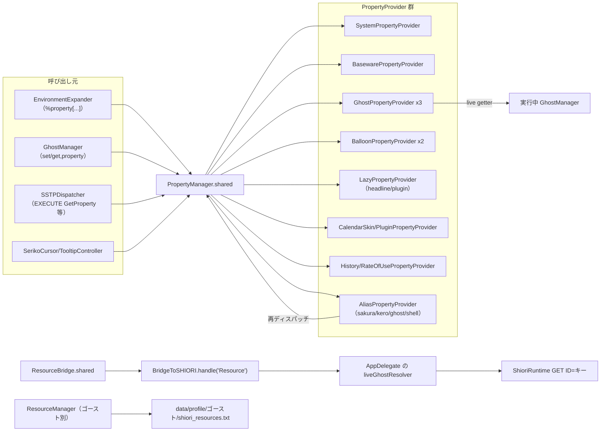
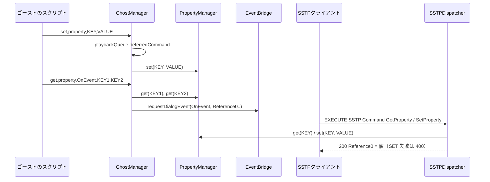

# 14 プロパティシステムとリソース

<details>
<summary>関連ソースファイル</summary>

このページは次のファイルをもとに作成した。

- [Ourin/Property/PropertyManager.swift](../../Ourin/Property/PropertyManager.swift)
- [Ourin/Property/PropertyProvider.swift](../../Ourin/Property/PropertyProvider.swift)
- [Ourin/Property/BasewarePropertyProvider.swift](../../Ourin/Property/BasewarePropertyProvider.swift)
- [Ourin/Property/GhostPropertyProvider.swift](../../Ourin/Property/GhostPropertyProvider.swift)
- [Ourin/Property/BalloonPropertyProvider.swift](../../Ourin/Property/BalloonPropertyProvider.swift)
- [Ourin/Property/CalendarPropertyProvider.swift](../../Ourin/Property/CalendarPropertyProvider.swift)
- [Ourin/Property/HeadlinePropertyProvider.swift](../../Ourin/Property/HeadlinePropertyProvider.swift)
- [Ourin/Property/HistoryRatePropertyProvider.swift](../../Ourin/Property/HistoryRatePropertyProvider.swift)
- [Ourin/Property/PluginPropertyProvider.swift](../../Ourin/Property/PluginPropertyProvider.swift)
- [Ourin/Property/ResourceManager.swift](../../Ourin/Property/ResourceManager.swift)
- [Ourin/Property/MachSupport.swift](../../Ourin/Property/MachSupport.swift)
- [Ourin/ResourceBridge/ResourceBridge.swift](../../Ourin/ResourceBridge/ResourceBridge.swift)
- [Ourin/NarInstall/Paths.swift](../../Ourin/NarInstall/Paths.swift)
- [Ourin/Ghost/GhostManager.swift](../../Ourin/Ghost/GhostManager.swift)
- [Ourin/Ghost/GhostManager+Window.swift](../../Ourin/Ghost/GhostManager+Window.swift)
- [Ourin/Ghost/GhostManager+Balloon.swift](../../Ourin/Ghost/GhostManager+Balloon.swift)
- [Ourin/Ghost/GhostManager+System.swift](../../Ourin/Ghost/GhostManager+System.swift)
- [Ourin/Ghost/GhostUtilityWindows.swift](../../Ourin/Ghost/GhostUtilityWindows.swift)
- [Ourin/SakuraScript/SakuraScriptEngine.swift](../../Ourin/SakuraScript/SakuraScriptEngine.swift)
- [Ourin/SakuraScript/EnvironmentExpander.swift](../../Ourin/SakuraScript/EnvironmentExpander.swift)
- [Ourin/SSTP/SSTPDispatcher.swift](../../Ourin/SSTP/SSTPDispatcher.swift)
- [Ourin/SHIORIEvents/SerikoCursorController.swift](../../Ourin/SHIORIEvents/SerikoCursorController.swift)
- [Ourin/SSTP/BridgeToSHIORI.swift](../../Ourin/SSTP/BridgeToSHIORI.swift)
- [Ourin/SSTP/ShioriBridgeContext.swift](../../Ourin/SSTP/ShioriBridgeContext.swift)
- [Ourin/OurinApp.swift](../../Ourin/OurinApp.swift)
- [Ourin/ContentView.swift](../../Ourin/ContentView.swift)
- [OurinTests/ResourceManagerFileMigrationTests.swift](../../OurinTests/ResourceManagerFileMigrationTests.swift)
- [OurinTests/PropertySetPropertyWiringTests.swift](../../OurinTests/PropertySetPropertyWiringTests.swift)
- [docs/PROPERTY_1.0M_SPEC_FULL_ja-jp.md](../../docs/PROPERTY_1.0M_SPEC_FULL_ja-jp.md)
- [docs/PropertySystem_ja-jp.md](../../docs/PropertySystem_ja-jp.md)
- [docs/PROPERTY_Resource_3.0M_SPEC_ja-jp.md](../../docs/PROPERTY_Resource_3.0M_SPEC_ja-jp.md)
- [docs/SHIORI_RESOURCE_3.0M_SPEC_ja-jp.md](../../docs/SHIORI_RESOURCE_3.0M_SPEC_ja-jp.md)

</details>

このページは、ゴーストやベースウェアが実行時の状態を名前で読み書きする 3 つの仕組みを扱う。

1. **プロパティシステム**（`Ourin/Property/` の `PropertyManager` と各 `PropertyProvider`）。UKADOC の「プロパティシステム」（`%property[...]`、`\![get,property,...]`、`\![set,property,...]`）に当たる。
2. **SHIORI Resource の永続化**（`ResourceManager`）。`username`、`homeurl`、`sakura.defaultleft` などのゴースト別設定を `data/profile/<ゴースト>/shiori_resources.txt` に保存する。
3. **SHIORI Resource の問い合わせ**（`ResourceBridge`）。`sakura.recommendsites` やオーナードローメニューの `*.caption` などを、稼働中の SHIORI へ `GET`（ID はリソース名）で問い合わせてキャッシュする。

プロパティを使うコマンドの構文は [7 さくらスクリプト](./07-sakura-script.md)、SSTP の `EXECUTE` 経路は [10 SSTP スタック](./10-sstp.md)、SHIORI 要求の実体は [8 SHIORI 層](./08-shiori-runtime.md) を参照。

## 全体構成



`PropertyManager` はプロセスで 1 つの `shared` を持ち、プレフィックス（`system`、`currentghost` など）ごとに Provider を登録する。`ResourceBridge` も `shared` 1 つで、問い合わせ先の決定は `BridgeToSHIORI` と `AppDelegate` に任せる。`ResourceManager` は `GhostManager` ごとに 1 つ生成される。

**出典:** [Ourin/Property/PropertyManager.swift:7-53](../../Ourin/Property/PropertyManager.swift#L7-L53)、[Ourin/ResourceBridge/ResourceBridge.swift:14-17](../../Ourin/ResourceBridge/ResourceBridge.swift#L14-L17)、[Ourin/ResourceBridge/ResourceBridge.swift:373-378](../../Ourin/ResourceBridge/ResourceBridge.swift#L373-L378)、[Ourin/Ghost/GhostManager.swift:848](../../Ourin/Ghost/GhostManager.swift#L848)

## PropertyProvider プロトコル

すべての Provider は次の 3 メソッドを実装する。`set` と `writableProperties` には既定実装（書き込み不可・空リスト）があるため、読み取り専用の Provider は `get(key:)` だけを書けばよい。`key` には、`PropertyManager` が名前空間の接頭辞を取り除いた**残りの部分**が渡される（例: `currentghost.scope(0).surface.num` なら `scope(0).surface.num`）。

| メソッド | 役割 | 既定 |
|---|---|---|
| `get(key:) -> String?` | 値を返す。存在しなければ `nil` | なし（必須） |
| `set(key:value:) -> Bool` | 書き込み。成功時 `true` | `false` |
| `writableProperties() -> [String]` | 書き込み可能キーの列挙 | `[]` |

**出典:** [Ourin/Property/PropertyProvider.swift:1-19](../../Ourin/Property/PropertyProvider.swift#L1-L19)

## PropertyManager

### 名前空間の登録

`init()` から呼ばれる `registerDefaultProviders()` が次の 16 個のプレフィックスを登録する。キーは小文字化して辞書 `providers` に入る。

| プレフィックス | Provider | 備考 |
|---|---|---|
| `system` | `SystemPropertyProvider` | 時刻・OS・CPU・メモリ等 |
| `baseware` | `BasewarePropertyProvider` | Ourin 自身の情報 |
| `ghostlist` / `activeghostlist` / `currentghost` | `GhostPropertyProvider`（mode 違い） | 生成時に `NarRegistry` のゴースト一覧を取得 |
| `balloonlist` | `BalloonPropertyProvider(mode: .balloonlist)` | 生成時に `NarRegistry` のバルーン一覧を取得 |
| `currentghost.balloon` | `BalloonPropertyProvider(mode: .currentBalloon)` | 最長一致で `currentghost` より優先 |
| `headlinelist` / `pluginlist` | `LazyPropertyProvider` | 初回参照時に `AppDelegate` のレジストリから構築 |
| `calendarskinlist` / `calendarpluginlist` | `CalendarSkin/PluginPropertyProvider` | `CalendarRegistry.shared` の一覧 |
| `history` | `HistoryPropertyProvider()` | 引数なしで生成（後述） |
| `rateofuselist` | `RateOfUsePropertyProvider` | `RateOfUseStore.shared.entries()` を都度呼ぶ |
| `sakura` / `kero` / `ghost` / `shell` | `AliasPropertyProvider` | それぞれ `currentghost.scope(0)` / `scope(1)` / `currentghost` / `currentghost.shelllist.current` へ書き換え |

`ghostlist` の元になるゴースト一覧は、`XCTestConfigurationFilePath` 環境変数があればダミー 1 件、なければ `ghost/<dir>/ghost/master` の `GhostConfiguration` から作る（descript.txt の `name` を使う）。`headlinelist` / `pluginlist` は `AppDelegate`（メインスレッド専用）を参照するため、`shared` の一回初期化中にメインへ同期するとデッドロックし得る。そこで `LazyPropertyProvider` で初回 `get` まで構築を遅らせ、構築処理はロックの外で行う。

**出典:** [Ourin/Property/PropertyManager.swift:13-145](../../Ourin/Property/PropertyManager.swift#L13-L145)、[Ourin/Property/PropertyManager.swift:359-392](../../Ourin/Property/PropertyManager.swift#L359-L392)

### キーの正規化と最長一致解決

1. `lowercasePreservingParams` が、括弧の外だけを小文字化する。`shelllist(MyShell)` のような括弧内の名前は大文字小文字を保つ（Provider 側で名前を case-sensitive に照合するため）。入れ子の括弧も深さで追跡する。
2. `resolveProvider` がキーを `.` で分割し、**長い接頭辞から順に** `providers` を引く。`currentghost.balloon.scope(0).num` は `currentghost.balloon` が見つかり、残り `scope(0).num` を Provider に渡す。旧実装は最初のドットで切っていたため `currentghost.balloon` が到達不能だった、とコメントにある。

**出典:** [Ourin/Property/PropertyManager.swift:151-190](../../Ourin/Property/PropertyManager.swift#L151-L190)

### get / set とキャッシュ

```swift
private static let uncachedPrefixes: Set<String> = [
    "system", "pluginlist", "rateofuselist", "currentghost"
]
public func get(_ key: String) -> String? {
    let lower = Self.lowercasePreservingParams(key)
    let firstSegment = lower.split(separator: ".", maxSplits: 1).first.map(String.init) ?? lower
    let cacheable = !Self.uncachedPrefixes.contains(firstSegment)
    ...
```

- `get` は先頭セグメントが `system` / `pluginlist` / `rateofuselist` / `currentghost` 以外ならキャッシュする。値ありは `valueCache`、値なしは `missingValueCache` に入る。`currentghost.balloon.*` は先頭セグメントが `currentghost` なのでキャッシュされない。
- `set` は Provider の `set` が `true` を返したときだけ両キャッシュを全消去する。`register` と `setActiveGhost` / `bindCurrentGhostRuntime` も全消去する。
- `getList` はカンマ区切り、`getDictionary` は `k:v,k:v` 形式を分解する補助で、`get` を内部で呼ぶ。

**出典:** [Ourin/Property/PropertyManager.swift:192-308](../../Ourin/Property/PropertyManager.swift#L192-L308)

### `%property[...]` の展開

さくらスクリプト本文の `%property[キー]` は `EnvironmentExpander` が `propertyManager.get(name)` で 1 段だけ置換する（未定義は空文字）。`PropertyManager.expand(_:)` は別に存在し、値の中に `%property[...]` が含まれる場合も再帰展開する（深さ 16 で打ち切り、循環参照中のキーは空文字）。コード上 `expand` の呼び出し元はテストだけである。

**出典:** [Ourin/SakuraScript/EnvironmentExpander.swift:191-193](../../Ourin/SakuraScript/EnvironmentExpander.swift#L191-L193)、[Ourin/Property/PropertyManager.swift:147-149](../../Ourin/Property/PropertyManager.swift#L147-L149)、[Ourin/Property/PropertyManager.swift:310-344](../../Ourin/Property/PropertyManager.swift#L310-L344)

### 実行中ゴーストとの接続

- `SakuraScriptEngine` は既定で独自の `PropertyManager()` を持つ。`GhostManager.init` がこれを `PropertyManager.shared` に差し替えないと、スクリプトで SET した値が SSTP や `ResourceBridge` から見えない。この配線は `PropertySetPropertyWiringTests` が回帰テストしている。
- 同じ `init` で `bindCurrentGhostRuntime(self)` を呼び、`currentghost` の scope プロパティと `currentghost.balloon` の倍率を `GhostManager` の live getter（`propertyScopeValue` / `setPropertyScopeValue` / `propertyBalloonScopeScaling`）へつなぐ。live getter は `surface.num`、`animation.num`、`scaling` を返し、それ以外は静的な `scopeData` に落ちる。
- `AppDelegate.runGhost(at:)` は `setActiveGhost(path:)` を呼び、`ghostlist` / `activeghostlist` / `currentghost` の active を実際に起動したゴーストへ合わせる（未設定だとインストール済み先頭が `currentghost` になる）。

**出典:** [Ourin/SakuraScript/SakuraScriptEngine.swift:30-39](../../Ourin/SakuraScript/SakuraScriptEngine.swift#L30-L39)、[Ourin/Ghost/GhostManager.swift:1222-1228](../../Ourin/Ghost/GhostManager.swift#L1222-L1228)、[Ourin/Ghost/GhostManager.swift:1280-1316](../../Ourin/Ghost/GhostManager.swift#L1280-L1316)、[Ourin/Property/PropertyManager.swift:241-271](../../Ourin/Property/PropertyManager.swift#L241-L271)、[Ourin/OurinApp.swift:910-914](../../Ourin/OurinApp.swift#L910-L914)、[OurinTests/PropertySetPropertyWiringTests.swift:1-33](../../OurinTests/PropertySetPropertyWiringTests.swift#L1-L33)

## 各 Provider と代表キー

### `system.*`（SystemPropertyProvider）

`PropertyManager.swift` の後半に同居する。値はすべて呼び出し時に計算し、キャッシュしない。

| キー | 取得方法 |
|---|---|
| `year` `month` `day` `hour` `minute` `second` `millisecond` `dayofweek` | `Calendar.current` / `Date()` |
| `cursor.pos` | `NSEvent.mouseLocation` を全画面 union の左上原点へ変換して `x,y` |
| `os.type` / `os.name` / `os.version` / `os.build` / `os.arch` | `macOS` 固定、`ProcessInfo`、`sysctl kern.osrelease` / `kern.osversion` / `hw.machine` |
| `os.parenttype` / `os.parentname` | `sysctl.proc_translated` が 1（Rosetta 2）のときだけ値 |
| `os.locale(.language/.country)` `os.timezone.offset` `os.uptime` `os.unixtime` `os.idletime` `os.dst` | `Locale` / `TimeZone` / `CGEventSource` |
| `cpu.num` `cpu.vendor` `cpu.name` `cpu.clock` `cpu.features` | `sysctl hw.ncpu` / `machdep.cpu.*` / `hw.cpufrequency` |
| `cpu.load` | `host_statistics(HOST_CPU_LOAD_INFO)` の前回呼び出しとの差分（アイドル以外の割合） |
| `memory.phyt`（別名 `memory.physical`）/ `memory.phya`（別名 `memory.available`）/ `memory.load` | `hw.memsize` と `host_statistics64(HOST_VM_INFO64)`（free+inactive）。単位 MB |
| `monitor.count` / `monitor.index(n).(rect\|work\|dpi\|primary\|bpp)` | `NSScreen.screens` |
| `disk.count` / `disk.index(n).(mountpoint\|total\|free\|type)` | `mountedVolumeURLs` と `attributesOfFileSystem` |
| `theme.app.mode` / `theme.os.mode` | `NSApp.effectiveAppearance` が dark なら `dark` |
| `dnd.mode` | 常に `0`（Focus 状態の公開 API がないため） |
| `power.source` / `power.battery.(percent\|flag\|lifetime)` | IOKit `IOPSCopyPowerSourcesInfo` |
| `network.status` / `network.ipaddress` / `network.type` / `network.cost` | `getifaddrs`（`en0` 優先）と `NWPathMonitor` の単発スナップショット（最大 1 秒待つ） |

`set` は常に `false` を返す。

**出典:** [Ourin/Property/PropertyManager.swift:419-495](../../Ourin/Property/PropertyManager.swift#L419-L495)、[Ourin/Property/PropertyManager.swift:497-536](../../Ourin/Property/PropertyManager.swift#L497-L536)、[Ourin/Property/PropertyManager.swift:569-715](../../Ourin/Property/PropertyManager.swift#L569-L715)

### `baseware.*`（BasewarePropertyProvider）

`name`（`Ourin` 固定）、`version` / `shortversion`（`CFBundleShortVersionString`）、`build`（`CFBundleVersion`）、`path` / `ssp.path`（`.app` のパス）、`rootpath`（`OurinPaths.baseDirectory()`）、`datapath` / `temppath` / `profilepath`（`SSPCompat` 由来）、`calendarpath` / `calendar.skin.path` / `calendar.plugin.path`、`mcp.path` / `ssph.path` を返す。

**出典:** [Ourin/Property/BasewarePropertyProvider.swift:3-48](../../Ourin/Property/BasewarePropertyProvider.swift#L3-L48)

### `ghostlist.*` / `activeghostlist.*` / `currentghost.*`（GhostPropertyProvider）

1 つのクラスが `Mode`（`.ghostlist` / `.activeghostlist` / `.currentghost`）で 3 役を担う。

| 形式 | 例 | 解決 |
|---|---|---|
| `count` | `ghostlist.count` | ゴースト数（active は `activeIndices.count`） |
| `index(n).汎用名` | `ghostlist.index(0).name` | `parseIndex` |
| `(名前\|sakuraname\|パス).汎用名` | Provider 内部では `(Emily).keroname` | `parseNamedAccess` |
| `currentghost.汎用名` | `currentghost.sakuraname` | active 先頭のゴースト |
| `currentghost.status` | — | `ShioriStatusStore.shared.currentStatus` |
| `currentghost.shelllist.(count\|current.name\|current.path\|current.menu)` / `shelllist(名).prop` / `shelllist.index(n).prop` | — | `handleShelllist` |
| `currentghost.scope.count` / `scope(n).(surface.num\|surface.x\|surface.y\|x\|y\|rect\|name\|seriko.defaultsurface\|animation.num\|scaling)` | `sakura.surface.num`（エイリアス） | live getter → `scopeData` |
| `currentghost.mousecursor.*` / `balloon.mousecursor.*` | — | SET 済みの辞書 |
| `currentghost.seriko.surfacelist.(all\|defined)` | — | 初期化時の文字列（空なら nil） |
| `currentghost.seriko.tooltip.scope(n).textlist(名).(text\|name)` / `.textlist.index(i)` / `.textlist.count` | — | `serikoTooltips` |
| `currentghost.seriko.cursor.scope(n).mouse(up\|down\|hover\|wheel)list(名).(path\|name)` ほか | — | `serikoCursor` |

汎用プロパティ名は `name`、`sakuraname`（別名 `selfname`）、`keroname`、`craftmanw`、`craftmanurl`、`path`、`icon`、`homeurl`、`username`、`thumbnail`、`update_result`、`update_time`、`index`、`shiori.<変数名>`、`(sakura|kero|char*).bind.menu`。

**出典:** [Ourin/Property/GhostPropertyProvider.swift:3-61](../../Ourin/Property/GhostPropertyProvider.swift#L3-L61)、[Ourin/Property/GhostPropertyProvider.swift:78-181](../../Ourin/Property/GhostPropertyProvider.swift#L78-L181)、[Ourin/Property/GhostPropertyProvider.swift:254-503](../../Ourin/Property/GhostPropertyProvider.swift#L254-L503)、[Ourin/Property/GhostPropertyProvider.swift:567-638](../../Ourin/Property/GhostPropertyProvider.swift#L567-L638)

### `balloonlist.*` / `currentghost.balloon.*`（BalloonPropertyProvider）

`balloonlist` は `count`、`index(n).(name|path|craftmanw|craftmanurl|index)`、`(名|パス).prop`。`currentghost.balloon` は `scope(n).(count|num|validwidth(.initial)|validheight(.initial)|lines(.initial)|basepos.x|basepos.y|char_width|scaling)` を受け付け、`scaling` だけは live getter（表示中バルーンの `scaleX/scaleY` を百分率）を返す。その他は `scopeData` 由来だが、`PropertyManager` はこの Provider を `scopeData` なしで登録するため、`scaling` 以外は値を返さない（コードからの読み取り）。

**出典:** [Ourin/Property/BalloonPropertyProvider.swift:52-177](../../Ourin/Property/BalloonPropertyProvider.swift#L52-L177)、[Ourin/Property/PropertyManager.swift:28-29](../../Ourin/Property/PropertyManager.swift#L28-L29)、[Ourin/Ghost/GhostManager.swift:1312-1316](../../Ourin/Ghost/GhostManager.swift#L1312-L1316)

### `headlinelist.*` / `pluginlist.*`

- `HeadlinePropertyProvider`: `count`、`index(n).(name|path|craftmanw|craftmanurl|index)`。`path` には `HeadlineMeta.filename` が入る。
- `PluginPropertyProvider`: `count`、`index(n).prop`、`(名|path|id|executablepath|packagepath).prop`。prop は `name` `path` `executablepath` `packagepath` `filename` `id` `charset` `craftmanw` `craftmanurl` `native`（`1`/`0`） `executionstate` `candispatchrequests` `index`、`message.<キー>`（`message.*.txt` の言語別文字列）、`ext.<キー>`。`ext.*` は `PluginEventDispatcher.propertyGet/propertySet` を通じてプラグイン自身に問い合わせ、**SET 可能**（詳細は [12 PLUGIN](./12-plugin.md)）。

**出典:** [Ourin/Property/HeadlinePropertyProvider.swift:18-84](../../Ourin/Property/HeadlinePropertyProvider.swift#L18-L84)、[Ourin/Property/PluginPropertyProvider.swift:84-182](../../Ourin/Property/PluginPropertyProvider.swift#L84-L182)、[Ourin/Property/PropertyManager.swift:81-107](../../Ourin/Property/PropertyManager.swift#L81-L107)

### `calendarskinlist.*` / `calendarpluginlist.*`

`CalendarSkinPropertyProvider` は `name` `path` `index` `background.filename` `icon.count` `icon(名).filename`（拡張子なしなら `.png` を補う）と、descript.txt の任意キー。`CalendarPluginPropertyProvider` は `name` `id` `filename` `path`（ディレクトリ + filename）`directory(.path)` `post` `index`。データは [16 付帯機能](./16-auxiliary-features.md) の `CalendarRegistry` から来る。

**出典:** [Ourin/Property/CalendarPropertyProvider.swift:3-84](../../Ourin/Property/CalendarPropertyProvider.swift#L3-L84)

### `history.*` / `rateofuselist.*`（HistoryRatePropertyProvider.swift）

- `HistoryPropertyProvider` は `ghost|balloon|headline|plugin` それぞれの `.count`、`.index(n).prop`、`(名).prop` を解く。ただし `PropertyManager` は**空配列で生成**しており、更新する経路もないため、現状は `count` が常に `0` になる。
- `RateOfUsePropertyProvider` は `count`、`index(n)` / `(名)` の `name` `sakuraname` `keroname` `boottime`（起動回数）`bootminute`（使用分）`percent`。元データは `RateOfUseStore` で、`UserDefaults` キー `OurinRateOfUseRecords.v1` に JSON で永続化される。`beginSession` / `endSession` / `recordTalk`（`recordBacklog` から呼ばれる）で更新し、使用中セッションの時間は表示時に加算する。同じデータを `\![open,rateofusegraph*]`（[16 付帯機能](./16-auxiliary-features.md)）も使う。

**出典:** [Ourin/Property/HistoryRatePropertyProvider.swift:38-216](../../Ourin/Property/HistoryRatePropertyProvider.swift#L38-L216)、[Ourin/Property/HistoryRatePropertyProvider.swift:218-275](../../Ourin/Property/HistoryRatePropertyProvider.swift#L218-L275)、[Ourin/Property/HistoryRatePropertyProvider.swift:348-388](../../Ourin/Property/HistoryRatePropertyProvider.swift#L348-L388)、[Ourin/Property/PropertyManager.swift:41-44](../../Ourin/Property/PropertyManager.swift#L41-L44)、[Ourin/Ghost/GhostUtilityWindows.swift:28-48](../../Ourin/Ghost/GhostUtilityWindows.swift#L28-L48)

### エイリアス（AliasPropertyProvider）

`sakura.*` → `currentghost.scope(0).*`、`kero.*` → `currentghost.scope(1).*`、`ghost.*` → `currentghost.*`、`shell.*` → `currentghost.shelllist.current.*`。`get` / `set` とも `PropertyManager.shared` に再ディスパッチするだけで状態を持たず、`writableProperties()` は空を返す。

**出典:** [Ourin/Property/PropertyManager.swift:46-52](../../Ourin/Property/PropertyManager.swift#L46-L52)、[Ourin/Property/PropertyManager.swift:394-417](../../Ourin/Property/PropertyManager.swift#L394-L417)

## 書き込み可能プロパティ（SET の権限）

SET の可否は Provider ごとの実装だけで決まり、呼び出し元による権限チェックはプロパティ層にはない。

| キー | 実装 | 備考 |
|---|---|---|
| `currentghost.scope(n).surface.num` / `animation.num` | `GhostManager.setPropertyScopeValue` → `applyScopePropertySideEffect` | live setter がある場合のみ |
| `currentghost.shelllist(名).menu` | `shells[idx].menu` | 一覧に名前がある場合のみ |
| `currentghost.mousecursor.*` / `balloon.mousecursor.*` | 辞書へ保存 | 任意のサブキーを受理 |
| `currentghost.seriko.tooltip.scope(n).textlist(名).text` | `serikoTooltips` | 空文字で削除 |
| `currentghost.seriko.cursor.scope(n).mouse????list(名).path` | `serikoCursor` | 空文字で削除、空になった種別・scope も除去 |
| `currentghost.(sakura\|kero\|char*).bind.menu` | `bindMenus` | |
| `pluginlist(…).ext.<キー>` / `pluginlist.index(n).ext.<キー>` | `extSet` クロージャ → プラグイン | [12 PLUGIN](./12-plugin.md) |

`writableProperties()` が列挙するのは `shelllist(…).menu`、`mousecursor.*` 5 種、`balloon.mousecursor.*` 3 種、`sakura.bind.menu`、`kero.bind.menu` だけで、実際に SET できる範囲より狭い。

**出典:** [Ourin/Property/GhostPropertyProvider.swift:183-252](../../Ourin/Property/GhostPropertyProvider.swift#L183-L252)、[Ourin/Property/GhostPropertyProvider.swift:640-682](../../Ourin/Property/GhostPropertyProvider.swift#L640-L682)、[Ourin/Property/PluginPropertyProvider.swift:122-132](../../Ourin/Property/PluginPropertyProvider.swift#L122-L132)、[Ourin/Ghost/GhostManager.swift:1303-1310](../../Ourin/Ghost/GhostManager.swift#L1303-L1310)

## 参照経路



| 経路 | 処理 | 位置 |
|---|---|---|
| `%property[キー]` | `EnvironmentExpander` が `get` で置換 | [Ourin/SakuraScript/EnvironmentExpander.swift:191-193](../../Ourin/SakuraScript/EnvironmentExpander.swift#L191-L193) |
| `\![get,property,イベント,キー...]` | 再生位置で各キーを `get` し、指定イベントを GET で発生（値を `Reference0..`） | [Ourin/Ghost/GhostManager.swift:3211-3241](../../Ourin/Ghost/GhostManager.swift#L3211-L3241) |
| `\![set,property,キー,値]` | 再生位置で `set`、結果はデバッグログのみ | [Ourin/Ghost/GhostManager.swift:3242-3251](../../Ourin/Ghost/GhostManager.swift#L3242-L3251) |
| SSTP `EXECUTE` `SetProperty` / `GetProperty` | `handleExtendedExecuteCommand` が `PropertyManager.shared` を直接読み書き | [Ourin/SSTP/SSTPDispatcher.swift:651-658](../../Ourin/SSTP/SSTPDispatcher.swift#L651-L658) |
| SSTP `EXECUTE` `GetName` / `GetShellNameList` 等 | `currentghost.name`、`*.index(i).name` を `count` 回読み集める | [Ourin/SSTP/SSTPDispatcher.swift:596-634](../../Ourin/SSTP/SSTPDispatcher.swift#L596-L634)、[Ourin/SSTP/SSTPDispatcher.swift:955-966](../../Ourin/SSTP/SSTPDispatcher.swift#L955-L966) |

`handleExtendedExecuteCommand` は `securityContext` を引数に取らず、`GetFMO` のようにヘッダの `SecurityLevel` を見る分岐も `SetProperty` / `GetProperty` には無い。上流で外部由来を弾くのは、`securityLocalOnly`（引数。無ければ環境変数 `OURIN_SSTP_LOCAL_ONLY=1`）が有効で、リクエストのヘッダが external を申告した（`SecurityOrigin` が非ローカル、または `SecurityLevel: external`）ときに 420 を返す処理だけである。したがって外部受信口から届いてもヘッダで external を申告しない `EXECUTE SetProperty` は、そのまま `PropertyManager.shared.set` に届く（コードの読み取り。実行では確認していない）。受信口ごとの扱いは [10 SSTP スタック](./10-sstp.md) を参照。

**出典:** [Ourin/SSTP/SSTPDispatcher.swift:474-506](../../Ourin/SSTP/SSTPDispatcher.swift#L474-L506)、[Ourin/SSTP/SSTPDispatcher.swift:559-569](../../Ourin/SSTP/SSTPDispatcher.swift#L559-L569)、[Ourin/SSTP/SSTPDispatcher.swift:134-155](../../Ourin/SSTP/SSTPDispatcher.swift#L134-L155)、[Ourin/SSTP/SSTPDispatcher.swift:939-946](../../Ourin/SSTP/SSTPDispatcher.swift#L939-L946)、[Ourin/ExternalServer/OurinExternalServer.swift:83-88](../../Ourin/ExternalServer/OurinExternalServer.swift#L83-L88)

## ResourceManager（SHIORI Resource の保存と移行）

`ResourceManager` は SHIORI Resource のうち**ベースウェア側で保存すべき値**（ユーザー名、更新 URL、立ち位置）の永続化を担う。`GhostManager` が `lazy var resourceManager = ResourceManager(ghostKey: ghostURL.lastPathComponent)` で生成する。

### 保存先とモード

| 生成 | 名前空間 | 保存先 |
|---|---|---|
| `ResourceManager()`（ghostKey なし） | `UserDefaults` の `OurinResource.<key>` | UserDefaults のみ（旧互換） |
| `ResourceManager(ghostKey: "emily4")` | `OurinResource.emily4.<key>` | `ProfileResourceFileStore` → `<base>/data/profile/emily4/shiori_resources.txt` |

ファイル形式は UTF-8 / LF、1 行 1 件の `key,value`（読み込みは最初の `,` で分割、書き込みはキーをソートし値の改行を空白へ置換、atomic 書き込み）。ghostKey 付きモードではメモリ上の `cache` が正で、`set` / `remove` のたびにファイル全体を書き直す。`profileDirectory(for:)` は `/` や `..` を含む名前を拒否する。

### 移行（ResourceManagerFileMigrationTests が検証する内容）

1. **backfill**: `OurinResource.__claimedBy` マーカーが未設定なら、最初に ghostKey 付きで初期化されたゴーストが旧グローバル `OurinResource.*` を自分のプレフィックスへ一度だけコピーし、マーカーに自分の名前を書く。
2. **UserDefaults → ファイル**: ファイルがあればファイルを優先して `cache` に読み込む。なければ UserDefaults のプレフィックス値を集めてファイルへ書き出す。**UserDefaults 側の値は削除しない**。
3. テストは `OurinPaths.testBaseOverride`（スレッドローカル）で一時ディレクトリへ逃がし、実データフォルダに触れない。

### 主なキーと利用箇所

| アクセサ | キー | 主な利用 |
|---|---|---|
| `username` | `username` | `GhostManager.init` で `envExpander.username` に設定 |
| `homeurl` | `homeurl` | ネットワーク更新、Web の homeurl リンク（`AppDelegate.handleWebHomeURL`） |
| `getCharDefaultLeft/Top(scope:)` | `sakura.defaultleft` / `kero.defaultleft` / `char<N>.defaultleft`（top も同様） | キャラクター窓の位置保存・復元 |
| `sakuraDefaultX/Y` ほか | `sakura.defaultx` 等 | アクセサのみ |
| `getBalloonLeft/Top(scope:)` / `resetBalloonPositions()` | `balloon<N>.defaultleft/top` | バルーン位置、`resetballoonpos` |
| `useOrigin1` | `useorigin1` | 更新ファイル番号の開始値 |
| `savedExtraCharacterPositionScopes()` | `char<N>.*`（N≥2） | 位置リセット時の列挙 |

位置は `NSWindow.frame.origin`（AppKit の左下原点）をそのまま整数で保存する。

**出典:** [Ourin/Property/ResourceManager.swift:4-130](../../Ourin/Property/ResourceManager.swift#L4-L130)、[Ourin/Property/ResourceManager.swift:132-345](../../Ourin/Property/ResourceManager.swift#L132-L345)、[Ourin/Property/ResourceManager.swift:347-409](../../Ourin/Property/ResourceManager.swift#L347-L409)、[Ourin/NarInstall/Paths.swift:104-114](../../Ourin/NarInstall/Paths.swift#L104-L114)、[OurinTests/ResourceManagerFileMigrationTests.swift:1-44](../../OurinTests/ResourceManagerFileMigrationTests.swift#L1-L44)、[Ourin/Ghost/GhostManager.swift:1230-1233](../../Ourin/Ghost/GhostManager.swift#L1230-L1233)、[Ourin/Ghost/GhostManager+Window.swift:126-131](../../Ourin/Ghost/GhostManager+Window.swift#L126-L131)、[Ourin/Ghost/GhostManager+Balloon.swift:655-660](../../Ourin/Ghost/GhostManager+Balloon.swift#L655-L660)、[Ourin/OurinApp.swift:626-640](../../Ourin/OurinApp.swift#L626-L640)

## ResourceBridge（SHIORI Resource の問い合わせ）

`ResourceBridge` は「ベースウェアの UI（メニュー・更新・ツールチップ）」と「稼働中ゴーストの SHIORI が返す Resource 値」を橋渡しする。`ResourceManager` と違い、値を保存しない。

### 取得の流れ

1. `get(key)` は (a) SET 上書き `overrides`（空文字は「定義削除」で `nil`）、(b) TTL 5 秒の `cache`、(c) `query(key:)` の順に見る。`cache`/`overrides` は `NSLock` で保護する。
2. `query` は `BridgeToSHIORI.handle(event: "Resource", references: [key])` を呼ぶ。`ShioriBridgeContext` はテスト登録値 → ネイティブ SHIORI バンドル → `liveGhostResolver` の順に解決する。
3. `AppDelegate` が設定する `liveGhostResolver` は、イベント名 `Resource` を見ると `runtime.request(method: "GET", id: key, refs: [], timeout: 2.0)` に正規化する。つまり SHIORI には `GET SHIORI/3.0` + `ID: sakura.recommendsites` のような Resource 要求が届く。`OnGetResource` のような専用イベントは使わない。
4. 空文字の応答は `nil`（未定義）として扱い、キャッシュしない。

### 提供するヘルパー

| メソッド | 用途 |
|---|---|
| `boolValue` / `intValue` / `pointValue` / `screenPointValue` / `listValue` / `colorValue(for:)` | 型変換。`screenPointValue` は左上原点の値を `union.height - 1 - y` で AppKit 座標へ変換 |
| `recommendSites(for:base:)` / `portalSites` / `recommendSites(forCharacter:)` | `\u{02}` でレコード、`\u{01}` でフィールド（title, url, banner, talk）を分割。`\` エスケープを考慮 |
| `menuItem(for:)` | `*.caption` の `(&X)` / `&X` からショートカットを取り出し、対応する `*.visible`（省略時 `true`）と組にする |
| `ownerDrawMenuConfig(base:)` | `menu.(background\|foreground\|sidebar).bitmap.filename`（無ければシェルの `menu/*.png`、次に `data/ssp-pictures/menu_*.png`）、`menu.*.color.(r\|g\|b)`、`menu.*.alignment` から `OwnerDrawMenuConfig` を作る |
| `menuItems()` | `inforootbutton` / `ghostrootbutton` / `shellrootbutton` / `balloonrootbutton` / `configurationbutton` / `quitbutton` の caption があればメニュー項目化。ゴースト・バルーン一覧は `NarRegistry`、シェル一覧は `currentghost.path` の `shell/` |
| `aiState()` / `aiStateEx()` / `tooltipEventName()` / `balloonTooltipEventName()` / `legacyInterfaceEnabled()` / `otherHomeURLOverride()` | 個別キー（`getaistate(ex)`、`tooltip`、`balloon_tooltip`、`legacyinterface`、`other_homeurl_override`） |

利用箇所は、右クリックのオーナードローメニュー（`GhostManager+Window`、[6 バルーンと入力 UI](./06-balloon.md)）、ベースウェア更新 URL の候補（`update.url`）、設定画面の Resource ビュー／オーバーレイ（`ContentView`、`UserDefaults` キー `OurinDevToolsResourceOverlays` に保存）、DevTools（[17](./17-devtools-migrator.md)）。`recommendSites` / `portalSites` / `aiState*` / `tooltipEventName` は、コード上 `ResourceBridge` の外ではテストからしか呼ばれていない（AI グラフ窓は `getaistate` を `ShioriRuntime` に直接問い合わせる）。

**出典:** [Ourin/ResourceBridge/ResourceBridge.swift:14-136](../../Ourin/ResourceBridge/ResourceBridge.swift#L14-L136)、[Ourin/ResourceBridge/ResourceBridge.swift:138-379](../../Ourin/ResourceBridge/ResourceBridge.swift#L138-L379)、[Ourin/ResourceBridge/ResourceBridge.swift:381-594](../../Ourin/ResourceBridge/ResourceBridge.swift#L381-L594)、[Ourin/SSTP/BridgeToSHIORI.swift:66-77](../../Ourin/SSTP/BridgeToSHIORI.swift#L66-L77)、[Ourin/SSTP/ShioriBridgeContext.swift:207-223](../../Ourin/SSTP/ShioriBridgeContext.swift#L207-L223)、[Ourin/OurinApp.swift:467-486](../../Ourin/OurinApp.swift#L467-L486)、[Ourin/Ghost/GhostManager+Window.swift:276-286](../../Ourin/Ghost/GhostManager+Window.swift#L276-L286)、[Ourin/Ghost/GhostManager+System.swift:3749-3760](../../Ourin/Ghost/GhostManager+System.swift#L3749-L3760)、[Ourin/ContentView.swift:488-536](../../Ourin/ContentView.swift#L488-L536)、[Ourin/Ghost/GhostUtilityWindows.swift:98-112](../../Ourin/Ghost/GhostUtilityWindows.swift#L98-L112)

## MachSupport

`MachSupport.swift` は `HOST_VM_INFO64_COUNT`（`vm_statistics64_data_t` のサイズを `integer_t` 単位で表した `mach_msg_type_number_t`）を Swift 定数として定義するだけのファイルである。C マクロを Swift から直接使えないための補助と読めるが、現在の `SystemPropertyProvider.memoryAvailable()` は同じ値をその場で計算しており、この定数を参照する箇所はリポジトリ内に見当たらない。

**出典:** [Ourin/Property/MachSupport.swift:1-11](../../Ourin/Property/MachSupport.swift#L1-L11)、[Ourin/Property/PropertyManager.swift:525-536](../../Ourin/Property/PropertyManager.swift#L525-L536)

## 制約と注意点

- **一覧系の名前指定アクセス**: Provider は `(名前).prop` 形式を解けるが、`PropertyManager.resolveProvider` は `.` 区切りの接頭辞しか照合しない。そのため `ghostlist(Emily).keroname` のようにトップレベルの名前空間へ括弧が直接付くキーは、`ghostlist(Emily)` という接頭辞を探して失敗する（コードの読み取り。`currentghost.shelllist(名)` のように接頭辞の後ろに括弧がある形は解ける）。docs の例 `\![get,property,OnGetSakuraName,ghostlist(Emily/Phase4.5).keroname]` は、`PropertyManager.get` の経路では `resolveProvider` が接頭辞を見つけられず `nil` になると読める（`get` の前段に括弧を分解する処理は見当たらず、`Phase4.5` の `.` でも分割される。この形を通すテストは見当たらず、実行では確認していない）。
- **一覧のスナップショット**: `ghostlist` / `balloonlist` / `calendar*list` は `PropertyManager.shared` 初期化時の一覧を保持し、NAR インストール後に作り直す処理はない。`headlinelist` / `pluginlist` も初回参照時に一度だけ構築する。
- **`history.*` は常に空**、`currentghost.balloon.scope(n).*` は `scaling` 以外は値を返さない（前述）。
- `valueCache` / `missingValueCache` / 各 Provider の辞書にはロックがない（ロックを持つのは `LazyPropertyProvider` の初回構築と `RateOfUseStore` だけ）。SSTP のバックグラウンドキューとメインスレッドの双方から呼ばれるため、同時アクセス時の安全性は未確認。
- `currentghost.shelllist` は `PropertyManager` 登録時に `shells` を渡しておらず、`shells` を後から更新するメソッドも、`currentghost` を再登録する呼び出しもリポジトリ内に見当たらない。したがって本番では `currentghost.shelllist.*` と `shell.*` エイリアスは値を返さないと読める（`SerikoCursorController` は `?? "master"` で補っている。`EXECUTE GetShellName` は `currentghost.shell.name` にフォールバックするがこれも未定義キーで、最終的に空文字を返す）。同様に `scopeData` も空なので、`scope(n).x` / `y` / `rect` / `name` は live getter が扱わない限り `nil` になる。また `EXECUTE GetBalloonName` は表示中バルーンではなく `balloonlist.index(0).name`（インストール済み一覧の先頭）を返す。
- 注意: `docs/PropertySystem_ja-jp.md` は `manager.expand(text:)` と書くが、実際のシグネチャは `expand(_:)`。また同書は書き込み可能プロパティを `shelllist(...).menu` だけ、`history.*` を将来拡張としているが、コードでは前節の表のとおり SET 可能範囲が広く、`HistoryPropertyProvider` も（中身は空だが）登録済みである。
- 注意: `docs/PROPERTY_1.0M_SPEC_FULL_ja-jp.md` §7 は「書込は無視＋警告ログ」とするが、未知キーへの SET は `false` を返すだけで、`\![set,property]` 経路はデバッグログに成否を出すのみ。
- 注意: `docs/PROPERTY_Resource_3.0M_SPEC_ja-jp.md` §3 は `*.defaultleft/top` を左上原点で受理し内部で変換するとするが、`ResourceManager` は AppKit の `frame.origin`（左下原点）をそのまま保存・復元している。SHIORI が返す同名 Resource を読み込む処理は本ページの範囲では見当たらない。

**出典:** [Ourin/Property/PropertyManager.swift:156-169](../../Ourin/Property/PropertyManager.swift#L156-L169)、[Ourin/Property/PropertyManager.swift:25-27](../../Ourin/Property/PropertyManager.swift#L25-L27)、[Ourin/SSTP/SSTPDispatcher.swift:617-624](../../Ourin/SSTP/SSTPDispatcher.swift#L617-L624)、[Ourin/SHIORIEvents/SerikoCursorController.swift:49-52](../../Ourin/SHIORIEvents/SerikoCursorController.swift#L49-L52)、[Ourin/Property/GhostPropertyProvider.swift:539-551](../../Ourin/Property/GhostPropertyProvider.swift#L539-L551)、[docs/PropertySystem_ja-jp.md:168-195](../../docs/PropertySystem_ja-jp.md#L168-L195)、[docs/PropertySystem_ja-jp.md:229-248](../../docs/PropertySystem_ja-jp.md#L229-L248)、[docs/PROPERTY_1.0M_SPEC_FULL_ja-jp.md:116-145](../../docs/PROPERTY_1.0M_SPEC_FULL_ja-jp.md#L116-L145)、[docs/PROPERTY_Resource_3.0M_SPEC_ja-jp.md:25-35](../../docs/PROPERTY_Resource_3.0M_SPEC_ja-jp.md#L25-L35)、[docs/SHIORI_RESOURCE_3.0M_SPEC_ja-jp.md:156-165](../../docs/SHIORI_RESOURCE_3.0M_SPEC_ja-jp.md#L156-L165)

## 関連ページ

- [4 GhostManager](./04-ghost-manager.md) — `resourceManager` と `bindCurrentGhostRuntime` を持つ側
- [5 サーフェス・シェル・SERIKO アニメーション](./05-surface-shell-animation.md) — `seriko.cursor` / `tooltip` を読む `SerikoCursorController` / `SerikoTooltipController`
- [6 バルーンと入力 UI](./06-balloon.md) — `ResourceBridge` を使うオーナードローメニュー
- [7 さくらスクリプト](./07-sakura-script.md) — `%property`、`\![get/set,property]` の構文
- [8 SHIORI 層](./08-shiori-runtime.md) — Resource 要求を受ける `ShioriRuntime`
- [10 SSTP スタック](./10-sstp.md) — `EXECUTE GetProperty` / `SetProperty`
- [12 PLUGIN](./12-plugin.md) — `pluginlist.*.ext.*` の委譲先
- [15 NAR インストールとパッケージ管理](./15-nar-install.md) — `OurinPaths` と `NarRegistry`
- [16 付帯機能](./16-auxiliary-features.md) — `CalendarRegistry`、使用率グラフ
