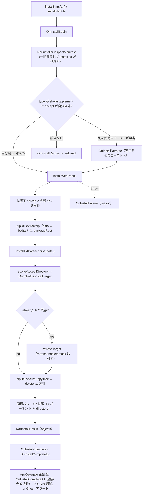
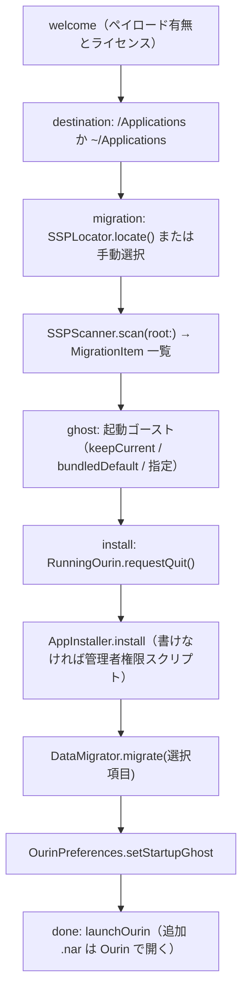

# 15 NAR インストールとパッケージ管理

関連ソースファイル

このページは次のファイルをもとに作成した。

- [Ourin/NarInstall/LocalNarInstaller.swift](../../Ourin/NarInstall/LocalNarInstaller.swift)
- [Ourin/NarInstall/InstallTxtParser.swift](../../Ourin/NarInstall/InstallTxtParser.swift)
- [Ourin/NarInstall/Paths.swift](../../Ourin/NarInstall/Paths.swift)
- [Ourin/NarInstall/ZipUtil.swift](../../Ourin/NarInstall/ZipUtil.swift)
- [Ourin/NarInstall/NarPackage.swift](../../Ourin/NarInstall/NarPackage.swift)
- [Ourin/NarInstall/NarInstallView.swift](../../Ourin/NarInstall/NarInstallView.swift)
- [Ourin/NarInstall/NarInstallViewModel.swift](../../Ourin/NarInstall/NarInstallViewModel.swift)
- [Ourin/Nar/NarRegistry.swift](../../Ourin/Nar/NarRegistry.swift)
- [Ourin/OurinApp.swift](../../Ourin/OurinApp.swift)
- [Ourin/Ghost/GhostManager.swift](../../Ourin/Ghost/GhostManager.swift)
- [Ourin/Ghost/GhostManager+System.swift](../../Ourin/Ghost/GhostManager+System.swift)
- [Ourin/Ghost/GhostConfiguration.swift](../../Ourin/Ghost/GhostConfiguration.swift)
- [Ourin/SHIORIEvents/DragDropReceiver.swift](../../Ourin/SHIORIEvents/DragDropReceiver.swift)
- [Ourin/SHIORIEvents/DragDropView.swift](../../Ourin/SHIORIEvents/DragDropView.swift)
- [Ourin/RightClickMenu.swift](../../Ourin/RightClickMenu.swift)
- [Ourin/Web/WebNarInstaller.swift](../../Ourin/Web/WebNarInstaller.swift)
- [Ourin/SSTP/SSTPDispatcher.swift](../../Ourin/SSTP/SSTPDispatcher.swift)
- [Ourin/SakuraScript/EnvironmentExpander.swift](../../Ourin/SakuraScript/EnvironmentExpander.swift)
- [Ourin/SHIORIEvents/EventReferenceSpec.swift](../../Ourin/SHIORIEvents/EventReferenceSpec.swift)
- [scripts/build-installer.sh](../../scripts/build-installer.sh)
- [Ourin/ContentView.swift](../../Ourin/ContentView.swift)
- [Ourin.xcodeproj/project.pbxproj](../../Ourin.xcodeproj/project.pbxproj)
- [Ourin/Ourin.entitlements](../../Ourin/Ourin.entitlements)
- [Installer/Package.swift](../../Installer/Package.swift)
- [Installer/Sources/OurinInstallerCore/SSPLocator.swift](../../Installer/Sources/OurinInstallerCore/SSPLocator.swift)
- [Installer/Sources/OurinInstallerCore/SSPScanner.swift](../../Installer/Sources/OurinInstallerCore/SSPScanner.swift)
- [Installer/Sources/OurinInstallerCore/DataMigrator.swift](../../Installer/Sources/OurinInstallerCore/DataMigrator.swift)
- [Installer/Sources/OurinInstallerCore/DescriptReader.swift](../../Installer/Sources/OurinInstallerCore/DescriptReader.swift)
- [Installer/Sources/OurinInstallerCore/OurinDataLocation.swift](../../Installer/Sources/OurinInstallerCore/OurinDataLocation.swift)
- [Installer/Sources/OurinInstallerCore/OurinPreferences.swift](../../Installer/Sources/OurinInstallerCore/OurinPreferences.swift)
- [Installer/Sources/OurinInstallerCore/RunningOurin.swift](../../Installer/Sources/OurinInstallerCore/RunningOurin.swift)
- [Installer/Sources/OurinInstallerCore/AppInstaller.swift](../../Installer/Sources/OurinInstallerCore/AppInstaller.swift)
- [Installer/Sources/OurinInstaller/InstallerModel.swift](../../Installer/Sources/OurinInstaller/InstallerModel.swift)
- [Installer/Sources/OurinInstaller/InstallerView.swift](../../Installer/Sources/OurinInstaller/InstallerView.swift)
- [Installer/Sources/OurinInstaller/OurinInstallerApp.swift](../../Installer/Sources/OurinInstaller/OurinInstallerApp.swift)
- [Installer/Tests/OurinInstallerCoreTests/OurinInstallerCoreTests.swift](../../Installer/Tests/OurinInstallerCoreTests/OurinInstallerCoreTests.swift)
- [AGENTS.md](../../AGENTS.md)
- [docs/NAR_INSTALL_1.0M_SPEC_ja-jp.md](../../docs/NAR_INSTALL_1.0M_SPEC_ja-jp.md)

このページは、NAR（実体は ZIP の伺か配布パッケージ）を受け取ってから、`install.txt` を解釈し、データフォルダへ設置し、SHIORI イベントを発火するまでの流れを扱う。あわせて、データフォルダ（`OurinPaths`）、インストール済み一覧（`NarRegistry`）、設定画面の NAR インストール UI、別アプリ **OurinInstaller** による SSP からのデータ移行を説明する。

ユーザーの ghost / NAR データは**実データ**として扱う（[AGENTS.md](../../AGENTS.md)）。インストーラや移行処理を改修・検証するときは、テスト用の上書き（`OurinPaths.testBaseOverride`、`OURIN_TEST_BASE_DIR`、OurinInstaller の `OURIN_INSTALLER_ROOT`）を使い、実際のデータフォルダに触れないこと。

ゴーストの起動・切替は [4 GhostManager](./04-ghost-manager.md)、Web からのインストールは [10.1 外部受信口と Web 連携](./10a-external-server-web.md)、OurinInstaller と `sakura.nar` のビルドは [2 ビルド・パッケージング・CI](./02-build-and-ci.md) を参照。

**出典:** [AGENTS.md:5-11](../../AGENTS.md#L5-L11)

## データ保存先（OurinPaths）

### 基準フォルダの決定

`OurinPaths.baseDirectory()` は次の順で基準フォルダ（以下 `<base>`）を決める。いずれの経路でも標準サブフォルダを冪等に作る。

| 順 | 条件 | `<base>` |
|---|---|---|
| 1 | `OurinPaths.testBaseOverride`（スレッドローカル）が設定済み | その URL |
| 2 | 環境変数 `OURIN_TEST_BASE_DIR` | その URL |
| 3 | 環境変数 `XCTestConfigurationFilePath` がある（XCTest 実行中） | `$TMPDIR/OurinTestBase` |
| 4 | 通常 | `~/Documents/Ourin` |
| 5 | `~/Documents` が使えない（TCC 拒否等） | `~/Library/Application Support/Ourin` |

標準サブフォルダは `ghost`、`balloon`、`plugin`、`headline`、`language`、`calendar`、`data`、`data/profile`、`temp`、`package`、`saori`。`subdirectory(_:)` は `/`・`..`・先頭 `.` を含む名前を、`profileDirectory(for:)` は `/`・`..` を含む名前を拒否する。

アプリのエンタイトルメントに `com.apple.security.app-sandbox` はなく、Xcode のビルド設定も `ENABLE_APP_SANDBOX = NO` なので、`~/Documents` はコンテナにリダイレクトされない。

注意: [AGENTS.md](../../AGENTS.md) はゴーストの保存先を `~/Library/Containers/furin-lab.Ourin/Data/Library/Application Support/Ourin/ghost/` と書くが、現行コードではこれは**旧データの移行元**であり、現在の保存先は `~/Documents/Ourin/ghost/`（フォールバック時は `~/Library/Application Support/Ourin/ghost/`）である。同様に [docs/NAR_INSTALL_1.0M_SPEC_ja-jp.md](../../docs/NAR_INSTALL_1.0M_SPEC_ja-jp.md) も §0 と「実装状況」では `~/Library/Application Support/Ourin/` と書き、§6.1 では `~/Documents/Ourin` と書いていて食い違う。

**出典:** [Ourin/NarInstall/Paths.swift:4-114](../../Ourin/NarInstall/Paths.swift#L4-L114)、[Ourin/Ourin.entitlements](../../Ourin/Ourin.entitlements)、[Ourin.xcodeproj/project.pbxproj:678-684](../../Ourin.xcodeproj/project.pbxproj#L678-L684)、[docs/NAR_INSTALL_1.0M_SPEC_ja-jp.md:31-35](../../docs/NAR_INSTALL_1.0M_SPEC_ja-jp.md#L31-L35)、[docs/NAR_INSTALL_1.0M_SPEC_ja-jp.md:63-77](../../docs/NAR_INSTALL_1.0M_SPEC_ja-jp.md#L63-L77)

### 旧データの一度きりの移行

`AppDelegate.applicationDidFinishLaunching` は、プラグイン・ヘッドラインの探索や起動ゴーストの決定より前に `OurinPaths.migrateLegacyDataIfNeeded()` を呼ぶ。

- テスト base のとき、または `<base>` が `~/Documents/Ourin` でない（フォールバック中）ときは何もしない。
- `<base>/.migrated_v1` があれば何もしない。
- 移行元は (1) `~/Library/Application Support/Ourin`、(2) 旧サンドボックスコンテナの `Library/Application Support/Ourin`、(3) 旧コンテナの `Documents/Ourin` の順。
- 対象サブフォルダ（`ghost` `balloon` `plugin` `headline` `language` `calendar` `data` `package` `saori`）の直下エントリを 1 件ずつ `moveItem` する。移動先に同名があれば skip（`Documents` 側を正とする）。
- 1 件でも move に失敗したらセンチネルを作らず、次回起動で再試行する。

**出典:** [Ourin/NarInstall/Paths.swift:116-192](../../Ourin/NarInstall/Paths.swift#L116-L192)、[Ourin/OurinApp.swift:398-400](../../Ourin/OurinApp.swift#L398-L400)

## インストールの入口

| 入口 | 経路 | SHIORI イベント |
|---|---|---|
| Finder のダブルクリック／「このアプリで開く」 | `AppDelegate.application(_:openFiles:)` / `application(_:open:)` → `installNars(at:)`（拡張子 `nar` / `zip` のみ） | あり |
| キャラクター窓への D&D | `DragDropReceiver` / `DragDropView` が `.nar` を見つけると `AppDelegate.application(NSApp, open:)` へ委譲（`.nar` 以外は `OnFileDrop`） | あり |
| メニューバーの「NARを読み込む...」 | `RightClickMenu.selectAndLoadNAR()` → `NSOpenPanel` → `application(_:openFiles:)` | あり |
| `\![execute,install,path,ファイル]`（または第 1 引数がパス） | `GhostManager.executeInstall` → `installNarFile(resolvedPath(...))` | あり |
| `\![execute,install,url,URL(,nar\|feed\|homeurl)]`、URL のドロップ | 公開ホストか事前確認 → `URLSession` でダウンロード → `installNarFile` | あり（URL ドロップは `OnURLDropped` / `OnURLDropFailure` も） |
| Web（`x-ukagaka-link` 等） | `WebNarInstaller` → 起動中ゴーストがあれば `installNarFile`、なければ `NarInstaller` を直接 | あり（[10.1](./10a-external-server-web.md)） |
| 設定画面「NAR Install」タブ | `NarInstallView` → `NarInstallViewModel.installNar` → `NarInstaller.install(fromNar:)` | **なし**（後述） |
| 初回起動の同梱 `sakura.nar` | `installDefaultGhost()` → `installNars(at:)` | 起動中ゴーストがないので直接インストール |
| ネットワーク更新で `.nar` / `.zip` が配られた場合 | `NarInstaller.downloadAndApply` 内で `install(fromNar:)` | 更新系イベント（[4](./04-ghost-manager.md)） |
| SSTP `INSTALL` | `SSTPDispatcher.handleInstall` → SHIORI へ `OnInstall` を転送するだけ | ファイル設置は行わない（[10](./10-sstp.md)） |

**出典:** [Ourin/OurinApp.swift:610-620](../../Ourin/OurinApp.swift#L610-L620)、[Ourin/SHIORIEvents/DragDropReceiver.swift:45-75](../../Ourin/SHIORIEvents/DragDropReceiver.swift#L45-L75)、[Ourin/SHIORIEvents/DragDropView.swift:160-186](../../Ourin/SHIORIEvents/DragDropView.swift#L160-L186)、[Ourin/RightClickMenu.swift:49-51](../../Ourin/RightClickMenu.swift#L49-L51)、[Ourin/RightClickMenu.swift:183-197](../../Ourin/RightClickMenu.swift#L183-L197)、[Ourin/Ghost/GhostManager.swift:2766-2769](../../Ourin/Ghost/GhostManager.swift#L2766-L2769)、[Ourin/Ghost/GhostManager+System.swift:5213-5220](../../Ourin/Ghost/GhostManager+System.swift#L5213-L5220)、[Ourin/Ghost/GhostManager+System.swift:5623-5669](../../Ourin/Ghost/GhostManager+System.swift#L5623-L5669)、[Ourin/Web/WebNarInstaller.swift:172-202](../../Ourin/Web/WebNarInstaller.swift#L172-L202)、[Ourin/NarInstall/NarInstallViewModel.swift:17-85](../../Ourin/NarInstall/NarInstallViewModel.swift#L17-L85)、[Ourin/SSTP/SSTPDispatcher.swift:176-177](../../Ourin/SSTP/SSTPDispatcher.swift#L176-L177)、[Ourin/SSTP/SSTPDispatcher.swift:972-992](../../Ourin/SSTP/SSTPDispatcher.swift#L972-L992)

## インストール処理の全体の流れ

`AppDelegate.installNars(at:)` は複数の NAR を `DispatchQueue.global(qos: .userInitiated)` で順番に処理する。起動中ゴースト（主ゴースト、なければ追加ゴーストの先頭）があれば `GhostManager.installNarFile` を通し、なければ `NarInstaller.installWithResult` を直接呼ぶ。完了後はメインスレッドで後処理を行う。

`installWithResult` 内の各段階は次節以降で詳しく述べる。

**出典:** [Ourin/OurinApp.swift:673-775](../../Ourin/OurinApp.swift#L673-L775)、[Ourin/Ghost/GhostManager+System.swift:6072-6118](../../Ourin/Ghost/GhostManager+System.swift#L6072-L6118)、[Ourin/NarInstall/LocalNarInstaller.swift:126-257](../../Ourin/NarInstall/LocalNarInstaller.swift#L126-L257)

## NarInstaller.installWithResult の各段階

1. **形式検証**: 拡張子が `nar` / `zip` で、ファイル先頭が `0x50 0x4B`（`PK`）でなければ `notZip`。
2. **一時展開**: `$TMPDIR/OurinNarInstall_<UUID>/extract` に展開し、`defer` で一時ディレクトリごと削除する。`ZipUtil.packageRoot` が「直下に install.txt が無く、隠しファイルと `__MACOSX` を除くとフォルダ 1 つだけで、その中に install.txt がある」場合にそのフォルダを NAR のルートとして扱う（フォルダごと圧縮した NAR への対応）。
3. **install.txt 解析**: 無ければ `installTxtNotFound`。`InstallTxtParser.parse(data:)` が文字コードを判定して解析する（次節）。
4. **設置先解決**: `resolveAcceptDirectory` が `accept` を実ディレクトリ名へ解決する。(a) `ghost/<accept>` がそのまま存在すればその名前、(b) なければ `ghost/*/ghost/master/descript.txt` の `name` が一致するゴーストのディレクトリ名、(c) どちらも無ければ `accept` のまま。続けて `OurinPaths.installTarget(forType:directory:accept:)` で設置先 URL を決める。
5. **上書きポリシー**: 既存の設置先があっても衝突扱いにせず「更新インストール」として続行する（旧実装は常に conflict にしていたため更新が失敗していた、とコメントにある）。`shell` / `supplement` で `accept` があるときは `validateShellAccept` が親ゴーストの存在を確かめるが、無くても警告ログだけで続行する。
6. **refresh**: `refresh,1` かつ設置先が存在すれば `refreshTarget` で中身を消す（後述）。
7. **安全コピー**: 設置先の親ディレクトリを作り、`ZipUtil.secureCopyTree(from: packageRoot, to: target)` でコピーし、続けてパッケージ直下の `delete.txt` を設置先に適用する。
8. **同梱バルーン**: `type,ghost` かつ `balloon.directory` があれば、`<root>/balloon/<source>`、なければ `<root>/<source>` を `balloon/<balloon.directory>` へコピーする（`source` は `balloon.source.directory`、未指定なら `balloon.directory`）。
9. **付属コンポーネント**: `type` が `ghost` / `shell` のときだけ、`*.directory` 系で宣言された balloon / headline / plugin / calendar.skin / calendar.plugin を展開する。ソースは `<root>/<source>`、なければ `<root>/<型の先頭語>/<source>`。手順 8 で処理済みの単一バルーンは飛ばす。各コンポーネントの `*.refresh` も個別に適用する。
10. **後処理**: `type,headline` または付属 headline があれば、そのディレクトリ名を `UserDefaults` の `OurinLastInstalledHeadlineName` に保存する（`\![execute,headline,lastinstalled]` が使う）。最後に、メイン対象と付属コンポーネントを `NarInstalledObject(identifier, name, path)` の配列にして返す。メインの `name` は install.txt の `name`（空なら `directory`）。

`install(fromNar:)` は `installWithResult` の結果から設置先 URL だけを返す互換ラッパーである。

**出典:** [Ourin/NarInstall/LocalNarInstaller.swift:6-17](../../Ourin/NarInstall/LocalNarInstaller.swift#L6-L17)、[Ourin/NarInstall/LocalNarInstaller.swift:122-257](../../Ourin/NarInstall/LocalNarInstaller.swift#L122-L257)、[Ourin/NarInstall/LocalNarInstaller.swift:271-332](../../Ourin/NarInstall/LocalNarInstaller.swift#L271-L332)、[Ourin/NarInstall/LocalNarInstaller.swift:365-456](../../Ourin/NarInstall/LocalNarInstaller.swift#L365-L456)、[Ourin/NarInstall/ZipUtil.swift:154-168](../../Ourin/NarInstall/ZipUtil.swift#L154-L168)

## install.txt の解釈（InstallTxtParser）

### 文字コード

`TextEncodingDetector.declaredCharset(in:)` が先頭 4KB を ISO Latin-1 として走査し、`charset,<値>` または `charset:<値>` を探す（コメント行 `;` `#` は飛ばす）。値は `EncodingAdapter.knownEncoding(for:)` で `String.Encoding` に写像する。宣言が無いかデコードに失敗したら UTF-8 → Shift_JIS（CP932）の順に試し、どちらも駄目なら `installTxtDecodeFailed`。

### キー

各行を最初の `,` で `キー,値` に分け、キーは小文字化、前後の空白は除く。空行と `;` / `#` で始まる行は無視する。

| キー | 格納先 | 意味・既定 |
|---|---|---|
| `charset` | `charset` | 宣言値（デコードは上記で処理済み） |
| `name` | `name` | 表示名。OnInstall 系イベントの name |
| `type` | `type` | **必須**。欠けると `installTxtMissingKey("type")` |
| `directory` | `directory` | `supplement` / `package` 以外では**必須** |
| `accept` | `accept` | `shell` / `supplement` の対象ゴースト名 |
| `refresh` | `refresh` | `1` または `true` で真 |
| `refreshundeletemask` | `refreshUndeleteMask` | `:` 区切り（互換のため `,` も可）の正規表現リスト |
| `balloon.directory` / `balloon.source.directory` | `balloonDirectory` / `balloonSourceDirectory` と `attachedComponents["balloon"]` | 同梱バルーン |
| `<種別>.directory` | `attachedComponents[<種別>].directory` | 付属コンポーネントの設置名 |
| `<種別>.source.directory` | `.sourceDirectory` | NAR 内のソース名 |
| `<種別>.refresh` / `<種別>.refreshundeletemask` | `.refresh` / `.refreshUndeleteMask` | コンポーネント単位の refresh |
| その他 | `extras[キー]` | 保持のみ |

`<種別>` は末尾の数字を取り除いて小文字化した値（`balloon0` → `balloon`、`calendar.skin1` → `calendar.skin`）を `type` とし、元の文字列を `kindToken` として持つ。同じ `kindToken` の 4 種類のキーは 1 つの `AttachedComponent` にまとめられる。

**出典:** [Ourin/NarInstall/InstallTxtParser.swift:4-88](../../Ourin/NarInstall/InstallTxtParser.swift#L4-L88)、[Ourin/NarInstall/InstallTxtParser.swift:90-213](../../Ourin/NarInstall/InstallTxtParser.swift#L90-L213)

## 展開先の決定（OurinPaths.installTarget）

| `type`（大文字小文字は無視） | 設置先 | 備考 |
|---|---|---|
| `ghost` / `balloon` / `plugin` / `headline` / `package` / `language` | `<base>/<type>/<directory>` | |
| `calendar/skin`、`calendar skin`、`calendarskin` | `<base>/calendar/skin/<directory>` | 付属コンポーネントの `calendar.skin` は `.` を `/` に置換して渡す |
| `calendar/plugin`、`calendar plugin`、`calendarplugin` | `<base>/calendar/plugin/<directory>` | 同上 |
| `calendar` | `<base>/calendar/<directory>` | skin/plugin 区別の無い旧形式 |
| `saori` | `accept` あり: `<base>/ghost/<accept>/ghost/master/<directory>`、なし: `<base>/saori/<directory>` | UKADOC に無い Ourin 独自解釈 |
| `shell` | `<base>/ghost/<accept>/shell/<directory>` | `accept` 必須（無いと `installTxtMissingKey("accept")`） |
| `supplement` | `<base>/ghost/<accept>/`（`directory` があればその下） | `accept` 必須 |
| 上記以外 | — | `unsupportedType` |

`accept` には前段で解決済みのディレクトリ名が渡る。`directory` 自体のパス成分チェック（`..` 等）はここでは行わず、`secureCopyTree` のターゲット配下チェックと、展開段階のパス正規化に依存している（コードの読み取り）。

**出典:** [Ourin/NarInstall/Paths.swift:194-273](../../Ourin/NarInstall/Paths.swift#L194-L273)、[Ourin/NarInstall/LocalNarInstaller.swift:427-446](../../Ourin/NarInstall/LocalNarInstaller.swift#L427-L446)

## 上書き・refresh・delete.txt

- **上書き**: `secureCopyTree` はファイルごとに既存ファイルを削除してからコピーする。NAR に含まれない既存ファイルは残る（マージ）。
- **refresh**: `refreshTarget` は設置先**直下**のエントリだけを列挙し、相対パスがどの正規表現（`NSRegularExpression`、大文字小文字無視）にも一致しなければ削除する。正規表現として不正なパターンは `compactMap` で黙って捨てられる。
- **delete.txt（パッケージ内）**: パッケージ直下の `delete.txt` を UTF-8 / Shift_JIS でデコードし、空行・`;` `#`・`charset` 行を除いた各行を相対パスとして設置先から削除する。`isSafeRelativePath`（絶対パス、`.`・`..`・`:` を含む成分、NUL を拒否）に反する行があると全体が `invalidDeletePath` で失敗する。削除前に親ディレクトリと対象をシンボリックリンク解決し、設置先配下にあることを確かめる。
- **ネットワーク更新**: `checkUpdateEntries(homeURLString:)` が `updates2.dau` → `updates.txt` → `update.txt` の順に取得し、`UpdateDescriptorParser` で MD5 付きの行だけを採用する（`file,` / `entry,` 形式や `\u{01}` 区切りのメタデータ、`md5=` / `hash=` 接頭辞を受理）。`downloadAndApply` はファイルを並列にダウンロードして MD5 を照合し、`.nar` / `.zip` は `install(fromNar:)`、それ以外は homeurl からの相対パスで `targetRoot` に保存する（パストラバーサル検査付き）。最後にサーバ上の `delete.txt` を取得して適用する（404 / 410 は「削除指示なし」）。ベースウェア更新用の `downloadAndStage` はアーカイブを拒否し、ステージング `.app` へ権限を保ったまま書き込む。更新イベントの並びは [4 GhostManager](./04-ghost-manager.md) と [3 アプリの起動とライフサイクル](./03-app-lifecycle.md) の範囲。

**出典:** [Ourin/NarInstall/ZipUtil.swift:170-215](../../Ourin/NarInstall/ZipUtil.swift#L170-L215)、[Ourin/NarInstall/LocalNarInstaller.swift:334-363](../../Ourin/NarInstall/LocalNarInstaller.swift#L334-L363)、[Ourin/NarInstall/LocalNarInstaller.swift:458-624](../../Ourin/NarInstall/LocalNarInstaller.swift#L458-L624)、[Ourin/NarInstall/LocalNarInstaller.swift:626-763](../../Ourin/NarInstall/LocalNarInstaller.swift#L626-L763)、[Ourin/NarInstall/LocalNarInstaller.swift:765-893](../../Ourin/NarInstall/LocalNarInstaller.swift#L765-L893)、[Ourin/NarInstall/InstallTxtParser.swift:216-352](../../Ourin/NarInstall/InstallTxtParser.swift#L216-L352)、[Ourin/Ghost/GhostManager+System.swift:3922-3962](../../Ourin/Ghost/GhostManager+System.swift#L3922-L3962)

## ZipUtil（展開と安全なコピー）

| 関数 | 処理 |
|---|---|
| `extractZip(_:to:)` | `/usr/bin/ditto -x -k` で展開。失敗したら途中まで書き出した中身を消し、`/usr/bin/bsdtar -x -f` で展開し直す（ditto が扱えない LZMA 等のため）。両方失敗なら 2 つのエラー文をまとめて `unzipFailed`。最後に `normalizeWindowsPaths` |
| `runExtractor` | `Process` で起動し、stderr を終了待ちの前に読み切る（パイプ詰まり防止）。非 0 終了で `unzipFailed` |
| `normalizeWindowsPaths(at:)` | 名前に `\` を含むエントリ（Windows のツールが作る ZIP）を `/` 区切りのディレクトリ構造へ移す。`..`・`:`・先頭 `/` を含めば `zipSlipDetected`。`.\` は除去。移動先が既存ディレクトリならマージし、ファイル同士の衝突は `unzipFailed`、シンボリックリンクは拒否 |
| `packageRoot(in:)` | 前述（1 段上げ） |
| `secureCopyTree(from:to:)` | 隠しファイル（`.skipsHiddenFiles`）、`ignoredFiles`（`desktop.ini` `thumbs.db` `folder.htt` `mscreate.dir` `.DS_Store` `_CATALOG.VIX`）、`ignoredDirectories`（`profile` `var` `__MACOSX` `XtraStuf.mac`）とそれを含むパス、シンボリックリンクを飛ばす。コピー先を `resolvingSymlinksInPath` で解決し、設置先配下でなければ `zipSlipDetected` |

`ignoredDirectories` に `profile` と `var` が入っているため、NAR に同梱された `profile/` や `var/`（SSP のユーザーデータ置き場）は設置されない。

Shift_JIS のファイル名について、ZipUtil に独自の変換処理はなく、ditto / bsdtar がどう解釈するかに依存する（未確認）。

**出典:** [Ourin/NarInstall/ZipUtil.swift:4-221](../../Ourin/NarInstall/ZipUtil.swift#L4-L221)

## インストール後のイベント

`GhostManager.installNarFile` と `emitInstallCompletionEvents` が発火する。`recipient`（reroute 先）があればそのゴーストだけへ、無ければ `EventBridge` の既定配送で送る。

| イベント | 時点 | 主な Reference（`EventReferenceSpec` の名前） |
|---|---|---|
| `OnInstallBegin` | 処理開始直後 | なし |
| `OnInstallRefuse` | `accept` が自分にも他の起動中ゴーストにも合わない | `accept`、`identifier`、`name` |
| `OnInstallReroute` | `accept` に合う別の起動中ゴーストがある（以降のイベントはそのゴースト宛） | `accept`、`identifier`、`name` |
| `OnInstallComplete` | 設置対象が 1 件 | `identifier`、`name` |
| `OnInstallComplete` | ghost / shell + バルーン 1 件の 2 件 | `identifier` = `ghost with balloon` 等、`name`、`name2` |
| `OnInstallCompleteEx` | それ以外の複数件 | `identifiers` / `names` / `paths`（`\u{01}` 区切り） |
| `OnInstallCompleteAll` | `installNars` に 2 件以上渡され、失敗・拒否が 0 件 | `identifiers` / `names` / `paths`（全 NAR の objects） |
| `OnInstallFailure` | 例外 | `reason` |

`identifier` は `NarInstaller.installIdentifier` で正規化した `type`（`calendar.skin` / `calendar/skin` → `calendar skin`、`calendar.plugin` → `calendar plugin`、それ以外は小文字の type）。`accept` の判定 `acceptsInstall` は、ゴーストの descript.txt `name`、ゴーストフォルダ名、`install.accept`（カンマ区切り）のいずれかと大文字小文字を無視して一致すれば自分宛とみなす。

`reason` の写像（`installFailureReason`）は、`notZip` / `unsupportedType` / `directoryConflict` / 更新系 → `unsupported`、`unzipFailed` → `extraction`、install.txt 系・`zipSlipDetected`・`invalidDeletePath` 等 → `invalid type`。URL ドロップ経路は別の写像 `URLDropFailureReason`（`md5 miss`、`timeout` 等）を使う。

完了時には `EnvironmentExpander.lastInstalledObjectName`（ghost なら `lastInstalledGhostName` も）を更新し、`%lastobjectname` / `%lastghostname` に反映する。`AppDelegate` 経路ではさらに、PLUGIN へ `onInstallComplete(objects:)` とフォルダ一覧（`notifyPluginCatalogs`）を通知し（[12 PLUGIN](./12-plugin.md)）、インストールした各対象について `runGhost(at: result.target)` を呼び、成功・失敗・拒否のアラートを出す。

**出典:** [Ourin/SHIORIEvents/EventReferenceSpec.swift:244-250](../../Ourin/SHIORIEvents/EventReferenceSpec.swift#L244-L250)、[Ourin/SHIORIEvents/EventReferenceSpec.swift:391-392](../../Ourin/SHIORIEvents/EventReferenceSpec.swift#L391-L392)、[Ourin/Ghost/GhostManager+System.swift:11-15](../../Ourin/Ghost/GhostManager+System.swift#L11-L15)、[Ourin/Ghost/GhostManager+System.swift:229-271](../../Ourin/Ghost/GhostManager+System.swift#L229-L271)、[Ourin/Ghost/GhostManager+System.swift:6072-6206](../../Ourin/Ghost/GhostManager+System.swift#L6072-L6206)、[Ourin/NarInstall/LocalNarInstaller.swift:259-269](../../Ourin/NarInstall/LocalNarInstaller.swift#L259-L269)、[Ourin/Ghost/GhostConfiguration.swift:409-412](../../Ourin/Ghost/GhostConfiguration.swift#L409-L412)、[Ourin/SakuraScript/EnvironmentExpander.swift:25-26](../../Ourin/SakuraScript/EnvironmentExpander.swift#L25-L26)、[Ourin/OurinApp.swift:715-775](../../Ourin/OurinApp.swift#L715-L775)、[Ourin/OurinApp.swift:818-820](../../Ourin/OurinApp.swift#L818-L820)

## 同梱 sakura.nar の初回展開

起動時、`UserDefaults` の `OurinStartupGhost` が設定されていればそのゴーストを `runNamedGhost` で起動し、無ければ `installDefaultGhost()` を呼ぶ。`installDefaultGhost` は `NarRegistry` に `sakura` という名前のゴーストフォルダがあればそれを起動し、無ければアプリバンドルの `Resources/sakura.nar`（Xcode プロジェクトの Resources ビルドフェーズに登録）を `installNars(at:)` でインストールする。インストール完了後の `runGhost` で起動する。`sakura.nar` の生成手順は [2 ビルド・パッケージング・CI](./02-build-and-ci.md) を参照。

**出典:** [Ourin/OurinApp.swift:497-503](../../Ourin/OurinApp.swift#L497-L503)、[Ourin/OurinApp.swift:642-675](../../Ourin/OurinApp.swift#L642-L675)、[Ourin.xcodeproj/project.pbxproj:12](../../Ourin.xcodeproj/project.pbxproj#L12)

## インストール済み一覧（NarRegistry / NarPackage / NarInstallView）

### NarRegistry

`NarRegistry.shared.installedItems(ofType:)` は `<base>/<type>/` の直下にある**ディレクトリ**を、フォルダ名を `name` とする `NarPackageItem(type, name, path)` の配列で返す。ファイルの中身（descript.txt）は読まない。

| メソッド | 返り値 |
|---|---|
| `installedItems(ofType:)` | 上記 |
| `installedGhosts()` / `installedBalloons()` | フォルダ名の配列 |
| `installedShells(for:)` | `ghost/<名>/shell/` 直下のフォルダ名（ソート済み）。無ければ `<base>/shell/` 直下 |
| `sequentialGhostName(items:currentName:)` | `\_+` や `change,ghost,sequential` が使う「次のゴースト」（名前の自然順で循環） |

利用者は `PropertyManager`（ghostlist / balloonlist）、`ResourceBridge`（メニュー）、`AppDelegate`（起動ゴースト解決、PLUGIN 通知）、DevTools の `NarListPane`・`SaveSharePane`（[17](./17-devtools-migrator.md)）など。

### NarPackage と NAR インストール UI

`NarPackage` は UI 表示用の構造体（`name`、`version`（既定「不明」）、`installPath`、`installDate`）。`NarInstallView` は設定画面（`ContentView` の「NAR Install」）に表示され、ドロップゾーン・進捗・エラー・インストール済み一覧・詳細シートからなる。

`NarInstallViewModel` は `@MainActor` で、次のように動く。

- `installNar(from:)`: 実行中なら拒否、拡張子を確認し、`Task` 内で `NarInstaller.install(fromNar:)` を呼ぶ。進捗表示は固定値（0.1 → 0.5 → 0.8 → 1.0）で、間に 0.5 秒・0.3 秒の `Task.sleep` を挟む演出であり、実際の展開進捗ではない。
- `loadInstalledPackages()`: `ghost` / `shell` / `balloon` / `plugin` / `package` を走査し、ghost は `ghost/master/descript.txt`、shell は `shell/master/descript.txt`、balloon は `DescriptorLoader` で名前を取る。日付はフォルダの作成日。

**出典:** [Ourin/Nar/NarRegistry.swift:1-107](../../Ourin/Nar/NarRegistry.swift#L1-L107)、[Ourin/NarInstall/NarPackage.swift:1-16](../../Ourin/NarInstall/NarPackage.swift#L1-L16)、[Ourin/NarInstall/NarInstallView.swift:4-97](../../Ourin/NarInstall/NarInstallView.swift#L4-L97)、[Ourin/NarInstall/NarInstallView.swift:178-233](../../Ourin/NarInstall/NarInstallView.swift#L178-L233)、[Ourin/NarInstall/NarInstallViewModel.swift:1-163](../../Ourin/NarInstall/NarInstallViewModel.swift#L1-L163)、[Ourin/ContentView.swift:80-87](../../Ourin/ContentView.swift#L80-L87)

## OurinInstaller（別アプリ）と SSP からのデータ移行

`Installer/` は Xcode プロジェクトとは独立した SwiftPM パッケージ（macOS 12 以上）で、UI を持たない `OurinInstallerCore`（テスト対象）、SwiftUI の実行ターゲット `OurinInstaller`、`OurinInstallerCoreTests` からなる。`scripts/build-installer.sh` が `.app` に組み立て、本体 `Ourin.app` を `Contents/Helpers/Ourin.app` に同梱する（環境変数 `OURIN_INSTALLER_PAYLOAD` で差し替え可）。

### 画面の流れ

`InstallerModel.Step` は `welcome` → `destination` → `migration` → `ghost` → `install` → `done`。

### コンポーネント

| 型 | 定義 | 役割 |
|---|---|---|
| `SSPLocator` | `OurinInstallerCore/SSPLocator.swift` | `~/.wine/drive_c`、CrossOver の `Bottles/*/drive_c`、Whisky の `Bottles/*/drive_c` を深さ 4 まで走査し、`ghost/` と `ssp.exe` を持つフォルダを SSP とみなす。シンボリックリンクは辿らず、`windows` `programdata` `dosdevices` `appdata` は飛ばす。手動選択は `ghost` か `balloon` があれば受け付ける |
| `SSPScanner` / `MigrationItem` | `SSPScanner.swift` | `ghost/*/ghost/master/descript.txt` と `balloon/*/descript.txt` を読み、名前と互換性（`shiori` が yaya / satori 系なら `supported`、それ以外は `windowsShiori`、未指定は `yaya.dll` 扱い）を付ける |
| `DescriptReader` | `DescriptReader.swift` | BOM 除去、`charset,` 宣言（utf-8 / shift_jis 系 / euc-jp）優先、無ければ UTF-8 → CP932。同じキーは先勝ち |
| `DataMigrator` | `DataMigrator.swift` | `<base>/ghost/<dir>` または `<base>/balloon/<dir>` へ**コピー**（元データは触らない）。移行先が既にあれば `skippedExisting`。隣の隠し一時名へコピーしてから rename し、失敗時は一時フォルダを消す |
| `OurinDataLocation` | `OurinDataLocation.swift` | 本体の `OurinPaths.baseDirectory()` と同じ規則（`~/Documents/Ourin`、だめなら `~/Library/Application Support/Ourin`） |
| `OurinPreferences` | `OurinPreferences.swift` | `furin-lab.Ourin` ドメインの `OurinStartupGhost` を読み書き |
| `RunningOurin` | `RunningOurin.swift` | 起動中の Ourin に通常の終了要求を出し、最大 60 秒待つ（強制終了しない。OnClose と保存を待つため） |
| `AppInstaller` | `AppInstaller.swift` | 隣の一時名へコピー → 既存を退避 → rename、失敗時は退避分を戻す。書き込めないディレクトリには同じ手順のシェルスクリプトを生成し、`PrivilegedShell` が AppleScript の `with administrator privileges` で実行 |
| `InstallerModel` / `InstallerView` / `OurinInstallerApp` | `OurinInstaller/` | 状態管理と画面。Windows 用 SHIORI のゴーストは既定で選択しない。`launchOurin()` は追加の `.nar` を `NSWorkspace.open(_:withApplicationAt:)` で本体に渡し、本体側のインストール（イベント付き）に任せる |
| `DevOverrides` | `InstallerModel.swift` | `OURIN_INSTALLER_ROOT` を設定すると `/Applications`・ホーム・データフォルダ・設定ドメイン（`jp.ourin.installer.devroot`）をすべてその配下へ向け、実環境に触れずに通しで試せる |

**出典:** [Installer/Package.swift:1-25](../../Installer/Package.swift#L1-L25)、[scripts/build-installer.sh:39-46](../../scripts/build-installer.sh#L39-L46)、[Installer/Sources/OurinInstaller/InstallerModel.swift:6-93](../../Installer/Sources/OurinInstaller/InstallerModel.swift#L6-L93)、[Installer/Sources/OurinInstaller/InstallerModel.swift:165-320](../../Installer/Sources/OurinInstaller/InstallerModel.swift#L165-L320)、[Installer/Sources/OurinInstaller/InstallerModel.swift:322-361](../../Installer/Sources/OurinInstaller/InstallerModel.swift#L322-L361)、[Installer/Sources/OurinInstaller/InstallerView.swift:5-34](../../Installer/Sources/OurinInstaller/InstallerView.swift#L5-L34)、[Installer/Sources/OurinInstaller/OurinInstallerApp.swift:1-34](../../Installer/Sources/OurinInstaller/OurinInstallerApp.swift#L1-L34)、[Installer/Sources/OurinInstallerCore/SSPLocator.swift:1-100](../../Installer/Sources/OurinInstallerCore/SSPLocator.swift#L1-L100)、[Installer/Sources/OurinInstallerCore/SSPScanner.swift:1-80](../../Installer/Sources/OurinInstallerCore/SSPScanner.swift#L1-L80)、[Installer/Sources/OurinInstallerCore/DescriptReader.swift:1-63](../../Installer/Sources/OurinInstallerCore/DescriptReader.swift#L1-L63)、[Installer/Sources/OurinInstallerCore/DataMigrator.swift:1-58](../../Installer/Sources/OurinInstallerCore/DataMigrator.swift#L1-L58)、[Installer/Sources/OurinInstallerCore/OurinDataLocation.swift:1-40](../../Installer/Sources/OurinInstallerCore/OurinDataLocation.swift#L1-L40)、[Installer/Sources/OurinInstallerCore/OurinPreferences.swift:1-29](../../Installer/Sources/OurinInstallerCore/OurinPreferences.swift#L1-L29)、[Installer/Sources/OurinInstallerCore/RunningOurin.swift:1-26](../../Installer/Sources/OurinInstallerCore/RunningOurin.swift#L1-L26)、[Installer/Sources/OurinInstallerCore/AppInstaller.swift:1-123](../../Installer/Sources/OurinInstallerCore/AppInstaller.swift#L1-L123)、[Installer/Tests/OurinInstallerCoreTests/OurinInstallerCoreTests.swift:50-203](../../Installer/Tests/OurinInstallerCoreTests/OurinInstallerCoreTests.swift#L50-L203)

## 制約と注意点

- **保存先の記述の食い違い**: 前述のとおり、`AGENTS.md` と `NAR_INSTALL_1.0M_SPEC` の一部はコンテナ／Application Support を保存先と書くが、コードは `~/Documents/Ourin` を使い、前者は移行元である。
- **インストール後の起動対象**: `AppDelegate.installNars` は成功した各 NAR について type を問わず `runGhost(at: result.target)` を呼ぶ。balloon や plugin を単体でインストールした場合にゴーストとして起動を試みる挙動になると読めるが、実際の結果は未確認。
- **設定画面の NAR Install タブ**は `NarInstaller.install(fromNar:)` を直接呼ぶため、OnInstall 系イベント・accept による reroute/refuse・PLUGIN 通知・ゴースト起動のいずれも行わない。
- **refreshundeletemask**: パターンは正規表現として扱われ、設置先直下のエントリにしか適用されない。docs の例 `savedata:*.sav:userconfig.txt` のうち `*.sav` は正規表現として不正なので無視される（推測。`NSRegularExpression` の初期化失敗を `compactMap` で捨てる実装のため）。
- 注意: `NAR_INSTALL_1.0M_SPEC` §8 は「`accept` 相違なら別名提案」、付録 B は「directory conflict → user prompt」とするが、コードは既存先を常に上書き更新し、`directoryConflict` を投げる箇所はない。同書 §6.1 の type 表には `saori` が無い。同書 §6.2 が参照する `InstallTxtParser.swift:106` は現在の位置（145-151 行）とずれている。
- `validateShellAccept` は親ゴーストが無くても警告だけで続行し、`ghost/<accept>/shell/...` を新規に作る。
- OurinInstaller の `StartupChoice.bundledDefault` とライセンス表示は同梱ゴーストを「emily4」と書くが、本体 `installDefaultGhost` がインストールするのは `sakura.nar`（`sakura`）である。リポジトリ内では、Xcode の Resources に入るのは `sakura.nar`（`scripts/build_default_ghost.sh` が `DefaultGhost/sakura` から作る）で、`Ourin/Resources/Licenses/` に `Emily4.txt` は無い。`licenseText()` は読めないファイルを `compactMap` で飛ばすので、emily4 の節は出ないと読める。配布済みの .app の中身は未確認。
- `inspectManifest` と `installWithResult` はそれぞれ NAR 全体を一時展開するため、`installNarFile` 経路では同じ NAR を 2 回展開する。

**出典:** [Ourin/OurinApp.swift:743-747](../../Ourin/OurinApp.swift#L743-L747)、[Ourin/NarInstall/LocalNarInstaller.swift:128-151](../../Ourin/NarInstall/LocalNarInstaller.swift#L128-L151)、[Ourin/NarInstall/LocalNarInstaller.swift:336-352](../../Ourin/NarInstall/LocalNarInstaller.swift#L336-L352)、[docs/NAR_INSTALL_1.0M_SPEC_ja-jp.md:83-109](../../docs/NAR_INSTALL_1.0M_SPEC_ja-jp.md#L83-L109)、[docs/NAR_INSTALL_1.0M_SPEC_ja-jp.md:154-168](../../docs/NAR_INSTALL_1.0M_SPEC_ja-jp.md#L154-L168)、[docs/NAR_INSTALL_1.0M_SPEC_ja-jp.md:219-225](../../docs/NAR_INSTALL_1.0M_SPEC_ja-jp.md#L219-L225)、[Installer/Sources/OurinInstaller/InstallerModel.swift:38-45](../../Installer/Sources/OurinInstaller/InstallerModel.swift#L38-L45)、[Installer/Sources/OurinInstaller/InstallerModel.swift:119-128](../../Installer/Sources/OurinInstaller/InstallerModel.swift#L119-L128)、[Ourin/OurinApp.swift:643-657](../../Ourin/OurinApp.swift#L643-L657)、[scripts/build_default_ghost.sh:1-7](../../scripts/build_default_ghost.sh#L1-L7)、[Ourin.xcodeproj/project.pbxproj:383](../../Ourin.xcodeproj/project.pbxproj#L383)、[Ourin/Resources/Licenses/](../../Ourin/Resources/Licenses/)

## 関連ページ

- [2 ビルド・パッケージング・CI](./02-build-and-ci.md) — `sakura.nar` の生成と OurinInstaller の組み立て
- [3 アプリの起動とライフサイクル](./03-app-lifecycle.md) — `applicationDidFinishLaunching` とベースウェア更新
- [4 GhostManager](./04-ghost-manager.md) — `installNarFile` を持つ側、ネットワーク更新
- [9 SHIORI イベント](./09-shiori-events.md) — OnInstall 系イベントの Reference 定義と D&D
- [10 SSTP スタック](./10-sstp.md) — SSTP `INSTALL`
- [10.1 外部受信口と Web 連携](./10a-external-server-web.md) — `WebNarInstaller`
- [12 PLUGIN](./12-plugin.md) — インストール完了とフォルダ一覧の PLUGIN 通知
- [14 プロパティシステムとリソース](./14-property-resource.md) — `NarRegistry` を使う一覧プロパティ
- [17 DevTools と Ourin Migrator](./17-devtools-migrator.md) — `NarListPane`
