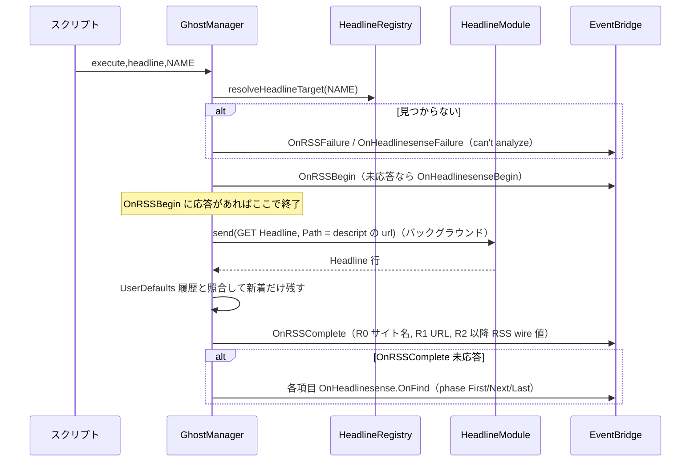
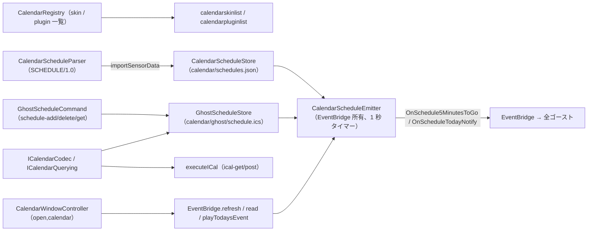

# 16 付帯機能（ヘッドライン・カレンダー・ネットワーク・メディア）

関連ソースファイル

このページは次のファイルをもとに作成した。

- [Ourin/HeadlineHost/HeadlineModule.swift](../../Ourin/HeadlineHost/HeadlineModule.swift)
- [Ourin/HeadlineHost/HeadlineRegistry.swift](../../Ourin/HeadlineHost/HeadlineRegistry.swift)
- [Ourin/HeadlineHost/HeadlineWireEngine.swift](../../Ourin/HeadlineHost/HeadlineWireEngine.swift)
- [Ourin/Calendar/CalendarRegistry.swift](../../Ourin/Calendar/CalendarRegistry.swift)
- [Ourin/Calendar/CalendarSchedule.swift](../../Ourin/Calendar/CalendarSchedule.swift)
- [Ourin/Calendar/CalendarWindow.swift](../../Ourin/Calendar/CalendarWindow.swift)
- [Ourin/Calendar/GhostSchedule.swift](../../Ourin/Calendar/GhostSchedule.swift)
- [Ourin/Calendar/ICalendar.swift](../../Ourin/Calendar/ICalendar.swift)
- [Ourin/Calendar/ICalendarQuery.swift](../../Ourin/Calendar/ICalendarQuery.swift)
- [Ourin/SaveShare/SaveShareManager.swift](../../Ourin/SaveShare/SaveShareManager.swift)
- [Ourin/Ghost/SNTPClient.swift](../../Ourin/Ghost/SNTPClient.swift)
- [Ourin/Ghost/MailBiffClient.swift](../../Ourin/Ghost/MailBiffClient.swift)
- [Ourin/Ghost/RSSFeedParser.swift](../../Ourin/Ghost/RSSFeedParser.swift)
- [Ourin/Ghost/HTTPDataTaskRunner.swift](../../Ourin/Ghost/HTTPDataTaskRunner.swift)
- [Ourin/Ghost/SoundPlayer.swift](../../Ourin/Ghost/SoundPlayer.swift)
- [Ourin/Ghost/SoundSpectrum.swift](../../Ourin/Ghost/SoundSpectrum.swift)
- [Ourin/Ghost/VideoPlayerWindow.swift](../../Ourin/Ghost/VideoPlayerWindow.swift)
- [Ourin/Ghost/GhostUtilityWindows.swift](../../Ourin/Ghost/GhostUtilityWindows.swift)
- [Ourin/Ghost/GhostManager.swift](../../Ourin/Ghost/GhostManager.swift)
- [Ourin/Ghost/GhostManager+System.swift](../../Ourin/Ghost/GhostManager+System.swift)
- [Ourin/Ghost/GhostManager+Display.swift](../../Ourin/Ghost/GhostManager+Display.swift)
- [Ourin/SHIORIEvents/EventBridge.swift](../../Ourin/SHIORIEvents/EventBridge.swift)
- [Ourin/OurinApp.swift](../../Ourin/OurinApp.swift)
- [Ourin/NarInstall/LocalNarInstaller.swift](../../Ourin/NarInstall/LocalNarInstaller.swift)
- [Ourin/DevTools/SaveSharePane.swift](../../Ourin/DevTools/SaveSharePane.swift)
- [docs/HEADLINE_2.0M_SPEC_ja-jp.md](../../docs/HEADLINE_2.0M_SPEC_ja-jp.md)

このページは、ゴーストの会話そのものではないが SSP 互換のために Ourin が持つ付帯機能をまとめる。HEADLINE モジュール（`HeadlineHost/`）、カレンダーと予定表（`Calendar/`）、セーブデータ共有（`SaveShare/`）、そして `Ghost/` にある時刻同期・メール確認・HTTP・RSS・音声・動画・ユーティリティ窓である。

いずれも、さくらスクリプトのタグ（`\![execute,...]`、`\![open,...]`、`\![sound,...]` など）から `GhostManager` の再生キュー経由で起動され、結果を SHIORI イベントで返す。タグの構文は [7 さくらスクリプト](./07-sakura-script.md)、イベント配送の仕組み（`EventBridge`、GET / NOTIFY）は [9 SHIORI イベント](./09-shiori-events.md) を参照。プロパティ経由の参照（`headlinelist.*`、`calendarskinlist.*`、`rateofuselist.*`）は [14 プロパティシステムとリソース](./14-property-resource.md) にある。

## 機能一覧（起動元と発火イベント）

| 機能 | 起動元 | 実装 | 発火するイベント |
|---|---|---|---|
| ヘッドライン | `\![execute,headline,名前\|random\|lastinstalled]` | `GhostManager.executeHeadline` + `HeadlineRegistry` / `HeadlineModule` / `HeadlineWireEngine` | `OnRSSBegin`→（未応答なら）`OnHeadlinesenseBegin`、`OnRSSComplete`→`OnHeadlinesense.OnFind` / `OnHeadlinesenseComplete`、`OnRSSFailure`→`OnHeadlinesenseFailure` |
| 時刻同期 | `\![executesntp]`、`\7`（開始）、`\6`（補正） | `executeSNTP` / `executeSNTPApply` + `SNTPClient` | `OnSNTPBegin`、`OnSNTPCompareEx`→`OnSNTPCompare`、`OnSNTPCorrectEx`→`OnSNTPCorrect`、`OnSNTPFailure` |
| メール確認 | `\![biff(,アカウント)]` | `executeBiff` + `MailBiffClient` | `OnBIFFBegin`、`OnBIFFComplete`→`OnBIFF2Complete`、`OnBIFFFailure` |
| HTTP | `\![execute,http-get\|post\|head\|put\|delete\|patch\|options,URL,...]`、`http-stream-*` | `executeHTTP` / `executeHTTPStreaming` + `HTTPDataTaskRunner` | `OnExecuteHTTPComplete` / `Failure` / `Progress` / `Streaming` / `SSLInfo` |
| RSS | `\![execute,rss-get\|rss-post,URL,...]` | `executeRSS` + `RSSFeedParser` | `OnExecuteRSSComplete` / `OnExecuteRSSFailure` / `OnExecuteRSS_SSLInfo` |
| iCalendar 取得 | `\![execute,ical-get\|ical-post,URL,...]`、`\![cancel,ical,URL]` | `executeICal` + `ICalendarCodec` / `ICalendarQuerying` | `OnExecuteICalComplete` / `Failure` / `Progress` / `OnExecuteICal_SSLInfo` |
| ゴースト用予定表 | `\![execute,schedule-add\|schedule-delete\|schedule-get,...]` | `executeGhostSchedule` + `GhostScheduleStore` | `OnExecuteScheduleComplete` / `OnExecuteScheduleFailure` / `OnExecuteScheduleGetComplete` |
| カレンダー（本体） | `\![open,calendar]`、1 秒タイマー | `CalendarWindowController` / `CalendarScheduleEmitter`（`EventBridge` が所有） | `OnSchedule5MinutesToGo`、`OnScheduleTodayNotify`、`OnSchedulesense*`、`OnScheduleRead`、`OnSchedulepost*` |
| 音声 | `\_v[ファイル]`、`\8[ファイル]`、`\![sound,play\|load\|loop\|pause\|resume\|stop\|option\|cdplay,...]`、`\_V`（完了待ち） | `playSound` ほか + `SoundPlayer` / `SoundSpectrumEngine` | `OnSoundStop`、`OnSoundLoop`、`OnSoundError`、`OnSoundSpectrum` |
| 動画 | `\![sound,play,動画ファイル]`（拡張子で判定） | `playVideo` + `VideoPlayerWindow` | `OnVideoPlayEx`、`OnVideoPlayFailure` |
| ユーティリティ窓 | `\![open,addressbar\|errorlog\|pictureviewer\|archiveviewer\|backlogviewer\|aigraph\|rateofusegraph*]` | `GhostUtilityWindows.swift` の `open*` | なし（AI グラフは `getaistate(ex)` を SHIORI に問い合わせる） |
| セーブデータ共有 | DevTools の SaveShare ペイン | `SaveShareManager` | なし |

**出典:** [Ourin/Ghost/GhostManager.swift:2739-2789](../../Ourin/Ghost/GhostManager.swift#L2739-L2789)、[Ourin/Ghost/GhostManager.swift:2976-2986](../../Ourin/Ghost/GhostManager.swift#L2976-L2986)、[Ourin/Ghost/GhostManager.swift:2998-3004](../../Ourin/Ghost/GhostManager.swift#L2998-L3004)、[Ourin/Ghost/GhostManager.swift:4020-4058](../../Ourin/Ghost/GhostManager.swift#L4020-L4058)、[Ourin/Ghost/GhostManager.swift:4303-4307](../../Ourin/Ghost/GhostManager.swift#L4303-L4307)、[Ourin/Ghost/GhostManager.swift:2513-2586](../../Ourin/Ghost/GhostManager.swift#L2513-L2586)、[Ourin/Ghost/GhostManager.swift:3505-3531](../../Ourin/Ghost/GhostManager.swift#L3505-L3531)、[Ourin/Ghost/GhostManager.swift:3616-3625](../../Ourin/Ghost/GhostManager.swift#L3616-L3625)、[Ourin/Ghost/GhostManager.swift:3652-3655](../../Ourin/Ghost/GhostManager.swift#L3652-L3655)

## HEADLINE（HeadlineHost/）

### モジュールの探索とロード

`AppDelegate` は起動時に `HeadlineRegistry()` を作って `discoverAndLoad()` し、`headlineRegistry` に保持する（終了時に `unloadAll()`）。探索先は (1) アプリバンドルの `PlugIns/Headline/`、(2) `<base>/headline/`（NAR の設置先と同じ）。

- 直下の `.plugin` / `.bundle` は、バンドルの Resources にある `descript.txt` を読む。
- それ以外のディレクトリは SSP 形式の `headline/<名前>/descript.txt` として読み、`filename`（なければ HEADLINE/2.0 の `dllname`）の DLL 名に対応するネイティブモジュールを `UkagakaModuleABI.nativeModuleCandidates` と大文字小文字を無視した解決で探す。見つかった候補が Windows PE なら採用しない。
- `readMeta` は先頭行の `charset` か `charset,` キーが Shift_JIS 系（`shift_jis` `windows-31j` `cp932` `ms932` `sjis`）なら Shift_JIS、それ以外は UTF-8 で読み、`name` `filename`/`dllname` `url` `openurl` を取り出す。`name` と filename が空なら無効。

`HeadlineModule` は `dlopen(RTLD_NOW | RTLD_LOCAL)` で実行ファイルを開き、呼び出し規約を判定する。バンドルの `Info.plist` に `OurinModuleABI` 宣言があればそれに従い、なければバンドルは Ourin C ABI（`execute(ptr, len, &outLen)`）、単体 `.dylib` は Windows DLL と同じ ukagaka ABI（`execute(HGLOBAL, long*)`）とみなす。`load` は `loadu` → `load`、`unload` は `unloadu` → `unload` の順に探す。`send(_:charset:)` は要求を指定文字コードで符号化し、応答の `Charset` ヘッダに従って復号する。ABI の詳細は [8 SHIORI 層](./08-shiori-runtime.md) の `UkagakaModuleABI` を参照。

**出典:** [Ourin/OurinApp.swift:461-465](../../Ourin/OurinApp.swift#L461-L465)、[Ourin/HeadlineHost/HeadlineRegistry.swift:3-129](../../Ourin/HeadlineHost/HeadlineRegistry.swift#L3-L129)、[Ourin/HeadlineHost/HeadlineModule.swift:1-91](../../Ourin/HeadlineHost/HeadlineModule.swift#L1-L91)

### ワイヤ形式（HeadlineWireEngine）

| 関数 | 内容 |
|---|---|
| `buildVersionRequest` | `GET Version HEADLINE/2.0` + `Charset` + `Sender` |
| `buildHeadlineRequest(path:version:charset:)` | `GET Headline HEADLINE/2.0(M)` + `Charset` + `Sender: Ourin` + `Option: url` + `Path` |
| `normalizePathForWire` | `file://` はそのまま、`C:\...` は `file:///C:/...` に、POSIX 絶対パスは `file://` URL に、それ以外（`http://...` を含む）はそのまま |
| `parseLines` | `Headline:` 行を `本文 \u{01} URL` に分ける |
| `parseVersion` / `parseCharset` / `parseRequestCharset` | `Value:` / `Charset:` / `RequestCharset:` を読む |

**出典:** [Ourin/HeadlineHost/HeadlineWireEngine.swift:1-117](../../Ourin/HeadlineHost/HeadlineWireEngine.swift#L1-L117)

### 実行の流れ

- 対象の選択: 空文字か `random` は登録済みからランダム、`lastinstalled` は `UserDefaults` の `OurinLastInstalledHeadlineName`（NAR インストール時に保存）に一致するもの（なければ最後の 1 件）、それ以外は `name` / `filename` / モジュール名を大文字小文字無視で比較。
- 既報判定: `OurinHeadlineHistory.<名前の base64>` に「本文と URL から作った識別子」を蓄積し、未登録のものだけを新着とする。新着 0 件なら `OnRSSComplete` の `Reference0` は `no update`（未応答なら `OnHeadlinesenseComplete` の `reason` = `no update`）。
- 応答が空なら `can't download`、`url` が空なら `can't download` で失敗イベントを送る。

**出典:** [Ourin/Ghost/GhostManager+System.swift:2323-2397](../../Ourin/Ghost/GhostManager+System.swift#L2323-L2397)、[Ourin/Ghost/GhostManager+System.swift:2399-2485](../../Ourin/Ghost/GhostManager+System.swift#L2399-L2485)、[Ourin/Ghost/GhostManager+System.swift:2487-2518](../../Ourin/Ghost/GhostManager+System.swift#L2487-L2518)、[Ourin/NarInstall/LocalNarInstaller.swift:228-233](../../Ourin/NarInstall/LocalNarInstaller.swift#L228-L233)

## カレンダー（Calendar/）

カレンダーには 3 種類の予定がある。(1) 本体カレンダーの予定（`calendar/schedules.json`、スケジュールセンサーの SCHEDULE/1.0 応答もここへ取り込む）、(2) ゴースト用予定表（`calendar/ghost/schedule.ics`、全ゴースト共有）、(3) HTTP で取得する外部 iCalendar（保存しない）。

### CalendarRegistry

`<base>/calendar/skin/*/` をスキンとして、descript.txt（`LegacyDescriptor` で読む）と `icon.txt`（`キー,ファイル名`、`#` `//` コメント可）を読む。`<base>/calendar/plugin/*/` は descript.txt に `filename`（または `dllname`）があるものだけをプラグインとし、`name` `id` `post` を持つ。どちらも名前の自然順でソートする。プラグインは一覧化だけで、ロードはしない（コードの読み取り）。

**出典:** [Ourin/Calendar/CalendarRegistry.swift:1-101](../../Ourin/Calendar/CalendarRegistry.swift#L1-L101)

### 本体カレンダーの予定（CalendarSchedule / Store / Emitter）

- `CalendarSchedule` は `type` `year` `month` `day` `startHour/Minute` `endHour/Minute`（終日予定は nil）`caption` `subtitle` `script` を持つ `Codable`。
- `CalendarScheduleParser` は SCHEDULE/1.0 のタブ区切り 11 欄（`type` から `script` まで、`script` 内のタブは最後の欄に残す）を解析し、壊れた行は行番号を `rejectedLineNumbers` に残して他を読む。
- `CalendarScheduleStore` は `<base>/calendar/schedules.json` に整形済み JSON で保存する（SSP のバイナリ形式は模倣しない）。
- `CalendarScheduleEmitter` は `EventBridge` の初期化時に作られ、自動イベントの有効化に合わせて `start()` / `stop()` される。`start()` はストアを読み込み、メインキューで 1 秒ごとに `emitDueEvents` を呼ぶ。
  - 開始 5 分前の予定に `OnSchedule5MinutesToGo`（`type` `caption` `subtitle` `script`）を 1 回だけ送る。
  - ゴースト用予定は `X-OURIN-NOTIFY`（`--notify` の分、既定 5）分前に同じイベントを送る。
  - 本体予定とゴースト予定を合わせた「今日の予定」の内容が変わったら `OnScheduleTodayNotify` を NOTIFY する（最初の計測は基準にするだけ）。
  - `refresh` は `OnSchedulesenseBegin` → `OnSchedulesenseComplete`（件数）または `OnSchedulesenseFailure`、`read(id:)` は `OnScheduleRead`、`beginPost` / `completePost` は `OnSchedulepostBegin` / `OnSchedulepostComplete`。
  - `buildTodaysEventScript` は SSP の `PlayTodaysEvent` に合わせ、`\b[2]M/D` + 辞書の `#todays event header` + `\n\n[half]` + `>>[HH:MM] 予定` を組み立てる（本文の `\` `%` 改行はエスケープ）。

**出典:** [Ourin/Calendar/CalendarSchedule.swift:3-198](../../Ourin/Calendar/CalendarSchedule.swift#L3-L198)、[Ourin/Calendar/CalendarSchedule.swift:200-267](../../Ourin/Calendar/CalendarSchedule.swift#L200-L267)、[Ourin/Calendar/CalendarSchedule.swift:274-617](../../Ourin/Calendar/CalendarSchedule.swift#L274-L617)、[Ourin/SHIORIEvents/EventBridge.swift:30-40](../../Ourin/SHIORIEvents/EventBridge.swift#L30-L40)、[Ourin/SHIORIEvents/EventBridge.swift:220-277](../../Ourin/SHIORIEvents/EventBridge.swift#L220-L277)

### ゴースト用予定表（GhostSchedule）

`\![execute,schedule-add|schedule-delete|schedule-get,...]` は UKADOC 2.8.91 相当で、`GhostScheduleCommand.run` が処理し、結果を `EventBridge.notify` で通知する。

| サブコマンド | 主な引数 | 成功 | 失敗理由 |
|---|---|---|---|
| `schedule-add` | `--summary=`（必須）`--start=`（必須）`--end=` `--uid=` `--description=` `--location=` `--url=` `--categories=` `--status=CONFIRMED\|TENTATIVE\|CANCELLED` `--notify=分` `--rrule=` `--exdate=` `--type=` `--script=` `--event=` | `OnExecuteScheduleComplete`（R0 `add`、R1 UID） | `notauthorized`（外部由来スクリプト）、`invalid`、`save` |
| `schedule-delete` | UID、`--event=` | 同（R0 `delete`） | `notauthorized`、`invalid`、`notfound`、`save` |
| `schedule-get` | `--from=` `--to=` `--expand(=日数)` `--limit=` `--event=` | `OnExecuteScheduleGetComplete`（Reference は iCal 取得と同形式） | — |

`--event=On...` を指定すると完了イベント名がその名前に、失敗は `名前+Failure` になる。UID 未指定なら `ourin-<UUID>` を振る。保存は `GhostScheduleStore`（`NSRecursiveLock`、ファイルの更新日時とサイズで再読込を判定するキャッシュ、atomic 書き込み）。

**出典:** [Ourin/Calendar/GhostSchedule.swift:1-118](../../Ourin/Calendar/GhostSchedule.swift#L1-L118)、[Ourin/Calendar/GhostSchedule.swift:119-246](../../Ourin/Calendar/GhostSchedule.swift#L119-L246)、[Ourin/Calendar/GhostSchedule.swift:334-352](../../Ourin/Calendar/GhostSchedule.swift#L334-L352)

### iCalendar の解析と照会（ICalendar / ICalendarQuery）

- `ICalendarCodec.parse` は RFC 5545 の一部を扱う。行の折り返し（CRLF + 空白）を解き、`VEVENT` の中だけを読み、入れ子（`VALARM` 等）は飛ばす。`SUMMARY` の無い VEVENT は捨てる。`X-WR-CALNAME` `X-WR-TIMEZONE` `CALSCALE` も読む。UTC や `TZID=` 付き日時はローカルへ換算し、終日予定の `end` は排他的 `DTEND` を 1 日戻した「最終日」で持つ。Ourin 独自に `X-OURIN-TYPE` / `X-OURIN-NOTIFY` / `X-OURIN-SCRIPT` を持つ。`serialize` は逆変換。
- `ICalRecurrenceRule` は `FREQ` `INTERVAL` `COUNT` `UNTIL` `BYDAY` `BYMONTHDAY` `BYMONTH` を扱い、`ICalendarRecurrence.occurrenceDays` が発生日を列挙する。
- `ICalQuery` は `--from=yyyymmdd` `--to=` `--expand[=日数]`（既定 30）`--limit=`（既定 200）を読み、いずれかがあれば「期間モード」（最大 1830 日）になる。
- `ICalendarReferences.complete` は `Reference0` に「カレンダー名・タイムゾーン・暦・返した件数・総件数・期間開始・期間終了」、`Reference1` 以降に各予定の「UID・開始・終了・件名・説明・場所・URL・状態・分類・RRULE・終日フラグ・発生日」を `\u{01}` 区切りで入れる。文字列の `\` `%` と改行・タブはエスケープする。
- `executeICal` は同じ URL の取得が進行中なら `downloading` で失敗させ、応答に `BEGIN:VCALENDAR` が無ければ `parse` で失敗させる。`\![cancel,ical,URL]` で中断できる。

**出典:** [Ourin/Calendar/ICalendar.swift:1-92](../../Ourin/Calendar/ICalendar.swift#L1-L92)、[Ourin/Calendar/ICalendarQuery.swift:1-60](../../Ourin/Calendar/ICalendarQuery.swift#L1-L60)、[Ourin/Calendar/ICalendarQuery.swift:181-236](../../Ourin/Calendar/ICalendarQuery.swift#L181-L236)、[Ourin/Calendar/ICalendarQuery.swift:317-393](../../Ourin/Calendar/ICalendarQuery.swift#L317-L393)、[Ourin/Ghost/GhostManager+System.swift:3162-3253](../../Ourin/Ghost/GhostManager+System.swift#L3162-L3253)

### カレンダー窓（CalendarWindow）

`\![open,calendar]` は `CalendarWindowController.shared.show()` を呼ぶ。窓（760×560、SwiftUI の `CalendarWindowView`）を初回だけ作り、表示のたびに `CalendarWindowModel.refresh()` で `EventBridge.refreshCalendarSchedules()`（＝ `OnSchedulesense*` を発火）を実行する。予定の行から `OnScheduleRead`、「今日の予定を再生」ボタンから `EventBridge.playTodaysEvent`（各起動中ゴーストの `#todays event header` を取得して `runScript`）を呼ぶ。`CalendarGrid` は月表示のセル日付を計算する。

**出典:** [Ourin/Calendar/CalendarWindow.swift:1-113](../../Ourin/Calendar/CalendarWindow.swift#L1-L113)、[Ourin/Calendar/CalendarWindow.swift:369-408](../../Ourin/Calendar/CalendarWindow.swift#L369-L408)

## SaveShare（SaveShareManager）

SSP 2.8.35f の `sp_saveshare` 互換の `.ssg` ファイルで、ゴーストのプロファイル `data/profile/<ゴースト>/` にあるセーブデータを書き出し・復元する。DevTools の SaveShare ペイン（[17](./17-devtools-migrator.md)）からだけ使われる。

- **対象ファイル**（SSP 定義の 15 件）: `yaya_variable.cfg` `aya_variable.cfg` `satori_savedata.txt` `dict-save.txt` `dict-save2.txt` `dict-keeps-savedata.txt` `Dict-KEEPSs.txt` `save.dat` `savedata1.dat`〜`savedata5.dat` `savedata.adb`（BINARY）`savedata.asv`。存在するものだけを含める。
- **バイナリ形式**: `SSZ\0` マジック、FILETIME（下位・上位 LE32）、コンピュータ名の長さ（LE32）と名前、圧縮前サイズ（LE32）、zlib 圧縮本文。
- **本文**: `===SSP_SAVESHARE:1.0===` に続けて `[TIMESTAMP:]` `[GHOSTNAME:]` `[COMPUTERNAME:]`、各ファイルを `[FILE:名]` `[SIZE:n]` `[TYPE:TEXT|BINARY]` 本文 `[ENDFILE]` で並べ、`===SSP_SAVESHARE_END===` で閉じる。BINARY は Base64。
- **読み込み**: 先頭がマジックでなければ平文として扱う（SSP のフォールバック）。ファイル名に `/` `\` `..` を含むと `pathTraversal`。復元はプロファイルディレクトリへ atomic 書き込み（既存は上書き）。
- 圧縮・伸長は Apple の `Compression` フレームワーク（`COMPRESSION_ZLIB`）を使う。

**出典:** [Ourin/SaveShare/SaveShareManager.swift:1-153](../../Ourin/SaveShare/SaveShareManager.swift#L1-L153)、[Ourin/SaveShare/SaveShareManager.swift:155-228](../../Ourin/SaveShare/SaveShareManager.swift#L155-L228)、[Ourin/SaveShare/SaveShareManager.swift:295-367](../../Ourin/SaveShare/SaveShareManager.swift#L295-L367)、[Ourin/DevTools/SaveSharePane.swift:70-119](../../Ourin/DevTools/SaveSharePane.swift#L70-L119)

## ネットワーク系ユーティリティ（Ghost/）

### SNTPClient（`\![executesntp]` / `\7` / `\6`）

- `SNTPClient.query(server:timeout:)` は `NWConnection` で UDP 123 番へ NTP v4 のクライアント要求（48 バイト、先頭 `0x23`）を送り、応答の mode=4・version≥3・stratum≠0・originate 一致を検証して、四時刻から `offset = ((t2-t1)+(t3-t4))/2` を計算する。既定タイムアウトは 5 秒。キューは `jp.ourin.sntp`。
- `GhostManager.executeSNTP` はサーバを `UserDefaults` の `OurinSNTPServer`（既定 `pool.ntp.org`）から取り、`OnSNTPBegin` を送ってから問い合わせる。成功時は `OnSNTPCompareEx`（符号付き秒・ミリ秒、ミリ秒付き時刻）を GET し、未応答なら `OnSNTPCompare`（絶対値）へフォールバックする（両方送ると二重再生になるため）。
- `\6`（`executeSNTPApply`）は直前の測定結果で `SNTPClockAdjuster.adjust`（`settimeofday`）を呼ぶ。測定が無ければ先に同期してから補正する。成功で `OnSNTPCorrectEx`→`OnSNTPCorrect`、権限不足（`EPERM`/`EACCES`）などの失敗は `OnSNTPFailure`。sudo などで権限を迂回しない。

**出典:** [Ourin/Ghost/SNTPClient.swift:1-96](../../Ourin/Ghost/SNTPClient.swift#L1-L96)、[Ourin/Ghost/SNTPClient.swift:98-185](../../Ourin/Ghost/SNTPClient.swift#L98-L185)、[Ourin/Ghost/SNTPClient.swift:186-294](../../Ourin/Ghost/SNTPClient.swift#L186-L294)、[Ourin/Ghost/GhostManager+System.swift:2116-2301](../../Ourin/Ghost/GhostManager+System.swift#L2116-L2301)

### MailBiffClient（`\![biff]`）

POP3 / IMAP を自前で話すのではなく、**macOS の「メール」アプリに AppleScript（`NSAppleScript`）で問い合わせる**。指定アカウント（省略時は全アカウント）の全メールボックスから未読メッセージを数え、サイズ合計、`差出人\u{01}件名\u{01}...`、全ヘッダ（`\u{02}` 区切り）を返す。スクリプトの実行は `DispatchQueue.global(qos: .utility)`。

`executeBiff` は `OnBIFFBegin` → 成功なら `OnBIFFComplete`（`mailCount` `mailBytes` `account` `newMailDelta` `topResult` `senderAndSubject` 等）、未応答かつ前回より未読が増えたときだけ `OnBIFF2Complete`、失敗なら `OnBIFFFailure`（`reason` はエラーメッセージ）。前回件数はアカウント名ごとに `lastBiffUnreadCounts` に持つ。

**出典:** [Ourin/Ghost/MailBiffClient.swift:1-105](../../Ourin/Ghost/MailBiffClient.swift#L1-L105)、[Ourin/Ghost/GhostManager+System.swift:2531-2603](../../Ourin/Ghost/GhostManager+System.swift#L2531-L2603)

### HTTPDataTaskRunner（`\![execute,http-*]` ほか）

`URLSession.shared.dataTask` は完了時にしかデータを返さないため、`HTTPDataTaskRunner` は ephemeral な `URLSession` を自前の delegate で作り、受信チャンクと累積データを `onData` で逐次渡し、完了時に `onComplete(data, response, metrics, error)` を呼ぶ。delegate の寿命も自分で保持し、`cancel()` でセッションごと破棄する。

利用者は `executeHTTP`（`--progress` 系オプション時に `OnExecuteHTTPProgress`）、`executeHTTPStreaming`（チャンクごとに `OnExecuteHTTPStreaming`）、`executeRSS`（途中イベントなし）、`executeICal`。HTTP メソッドはサブコマンド末尾（`GET` `POST` `HEAD` `PUT` `DELETE` `PATCH` `OPTIONS`、それ以外は GET）。結果はファイル保存（既定）か本文そのまま（`--nofile` 相当）で `OnExecuteHTTPComplete` に入る。HTTPS で TLS 接続が成立していれば `OnExecuteHTTPSSLInfo` も送る。オプションの全体は `HTTPCommandOptions` を参照。

**出典:** [Ourin/Ghost/HTTPDataTaskRunner.swift:1-70](../../Ourin/Ghost/HTTPDataTaskRunner.swift#L1-L70)、[Ourin/Ghost/GhostManager+System.swift:548-568](../../Ourin/Ghost/GhostManager+System.swift#L548-L568)、[Ourin/Ghost/GhostManager+System.swift:2604-2796](../../Ourin/Ghost/GhostManager+System.swift#L2604-L2796)

### RSSFeedParser（`\![execute,rss-get]`）

`XMLParser`（外部エンティティ解決なし、名前空間処理あり）で RSS 2.x / RDF / Atom 1.0 を読む最小パーサー。ルート要素 `rss` `rdf` `feed` が無ければエラー。`item` / `entry` ごとに `title`、`link`（Atom は `href`）、`pubDate` / `published` / `updated` / `date`、`author` / `creator` / `name`、`description` / `summary` / `content` / `encoded` を集める。`wireValue` は `タイトル\u{01}URL\u{01}yyyy,MM,dd,HH,mm,ss（UTC）\u{01}著者\u{01}要約`。

`executeRSS` は 2xx 応答を解析し、項目を `Reference0..` に入れて `OnExecuteRSSComplete`（0 件なら `no update`）、失敗は `OnExecuteRSSFailure`（解析失敗は `parse`）を NOTIFY する。HEADLINE 経路も `RSSFeedItem` を共有している。

**出典:** [Ourin/Ghost/RSSFeedParser.swift:1-100](../../Ourin/Ghost/RSSFeedParser.swift#L1-L100)、[Ourin/Ghost/RSSFeedParser.swift:215-241](../../Ourin/Ghost/RSSFeedParser.swift#L215-L241)、[Ourin/Ghost/GhostManager+System.swift:3080-3160](../../Ourin/Ghost/GhostManager+System.swift#L3080-L3160)

## メディア（SoundPlayer / SoundSpectrum / VideoPlayerWindow）

### SoundPlayer

`playSound(filename:loop:options:)` は `ghost/master` 基準（旧 `ghost/sound` もフォールバック）でパスを解決し、`mms` / `rtsp` は `unsupported_scheme`、ローカルファイルが無ければ `file_not_found` で `OnSoundError` を送る。プリロード済み（`\![sound,load]`）のインスタンスがあれば消費し、無ければ新規に作る。同じファイル名でも再生ごとに独立したインスタンスを持つので多重再生できる。

`SoundPlayer` はローカルを `AVAudioPlayer`、`http(s)` を `AVPlayer` で再生する。オプションは `SoundPlaybackOptions`（`--volume` `--balance`（pan、ローカルのみ）`--rate`（0.01 以上、`enableRate` を先に立てる）`--seektime`（絶対・相対）`--spectrum` 系）。ループは `AVAudioPlayer` の自動ループを使わず、終了 delegate で先頭から再開して `onLoop` を呼ぶ（`OnSoundLoop` を正確に出すため）。

| イベント | 条件 | Reference |
|---|---|---|
| `OnSoundStop` | 自然終了 | `filename`、`reason` = `end` |
| `OnSoundLoop` | ループの周回境界 | `filename` |
| `OnSoundError` | 読み込み・デコード・再開失敗、`cdplay`（macOS 非対応） | `command` `errorCode` `filename` `message` |

`\_v[ファイル]` と `\8[ファイル]` は再生キューに `.playSound` を積み、`\_V` は音声・効果音・動画の完了を待つ。

**出典:** [Ourin/Ghost/SoundPlayer.swift:1-95](../../Ourin/Ghost/SoundPlayer.swift#L1-L95)、[Ourin/Ghost/SoundPlayer.swift:160-216](../../Ourin/Ghost/SoundPlayer.swift#L160-L216)、[Ourin/Ghost/SoundPlayer.swift:296-325](../../Ourin/Ghost/SoundPlayer.swift#L296-L325)、[Ourin/Ghost/GhostManager+Display.swift:236-320](../../Ourin/Ghost/GhostManager+Display.swift#L236-L320)、[Ourin/Ghost/GhostManager+Display.swift:361-420](../../Ourin/Ghost/GhostManager+Display.swift#L361-L420)、[Ourin/Ghost/VideoPlayerWindow.swift:6-30](../../Ourin/Ghost/VideoPlayerWindow.swift#L6-L30)

### SoundSpectrum（`--spectrum`）

UKADOC 2.9.18〜2.9.20 の `OnSoundSpectrum` を実装する。`SoundSpectrumEngine` は `--spectrum=間隔`（20〜1000 ms に丸める、0 で停止して全 0 を 1 回送る）、`--spectrum-bands`（0・5・10・15・31 のうち最も近い値、既定 10）、`--spectrum-hold`（ピークホールド 0〜10000 ms）を受ける。メインキューのタイマーで、再生中のローカルファイルを約 85 ms 窓（44.1 / 48 kHz では 4096 点）で FFT（Accelerate）し、ISO 中心周波数の帯域ごとのレベル（-60 dB を 0、0 dB を 100）とチャンネルごとのレベルを出す。ストリーミングなど波形を取れない音は、帯域 0 のときだけ再生位置を通知する。

`Reference0` ファイル名、`R1` 帯域数、`R2` / `R3` チャンネルのレベル / ピーク、`R4` / `R5` 帯域のレベル / ピーク（`\u{01}` 区切り）、`R6` 再生位置（ms）。

**出典:** [Ourin/Ghost/SoundSpectrum.swift:1-75](../../Ourin/Ghost/SoundSpectrum.swift#L1-L75)、[Ourin/Ghost/SoundSpectrum.swift:184-300](../../Ourin/Ghost/SoundSpectrum.swift#L184-L300)

### VideoPlayerWindow

`\![sound,play|load|loop,...]` のファイル名が動画拡張子なら `playVideo` / `loadVideo` に回る。`mp4` `m4v` `mov` `qt` は再生可能、`avi` `wmv` `mpg` `mkv` `webm` `flv` などは `unsupported_codec` として `OnVideoPlayFailure` を送る。`VideoPlayerWindow` は `AVPlayer` + `AVPlayerView` を枠なし・`floating` レベルの窓に載せ、`--soundonly` や表示指定がなければ窓を出す。`--balance` は `MTAudioProcessingTap` で左右ゲインを掛ける `AVAudioMix` として実装し、`VideoPreloadPlayer` が `load` 済みの `AVPlayer` を保持する（`play` 時に一度だけオプションを適用して `--seektime` の二重適用を避ける）。開始時に `OnVideoPlayEx` を送る。

**出典:** [Ourin/Ghost/GhostManager+Display.swift:330-345](../../Ourin/Ghost/GhostManager+Display.swift#L330-L345)、[Ourin/Ghost/GhostManager+Display.swift:554-620](../../Ourin/Ghost/GhostManager+Display.swift#L554-L620)、[Ourin/Ghost/VideoPlayerWindow.swift:166-320](../../Ourin/Ghost/VideoPlayerWindow.swift#L166-L320)、[Ourin/Ghost/VideoPlayerWindow.swift:322-490](../../Ourin/Ghost/VideoPlayerWindow.swift#L322-L490)、[Ourin/Ghost/VideoPlayerWindow.swift:560-640](../../Ourin/Ghost/VideoPlayerWindow.swift#L560-L640)

## ユーティリティ窓（GhostUtilityWindows）

`GhostManager` の extension として、`\![open,...]` で開く小さな SwiftUI 窓をまとめる。`presentUtilityWindow(key:title:size:)` はキーごとに 1 枚だけ作り（既にあれば前面へ）、識別子に `GhostUtilityWindow_<key>_<sstpUniqueID>` を付けるため、ゴーストごとに別窓になる。

| `\![open,X]` | 関数 | 内容 |
|---|---|---|
| `addressbar` | `openAddressBar` | URL 入力欄。`http` `https` `mailto` `file` を既定アプリで開く（スキーム省略は `https://` を補う） |
| `errorlog` | `openErrorLogViewer` | `LogStore` から `jp.ourin.*` の直近 24 時間のログを表示・コピー（[3](./03-app-lifecycle.md)） |
| `pictureviewer(,パス)` | `openPictureViewer` | 画像表示。パス省略時は `NSOpenPanel` |
| `archiveviewer(,パス)` | `openArchiveViewer` | `/usr/bin/zipinfo -1` で ZIP / NAR の中身一覧 |
| `backlogviewer` | `openBacklogViewer` | 発言履歴（`recordBacklog` が表示テキストを最大 200 件保持し、`RateOfUseStore.recordTalk` も更新） |
| `aigraph` | `openAIGraph` | SHIORI に `getaistate` / `getaistateex` を GET し、値が無ければ「提供していません」と表示 |
| `rateofusegraph` / `rateofusegraphballoon` / `rateofusegraphtotal` | `openRateOfUseGraph` | `RateOfUseStore` の使用統計。balloon はゴースト使用率へフォールバック、total は全ゴースト |

カレンダー窓（`CalendarWindowController`）と動画窓（`VideoPlayerWindow`）は前節、入力ボックス類は [6 バルーンと入力 UI](./06-balloon.md)、サーフェステスト窓は [5](./05-surface-shell-animation.md) を参照。

**出典:** [Ourin/Ghost/GhostUtilityWindows.swift:1-345](../../Ourin/Ghost/GhostUtilityWindows.swift#L1-L345)、[Ourin/Ghost/GhostUtilityWindows.swift:389-450](../../Ourin/Ghost/GhostUtilityWindows.swift#L389-L450)、[Ourin/Ghost/GhostManager.swift:4194-4215](../../Ourin/Ghost/GhostManager.swift#L4194-L4215)

## 制約と注意点

- **HEADLINE の Path**: 仕様（`docs/HEADLINE_2.0M_SPEC_ja-jp.md` §11）では `Path:` はホストが取得したローカルファイルで、旧・新ファイルで 2 回呼ばれ得る。`executeHeadline` は descript.txt の `url` を**そのまま** `Path:` に入れて 1 回だけ呼び、ホスト側でページを取得していない。既報判定はホスト側の履歴で行う。
- 注意: 同仕様 §5 は「ホストは `CFBundleGetFunctionPointerForName` で `execute` を取得」「任意の `headline_free`」とするが、実装は `dlopen` / `dlsym` で、`headline_free` は探さない。`parseRequestCharset` / `parseVersion` / `buildVersionRequest` は `HeadlineWireEngine` に定義されているが、アプリ本体の実行経路から呼ばれておらず、使うのはテスト（`OurinTests/HeadlineWireTests.swift`、`OurinTests/ForeignCharsetTests.swift`）だけである。
- `executeHeadline` は `OnRSSBegin` にゴーストが応答すると取得せずに終了する。`dispatchRSSBegin` のコメントは、ゴーストが `OnRSSBegin` に応答しなければ `OnHeadlinesenseBegin` へ戻る設計だと書くが、この分岐の仕様上の根拠は `docs/` からは読み取れない（未確認）。
- **SaveShare の互換性（推測）**: Apple の `COMPRESSION_ZLIB` は zlib ヘッダと Adler-32 を持たない raw DEFLATE を扱う（`InternalDataModule` のコメントも「ヘッダの無い deflate」と書き、zlib 形式には自前でヘッダと Adler-32 を足している）。`SaveShareManager` は `compression_encode_buffer` / `compression_decode_buffer` をそのまま使うので、Ourin が書く圧縮データは zlib 形式ではなく、SSP の `compress2` が作る zlib 形式の .ssg は `zlibDecompress` で展開できず `unsupportedCompression` になると読める。SSP が Ourin の .ssg を読めるかも含め、相互読み込みは実機では未確認。ファイル冒頭コメントはコンピュータ名の長さを「`GetComputerNameW` の長さから 1 引いた値」と書くが、実装は UTF-8 のバイト数をそのまま書き、読み込みも同じ値で読む。また、各 SHIORI（YAYA・里々等）が実際に `data/profile/<ゴースト>/` にセーブデータを置くかは本ページの範囲では未確認。
- `EventBridge.importCalendarScheduleData`（SCHEDULE/1.0 センサー応答の取り込み）の呼び出し元はリポジトリ内に見当たらない。カレンダープラグイン（`calendar/plugin`）もロード・実行はされない。
- `MailBiffClient` は「メール」アプリへの Apple Event 送信許可（オートメーション）が必要と推測される（推測。実機では未確認）。本体の `Info.plist` に `NSAppleEventsUsageDescription` は無く、`Ourin.entitlements` にも Apple Events のエンタイトルメントは無いのに、Hardened Runtime は有効（`ENABLE_HARDENED_RUNTIME = YES`）なので、許可が得られず拒否される可能性がある（推測）。拒否を含め AppleScript の実行エラーは `OnBIFFFailure` になる。
- `SNTPClockAdjuster` の補正は一般ユーザー権限では `settimeofday` が拒否されるため、通常は `OnSNTPFailure` になる（推測。`SNTPClockAdjuster` のコメントも、`settimeofday` はプロセスが持つ権限の範囲でのみ成功し、拒否はそのまま `OnSNTPFailure` へつなげると書く）。
- `\![sound,cdplay]` は macOS 非対応として常に `OnSoundError`（`audio_cd_unsupported`）。

**出典:** [docs/HEADLINE_2.0M_SPEC_ja-jp.md:40-63](../../docs/HEADLINE_2.0M_SPEC_ja-jp.md#L40-L63)、[docs/HEADLINE_2.0M_SPEC_ja-jp.md:108-126](../../docs/HEADLINE_2.0M_SPEC_ja-jp.md#L108-L126)、[Ourin/Ghost/GhostManager+System.swift:2338-2356](../../Ourin/Ghost/GhostManager+System.swift#L2338-L2356)、[Ourin/Ghost/GhostManager+System.swift:2399-2408](../../Ourin/Ghost/GhostManager+System.swift#L2399-L2408)、[Ourin/Ghost/GhostManager+System.swift:2532-2562](../../Ourin/Ghost/GhostManager+System.swift#L2532-L2562)、[Ourin/HeadlineHost/HeadlineWireEngine.swift:12-85](../../Ourin/HeadlineHost/HeadlineWireEngine.swift#L12-L85)、[Ourin/HeadlineHost/HeadlineModule.swift:24-45](../../Ourin/HeadlineHost/HeadlineModule.swift#L24-L45)、[Ourin/SaveShare/SaveShareManager.swift:329-367](../../Ourin/SaveShare/SaveShareManager.swift#L329-L367)、[Ourin/SaoriHost/Internal/InternalDataModule.swift:44-66](../../Ourin/SaoriHost/Internal/InternalDataModule.swift#L44-L66)、[Ourin/Ghost/MailBiffClient.swift:25-45](../../Ourin/Ghost/MailBiffClient.swift#L25-L45)、[Ourin/Resources/Info.plist](../../Ourin/Resources/Info.plist)、[Ourin/Ourin.entitlements](../../Ourin/Ourin.entitlements)、[Ourin.xcodeproj/project.pbxproj:686](../../Ourin.xcodeproj/project.pbxproj#L686)、[Ourin.xcodeproj/project.pbxproj:743](../../Ourin.xcodeproj/project.pbxproj#L743)、[Ourin/SaveShare/SaveShareManager.swift:5-27](../../Ourin/SaveShare/SaveShareManager.swift#L5-L27)、[Ourin/SaveShare/SaveShareManager.swift:137-149](../../Ourin/SaveShare/SaveShareManager.swift#L137-L149)、[Ourin/SHIORIEvents/EventBridge.swift:228-232](../../Ourin/SHIORIEvents/EventBridge.swift#L228-L232)、[Ourin/Ghost/SNTPClient.swift:33-45](../../Ourin/Ghost/SNTPClient.swift#L33-L45)、[Ourin/Ghost/GhostManager.swift:2544-2548](../../Ourin/Ghost/GhostManager.swift#L2544-L2548)

## 関連ページ

- [5 サーフェス・シェル・SERIKO アニメーション](./05-surface-shell-animation.md) — サーフェステスト窓
- [6 バルーンと入力 UI](./06-balloon.md) — 入力ボックス類の窓
- [7 さくらスクリプト](./07-sakura-script.md) — `\![execute,...]` `\![open,...]` `\![sound,...]` の構文
- [8 SHIORI 層](./08-shiori-runtime.md) — `UkagakaModuleABI` と `ShioriRuntime`
- [9 SHIORI イベント](./09-shiori-events.md) — `EventBridge` と各イベントの Reference 定義
- [12 PLUGIN](./12-plugin.md) — HEADLINE と共通のモジュール ABI
- [14 プロパティシステムとリソース](./14-property-resource.md) — `headlinelist` / `calendar*list` / `rateofuselist`
- [15 NAR インストールとパッケージ管理](./15-nar-install.md) — headline / calendar の設置先
- [17 DevTools と Ourin Migrator](./17-devtools-migrator.md) — SaveShare ペイン
