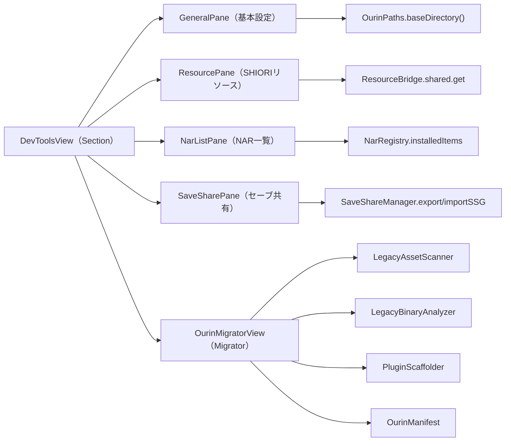
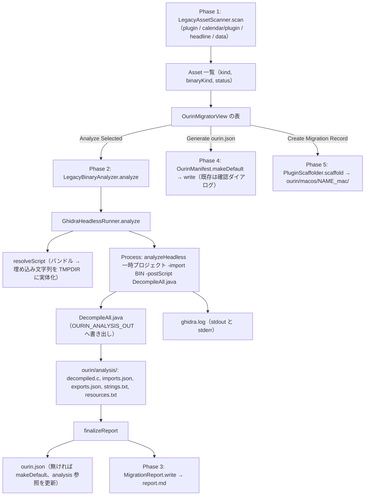

# 17 DevTools と Ourin Migrator

<details>
<summary>関連ソースファイル</summary>

このページは次のファイルをもとに作成した。

- [Ourin/DevTools/DevToolsView.swift](../../Ourin/DevTools/DevToolsView.swift)
- [Ourin/DevTools/DevToolsCommands.swift](../../Ourin/DevTools/DevToolsCommands.swift)
- [Ourin/DevTools/GeneralPane.swift](../../Ourin/DevTools/GeneralPane.swift)
- [Ourin/DevTools/NarListPane.swift](../../Ourin/DevTools/NarListPane.swift)
- [Ourin/DevTools/ResourcePane.swift](../../Ourin/DevTools/ResourcePane.swift)
- [Ourin/DevTools/SaveSharePane.swift](../../Ourin/DevTools/SaveSharePane.swift)
- [Ourin/DevTools/Migrator/LegacyAssetScanner.swift](../../Ourin/DevTools/Migrator/LegacyAssetScanner.swift)
- [Ourin/DevTools/Migrator/LegacyBinaryAnalyzer.swift](../../Ourin/DevTools/Migrator/LegacyBinaryAnalyzer.swift)
- [Ourin/DevTools/Migrator/GhidraHeadlessRunner.swift](../../Ourin/DevTools/Migrator/GhidraHeadlessRunner.swift)
- [Ourin/DevTools/Migrator/GhidraScriptSource.swift](../../Ourin/DevTools/Migrator/GhidraScriptSource.swift)
- [Ourin/DevTools/Migrator/Resources/DecompileAll.java](../../Ourin/DevTools/Migrator/Resources/DecompileAll.java)
- [Ourin/DevTools/Migrator/MigrationReport.swift](../../Ourin/DevTools/Migrator/MigrationReport.swift)
- [Ourin/DevTools/Migrator/OurinManifest.swift](../../Ourin/DevTools/Migrator/OurinManifest.swift)
- [Ourin/DevTools/Migrator/PluginScaffolder.swift](../../Ourin/DevTools/Migrator/PluginScaffolder.swift)
- [Ourin/DevTools/Migrator/OurinMigratorView.swift](../../Ourin/DevTools/Migrator/OurinMigratorView.swift)
- [Ourin/OurinApp.swift](../../Ourin/OurinApp.swift)
- [Ourin/RightClickMenu.swift](../../Ourin/RightClickMenu.swift)
- [Ourin/ContentView.swift](../../Ourin/ContentView.swift)
- [Ourin/Ghost/GhostManager.swift](../../Ourin/Ghost/GhostManager.swift)
- [Ourin/Ghost/GhostManager+System.swift](../../Ourin/Ghost/GhostManager+System.swift)
- [Ourin/PluginHost/PluginRegistry.swift](../../Ourin/PluginHost/PluginRegistry.swift)
- [Ourin/Resources/Licenses/Ghidra.txt](../../Ourin/Resources/Licenses/Ghidra.txt)
- [Ourin.xcodeproj/project.pbxproj](../../Ourin.xcodeproj/project.pbxproj)
- [README.md](../../README.md)
- [docs/OURIN_MIGRATOR_PLAN_ja-jp.md](../../docs/OURIN_MIGRATOR_PLAN_ja-jp.md)
- [docs/DevToolsUIMockup_ja-jp.md](../../docs/DevToolsUIMockup_ja-jp.md)

</details>

このページは、開発者向けの **DevTools** 窓（`Ourin/DevTools/`）と、その中の **Ourin Migrator**（`Ourin/DevTools/Migrator/`）を扱う。DevTools はデータフォルダ・SHIORI Resource・インストール済み NAR・セーブデータ共有の確認と操作をまとめた窓で、設定画面（`ContentView`、[3 アプリの起動とライフサイクル](./03-app-lifecycle.md)）とは別の窓である。

Ourin Migrator は、SSP 互換資産フォルダにある Windows 向け DLL / EXE を**実行せずに**読み取り、Ghidra の headless 解析で疑似 C や import / export を取り出し、`ourin.json`（移行マニフェスト）と移行記録を作る補助ツールである。Ghidra は同梱せず、ユーザーが別途入れた `analyzeHeadless` を外部プロセスとして呼ぶ。Migrator を使わない通常の起動では Ghidra も Java も不要である。

**出典:** [README.md:170-182](../../README.md#L170-L182)、[Ourin/Resources/Licenses/Ghidra.txt:1-9](../../Ourin/Resources/Licenses/Ghidra.txt#L1-L9)、[docs/OURIN_MIGRATOR_PLAN_ja-jp.md:1-20](../../docs/OURIN_MIGRATOR_PLAN_ja-jp.md#L1-L20)

## DevTools の開き方

| 入口 | 処理 | 窓 |
|---|---|---|
| メニューバー（`MenuBarExtra`）の「DevTools」 | `AppDelegate.showDevTools()` | `NSHostingController(rootView: DevToolsView())` の `NSWindow`（700×500、`devToolsWindow` に保持して再利用） |
| 「View」メニュー「DevTools を表示」（⌘D、macOS 13 以上） | `ModernDevToolsCommands.openDevTools()` → `openWindow(id: "DevTools")` | `WindowGroup("DevTools", id: "DevTools")` |
| `\![open,developer]` / `\![open,shiorirequest]` / `\![open,dressupexplorer]` | `GhostManager.openDeveloperTool(_:)` → `showDevTools()` と `devToolsReload` 通知（`object` にツール名） | 同上（`NSWindow`） |

3 つの `\![open,...]` はいずれも同じ DevTools 窓を開くだけで、ツール名ごとの専用画面はない。`devToolsReload` 通知を購読しているのは設定画面の `ContentView`（`reload()` を呼ぶ）で、`DevToolsView` 自身は購読していない。

**出典:** [Ourin/OurinApp.swift:62-74](../../Ourin/OurinApp.swift#L62-L74)、[Ourin/OurinApp.swift:1084-1094](../../Ourin/OurinApp.swift#L1084-L1094)、[Ourin/OurinApp.swift:1114-1117](../../Ourin/OurinApp.swift#L1114-L1117)、[Ourin/RightClickMenu.swift:59-61](../../Ourin/RightClickMenu.swift#L59-L61)、[Ourin/Ghost/GhostManager.swift:3644-3647](../../Ourin/Ghost/GhostManager.swift#L3644-L3647)、[Ourin/Ghost/GhostManager+System.swift:7237-7242](../../Ourin/Ghost/GhostManager+System.swift#L7237-L7242)、[Ourin/ContentView.swift:68-70](../../Ourin/ContentView.swift#L68-L70)

## DevToolsView と各ペイン

`DevToolsView` はサイドバーとツールバーを持つ。macOS 13 以上では `NavigationSplitView`、それ未満では `NavigationView` を使う。ツールバーの「再読込」は `ResourceBridge.shared.invalidateAll()`（SHIORI Resource のキャッシュ破棄、[14](./14-property-resource.md)）だけを行う。



| Section（表示名） | ペイン | 機能 |
|---|---|---|
| `general`（基本設定） | `GeneralPane` | データフォルダ（`OurinPaths.baseDirectory()`）を編集不可の欄に表示し、「Finderで開く」で `activateFileViewerSelecting` する |
| `shioriResource`（SHIORIリソース） | `ResourcePane` | `sakura.name` と `kero.name` の 2 キーだけを `ResourceBridge.shared.get` で読み、表に出す |
| `narList`（NAR一覧） | `NarListPane` | `ghost` `balloon` `shell` `plugin` `package` について `NarRegistry.shared.installedItems(ofType:)` を並べる（種別・フォルダ名・パス）。descript.txt は読まない |
| `saveShare`（セーブ共有 (SaveShare)） | `SaveSharePane` | ゴーストを選び、`data/profile/<ゴースト>/` を `.ssg` に書き出す／`.ssg` から復元する。形式は [16 付帯機能](./16-auxiliary-features.md) の SaveShare 節 |
| `migrator`（Migrator） | `OurinMigratorView` | 後述 |

`SaveSharePane` はゴースト一覧を `NarRegistry.shared.installedGhosts()`（フォルダ名）から作り、`OurinPaths.profileDirectory(for:)` でプロファイルを決める。エクスポートは `NSSavePanel`（既定名 `<ゴースト>.ssg`、コンピュータ名は `Host.current().localizedName`）、インポートは `NSOpenPanel` で、復元は既存ファイルを上書きする。

**出典:** [Ourin/DevTools/DevToolsView.swift:6-110](../../Ourin/DevTools/DevToolsView.swift#L6-L110)、[Ourin/DevTools/GeneralPane.swift:6-36](../../Ourin/DevTools/GeneralPane.swift#L6-L36)、[Ourin/DevTools/ResourcePane.swift:3-28](../../Ourin/DevTools/ResourcePane.swift#L3-L28)、[Ourin/DevTools/NarListPane.swift:3-33](../../Ourin/DevTools/NarListPane.swift#L3-L33)、[Ourin/DevTools/SaveSharePane.swift:7-119](../../Ourin/DevTools/SaveSharePane.swift#L7-L119)

## DevToolsCommands（メニューコマンド）

`ModernDevToolsCommands`（macOS 13 以上）は `MenuBarExtra` の `.commands` に付き、3 つの `CommandMenu` を追加する。

| メニュー | 項目 | ショートカット | 処理 |
|---|---|---|---|
| View | DevTools を表示 | ⌘D | `openWindow(id: "DevTools")` |
| Debug | リロード | ⌘R | `ResourceBridge.invalidateAll()`、`pluginRegistry` の `unloadAll()` → `discoverAndLoad()`、`devToolsReload` 通知 |
| Debug | 診断情報をエクスポート | ⇧⌘E | `$TMPDIR/OurinDiagnostics.txt` に「診断情報は <日時> にエクスポートされました」という 1 行だけを書き、Finder で選択表示 |
| Debug | プラグインを再読み込み | — | `pluginRegistry` の `unloadAll()` → `discoverAndLoad()`（[12 PLUGIN](./12-plugin.md)） |
| Debug | 外部サーバーを再起動 | — | `externalServer?.stop()` → `start()`（[10.1](./10a-external-server-web.md)） |
| Help | DevTools ヘルプ / SHIORI 仕様書を開く / プラグイン開発ガイド | ⇧⌘? | `furinlab.com/ourin/docs/` 以下の公開ドキュメントをブラウザで開く |

**出典:** [Ourin/DevTools/DevToolsCommands.swift:3-110](../../Ourin/DevTools/DevToolsCommands.swift#L3-L110)

## Ourin Migrator

### 基本方針

- DLL / EXE はロードも実行もしない。先頭バイトで PE 種別を判定し、解析は Ghidra の別プロセスに任せる。
- 元の SSP 資産の構造は変えず、生成物は各資産フォルダの `ourin.json` と `ourin/` 配下（`ourin/analysis/`、`ourin/macos/`）にだけ置く。
- 未知 DLL を自動変換したり、固定応答の偽プラグインを作ったりしない。移行記録は「実行体を含まない記録」として作る。
- 疑似 C は元ソースではないので、レポートでは TODO として扱う。

**出典:** [Ourin/DevTools/Migrator/LegacyAssetScanner.swift:3-9](../../Ourin/DevTools/Migrator/LegacyAssetScanner.swift#L3-L9)、[Ourin/DevTools/Migrator/PluginScaffolder.swift:1-38](../../Ourin/DevTools/Migrator/PluginScaffolder.swift#L1-L38)、[docs/OURIN_MIGRATOR_PLAN_ja-jp.md:14-20](../../docs/OURIN_MIGRATOR_PLAN_ja-jp.md#L14-L20)、[docs/OURIN_MIGRATOR_PLAN_ja-jp.md:284-290](../../docs/OURIN_MIGRATOR_PLAN_ja-jp.md#L284-L290)

### 処理パイプライン



**出典:** [Ourin/DevTools/Migrator/OurinMigratorView.swift:350-449](../../Ourin/DevTools/Migrator/OurinMigratorView.swift#L350-L449)、[Ourin/DevTools/Migrator/LegacyBinaryAnalyzer.swift:40-150](../../Ourin/DevTools/Migrator/LegacyBinaryAnalyzer.swift#L40-L150)、[Ourin/DevTools/Migrator/GhidraHeadlessRunner.swift:71-209](../../Ourin/DevTools/Migrator/GhidraHeadlessRunner.swift#L71-L209)

### Phase 1: スキャン（LegacyAssetScanner）

`defaultScanRoots(baseDirectory:)` は `<base>` の `plugin`、`calendar/plugin`、`headline`、`data` を起点にする（`<base>` は `OurinPaths.baseDirectory()`、[15](./15-nar-install.md)）。走査は読み取り専用で、結果は表示名の自然順に並べる。

| 起点 | 走査 | `AssetKind` |
|---|---|---|
| `plugin/` | 直下のフォルダ 1 つを 1 資産とする | `plugin` |
| `calendar/plugin/` | 同上 | `calendar-plugin` |
| `headline/` | 同上 | `headline` |
| `data/` | フォルダに加え、直下の `.dll` / `.exe` を descript.txt なしの資産として拾う（SSPH.exe 等） | `tool` |

フォルダ資産は `descript.txt` を `LegacyDescriptor` で読み（UTF-8 / Shift_JIS）、`filename`（なければ `dllname`）が指すファイルがあればそれを、無ければフォルダ内で最初に見つかった `.dll` / `.exe` をバイナリとする。

`classifyBinary(at:)` は `MZ` → `e_lfanew`（0x3C）→ `PE\0\0` → Optional Header の magic（`0x10B` = PE32、`0x20B` = PE32+）で判定し、magic を読めなければ COFF の Machine（`0x014C` / `0x8664`）から推定する。PE でなければ `unknown`。

状態 `MigrationStatus` は資産フォルダの `ourin.json` の `mode` と `ourin/analysis/report.md` の有無で決まる。`native-replacement` / `native-plugin` → `mapped`、`scaffold` → `scaffolded`、それ以外で report.md があれば `analyzed`、無ければ `metadata-only`。`id` は資産パス（+ ファイル名）。

**出典:** [Ourin/DevTools/Migrator/LegacyAssetScanner.swift:9-123](../../Ourin/DevTools/Migrator/LegacyAssetScanner.swift#L9-L123)、[Ourin/DevTools/Migrator/LegacyAssetScanner.swift:125-221](../../Ourin/DevTools/Migrator/LegacyAssetScanner.swift#L125-L221)、[Ourin/DevTools/Migrator/LegacyAssetScanner.swift:223-299](../../Ourin/DevTools/Migrator/LegacyAssetScanner.swift#L223-L299)

### Phase 2: Ghidra 解析（LegacyBinaryAnalyzer / GhidraHeadlessRunner）

`LegacyBinaryAnalyzer.analyze(asset:ghidraURL:progress:completion:)` は、出力先を `<資産>/ourin/analysis/`、作業領域を `$TMPDIR/OurinMigrator/` として `GhidraHeadlessRunner` を構成し、`Progress`（`started` / `stdout` / `stderr` / `finishedAnalysis` / `failed` / `cancelled`）を UI へ流す。

`GhidraHeadlessRunner.analyze(binaryURL:outputDirectory:)` の動作:

1. 出力ディレクトリと、1 解析 = 1 プロジェクトの一時プロジェクト `OurinMigrator_<UUID 先頭 8 文字>` を作る。
2. `resolveScript()` で `DecompileAll.java` のあるディレクトリを決める。バンドルの Resources にあればそれ、無ければ `GhidraScriptSource.decompileAll` を `$TMPDIR/OurinMigrator/ghidra_scripts/DecompileAll.java` に書き出す（内容が同じなら書き直さない）。
3. 環境変数 `OURIN_ANALYSIS_OUT=<出力先>` を加え、作業ディレクトリをプロジェクトにして、次の引数で `analyzeHeadless` を起動する。

   ```text
   <projectDir> <projectName> -import <binary> -overwrite -scriptPath <scriptDir> -postScript DecompileAll.java
   ```

4. stdout / stderr は `readabilityHandler` で逐次 UI に渡しつつ蓄積し、終了時に `ghidra.log`（終了コード・理由・両出力）として出力先に保存する。
5. 終了コード 0 なら `success`、シグナル終了（`terminationReason == .uncaughtSignal`）なら `cancelled`、それ以外は `failure`。最後に一時プロジェクトを削除する。
6. `cancel()` は `process.terminate()`。`timeoutSeconds`（既定 0 = 無制限）が正なら期限後に `cancel()` する。

解析が成功しても失敗しても `finalizeReport` が呼ばれ（キャンセル時を除く）、`ourin.json` を読むか `OurinManifest.makeDefault` で作り、`analysis` に `ourin/analysis/decompiled.c` と `report.md` への相対参照を入れて書き戻し、続けて `report.md` を生成する。

**出典:** [Ourin/DevTools/Migrator/LegacyBinaryAnalyzer.swift:1-150](../../Ourin/DevTools/Migrator/LegacyBinaryAnalyzer.swift#L1-L150)、[Ourin/DevTools/Migrator/GhidraHeadlessRunner.swift:1-265](../../Ourin/DevTools/Migrator/GhidraHeadlessRunner.swift#L1-L265)

### DecompileAll.java と GhidraScriptSource

`DecompileAll` は Ghidra の `GhidraScript` で、`-postScript` としてインポート後のプログラムに対して実行される。`OURIN_ANALYSIS_OUT` が無ければ何もしない。

| 出力 | 内容 |
|---|---|
| `exports.json` | 外部エントリポイント、またはソースが `DEFAULT` 以外のシンボル（JSON 配列） |
| `imports.json` | 外部シンボル（DLL からの import） |
| `strings.txt` | 定義済み文字列データ（タブ区切り） |
| `resources.txt` | メモリブロックごとの名前・範囲・サイズ・r/w/x・ソース名（PE リソースの簡易代替） |
| `decompiled.c` | 全関数の疑似 C。関数ごとに 30 秒の decompile タイムアウト、最大 2000 関数 |

実行時に使われるのは `GhidraScriptSource.decompileAll`（Swift の生文字列）であり、コメントにも「本文字列が実行時の権威ソース。`.java` を編集した場合はこちらも同期すること」とある。`Resources/DecompileAll.java` は Xcode のファイル同期フォルダの `membershipExceptions` に入っており、Ourin ターゲットの Resources には含まれないと読める。両者の差分は import 2 行（`Address`、`Iterator`）とコメントだけで、処理は同じである。

**出典:** [Ourin/DevTools/Migrator/Resources/DecompileAll.java:1-22](../../Ourin/DevTools/Migrator/Resources/DecompileAll.java#L1-L22)、[Ourin/DevTools/Migrator/Resources/DecompileAll.java:50-70](../../Ourin/DevTools/Migrator/Resources/DecompileAll.java#L50-L70)、[Ourin/DevTools/Migrator/Resources/DecompileAll.java:72-200](../../Ourin/DevTools/Migrator/Resources/DecompileAll.java#L72-L200)、[Ourin/DevTools/Migrator/GhidraScriptSource.swift:1-12](../../Ourin/DevTools/Migrator/GhidraScriptSource.swift#L1-L12)、[Ourin.xcodeproj/project.pbxproj:88-95](../../Ourin.xcodeproj/project.pbxproj#L88-L95)

### Phase 3: レポート（MigrationReport）

`MigrationReport.write` は `ourin/analysis/report.md` を上書きで生成する。構成は次のとおり。

1. 見出しと「疑似 C は元ソースではない」旨の注意
2. `## Summary`: Name、Kind、Binary、Filename、SSP ID、ourin.json の Mode / Implementation（無ければ推奨 mode）、Ghidra 解析時間
3. `## descript.txt`: 全キー
4. `## Exports` / `## Imports`: `exports.json` / `imports.json` を読んだ一覧
5. `## Notable Strings`: `strings.txt` の最終列のうち 5〜120 文字の印字可能文字列（最大 20 件）
6. `## Implementation TODO`: export / import 名に `load` `unload` `request` `get` `version` を含めば対応する TODO、`OnBoot` `OnSecondChange` `OnMinuteChange` `OnGhostChanged` の入口の有無、既知 DLL なら builtin 置換、未知なら個別 `.plugin` 実装と Windows API 置換の TODO、依存 Windows DLL（最大 10）
7. `## Generated Files`: 6 ファイルの有無をチェックボックスで

**出典:** [Ourin/DevTools/Migrator/MigrationReport.swift:1-170](../../Ourin/DevTools/Migrator/MigrationReport.swift#L1-L170)、[Ourin/DevTools/Migrator/MigrationReport.swift:172-262](../../Ourin/DevTools/Migrator/MigrationReport.swift#L172-L262)

### Phase 4: ourin.json（OurinManifest）

```json
{
  "format": "ourin-migration-1",
  "source": { "filename": "shared_value.dll", "kind": "pe32-dll", "sspPluginId": "..." },
  "mode": "native-replacement",
  "implementation": "builtin:shared_value",
  "analysis": { "decompiled": "ourin/analysis/decompiled.c", "report": "ourin/analysis/report.md" }
}
```

| `mode` | 意味 |
|---|---|
| `metadata-only` | DLL / EXE は実行せず SSP メタデータだけ使う |
| `native-replacement` | Ourin の builtin 実装へ差し替える |
| `native-plugin` | macOS の `.plugin` / `.bundle` を使う |
| `scaffold` | 旧形式の雛形（実行対象外、新規には生成しない） |
| `unsupported` | 現時点では未対応 |

`source.kind` は `pe32-dll` / `pe32+-dll` / `pe32-exe` / `pe32+-exe` / `unknown`。`knownBuiltinMap`（小文字のファイル名）は `shared_value.dll` → `builtin:shared_value`、`saknife.dll` → `builtin:saknife`、`schedule.dll` → `builtin:calendar_schedule`、`ssph.exe` → `builtin:ssph_compat` の 4 件で、`makeDefault(for:)` は既知なら `native-replacement` + 実装名、未知なら `unsupported` を提案する。書き出しは整形・キーソート済み JSON の atomic 書き込み。

`PluginRegistry` は資産フォルダ（または `.plugin` の `Contents/Resources/` か直下）の `ourin.json` が `unsupported` / `scaffold` なら、そのプラグインを実行対象にしない（[12 PLUGIN](./12-plugin.md)）。

**出典:** [Ourin/DevTools/Migrator/OurinManifest.swift:1-171](../../Ourin/DevTools/Migrator/OurinManifest.swift#L1-L171)、[Ourin/PluginHost/PluginRegistry.swift:726-752](../../Ourin/PluginHost/PluginRegistry.swift#L726-L752)

### Phase 5: 移行記録（PluginScaffolder）

`PluginScaffolder.scaffold(for:force:)` は、未知 DLL のために**実行体を含まない**移行記録パッケージを作る。既存があり `force` でなければ何もせず `nil`。

```text
<資産>/ourin/macos/<name>_mac/
  descript.txt          元をコピー（無ければ Charset / name / filename / id を生成）
  message.*.txt         元にあればコピー
  ourin.json            mode=unsupported、analysis は ../../analysis/ への相対参照
  OriginalDocs/         元の .txt .md .rtf .html .dau と ReadMe*、install.txt（あれば）
  README.md             ネイティブ移行の要件（PLUGIN/2.0M 契約の実装、mode の更新手順）
```

`install.txt` はパッケージ直下に置かない（SSP がインストール可能なプラグインとして扱わないようにするため）。`<name>` は descript の `name` → バイナリ名 → フォルダ名の順に選び、英数字・`_`・`-` 以外を `_` に置換して小文字化する。

**出典:** [Ourin/DevTools/Migrator/PluginScaffolder.swift:1-221](../../Ourin/DevTools/Migrator/PluginScaffolder.swift#L1-L221)、[docs/OURIN_MIGRATOR_PLAN_ja-jp.md:216-236](../../docs/OURIN_MIGRATOR_PLAN_ja-jp.md#L216-L236)

### OurinMigratorView（UI）

- **表示時**: `loadGhidraDefault()` が `LegacyBinaryAnalyzer.defaultGhidraCandidates` の中から実行可能なものを Ghidra パス欄に入れ、`performScan()` をバックグラウンドで走らせる。
- **ツールバー**: Scan、Ghidra Path 欄と「Browse…」（`NSOpenPanel` で `analyzeHeadless` を選ぶ）、Analyze Selected（資産選択済み・解析中でない・パスが実行可能のときだけ有効）、Generate ourin.json、Create Migration Record、解析中の Cancel。
- **表**: Name / Kind / Binary / Status / Action。Action は既知 builtin なら `native-replacement`、`analyzed` / `mapped` なら `review`、`scaffolded` なら `implement`、それ以外は `analyze`。
- **詳細ペイン**: ヘッダ、descript.txt、imports（先頭 30）、exports（先頭 30）、strings プレビュー、`resources.txt`、推奨 mode と実装名、生成ファイルの有無。
- **上書き確認**: 既存の `ourin.json`、既存の移行記録がある場合は破壊的ボタンのアラートで確認してから書く。
- **状態更新**: 書き込み後に `refreshStatus` が `ourin.json` と `report.md` を読み直して表の状態を更新する。

**出典:** [Ourin/DevTools/Migrator/OurinMigratorView.swift:1-130](../../Ourin/DevTools/Migrator/OurinMigratorView.swift#L1-L130)、[Ourin/DevTools/Migrator/OurinMigratorView.swift:128-345](../../Ourin/DevTools/Migrator/OurinMigratorView.swift#L128-L345)、[Ourin/DevTools/Migrator/OurinMigratorView.swift:451-543](../../Ourin/DevTools/Migrator/OurinMigratorView.swift#L451-L543)

### 主要な型

| 型 | 定義 | 役割 |
|---|---|---|
| `LegacyAssetScanner` / `Asset` / `AssetKind` / `BinaryKind` / `MigrationStatus` | `Migrator/LegacyAssetScanner.swift` | Phase 1 |
| `LegacyBinaryAnalyzer` / `Progress` | `Migrator/LegacyBinaryAnalyzer.swift` | Phase 2・3 の統合（Ghidra 起動 → レポート → マニフェスト） |
| `GhidraHeadlessRunner` / `Configuration` / `Handlers` / `Result` | `Migrator/GhidraHeadlessRunner.swift` | `analyzeHeadless` の外部起動、ログ、キャンセル |
| `GhidraScriptSource.decompileAll` | `Migrator/GhidraScriptSource.swift` | 実行時に実体化する Ghidra スクリプト本文 |
| `MigrationReport` / `ImportEntry` / `ExportEntry` | `Migrator/MigrationReport.swift` | Phase 3、成果物の読み込み |
| `OurinManifest` / `Mode` / `Source` / `AnalysisRef` | `Migrator/OurinManifest.swift` | Phase 4、既知 DLL の対応表 |
| `PluginScaffolder` / `ScaffoldResult` | `Migrator/PluginScaffolder.swift` | Phase 5 |
| `OurinMigratorView` | `Migrator/OurinMigratorView.swift` | UI |

**出典:** [Ourin/DevTools/Migrator/LegacyAssetScanner.swift:9-104](../../Ourin/DevTools/Migrator/LegacyAssetScanner.swift#L9-L104)、[Ourin/DevTools/Migrator/GhidraHeadlessRunner.swift:12-69](../../Ourin/DevTools/Migrator/GhidraHeadlessRunner.swift#L12-L69)、[Ourin/DevTools/Migrator/MigrationReport.swift:11-24](../../Ourin/DevTools/Migrator/MigrationReport.swift#L11-L24)

## 制約と注意点

- **Ghidra の既定候補**: `LegacyBinaryAnalyzer.defaultGhidraCandidates` には開発者のローカル環境を指す絶対パスが 1 件ハードコードされているだけで、他の環境では一致しない。実際には「Browse…」で `analyzeHeadless` を選ぶ必要がある。計画書も同じパスと、開発者のホーム下の `Documents/Ourin` を対象ディレクトリとして書いているが、コードは `OurinPaths.baseDirectory()` を使う。
- **確認なしの上書き**: 計画書は「生成物の上書きは確認またはバックアップを必須にする」とするが、解析完了時の `finalizeReport` は既存の `ourin.json` の `analysis` を確認なしに書き換え、`report.md` も上書きする（確認ダイアログが出るのは UI の Generate ourin.json と Create Migration Record だけ）。
- **`scaffolded` 状態**: `PluginScaffolder` は `mode=unsupported` の `ourin.json` を `ourin/macos/<name>_mac/` に書き、資産フォルダ直下の `ourin.json` は変えない。状態判定は資産直下の `ourin.json` だけを見るため、移行記録を作っても状態は `scaffolded` にならない（コードの読み取り）。`resolveStatus` の `reportExists ? .mapped : .mapped` は両分岐が同じ値である。
- **キャンセル**: `analyzeHeadless` はシェルスクリプトから Java を起動するため、`terminate()` で親プロセスを止めたときに子の Java プロセスも止まるかは未確認。既定ではタイムアウトもない。
- **スクリプトの二重管理**: `Resources/DecompileAll.java` を編集しても実行には反映されない。`GhidraScriptSource.swift` 側の同期が必要。
- 注意: `docs/DevToolsUIMockup_ja-jp.md` は DevTools のペインを General / SHIORI Resource / Plugins & Events / External / Headline・Balloon / Logging & Diagnostics / Network の 7 つとするが、実際の `DevToolsView` は基本設定 / SHIORIリソース / NAR一覧 / セーブ共有 / Migrator の 5 つである。モックにある Plugins & Events 以降のペインと、Key / Value / Overlay を持つ Resource 表は、設定画面 `ContentView` の Section 側に実装されている。DevTools の `ResourcePane` は 2 キーを表示するだけである。
- 注意: 同モック §5 は「Export Diagnostics… で OSLog・Signpost・設定・環境情報を ZIP 化」とするが、DevTools の「診断情報をエクスポート」は日時入りの 1 行テキストを書くだけである。
- 注意: 計画書は `mcp.exe -> unsupported` を既知候補に挙げるが `knownBuiltinMap` には無い（未知扱いでも `unsupported` になるので結果は同じ）。`SAKNIFE.DLL` / `SCHEDULE.dll` の「または scaffold」は実装されておらず、常に builtin を提案する。
- `NarListPane` の doc コメントは「Application Support 配下」と書くが、実際の走査先は `OurinPaths.baseDirectory()`（通常 `~/Documents/Ourin`、[15](./15-nar-install.md)）である。

**出典:** [Ourin/DevTools/Migrator/LegacyBinaryAnalyzer.swift:24-38](../../Ourin/DevTools/Migrator/LegacyBinaryAnalyzer.swift#L24-L38)、[Ourin/DevTools/Migrator/LegacyBinaryAnalyzer.swift:114-135](../../Ourin/DevTools/Migrator/LegacyBinaryAnalyzer.swift#L114-L135)、[Ourin/DevTools/Migrator/LegacyAssetScanner.swift:271-289](../../Ourin/DevTools/Migrator/LegacyAssetScanner.swift#L271-L289)、[Ourin/DevTools/Migrator/PluginScaffolder.swift:68-94](../../Ourin/DevTools/Migrator/PluginScaffolder.swift#L68-L94)、[Ourin/DevTools/Migrator/GhidraHeadlessRunner.swift:20-31](../../Ourin/DevTools/Migrator/GhidraHeadlessRunner.swift#L20-L31)、[Ourin/DevTools/Migrator/GhidraHeadlessRunner.swift:211-214](../../Ourin/DevTools/Migrator/GhidraHeadlessRunner.swift#L211-L214)、[Ourin/DevTools/DevToolsCommands.swift:72-78](../../Ourin/DevTools/DevToolsCommands.swift#L72-L78)、[Ourin/DevTools/NarListPane.swift:3-4](../../Ourin/DevTools/NarListPane.swift#L3-L4)、[Ourin/ContentView.swift:26-35](../../Ourin/ContentView.swift#L26-L35)、[docs/OURIN_MIGRATOR_PLAN_ja-jp.md:85-98](../../docs/OURIN_MIGRATOR_PLAN_ja-jp.md#L85-L98)、[docs/OURIN_MIGRATOR_PLAN_ja-jp.md:146-151](../../docs/OURIN_MIGRATOR_PLAN_ja-jp.md#L146-L151)、[docs/OURIN_MIGRATOR_PLAN_ja-jp.md:202-212](../../docs/OURIN_MIGRATOR_PLAN_ja-jp.md#L202-L212)、[docs/DevToolsUIMockup_ja-jp.md:22-40](../../docs/DevToolsUIMockup_ja-jp.md#L22-L40)、[docs/DevToolsUIMockup_ja-jp.md:135-137](../../docs/DevToolsUIMockup_ja-jp.md#L135-L137)

## 関連ページ

- [3 アプリの起動とライフサイクル](./03-app-lifecycle.md) — 設定画面 `ContentView` とメニューバー
- [12 PLUGIN](./12-plugin.md) — `ourin.json` の mode による実行対象外の判定、プラグイン再読み込み
- [14 プロパティシステムとリソース](./14-property-resource.md) — `ResourceBridge`（ResourcePane と再読込）
- [15 NAR インストールとパッケージ管理](./15-nar-install.md) — `OurinPaths` と `NarRegistry`
- [16 付帯機能](./16-auxiliary-features.md) — `SaveShareManager` の .ssg 形式
- [19 開発支援ツールと文書体系](./19-dev-tooling.md) — docs の計画書・モックの位置づけ
