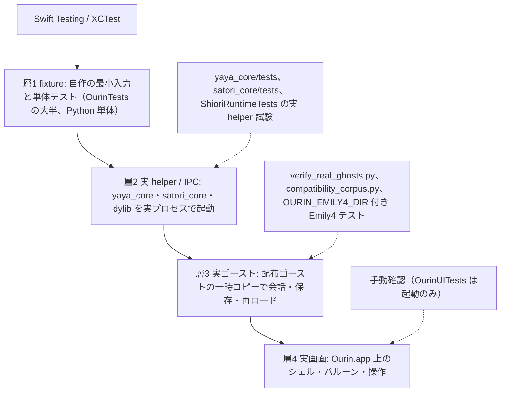
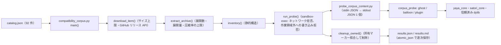

# 18 テストと互換性検証

関連ソースファイル

このページは次のファイルをもとに作成した。

- [CONTRIBUTING.md](../../CONTRIBUTING.md)
- [AGENTS.md](../../AGENTS.md)
- [README.md](../../README.md)
- [OurinTests/](../../OurinTests/)
- [OurinTests/TestGhostFixture.swift](../../OurinTests/TestGhostFixture.swift)
- [OurinTests/TestWaiting.swift](../../OurinTests/TestWaiting.swift)
- [OurinTests/EventBridgeTestIsolation.swift](../../OurinTests/EventBridgeTestIsolation.swift)
- [OurinTests/Fixtures/](../../OurinTests/Fixtures/)
- [OurinTests/ShioriRuntimeTests.swift](../../OurinTests/ShioriRuntimeTests.swift)
- [OurinTests/ShioriLoaderTests.swift](../../OurinTests/ShioriLoaderTests.swift)
- [OurinTests/NativeShioriABITests.swift](../../OurinTests/NativeShioriABITests.swift)
- [OurinTests/PluginBridgeIntegrationTests.swift](../../OurinTests/PluginBridgeIntegrationTests.swift)
- [OurinTests/DLLCompatibilityTests.swift](../../OurinTests/DLLCompatibilityTests.swift)
- [OurinTests/BalloonTests.swift](../../OurinTests/BalloonTests.swift)
- [OurinTests/YayaEmily4RegressionTests.swift](../../OurinTests/YayaEmily4RegressionTests.swift)
- [OurinTests/YayaSaoriResponseParsingTests.swift](../../OurinTests/YayaSaoriResponseParsingTests.swift)
- [OurinTests/RealPluginCorpusTests.swift](../../OurinTests/RealPluginCorpusTests.swift)
- [OurinTests/ShiolinkRealEngineTests.swift](../../OurinTests/ShiolinkRealEngineTests.swift)
- [OurinTests/AosoraEngineTests.swift](../../OurinTests/AosoraEngineTests.swift)
- [OurinTests/MacUkagakaTests.swift](../../OurinTests/MacUkagakaTests.swift)
- [OurinUITests/OurinUITests.swift](../../OurinUITests/OurinUITests.swift)
- [OurinUITests/OurinUITestsLaunchTests.swift](../../OurinUITests/OurinUITestsLaunchTests.swift)
- [Ourin/NarInstall/Paths.swift](../../Ourin/NarInstall/Paths.swift)
- [Ourin.xcodeproj/project.pbxproj](../../Ourin.xcodeproj/project.pbxproj)
- [Ourin.xcodeproj/xcshareddata/xcschemes/Ourin.xcscheme](../../Ourin.xcodeproj/xcshareddata/xcschemes/Ourin.xcscheme)
- [.github/workflows/macOS.yml](../../.github/workflows/macOS.yml)
- [verify.sh](../../verify.sh)
- [yaya_core/tests/](../../yaya_core/tests/)
- [satori_core/tests/test_encoding.py](../../satori_core/tests/test_encoding.py)
- [engines/](../../engines/)
- [scripts/compatibility_corpus.py](../../scripts/compatibility_corpus.py)
- [scripts/test_compatibility_corpus.py](../../scripts/test_compatibility_corpus.py)
- [scripts/probe_corpus_content.py](../../scripts/probe_corpus_content.py)
- [scripts/corpus_probe/README.md](../../scripts/corpus_probe/README.md)
- [scripts/corpus_probe/](../../scripts/corpus_probe/)
- [scripts/verify_real_ghosts.py](../../scripts/verify_real_ghosts.py)
- [scripts/test_verify_real_ghosts.py](../../scripts/test_verify_real_ghosts.py)
- [scripts/verify_external_shiori.py](../../scripts/verify_external_shiori.py)
- [docs/compatibility-corpus/README.md](../../docs/compatibility-corpus/README.md)
- [docs/compatibility-corpus/results.md](../../docs/compatibility-corpus/results.md)
- [docs/compatibility-corpus/](../../docs/compatibility-corpus/)
- [docs/REAL_GHOST_VERIFICATION_2026-10-25.md](../../docs/REAL_GHOST_VERIFICATION_2026-10-25.md)
- [docs/SHIORI_EXPANSION_VERIFICATION_2026-10-25.md](../../docs/SHIORI_EXPANSION_VERIFICATION_2026-10-25.md)
- [Samples/](../../Samples/)

Ourin の検証は、Xcode のテストターゲット `OurinTests`（Swift、約 150 ファイル）と `OurinUITests`、各 helper / エンジンに付いた Python のテスト、そして公開配布物や実ゴーストを一時コピーで動かす **互換性検証スクリプト** の 3 系統からなる。このページはそれらの置き場所・作り方・実行方法と、結果をどう解釈すべきかをまとめる。

各機能の詳細は該当ページにある（YAYA の helper テストは [8.1](./08a-yaya.md)、里々は [8.2](./08b-satori.md)、追加栞は [8.3](./08c-external-engines.md)、CI のジョブ構成全体は [2 ビルド・パッケージング・CI](./02-build-and-ci.md)、`verify.sh` などの開発支援ツールは [19](./19-dev-tooling.md)）。

**出典:** [.github/workflows/macOS.yml:36-109](../../.github/workflows/macOS.yml#L36-L109)、[Ourin.xcodeproj/xcshareddata/xcschemes/Ourin.xcscheme:26-56](../../Ourin.xcodeproj/xcshareddata/xcschemes/Ourin.xcscheme#L26-L56)

## 検証の層と「成功」の意味

`CONTRIBUTING.md` は互換性変更について、**fixture 成功、実 helper / IPC 成功、実ゴーストの会話・保存・再起動、実画面確認を区別し、未検証を成功として扱わない** ことを求めている。あわせて、SSP / UKADOC または固定版の上流実装を根拠に最小再現を残すこと、ゴーストを書き換えて Ourin 側の不具合を隠さないこと、利用者のゴースト・セーブデータは許可された一時コピーで試験し、配布許諾のない NAR や辞書をリポジトリへ追加しないことも定めている。`AGENTS.md` も、GUI・IPC・ghost 動作に関わる変更は実 app / process で対象操作を再現するよう求める。

層が上がるほど再現に必要な外部資源が増えるため、リポジトリ内の自動テストは層 1〜2 が中心である。層 3 のスクリプトも helper の応答を見るだけで、画面・クリック座標・バルーン描画は対象外だと各スクリプトと記録文書が明記している。

**出典:** [CONTRIBUTING.md:21-25](../../CONTRIBUTING.md#L21-L25)、[CONTRIBUTING.md:34-35](../../CONTRIBUTING.md#L34-L35)、[AGENTS.md:15-18](../../AGENTS.md#L15-L18)、[docs/REAL_GHOST_VERIFICATION_2026-10-25.md:1-3](../../docs/REAL_GHOST_VERIFICATION_2026-10-25.md#L1-L3)、[scripts/verify_real_ghosts.py:1-7](../../scripts/verify_real_ghosts.py#L1-L7)

## テストターゲットと実行コマンド

| ターゲット | 中身 | 設定 |
|---|---|---|
| `OurinTests` | 単体・結合テスト。147 ファイルが Swift Testing（`import Testing`、`@Test` / `@Suite`）、`OwnerDrawMenuTests.swift` の 1 ファイルだけ XCTest | `TEST_HOST` が `Ourin.app` の実行ファイル（`BUNDLE_LOADER = $(TEST_HOST)`）。`@testable import Ourin` で内部 API を使う |
| `OurinUITests` | XCTest の UI テンプレート 2 ファイル | `TEST_TARGET_NAME = Ourin` |

共有スキーム `Ourin` の TestAction は両ターゲットを `skipped = "NO"`、`parallelizable = "YES"` で持つ。`OurinTests` はファイルシステム同期グループで、フォルダ内のファイルが自動でターゲットに入る。`Fixtures/` のうちデータファイル（追加栞の辞書、`misaka.*`、`rishu_remote.pl`）は「Authored SHIORI fixtures read from source」という例外でバンドルへの取り込みから外し、テストは `#filePath` からソースツリーの fixture を直接読む。

| 目的 | コマンド |
|---|---|
| 全テスト | `xcodebuild -project Ourin.xcodeproj -scheme Ourin test` |
| 対象を絞る | `-only-testing:OurinTests/TestClassName/testMethodName`（README・AGENTS・CONTRIBUTING の表記）。スイート単位なら `-only-testing:OurinTests/ShioriRuntimeTests` のように struct 名を渡す例が検証記録にある |
| CI 相当 | `-destination "platform=macOS,arch=<arm64/x86_64>" -parallel-testing-enabled NO -enableCodeCoverage YES CODE_SIGNING_ALLOWED=NO` |
| まとめて検証 | `./verify.sh`（構成確認 + build）、`./verify.sh --full`（+ test） |

CI が `-parallel-testing-enabled NO` を付ける理由はワークフローのコメントにある。スイートはアプリのメイン run loop とプロセス全体のランタイムを共有しており、CPU を多く使う暗号スイートを、期限付きの IPC / UI テストと並べて走らせると CI でコールバックが飢えるため、ローカルの確認と同じ直列実行にしている。x86_64 を Rosetta で回すジョブ `test-x86_64 (advisory)` も同じ方針で、`continue-on-error: true` の参考扱いである。

注意: Swift Testing の関数を `-only-testing` で 1 つだけ選ぶときの識別子の書式（`()` の要否など）は、リポジトリ内に実例が無く未確認である。

**出典:** [Ourin.xcodeproj/project.pbxproj:96-146](../../Ourin.xcodeproj/project.pbxproj#L96-L146)、[Ourin.xcodeproj/project.pbxproj:790-806](../../Ourin.xcodeproj/project.pbxproj#L790-L806)、[Ourin.xcodeproj/project.pbxproj:853](../../Ourin.xcodeproj/project.pbxproj#L853)、[Ourin.xcodeproj/xcshareddata/xcschemes/Ourin.xcscheme:26-56](../../Ourin.xcodeproj/xcshareddata/xcschemes/Ourin.xcscheme#L26-L56)、[README.md:131-140](../../README.md#L131-L140)、[.github/workflows/macOS.yml:70-90](../../.github/workflows/macOS.yml#L70-L90)、[.github/workflows/macOS.yml:283-312](../../.github/workflows/macOS.yml#L283-L312)、[docs/SHIORI_EXPANSION_VERIFICATION_2026-10-25.md:32-41](../../docs/SHIORI_EXPANSION_VERIFICATION_2026-10-25.md#L32-L41)、[verify.sh:1-28](../../verify.sh#L1-L28)

## テスト基盤

| ファイル / 仕組み | 役割 |
|---|---|
| `TestGhostFixture.swift` | 同梱ゴーストに依存せず、テストごとに一時ディレクトリへ最小の ghost / shell / balloon を組み立てる。`makeRoot`（`<prefix>-<UUID>`）、`makeShell`（`shell/master`）、`writePNG`（ピクセル関数で塗る。y は上から）、`writeGreenKeyedPNG`（純緑背景に左下寄りの赤ブロック。クロマキーと上下の向きの検証用）、`writeSolidPNG`。サーフェス・バルーン・さくらスクリプト系の 9 ファイルが使う |
| `TestWaiting.swift` | `waitUntil`（`@MainActor`、メインアクターを解放しながら 10 ms 間隔で条件を待つ）、`waitUntilNonisolated`、`flushMainQueue`（メインキューに積まれた処理を一巡させ、「後続イベントが来ないこと」を確かめる前に使う）。上限 `testWaitTimeoutNanoseconds` は 20 秒で、全体実行では多数の `@MainActor` テストがメインアクターを順番に使うため長めにしてある。上限に達すると何もせず戻り、直後の `#expect` に失敗を報告させる |
| `EventBridgeTestIsolation.swift` | `EventBridge.shared` はプロセス全体で 1 つのセッション表を持ち、Swift Testing は別スイートを並列実行するので、他スイートのイベントが届いたり `runningGhostNames()` が混ざったりする。`.eventBridgeIsolated` trait（`EventBridgeIsolationTrait`）を付けたスイート同士を、FIFO の非同期ロック `EventBridgeTestLock`（actor）でスイート単位に排他する。13 ファイルが使う |
| `@Suite(.serialized)` | 外部プロセスや共有状態を使うスイートの直列化。50 ファイルにある |
| `OurinPaths.testBaseOverride` | Ourin のデータ基準フォルダの差し替え（スレッドローカル）。無ければ環境変数 `OURIN_TEST_BASE_DIR`、さらに XCTest 実行中（`XCTestConfigurationFilePath` がある）なら一時ディレクトリの `OurinTestBase` を使い、`~/Documents` への TCC ダイアログと実データへの書き込みを避ける |

外部資源が必要なテストは、環境変数で明示したときだけ動く。

| 環境変数 | テスト | 無いとき |
|---|---|---|
| `OURIN_EMILY4_DIR` | `YayaEmily4RegressionTests`（実在の Emily4 の 33 辞書を一時コピーして `yaya_core` に読ませる） | `[skip]` を print して早期 return |
| `OURIN_PLUGIN_CORPUS`（xcodebuild では `TEST_RUNNER_OURIN_PLUGIN_CORPUS`）、`OURIN_PLUGIN_CORPUS_REPORT` | `RealPluginCorpusTests`（SSP 用配布プラグイン群の一時コピーを変換・実行） | `.enabled(if:)` で無効 |
| `OURIN_SHIOLINK_NPM_ROOT`、`OURIN_SHIOLINK_GEM_ROOT`、`OURIN_SHIOLINK_NODE`、`OURIN_SHIOLINK_RUBY` | `ShiolinkRealEngineTests`（リポジトリ外に入れた実 SHIOLINK エンジン） | `.enabled(if:)` で無効 |
| （ファイルの有無）`build/engines/aosora/libaosora.dylib` | `AosoraEngineTests` の実エンジン試験。テストは取得も再配布もしない | `.enabled(if:)` で無効 |

注意: `YayaEmily4RegressionTests` は `.enabled(if:)` ではなく早期 return でスキップするため、Xcode の集計では「成功」に数えられる。`CONTRIBUTING.md` の「PASS / FAIL / SKIP と理由を残す」に従うには、ログの `[skip]` 行を確認する必要がある。

**出典:** [OurinTests/TestGhostFixture.swift:1-61](../../OurinTests/TestGhostFixture.swift#L1-L61)、[OurinTests/TestWaiting.swift:1-47](../../OurinTests/TestWaiting.swift#L1-L47)、[OurinTests/EventBridgeTestIsolation.swift:1-62](../../OurinTests/EventBridgeTestIsolation.swift#L1-L62)、[Ourin/NarInstall/Paths.swift:14-43](../../Ourin/NarInstall/Paths.swift#L14-L43)、[OurinTests/YayaEmily4RegressionTests.swift:12-49](../../OurinTests/YayaEmily4RegressionTests.swift#L12-L49)、[OurinTests/YayaEmily4RegressionTests.swift:185-193](../../OurinTests/YayaEmily4RegressionTests.swift#L185-L193)、[OurinTests/RealPluginCorpusTests.swift:5-11](../../OurinTests/RealPluginCorpusTests.swift#L5-L11)、[OurinTests/ShiolinkRealEngineTests.swift:5-9](../../OurinTests/ShiolinkRealEngineTests.swift#L5-L9)、[OurinTests/ShiolinkRealEngineTests.swift:33](../../OurinTests/ShiolinkRealEngineTests.swift#L33)、[OurinTests/AosoraEngineTests.swift:7-9](../../OurinTests/AosoraEngineTests.swift#L7-L9)、[OurinTests/AosoraEngineTests.swift:62-63](../../OurinTests/AosoraEngineTests.swift#L62-L63)、[CONTRIBUTING.md:34](../../CONTRIBUTING.md#L34)

## OurinTests の領域別一覧

`OurinTests/` 直下の Swift ファイルを、テスト対象の領域で分けた。ファイル名から `Tests.swift` を省いて書く。

### SSTP・外部受信口・Web

| ファイル | テスト対象 |
|---|---|
| `SSTPDispatcherTests` | `SSTPDispatcher`（偽のルーティング表・break 方針・独立した SHIORI ブリッジで 65 ケース） |
| `SSTPDispatcherEffectTests` | ディスパッチャが `SstpDispatcherHost` に起こす UI 効果（`SpySstpDispatcherHost` で記録） |
| `SSTPCompatRegressionTests` | SSP 2.8.35f のデコンパイル互換で直した P1 / P2 の回帰 |
| `SSTPResponseTests` | `SSTPResponse` のワイヤ形式・既定ステータス文言 |
| `SSTPExecuteMoveAsyncTests` | `EXECUTE` の `moveasync` 引数 |
| `ShioriBridgeContextTests` | `ShioriBridgeContext` のルーティング・直列化・リセット |
| `ExternalServerTests` | 外部 SSTP 経路（生テキスト → `SSTPParser` → `SSTPDispatcher`） |
| `ExternalServerSecuritySettingsTests` | 外部受信口の既定値（安全側）と保存・読み込み |
| `DirectSSTPXPCEncodingTests` | DirectSSTP の XPC 入口の文字コード互換 |
| `EncodingNormalizerCP932GateTests` | `OurinAcceptCP932` 設定による Shift_JIS フォールバックの可否 |
| `WebHandlerTests` | `WebHandler`（フォーム解析、`homeurl`・イベント通知） |
| `WebSocketConnectionTests` | `WebSocketConnection`（ローカル WebSocket サーバでの開閉・失敗） |

### SHIORI（ローダ・ランタイム・各エンジン）

| ファイル | テスト対象 |
|---|---|
| `ShioriLoaderTests` | `ShioriLoader`・`YayaBackend`・XPC / Bundle / dylib バックエンド、`yaya.txt` 解析（65 ケース。埋め込み XPC サービスを fixture から起動） |
| `ShioriRuntimeTests` | `ShioriRuntimeFactory` の判定、YAYA / 里々 helper の期限切れ後の再起動と復元、実 `satori_core` の fixture、`ShioriWireCodec` の SSP 互換 |
| `NativeShioriABITests` | ネイティブ SHIORI の標準 ABI（`long` / `int32`、ロード失敗、XPC 隔離の有無） |
| `DLLCompatibilityTests` | 伺か DLL 共通 ABI と、Windows の `.dll` 名から macOS モジュールへの解決（SAORI を含む） |
| `SSPCompat` | `SSPCompat.resolvePath` による SSP の `data\SSPH.exe` などのパス解決 |
| `BuildGET` | `buildGET` のヘッダ組み立て |
| `NumericEventResponse` | 数値だけの応答を台本として再生しない境界 |
| `AdditionalShioriEngine` | 追加 7 栞の実ライブラリと自作辞書（`Fixtures/additional-shiori`） |
| `MisakaEngine` | 美坂の実エンジン（`Fixtures/misaka`） |
| `KawariKagariEngine` | 華和梨・篝（`Fixtures/kawari`、`Fixtures/shiori/kagari_fixture.c`） |
| `AosoraEngine` | Aosora の ABI と、任意の実エンジン |
| `ShiolinkTests` | SHIOLINK（`Fixtures/shiolink/helper.c` を実プロセスとして起動） |
| `ShiolinkRealEngine` | 実 SHIOLINK エンジン（環境変数で有効化） |
| `RishuProxy` | 里珠 Proxy（`Fixtures/rishu/rishu_remote.pl` を実 Perl で起動） |

### YAYA

| ファイル | テスト対象 |
|---|---|
| `YayaBuiltinCompatibility` | 文字列・時刻・正規表現の組み込み関数が本家と同じ値を返すこと |
| `YayaEmbeddedElement` | `%(…)` の埋め込みが名前に関係なく評価されること |
| `YayaFileFunction` | ファイル関数を本家に合わせた挙動（#179） |
| `YayaSaoriResponseParsing` | `REQUESTLIB` の応答解析。`YayaCoreLineHarness` で yaya_core と JSON line を直接やり取りし、`host_op` に手で返信する |
| `YayaEmily4Regression` | 実在の Emily4 辞書での SHIORI イベント（`OURIN_EMILY4_DIR` 必須） |

### PLUGIN

| ファイル | テスト対象 |
|---|---|
| `PluginBridgeIntegration` | `Fixtures/plugin` の C プラグインを `.plugin` にビルドしてロード・要求・アンロード |
| `PluginEventDispatchMatrix` | PLUGIN/2.0M イベント配送の網羅表 |
| `PluginEngineConversion` | SSP 形式（descript.txt + Windows DLL）から `.plugin` への変換 |
| `PluginSSPCompat` | UKADOC と SSP に合わせたプラグイン挙動、ブラウザ URL の正規化 |
| `PluginEncoding` | 要求・応答の `Charset` に従った符号化 |
| `PluginPropertyBridge` | `ext` プロパティの委譲 |
| `PluginTargetRouting` | `AppDelegate` の解決と対象ゴーストの照合 |
| `OurinPluginEventBridge` | `OurinPluginEventBridge` の raise / notify と応答解析 |
| `LegacyPluginRegistry` | DLL を読まずに旧 Windows プラグインのメタデータを登録する処理 |
| `ReferenceOrdering` | `PluginProtocolBuilder` の `ReferenceN` の数値順 |
| `ScriptBridgePlugin` | `Plugins/ScriptBridge` を clang でビルドして他形式スクリプトを解釈 |
| `RealPluginCorpus` | 実在プラグイン群（環境変数で有効化） |

### SAORI と内蔵暗号

| ファイル | テスト対象 |
|---|---|
| `SaoriProtocol` | `SaoriProtocol` の要求・応答の構築と解析 |
| `SaoriLoader` | `SaoriLoader` で `satori_core/build/external_saori.dylib` を読む |
| `SaoriRegistry` | `.dll` 名からの候補生成と解決 |
| `SaoriHostIntegration` | `YayaAdapter.handlePluginOperation` 経由の外部 SAORI 往復 |
| `BuiltinSaori` | Windows 専用の汎用 SAORI（`proxy_ex.dll`）の内蔵置き換え |
| `CompatSaori` | 互換モジュール（`string.dll` など）。外部とのつなぎ目 `CompatSaoriHooks` を差し替える |
| `InternalSaori` | 内蔵 SAORI の共通規則・非同期・小モジュール |
| `InternalFile` | 内蔵ファイルモジュール（メディアのタグ読み取りなど） |
| `InternalCrypto`、`InternalCryptoHashExtra`、`InternalCryptoPassword`、`InternalCryptoCurve`、`InternalCryptoProtect`、`InternalArgon2Core`、`InternalJWT`、`InternalRSA` | `SaoriHost/Internal` の暗号モジュール（ハッシュ・HMAC・暗号・鍵導出、scrypt・DES・crypt、BIP-340・鍵共有・Ed25519、保護、Argon2（RFC 9106）、JWT（RFC 7515）、RSA）。CI で直列実行が必要になった「CPU を多く使う暗号スイート」はこの群を指すと推測される |

### バルーン・入力 UI

| ファイル | テスト対象 |
|---|---|
| `BalloonTests` | `DescriptorLoader`（`Fixtures/descript.txt` と `balloons1.txt` の上書き、Shift_JIS の二段読み）、`ImageLoader` の ICO など |
| `BalloonBackground`、`BalloonFontDefaults`、`BalloonPlacement`、`BalloonProgress` | 背景画像の選択、`font.color` / `font.height` の既定、配置オフセット、数値フィールド |
| `BalloonRichTextViewModel` | 書式コマンドの属性付き文字列化 |
| `GhostBalloonSelection` | descript.txt の標準バルーン指定 |
| `ModelessInputDialog`、`TextAreaBox`、`ScriptBox` | 非モーダル入力ボックス、`OnTextAreaInput`、scriptbox 互換（#118） |
| `OwnerDrawMenu` | オーナードローメニュー（唯一の XCTest） |

### さくらスクリプト

| ファイル | テスト対象 |
|---|---|
| `SakuraScriptEngine` | `SakuraScriptEngine` の字句・構文（219 ケース） |
| `SakuraScriptBalloonGap` | 改行送り・拡大縮小・文字配置（71 ケース） |
| `SakuraScriptDocumentationCoverage` | `docs/SAKURASCRIPT_COMMANDS_SUPPORTED_ja-jp.md` の例とパーサーの同期 |
| `SakuraScriptAnimationWait`、`SakuraScriptScalar`、`EnvironmentExpander` | `\__w[animation]`、スカラー値、環境変数展開 |

### サーフェス・シェル・アニメーション

| ファイル | テスト対象 |
|---|---|
| `SerikoParser`、`SerikoExecutor` | SERIKO 定義（Shift_JIS・CRLF の実ファイル形式）と実行 |
| `SerikoCursorController`、`SerikoTooltipController` | 当たり判定に連動したカーソル・ツールチップ |
| `AnimationEngine` | 当たり判定領域の解析とアニメーション中の有効範囲 |
| `SurfaceTableParser`、`SurfaceTestCatalog` | `surfacetable` と表示試験用カタログ |
| `SurfaceBlend`、`SurfaceOverlayOrdering`、`SurfaceImageOrientation`、`SurfaceVisualEffect` | element / overlay の座標・重ね順・上下の向き・視覚効果 |
| `SurfaceRestoreTiming` | `OnSurfaceRestore` の発生時刻 |
| `CharacterHitTest`、`CollisionHit` | 窓より小さいサーフェスの当たり判定、座標系の変換 |
| `DressupBindCommand`、`DressupMenuParsing` | 着せ替えの `bind` コマンドとメニュー |

### SHIORI イベント・OS 監視

| ファイル | テスト対象 |
|---|---|
| `EventReferenceTable` | `EventReferenceTable` の Reference 生成（34 ケース） |
| `EventIDAudit` | 監査で追加した `EventID` の存在 |
| `EventObserverLifecycle`、`DragDropEvent` | 監視の開始・停止、ドラッグ＆ドロップ |
| `DesktopWallpaperObserver`、`OSUpdateObserver`、`PowerObserver`、`RecycleBinObserver`、`SpeechObserver` | 各 OS 監視からの UKADOC 準拠 Reference |
| `DisplayHandover`、`OverlapTransition`、`SystemNotificationData` | `OnDisplayHandover`、`OnOffscreen` / `OnOverlap`、`OnNotify*Info` の値 |
| `HolidayInfo`、`ForeignHoliday` | 祝日表と言語ごとの祝日名（#165） |

### プロパティ・リソース

| ファイル | テスト対象 |
|---|---|
| `PropertySystem`、`Property`、`PropertySetPropertyWiring` | `PropertyManager` と各 Provider、`\![set,property]` の配線 |
| `ResourceBridge`、`ResourceManagerFileMigration`、`ResourceManagerSeparation` | SHIORI Resource の取得・ファイル永続化・ゴースト別分離 |
| `RateOfUseStore` | 使用率の記録 |

### FMO・NAR・ゴースト管理

| ファイル | テスト対象 |
|---|---|
| `Fmo` | `FmoManager.buildSnapshot` の形式など |
| `NarInstall` | NAR の展開・`install.txt`・`type,saori` の設置先（26 ケース） |
| `GhostConfiguration` | `GhostConfiguration` の解析（37 ケース） |
| `FileWatchRegistry`、`ComponentUpdateTarget` | ファイル監視の非同期イベント、更新対象の発見 |
| `CloseAllSequence`、`MoveCommand`、`GhostWindowClamp`、`GhostUtilityCommand` | 一括終了、`\![move]` の座標、窓の画面内クランプ、ユーティリティ窓とコマンド（47 ケース） |
| `ForeignCharset` | 日本語以外の文字コード名と往復（#163） |

### カレンダー

| ファイル | テスト対象 |
|---|---|
| `CalendarRegistry`、`CalendarSchedule`、`CalendarWindow` | スキン・プラグインの発見、予定（#119）、月表示 |
| `ICalendar`、`ICalExecute` | iCalendar の符号化・繰り返し・問い合わせ、ローカル HTTP サーバでの取得 |
| `GhostSchedule` | ゴーストの予定の追加・削除・取得 |

### その他（アプリ・ネットワーク・メディア・DevTools）

| ファイル | テスト対象 |
|---|---|
| `AppUpdater`、`BasewareUpdate` | GitHub リリースの選択、更新 helper の差し替え |
| `LaunchSettingsWindow`、`Localization`、`LogFileSink`、`ProcessKiller` | 起動時の設定窓、多言語化（#164）、ファイルログ、自インスタンス判定 |
| `HTTPCommandOptions`、`HTTPStreamingCancel`、`HeadlineWire`、`RSSFeedParser`、`SNTPClient` | HTTP 系コマンドの引数・取消、ヘッドラインの電文、RSS、SNTP とメール確認 |
| `SoundPlayer`、`SoundSpectrum`、`VideoRenderer` | 音声再生、スペクトル帯域、動画再生 |
| `SaveShareManager` | セーブの書き出し・読み込み（SSP と同じヘッダ配置） |
| `DevToolsTargetRouting`、`OurinMigrator` | DevTools の対象選択、Migrator の資産走査 |
| `MacUkagaka` | 旧プロジェクト名の空テンプレート（中身なし） |
| `TestGhostFixture`、`TestWaiting`、`EventBridgeTestIsolation` | テスト基盤（前節） |

**出典:** [OurinTests/](../../OurinTests/)、[OurinTests/SSTPDispatcherTests.swift:110](../../OurinTests/SSTPDispatcherTests.swift#L110)、[OurinTests/BalloonTests.swift:23-42](../../OurinTests/BalloonTests.swift#L23-L42)、[OurinTests/MacUkagakaTests.swift:1-16](../../OurinTests/MacUkagakaTests.swift#L1-L16)、[OurinTests/YayaSaoriResponseParsingTests.swift:1-60](../../OurinTests/YayaSaoriResponseParsingTests.swift#L1-L60)、[.github/workflows/macOS.yml:70-73](../../.github/workflows/macOS.yml#L70-L73)

## Fixtures の作られ方と使われ方

`OurinTests/Fixtures/` の 38 ファイルはすべて Ourin が書いたもので、第三者のゴーストや辞書は含まない。C の fixture は **テストの実行中に `/usr/bin/clang` でビルド** し、一時ディレクトリに置いて読み込む。

| fixture | 形式 | ビルドと用途 |
|---|---|---|
| `shiori/standard_fixture.c` | SHIORI 標準 ABI | `-dynamiclib`。`-DLENGTH32`（int32 長）・`-DFAIL_LOAD` の変種で `NativeShioriABITests` が使う。横に `OurinShioriABI` の plist を書いて ABI 幅を宣言する |
| `shiori/native_fixture.c` | ネイティブ SHIORI | `ShioriLoaderTests`・`ShioriRuntimeTests` が dylib にして、プロセス内と埋め込み XPC サービス経由の両方で試す |
| `shiori/kagari_fixture.c`、`shiori/aosora_fixture.c` | 篝・Aosora の ABI | Aosora 版は 32 ビットに収まらないインスタンス ID（`0x100000003L`）で LP64 の扱いを確かめる |
| `shiolink/helper.c` | SHIOLINK の相手プロセス | 決定的な実プロセスとして `ShiolinkTests` が起動する |
| `dll_compat/module.c` | 伺か DLL / SAORI/1.0 | `-DDLL_COMPAT_FIXTURE_BUILD=1 -DMODULE_UKAGAKA` などで dylib / bundle にする。テストターゲットにも取り込まれるため、このマクロが無いときは中身が空になる |
| `plugin/*/plugin.c` + `plugin/fixture_common.h` | PLUGIN/2.0M | `utf8_echo`・`shift_jis_echo`・`property`・`target`・`event_script_fallback` の 5 種。`-DOURIN_PLUGIN_FIXTURE_BUILD=1 -bundle` でビルドすると `load` / `request` / `unload` を公開し、マクロ無し（テストターゲットに取り込まれる場合）は `OURIN_FIXTURE_PREFIX` を前置した名前になって衝突しない。clang の一時ファイルは出力先の `clang-tmp` へ向ける |
| `plugin/legacy_metadata_only/` | 旧プラグインのメタデータ | `descript.txt` と英日メッセージだけ（DLL なし） |
| `ghost/master/test_shiori.so.b64` | base64 にしたビルド済み SHIORI | テストが復号して `test_shiori.so` として書き出す。環境によっては読み込めないので、その場合は検証を打ち切る |
| `additional-shiori/` | 追加 6 栞の最小辞書と `cases.json` | 各辞書は `OnBoot` / `OnAITalk` / `OnClose` に答え、`OnRemember` で 37 を保存し `OnRecall` で読む。Yuhna の `dic.ydf` のバイナリ構造は README に記載。実ゴーストではなく、元エンジンとの完全互換を示すものではないと README が明記 |
| `kawari/minimal/kawarirc.kis`、`misaka/` | 華和梨・美坂の最小辞書 | 各エンジンテスト |
| `rishu/rishu_remote.pl` | 里珠の相手（Ourin 独自のプロトコル fixture、上流コードではない） | `RishuProxyTests` |
| `descript.txt`、`balloons1.txt` | 記述子の上書き | `BalloonTests.descriptorOverlay`（`foo` が `baz` に上書きされること） |

ゴーストやシェルは、ファイルとして置かずに `TestGhostFixture` で毎回組み立てるのが基本である。`ShioriRuntimeTests` は helper の再起動試験のために、`load` / `capability` / `Hang`（`trap '' TERM` で SIGTERM を無視して無限ループ）に決まった行を返す zsh スクリプトを偽の helper として書き出し、`SIGKILL` までの経路を通す。

**出典:** [OurinTests/NativeShioriABITests.swift:5-23](../../OurinTests/NativeShioriABITests.swift#L5-L23)、[OurinTests/ShioriLoaderTests.swift:606-640](../../OurinTests/ShioriLoaderTests.swift#L606-L640)、[OurinTests/ShioriLoaderTests.swift:708-725](../../OurinTests/ShioriLoaderTests.swift#L708-L725)、[OurinTests/DLLCompatibilityTests.swift:205-222](../../OurinTests/DLLCompatibilityTests.swift#L205-L222)、[OurinTests/Fixtures/dll_compat/module.c:1-6](../../OurinTests/Fixtures/dll_compat/module.c#L1-L6)、[OurinTests/Fixtures/plugin/fixture_common.h:1-16](../../OurinTests/Fixtures/plugin/fixture_common.h#L1-L16)、[OurinTests/PluginBridgeIntegrationTests.swift:363-379](../../OurinTests/PluginBridgeIntegrationTests.swift#L363-L379)、[OurinTests/PluginBridgeIntegrationTests.swift:478-498](../../OurinTests/PluginBridgeIntegrationTests.swift#L478-L498)、[OurinTests/Fixtures/shiori/aosora_fixture.c:1-6](../../OurinTests/Fixtures/shiori/aosora_fixture.c#L1-L6)、[OurinTests/Fixtures/additional-shiori/README.md:1-23](../../OurinTests/Fixtures/additional-shiori/README.md#L1-L23)、[OurinTests/Fixtures/rishu/rishu_remote.pl:1](../../OurinTests/Fixtures/rishu/rishu_remote.pl#L1)、[OurinTests/ShioriRuntimeTests.swift:6-34](../../OurinTests/ShioriRuntimeTests.swift#L6-L34)

## OurinUITests

`OurinUITests.swift` の `testExample`（アプリを起動するだけ）と `testLaunchPerformance`（`XCTApplicationLaunchMetric` で起動時間を計測）、`OurinUITestsLaunchTests.swift` の `testLaunch`（起動直後のスクリーンショットを `keepAlways` で添付。`runsForEachTargetApplicationUIConfiguration` が真）だけで、いずれも Xcode の雛形のままである。ヘッダのコメントには旧名 `MacUkagakaUITests` が残る。スキームでは無効化されていないので `xcodebuild … test` で一緒に走るが、ゴースト表示やバルーンなど実画面の振る舞いは検証しない。層 4（実画面）の確認は手動である。

**出典:** [OurinUITests/OurinUITests.swift:1-41](../../OurinUITests/OurinUITests.swift#L1-L41)、[OurinUITests/OurinUITestsLaunchTests.swift:1-33](../../OurinUITests/OurinUITestsLaunchTests.swift#L1-L33)、[Ourin.xcodeproj/xcshareddata/xcschemes/Ourin.xcscheme:44-54](../../Ourin.xcodeproj/xcshareddata/xcschemes/Ourin.xcscheme#L44-L54)

## Python のテスト

いずれも `python3 <file> -v` または `python3 -m unittest` で動き、外部のゴーストやパッケージを取得しない。

| ファイル | 対象 | CI |
|---|---|---|
| `yaya_core/tests/test_file_persistence.py`・`test_hash_foreach.py`・`test_json_files.py`・`test_user_arguments.py` | 実 `yaya_core` helper（[8.1](./08a-yaya.md)） | `test` ジョブ |
| `yaya_core/tests/test_saori_no_content.py` | SAORI 204 の扱い | なし |
| `satori_core/tests/test_encoding.py` | iconv 境界と実 `satori_core`（[8.2](./08b-satori.md)） | `helper-cores` |
| `engines/plugins/test_yaya_adapter.py`・`test_akari_adapter.py`・`test_ugm_adapter.py`・`test_ugm_http.py` | PLUGIN のネイティブアダプタの C ABI と実プロセス | `test` |
| `engines/plugins/test_bouyomi_adapter.py`・`test_local_tts_adapter.py` | 棒読みちゃん・ローカル TTS アダプタ（合成側は偽のサービス） | なし |
| `engines/plugin-native/test_native.py`・`test_tmidi.py` | 専用ネイティブプラグイン | `test` |
| `engines/kagari/tests/test_native_modules.py` | KAGARI / Lua の dylib（`--library build/engines/kagari/libkagari.dylib`） | `test` |
| `engines/additional/test_akari_values.py` | 固定版ソースと Ourin の patch からの灯の回帰 | `test` |
| `engines/aosora/test_native.py` | Aosora の ABI / ライフサイクル | なし |
| `engines/tts/test_irodori_worker.py`・`test_server.py` | TTS ワーカーのプロトコル（モデルの取得なし） | なし |
| `scripts/test_compatibility_corpus.py` | `compatibility_corpus.py` のブラックボックス試験（ローカル HTTP サーバと自作 ZIP、38 ケース） | `helper-cores` |
| `scripts/corpus_probe/tests/test_probe_contract.py`・`test_audit_regressions.py` | 検証 probe の契約と監査回帰（`OURIN_CORPUS_ENGINE_DIR` が無ければ一部 skip） | `helper-cores` |
| `scripts/test_verify_real_ghosts.py` | `verify_real_ghosts.py` の期待ステータス規則 | なし |
| `docs/test_generate_html.py` | 文書の HTML 生成（[19](./19-dev-tooling.md)） | なし |

CI の `test` ジョブは、xcodebuild のテストの後に `engines/plugins/catalog.json` と `docs/compatibility-corpus/plugin-ports-results.json` の一致を `cmp` で確かめ、`engines/plugins/build.sh` を実行してからこれらの Python テストを回す。

**出典:** [.github/workflows/macOS.yml:92-109](../../.github/workflows/macOS.yml#L92-L109)、[.github/workflows/macOS.yml:157-163](../../.github/workflows/macOS.yml#L157-L163)、[scripts/corpus_probe/tests/test_probe_contract.py:269-271](../../scripts/corpus_probe/tests/test_probe_contract.py#L269-L271)、[scripts/test_verify_real_ghosts.py:1-43](../../scripts/test_verify_real_ghosts.py#L1-L43)

## 互換性コーパス（公開配布物の継続検証）

公開配布されているゴースト・バルーン・プラグインを、一時領域への取得 → 展開 → 検証 → 削除の順で確認し、配布ページと直接ダウンロード先・結果を `docs/compatibility-corpus/` に残す仕組みである。標本調査であって伺か全体の母集団ではなく、取得できなかった作品を未対応と断定しない。

### runner（scripts/compatibility_corpus.py）

- 作業ルートは `/tmp/ourin-corpus-20261025` の下に限る。カタログ・出力 JSON・Markdown は別ファイルでなければならない。
- 項目ごとに `item-*` の使い捨てディレクトリと所有マーカー `.ourin-owned.json`（ランダムな token）を作る。終了時、または強制終了後の次回起動時に、マーカーが一致するものだけを削除する。削除できなければ結果を `error` にして `cleanup_pending` に残す。
- probe は `sandbox-exec` の中でしか実行せず、無ければ `sandbox_unavailable` として実行しない（非 sandbox のフォールバックは無い）。プロファイルはネットワークを拒否し、書き込みを項目の作業領域と `/dev/null` だけに許す。環境変数は `PATH`・`HOME`・`TMPDIR`・`LANG` など最小限に絞り、`OURIN_CORPUS_PARENT_OWNS_GROUP=1` で helper を probe と同じプロセスグループに入れて、タイムアウト時の `killpg` でまとめて止める。
- probe が `pass` を返しても `checks.runtime_executed` が真でなければ `partial` に下げる。公開する理由文からはローカルパス・一時パスを伏せる。
- `--resume` は入力・設定・runner・probe ファイルの指紋が一致し、削除完了を確認済みの結果を再利用する。`--retry-failed` は `pass` / `static_only` 以外をやり直す。エンジンや helper を変えたら `--probe-revision` を変える。

率は層ごとに分母を変えて別々に出す（`download` / `import` / `runtime_tested` / `runtime_pass` / `runtime_pass_of_selected`）。`results.md` の現在値は取得 92/92、静的構造 91/92、実行 59/91、実行成功 34/59、全体に対する実行成功 34/92 である。バルーンの部分確認やプラグインのメタデータ確認は栞の実行成功数に混ぜない。

### probe（scripts/probe_corpus_content.py と scripts/corpus_probe/）

| モジュール | 役割 |
|---|---|
| `probe_corpus_content.py` | 入口。`--preflight` で製品の YAYA 設定解析（`ShioriLoader.swift` の `collectDicEntries` / `applyYayaBasePath`）とバルーン解析を `--cache-dir` にコンパイルし、実行時はキャッシュを読むだけ。`--engine-dir` で信頼済みの dylib ディレクトリ（`Ourin.app/Contents/Frameworks`）を渡す |
| `corpus_probe/ghost.py` | helper の `load` → `OnBoot` → 空でない会話 → `OnClose` → `unload` と、2 回目の `load` / `OnBoot` / `OnClose` / `unload`。両方通って `pass`、2 回目の失敗は `partial`（`reopen_failed`） |
| `corpus_probe/engine.py`・`discovery.py` | descript.txt からのエンジン判定（`ShioriRuntimeFactory` と同じ規則）、パッケージルートの探索 |
| `corpus_probe/native_shiori_worker.py` | 信頼済み dylib を ABI どおりの ctypes で呼ぶ隔離ワーカー |
| `corpus_probe/balloon.py` + `swift/balloon_probe_cli.swift` | 製品の Swift パーサと画像デコーダでバルーンを読む。描画は未検証なので常に `partial` |
| `corpus_probe/plugin.py` | マニフェストと配置だけを調べ、プラグインは実行しない |
| `corpus_probe/io_util.py`・`build.py` | 上限付きの入出力・パス検査、preflight のコンパイル |

Windows の DLL や、ダウンロードした独自の Mach-O は読み込まない。既知エンジンのゴーストに Windows DLL があっても、対応する macOS エンジンを使う。保存の観察（作業ツリーの変化）は「保存が正しく行われた」証明として扱わず、`persistence_semantically_verified: false` を付ける。

### docs/compatibility-corpus/ の中身

| ファイル | 内容 |
|---|---|
| `README.md` | 方針・層の読み方・実行と削除の境界・失敗から実装を直す手順・ローカル再実行手順 |
| `catalog.json`、`catalog-batch2.json`、`sources.md` | 配布元カタログ（ゴースト 67・バルーン 10・プラグイン 15 の 92 件）と探索の記録 |
| `results.json`、`results.md`、`probe-inputs.json` | runner の出力と、probe の入力ファイル・helper の SHA-256 |
| `validation.md` | 初回 92 件で見つかった修正・最終検証・残る課題 |
| `plugin-ports.md`・`plugin-ports-results.json`・`plugin-akari.md`・`plugin-native.md`・`tmidi-bridge.md`・`local-tts.md`・`local-tts-results.json` | 15 プラグインの `.plugin` 変換と個別機能の検証 |
| `kagari-fixes.md`・`kagari-fixes-results.json`・`aosora.md`・`aosora-results.json` | KAGARI と Aosora の実配布ゴーストの再検証 |

README の「失敗から実装を直す」手順は、取得失敗・検証器の不備・Ourin の問題を切り分け、同じ URL と SHA-256 で再現対象を固定し、最小の自作入力へ縮小して SSP / UKADOC と比べ、ホスト側を直して同じ配布物で再検証する、というもので、**ゴーストの辞書改変で成功に見せない**、取得不能や未確認を成功へ書き換えないと明記している。辞書・会話の本文、画像・音声、第三者アーカイブはコミットせず、会話応答は長さ・有無・ハッシュで記録する。

**出典:** [scripts/compatibility_corpus.py:1-9](../../scripts/compatibility_corpus.py#L1-L9)、[scripts/compatibility_corpus.py:35-37](../../scripts/compatibility_corpus.py#L35-L37)、[scripts/compatibility_corpus.py:370-456](../../scripts/compatibility_corpus.py#L370-L456)、[scripts/compatibility_corpus.py:486-503](../../scripts/compatibility_corpus.py#L486-L503)、[scripts/compatibility_corpus.py:506-620](../../scripts/compatibility_corpus.py#L506-L620)、[scripts/probe_corpus_content.py:1-40](../../scripts/probe_corpus_content.py#L1-L40)、[scripts/corpus_probe/README.md:15-101](../../scripts/corpus_probe/README.md#L15-L101)、[scripts/corpus_probe/README.md:117-121](../../scripts/corpus_probe/README.md#L117-L121)、[docs/compatibility-corpus/README.md:1-41](../../docs/compatibility-corpus/README.md#L1-L41)、[docs/compatibility-corpus/README.md:43-93](../../docs/compatibility-corpus/README.md#L43-L93)、[docs/compatibility-corpus/results.md:1-12](../../docs/compatibility-corpus/results.md#L1-L12)、[docs/compatibility-corpus/sources.md:1-3](../../docs/compatibility-corpus/sources.md#L1-L3)、[docs/compatibility-corpus/validation.md:1-4](../../docs/compatibility-corpus/validation.md#L1-L4)

## 実ゴースト・外部栞の検証スクリプト

### scripts/verify_real_ghosts.py

手元の実ゴーストを、常に使い捨てのコピーで helper に通す。対象はプロトコル・辞書・保存の挙動で、GUI や SAORI の完全な統合は含まない。

1. `--cases`（`name` / `engine` / `root` / `config` / `events` / `source_url` / `expected_statuses` の配列）と、**新規** の `--output` ディレクトリを受け取る（既存なら拒否）。
2. YAYA のケースがあれば、`ShioriLoader.swift` の「YAYA Config Parsing Helpers」節を切り出して `swiftc` でコンパイルし、製品と同じ設定解析で `load` 要求を作る（別の解析器を保守しない）。
3. 元ツリーの全ファイルの SHA-256 を記録してコピーを作り、`engine` に応じて `yaya_core/build/yaya_core`・`satori_core/build/satori_core`、または華和梨の `--native-worker` を起動する。`ghost/master/profile` はコピー側にだけ作る。
4. 既定の手順は `OnNotifyUserInfo`（NOTIFY）→ `OnBoot` → `OnMouseDoubleClick` → `OnCommunicate` → `OnClose` → `OnDestroy`（NOTIFY）→ `unload`。2 回目のプロセスで `OnBoot` / `OnClose` / `OnDestroy` / `unload` をやり直し、保存の再読み込みを見る。
5. `host_op` には、FMO だけ空のスナップショットを返し、その他は `not provided by real-ghost helper harness` で断る（外部機能を成功と偽らない）。
6. 応答は長さと SHA-256 だけを記録する。`passed` は、期限内の正常応答・ステータスが 200〜399（または明示した期待値）・元ツリーが不変、のすべてを満たすときだけ真。期待ステータスの例外は、正確なイベント名・メソッド・整数ステータス・理由を書いたときだけ認める。

### scripts/verify_external_shiori.py

里珠（`rishu`）または MiyoJS などの SHIOLINK（`miyo`）の、用意済みのディレクトリを一時コピーし、製品の `ShiolinkAdapter.swift`・`RishuProxyAdapter.swift`・`ShioriRuntime.swift`・`EncodingAdapter.swift` と小さな `main.swift` を `swiftc` でまとめてビルドして実行する。里珠は公式 echo サンプルで GET / NOTIFY の `Reference0` 往復、Miyo は `OnBoot` / `OnClose` に空でない `Value` が返ること、最後に `unload` 後に子プロセスが残らないこと（`kill(pid, 0)` が `ESRCH`）を確かめる。ダウンロードやパッケージの導入は行わない。

検証結果は日付付きの記録文書（`docs/REAL_GHOST_VERIFICATION_2026-10-25.md`、`docs/SHIORI_EXPANSION_VERIFICATION_2026-10-25.md`）に残す運用である。

**出典:** [scripts/verify_real_ghosts.py:1-67](../../scripts/verify_real_ghosts.py#L1-L67)、[scripts/verify_real_ghosts.py:84-109](../../scripts/verify_real_ghosts.py#L84-L109)、[scripts/verify_real_ghosts.py:127-222](../../scripts/verify_real_ghosts.py#L127-L222)、[scripts/verify_real_ghosts.py:274-297](../../scripts/verify_real_ghosts.py#L274-L297)、[scripts/verify_external_shiori.py:1-53](../../scripts/verify_external_shiori.py#L1-L53)、[docs/REAL_GHOST_VERIFICATION_2026-10-25.md:5-24](../../docs/REAL_GHOST_VERIFICATION_2026-10-25.md#L5-L24)

## Samples/

`Samples/` は仕様ごとの最小実装サンプルで、Xcode プロジェクトや CI からは参照されない（`project.pbxproj` にも workflow にも `Samples/` は出てこない）。

| ディレクトリ | 内容 |
|---|---|
| `OURIN_SHIORI3M/` | SHIORI/3.0M の最小実装：`c_shiori`（C・固定応答・CMake）、`swift_shiori`（SwiftPM）、`swift_host`（`.bundle` をロードして `GET SHIORI/3.0` を送るホスト）、`xpc_skeleton`（SHIORI を別プロセス化する XPC インタフェース） |
| `PLUGIN_2_0M/` | PLUGIN/2.0M：`c_plugin`（iconv で CP932 → UTF-8、`version`・`OnMenuExec`・`OnSecondChange`）、`swift_host`、`xpc`（`PluginWorker.xpc` でワイヤ文字列を往復） |
| `SimpleSaori/` | SAORI/1.0：`cpp_saori`、`swift_saori`（`@_cdecl("load"/"unload"/"request")`）、`SimpleSaori.swift`、`build_simple_saori.sh`、`LOADLIB` / `REQUESTLIB` / `UNLOADLIB` を確かめる YAYA の `test_ghost/`。ビルド済みの `build/libsimple_saori_swift.dylib` もコミットされている |
| `OURIN_SHIORI_EVENTS/OurinShioriMacBridge/` | キー・マウス監視、ドラッグ＆ドロップ、画面構成・Spaces・電源・ロケール・外観の変化を SHIORI イベントへ橋渡しするスケルトン |
| `OURIN_SSTP/server_swiftpm/` | `NWListener` でポート 9801 を待つ SSTP サーバ |
| `OurinExternalEventServers/` | TCP（9801）・HTTP（9810）・XPC の SSTP 受信と `OurinSstpRouter` のデモ |
| `OurinPluginEventBridge/` | プラグインイベント橋渡しのスケルトン |
| `OURIN_WEB/` | URL スキーム・NAR の UTI を登録する Info.plist 断片と URL ハンドラ |
| `OURIN_NAR_INSTALL_1_0M/` | NAR インストーラのサンプルアプリ（`InstallTxtParser`、`ZipUtil` など） |
| `OURIN_BALLOON/` | 画像デコーダ SPI、ICO / CUR パーサ（C 版と Swift 版） |
| `rosetta_check.swift` | `sysctl.proc_translated` で Rosetta 実行中かを表示 |

注意: `OurinExternalEventServers/` の `OurinSstpRouter` は古い設計のサンプルで、`AGENTS.md` は本体で旧 `SstpRouter` を別経路として復活させないと定めている。本体の SSTP は `SSTPParser` → `SSTPDispatcher` の単一経路である（[10 SSTP スタック](./10-sstp.md)）。サンプルを本体へ移植する際は、現行の実装と仕様で裏を取る必要がある。

**出典:** [Samples/](../../Samples/)、[Samples/OURIN_SHIORI3M/c_shiori/README.md:1-3](../../Samples/OURIN_SHIORI3M/c_shiori/README.md#L1-L3)、[Samples/PLUGIN_2_0M/c_plugin/README.md:1-8](../../Samples/PLUGIN_2_0M/c_plugin/README.md#L1-L8)、[Samples/PLUGIN_2_0M/xpc/README.md:1-7](../../Samples/PLUGIN_2_0M/xpc/README.md#L1-L7)、[Samples/SimpleSaori/README.md:1-8](../../Samples/SimpleSaori/README.md#L1-L8)、[Samples/OURIN_SHIORI_EVENTS/OurinShioriMacBridge/README.md:1-8](../../Samples/OURIN_SHIORI_EVENTS/OurinShioriMacBridge/README.md#L1-L8)、[Samples/OurinExternalEventServers/main.swift:1-12](../../Samples/OurinExternalEventServers/main.swift#L1-L12)、[Samples/OURIN_SSTP/server_swiftpm/Sources/main.swift:1-5](../../Samples/OURIN_SSTP/server_swiftpm/Sources/main.swift#L1-L5)、[Samples/rosetta_check.swift:1-11](../../Samples/rosetta_check.swift#L1-L11)、[AGENTS.md:8](../../AGENTS.md#L8)

## 制約と注意点

- **自動テストの成功は層 1〜2 の成功にすぎない**。実ゴーストでの会話・保存・再起動と実画面は別に確認し、確認していないものは「未確認」と書く（`CONTRIBUTING.md`）。`OurinUITests` は起動するだけで画面の振る舞いを見ない。
- **スキップの扱いが揃っていない**。`.enabled(if:)` で無効化されるテストと、`YayaEmily4RegressionTests` のように早期 return で「成功」になるテストが混在する。
- **ソースツリーが必要**。fixture は `#filePath` からソースを読み、C の fixture はテスト中に `/usr/bin/clang` でビルドするため、Command Line Tools の無い環境やソース外へ移したテストバンドルでは動かない。`yaya_core/build/yaya_core`・`satori_core/build/satori_core`・`satori_core/build/external_saori.dylib` を使うテストは helper のビルドが前提で、Xcode のビルドフェーズが用意する。
- **並列実行に弱い**。プロセス全体の共有状態（`EventBridge.shared`、`PropertyManager.shared`、メイン run loop）があるため、CI と検証記録は `-parallel-testing-enabled NO` を使う。スキームの既定（`parallelizable = "YES"`）のまま全体を回すと結果が不安定になり得る（推測）。
- 第三者の NAR・辞書・保存データはリポジトリに入れない。fixture は自作に限り、互換性コーパスは取得物を毎回削除する。
- `scripts/corpus_probe/tests/temp/`（`minimal_balloon`・`minimal_yaya`）は probe テスト用の自作 fixture で、テスト時は一時ディレクトリへコピーして使う。

**出典:** [CONTRIBUTING.md:23-25](../../CONTRIBUTING.md#L23-L25)、[Ourin.xcodeproj/xcshareddata/xcschemes/Ourin.xcscheme:33-35](../../Ourin.xcodeproj/xcshareddata/xcschemes/Ourin.xcscheme#L33-L35)、[scripts/corpus_probe/README.md:76-77](../../scripts/corpus_probe/README.md#L76-L77)、[docs/compatibility-corpus/README.md:25-31](../../docs/compatibility-corpus/README.md#L25-L31)

## 関連ページ

- [2 ビルド・パッケージング・CI](./02-build-and-ci.md) — CI の各ジョブ（metadata / test / helper-cores / release-gate）
- [8.1 YAYA（YayaAdapter と yaya_core）](./08a-yaya.md) — yaya_core の Python テストと IPC
- [8.2 里々（SatoriAdapter と satori_core）](./08b-satori.md) — `test_encoding.py` と外部 SAORI fixture
- [8.3 SHIOLINK・里珠・追加栞・華和梨/篝/Aosora](./08c-external-engines.md) — 追加エンジンと検証記録
- [12 PLUGIN](./12-plugin.md) — `.plugin` 変換とネイティブアダプタ
- [13 SAORI](./13-saori.md) — 内蔵・互換 SAORI と暗号モジュール
- [19 開発支援ツールと文書体系](./19-dev-tooling.md) — `verify.sh` などの検証ハーネス
