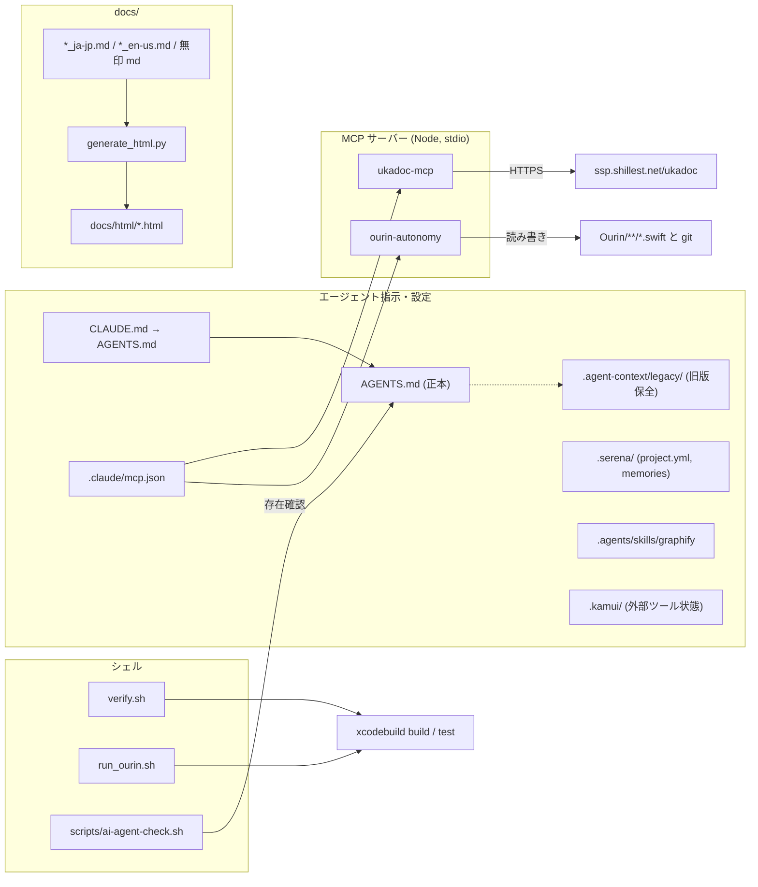
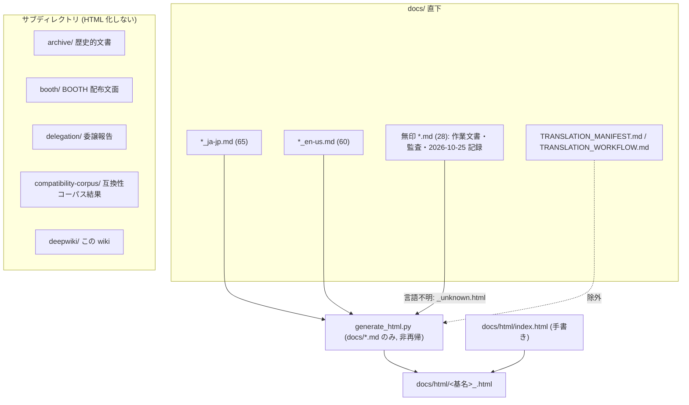

# 19 開発支援ツールと文書体系

関連ソースファイル

このページは次のファイルをもとに作成した。

- [ourin-autonomy/package.json](../../ourin-autonomy/package.json)
- [ourin-autonomy/build.sh](../../ourin-autonomy/build.sh)
- [ourin-autonomy/tsconfig.json](../../ourin-autonomy/tsconfig.json)
- [ourin-autonomy/README.md](../../ourin-autonomy/README.md)
- [ourin-autonomy/src/cli.ts](../../ourin-autonomy/src/cli.ts)
- [ourin-autonomy/src/index.ts](../../ourin-autonomy/src/index.ts)
- [ourin-autonomy/src/autonomy/safety-level.ts](../../ourin-autonomy/src/autonomy/safety-level.ts)
- [ourin-autonomy/src/autonomy/task-scheduler.ts](../../ourin-autonomy/src/autonomy/task-scheduler.ts)
- [ourin-autonomy/src/analyzers/swift-analyzer.ts](../../ourin-autonomy/src/analyzers/swift-analyzer.ts)
- [ourin-autonomy/src/refactoring/safe-refactor.ts](../../ourin-autonomy/src/refactoring/safe-refactor.ts)
- [ourin-autonomy/src/generators/test-generator.ts](../../ourin-autonomy/src/generators/test-generator.ts)
- [ourin-autonomy/src/generators/doc-generator.ts](../../ourin-autonomy/src/generators/doc-generator.ts)
- [ourin-autonomy/src/git/manager.ts](../../ourin-autonomy/src/git/manager.ts)
- [ukadoc-mcp/package.json](../../ukadoc-mcp/package.json)
- [ukadoc-mcp/README.md](../../ukadoc-mcp/README.md)
- [ukadoc-mcp/src/index.ts](../../ukadoc-mcp/src/index.ts)
- [ukadoc-mcp/src/ukadoc.ts](../../ukadoc-mcp/src/ukadoc.ts)
- [scripts/ai-agent-check.sh](../../scripts/ai-agent-check.sh)
- [verify.sh](../../verify.sh)
- [run_ourin.sh](../../run_ourin.sh)
- [AGENTS.md](../../AGENTS.md)
- [CLAUDE.md](../../CLAUDE.md)
- [.claude/mcp.json](../../.claude/mcp.json)
- [.agent-context/legacy/AGENTS-before-2026-09-05.md](../../.agent-context/legacy/AGENTS-before-2026-09-05.md)
- [.agent-context/legacy/CLAUDE-before-2026-09-05.md](../../.agent-context/legacy/CLAUDE-before-2026-09-05.md)
- [.agents/skills/graphify/SKILL.md](../../.agents/skills/graphify/SKILL.md)
- [.agents/skills/graphify/references/](../../.agents/skills/graphify/references/)
- [.serena/project.yml](../../.serena/project.yml)
- [.serena/memories/](../../.serena/memories/)
- [.kamui/prompt/merge-prompt.txt](../../.kamui/prompt/merge-prompt.txt)
- [.kamui/system-graph-state.json](../../.kamui/system-graph-state.json)
- [.kamui/model-versions-cache.json](../../.kamui/model-versions-cache.json)
- [docs/generate_html.py](../../docs/generate_html.py)
- [docs/test_generate_html.py](../../docs/test_generate_html.py)
- [docs/TRANSLATION_MANIFEST.md](../../docs/TRANSLATION_MANIFEST.md)
- [docs/TRANSLATION_WORKFLOW.md](../../docs/TRANSLATION_WORKFLOW.md)
- [docs/README_ja-jp.md](../../docs/README_ja-jp.md)
- [docs/AI_ORCHESTRATION.md](../../docs/AI_ORCHESTRATION.md)
- [docs/AUDITS_TODO.md](../../docs/AUDITS_TODO.md)
- [docs/TODO_ISSUE_STATUS.md](../../docs/TODO_ISSUE_STATUS.md)
- [docs/archive/README.md](../../docs/archive/README.md)
- [docs/compatibility-corpus/README.md](../../docs/compatibility-corpus/README.md)
- [docs/booth/LISTING_ja-jp.md](../../docs/booth/LISTING_ja-jp.md)
- [docs/html/README.md](../../docs/html/README.md)
- [docs/delegation/](../../docs/delegation/)
- [MISSION.template.md](../../MISSION.template.md)
- [MISSION_LUNA.md](../../MISSION_LUNA.md)
- [TODO/todo.md](../../TODO/todo.md)
- [YAYA_CORE_COMPLETE.md](../../YAYA_CORE_COMPLETE.md)
- [CONTRIBUTING.md](../../CONTRIBUTING.md)
- [.gitignore](../../.gitignore)

このページは、Ourin 本体の外側にある開発支援の仕組みを扱う。対象は次のとおり。TypeScript 製の 2 つの MCP サーバー／CLI（`ourin-autonomy/`、`ukadoc-mcp/`）、検証と起動のシェルスクリプト（`verify.sh`、`run_ourin.sh`、`scripts/ai-agent-check.sh`）、各種 AI エージェント向けの設定ディレクトリ（`.agents/` `.serena/` `.kamui/` `.agent-context/` `.claude/`）、そして `docs/` の文書体系（対訳規則、HTML 生成、仕様書群）である。

どれもアプリのビルド成果物には入らない。現行のエージェント指示の正本はリポジトリ直下の [AGENTS.md](../../AGENTS.md) で、[CLAUDE.md](../../CLAUDE.md) はそれを参照するだけである。ビルドと CI は [2 ビルド・パッケージング・CI](./02-build-and-ci.md)、テストと互換性コーパスは [18 テストと互換性検証](./18-testing.md) にある。

## 全体像

**出典:** [CLAUDE.md:1-4](../../CLAUDE.md#L1-L4)、[AGENTS.md:1-29](../../AGENTS.md#L1-L29)、[.claude/mcp.json:1-17](../../.claude/mcp.json#L1-L17)

## ourin-autonomy（自律改善 CLI / MCP サーバー）

`ourin-autonomy` は、AI エージェントが Ourin を段階的な自律性（Staged Autonomy）のもとで改善するための Node.js（ESM、TypeScript → `dist/`）ツールである。同じ機能を、CLI の `dist/cli.js`（bin `ourin-autonomy`、commander ベース）と、MCP サーバーの `dist/index.js`（`@modelcontextprotocol/sdk` の stdio サーバー）の 2 つの入口から使える。`build.sh` は `node_modules` が無ければ `npm install` を実行し、続けて `npm run build`（`tsc`）を行って `dist/cli.js` に実行権を付ける。`dist/` と `node_modules/` は `.gitignore` の対象である。

| モジュール | 役割 |
|---|---|
| `src/analyzers/swift-analyzer.ts`（`SwiftAnalyzer`） | glob（既定 `**/*.swift`）で集めたファイルごとに、行数、`func` / `class` の数、制御構文の出現数を足した複雑度を出す。行単位の検査は 120 文字超、`TODO`/`FIXME`、2 桁以上の数値（magic number）、`!` を含む行（force unwrap）の 4 種類 |
| `src/refactoring/safe-refactor.ts`（`RefactoringHelper`） | 重複ブロック、長い関数、複雑な条件を検出して `extract-method` / `extract-function` / `extract-variable` を提案する。`applyRefactoring` は指定行範囲を提案コードで置き換えた文字列を返す。`formatSwiftCode` は行末空白と連続空行を削る程度の整形 |
| `src/generators/test-generator.ts`（`TestGenerator`） | Swift Testing（`import Testing`、`@Suite`、`@Test`）のひな形を生成する。中身は `// TODO` と `#expect(expected == expected)` だけ |
| `src/generators/doc-generator.ts`（`DocGenerator`） | 関数と型の一覧を Markdown / HTML で出力する。分析レポートも作る |
| `src/autonomy/safety-level.ts` | 安全性レベル 1〜5 の定義（`allowedActions`、`canAutoExecute`、`requiresApproval`）と `SafetyLevelManager` |
| `src/autonomy/task-scheduler.ts` | メモリ上のタスク表と実行キュー |
| `src/git/manager.ts`（`GitManager`） | `simple-git` によるブランチ作成・切替、commit、diff、stash、ファイルの revert |

安全性レベル:

| レベル | 名前 | 自動実行 | `allowedActions` |
|---|---|---|---|
| 1 | Read-only Analysis | 可 | `analyze` `document` `measure` `search` |
| 2 | Safe Auto-Execution | 可 | `test` `document` `refactor_safe` `format` |
| 3 | Semi-Autonomous | 承認が必要 | `fix_bug` `implement_feature` `refactor_medium` |
| 4 | Supervised Autonomy | 承認が必要 | `refactor_major` `architecture_change` `api_change` |
| 5 | Critical Operations | 承認が必要 | `breaking_change` `migration` `destructive` |

CLI コマンド: `safety [level]`、`analyze [-p pattern] [-o file]`、`test-gen <file>`、`doc-gen <file>`、`refactor-analyze <file>`、`approve <taskId>`、`tasks`、`branch <name>`、`commit <message>`、`auto`（分析 → 推奨 → タスク作成）、`safety-levels`。

MCP ツール: `set_safety_level`、`analyze_code`、`generate_tests`、`generate_documentation`、`analyze_refactoring`、`apply_refactoring`（実際にファイルへ書き込む）、`generate_analysis_report`（`output_file` を指定するとファイルへ書く）、`get_safety_status`、`list_pending_tasks`。

**出典:** [ourin-autonomy/package.json:1-42](../../ourin-autonomy/package.json#L1-L42)、[ourin-autonomy/build.sh:1-33](../../ourin-autonomy/build.sh#L1-L33)、[ourin-autonomy/README.md:1-146](../../ourin-autonomy/README.md#L1-L146)、[ourin-autonomy/src/cli.ts:17-60](../../ourin-autonomy/src/cli.ts#L17-L60)、[ourin-autonomy/src/cli.ts:186-258](../../ourin-autonomy/src/cli.ts#L186-L258)、[ourin-autonomy/src/cli.ts:294-378](../../ourin-autonomy/src/cli.ts#L294-L378)、[ourin-autonomy/src/index.ts:19-60](../../ourin-autonomy/src/index.ts#L19-L60)、[ourin-autonomy/src/index.ts:187-362](../../ourin-autonomy/src/index.ts#L187-L362)、[ourin-autonomy/src/autonomy/safety-level.ts:1-124](../../ourin-autonomy/src/autonomy/safety-level.ts#L1-L124)、[ourin-autonomy/src/autonomy/task-scheduler.ts:1-68](../../ourin-autonomy/src/autonomy/task-scheduler.ts#L1-L68)、[ourin-autonomy/src/analyzers/swift-analyzer.ts:102-191](../../ourin-autonomy/src/analyzers/swift-analyzer.ts#L102-L191)、[ourin-autonomy/src/refactoring/safe-refactor.ts:15-35](../../ourin-autonomy/src/refactoring/safe-refactor.ts#L15-L35)、[ourin-autonomy/src/refactoring/safe-refactor.ts:146-174](../../ourin-autonomy/src/refactoring/safe-refactor.ts#L146-L174)、[ourin-autonomy/src/generators/test-generator.ts:60-129](../../ourin-autonomy/src/generators/test-generator.ts#L60-L129)、[ourin-autonomy/src/git/manager.ts:1-111](../../ourin-autonomy/src/git/manager.ts#L1-L111)

### 実装上の制約

- **状態がプロセスをまたがない**: 安全性レベルとタスク表は、CLI プロセスまたは MCP サーバープロセスのメモリにしか無い。たとえば `safety 2` は、その CLI プロセスが終わると消える。MCP の `apply_refactoring` が返す「`ourin-autonomy approve <taskId>` で承認」という案内に従っても、別プロセスの CLI からはそのタスクが見つからない。
- **承認分岐に到達しない**: `apply_refactoring` は先に `canExecuteAction('refactor_safe')` を確認する。この action を許すのはレベル 2 だけで、レベル 2 では `canAutoExecute(2)` が常に true になる。そのため承認待ちタスクを作る else 節には到達しない。レベル 3 以上では、逆に「Refactoring not allowed」で失敗する。
- **`auto` がタスクを作らない**: `auto` は `severity === 'error'` の issue があるときだけタスクを作るが、`SwiftAnalyzer` は `warning` と `info` しか出さない。
- 検出は正規表現による近似で、force unwrap の判定（`!` を含み `!.` を含まない行）は `!=` や論理否定でも反応する。生成されるテストは常に通るひな形である。

**出典:** [ourin-autonomy/src/index.ts:294-362](../../ourin-autonomy/src/index.ts#L294-L362)、[ourin-autonomy/src/autonomy/safety-level.ts:64-100](../../ourin-autonomy/src/autonomy/safety-level.ts#L64-L100)、[ourin-autonomy/src/cli.ts:296-325](../../ourin-autonomy/src/cli.ts#L296-L325)、[ourin-autonomy/src/analyzers/swift-analyzer.ts:128-191](../../ourin-autonomy/src/analyzers/swift-analyzer.ts#L128-L191)

## ukadoc-mcp（UKADOC 参照 MCP サーバー）

`ukadoc-mcp` は、SSP の公式文書 UKADOC（`https://ssp.shillest.net/ukadoc`）を MCP 経由で引くための小さな stdio サーバーである。依存は `@modelcontextprotocol/sdk` と `node-fetch` だけで、`npm install && npm run build` で `dist/index.js` を作る。

| ツール | 引数 | 動作 |
|---|---|---|
| `search_ukadoc` | `query`（必須） | 固定の 6 カテゴリのページを毎回すべて取得し、`query` を大文字小文字無視で含む行から `>…<` のテキスト（10 文字超）を抜き出す。最大 20 件で、`{url, title, snippet}` を返す |
| `get_ukadoc_page` | `path`（例 `/manual/list_sakura_script.html`） | ベース URL に `path` をつないだページの HTML をそのまま返す |
| `list_ukadoc_categories` | なし | 固定カテゴリの一覧を返す |

固定カテゴリは次の 6 つ: `Sakura Script`（`/manual/list_sakura_script.html`）、`Property System`（`list_propertysystem.html`）、`SHIORI 3.0 Specification`（`spec_shiori3.html`）、`SSTP Protocol`（`spec_sstp.html`）、`Plugin 2.0 Specification`（`spec_plugin.html`）、`Ghost Development Guide`（`ghost_create.html`）。キャッシュは無いので、検索のたびに 6 ページを取得する。失敗すると `isError: true` の JSON を返す。README は中国語の見出しで書かれており、参考 URL として YAYA や伺か関連のサイトも挙げている。

`.claude/mcp.json` は、この 2 つのサーバーを `node <ビルド済み dist/index.js>` として登録している。引数は開発者のマシン固有の絶対パスなので、ほかの環境ではそのまま使えない（パスはここに転記しない）。

**出典:** [ukadoc-mcp/package.json:1-30](../../ukadoc-mcp/package.json#L1-L30)、[ukadoc-mcp/src/ukadoc.ts:1-98](../../ukadoc-mcp/src/ukadoc.ts#L1-L98)、[ukadoc-mcp/src/index.ts:23-142](../../ukadoc-mcp/src/index.ts#L23-L142)、[ukadoc-mcp/README.md:1-39](../../ukadoc-mcp/README.md#L1-L39)、[.claude/mcp.json:1-17](../../.claude/mcp.json#L1-L17)

## 検証・起動スクリプト

| スクリプト | 使い方 | 動作 |
|---|---|---|
| `verify.sh` | `--check` / 無印 / `--full` | AI エージェント向けの検証ハーネス。`--check` はツールの有無（`xcodebuild -version` が成功するか、`cmake`、`make`）と、実行予定のステップを表示する。無印は `[1/3]` プロジェクトの存在、`[2/3]` helper がビルド済みか、`[3/3]` `xcodebuild -project Ourin.xcodeproj -scheme Ourin build`。`--full` はさらに `[4/5]` `YayaEmily4RegressionTests` の前提（`emily4/ghost/master/yaya.txt` と `yaya_core` バイナリ）、`[5/5]` `xcodebuild ... test`。cmake が無く helper も未ビルドなら、失敗が分かっているので SKIP にする。最後に `VERIFY PASS` か、`VERIFY FAIL`（exit 1）を出力する。ログは `$TMPDIR/ourin_verify_*.XXXXXX`。bash 3.2 と BSD ユーティリティで動くように書かれている |
| `run_ourin.sh` | `[--release\|--debug] [--skip-build] [--derived-data DIR]` | `xcodebuild -configuration <Debug/Release> -derivedDataPath .build/DerivedData build` を実行した後、起動中の Ourin（`pgrep -f /Ourin.app/Contents/MacOS/Ourin`）を `osascript -e 'quit app id "furin-lab.Ourin"'` で正常終了させる。お別れトークを待つため最大 30 秒（0.1 秒 × 300 回）待ち、残っていれば起動せずに exit 1。最後に `open` で起動する。Ourin が単一インスタンスなので、新しいビルドを確実に起動するための手順である（[3 アプリの起動](./03-app-lifecycle.md)） |
| `scripts/ai-agent-check.sh` | 引数なし | 読み取りだけの環境診断。`git node npm claude codex opencode agy` の有無と版、Git の状態（ブランチ、変更数、worktree）、`CLAUDE.md` `AGENTS.md` `MISSION.template.md` `docs/AI_ORCHESTRATION.md` の存在、サブエージェント定義 `deep-reasoner` `fast-worker`（`.claude/agents/` か `~/.claude/agents/`）の有無を表示する |

**出典:** [verify.sh:1-64](../../verify.sh#L1-L64)、[verify.sh:110-209](../../verify.sh#L110-L209)、[run_ourin.sh:1-100](../../run_ourin.sh#L1-L100)、[scripts/ai-agent-check.sh:1-51](../../scripts/ai-agent-check.sh#L1-L51)

## エージェント向けディレクトリ

| パス | 中身 | 役割 |
|---|---|---|
| `AGENTS.md` | 保護すべき制約（`AppDelegate` の位置、SSTP の単一 stack、FMO の契約、`yaya_core` の JSON line IPC、ユーザーデータの扱い）、変更範囲に応じた検証コマンド、必要なときだけ読む参照先 | 現行の正本 |
| `CLAUDE.md` | 「共通の制約と検証入口は AGENTS.md を参照。モデル固有の役割階層や追加の常時レビュー手順は置かない」 | Claude Code 用の入口 |
| `.agent-context/legacy/AGENTS-before-2026-09-05.md`、`CLAUDE-before-2026-09-05.md` | 2026-09-05 より前の長い技術ガイド（Build & Test、Architecture Overview：FMO・SHIORI・Plugin・External Server など） | 履歴として原文のまま保全。AGENTS.md は FMO / Plugin / NAR / Event の詳細や旧ログ prefix を調べるときの参照先として挙げているが、「モデル役割・固定 effort・全資料先読み・多重レビューは現行指示ではない」とも明記している |
| `.claude/mcp.json` | MCP サーバー 2 件の登録（前節） | Claude Code / Claude Desktop 用 |
| `.agents/skills/graphify/` | `SKILL.md`（699 行）と `references/*.md` 8 本、`.graphify_version`（`0.9.32`） | 外部ツール graphify（Python パッケージ `graphifyy`）用のエージェントスキル。フォルダから知識グラフ（`graphify-out/graph.json`、HTML、`GRAPH_REPORT.md`）を作り、`/graphify query` などで問い合わせる。`graphify-out/` は `.gitignore` 済みで、aa88972 時点では存在しない |
| `.serena/project.yml`、`.serena/memories/*.md` 6 本 | Serena（LSP ベースのコーディングエージェント）のプロジェクト設定。`language_servers: [cpp]`、`encoding: utf-8`。memories には `project_overview` `tech_stack` `codebase_architecture` `code_style_conventions` `suggested_commands` `task_completion_checklist` がある | Serena のセッション開始時に読む前提知識。内容は旧 CLAUDE.md 由来の要約 |
| `.kamui/` | `system-graph-state.json`（約 1.1 MB。ファイルツリーを可視化したグラフの状態、`graphStats`、`trackedFiles` 859 件）、`model-versions-cache.json`（codex / claude / gemini CLI の版数キャッシュ）、`prompt/merge-prompt.txt`（作業ブランチを `main` へマージする手順のプロンプト） | 外部 GUI ツール（推測: KAMUI 系のエージェント作業環境）の保存状態。プロンプトに他者のマシン固有パスが含まれ、このリポジトリの運用（`master` ブランチ）とも一致しない |

**出典:** [AGENTS.md:1-29](../../AGENTS.md#L1-L29)、[CLAUDE.md:1-4](../../CLAUDE.md#L1-L4)、[.agent-context/legacy/AGENTS-before-2026-09-05.md:1-30](../../.agent-context/legacy/AGENTS-before-2026-09-05.md#L1-L30)、[.agent-context/legacy/CLAUDE-before-2026-09-05.md:1-40](../../.agent-context/legacy/CLAUDE-before-2026-09-05.md#L1-L40)、[.agents/skills/graphify/SKILL.md:1-60](../../.agents/skills/graphify/SKILL.md#L1-L60)、[.serena/project.yml:31](../../.serena/project.yml#L31)、[.serena/project.yml:179-180](../../.serena/project.yml#L179-L180)、[.kamui/prompt/merge-prompt.txt](../../.kamui/prompt/merge-prompt.txt)、[.gitignore:5](../../.gitignore#L5)

## docs/ の構成

### 対訳規則と翻訳ワークフロー

- 命名規則は `{名前}_ja-jp.md` / `{名前}_en-us.md` である。aa88972 時点で `_ja-jp` は 65 本、`_en-us` は 60 本ある。日本語版しか無いのは `ADVENT_2023_SHIORI_COMPATIBILITY`、`SHIORI_2X_COMPAT_SPEC`、`SHIORI_RUNTIME_COMPATIBILITY_MATRIX`、`STUB_COMPLETION_PLAN`、`THIRD_PARTY_TRUST_MODEL` の 5 本である。
- 片側が `**Status:** Translation Pending`（または `**ステータス:** 翻訳待ち`）の placeholder になっている組が 20 ある（英語版待ち 16、日本語版待ち 4）。`TRANSLATION_MANIFEST.md` は 2026-07-02 に再監査し、57 組中 37 組が完了（65%）と記録している。本ページ執筆時に `grep` で数えた placeholder ファイルも、この 20 本と一致した。2026-10-25 に追加された 5 組（Native SHIORI ABI、SHIOLINK、Known issues、Bug reporting、KAWARI/KAGARI）は完了とされている。
- 無印の作業文書（監査、計画、報告）は、元の場所に残したまま横に訳を足す方針である。
- `TRANSLATION_WORKFLOW.md` の指針: API 名、プロトコル名、データ型は英語のまま。見出し、説明、コード例のコメントは訳す。コード、パス、環境変数、設定キー、エラーコードは訳さない。Markdown の構造、アンカー、目次を保つ。翻訳後は MANIFEST を更新して HTML を再生成する。

**出典:** [docs/TRANSLATION_WORKFLOW.md:1-105](../../docs/TRANSLATION_WORKFLOW.md#L1-L105)、[docs/TRANSLATION_MANIFEST.md:1-130](../../docs/TRANSLATION_MANIFEST.md#L1-L130)

### generate_html.py の動作

`docs/generate_html.py` は Python の `markdown` パッケージ（拡張 `extra` `codehilite` `fenced_code` `tables` `toc`）で、docs の Markdown を対訳切替付きの HTML に変換する。`markdown` が import できなければ、メッセージを出して終了する。

1. `docs/*.md` を **非再帰** で集め、`TRANSLATION_MANIFEST.md` と `TRANSLATION_WORKFLOW.md` を除く。
2. 言語はファイル名で判定する。`_ja-jp.md` → `ja` / `ja-jp`、`_en-us.md` → `en` / `en-us`、それ以外は `ja` / `unknown`。出力名は `<基名>_<suffix>.html`（無印の文書は `_unknown.html`）。
3. 同じ基名の `_ja-jp.md` / `_en-us.md` があるかどうかで、`日本語 | English` の言語スイッチャーを作る。目次の見出しは日本語なら `目次`、英語なら `Contents`。
4. `rewrite_local_links` が本文の `href` / `src` を書き換える。変換対象の Markdown へのリンクは生成された HTML への相対パスにする。言語接尾辞の無い旧名（`_ja` / `_en` の別名を含む）は、現在の言語 → `_ja-jp` → `_en-us` の順で解決する。変換対象外の Markdown（MANIFEST など）や実在するファイルは、`docs/html/` から見た相対パスにする。外部 URL とフラグメントはそのまま残す。
5. `docs/html/` に書き出し、成功と失敗の件数を表示する。`index.html` は手で更新する前提で、実行後の Next steps に「Update index.html」と出る。

`docs/test_generate_html.py`（`unittest`）は、言語中立リンクの解決、docs 外へのリンク、除外ファイルと既存 HTML の付け替え、旧別名、外部リンクとフラグメントの不変を検査する。`MISSION_LUNA.md` には、再生成するときは `cd docs && uv run --with markdown python3 generate_html.py` を使い、偽の `markdown` シムを自作しないこと（2026-08-15 に壊れた HTML を量産しかけた事故があった）が書かれている。

**出典:** [docs/generate_html.py:1-34](../../docs/generate_html.py#L1-L34)、[docs/generate_html.py:191-342](../../docs/generate_html.py#L191-L342)、[docs/generate_html.py:342-475](../../docs/generate_html.py#L342-L475)、[docs/test_generate_html.py:1-90](../../docs/test_generate_html.py#L1-L90)、[MISSION_LUNA.md:28](../../MISSION_LUNA.md#L28)

### サブディレクトリの位置づけ

| ディレクトリ | 位置づけ |
|---|---|
| `docs/archive/` | 2026-08-15 の文書整合性監査で移した完了済みの計画・報告・未使用テンプレート（`INTEGRATION_ROADMAP*`、`IMPLEMENTATION_PLAN_2026-06*`、`PROJECT_SUMMARY*`、`VIDEO_RENDERER_DESIGN_ja-jp.md`、旧 Copilot 用プロンプトなど）。README に「現在のコードベースを反映しない」とある。`MISSION_LUNA.md` は「一切触らない」としている |
| `docs/booth/` | BOOTH 配布物の文面。`README_ja-jp.txt` は `package-booth.sh` が `{{VERSION}}` を置換して同梱する（[2 ビルド・パッケージング・CI](./02-build-and-ci.md)）。`LISTING_ja-jp.md` は 0.1.0 Public Beta の商品ページ文案 |
| `docs/delegation/` | 2026-10-25 前後の委譲作業の報告（P0 リリース課題、cursor-engines #101、KAGARI/もす実ゴースト検証、YAYA 実ゴースト互換修正） |
| `docs/compatibility-corpus/` | 公開配布物（ゴースト、バルーン、プラグイン）の取得 → 展開 → 検証 → 削除の結果。catalog/results の JSON と、各回の報告 md。CI は `plugin-ports-results.json` と `engines/plugins/catalog.json` の一致を検査する（[18 テストと互換性検証](./18-testing.md)） |
| `docs/html/` | `generate_html.py` の出力（151 ファイル）。手書きの `index.html` と `README.md` がある |
| `docs/deepwiki/` | この wiki。`docs/*.md` の非再帰 glob に入らないので HTML 化されない |

**出典:** [docs/archive/README.md:1-20](../../docs/archive/README.md#L1-L20)、[docs/booth/LISTING_ja-jp.md:1-20](../../docs/booth/LISTING_ja-jp.md#L1-L20)、[docs/compatibility-corpus/README.md:1-20](../../docs/compatibility-corpus/README.md#L1-L20)、[docs/html/README.md:1-60](../../docs/html/README.md#L1-L60)

## 主要仕様書の索引（docs/*_ja-jp.md）

65 本を分類した。行数は aa88972 時点の値。ファイル名の `_ja-jp.md` は省略する。英語版がある文書は `_en-us.md` で開ける（日本語版だけの 5 本は前述）。

### プロトコル・形式の仕様（UKADOC の macOS 差分版）

| 文書 | 1 行説明 | 関連ページ |
|---|---|---|
| `SHIORI_3.0M_SPEC` | SHIORI/3.0 の macOS ネイティブ差分仕様（Draft） | [8](./08-shiori-runtime.md) |
| `SHIORI_2X_COMPAT_SPEC` | SHIORI/2.x 互換の Ourin 実装仕様 | [8](./08-shiori-runtime.md) |
| `NATIVE_SHIORI_ABI` | macOS 用ネイティブ SHIORI モジュールの選択と ABI 契約 | [8](./08-shiori-runtime.md) |
| `OURIN_USL_1.0M_SPEC` | Universal SHIORI Loader（USL/1.0M）仕様 | [8](./08-shiori-runtime.md) |
| `OURIN_YAYA_ADAPTER_SPEC_1.0M` | YayaAdapter と `yaya_core` の IPC 仕様（完全版） | [8.1](./08a-yaya.md) |
| `SHIORI_EVENTS_3.0M_SPEC` | SHIORI Events 3.0M / 2.0M 互換仕様 | [9](./09-shiori-events.md) |
| `OURIN_SHIORI_EVENTS_3.0M_SPEC` | Ourin の SHIORI Events 3.0M 仕様（UKADOC 互換、目次付き） | [9](./09-shiori-events.md) |
| `SHIORI_EVENTS_FULL_1.0M_PATCHED` | SHIORI イベント全一覧（Ourin/1.0M） | [9](./09-shiori-events.md) |
| `SHIORI_EXTERNAL_3.0M_SPEC` | 外部イベント（SSTP 経由など）の 3.0M-Mac 仕様 | [10](./10-sstp.md) |
| `SHIORI_RESOURCE_3.0M_SPEC` | SHIORI Resource の 3.0M-Mac 仕様（完全版） | [14](./14-property-resource.md) |
| `PROPERTY_Resource_3.0M_SPEC` | SHIORI Resource 3.0M（2.x 互換、M-Add 付き） | [14](./14-property-resource.md) |
| `PROPERTY_1.0M_SPEC` | プロパティシステム PROPERTY/1.0M | [14](./14-property-resource.md) |
| `PROPERTY_1.0M_SPEC_FULL` | 同上の完全版（UKADOC 準拠） | [14](./14-property-resource.md) |
| `SSTP_1.xM_SPEC` | SSTP/1.x の macOS 差分仕様（Draft） | [10](./10-sstp.md) |
| `SPEC_PLUGIN_2.0M` | PLUGIN/2.0 の macOS ネイティブ差分仕様（Draft） | [12](./12-plugin.md) |
| `PLUGIN_EVENT_2.0M_SPEC` | PLUGIN Event 2.0M（UKADOC 互換） | [12](./12-plugin.md) |
| `PLUGIN_EVENT_2.0M_SPEC_FULL` | 同上の完全版 | [12](./12-plugin.md) |
| `NAR_INSTALL_1.0M_SPEC` | NAR ダブルクリックインストーラ仕様（NAR-INSTALL/1.0M） | [15](./15-nar-install.md) |
| `BALLOON_1.0M_SPEC` | バルーン仕様（Draft） | [6](./06-balloon.md) |
| `HEADLINE_2.0M_SPEC` | HEADLINE/2.0M の macOS 差分仕様（Draft） | [16](./16-auxiliary-features.md) |
| `WEB_1.0M_SPEC` | WEB/1.0M の macOS 差分仕様（Draft） | [10.1](./10a-external-server-web.md) |
| `SAKURASCRIPT_FULL_1.0M_PATCHED` | さくらスクリプト全一覧（3014 行） | [7](./07-sakura-script.md) |
| `SERIKO_OVERLAY_DRESSUP_RENDERING_SPEC` | SERIKO のオーバーレイと着せ替えのレンダリング仕様 | [5](./05-surface-shell-animation.md) |

### 実装解説・ガイド

| 文書 | 1 行説明 | 関連ページ |
|---|---|---|
| `About_FMO` | FMO 機能の解説 | [11](./11-fmo.md) |
| `SSTP_DISPATCHER_GUIDE` | SSTP Dispatcher の構成ガイド | [10](./10-sstp.md) |
| `SSTP_Host_Modules_JA` | SSTP 関連モジュールの概要（15 行） | [10](./10-sstp.md) |
| `SAORI_IMPLEMENTATION` | Ourin の SAORI 実装 | [13](./13-saori.md) |
| `SERIKO_IMPLEMENTATION` | Ourin の SERIKO 実装 | [5](./05-surface-shell-animation.md) |
| `SERIKO_IMPLEMENTATION_PROGRESS_REPORT` | SERIKO のオーバーレイ・着せ替え実装レポート | [5](./05-surface-shell-animation.md) |
| `PropertySystem` | プロパティシステムの実装 | [14](./14-property-resource.md) |
| `GhostConfigurationImplementation` | `descript.txt` によるゴースト設定システムの実装 | [4](./04-ghost-manager.md) |
| `connect_swift` | `yaya_core` から Swift 製プラグインを扱う手順 | [12](./12-plugin.md) |
| `OURIN_EXTENSIONS` | Ourin 独自の拡張と、SSP と異なる動作の注意 | [1](./01-overview.md) |
| `DEPENDENCIES` | 依存関係（nlohmann/json、同梱ハッシュ実装など） | [8.1](./08a-yaya.md) |

### 対応状況・互換性・エンジン

| 文書 | 1 行説明 | 関連ページ |
|---|---|---|
| `SUPPORTED_SAKURA_SCRIPT` | 対応さくらスクリプトの要約 | [7](./07-sakura-script.md) |
| `SAKURASCRIPT_COMMANDS_SUPPORTED` | さくらスクリプトのコマンド別対応状況（網羅） | [7](./07-sakura-script.md) |
| `SHIORI_RUNTIME_COMPATIBILITY_MATRIX` | SHIORI ランタイムの選択・ロード・障害隔離の正本 | [8](./08-shiori-runtime.md) |
| `ADVENT_2023_SHIORI_COMPATIBILITY` | Advent Calendar 2023 で紹介された 16 種の SHIORI の互換性 | [8.3](./08c-external-engines.md) |
| `ADDITIONAL_SHIORI` | 追加 SHIORI 互換エンジン（7 栞） | [8.3](./08c-external-engines.md) |
| `SHIOLINK` | SHIOLINK による外部プロセス接続 | [8.3](./08c-external-engines.md) |
| `RISHU` | 里珠（Rishu/Proxy）接続 | [8.3](./08c-external-engines.md) |
| `KAWARI_KAGARI_ENGINES` | KAWARI / KAGARI の実エンジン同梱 | [8.3](./08c-external-engines.md) |
| `IMPLEMENTATION_STATUS_SUMMARY` | 実装状況サマリー（2026-06-27 監査で「100%」表記を撤回） | [1](./01-overview.md) |
| `KNOWN_ISSUES` | 既知の問題と検証範囲（リリースノートからリンクする） | [18](./18-testing.md) |
| `COMPAT_FIXES_2026-06` | 2026-06-10 の互換性修正レポート | [18](./18-testing.md) |
| `CODE_SPEC_DIFF_2026-06` | コードと仕様書の差異レポート（2026-06-14/15） | [1](./01-overview.md) |

### YAYA Core 関連

| 文書 | 1 行説明 |
|---|---|
| `YAYA_CORE_IMPLEMENTATION_PLAN` | YAYA Core の詳細実装計画（526 行） |
| `YAYA_CORE_INVESTIGATION_REPORT` | YAYA Core モジュールの調査報告 |
| `YAYA_DIC_COMPAT_IMPLEMENTATION_PLAN` | YAYA 辞書互換性の実装計画 |
| `YAYA_CORE_ARCHITECTURE` / `YAYA_CORE_EXECUTIVE_SUMMARY` / `YAYA_CORE_INDEX` / `YAYA_CORE_TECHNICAL_SPEC` | いずれも 32 行の「翻訳待ち」placeholder（英語版が本体） |

いずれも [8.1 YAYA](./08a-yaya.md) と関係する。

### 計画・プロセス・監査・UI モック・入門

| 文書 | 1 行説明 |
|---|---|
| `README` | docs の索引（入門、コア仕様、実装、詳細仕様、YAYA Core、UI モック、凡例） |
| `ONBOARDING` | 新規参加者向けの概要（旧 CLAUDE.md を出典にしている） |
| `BUG_REPORT_GUIDE` | バグ報告の手順（診断情報、再現性、秘匿） |
| `AUDIT_PROMPT` | 技術監査エージェント用のプロンプト |
| `BLOCKER_TRACKER` | 統合ブロッカー ID-001〜007 の解決記録（歴史的トラッカー） |
| `PLUGIN_BRIDGE_COMPLETION_PLAN` | Plugin Bridge 完全実装計画 |
| `PLUGIN_COMPAT_FIX_PROPOSAL` | Plugin 互換実装の修正案 |
| `OURIN_MIGRATOR_PLAN` | Ourin Migrator の計画（[17](./17-devtools-migrator.md)） |
| `STUB_COMPLETION_PLAN` | スタブ実装を本実装にする計画（2026-07-08、TODO/stub の実測に基づく） |
| `THIRD_PARTY_TRUST_MODEL` | 第三者コンポーネントの信頼モデル（監査ドラフト） |
| `DevToolsUIMockup` | DevTools UI のモック（[17](./17-devtools-migrator.md)） |
| `RightClickMenuMockup` | SSP 右クリックメニューのモック（17 行） |

数え方: プロトコル・形式 23、実装解説 11、対応状況 12、YAYA Core 7、計画ほか 12 で合計 65 本。

**出典:** [docs/README_ja-jp.md:1-149](../../docs/README_ja-jp.md#L1-L149)、[docs/TRANSLATION_MANIFEST.md:26-91](../../docs/TRANSLATION_MANIFEST.md#L26-L91)

### 無印の作業文書と 2026-10-25 の記録

`docs/` 直下の無印 md（28 本）は、次の 3 群に分けられる。

- **訳を横に足した元文書**: `AUDIT_PROMPT`、`BLOCKER_TRACKER`、`CODE_SPEC_DIFF_2026-06`、`COMPAT_FIXES_2026-06`、`IMPLEMENTATION_STATUS_SUMMARY`、`OURIN_EXTENSIONS`、`OURIN_MIGRATOR_PLAN`、`PLUGIN_BRIDGE_COMPLETION_PLAN`、`PLUGIN_COMPAT_FIX_PROPOSAL`、`SAORI_IMPLEMENTATION`、`SERIKO_IMPLEMENTATION`、`SSTP_DISPATCHER_GUIDE`、`SUPPORTED_SAKURA_SCRIPT`、`YAYA_DIC_COMPAT_IMPLEMENTATION_PLAN`。
- **TODO の正本と監査**: `AUDITS_TODO.md`（未完了の項目だけ。2026-08-15 に作り直され、`MISSION_LUNA.md` は「唯一の正」と呼んでいる）、`AUDITS_COMPLETED.md`（完了の根拠と移管記録）、`TODO_ISSUE_STATUS.md`（GitHub の open issue と実装の照合。2026-10-25 時点）。
- **2026-10-25 前後の記録**: `RELEASE_GATES_2026-10-25`、`DELEGATION_2026-10-25`、`PR_TAKEOVER_2026-10-25`、`REAL_GHOST_VERIFICATION_2026-10-25`、`SHIORI_EXPANSION_VERIFICATION_2026-10-25`、`COMPAT_FIXES_2026-10-25`、`THIRD_PARTY_LICENSE_AUDIT_2026-10-25`、`SSP_BINARY_COMPAT_VERIFICATION`。
- **運用**: `AI_ORCHESTRATION.md`（マルチエージェント運用の手順書）、`TRANSLATION_MANIFEST.md`、`TRANSLATION_WORKFLOW.md`。

**出典:** [docs/AUDITS_TODO.md:1-12](../../docs/AUDITS_TODO.md#L1-L12)、[docs/TODO_ISSUE_STATUS.md:1-12](../../docs/TODO_ISSUE_STATUS.md#L1-L12)、[docs/AI_ORCHESTRATION.md:1-20](../../docs/AI_ORCHESTRATION.md#L1-L20)

## ルートの補助文書

| ファイル | 要点 |
|---|---|
| `CONTRIBUTING.md` | 着手前に Issue（Bug / Feature・Compatibility / Release task）を用意し、背景・範囲・AC を書く。優先度は P0（リリースを止める）、P1（正式版品質に必要）、P2（後続の改善）。互換性変更では SSP/UKADOC か固定版の上流を根拠にし、ゴーストを書き換えて症状を隠さない。fixture、helper/IPC、実ゴースト、GUI の検証を区別し、未検証を成功扱いしない。PR では全 AC を満たしたときだけ `Closes`/`Fixes` を使い、部分対応は `Refs`。検証コマンドは `xcodebuild ... test`、`(cd yaya_core && ./build.sh)`、`python3 scripts/check_release_metadata.py`。意味の変わらない誤字修正と緊急 hotfix は例外 |
| `MISSION.template.md` | エージェントへのミッション指示書のひな形。Goal / Context / Constraints / Relevant files / Acceptance criteria / Do not / Suggested routing（Fable、deep-reasoner/Opus、fast-worker/Sonnet、Codex、Agy、OpenCode(GLM)）/ Required final report |
| `MISSION_LUNA.md` | 2026-08-15 に作った、Codex CLI「Luna」の再起動用指示書。`docs/AUDITS_TODO.md` に従って残タスクを消化し、どの項目から始めるかはユーザーに 1 行確認する。push は禁止。`docs/archive/` と `TODO/todo.md` は変更禁止。テストが通っただけで完了扱いにせず、実機での操作記録を残す。md を更新したら HTML を再生成する。依存のシムを自作しない |
| `TODO/todo.md` | 2025-10-21 時点のさくらスクリプト実装状況の一覧（292 行）。冒頭に **DEPRECATED（2026-06-15）** とあり、`\![embed]` などを未実装と誤記していること、正本が `docs/SAKURASCRIPT_COMMANDS_SUPPORTED_*` と `docs/SUPPORTED_SAKURA_SCRIPT*` であることが書かれている。現在の TODO は `docs/AUDITS_TODO.md` と `docs/TODO_ISSUE_STATUS.md` |
| `YAYA_CORE_COMPLETE.md` | `yaya_core` の実装メモ。Value / Lexer / Parser / VM などの Phase 1 完了、yaya-shiori-500 の 160 関数を実装、テスト結果、Xcode への統合手順、既知の制限（ファイル操作は `..` を含まない相対パスだけ、正規表現は `std::regex` の ECMAScript、CP932 は iconv）（[8.1 YAYA](./08a-yaya.md)） |

**出典:** [CONTRIBUTING.md:1-47](../../CONTRIBUTING.md#L1-L47)、[MISSION.template.md:1-29](../../MISSION.template.md#L1-L29)、[MISSION_LUNA.md:1-65](../../MISSION_LUNA.md#L1-L65)、[TODO/todo.md:1-17](../../TODO/todo.md#L1-L17)、[YAYA_CORE_COMPLETE.md:1-20](../../YAYA_CORE_COMPLETE.md#L1-L20)、[YAYA_CORE_COMPLETE.md:164-216](../../YAYA_CORE_COMPLETE.md#L164-L216)

## 制約と注意点

- **注意: 旧運用の文書が残っている**: `AGENTS.md` と `CLAUDE.md` は「モデル役割・固定 effort・多重レビューは現行指示ではない」「モデル固有の役割階層は置かない」としている。一方で、`docs/AI_ORCHESTRATION.md`、`MISSION.template.md`、`MISSION_LUNA.md` はモデル別の役割分担（Fable / deep-reasoner / fast-worker / Codex / Agy / OpenCode）を前提にしている。`scripts/ai-agent-check.sh` も `docs/AI_ORCHESTRATION.md` と、サブエージェント定義 `deep-reasoner` / `fast-worker` の存在を確認するが、リポジトリの `.claude/` には `mcp.json` しか無い。
- **注意: `.serena/memories` が古い**: `project_overview.md` はライセンスを CC BY-NC-SA 4.0 としているが、README ではソースが Apache-2.0、文書が CC BY-SA 4.0 である。`tech_stack.md` と `suggested_commands.md` は「外部パッケージマネージャ不要」と書いているが、実際には SwiftPM の Installer や npm の MCP ツールがある。起動手順の `open build/Release/Ourin.app` も、現在の DerivedData の出力先（`run_ourin.sh` は `.build/DerivedData/Build/Products/<構成>/Ourin.app`）と一致しない。`project.yml` の `language_servers` は `cpp` だけで、Swift の LSP は設定されていない。
- **注意: `YAYA_CORE_COMPLETE.md` の統合手順は古い**: 「Copy Files phase を手で追加する」と書かれているが、現在は pbxproj に Run Script `Build yaya_core` と `Copy helper cores` が組み込み済みである（[2 ビルド・パッケージング・CI](./02-build-and-ci.md)）。参照先の `yaya_core/examples/simple_ghost.dic`、`docs/YAYA_CORE_IMPLEMENTATION_PLAN.md`、`docs/OURIN_YAYA_ADAPTER_SPEC_1.0M.md` は存在しない（docs 側は `_ja-jp` / `_en-us` 付きの名前に変わっている）。「どんな YAYA ゴーストでも動く」という結論も、`IMPLEMENTATION_STATUS_SUMMARY` が 2026-06-27 に「100%」表記を撤回したこととは食い違う。
- **`verify.sh` の前提**: `--full` の回帰テストは、`.gitignore` 対象の `emily4/` がローカルに無ければ自動で SKIP される。スクリプトのコメントはコマンドの出典を「CLAUDE.md / README.md」としているが、現在の CLAUDE.md にはコマンドが無く、AGENTS.md にある。
- **docs/html の陳腐化**: `generate_html.py` は古い出力を削除しない。そのため、現在の `docs/*.md` に対応しない HTML が `docs/html/` に残っている。`delegation/*.md` 由来とみられる `*_unknown.html`（例: `kagari-mosu-report_unknown.html`）や、除外対象のはずの `TRANSLATION_MANIFEST_unknown.html` がその例である。無印の md は言語 `ja` として `_unknown.html` に変換される。
- **`.kamui/` と `.claude/mcp.json` の機械固有情報**: どちらにも特定の開発者のマシンの絶対パスが含まれ、そのままでは再利用できない。
- **`ukadoc-mcp` の検索コスト**: 検索ごとに外部サイトの 6 ページを取得するので、オフラインでは使えない。

**出典:** [AGENTS.md:27-29](../../AGENTS.md#L27-L29)、[docs/AI_ORCHESTRATION.md:1-12](../../docs/AI_ORCHESTRATION.md#L1-L12)、[scripts/ai-agent-check.sh:32-49](../../scripts/ai-agent-check.sh#L32-L49)、[.serena/memories/project_overview.md:1-18](../../.serena/memories/project_overview.md#L1-L18)、[.serena/memories/suggested_commands.md:30-34](../../.serena/memories/suggested_commands.md#L30-L34)、[YAYA_CORE_COMPLETE.md:164-200](../../YAYA_CORE_COMPLETE.md#L164-L200)、[YAYA_CORE_COMPLETE.md:249-305](../../YAYA_CORE_COMPLETE.md#L249-L305)、[verify.sh:166-176](../../verify.sh#L166-L176)、[docs/generate_html.py:416-440](../../docs/generate_html.py#L416-L440)

## 関連ページ

- [1 概要](./01-overview.md) — リポジトリ全体の構成
- [2 ビルド・パッケージング・CI](./02-build-and-ci.md) — `xcodebuild` の build phase、CI、BOOTH 文面の使われ方
- [3 アプリの起動とライフサイクル](./03-app-lifecycle.md) — `run_ourin.sh` が前提にする単一インスタンス制御
- [8.1 YAYA](./08a-yaya.md) — `yaya_core` の実装（`YAYA_CORE_COMPLETE.md` の現状）
- [18 テストと互換性検証](./18-testing.md) — `docs/compatibility-corpus/` と検証スクリプト
- [20 用語集](./20-glossary.md) — 用語
