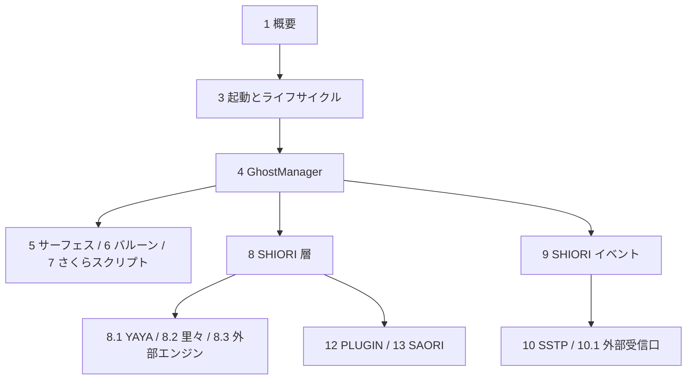

# Ourin DeepWiki

Ourin（桜鈴）のソースコードを読んで作成した、階層型の技術 wiki である。各ページは「どこに何があり、どう動くか」を、ソースの行番号付きの出典とともに説明する。

- 対象: commit `aa88972`（`master`、2026-10-26。PR #219 のマージ時点）
- 言語: 日本語（識別子・ファイル名・ログ文字列は原文のまま）
- 出典の書式: `[path:開始行-終了行](../../path#L開始行-L終了行)`。リンクはリポジトリ内の相対パスなので、GitHub 上でも手元の clone でも辿れる
- 既存の仕様書（`docs/*_ja-jp.md`）は「仕様」、この wiki は「現在の実装の地図」である。両者が食い違う箇所は各ページに「注意:」として記した

## 読み方



初めて読む場合は 1 → 3 → 4 → 8 の順に読むと、アプリの起動からゴーストが話すまでの流れが掴める。特定の機能を改修する場合は下の目次から該当ページへ進む。

## 目次

### 全体

| ページ | 内容 |
|---|---|
| [1 概要](./01-overview.md) | 目的、層構造、ビルド成果物、データの保存場所、リポジトリ構成、保護すべき制約 |
| [2 ビルド・パッケージング・CI](./02-build-and-ci.md) | Xcode ターゲットと build phase、helper（yaya_core / satori_core）とエンジンの同梱、リリース・公証・BOOTH 配布、既定ゴースト `sakura.nar` の生成、GitHub Actions |
| [3 アプリの起動とライフサイクル](./03-app-lifecycle.md) | `main.swift` → `AppDelegate.applicationDidFinishLaunching` の初期化順、終了処理、設定 UI と設定キー、アップデート、ログ基盤 |

### ゴーストの実行

| ページ | 内容 |
|---|---|
| [4 GhostManager](./04-ghost-manager.md) | ゴースト実行の中核。extension ファイルの責務の地図、起動・切替・終了、スクリプト再生キュー |
| [5 サーフェス・シェル・SERIKO アニメーション](./05-surface-shell-animation.md) | シェルの読み込み、SERIKO の解析と実行、合成描画、ウィンドウ配置、着せ替え |
| [6 バルーンと入力 UI](./06-balloon.md) | バルーンの設定・描画・配置、文字装飾と選択肢、入力ボックス、オーナードローメニュー |
| [7 さくらスクリプト](./07-sakura-script.md) | 字句解析、環境変数の展開、`\![...]` コマンドのディスパッチ表 |

### SHIORI とエンジン

| ページ | 内容 |
|---|---|
| [8 SHIORI 層（USL）](./08-shiori-runtime.md) | SHIORI/3.0 の要求・応答、ランタイムの選択、ネイティブ SHIORI の ABI、SHIORI/2.x 互換、XPC service |
| [8.1 YAYA（YayaAdapter と yaya_core）](./08a-yaya.md) | JSON line IPC、C++ のパーサ / VM、組み込み関数 |
| [8.2 里々（SatoriAdapter と satori_core）](./08b-satori.md) | 固定版 SATORI の helper 化とローカル patch |
| [8.3 SHIOLINK・里珠・追加栞・華和梨/篝/Aosora](./08c-external-engines.md) | 外部プロセス型エンジンと同梱ネイティブエンジン、上流の固定版 |

### イベントと通信

| ページ | 内容 |
|---|---|
| [9 SHIORI イベント](./09-shiori-events.md) | `EventBridge`、イベント ID、OS 状態の Observer、タイマー、ドラッグ&ドロップ、祝日データ |
| [10 SSTP スタック](./10-sstp.md) | `SSTPParser` → `SSTPDispatcher` の単一 stack、ルーティング、セッション、割り込み、SHIORI への橋渡し |
| [10.1 外部受信口と Web 連携](./10a-external-server-web.md) | HTTP / 生 TCP / XPC / Distributed IPC の受信口、セキュリティ設定、`x-ukagaka-link`・WebSocket |
| [11 FMO](./11-fmo.md) | POSIX 共有メモリと named semaphore、単一インスタンス制御、SSP 互換のエントリ |

### 拡張モジュール

| ページ | 内容 |
|---|---|
| [12 PLUGIN](./12-plugin.md) | PLUGIN/2.0M、プラグインの探索・ロード・イベント配送、Windows DLL プラグインの変換、移植プラグインと TTS |
| [13 SAORI](./13-saori.md) | SAORI/1.0、ロードとインスタンス管理、内蔵モジュール（暗号・JWT・ファイル等）、Windows 専用 SAORI の互換実装 |
| [14 プロパティシステムとリソース](./14-property-resource.md) | `%property[...]` の Provider 群、SHIORI Resource、`ResourceBridge` |
| [15 NAR インストールとパッケージ管理](./15-nar-install.md) | NAR の検証・展開・`install.txt`、保存先、SSP からのデータ移行インストーラ |
| [16 付帯機能](./16-auxiliary-features.md) | HEADLINE、カレンダー、SaveShare、SNTP・メール・RSS・HTTP・サウンド・動画 |
| [17 DevTools と Ourin Migrator](./17-devtools-migrator.md) | 開発者ツールの各ペイン、Windows 資産の解析と移行（Ghidra 連携） |

### 開発

| ページ | 内容 |
|---|---|
| [18 テストと互換性検証](./18-testing.md) | XCTest の分類、fixture、Python テスト、互換性コーパスと実ゴースト検証 |
| [19 開発支援ツールと文書体系](./19-dev-tooling.md) | `ourin-autonomy`・`ukadoc-mcp`、AI エージェント設定、`docs/` の構成と対訳規則 |
| [20 用語集](./20-glossary.md) | 伺か用語と Ourin 固有の名前 |

## HTML 版

`docs/deepwiki/site/index.html` は、この wiki 全体を 1 ファイルにまとめた HTML 版である。ブラウザで直接開ける（GitHub Pages などに置いてもよい）。

- 左にページの階層、右に「このページの内容」を表示する。上部の検索欄（`/` キーで移動）で全ページの節を全文検索できる
- 出典はコミット `aa88972` に固定した GitHub の行リンクになる
- Mermaid 図はビルド時に SVG にしてある（ライト・ダーク両方）。図の「拡大」で原寸表示になる
- 配色は OS の設定に従い、右上のボタンで切り替えられる

Markdown（このディレクトリの `*.md`）が正本で、HTML は `tools/` のスクリプトで生成する。

```bash
cd docs/deepwiki/tools
npm install                          # mermaid と playwright（図の事前描画に使う）
pip install markdown-it-py pygments
python3 build_site.py                # docs/deepwiki/site/index.html を書き出す
python3 check_wiki.py ../../..       # 出典リンク・行範囲・ページ間リンクの検査
```

Node.js がない環境では `python3 build_site.py --no-mermaid` で、図を Mermaid のソースのまま載せた HTML を作れる。配色・フォント・対象コミットは `tools/site.json` で設定する。

## この wiki の検証方法

各ページの出典リンクは、作成時に次の点を機械的に検査した。

- リンク先のファイル・ディレクトリが git 管理下に実在すること
- 行アンカー（`#Lx-Ly`）がファイルの行数の範囲内にあり、リンクのラベルと一致すること
- wiki 内のページ間リンクが実在すること
- Mermaid 図が Mermaid 11 でパース・描画できること

ただし、出典の行が本文の主張を正しく支えているかは人が読んで確かめる必要がある。コードが更新されると行番号はずれるので、対象コミット（`aa88972`）と照らし合わせて読むこと。
